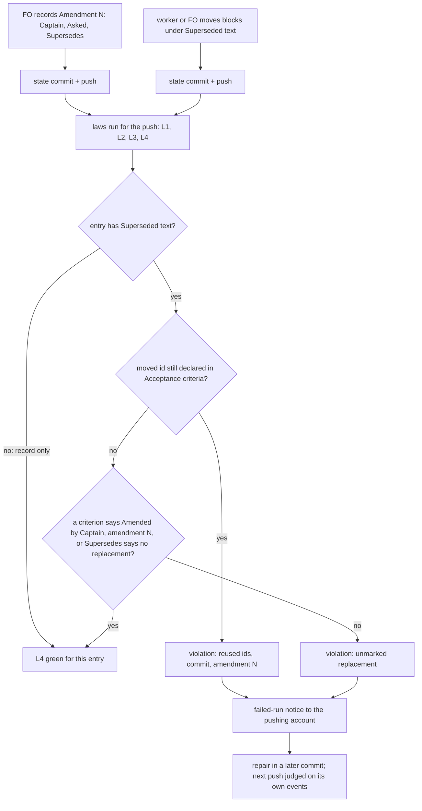

## Scope

- Source: the Captain 「驗證不讀 PR 審查意見（建議）, 特別角色派工紀錄手寫（建議）, 改驗收條件沒當下檢查（建議）, 合併檢查時間點看不出（建議）」 (host question dialog, 2026-11-08), answering 「批次 17 觀察者找到的問題，哪些要開成 kc-dev-flow-2 套件問題單（排進下一批的待辦）？建議四張都開，每張都真的發生過。」
- Bite: the batch 17 observer for worker-browser-checks-use-paseo-browser recorded that FO rewrote AC-1, AC-2 and AC-4 in place under reused ids (state a113aa3e9); design_surfaces.py caught it only when the implementation worker ran it.
- Non-goals: changing Spacedock; adopter AGENTS.md files.

## Budget
- One package PR; workflow word budget unchanged unless the design names a raise for the Captain.

## Stop condition
- Committing a task whose amendment reuses an id or lacks the 'Amended by Captain, amendment N' marker is refused or flagged at that commit, with a falsifier.

## FO alignment

Alignment: not needed; the Captain chose to file it from the batch 17 observer findings.
Surfaces: none
Visible change: none
Release review: not needed: workflow maintenance, on no journey map.
Reviewer: kc-dev-flow-2:engineering-reviewer gpt-6-astra 2026-11-10 — Amendment 1: do these amendments withdraw what the Captain approved, and what changes in the build?
Reviewer: kc-dev-flow-2:chief-engineer not run 2026-11-10: the 4 counted passes are 4 follow-up messages to one worker (message-1 withdrawn before any work, message-2 applied the Captain's amendments 1 and 2, messages 3 and 4 are the two phases of the single Cycle 1 repair of validation-1 F1); one validation rejection so far, and the next step is its recheck at d7502656c
Reviewer: kc-dev-flow-2:chief-engineer gpt-6-astra 2026-11-10 — what is the smallest next step, given the findings so far?
Step back (FO, 2026-11-10, before the third validation; basis review/chief-engineer-1.md): the outcome is still the one first asked for, flagging a reused id or a missing marker at the commit that writes it, and the batch 17 bite is caught at the candidate (the chief-engineer's local read, not a hosted run); F3 could be tested now and is repaired at 864536d11, F2 has no observed case and is deferred; deleting the law loses the only check that sees a move with no later dispatch (6 of the 7 corpus events, the ideation worker's count).

## Design

### PRFAQ

**Proposition.** When a commit to the state branch moves a superseded criterion under an amendment's `Superseded text:` and leaves the same id declared in `## Acceptance criteria`, or moves criteria with no replacement marked "Amended by Captain, amendment N" and no `no replacement` on its `Supersedes:` line, the state-branch laws run for that push names the commit, the amendment, and the reused ids. It does not wait for the next worker to run `design_surfaces.py check`. A new law, L4 `amendment-moves-use-fresh-ids`, in `kc-dev-flow-2/scripts/laws_check.py` does this. Its rule is one predicate in `kc-dev-flow-2/scripts/design_surfaces.py`, and `check` uses the same predicate.

**FAQ.**
- *Why not run the whole `design_surfaces.py check` at commit time?* That check flags a missing marker even when FO has only recorded the amendment and the worker has not moved anything yet (`check_amendments`, final condition: it does not depend on whether the move or the dispatch has happened). If it ran at every commit, it would fail every legitimate FO record-only commit. L4 judges an entry only after it holds a `Superseded text:` payload. The payload is the moment a move has been written, so it is the moment both rules can be checked.
- *What does it catch that nothing catches today?* The reuse: an id held under `Superseded text:` and also declared live. `check_amendments` tests `held - named` and `named & declared`, and the latter waits until a dispatch checklist names the amendment. No current code tests `held & declared`. At the bite commit, current `origin/main` (6a495cb8) `design_surfaces.py check` prints only the unmarked line. `laws_check.py` over `b91e7434adde..a113aa3e9` prints L2 lines about the hand-written reviewer record and no line about the criteria (replayed 2026-11-10; the hosted run 42442764436 at that push printed the same L2 set).
- *Refuse or flag?* It flags, after the push. It cannot stop the commit; see D1.
- *Does FO read more?* No, at any moment it reads today. See "Words FO reads".
- *A partial move (clauses moved, id kept)?* L4 flags it as reuse. That matches the Captain's #650 delivery-gate ruling on `staff-multi-branch` amendment 1: 「a form break the refusal is right about」 (archived `amendment-form-check` AC-8).

**Acceptance evidence plan.** Replay the bite range, run unit fixtures for the three legitimate shapes and the two defects, replay three adopter state histories read-only, run the registry test, and observe one hosted run after the pin moves (D2).

### Mechanism

1. `design_surfaces.py` gains one function, `move_defects(lines)`. For each entry under `## Captain amendments` that has a `Superseded text:` payload, it returns `("reused", N, ids)` for ids declared both in the payload and in `## Acceptance criteria`. It returns `("unmarked", N)` when the entry's `Supersedes:` names ids, has no `no replacement` waiver, and no live or other-entry moved declaration carries "Amended by Captain, amendment N". The shared unit is the marker predicate, `unmarked(entry, live, others)`, moved out of `check_amendments`. `check_amendments` keeps calling it for every entry, with or without a payload, as it does today. `move_defects` calls it only for entries that have a payload, and adds the `held & live` reuse test. So `check`'s output is unchanged, `test_design_surfaces.py` passes unchanged, and the marker logic exists in one place.
2. `laws_check.py` gains `l4_amendment_moves_use_fresh_ids` and a `LAWS["L4"]` entry. Event: a commit in the existing `walk()` range that changes a task file (flat, `index.md` and `_archive/` forms, the same path and rename matching as L3's `amendment_pairs`/`amendment_blob`) where `move_defects` at that commit returns a defect absent at its first parent. Each defect is reported once, at the commit that introduced it (ADR 0017). An unreadable blob or an ambiguous match raises `Cannot`, like L3. A file whose `parse_amendments` reports structural issues is left to L2/L3 and not judged by L4.
3. `references/sd/laws.md` gains `## L4 amendment-moves-use-fresh-ids` with Rule, Event, Judged by, Bit and Bounds. `test_laws_file_matches_registry` fails if the heading and the registry differ.
4. No change to `references/sd/workflow.md`, `dispatch_records.py`, skills, `state-laws.workflow.yml`, Spacedock or any adopter file. No ADR: ADR 0005 (the worker moves), 0016 (what `check` refuses) and 0017 (laws judge push events) stand unchanged. L1–L3 also have no ADR of their own.

### Chain checked (2026-11-10)

- **Spacedock 0.27.2:** `spacedock --help` lists no state-commit hook. Changing Spacedock is a non-goal.
- **kc-dev-flow-2 at origin/main 6a495cb8 (0.37.0):** `design_surfaces.py check` has the marker rule and the waiting `still declared` rule, and is run by implementation, validation and FO at the ideation and ui-validation gates. `dispatch_records.py --names` and L2 run `amendment_form` (form only) and the named-in-checklist test, not `check_amendments`. L3 protects entry bytes. `laws_check.py` already judges every state commit per push. That is the existing commit-time point, so this design extends it instead of adding a hook.
- **Siblings:** the qnow and relay state histories were read with read-only `git log`/`git show` on the local checkouts (`qnow-adopt-dev2` at 62423c60e and `beirut-dev2` at 0bd9429d, both 2026-11-10, not fetched). `git grep -l "Superseded text"` over each trunk's `*.py *.sh *.ts *.mjs *.yml` (state excluded) finds nothing, so no adopter has its own amendment check.

### Existing-code capability check

The boundary is the Captain-amendment journey: FO records, a worker moves, and the commit is pushed and judged. Completeness: the marker rule works through the journey but runs only when a worker or a gate runs `check`. The reuse rule (`held & declared`) is not found. Two bounded searches support that: `git grep -n "held"` over `design_surfaces.py`, `dispatch_records.py` and `laws_check.py` at origin/main shows one set test, `held - named`, and the L2/L3 Rule text in `laws.md` names no reuse test. Need: the bite. A prototype of `move_defects` (scratch `/tmp/acw-proto/walk.py`, not committed) was run over whole state histories, comparing each version with its first parent. Out of 1175 task-file versions that hold `Superseded text:` (dev2 644, qnow 261, relay 270), it fires at 7 commits:

| Repository | Commit | Task, amendment | Defect | Known as |
| --- | --- | --- | --- | --- |
| dev2 | a113aa3e9 | worker-browser-checks-use-paseo-browser, 1 | reused AC-1, AC-2, AC-4; unmarked | the bite |
| dev2 | 7326e2a11 | delivery-gate-verdict-form, 2 | unmarked | the break ADR 0016 was filed on |
| dev2 | bf8c73be9 | release-acceptance, 2 | unmarked | repaired by 5ca46d186, the next push 38 s later (waiver added) |
| qnow | 3a384063e, 4ad692922 | staff-multi-branch, 1 | unmarked; reused AC-6, AC-7 | the partial move the Captain ruled a form break (#650) |
| qnow | 4993b5b60 | booking-outcomes, 1 | unmarked | ADR 0016 corpus break |
| relay | 06cadae76 | owner-sees-all-feedback-room, 3 | unmarked | written before the waiver form existed; clears with it |

Only 1 of the 7 commits added a dispatch record (`git show --name-status`), so a check placed at dispatch would have seen only the bite.

### Words FO reads

| Moment | Before | After |
| --- | --- | --- |
| Startup, idle on an open PR, idle on a merged PR, after the archive, the merge ask (root learning.md) | unchanged files: workflow.md, `pr_watch.py`, `delivery_gate.py`, `observer_check.py` output | identical: none of these files changes |
| Recording an amendment (workflow.md § Captain amendments) | that section as it is | identical (file untouched) |
| Before a dispatch (`dispatch_records.py --names`) | its output | identical (script untouched) |
| A state push, green | 0: FO reads no green run | 0 |
| A state push, red (GitHub failed-run notice, then the log) | the L1–L3 lines | plus one 9-word `L4 …: n events judged in <range>, m violated` head line, and at most one violation line per defect kind per entry: 31 words for reuse, 28 for unmarked, as drafted on the bite |

The workflow word budget does not change. `laws.md`, which FO reads once at the laws rollout, grows by one section, at most 250 words (base 1345).

### Bounds

- L4 flags after the push. It does not block a commit, a dispatch, a gate or `merge guard`.
- On dev2, L4 is inert until `.github/workflows/dev2-laws.yml` on the state branch pins a release that contains it. Today it pins 22219a3e (`kc-dev-flow-2-v0.26.0`). See D2.
- Not seen: an in-place rewrite of a superseded id with no move. That state looks the same as "FO recorded, the worker has not moved yet". The prototype found 2 such edits (the bite, and qnow `staff-multi-branch` AC-10 at 71ac1120e), and in both tasks another commit already fired L4. A task with no amendment entry at all stays an observer duty (L3 Bounds).
- A waiver forgotten at record time has no L3-clean repair: adding it to `Supersedes:` is an L3 metadata edit. This is unchanged by this design and belongs to amendment-form-check-round3-followups.
- CI cost per push is not measured. L4 reads the two blobs per changed task file that L3 already reads. No trigger or job is added.

### Decisions for the Captain

- **D1. Where the check runs. Recommend: the new state law L4 (flags each commit after its push).** Why: it judges every state commit, and it fires on all 7 events above. A check before dispatch (`dispatch_records.py --names` / L2) sees 1 of 7. An adopter-installed pre-commit or `PreToolUse` hook would refuse at the commit, but the package can only ship a template for it, like the secret-reads hook. Commits written by `spacedock` itself and by hosts without hooks would bypass it. What gets worse: the bad commit is already pushed, and the signal is a failed-run email FO can miss. The repair is a later commit.
- **D2. Turn L4 on for dev2. Recommend: after the release that carries L4, FO commits the `dev2-laws.yml` pin to that published tag on your word (adoption.md: rollout 「on the Captain's word」), and this task closes only after one state push run prints the L4 head line (AC-7).** What gets worse: the task stays open after merge until a push runs. Moving the pin from 0.26.0 also turns on, at once, every L2/L3 check added since that release. Each run judges only its own push (ADR 0017), so old history stays green, but new pushes may go red on those checks too.

### Batch overlap

Files this design changes: `kc-dev-flow-2/scripts/laws_check.py` (new L4 function, `LAWS` entry, docstring), `kc-dev-flow-2/scripts/design_surfaces.py` (new `move_defects`; the `check_amendments` marker test calls it), `kc-dev-flow-2/scripts/test_laws_check.py` (L4 cases), `kc-dev-flow-2/scripts/test_design_surfaces.py` (only if the helper split needs one direct case), `kc-dev-flow-2/references/sd/laws.md` (new L4 section). No ADR number and no shared index.

| Task | Shares | Kind |
| --- | --- | --- |
| issue-815-fo-record-gaps (batch 20) | `design_surfaces.py` (its built-screen `preview:` check) | same file, different function; rebase only |
| special-role-dispatch-records-built-by-script (batch 20) | the same bite commit; it changes the dispatch-record route, and this design leaves `dispatch_records.py` alone | none; its fix removes the bite's L2 lines and L4's lines stay |
| delivery-gate-pr-body-attribution-link (batch 20) | `delivery_gate.py` only | none |
| adoption-asks-which-extensions | `laws.md` (its L2 Bounds sentence) and `test_laws_check.py` (one L2 test) | same files, different sections; textual rebase |
| captain-ruling-sources-checked | `design_surfaces.py`, `test_design_surfaces.py` (provenance checks) | same files, different functions |
| fo-write-checks-parse-top-level | `design_surfaces.py` `scope_lines`, `ScopeCheckTests` | same files, different functions |
| seed-check-requires-alignment-result | `design_surfaces.py` seed branch, seed tests | same files, different functions |
| comment-check-reaches-delivery-gate | `delivery_gate.py`; it explicitly adds no law | none |
| dispatch-carries-reserved-adr-number | recommends no package change | none |
| adr-required-statement, merge-guard-stops-unasked-merges, archive-waits-for-observer-report, gate-summary-names-each-decline, step-back-answer-has-a-record-line, validation-reads-pr-review-comments | `adr_lint.py`, `delivery_gate.py`, `adoption.md`, observer and role files, validation principles | none |
| journey-server-host-pilot, journey-canvas-hosted-poc, pr-review-lite-value-pilot, ops-inbox-r1-setup-and-isolation, adr-silent-undo-probe, picky-reviewers-may-run-on-gemini | run `design_surfaces.py check` at most, or write `kc-ops-inbox/**`, or change no file | none: `check` output is unchanged |
| superseded-criterion-without-dispatch-caught, amendment-form-check-round3-followups (backlog, not in the list) | `check_amendments` and its marker test | same function; whichever lands second rebases onto `move_defects`. L4 covers part of the first one's "no later dispatch" gap, for moved criteria only |

Recommended order: no ordering is needed within batch 20. Among the `design_surfaces.py` editors, whichever merges first goes first and the others rebase, since they touch different functions. adoption-asks-which-extensions rebases `laws.md`/`test_laws_check.py` textually, in either order.

## Acceptance criteria

**AC-1** The bite is flagged at its commit. Evidence: at the candidate, `python3 -B kc-dev-flow-2/scripts/laws_check.py <dev2 state checkout> --before b91e7434adde --after a113aa3e9 --readme <trunk>/docs/dev2/README.md` prints `L4 amendment-moves-use-fresh-ids: 1 events judged …, 1 violated`, one violation naming `worker-browser-checks-use-paseo-browser.md`, commit `a113aa3e9a3d`, amendment 1 and AC-1, AC-2, AC-4 as reused, and one unmarked violation for amendment 1. At base 6a495cb8 the same command prints no L4 line. Falsifier: deleting the `held & live` test drops the reuse line; deleting the marker test drops the unmarked line. Not yet verified (prototype output only).

**AC-2** The legitimate shapes stay green. Evidence: `test_laws_check.py` fixtures (temporary git repositories, as its `Repo` class builds) for (a) FO records `Supersedes: AC-2` with no `Superseded text:`, (b) a worker moves AC-2 and declares AC-5 "Amended by Captain, amendment 1", and (c) a move whose `Supersedes:` says `(no replacement: …)`. Each yields zero L4 violations, while (d) a move that keeps AC-2 declared and (e) a move with no marked replacement each yield one. Falsifier: removing the payload gate makes (a) fail. Not yet verified.

**AC-3** A defect is reported once, at the commit that adds it. Evidence: a fixture range whose first commit introduces the reuse and whose second commit only edits another section reports one event, at the first commit. A range that starts after the defect reports none, and a commit that repairs it reports none. Falsifier: judging the tip state instead of each commit against its first parent reports the defect again in the later range. Not yet verified.

**AC-5** Registry, docs and FO reading. Evidence: `laws.md` has `## L4 amendment-moves-use-fresh-ids` (Rule, Event, Judged by, Bit citing a113aa3e9, Bounds) and adds at most 250 words; `test_laws_file_matches_registry` passes; `git diff --stat origin/main...<candidate> -- kc-dev-flow-2/references/sd/workflow.md kc-dev-flow-2/scripts/dispatch_records.py kc-dev-flow-2/skills kc-dev-flow-2/references/sd/state-laws.workflow.yml` is empty; `python3 kc-dev-flow-2/scripts/lint-skills.py` passes. Falsifier: adding the registry entry without the heading fails the registry test. Not yet verified.

**AC-6** One marker predicate for both checks. Evidence: `check_amendments` and `move_defects` both call the shared marker predicate, `check_amendments` still for every entry; `test_design_surfaces.py` passes unchanged; a mutation of the marker test inside `move_defects` fails at least one test in each of `test_design_surfaces.py` and `test_laws_check.py`. Falsifier: a copy of the marker logic left in `check_amendments` lets the mutation pass `test_design_surfaces.py`. Not yet verified.

**AC-7** Hosted on dev2 (per D2). Evidence: after the release, the pin commit on `spacedock-state/dev2` names the published tag, and the next state push's `dev2-laws.yml` run log (`gh run view <id> --log`) prints the L4 head line. Falsifier: a run on the old pin prints no L4 line. Not yet verified; it runs after merge and on the Captain's word.
**AC-8** Amended by Captain, amendment 1, and by amendment 2. The corpus replay matches the table under "Existing-code capability check". Evidence: the candidate `laws_check.py` with `--before` at each history's root, run read-only over the dev2, qnow and relay state checkouts, prints L4 events exactly at the seven commits named there. This includes dev2 bf8c73be99c4 and relay 06cadae7681f. Any extra event from history newer than the tips named there is listed with its cause. Only the amendment entry whose own structure is broken is skipped; valid sibling entries remain judged. A later push that only repairs a broken heading reports a move defect that was previously unjudgeable, without repeating an already reported sibling defect. Falsifier: restoring the whole-file skip fails `L4Test.test_unrelated_broken_entry_does_not_hide_valid_move`; restoring the first-parent structural skip fails `L4Test.test_repaired_heading_reports_previously_unjudged_defect`; an L4 event on a record-only entry fails `L4Test.test_record_only_marked_move_and_waived_move_are_green`. Current evidence: the latest implementation report and `amendment-checked-when-written/implementation/amendment-2/` bind the candidate, ranges, output and falsifiers.

## Captain amendments

### Amendment 1 — 2026-11-10, host question dialog
Captain: 「改成 5 次（建議）」 (host question dialog, 2026-11-10)
Asked: 「決定：「修改驗收條件的檢查」那張的歷史重跑驗收條件，要從抓到 7 次改成 5 次嗎？建議改成 5 次。你核准的設計同時寫了「歷史重跑抓到 7 次」和「任務檔格式有問題時新規則不判，留給既有的格式規則」，兩者衝突：照後者實作只抓到 5 次，少的 2 次檔案都有格式問題（實作工人的報告，我沒重跑）。同意即把這條驗收條件改成 5 次，並寫明另外 2 次留給既有格式規則；缺點是格式壞掉的檔案裡的編號重用，要等格式修好才會被新規則看到。」
Supersedes: AC-4

Superseded text:

**AC-4** The corpus replay matches the table under "Existing-code capability check". Evidence: the candidate `laws_check.py` with `--before` at each history's root, run read-only over the dev2, qnow and relay state checkouts, prints L4 events exactly at the seven commits named there. Any extra event from history newer than the tips named there is listed with its cause. Falsifier: an L4 event on a state that the current form accepts (for example a record-only entry). Not yet verified at the candidate; the prototype reproduces the seven.

### Amendment 2 — 2026-11-10, host question dialog
Captain: 「這張就做到 7 次」 (host question dialog, 2026-11-10)
Asked: 「決定：「修改驗收條件的檢查」這張，要維持 5 次先交付、漏掉的 2 次另開待辦任務嗎？建議這樣做。我上一題說錯了：工程審查員重跑後發現，被跳過的 2 次並沒有被既有規則接住——dev2 那次只回報「無法判定」，relay 那次整次通過、沒有任何警訊；格式修好之後也不會補報。同意即接受：驗收條件寫成 5 次並照實寫明這 2 次的結果，程式不動；我另開一張待辦任務，把跳過範圍縮小到只跳過格式壞掉的那一筆修改紀錄。缺點是那張待辦做完前，同一份檔案裡有別的修改紀錄格式壞掉時，新寫入的編號重用不會被抓到。」
Supersedes: none
Design: A file whose `parse_amendments` reports structural issues is left to L2/L3 and not judged by L4.

### Feedback Cycles

- Cycle 1 (FO, 2026-11-10): validation-1 on #828 head 72216e2e recommended REJECTED with one finding, F1, assessed Material and owned (value-ac[AC-3]: a defect is reported once at the commit that adds it; evidence amendment-checked-when-written/validation/cycle-1/partial-repair.log, the validator's run, not re-run by FO), to fix; investigation first, then FO fix authorization, then a fresh validation recheck.
  - F1: a push that repairs only one of several reused ids reports the remaining, already reported id again, because laws_check.py compares the whole reused-id tuple.
- Cycle 2 (FO, 2026-11-10): validation-2 on #828 head d7502656 recommended REJECTED with two findings; F1 of Cycle 1 is closed. After the chief-engineer step-back (review/chief-engineer-1.md): F3 assessed Material and owned (value-ac[AC-2]: a real unmarked move passes with exit 0 when a tilde-fenced example holds the marker; evidence validation/cycle-2/review-example-tilde.log, the validator's run, not re-run by FO), to fix; investigation first, then FO fix authorization, then a fresh validation recheck. F2 is assessed Deferred risk and FO will decline it in the validation gate summary: its trigger is the validator's constructed multi-task push with an unreadable file, no such push is in the read histories, and that path still exits non-zero; it becomes Material on an observed push that loses a diagnostic, or on the Captain's ask.
  - F3: design_surfaces.py's live-section filter strips only backtick fences, so a tilde-fenced example can supply the 'Amended by Captain, amendment N' marker.

## Stage Report: ideation

- DONE: Design the check that refuses or flags, at the commit that writes it, a task amendment that reuses an acceptance-criterion id or lacks the 'Amended by Captain, amendment N' marker (the batch 17 in-place AC rewrite is the bite); name where it runs at commit time, what kc-dev-flow-2/scripts/design_surfaces.py already catches, and the falsifier
  New state law L4 in `laws_check.py`, run per push and judging each commit, using one `move_defects` predicate in `design_surfaces.py`. Today `check` catches only the unmarked replacement, and only once a worker or gate runs it; the reuse (`held & declared`) is caught nowhere. Bite replayed at origin/main 6a495cb8: no line on the criteria from either script. Falsifiers are in AC-1 and AC-2.
- DONE: A `### Batch overlap` section naming each file the design would change and each other batch task (issue-815-fo-record-gaps, special-role-dispatch-records-built-by-script, amendment-checked-when-written, delivery-gate-pr-body-attribution-link) and live task of other sessions (adr-required-statement, journey-server-host-pilot, merge-guard-stops-unasked-merges, archive-waits-for-observer-report, ops-inbox-r1-setup-and-isolation, pr-review-lite-value-pilot, validation-reads-pr-review-comments, adoption-asks-which-extensions, adr-silent-undo-probe, captain-ruling-sources-checked, comment-check-reaches-delivery-gate, dispatch-carries-reserved-adr-number, fo-write-checks-parse-top-level, gate-summary-names-each-decline, journey-canvas-hosted-poc, picky-reviewers-may-run-on-gemini, seed-check-requires-alignment-result, step-back-answer-has-a-record-line (in flight or parked; read only)) that changes the same file or check, so FO can order implementation
  Names five files and every listed task, plus two backlog tasks on `check_amendments`. Overlaps are textual only (different functions or sections). `Recommended order:` none is required.
- DONE: The words FO reads at each lifecycle moment, before and after, per root learning.md "Measure the words FO reads at each moment, not one file's size"
  "Words FO reads" table: identical at the five learning.md moments, at recording an amendment and before a dispatch. A red push adds a 9-word head line plus a 28–31-word line per defect. workflow.md is untouched.
- DONE: Acceptance criteria with reproducible evidence clauses and falsifiers, and unresolved decisions for the Captain, each with a recommendation and what gets worse under it
  AC-1 bite replay: not yet verified at a candidate (prototype reproduces it). AC-2 legitimate shapes green: not yet verified. AC-3 reported once: not yet verified. AC-4 corpus of 7 events over 1175 versions: prototype reproduces it; not yet verified at a candidate. AC-5 registry/docs/FO words: not yet verified. AC-6 one predicate: not yet verified. AC-7 hosted run: not yet verified (after merge). D1 (law vs hook) and D2 (pin bump, close after one hosted run) each carry a recommendation and what gets worse. `python3 -B /Users/kent/.claude/plugins/cache/kc-claude-plugins/kc-dev-flow-2/0.37.0/scripts/design_surfaces.py check amendment-checked-when-written.md` printed `amendment-checked-when-written.md: design surfaces presentable` (plus its `next:` gate-question line) and exited 0.

### Summary

Designed state law L4 `amendment-moves-use-fresh-ids`. It flags, at the commit that writes it, a move that redeclares a moved id or leaves the replacement unmarked. The marker test is shared with `design_surfaces.py check` through one predicate, so the two cannot drift. Measurement: on three adopter histories a prototype fires at 7 commits. Each is a known form break or a defect repaired in the next push. 6 of the 7 added no dispatch record, which is why the check goes at the push and not at dispatch. The material risk is D2: dev2's laws run pins 0.26.0, so L4 does nothing on dev2 until the Captain approves moving the pin.

## Stage Report: implementation

- DONE: Implement the approved Pilot design within the named product files, based on origin/main.
  Branch `spacedock-ensign/amendment-checked-when-written`; base `6a495cb8c4055f9a6eba8a05419c2d2fad1a90f1`; candidate `71eb2ec4298812d831573386324641ca6babff5d`; four approved files only, clean worktree; artifact manifest `/tmp/opencode/amendment-checked-when-written/artifact.json`.
- SKIPPED: One Draft PR (Conventional Commit title scoped to the plugin) from a branch off origin/main implementing the approved design and acceptance criteria; decisions as approved at the ideation gate; only the files the design names.
  No PR opened: no push grant. Product publication belongs to FO; local candidate preserves D1 per-push L4 and D2's unchanged adopter pin. AC-4 remains a specification hold, so this is not a publication recommendation.
- FAILED: Every acceptance criterion green with the evidence each names; each falsifier shown failing by a mutation you run (python3 -B, caches cleared).
  AC-4 expects seven historical events, but the approved whole-file structural skip excludes dev2 `bf8c73be99c4` and relay `06cadae7681f`: both have unrelated amendment headings outside the amendment section; the former is also malformed and duplicate. Details and source lines: `/tmp/opencode/amendment-checked-when-written/seven-events.json`; both per-commit CLI counterexample logs are beside it. FO must resolve expected corpus versus skip scope; candidate and accepted criteria were not changed to hide the conflict.
- DONE: AC-1 — reproduce the original defect and its two falsifiers.
  Candidate CLI on `b91e7434adde..a113aa3e9` reports one L4 event with reused AC-1, AC-2, AC-4 and an unmarked replacement; base prints no L4. Disabling each check removes its corresponding line and fails the L4 fixture: `candidate-bite.log`, `base-bite.log`, `mutation-{reuse,marker}-bite.log` under `/tmp/opencode/amendment-checked-when-written/`.
- DONE: AC-2 and AC-3 — legitimate shapes pass and defects belong to their introducing commit.
  `test_laws_check.py`: 73 run, 72 passed, 1 optional environment fixture skipped; covers record-only, marked/waived moves, each defect, later unrelated edits, post-defect ranges and repair. Removing the payload gate or first-parent suppression fails its named case; `laws-tests.log`, `mutation-payload-0.log`, `mutation-parent-0.log` in the evidence directory.
- DONE: Complete the read-only three-adopter history replay required by AC-4, including current tips.
  Pinned dev2 `5254e465b7a3`, qnow `69ac9bed19ab`, relay `e6751812e914`: L4 reports 2/3/0 events, no extra event. Full CLI and final-candidate L4 replay agree; full CLI exits 2 on existing L3 history debt. `corpus-inputs.json`, `corpus-reconciliation.json`, `corpus-{dev2,qnow,relay}.log` retain ranges/results; the seven-event assertion fails with exactly the two missing commits above.
- DONE: AC-5 — registry, docs and FO reading remain within the approved boundary.
  Registry test passes and removing the L4 heading fails it; `laws.md` grows 1345 to 1570 words (+225, below 250). Workflow, dispatch_records.py, skills, CI template and versions are byte-unchanged from base, preserving lifecycle reading; `mutation-heading-0.log` and `artifact.json` in the evidence directory.
- DONE: AC-6 — share one marker predicate while preserving existing checks.
  Both callers use `unmarked`; unchanged `test_design_surfaces.py`: 217 run, 213 passed, 4 optional environment fixtures skipped. Disabling the shared marker fails one test in each suite; six mutation controls reject their regressions with absent caches and python3 -B. Three pinned tips produce 1032 identical base/candidate check/seed verdicts; `mutations.json`, `design-tests.log`, `check-comparison.json` in the evidence directory.
- SKIPPED: AC-7 — hosted dev2 activation and its old-pin falsifier.
  Deferred by approved D2 until a containing release, Captain-approved pin change and one observed state-push L4 headline; no adopter file or pin was changed, and no hosted activation/run is claimed.
- DONE: kc-dev-flow-2/scripts/lint-skills.py (the repository copy CI runs), package adr_lint.py docs/adr --since <base>, number_guards.py check, and comment_ratio.py within its maximum.
  All exit 0 at candidate; ADR lint checks 65 records with no new ADR; number guards show no findings; comment ratio is 0/173 = 0.0%, maximum 5%. Logs `lint.log`, `adr-lint.log`, `number-guards.log`, `comment-ratio.log` are under `/tmp/opencode/amendment-checked-when-written/`.
- DONE: doc-impact — docs/adr/0041-seed-admission-enforces-required-fields.md is unaffected.
  Seed admission is unchanged; pinned check/seed verdicts match the base. Recorded in `doc-verdicts.json` beside the raw `doc-impact.json` output.
- DONE: doc-impact — docs/adr/0057-rewritten-criteria-are-compared-with-the-captains-words.md is unaffected.
  `added_words` and its dispatch comparison are unchanged; the shared replacement-marker predicate preserves check output. Recorded in `doc-verdicts.json`.
- DONE: doc-impact — kc-dev-flow-2/references/sd/laws.md is updated.
  Added L4 Rule, Event, Judged by, Bit and Bounds; the registry and heading mutation exercise its entry point. Recorded in `doc-verdicts.json`.
- DONE: doc-impact — learning.md is unaffected.
  Historical practices remain applicable; this task follows the word, history-input and corpus checks without rewriting those records. Recorded in `doc-verdicts.json`.
- DONE: Commit locally, no product push; write the PR title and body for FO.
  Local candidate is `71eb2ec4298812d831573386324641ca6babff5d`; `/tmp/impl-amendment-checked-when-written-pr.md` contains the scoped Conventional Commit title, body, checks and explicit AC-4 hold; no version bump or empty commit.
- SKIPPED: FO pushes, opens the Draft PR, runs RoboRev and reads hosted CI.
  Delegated and not run by this worker; no clean review or hosted delivery claimed. CI cost per PR and per state push is not measured; no trigger, job or adopter pin changes.

### Summary

Implemented L4 with the approved whole-file structural skip and the shared `unmarked` predicate; local behavior, five acceptance criteria and six mutation controls pass. AC-4 fails because two of its seven expected historical events have parser structural issues and are therefore excluded by the approved design; return this conflict to FO before further product changes/publication, while AC-7 stays open under D2.

## Stage Report: implementation

- FAILED: Apply Captain amendments Amendment 1: move the AC-4 block verbatim from `## Acceptance criteria` into the entry under a `Superseded text:` line, and write the replacement under a fresh id that says "Amended by Captain, amendment 1": the corpus replay prints L4 events at five commits, and the two commits the whole-file structural skip excludes (dev2 bf8c73be99c4, relay 06cadae7681f) are named as left to the existing form laws
  held: special-role call owed
- FAILED: Show the replacement criterion green at the unchanged candidate 71eb2ec42 with its evidence and falsifier, and keep that evidence in the task folder in the state checkout, not only under /tmp
  held: special-role call owed
- FAILED: Append one complete new `## Stage Report: implementation`, every DONE or SKIPPED item followed by its own indented evidence line; no product code change unless the replacement criterion needs one, and then say so and stop
  held: special-role call owed

### Summary

This complete report supersedes the earlier implementation report for the follow-up's readiness; implementation is held before applying the amendment or running product checks. Package `/Users/kent/.claude/plugins/cache/kc-claude-plugins/kc-dev-flow-2/0.37.0`, version `0.37.0`: `role_triggers.py` exited 1 with the following output; FO must record the call or a decline and dispatch again. Product candidate remains `71eb2ec4298812d831573386324641ca6babff5d`; no criterion, amendment entry or product code was changed.

next: amendment-checked-when-written has replacing amendment 1; dispatch kc-dev-flow-2:engineering-reviewer on opus or gpt-6-astra with the question "do these amendments withdraw what the Captain approved, and what changes in the build?" and record `Reviewer: kc-dev-flow-2:engineering-reviewer <model> <date> — <question>` under ## FO alignment; or, to decline, record `Reviewer: kc-dev-flow-2:engineering-reviewer not run <date>: <reason>` instead.

## Stage Report: implementation

- DONE: Apply Captain amendments Amendment 1 and Amendment 2 together; implementation-1-message-1 is withdrawn where it says five.
  The Reviewer line is recorded under FO alignment and `role-triggers.log` exits 0 for two events; Amendment 2's 「這張就做到 7 次」 and Design line govern the per-entry skip. No original Captain metadata or withdrawn Design prose was rewritten.
- DONE: Move the AC-4 block verbatim under Amendment 1's Superseded text and write the replacement under a fresh id naming both amendments.
  Live AC-8 says "Amended by Captain, amendment 1, and by amendment 2"; `superseded-ac-4.md` and `criterion-move.json` prove the exact old block, unchanged amendment metadata/frontmatter and no live AC-4. `task-design.log` exits 0 and `amendment-added-words.json` is empty.
- DONE: Narrow the product skip in only the design's named files, with tests and the whole-file-skip falsifier.
  Candidate `72216e2e947e962737a17c6e61ef3800f9d639c4` filters entries whose own spans contain parser issues and removes L4's file-level/first-parent structural gate. Three new tests fail on prior candidate `71eb2ec42` (`red.log`) and pass now; restoring the whole-file skip fails `L4Test.test_unrelated_broken_entry_does_not_hide_valid_move` (`mutation-whole-file-entry-skip-0.log`).
- DONE: Show that a later push repairing only a broken heading reports a never-reported defect and does not repeat a reported sibling defect.
  `L4Test.test_repaired_heading_reports_previously_unjudged_defect` asserts both reuse/unmarked diagnostics at the heading-repair commit; restoring the first-parent gate fails it (`mutation-whole-file-parent-skip-0.log`). `test_repairing_an_unrelated_heading_does_not_repeat_reported_defect` asserts zero later L4 events; `l4-tests.log`: all 11 pass.
- DONE: AC-8 — replay all seven capability-table events at the new candidate and keep every local acceptance criterion's evidence in the task folder.
  Full root-to-tip CLI runs pinned at dev2 `2a42fbb15e0f`, qnow `c36650727548`, relay `fd1481da6295` report 3/3/1 L4 events, exactly the seven expected commits, no extra. `corpus-reconciliation.json` and `corpus-*.log` include ranges/output; complete CLI exits 2 on existing L3 history debt while the L4-specific verification passes. `recovered-dev2.log` and `recovered-relay.log` show both previously missed commits now reported.
- DONE: AC-1 — the original bite and its reuse/marker falsifiers.
  `candidate-bite.log` reports one event, reused AC-1/AC-2/AC-4 and unmarked amendment 1; the full base-package replay `base-bite.log` has no L4. Removing either predicate removes its diagnostic and fails its fixture (`mutation-reuse-bite.log`, `mutation-marker-bite.log`).
- DONE: AC-2 and AC-3 — legitimate moves remain green and an existing defect is not re-reported.
  `laws-tests.log`: 76 run, 75 passed, one optional environment fixture skipped; record-only, marked/waived moves, defect introductions, post-defect ranges and repair are exercised. Removing the payload gate or first-parent suppression fails its named case (`mutation-payload-0.log`, `mutation-parent-0.log`); judging the broken entry itself fails its skip case (`mutation-judge-broken-entry-0.log`).
- DONE: AC-5 — registry, documentation word bound and FO reading boundaries.
  `laws.md` adds 242 words (1345 to 1587, below 250); the registry test passes and deleting its L4 heading fails (`mutation-heading-0.log`). `artifact.json` lists only four approved product files; workflow, dispatch_records.py, skills, CI template and versions are unchanged.
- DONE: AC-6 — one shared marker predicate with unchanged design-check behavior.
  Both callers use `unmarked`; unchanged `test_design_surfaces.py` runs 217 tests, 213 passed and four optional environment fixtures skipped (`design-tests.log`). Disabling the shared marker fails one test in each suite; all nine mutation test runs reject their regressions with absent caches and python3 -B (`mutations.json`). All 1032 pinned check/seed verdicts match the base (`check-comparison.json`).
- SKIPPED: AC-7 — hosted dev2 activation and the old-pin hosted falsifier.
  Deferred by approved D2 until a containing release, Captain-approved pin change and one observed state-push L4 headline. This worker changed no adopter pin and claims no hosted activation; local evidence is not that proof.
- DONE: Repository skill lint, package ADR lint, number guards and comment ratio at the new candidate.
  All exit 0: `lint.log`, `adr-lint.log` (65 ADR records, none newly added), `number-guards.log` (no findings), `comment-ratio.log` (0/205 = 0.0%, maximum 5%); base `6a495cb8c4055f9a6eba8a05419c2d2fad1a90f1`.
- DONE: doc-impact — docs/adr/0041-seed-admission-enforces-required-fields.md is unaffected.
  Seed admission remains unchanged; all pinned check/seed verdicts match the base. `doc-verdicts.json` records this disposition beside raw `doc-impact.json`.
- DONE: doc-impact — docs/adr/0057-rewritten-criteria-are-compared-with-the-captains-words.md is unaffected.
  `added_words` and its dispatch comparison remain unchanged; the replacement criterion passes that check (`amendment-added-words.json`). Disposition: `doc-verdicts.json`.
- DONE: doc-impact — kc-dev-flow-2/references/sd/laws.md is updated.
  L4 documents per-entry structural skips and the first-judgeable heading-repair event. Disposition: `doc-verdicts.json`; registry and heading mutation exercise its entry point.
- DONE: doc-impact — learning.md is unaffected.
  Historical practices still apply; the word, history-input, consumer and corpus checks were followed without rewriting the records. Disposition: `doc-verdicts.json`.
- DONE: Keep the candidate, evidence and falsifiers durably reviewable in the task folder.
  Evidence home: `amendment-checked-when-written/implementation/amendment-2/`; `artifact.json` binds code hashes and candidate, `manifest.json` seals the files, and `README.md` explains replay. `acceptance.json` records six local criteria passed and AC-7 deferred; the prior failed AC-4 is superseded, not reused.
- DONE: Commit locally without product push and update the PR text for FO.
  Branch `spacedock-ensign/amendment-checked-when-written`, base `6a495cb8c4055f9a6eba8a05419c2d2fad1a90f1`, new candidate `72216e2e947e962737a17c6e61ef3800f9d639c4`, clean product worktree. `/tmp/impl-amendment-checked-when-written-pr.md` and evidence `pr-draft.md` carry the scoped Conventional Commit title/body; no version bump or empty commit.
- SKIPPED: Product push, opening the Draft PR, RoboRev and hosted CI review.
  No PR opened: no push grant; these steps remain FO-owned and not run by this worker. CI cost per PR and per state push is not measured; no trigger, job or adopter pin was changed.
- DONE: Append one complete new Stage Report: implementation with each item followed by its own indented evidence line.
  This complete report uses the exact heading and DONE/SKIPPED forms, with evidence per item including all four document dispositions; evidence copy: `stage-report.md`.

### Summary

This report supersedes every earlier implementation report: both Captain amendments are applied, the seven-event acceptance criterion is green at `72216e2e947e962737a17c6e61ef3800f9d639c4`, and restoring either structural skip fails a named test. The prior whole-file miss is repaired without hiding a previously unjudged defect on a later heading-only repair; AC-7 and FO-owned publication/reviews remain explicitly open.

## Stage Report: validation

- DONE: Independent verdict on PR #828 head 72216e2e against every acceptance criterion in the task file, re-running each evidence command and at least one falsifier per criterion yourself, and judging each limit the implementation report states
  REJECTED at `72216e2e947e962737a17c6e61ef3800f9d639c4`, base `6a495cb8c4055f9a6eba8a05419c2d2fad1a90f1`: F1 violates AC-3. Evidence below is under `amendment-checked-when-written/validation/cycle-1/`; AC-7's hosted proof/falsifier remain explicitly deferred by D2, with a local old-pin negative control only.
- DONE: Captain amendments Amendment 1 and Amendment 2 are applied: judge the replacement criterion (seven events, per-entry skip) and the engineering review's points in amendment-checked-when-written/review/engineering-reviewer-1.md, including what a later heading-only repair push reports
  `criterion-move.json` verifies the exact old AC-4 move and fresh AC-8 naming both amendments; `recovered-exits.json` records dev2 L4 event plus L3 cannot-judge (exit 2), relay L4 event with L2/L3 clean (exit 1). `prior-regression.log`, `laws-tests.log` and structural-skip mutations prove heading-only repair reports previously unjudged defects without repeating an already reported sibling.
- DONE: A minimal acceptance script the Captain can run (three to six steps, exact commands, expected output), run by you exactly as written in a fresh bash shell, with its observed output; /Users/kent/.claude/plugins/cache/kc-claude-plugins/kc-dev-flow-2/0.37.0/scripts/adr_lint.py docs/adr --since <base> with its exit code; your verdict naming the head, with findings classified by the workflow's Review-finding disposition
  `README.md` gives the exact fresh-shell invocation; `acceptance.sh` has five steps. `acceptance.log` and `acceptance-exit.json`: steps 1–4 pass, step 5 exposes F1, overall exit 1; step 4 runs the exact declared package ADR command against the pinned base and exits 0 (65 records).
- DONE: AC-1 — the original event reports both defects, absent at base, and both predicate falsifiers are caught.
  `candidate-bite.log` has one L4 event and two diagnostics; `base-bite.log` has no L4. Disabling reuse or the shared marker removes its corresponding diagnostic and fails its test: `mutation-reuse-bite.log`, `mutation-marker-bite.log`, `mutations.json`.
- DONE: AC-2 — record-only, marked and waived moves stay green; actual reuse/unmarked moves fail.
  `laws-tests.log` passes the declared temporary-repository fixtures; removing the payload gate fails `test_record_only_marked_move_and_waived_move_are_green` in `mutation-payload-0.log`.
- FAILED: AC-3 — a defect is reported once at the commit that adds it, and repair adds no new event.
  The original fixture and first-parent mutation pass, but `partial-repair.log` shows an already reported AC-2 repeated when only AC-1 is fixed; L3 reports no violation, the partial-repair push exits 1, and full repair exits 0. `acceptance.log` step 5 independently reproduces F1.
- DONE: AC-5 — registry, documentation word bound and FO reading boundaries.
  `artifact.json`: only four approved files, laws.md 1345→1587 words (+242 ≤250), original design tests unchanged; workflow, skills, dispatch records, CI template and versions unchanged. `lint.log` exits 0; removing L4's heading fails `mutation-heading-0.log`.
- DONE: AC-6 — one marker predicate serves both checks, preserving design check/seed behavior.
  `design-tests.log`: 217 run, 213 passed, four optional fixtures skipped. `check-comparison.json`: 1036 task/mode verdicts at fresh local tips identical to base; disabling the shared marker fails each suite (`mutation-marker-0.log`, `mutation-marker-1.log`).
- SKIPPED: AC-7 — containing release, Captain-approved dev2 pin and observed hosted state-push run, including its hosted old-pin falsifier.
  D2 defers this obligation; `activation-limit.json` and `dev2-laws.yml` verify the unchanged old pin and a local replay with no L4. No release, adoption edit or hosted proof is claimed; the task cannot close before AC-7.
- DONE: AC-8 — the seven-event corpus, per-entry skips and first-judgeable heading repair.
  `corpus-reconciliation.json` verifies dev2/qnow/relay 3/3/1 events at the seven specified commits, with no extra event at the fresh local tips in `corpus-inputs.json`; all three full CLI runs exit 2 on existing L3 ambiguity, not a clean overall-history claim. `mutations.json` records all nine rejected regressions, including both restored whole-file structural skips; `prior-regression.log` shows all three new regression methods fail on prior sources.
- DONE: Required repository checks, implementation dispatch records and added-comment review.
  `checks.json`: repository skill lint, package ADR lint, comment ratio (0/205; 0%, maximum 5%), number guards, task-design and six dispatch records pass. Initial/clean-env role checks pass; one redundant export-GIT_DIR invocation error is disclosed in `README.md`. Number guard's unavailable state fetch is scoped to local reservations; this candidate reserves/changes no number.
- DONE: doc-impact — docs/adr/0041-seed-admission-enforces-required-fields.md is unaffected.
  `doc-verdicts.json` and `check-comparison.json`: seed admission is unchanged and all compared verdicts match.
- DONE: doc-impact — docs/adr/0057-rewritten-criteria-are-compared-with-the-captains-words.md is unaffected.
  `added_words` is unchanged; `amendment-added-words.json` is empty and the marked replacement passes the task check.
- DONE: doc-impact — kc-dev-flow-2/references/sd/laws.md is updated.
  `doc-verdicts.json`: per-entry skip/heading-repair statements match observed behavior; the no-repeat claim is not satisfied for partial repair (F1).
- DONE: doc-impact — learning.md is unaffected.
  `doc-verdicts.json`: historical practices remain intact; fresh exports, later-history checks and check/seed comparisons were exercised without rewriting past evidence.
- DONE: Assess goal sufficiency, minimal necessity and implementation limits at the same candidate.
  `README.md`: the four-file footprint directly serves detection, event wiring, falsifiers and registry docs; goal sufficiency fails F1. `test-summary.json` preserves 76 laws tests (75 passed, one optional skip); historical whole-CLI exit 2 is not green. Post-push-only, record-only/in-place/quote limits remain; CI cost per PR/state push is unmeasured and no job/trigger/pin changed.
- F1 Material: Partial repair re-reports old reused ids; `kc-dev-flow-2/scripts/laws_check.py:383` compares the entire reused-id tuple, so a smaller set is treated as a new defect.
  User/workflow: an adopter worker fixes a previously reported multi-id move across commits; harm: a no-new-defect push fails and attributes old AC-2 to the repair commit; boundary: `value-ac[AC-3]` once at introduction, `contract[docs/adr/0017-history-laws-judge-only-the-events-a-push-adds.md#decision]` new events only; trigger: `partial-repair.log`, `acceptance.log` step 5. Full fields and proposed repair boundary: `findings.json`.

### Summary

Independent validation recommends REJECTED for PR #828 at `72216e2e947e962737a17c6e61ef3800f9d639c4`: both Captain amendments are applied, but the supported partial-repair path violates AC-3. Product bytes remain unchanged; return F1 through FO disposition/implementation feedback, while AC-7 remains open for the approved release/adoption sequence. This is an evidence verdict, not gate, merge, review-completion or delivery authority.

## Stage Report: implementation

- DONE: Phase 1 only of the Cycle 1 repair: reproduce finding F1 as a failing test at head 72216e2e and propose the smallest fix; report and stop with no product commit or product push until FO authorizes the fix.
  Independent `ReusedIdEvents.test_partial_repair_adds_no_event` uses real temporary Git commits and the unmodified CLI: expected exit 0, observed exit 1 re-reporting unchanged AC-2, with L3 clean. `tests.log`/`tests.json`: 10 tests, three expected failures (partial repair, growth diagnostics, mixed removal/addition), seven passing controls, zero errors. `proposed-runtime.diff` is unapplied; proposed product scope is only `laws_check.py` plus the three regressions in `test_laws_check.py`.
- DONE: Say whether the same whole-tuple comparison affects the unmarked-replacement defect or any other L4 event, and whether the fix changes any of the seven corpus events.
  `scenarios.json` shows strict decreases create false events; growth/mixed changes repeat surviving old ids. Unmarked `(kind, amendment)` identity is stable: persistence, marker repair/removal controls behave correctly; the existing first-judgeable heading-repair test also passes. `seven-events.json` exercises all seven named first-parent ranges: each event task's previous defect list is empty, so the analysis-only per-id delta preserves all seven event/diagnostic payloads. This is not patched-candidate or full-history validation; details and repair scope are in `proposal.md`.
- DONE: Append one complete Stage Report: implementation, every item followed by its own indented evidence line, with evidence kept in the task folder in the state checkout.
  Durable evidence: `amendment-checked-when-written/implementation/cycle-1-phase-1/`; `README.md` gives exact reproduction commands, `identity.json` binds candidate/source hashes and clean product status, and `manifest.json` seals the evidence. This report is copied to `stage-report.md`; existing reports, findings, criterion text and amendment records remain untouched.
- SKIPPED: Apply the proposed fix, create a product commit, push the product branch, or run fixed-candidate validation.
  Phase 1 grants investigation only. Candidate remains `72216e2e947e962737a17c6e61ef3800f9d639c4`; no product bytes, commit, PR text or remote publication changed. Await FO fix authorization, then re-run the named regressions, existing suites, mutation controls and full corpus at the new candidate before fresh validation.

### Summary

This report supersedes earlier implementation readiness claims: phase 1 independently confirms F1 and the candidate remains rejected on AC-3. The smallest proposed repair compares reused ids individually within each amendment while retaining the unmarked comparison and grouped output; the seven named events are unchanged in the scoped data comparison, but no repair has been applied or validated.

## Stage Report: implementation

- DONE: Phase 2 of the Cycle 1 repair, FO fix authorization for finding F1: apply the repair your phase-1 report proposes (compare reused ids one by one within each amendment, keep the unmarked comparison and the grouped output) in kc-dev-flow-2/scripts/laws_check.py only
  Candidate `d7502656c765e36ce3d24be8602862ccc2551254` changes the reused-id delta in L4; `boundaries.json` proves the repair touches the runner and tests only, retaining the unmarked comparison, first-parent walker, parser and grouped diagnostics.
- DONE: Add the three regressions (partial repair adds no event, growth reports only the added ids, mixed removal and addition) to kc-dev-flow-2/scripts/test_laws_check.py; show each failing with the fix reverted (python3 -B, caches cleared)
  `reverted-fix.json` and `reverted-fix-{0,1,2}.log`: each exact new test fails an assertion, without errors, with only the temporary runner reverted to `72216e2e`; all three pass in the candidate's 79-test laws suite. Each fixture requires L3 to remain clean, so an unrelated append-only violation cannot supply the failure.
- DONE: Re-run at the new candidate: all package test files, the existing mutation controls, and the corpus replay with all seven named events unchanged
  `tests.json`/`tests-summary.json`: all 27 test-file commands exit 0, 1277 unittest cases run with 11 skips plus model-free CLI assertions; local Spacedock CLI 0.27.2/plugin root 0.27.3, not hosted CI. `mutations.json` has nine rejected regressions; `corpus-comparison.json` proves all seven event commits, headlines and diagnostics unchanged at the same three pinned ranges.
- DONE: One local commit on the existing branch, no push and no PR write; update the PR text file /tmp/impl-amendment-checked-when-written-pr.md if its claims change; FO pushes and runs RoboRev
  `commit-receipt.log` records the single repair commit `d7502656c765e36ce3d24be8602862ccc2551254` on `spacedock-ensign/amendment-checked-when-written`, base `6a495cb8c4055f9a6eba8a05419c2d2fad1a90f1`; `pr-draft.md` matches the updated local PR text file. No product push or PR write was performed.
- DONE: Append one complete `## Stage Report: implementation` naming the new candidate SHA, every item followed by its own indented evidence line, evidence kept in the task folder in the state checkout
  Evidence is under `amendment-checked-when-written/implementation/cycle-1-phase-2/`; `artifact.json`, `manifest.json`, `README.md` and this report bind the candidate, source digests, declared local inputs and rerunnable commands; prior task bytes are preserved by append.
- DONE: AC-1 — the original introducing event retains both diagnostics and the base has no L4.
  Fresh `candidate-bite.log` reports one L4 event at `a113aa3e9a3d`, reused AC-1/AC-2/AC-4 and one unmarked diagnostic; the unchanged base's absence is retained in `implementation/amendment-2/base-bite.log`. Reuse/marker mutations each remove their own bite line and fail their named fixture.
- DONE: AC-2 — record-only, marked and waived moves remain green; reused ids and unmarked replacements remain violations.
  `test_laws_check.log` runs the temporary-repository controls; `mutation-payload-0.log` fails when the payload gate is removed, while reuse and marker mutations fail their respective controls.
- DONE: AC-3 — each reused id is judged when introduced, and partial repairs add no event.
  The three new named tests reject whole-tuple comparison in `reverted-fix-{0,1,2}.log`: partial repair must exit 0; growth and mixed changes must name AC-3 without surviving AC-1/AC-2. `mutation-parent-0.log` rejects discarding the first-parent comparison; the candidate laws suite passes.
- DONE: AC-5 — registry, documentation word budget and FO reading boundaries remain satisfied.
  `boundaries.json` records four approved files across the task branch, two in this repair, and laws.md 1345 to 1587 words (+242 <=250); `mutation-heading-0.log` rejects a missing registry heading. Workflow, skills, dispatch records, CI template and versions remain outside the diff.
- DONE: AC-6 — the shared replacement-marker predicate and design-check behavior remain unchanged by this repair.
  `boundaries.json` proves design_surfaces.py and its tests byte-identical to `72216e2e`; `test_design_surfaces.log` runs 217 cases (four skipped). Both suites reject the disabled shared marker (`mutation-marker-{0,1}.log`).
- SKIPPED: AC-7 — containing release, Captain-approved dev2 pin and observed hosted state-push run.
  Approved D2 still defers release/adoption/hosted proof and its hosted old-pin falsifier; no pin was changed, and this task is not closable until that evidence exists.
- DONE: AC-8 — seven historical events, valid sibling entries and first-judgeable heading repairs remain covered.
  `corpus-reconciliation.json` proves 3/3/1 events with no extras in the pinned ranges, including dev2 `bf8c73be99c4` and relay `06cadae7681f`; the structural-skip mutations fail their named fixtures. All three full CLI runs exit 2 for existing L3 ambiguity; no overall-history green claim is made.
- DONE: Required repository checks and CI-cost disposition.
  `checks.json`: repository skill lint, package ADR lint since the pinned base, number guards, task-design, role triggers and doc-impact all exit 0; comment ratio is 0/246 (0%, maximum 5%). CI cost per PR/state push was not measured; no job or trigger changed. No ADR was added or changed; `artifact.json` binds the accepted ADR 0017 read at the candidate.
- DONE: Affected document docs/adr/0041-seed-admission-enforces-required-fields.md — unaffected.
  `doc-verdicts.json`: seed admission is unchanged; this repair changes the L4 event delta only.
- DONE: Affected document docs/adr/0057-rewritten-criteria-are-compared-with-the-captains-words.md — unaffected.
  `doc-verdicts.json`: criterion-word and dispatch comparisons are unchanged, and design_surfaces.py is byte-identical to the preceding candidate.
- DONE: Affected document kc-dev-flow-2/references/sd/laws.md — updated in the preceding implementation, retained here.
  `doc-verdicts.json`: the existing L4 Event section describes the repaired behavior; no additional words were added in phase 2, retaining +242 within the bound.
- DONE: Affected document learning.md — unaffected.
  `doc-verdicts.json`: retained historical practices remain applicable and are followed; this repair adds no new practice or ruling.
- DONE: Resolve evidence-driver/environment failures without changing the candidate or repeating green tests.
  `disk-full-attempt/` preserves the interrupted ENOSPC run; the completed 27 test-file receipts all exit 0. `all-tests.log` retains the post-run bytecode assertion; `finalize-tests.log` exits 0 after matching the receipts to the unchanged candidate/test digests and removing seven generated caches. Reverted-fix/mutation probes separately proved absent bytecode.
- SKIPPED: Eleven local fixture cases, real worker/model execution, product publication, RoboRev and hosted CI.
  `tests-summary.json` and individual logs record the 11 skips; the model-free CLI harness names its limits. FO owns product push, PR delivery/review and fresh validation; no delegated check is reported as run or clean.

### Summary

This report supersedes the earlier implementation reports: the authorized F1 repair is committed locally at `d7502656c765e36ce3d24be8602862ccc2551254`, with all 27 test-file commands green, three reverted-fix failures, nine mutation rejections and seven unchanged corpus events. The evidence distinguishes resolved ENOSPC/reporting-cache failures and existing L3 history ambiguity from the repaired behavior; FO publication, RoboRev, independent revalidation and D2 hosted activation remain outstanding.

## Stage Report: validation

- DONE: Independent verdict on PR #828 head d7502656 against every acceptance criterion in the task file, re-running each evidence command and at least one falsifier per criterion yourself, and judging each limit the implementation report states
  REJECTED at `d7502656c765e36ce3d24be8602862ccc2551254`, base `6a495cb8c4055f9a6eba8a05419c2d2fad1a90f1`; evidence under `amendment-checked-when-written/validation/cycle-2/`. F1 is repaired, but independently reproduced F2/F3 remain Material; AC-7 and its hosted falsifier remain deferred by approved D2.
- FAILED: Recheck of the Cycle 1 repair: finding F1 of validation-1 is closed at this head (partial repair adds no event; growth reports only added ids; mixed removal and addition), AC-3 is green, and the seven corpus events are unchanged
  `reverted-fix.json` and `test_laws_check.log` close F1; `corpus-comparison.json` proves all seven event payloads unchanged. The combined item cannot pass because new F2 independently violates AC-3 by losing the only known introducing diagnostic.
- DONE: A minimal acceptance script the Captain can run (three to six steps, exact commands, expected output), run by you exactly as written in a fresh bash shell, with its observed output; /Users/kent/.claude/plugins/cache/kc-claude-plugins/kc-dev-flow-2/0.37.0/scripts/adr_lint.py docs/adr --since <base> with its exit code; your verdict naming the head, with findings classified by the workflow's Review-finding disposition
  `README.md`/`acceptance.sh`: six exact steps, run with `bash --noprofile --norc`; steps 1–5 pass, step 6 prints two False results and exits 1 (`acceptance.log`, `acceptance-exit.json`). Declared-package ADR lint against the pinned base exits 0, 65 records (`adr-lint.log`); explicit 0017/0041/0057 requirements also pass.
- DONE: AC-1 — introducing commit reports both defects and each predicate falsifier removes its own diagnostic.
  `candidate-bite.log` reports one event with reused AC-1/AC-2/AC-4 plus unmarked replacement; `base-bite.log` has no L4. `mutation-{reuse,marker}-bite.log` and `mutations.json` prove removal of either predicate loses its diagnostic and fails its test.
- FAILED: AC-2 — every moved amendment without a real marked replacement is refused.
  Original record-only/marked/waived controls pass and the payload mutation fails; `review-example-tilde.log` nevertheless exits 0 for a real unmarked move whose only marker is an example. Backtick-only control exits 1 (`review-example-backtick.log`): F3.
- FAILED: AC-3 — report each defect at its introducing commit without repeating or losing it.
  Partial/growth/mixed repair regressions pass; reverting the repair fails all three (`reverted-fix.json`), and the first-parent mutation fails. `review-unreadable-{solo,combined,repair,later}.log` shows F2: diagnostic present alone, lost in combined push, never recovered on later unrelated edits.
- DONE: AC-5 — registry, documentation budget and FO reading boundaries.
  `artifact.json`: exactly four approved files, laws.md 1345 to 1587 words (+242 <=250), workflow/skills/dispatch/CI template/versions unchanged. `lint.log` passes; removing the L4 heading fails `mutation-heading-0.log`.
- DONE: AC-6 — one shared marker predicate, preserved design-check behavior and existing tests.
  `test_design_surfaces.log` runs 217 cases with four skips; `check-comparison.json` retains 1,032 identical candidate/base check/seed verdicts. Disabling the shared predicate fails both suites (`mutation-marker-{0,1}.log`); F3 is an inherited fence-helper gap newly exposed through L4, not an alleged design-check regression.
- SKIPPED: AC-7 — containing release, Captain-approved pin and observed hosted state-push run, including its hosted old-pin falsifier.
  `activation-limit.json`, `dev2-laws.yml` and `old-pin-bite.log` confirm the local old pin and no L4; this is only a local negative control. Approved D2 leaves hosted activation open; no release or adopter edit was made.
- DONE: AC-8 — seven historical events, valid siblings and first-judgeable heading repairs.
  `corpus-reconciliation.json` proves 3/3/1 events; `corpus-comparison.json` proves exact prior-candidate L4 payload equality; `current-tail.json` finds no extra event at newer local tips. Full CLI exits 2 for pre-existing L3 ambiguity. Per-entry/heading-repair controls and their restored-skip mutations pass/fail as required.
- DONE: Independently rerun every package test-file command and the existing mutation/reverted-fix evidence.
  `tests-summary.json`/`tests.json`: 27 commands exit 0, 1277 unittest cases with 11 skips plus model-free CLI assertions; nine mutation rejections and three reverted-fix assertion failures are separately recorded. Local CLI 0.27.2/plugin 0.27.3; no hosted/model-execution claim.
- DONE: Required checks, implementation dispatches, Captain amendments and added-comment review.
  `checks.json`: lint, ADR, comment ratio (0/246, 0%, max 5%), number guards, doc-impact, task design, role triggers and nine dispatch records pass; `criterion-move.json` proves verbatim AC-4 withdrawal/fresh AC-8. Initial archive metadata error was corrected; number-guard fetch remains local-ref-only and this task changes/reserves no number.
- DONE: Every affected document has an independent updated or unaffected disposition.
  `doc-verdicts.json`: ADR 0041 unaffected (seed admission unchanged), ADR 0057 unaffected (word comparison unchanged), laws.md updated (event claims still fail F2/F3), learning.md unaffected (historical practices retained and applied).
- DONE: Assess goal sufficiency, minimal necessity, all implementation limits and current review evidence at the same candidate.
  `README.md` binds each of four files to detection, existing event wiring, falsifiers or registry docs; sufficiency fails F2/F3. Post-push, record-only, in-place, quote, local-tool and fixture-skip limits remain; CI cost per PR/state push is unmeasured. `pr-threads.json` records both unresolved exact-head review findings; PR body still cites the previous candidate.
- SKIPPED: Product repair/publication, PR edits or replies, review resolution, release/adoption, hosted CI, gate decision and merge.
  These remain FO/Captain work; this worker changes only its state evidence/report and publishes that prescribed state commit. Product candidate/branch stay unchanged; green unit suites do not discharge the two reproduced Material findings.
- F2 Material: An unrelated unreadable task discards already known L4 violations; `kc-dev-flow-2/scripts/laws_check.py:380` lets Cannot escape the whole law.
  User/workflow: adopter pushes several tasks and repairs an unreadable one; harm: the readable task's sole introducing diagnostic vanishes; boundary: `value-ac[AC-3]` and `contract[docs/adr/0017-history-laws-judge-only-the-events-a-push-adds.md#decision]` report new events at introduction; trigger/control: `review-unreadable-*.log`, `review-probes.json`. Fields and source review: `findings.json`.
- F3 Material: A tilde-fenced example supplies a fake live marker; `kc-dev-flow-2/scripts/design_surfaces.py:419` uses a backtick-only live-section filter.
  User/workflow: worker includes a standard Markdown example with a move; harm: a real unmarked replacement passes with exit 0; boundary: `value-ac[AC-2]` invalid moves must fail and `contract[kc-dev-flow-2/references/sd/laws.md#l4-amendment-moves-use-fresh-ids]` requires a live/moved declaration; trigger/control: `review-example-{tilde,backtick}.log`. Full fields: `findings.json`.

### Summary

Cycle 2 independently recommends REJECTED for PR #828 at `d7502656c765e36ce3d24be8602862ccc2551254`: the Cycle 1 F1 repair works and preserves the seven historical events, while two newly completed review findings are independently reproduced as Material. Return F2/F3 through FO disposition before any repair; AC-7 remains open for the approved later release/adoption sequence. This supersedes prior validation readiness, not gate, delivery or review authority; product bytes and all preceding reports are preserved.

## Stage Report: implementation

- DONE: Phase 1 only of the Cycle 2 repair: reproduce finding F3 (under `### Feedback Cycles` in the task file; the validator's evidence is in amendment-checked-when-written/validation/cycle-2/ and the chief-engineer advice in amendment-checked-when-written/review/chief-engineer-1.md, both in the state checkout) as a failing test at head d7502656, and propose the smallest fix bounded to L4's input; report and stop, with no product commit and no push, until FO authorizes the fix
  At unchanged `d7502656c765e36ce3d24be8602862ccc2551254`, `candidate-tests.log`/`probes.json` independently show one F3 assertion failure (CLI exits 0 for a real unmarked move with a tilde-fenced fake marker), four passing controls, no errors, no parser issue and clean L3. `proposed-input.diff` replaces only live-declaration filtering inside the L4-only `move_defects`; its disposable copy passes all five controls and fourteen existing L4 regressions, not a repaired-candidate validation.
- DONE: Say whether the proposed fix changes the shared fence handling used by the existing kc-dev-flow-2/scripts/design_surfaces.py check, any existing check verdict, or any of the seven corpus events; F2 is not part of this repair
  `source-boundary.json` proves the shared `unfenced`, `unmarked`, amendment parser and public check/seed functions unchanged; only two package calls reach `move_defects`, both in L4. `gate-comparison.json` has 16 distinct input/mode cases with identical check/seed output (32 repeated result pairs), preserving inherited gate behavior. `corpus-helper-comparison.json` finds no changed move-defect result in 9,267 per-history unique old/new task blobs; `seven-events.json` preserves every named first-parent event count, headline and diagnostic. No full CLI run with a patched candidate is claimed; F2 exception handling is untouched and was not probed.
- DONE: Append one complete `## Stage Report: implementation`, every item followed by its own indented evidence line, evidence kept in the task folder in the state checkout
  Evidence is under `amendment-checked-when-written/implementation/cycle-2-phase-1/`; `identity.json`, `manifest.json`, `README.md` and `proposal.md` bind the unchanged candidate, concrete unapplied proposal, inputs, commands and scope. The prior task bytes/frontmatter and all earlier reports are preserved by append.
- DONE: Re-establish the Pilot profile, role trigger and the three step-back answers before investigation.
  `role-triggers.log` exits 0; `step-back-answers.json`: the original missing-marker outcome is retained, the gap is directly testable now, and deleting the requirement would lose the original diagnostic/accepted ADR 0016 protection. `adr-bindings.json` seals accepted ADR 0016 and 0017 at the candidate; no new ruling is written.
- SKIPPED: Apply the product repair, promote regression tests, make a product commit/push, edit the PR, repair F2, or run fixed-candidate/full-package validation.
  This dispatch authorizes investigation/proposal only. Product HEAD and tracked bytes remain at `d7502656c765e36ce3d24be8602862ccc2551254` with a clean working tree; FO must authorize phase 2. The proposal's changed L4 input is isolated from the retained gate behavior; product publication, RoboRev, independent validation and approved D2/AC-7 hosted activation remain outstanding.

### Summary

This report supersedes earlier implementation readiness claims: phase 1 independently confirms F3, so the unchanged candidate remains rejected on AC-2. The smallest proposed repair filters fenced examples only from L4's live-declaration input, preserving shared checks and all seven named events in the bounded analysis; it has not been applied or committed, and F2 remains outside this repair.

## Stage Report: implementation

- DONE: Phase 2 of the Cycle 2 repair, FO fix authorization for finding F3: apply the change your phase-1 report proposes (the live-declaration filtering inside the L4-only move_defects, so a tilde-fenced example cannot supply the marker) in kc-dev-flow-2/scripts/design_surfaces.py only; the shared unfenced, unmarked, amendment parser and the public check and seed functions stay byte-unchanged
  Candidate `864536d1180334fa8a10c1ec7122f2ddf0feea14` matches the concrete phase-1 proposal (`boundaries.json`); `function-boundaries.json` verifies module bytes outside `move_defects` and all 55 other functions identical to `d7502656`. Only the L4-only live input receives the fence filter.
- DONE: Promote the F3 regression and its controls into kc-dev-flow-2/scripts/test_laws_check.py; show the F3 test failing with the fix reverted (python3 -B, caches cleared)
  Five promoted methods cover the tilde false marker, backtick control, real marker, waiver and record-only shapes; `red-before-fix.log` has one F3 failure/four passes, no errors. `reverted-f3.json`/`reverted-f3-test.log` show that exact F3 assertion failing with only the temporary helper reverted, bytecode absent; all 19 L4 methods and the complete 84-case laws suite pass at the candidate (one optional suite skip).
- DONE: Re-run at the new candidate: all package test files, the existing mutation controls, the check and seed comparison, and the corpus replay with all seven named events unchanged; F2 is not part of this repair
  `tests-summary.json`: all 27 commands exit 0, 1282 unittest cases/11 skips plus model-free CLI assertions. Nine existing mutations reject regressions; three F1 reverted-fix probes fail as expected. `check-comparison-summary.json` has 1032 identical base/candidate check/seed verdicts; `corpus-comparison.json` preserves all seven event headlines/diagnostics, and `current-tail.json` adds no event at the three observed newer local tips.
- DONE: One local commit on the existing branch, no push and no PR write; update the PR text file /tmp/impl-amendment-checked-when-written-pr.md if its claims change; FO pushes and runs RoboRev
  `commit-receipt.log` records one repair commit `864536d1180334fa8a10c1ec7122f2ddf0feea14` after `d7502656`, on `spacedock-ensign/amendment-checked-when-written`, pinned base `6a495cb8c4055f9a6eba8a05419c2d2fad1a90f1`; the tree is clean. `pr-draft.md` matches the updated local text file; no product push or PR write was performed.
- DONE: Append one complete `## Stage Report: implementation` naming the new candidate SHA, every item followed by its own indented evidence line, evidence kept in the task folder in the state checkout
  Evidence is under `amendment-checked-when-written/implementation/cycle-2-phase-2/`; `artifact.json`, `manifest.json` and `README.md` bind candidate/source digests, full logs, declared local inputs and reproduction commands. The report appends without rewriting prior task bytes, frontmatter, findings or reports.
- DONE: AC-1 — the original event retains both diagnostics and each predicate falsifier detects its removal.
  Fresh `candidate-bite.log`/`bite-exit.json` show one L4 event at `a113aa3e9a3d`, reused AC-1/AC-2/AC-4 and unmarked replacement; `mutation-{reuse,marker}-bite.log` each loses its own diagnostic and the named test fails. The unchanged base's no-L4 receipt remains in `implementation/amendment-2/base-bite.log`.
- DONE: AC-2 — examples cannot replace a real marked declaration in L4, while legitimate marker, waiver and record-only shapes remain valid.
  The five new methods exercise actual CLI pushes with clean L3; restoring the old filter fails `test_tilde_example_does_not_supply_live_marker` (`reverted-f3-test.log`). Removing the payload gate fails the record-only control (`mutation-payload-0.log`); the candidate's full laws suite passes.
- DONE: AC-3 — existing per-id event identity and first-parent behavior remain intact within the accepted scope.
  `laws_check.py` is byte-identical to `d7502656` (`boundaries.json`); all three partial/growth/mixed methods pass and fail with their old runner restored (`reverted-f1.json`), and removing parent comparison fails `mutation-parent-0.log`. F2's unreadable-batch diagnostic preservation is unrepaired, as FO directed.
- DONE: AC-5 — registry, documentation budget and FO reading boundaries remain satisfied.
  `boundaries.json`: only two files in this repair and four approved files in the task branch; laws.md stays 1345 to 1587 words (+242 <=250). The registry test and lint pass; removing its L4 heading fails `mutation-heading-0.log`. Workflow, skills, dispatch records, CI template and versions are outside the diff.
- DONE: AC-6 — the shared replacement-marker predicate and existing design-check compatibility remain preserved.
  `function-boundaries.json` proves shared/public functions byte-unchanged; `check-comparison.json` preserves 1032 check/seed verdicts, including inherited gate behavior. Unchanged design tests run 217 cases/four skips; both suites reject the disabled shared marker (`mutation-marker-{0,1}.log`).
- DONE: AC-8 — seven historical events, per-entry structural skips and heading-repair semantics remain covered.
  `corpus-reconciliation.json` proves 3/3/1 events without extras in fixed ranges, including dev2 `bf8c73be99c4` and relay `06cadae7681f`; every line equals `d7502656`. Restoring either whole-file skip fails its structural fixture. All three full CLI runs still exit 2 for existing L3 ambiguity; no overall-history green is claimed.
- SKIPPED: AC-7 — containing release, Captain-approved dev2 pin and observed hosted state-push run, including the hosted old-pin falsifier.
  Approved D2 still defers these obligations; no pin or release changed, and no hosted evidence is claimed. The task cannot close before the required hosted L4 headline.
- DONE: Required repository checks, explicit ADR checks and CI-cost disposition.
  `checks.json` and `adr-explicit.json`: skill lint, package ADR lint since the pinned base with explicit 0016/0017/0041/0057 records, number guards, task design, role triggers and doc-impact exit 0; comment ratio is 0/295 (0%, maximum 5%). CI cost per PR/state push was not measured; no job or trigger changed.
- DONE: Re-establish the Pilot profile, role trigger and step-back answers for the authorized repair.
  `step-back-answers.json` retains the same missing-marker outcome, direct testability and the protection lost if the rule were deleted; role triggers exit 0. `adr-bindings.json` binds accepted ADR 0016/0017 at this candidate; no decision record is added or changed.
- DONE: Affected document docs/adr/0041-seed-admission-enforces-required-fields.md — unaffected.
  `doc-verdicts.json`: seed fields and public seed paths are byte-unchanged, and check/seed corpus verdicts match the pinned base.
- DONE: Affected document docs/adr/0057-rewritten-criteria-are-compared-with-the-captains-words.md — unaffected.
  `doc-verdicts.json`: word/dispatch comparisons remain byte-unchanged; the new input filter is local to the L4-only helper.
- DONE: Affected document kc-dev-flow-2/references/sd/laws.md — updated in the preceding implementation, retained here.
  `doc-verdicts.json`: filtering examples from live L4 declarations fulfills the existing rule without adding words; the +242-word total remains within its bound.
- DONE: Affected document learning.md — unaffected.
  `doc-verdicts.json`: retained historical practices still apply; this repair adds no new ruling or operating practice.
- SKIPPED: Repair F2, publish the product, write the PR, run RoboRev/hosted CI, make gate decisions or merge.
  F2 is outside this dispatched repair and the exception path remains byte-unchanged; its disposition stays with FO. Product push, PR publication/review and independent validation remain FO-owned; no delegated check is called run or clean.
- SKIPPED: Eleven environment-dependent fixture cases and real worker/model execution.
  `tests-summary.json`/individual logs record 11 skips; local CLI is Spacedock 0.27.2 with plugin root 0.27.3, while CI pins both to 0.27.2. The model-free CLI harness states its execution limits; no hosted or real-model claim is made.

### Summary

This report supersedes earlier implementation readiness claims: the authorized F3 repair is committed locally at `864536d1180334fa8a10c1ec7122f2ddf0feea14`, with all 27 test-file commands successful, the required reverted-fix/mutation failures, unchanged public check/seed verdicts and seven unchanged historical events. F2 remains unrepaired per FO scope, and existing L3 history ambiguity, FO publication/RoboRev/independent validation and D2 hosted activation remain explicit limits; this report is not a gate approval or task closure.

## Stage Report: validation

- DONE: Independent verdict on PR #828 head 864536d1 against every acceptance criterion in the task file, re-running each evidence command and at least one falsifier per criterion yourself, and judging each limit the implementation report states
  PASSED at `864536d1180334fa8a10c1ec7122f2ddf0feea14`, base `6a495cb8c4055f9a6eba8a05419c2d2fad1a90f1`, within the accepted local validation boundary; evidence below is under `amendment-checked-when-written/validation/cycle-3/`. AC-7 and its hosted falsifier remain deferred by approved D2; no new Material or Needs decision finding.
- DONE: Recheck of the Cycle 2 repair: finding F3 of validation-2 is closed at this head, F1 stays closed, the existing check and seed verdicts and the seven corpus events are unchanged; F2 is assessed Deferred risk by FO (see Feedback Cycles) and is not re-reported unless new evidence makes it Material
  `review-example-{tilde,backtick}.log` reject false markers; `reverted-f3.json` detects restoration of the broken helper. `reverted-f1.json` rejects the old runner in all three repair cases; `check-comparison.json` preserves 1,032 verdicts and `corpus-comparison.json` preserves seven events. F2 code is unchanged; no new observed trigger reopens its settled disposition.
- DONE: A minimal acceptance script the Captain can run (three to six steps, exact commands, expected output), run by you exactly as written in a fresh bash shell, with its observed output; /Users/kent/.claude/plugins/cache/kc-claude-plugins/kc-dev-flow-2/0.37.0/scripts/adr_lint.py docs/adr --since <base> with its exit code; your verdict naming the head, with findings classified by the workflow's Review-finding disposition
  `README.md` gives the exact durable-path invocation; all six `acceptance.sh` steps pass under `bash --noprofile --norc` (`acceptance-durable.log`, `acceptance-exit.json`, exit 0). The exact declared-package ADR command checks 65 records, exit 0; explicit 0016/0017/0041/0057 checks also pass. No screen surface exists.
- DONE: AC-1 — the original introducing commit retains both diagnostics and each predicate falsifier detects its removal.
  `candidate-bite.log` reports one event at a113aa3e9a3d with reused AC-1/AC-2/AC-4 and unmarked replacement; `base-bite.log` has no L4. `mutation-{reuse,marker}-bite.log` each loses its own diagnostic and its named test fails; command exits are in `bite-and-recovered-exits.json`.
- DONE: AC-2 — legitimate moved, waived and record-only shapes pass; real reuse/unmarked moves fail, including fenced examples.
  `test_laws_check.log` and `review-probes.json` exercise the CLI and both fence types. Restoring the previous input filter fails the promoted tilde assertion (`reverted-f3-test.log`); disabling the payload gate fails the record-only control (`mutation-payload-0.log`).
- DONE: AC-3 — defects are reported on introduction, with no repeat for partial repair and only added ids reported on growth/mixed changes.
  `test_laws_check.log`, `acceptance-durable.log` step 5 and `reverted-f1.json` prove event identity; deleting first-parent comparison fails `mutation-parent-0.log`. This verdict respects FO's settled F2 Deferred risk; it does not promise diagnostic preservation for that constructed unreadable batch.
- DONE: AC-5 — registry, documentation word limit and unchanged FO reading paths.
  `artifact.json`: four approved files only, laws.md 1345 to 1587 words (+242 <=250), workflow/skills/dispatch/CI/versions unchanged. Registry and skill lint pass; removing the L4 heading fails `mutation-heading-0.log`. Added-comment review and `comment-ratio.log` find 0/295 comment lines, 0% (maximum 5%).
- DONE: AC-6 — one shared marker predicate and existing check/seed compatibility are preserved.
  `artifact.json` proves 55 other functions and module bytes outside move_defects unchanged from d7502656; `check-comparison.json` preserves 1,032 base/candidate verdicts. Unchanged design tests run 217 cases/four skips; disabling the shared marker fails both suites (`mutation-marker-{0,1}.log`).
- SKIPPED: AC-7 — containing release, Captain-approved dev2 pin and observed hosted state-push run, including the hosted old-pin falsifier.
  Approved D2 defers these obligations. `activation-limit.json`, `dev2-laws.yml` and `old-pin-bite.log` confirm the local old 0.26.0 pin and no L4; this is only a local negative control. No release, adoption or hosted proof is claimed; the task cannot close before AC-7.
- DONE: AC-8 — all seven historical events, per-entry structural skips and first-judgeable heading repair remain intact.
  `corpus-reconciliation.json` proves 3/3/1 events with every prior L4 line unchanged (`corpus-comparison.json`), and `current-tail.json` records no newer local event. Restored whole-file and parent structural skips fail their named controls (`mutations.json`). Full CLI exits 2 for existing L3 ambiguity; no overall-history green claim.
- DONE: Independently rerun every package test-file command and existing mutation/reverted-fix evidence.
  `tests.json`/`tests-summary.json`: 27 commands exit 0, 1282 unittest cases/11 skips plus model-free CLI assertions. `mutations.json` records nine expected assertion rejections; reverted F1/F3 controls detect their known errors, with no import errors or stale bytecode.
- DONE: Required repository checks, implementation dispatch records, Captain amendments and candidate integrity.
  `checks.json` records all nine checks exit 0, including 13 complete dispatch records; `criterion-move.json` confirms withdrawn AC-4 and fresh AC-8 naming both amendments. `export-integrity.json` matches all 1,586 exported blobs to the exact candidate. Number-guard fetch is local-ref-only; this candidate changes/reserves no number.
- DONE: Affected document docs/adr/0041-seed-admission-enforces-required-fields.md — unaffected.
  `doc-verdicts.json`: seed admission and public seed code are unchanged; all compared check/seed verdicts match the pinned base.
- DONE: Affected document docs/adr/0057-rewritten-criteria-are-compared-with-the-captains-words.md — unaffected.
  `doc-verdicts.json`: added_words and dispatch comparison are unchanged; no new sentence-comparison behavior is introduced.
- DONE: Affected document kc-dev-flow-2/references/sd/laws.md — updated.
  `doc-verdicts.json`: the added rule and bounds match observed event/repair behavior; the input filter fulfills its existing live-declaration promise within the +242-word total.
- DONE: Affected document learning.md — unaffected.
  `doc-verdicts.json`: retained historical practices remain accurate; explicit inputs, fresh exports, later-history checks and check/seed comparisons are applied without rewriting those records.
- DONE: Assess goal sufficiency, minimal necessity, implementation limits and current review evidence at the same candidate.
  `README.md` maps each of four files to the accepted outcome, falsifier or registry contract. Post-push-only, record-only/in-place/quote limits, CLI/plugin mismatch and fixture skips remain; CI cost per PR/state push is unmeasured. `pr-*.json` confirms current-head review receipt, unresolved historical threads and stale PR-body/RoboRev text for FO to handle.
- SKIPPED: Product repair/publication, PR writes or review resolution, release/adoption, hosted CI, gate decision and merge.
  Only task evidence/report and the prescribed state commit are published. Product bytes/branch stay unchanged; local validation does not grant delivery authority. The exact-head gate, settled F2 decline and AC-7 remain FO/Captain work.

### Summary

Cycle 3 independently recommends PASSED for PR #828 at `864536d1180334fa8a10c1ec7122f2ddf0feea14` within the accepted local boundary: F3 is closed, F1 remains closed, existing check/seed verdicts and all seven historical events are unchanged. This supersedes earlier validation readiness recommendations while preserving FO's F2 Deferred risk and the outstanding AC-7 release/adoption/hosted obligation. It grants no gate approval, review resolution, merge or task-closure authority.
