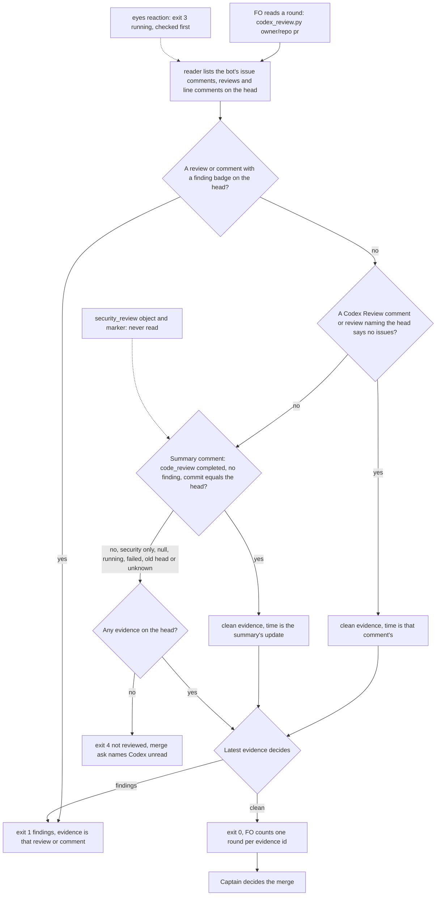

## Scope

- Source: codex-reader-reads-receipt-marker ideation D3, approved by the Captain 「可以，但要注意這個安全性審查是選用功能，不是每個人都會打開，請你動手設計時要跟 codex 確認一下它的規格」 (batch-5 sitting, 2026-10-21) as its own batch-5 task, after codex-reader-reads-receipt-marker.
- Bite: that ideation found the summary-comment path of `kc-dev-flow-2/extensions/codex/codex_review.py` reads a completed Codex security review as a clean code-review round; iamcxa/kc-claude-plugins #685, #686 and #689 read exit 0 via `summary:` while their `code_review.status` was null. Those three PRs merged in kc-dev-flow-2 0.27.0 with that evidence counted as Codex clean.
- First step: establish, from Codex's own documentation or output specification (not an adopter's reading of it), what the summary comment states for code review and for security review, whether a code review ran on those three heads, and what the comment looks like when security review is not enabled.
- The Captain's constraint: security review is an optional Codex feature that many repositories do not enable, so the reader must stay correct with it off, with it on, and when only one of the two ran.
- Shape asked for: a round counts as clean only from a code-review result on the head; a security-only summary reads as no verdict for code review.
- Upstream first: `codex_review.py` and its tests; the codex extension's stated limit that an unrecognized shape never reads as clean; codex-reader-reads-receipt-marker (same file, lands first).
- Non-goals: reading or acting on security-review findings themselves.

## FO alignment

Alignment: not needed before ideation; the Captain set the constraint.
Surfaces: none
Visible change: none
Release review: not needed: workflow maintenance, on no journey map.

## Design

### Upstream check (read 2026-10-21)

- Spacedock 0.27.3 cache: `grep -rIl "codex-review-state\|codex-security-review\|chatgpt-codex-connector"` finds nothing; no Codex reader there.
- kc-dev-flow-2 at origin/main c27e7659 (0.27.0): the same grep outside `extensions/codex/` finds nothing. The defect is one block of `state()` in `extensions/codex/codex_review.py`, the loop `for c in issue: if c["body"].startswith(SUMMARY)`, added in 49c670cb (2026-10-12) and never changed since; it reads the `codex-security-review:v1` marker (`headSha`, `status`), which describes the security review only.
- Sibling adopters (read-only `git grep` on the local checkouts of qnow, subspace-relay and recce-team, no fetch, 2026-10-21): no hit; none has a Codex reader to borrow.
- ADR 0013 closing sentence ("Later work must keep the reader's rule positive") and ADR 0004 (rounds counted by rule) bind the shape: a round counts from a positive code-review result, not from "no refusal seen". No `Override:` line bears on a Codex reader (`git -C <state> grep -n 'Override:'`, read 2026-10-21: no hit on codex, summary or reader).
- Order: the sibling task codex-reader-reads-receipt-marker edits the same file and lands first (Captain 「可以」 on its D3, in its gate record); this design is written against origin/main and rebased on that task's change at implementation.

### What Codex documents, and what it posts (the specification the Captain asked for)

Codex's own documentation, read 2026-10-21 (the old developers.openai.com URLs redirect with HTTP 308):

- Code review, https://learn.chatgpt.com/docs/third-party/github: "Codex posts a review on the pull request, just like a teammate would. In GitHub, Codex flags only P0 and P1 issues". Reviews run on `@codex review` or, with "Automatic review" on, on a "Review trigger". The page shows only a findings review ("Codex Review: Here are some suggestions.") and does not describe what Codex posts when it finds nothing. (Live reviews carry P2 badges too, so the page already differs from the output.)
- Security Review, same page and https://learn.chatgpt.com/docs/security/security-review: "available in research preview"; "an additional review for customers that want to pay particular attention to security issues"; per repository the opt-in "Auto security review", with "Trigger" set to "On PR open", "On every push" or "Whenever code review runs"; also `@codex security review` by hand. It is not on by default ("An existing Codex Security scan is optional"), and not available on the Plus plan. Findings are "posted directly on the pull request" above a reporting threshold; "If no issues meet the reporting threshold, Codex does not post findings to the pull request. Check the task status and full report before interpreting an empty comment result as a completed review with no findings."
- Together: "Code Review can also identify security-related issues as part of its general review, so you may see occasional overlap". "Whenever code review runs" runs the security review alongside the code review; the other two triggers run it without one. No page describes a combined comment.
- Not documented anywhere read: the summary comment, its markers (`codex-pull-request-review-summary`, `codex-review-state`, `codex-security-review`, `codex-review-receipt`), "Reviewed commit". The reader is therefore what EXTENSION.md already calls it, a compatibility adapter, and the live comment bodies are the specification for those parts.

What the live bodies say (Codex's own output; comments read 2026-10-21):

- The summary comment (`<!-- codex-pull-request-review-summary -->`) states its own contract in its footer: "Codex reacts with 👀 while any review is running, comments if it has suggestions, and reacts with 👍 once all reviews finish with no findings." The 👍 is therefore a verdict on all reviews at once and cannot tell code review from security review; on all five security-only heads below (iamcxa/kc-paseo-plugins #10 and #11, this repository's #685, #686, #689) the bot's 👍 is on the PR. The reader already ignores 👍 (an existing test asserts it); this design keeps that.
- Its table has one row per review that ran: `📝 Code Review`, `🔒 Security Review`, each with Status, Commit and trigger. Its marker `codex-review-state:v1` carries one object per review: `{"code_review":{"commit_sha","has_any_findings","has_unresolved_findings","status"},"security_review":{...}}`. The never-run review has all four fields null. A code review with findings has `commit_sha` null and `has_any_findings` true (#687); a clean one has the head sha and `false`. `status` was seen as `completed`, `running`, `failed`, null.
- Since 2026-10-16 the summary carries `codex-review-state:v1` next to `codex-security-review:v1`; before that (PRs #640, #645 and #647, 2026-10-13 to 15) it carried only the security marker, and #645 shows a head with a summary and no code-review comment at all.

### What the reader does in each mode (22 own PRs and 100 public PRs, one pass, 2026-10-21)

| Mode | Summary comment on the head | Base reader (0.27.0) | Candidate |
| --- | --- | --- | --- |
| Security off, code review ran clean | one row `Code Review`, `codex-review-state:v1` only, no `codex-security-review` marker (92 of the 100 public PRs in the first draw have this layout) | summary path never fires; clean only if a `Codex Review:` comment exists (27 heads read exit 4 although Codex finished clean) | clean from `code_review` |
| Security on, code review clean | both rows, both completed on the head | exit 0 (right, by the security marker) | exit 0 (right, by `code_review`) |
| Security on, code review never ran | `Security Review` row only, `code_review` all null | exit 0 (wrong: 5 of 5, the three bite PRs #685, #686, #689 and paseo #10, #11) | exit 4 |
| Security on, code review has findings | both rows, `code_review.has_any_findings` true | findings from the review lines; the summary adds nothing | same |
| Code review running or failed, security done | `code_review.status` running or failed | exit 3 while the 👀 reaction is on; after it, exit 0 if the security marker says completed | exit 3 while 👀 is on; after it exit 4 (24 public heads read `failed`) |

Counts from one cached read per PR, so all four readers saw the same bytes (a clean decision needs the head to be the head at read time; live PRs move, which is why an earlier pass without the cache disagreed with itself on a few PRs). Oracle for "Codex finished a clean code review on the head": the summary's `code_review` is `completed`, `has_any_findings` false, `commit_sha` equals the head, or a `Codex Review: Didn't find any major issues` comment names the head with no badge. The oracle shares the `code_review` object with the candidate, so the candidate's zero below measures consistency with Codex's own state, not an independent truth; the independent part is the 22 own PRs, where the comment shape also exists.

| Reader | Own 22: false clean / missed clean | Public 100: false clean / missed clean |
| --- | --- | --- |
| Base 0.27.0 | 5 / 1 | 0 / 27 |
| Base plus the receipt fix (the sibling task) | 5 / 0 | 0 / 21 |
| Remove the summary path (option A) | 0 / 0 | 0 / 21 |
| Read the `code_review` row (option B, candidate) | 0 / 0 | 0 / 0 |

"False clean" is exit 0 without the oracle; "missed clean" is a non-0, non-3 exit with it. The 21 public heads that stay unread under A are heads Codex reviewed clean and signalled only by the summary row and a 👍, with no comment.

### Existing-code check (bounded)

Use and repair what exists: one block of `state()` reads the wrong member of the wrong marker. Observation (disposable prototypes in `/tmp/ideation-ccr`, outside any repository): the base reader reads exit 0 on all five security-only heads above; the candidate reads exit 4 on all five and exit 0 on 27 of the 100 public heads (base: 0; base plus the receipt fix: 6), and against the receipt-fixed reader its exit differs on exactly 26 of 122 PRs, the 5 security-only heads and 21 public heads whose only clean evidence is the summary row; on 14 more own PRs only the wording of the detail changes ("code review of the head"). No new script, exit code, flag or printed field.

### PRFAQ

**Press release.** FO's Codex round counts only what Codex says about the code review. A head Codex reviewed for security alone reads "not reviewed", so the merge ask no longer says "Codex clean" for a head whose code was never read; a head whose code review finished clean reads clean whether or not the repository runs security review and whether or not a "Codex Review:" comment was posted.

**FAQ**
- *What counts as a code-review result?* Four things, as today: a `Codex Review:` clean comment or a badge-free clean review naming the head, a review or comment with a finding badge, and one new thing replacing the security read: the summary's `code_review` object with `status` `completed`, `has_any_findings` false and `commit_sha` equal to the head, in a comment that opens with the summary marker, with no finding on the head before it. Each field is needed (AC-3).
- *Security review off?* The summary has no `codex-security-review` marker and a null `security_review` object; the candidate does not look at either, so nothing changes except that the `code_review` row now counts. *On?* Same: the security object and marker are never read. *Only one ran?* Security only reads exit 4; code review only reads clean or findings as above.
- *What of a security finding?* Out of scope (the task's non-goal). Codex posts it on the PR above a threshold; the shape is not documented and none of the 122 PRs read carries one, so the candidate neither reads it nor claims to. A finding that carries a P-badge is already read as a finding by the existing badge rule; one without a badge reads as nothing.
- *Why read `code_review` and not just delete the summary path?* Deleting leaves 21 of the 100 public heads unread although Codex finished clean (option A, D1). It also drops the structured fallback that carried this repository for five days after the receipt wording changed on 2026-10-16.
- *What if Codex changes `codex-review-state`?* The summary path goes quiet, the reader reads exit 4, never clean (fail closed), as for any unrecognized shape; the same undocumented-adapter limit EXTENSION.md already states.
- *Does the printed output change?* Only the words of one detail: "summary marks the head completed" becomes "summary marks the code review of the head completed". EXTENSION.md, README, mods, `pr_watch.py` and `delivery_gate.py` are untouched.

### Mermaid

Actors and order match the prose: the reader is the only classifier, FO acts on the exit code, the Captain owns the merge; the dashed security box shows what the candidate does not read. The finding-before-summary guard and the head-moved check are existing code and are not drawn.

### Surfaces

`Surfaces: none`: no UI and no schema; PRFAQ and Mermaid only.

### Delivery shape (for implementation, not decided here)

Files the change touches, and no others:
- `kc-dev-flow-2/extensions/codex/codex_review.py`: `MARKER` matches `codex-review-state:v1`; the summary block reads `code_review` (14 changed lines on top of the receipt task's change, including the docstring sentence and the printed detail, measured on the prototype).
- `kc-dev-flow-2/extensions/codex/test_codex_review.py`: the `marker` helper builds the real two-marker body (state object, plus the security marker when the security object ran); one new test with 11 subtests (the table's rows and the field-by-field cases) plus the old security-only shape and a non-bot author; the existing test that asserted the defect keeps its lines and now passes through the new helper; two assertion lines that gave a marker another repository or PR number are removed because the new marker carries neither; the guard they gave is held by the read itself, which takes comments from this PR's own `issues/{pr}/comments` list filtered to the bot author, so another PR's marker cannot enter the loop (prototype: 39 added, 6 removed lines).

Commit type `fix(kc-dev-flow-2): ...`, patch release by release-please. `delivery_gate.py` classes `extensions/codex/codex_review.py` as `never`, so the merge ask stays an ask. CI already runs the test file (`.github/workflows/kc-dev-flow-2-tests.yml` step `extensions/codex/test_codex_review.py`); no new job. Added `#` comment lines: 0 (prototype count).

Prototype and mutation record (in `/tmp/ideation-ccr`, not repository files; `python3 -B -I`): the 13 tests pass on the prototype; on the base reader 5 fail (the new test's four clean rows and the helper-driven old test). Seven mutants of the prototype, each alone: (M1) read the security marker again: 5 red including the security-only row; (M2) drop `commit_sha == head`: 3 red; (M3) treat an unknown finding as none: 1 red; (M4) drop `status == completed`: 2 red; (M5) read `security_review`: 5 red; (M6) drop the finding-before guard: 2 red; (M7) drop the summary-lead check: 1 red.

### Batch overlap

Files the design would change: `kc-dev-flow-2/extensions/codex/codex_review.py` and `kc-dev-flow-2/extensions/codex/test_codex_review.py`. It reads but does not change `kc-dev-flow-2/extensions/codex/EXTENSION.md`, `kc-dev-flow-2/scripts/pr_watch.py` (parses the exit code and `evidence=`, both unchanged), `kc-dev-flow-2/scripts/test_sd_dispatch.py` (case `codex-round` asserts EXTENSION.md phrases, unchanged), `kc-dev-flow-2/scripts/test_delivery_gate.py` (lists `codex_review.py` as class `never`) and `.github/workflows/kc-dev-flow-2-tests.yml`. No ADR number, shared index, table or numbered record. Read 2026-10-21 from the task files in the state checkout, `gh pr list --repo iamcxa/kc-claude-plugins --state open --json files`, and `git log origin/main -- kc-dev-flow-2/extensions/codex` (no commit since 2026-10-20).

| Other task | Same file or check | Note |
| --- | --- | --- |
| codex-reader-reads-receipt-marker (ideation, revised after the Captain's D2) | yes: both change `codex_review.py` and `test_codex_review.py` | it edits the clean-comment branch of `state()` and adds tests; this design edits the summary block, the `MARKER` line, the docstring and the `marker` test helper. Different lines, so a mechanical merge; its D2 (name an unrecognized Codex comment on a wait timeout) must treat a summary carrying `codex-review-state:v1` as recognized, or a security-only head would be quoted as an unknown comment. Its design reads `pr_watch.py` and the merge ask; mine does not. Implement mine second. |
| new-work-starts-from-a-story-map, merge-ask-holds-missing-clauses, fo-write-checks-parse-top-level, idle-names-failing-seeds, agent-reads-governing-adr | none | their own overlap tables list `codex_review.py` only as the receipt task's file |
| kc-decision-log-p1, kc-decision-log-cli, kc-decision-log-handoff-trial, pr-review-lite-value-pilot, release-acceptance, journey-canvas-hosted-poc, journey-server-host-pilot (other sessions, read only) | none | no mention of the codex files, `pr_watch.py` or `EXTENSION.md` in their task files |
| open PR #674 (Codex model and effort policy) | no | `.github/workflows/kc-dev-flow-2-tests.yml` only; concerns Codex workers, not the reader |

Shared only by release: one release-please component for kc-dev-flow-2. Recommended order: codex-reader-reads-receipt-marker implementation first, then this task, because both edit `state()` and the same test file; no other task needs ordering against it.

## The words FO reads at each lifecycle moment

Rule: root `learning.md` "Measure the words FO reads at each moment, not one file's size". Counted as `len(text.split())`, same method for base (origin/main c27e7659) and the prototype; the goal is no growth in instruction words.

| Moment | What FO reads about this reader | Base | Candidate |
| --- | --- | --- | --- |
| Startup | nothing from the reader (not run) | 0 | 0 |
| Idle on an open PR | `pr_watch.py` columns `codex=<verdict> codex-evidence=<id>`; two fields | 2 | 2 |
| Idle on a merged PR | none: the reader runs only for an OPEN PR | 0 | 0 |
| After the archive | none | 0 | 0 |
| A review round and the merge ask | `extensions/codex/EXTENSION.md` | 185 | 185 |
| The same, printed line for a security-only head (#685) | clean line becomes the existing not-reviewed line | 11 | 7 |
| The same, printed line when the summary row is the clean evidence | "summary marks the head completed" becomes "summary marks the code review of the head completed" | 11 | 15 |
| `--help` text, printed only on bad arguments | the module docstring | 151 | 158 |

Only data words change; no instruction word is added. The value of `codex=` in `pr_watch.py`'s watch columns for a security-only head changes from `clean` to `not-reviewed` (`reader()` maps exit 4 to `not-reviewed`), which is the point of the task.

## Unresolved decisions for the Captain

- **D1: replace the summary's security read with the `code_review` read (option B), or delete the summary path (option A)?** Recommend B. It is the only option that counts a clean code review in a repository that runs automatic review without security review or without `@codex review` comments: 21 of the 100 public heads (and none of this repository's) are clean in Codex's own state yet read exit 4 under A. Worse under B: it reads one more undocumented marker, `codex-review-state:v1` (first seen 2026-10-16), so a Codex format change silences that path (reads exit 4, never clean) until someone edits one regex; A has no such surface but leaves 21 percent of sampled public heads unread, and FO waits to the timeout then asks the Captain with Codex unread.

## Acceptance criteria

Evidence commands run from `<package>/extensions/codex/` of the implementation candidate with `python3 -B -I`; "base" is origin/main c27e7659 (0.27.0). `gh` must be authenticated read-only. Live PRs move: a changed head changes a live reading, so AC-2 to AC-4 are the durable forms and AC-1 and AC-5 are dated observations.

**AC-1** The candidate reads a security-only head as no verdict. Evidence: `python3 -B -I codex_review.py iamcxa/kc-claude-plugins 685` (and 686, 689; `iamcxa/kc-paseo-plugins` 10, 11) exits 4 with `not reviewed: no Codex evidence covers <sha>`, where base exits 0 with `summary marks the head completed` (observed 2026-10-21 on all five). Falsifier: exit 0, or a candidate that reads `security_review` (M5). Status: prototype observed 5 of 5 on 2026-10-21; repository run not yet done. If a later push moved a head, the same command on any PR whose summary has a null `code_review` and a completed `security_review` stands in.

**AC-2** A unit test holds the table's modes with real-shaped bodies (two markers, as Codex posts them): code review clean on the head with security off, with security on and clean, each exit 0; security completed with a null code review, security completed with the code review running, code review failed, code review clean on an old head, code review clean with no sha, code review completed with `has_any_findings` null, code review completed with a finding, a summary with an empty state, each exit 4; the pre-2026-10-16 security-only marker body exit 4; a non-bot author exit 4. Evidence: `python3 -B -I test_codex_review.py`. Falsifier: M1 (security marker read again) and M5 (`security_review` member) turn the security-only rows red. Status: prototype passes (13 tests); M1 and M5 red, 4 subtests each. Not yet verified in the repository.

**AC-3** Each field of the positive rule is needed. Evidence: three subtests, each failing only its own mutant: `commit_sha` not the head (M2: red), `has_any_findings` not exactly false (M3: red), `status` not `completed` (M4: red). Falsifier: a mutant that passes the suite. Status: prototype M2, M3, M4 each red; not yet verified in the repository.

**AC-4** The guards around the summary stay: a finding on the head earlier than the summary's update still blocks (existing tests `test_a_completed_summary_after_findings_is_not_clean` and the badge test), and a marker outside a summary comment or from a person is ignored. Evidence: the existing tests pass unedited except the `marker` helper and the two removed assertion lines named in Delivery shape. Falsifier: M6 (guard dropped) and M7 (lead check dropped) go red. Status: prototype M6 two red, M7 one red; not yet verified in the repository.

**AC-5** Live replay finds no false clean. Evidence: for the 22 own PRs (iamcxa/kc-paseo-plugins #8, #10, #11; this repository #649, #651, #652, #658, #659, #661, #663, #664, #668, #670, #675, #679, #680, #682, #685 to #689) and a fresh draw of `gh search prs --commenter "chatgpt-codex-connector[bot]" --sort created --limit 100`, read each PR once into a cache, run base and candidate on that one cache, and count exit 0 with no clean code review on the head by the oracle above. Expect candidate 0 and base 5 on the own 22; the recorded draw gave 0 false clean for base and candidate on the public 100, with base reading none of its 28 oracle-clean heads as clean (27 missed, 1 still running) and the candidate missing none. Falsifier: any candidate exit 0 without the oracle, or the base count not reproducing on the own 22. Status: prototype recorded 2026-10-21 (table in the design); repository run not yet done. Public repository names are not recorded in this file.

**AC-6** The change touches only the two files and adds no comment line. Evidence: `git diff --name-only origin/main...HEAD` lists exactly `kc-dev-flow-2/extensions/codex/codex_review.py` and `kc-dev-flow-2/extensions/codex/test_codex_review.py` (plus the receipt task's files only if its commit is not yet on origin/main, which AC-8 forbids); `comment_ratio.py` reports 0 added comment lines. Falsifier: any other path or an added `#` line. Status: not yet verified.

**AC-7** FO's reading does not grow. Evidence: `git diff origin/main...HEAD -- kc-dev-flow-2/extensions/codex/EXTENSION.md kc-dev-flow-2/README.md kc-dev-flow-2/references` is empty, so the 185-word EXTENSION.md and the two watch columns are unchanged, and the printed-line rows above hold. Falsifier: any added word in those paths. Status: not yet verified.

**AC-8** The implementation follows codex-reader-reads-receipt-marker. Evidence: `git merge-base --is-ancestor <that task's merge commit> HEAD` exits 0, and both tests files pass together. Falsifier: exit 1. Status: not yet verified; FO orders it.

## Number guards

ADR: none. The design lands no ADR.

### Feedback Cycles

- Cycle 1 (FO, 2026-10-22): Codex review on #702 12766289 (review:5609156241) left one P1, to fix (rounds 1 and 2 fix every finding; a P1 blocks in every round); investigation first, then FO fix authorization, then a fresh validation recheck.
  - P1 comment:4344458066 (codex_review.py): the summary evidence id uses the comment-wide updated_at, so a later security_review edit of the same summary yields a second summary:@ id for one unchanged clean code_review, and FO counts one code-review verdict as two rounds; tie the evidence identity to the code-review transition.

## Stage Report: ideation

- DONE: First establish Codex's code-review and security-review output from Codex's own documentation or specification (cite the source), then design the reader so a round counts only from a code-review result on the head, correct with security review off, on, or only one of the two run; measure on the 22 sampled live PRs plus #685, #686 and #689; order the implementation after codex-reader-reads-receipt-marker, which edits the same file
  `## Design`: docs read at learn.chatgpt.com/docs/third-party/github and /docs/security/security-review (code review's no-issues output and every marker are undocumented; security review is optional, per repository, and "an empty comment result" is not a completed review); the live summary comments are the specification for the rest. Reader counts the summary's `code_review` object (completed, no finding, sha equals head) in place of the security marker. Measured on the 22 own PRs (which already include #685, #686, #689) and 100 public PRs: 5 false clean and 0 false clean for base and candidate on the own set; 27 missed clean to 0 on the public set. Order: after the receipt task.
- DONE: A `### Batch overlap` section naming each file the design would change and each other batch task and live task of other sessions that changes the same file or check, so FO can order implementation
  `### Batch overlap`: two files changed; only codex-reader-reads-receipt-marker shares them (and its D2 detector must treat the summary as recognized); the other four batch tasks, the seven other-session tasks and PR #674 do not; `Recommended order:` receipt task first.
- DONE: The words FO reads at each lifecycle moment, before and after, per root learning.md "Measure the words FO reads at each moment, not one file's size"
  `## The words FO reads at each lifecycle moment`: six moments and two printed lines counted by `len(split())`; EXTENSION.md 185 to 185, no instruction word added; printed detail 11 to 15 words, the security-only line 11 to 7, `--help` 151 to 158.
- DONE: Acceptance criteria with reproducible evidence clauses and falsifiers, and unresolved decisions for the Captain, each with a recommendation and what gets worse under it
  AC-1 to AC-8 each carry a command and a falsifier; D1 (read `code_review` or delete the summary path) carries a recommendation and its cost. `design_surfaces.py check` printed "design surfaces presentable".

### Per-criterion evidence

- AC-1: prototype reads exit 4 on the five security-only heads where base reads 0 (2026-10-21). Repository run not yet done.
- AC-2: prototype test passes (13 tests, 11 summary subtests); M1 and M5 red on the security-only rows. Not yet verified in the repository.
- AC-3: M2, M3, M4 each red by its own subtest on the prototype. Not yet verified in the repository.
- AC-4: M6 two red, M7 one red on the prototype. Not yet verified in the repository.
- AC-5: cached replay on 22 own and 100 public PRs recorded in the design; repository run not yet done.
- AC-6, AC-7, AC-8: designed, not yet verified (they check the implementation diff and its base).

### Summary

The reader's summary path reads the security review's marker, so a head Codex reviewed for security alone reads as a clean code-review round (5 of the 22 own PRs, including #685, #686 and #689). The design swaps that read for the summary's `code_review` object, which Codex states per review, so security off, on or only one run all read correctly, and 27 of 100 sampled public heads that Codex finished clean now read clean instead of unread. One decision goes to the Captain: read that object (recommended) or delete the summary path.

### Deviations and disclosures

- The ideation skill and its principles loaded from kc-dev-flow-2 0.27.0, matching the dispatch.
- 100 public PRs of other organisations were read through `gh` (read-only) for the security-off layout; their names are not recorded here, only counts. Prototype, replay scripts and mutants are in `/tmp/ideation-ccr`, outside every repository.
- The usage limit interrupted this stage once; the work resumed from the same prototype and was re-measured in one cached pass, so the figures above come from that pass.

## Stage Report: implementation

- DONE: One Draft PR (fix(kc-dev-flow-2): ...) from a branch off origin/main (4befab1f1d98cde0dfa107dbb12404c69f445af0, which holds codex-reader-reads-receipt-marker's merge) implementing the approved design (D1 option B): the Codex reader counts a clean round from the summary comment's `code_review` object (status completed, has_any_findings false, commit_sha equal to the head) in place of the security marker; only kc-dev-flow-2/extensions/codex/codex_review.py and kc-dev-flow-2/extensions/codex/test_codex_review.py change
  Draft PR https://github.com/iamcxa/kc-claude-plugins/pull/702, head 12766289, base 4befab1f; `git diff --name-only origin/main...HEAD` lists exactly those two files (AC-6, AC-8: base holds the receipt merge).
- DONE: Every acceptance criterion AC-1 to AC-8 green with the evidence each names, each falsifier (M1 to M7) shown failing by a mutation you run (python3 -B, caches cleared), including the AC-5 live replay of base and candidate on one cache (own 22 PRs and a fresh public draw of 100; public repository names not recorded)
  AC-1: five security-only heads (685, 686, 689, paseo 10, 11) candidate exit 4 `not reviewed: no Codex evidence covers <sha>`, base exit 0 `summary marks the head completed`.
  AC-2/3/4: `python3 -B -I test_codex_review.py` 20 tests OK; the new test's 11 subtests fail when its row's rule is broken (M1 to M7 below), the old guard tests are unedited apart from the `marker` helper and two removed assertions.
  M1 6 red, M2 3, M3 1, M4 3, M5 5, M6 2, M7 1, each alone, `python3 -B -I`, fresh temp dir per mutant (script /tmp/ensign-mut.py); M3 fails only the unknown-finding row, M7 only the non-summary-lead test.
  AC-5 (one cached read per PR, 2026-10-22): own 22 base 5 false clean / 0 missed, candidate 0 / 0; fresh public 100 base 0 / 24 missed (28 oracle-clean), candidate 0 / 0; no fetch or reader errors. Script /tmp/ensign-replay/replay.py.
  AC-6: 0 added comment lines; AC-7: diff of EXTENSION.md, README.md, references is empty; AC-8: `git merge-base --is-ancestor` holds, base is origin/main 4befab1f.
- DONE: comment_ratio.py reports 0 added comment lines; lint-skills.py exits 0; roborev evidence= line; push without force and without -u; CI green on the PR head; CI cost measured or stated as not measured
  `comment_ratio.py origin/main HEAD`: code lines 41, comment lines 0, 0.0%, exit 0.
  lint-skills.py: the repo's own `kc-dev-flow-2/scripts/lint-skills.py` (what CI runs) exits 0; the package-cache copy named in the dispatch exits 1 with `repository frontmatter check missing: .../kc-dev-flow-2/scripts/skill-frontmatter-lint.sh` (cache install lacks that repo-level script, also with `--root`); not a candidate defect.
  roborev_gate.py: `clean on 127662897; evidence=roborev:1007` (exit 0, first run).
  `git push origin <branch>` fast, no -u, no force. CI on 12766289: unit tests (python3) pass 1m50s, multi-profile route gate pass 6s, version parity pass 55s, GitGuardian pass. Cost: job wall time as above; billed minutes not measured; no workflow change.

### Summary

The summary-comment path of the Codex reader now reads `code_review` of `codex-review-state:v1` (completed, `has_any_findings` false, `commit_sha` equal to the head) and never the security marker or object, so security off, on or only one run read correctly; security-only heads read exit 4. The prototype from ideation was ported onto the receipt-fixed origin/main (7 changed lines in the reader, 39 added and 6 removed in the test file), then re-measured in the repository: all seven mutants red, replay 0 false clean and 0 missed clean for the candidate.

### Deviations and disclosures

- Public draw differs from the design's recorded one: base missed 24 (design recorded 21 on the receipt-fixed base; the draw is fresh and Codex reviewed more heads since). Candidate result unchanged at 0 / 0.
- Dispatch named the package-cache `lint-skills.py`; it cannot run from the cache install (see above). The repo copy, which CI runs, exits 0.
- `test_sd_dispatch.py` needs `--sd-plugin-root`; run against the spacedock 0.27.3 cache, all PASS. Other CI-listed tests run locally, all exit 0.
- Scratch scripts and the replay cache live in /tmp (outside every repository); public repository names appear only in that scratch output, not in this file or the PR.
- No ADR, no `Applied` or migration; `doc_impact.py origin/main HEAD` lists 0 documents.

## Stage Report: validation

- DONE: Independent verdict on PR #702 head 12766289 against every acceptance criterion in the task file, re-running each evidence command and at least one falsifier per criterion yourself, and judging each limit the implementation report states
  Verdict PASSED at 127662897 (Draft, open, CI green: unit tests, route gate, version parity, GitGuardian). AC-1: five security-only heads (685, 686, 689, paseo 10, 11) candidate exit 4 `not reviewed: no Codex evidence covers <sha>`, previous reader exit 0 (685's live summary has `code_review` all null, `security_review` completed). AC-2/3/4: `test_codex_review.py` 20 tests OK; my own mutants, each alone: security marker read again (M1) red on the clean row and the security rows, no `commit_sha==head` (M2) red on the old-head row, unknown finding as none (M3) red only on the unknown-finding row, no `status==completed` (M4) red, `security_review` read (M5) red on the security-only rows, no finding-before guard (M6) 2 red, no summary-lead check (M7) 1 red, any author (M8) red. AC-5 (one cached read per PR, my own oracle, 2026-10-22): own 22 base 5 false clean / 0 missed, candidate 0 / 0; fresh public 100 (28 oracle-clean) base 1 false clean / 26 missed, candidate 0 / 0, no read errors. AC-6: diff vs origin/main lists exactly the two files, comment_ratio 41 code / 0 comment lines, exit 0. AC-7: diff of EXTENSION.md, README.md, references is empty. AC-8: 4befab1f (receipt merge) is an ancestor of origin/main and of the head. Limits judged: reads an undocumented marker (Codex change goes quiet, reads exit 4, never clean; Deferred risk); a security finding without a P-badge reads as nothing (stated non-goal; Deferred risk); two removed assertions (repo and PR number in a marker) are covered because comments come from this PR's own `issues/{pr}/comments` list filtered to the bot (read in `state()`; M8 shows the author filter is tested).
- DONE: Merge onto current origin/main (coordinator request)
  origin/main is cebd0ab9 (holds #694); `git merge --no-commit` of the head into a throwaway worktree: no conflict, only the two codex files change; `test_codex_review.py` 20 tests OK and `test_pr_watch.py` 101 tests OK on the merged tree. Both throwaway worktrees removed.
- DONE: A minimal acceptance script the Captain can run (three to six steps, exact commands, expected output), run by you exactly as written in a fresh bash shell, with its observed output
  Script below, run as `env -i HOME PATH bash --noprofile --norc`, output as the expected lines.
- DONE: `adr_lint.py docs/adr --since <base>` with its exit code
  `adr_lint.py docs/adr --since 4befab1f` and `--since origin/main`: "28 ADR file(s) checked, 0 legacy", exit 0 both. Also: `dispatch_records.py` exit 0 (3 records complete); `design_surfaces.py check` exit 0; `doc_impact.py 4befab1f HEAD` lists 0 documents, exit 0; no `## Number guards` check owed (Surfaces none, ADR none).
- DONE: Verdict naming the head, with findings classified by the workflow's Review-finding disposition
  PASSED for 127662897fc547dedd501a59c953c8d3ece9cddb. F1 Deferred risk: the summary path depends on the undocumented `codex-review-state:v1` marker; becomes Material if Codex changes it and a repository then waits to the timeout with Codex unread. F2 Deferred risk: a Codex security finding with no P-badge reads as nothing; Material only if the Captain asks the reader to act on security findings (task non-goal). No Material finding, no repair needed.

### Acceptance script (Captain)

    D=$(mktemp -d)
    git clone -q --filter=blob:none --no-checkout https://github.com/iamcxa/kc-claude-plugins.git "$D/r" && cd "$D/r" && git fetch -q origin 127662897fc547dedd501a59c953c8d3ece9cddb && git checkout -q 127662897fc547dedd501a59c953c8d3ece9cddb && git log -1 --format='head %h'
    cd kc-dev-flow-2/extensions/codex && python3 -B -I test_codex_review.py 2>&1 | tail -3
    python3 -B -I codex_review.py iamcxa/kc-claude-plugins 685; echo "exit=$?"
    git show 4befab1f1d98cde0dfa107dbb12404c69f445af0:kc-dev-flow-2/extensions/codex/codex_review.py > "$D/base_reader.py"; python3 -B -I "$D/base_reader.py" iamcxa/kc-claude-plugins 685; echo "exit=$?"
    python3 -B -I codex_review.py iamcxa/kc-claude-plugins 682; echo "exit=$?"

Needs `git`, `python3`, and `gh` signed in (read-only). Observed: `head 12766289`; `Ran 20 tests ... OK`; step 3 `not reviewed: no Codex evidence covers 187f93a53` exit=4; step 4 (previous reader, same PR) `clean on 187f93a53: summary marks the head completed; ...` exit=0; step 5 `clean on f44473962: summary marks the code review of the head completed; ...` exit=0. Not covered: a repository with security review enabled and Codex security findings; PRs whose Codex comments change after 2026-10-22 (live PRs move; 685 and 682 are merged-era heads); the Captain's own Codex setup.

### Summary

PASSED at 127662897. The reader now counts a summary only through `code_review`; five security-only heads that read clean before read not reviewed, and clean code reviews still read clean with security off or on. Every criterion re-ran green, each mutant fails its own test, the head merges cleanly onto cebd0ab9 with all codex and pr_watch tests passing.

### Deviations and disclosures

- My oracle is a fresh re-implementation (clean review/comment on the head, or summary `code_review` completed/clean/head); it shares the `code_review` object with the candidate, so the public zero measures consistency with Codex's own state. Base showed 1 public false clean (design recorded 0); the candidate had 0; I did not trace that one PR. Public repository names are not recorded.
- Not run by me: `lint-skills.py` and the other CI-listed test files (read CI results only: four checks pass on the head).
- Scratch files live in /tmp (replay, mutants); both throwaway worktrees were removed. No push, no PR comment, no `ready`.

## Stage Report: implementation (cycle 1)

- DONE: In kc-dev-flow-2/extensions/codex/codex_review.py state(), change the summary evidence id from summary:<comment id>@<comment updated_at> to summary:<comment id>@<first 9 hex of the head>, keeping the tuple's time as updated_at so ordering and the printed at-time are unchanged
  Commit 28807397: one token in the evidence append (`@{head[:9]}`); the tuple time is still `c["updated_at"]`; diff vs origin/main...HEAD still lists only the two files, comment_ratio.py 0 added comment lines.
- DONE: Keep both new tests in kc-dev-flow-2/extensions/codex/test_codex_review.py: a summary edit after a clean code review keeps one evidence id (security on and off), and a clean code review on a new head gets a new id; show each failing on the matching mutant (old updated_at id; comment id alone)
  `test_a_summary_edit_after_the_code_review_does_not_make_a_second_round` asserts equal ids when updated_at moves T1 to T2 (security running to completed, and security off); M8 (id from updated_at) turns only it red. `test_a_clean_code_review_on_a_new_head_is_a_new_round` asserts a clean verdict on another head has another id; M9 (comment id alone) turns only it red. Before the fix the first test failed with `summary:9@...T10:00:00Z != summary:9@...T11:00:00Z`.
- DONE: Rerun mutants M1 to M7 and the AC-5 replay on one cached read per PR; state the two residuals in the stage report
  Mutants (python3 -B -I, fresh temp dir each): M1 8 red, M2 3, M3 1, M4 3, M5 7, M6 2, M7 1, M8 1, M9 1; M1 and M5 now also turn the two new tests red. Replay 2026-10-22 (/tmp/ensign-replay/replay.py, one cache): own 22 candidate 0 false clean / 0 missed (base 5 / 0); public 100 candidate 0 / 0, base 2 false clean and 28 missed (oracle-clean 33; the live draw moved since the earlier run); no fetch or reader errors.
  Residual 1: a clean re-review of the same head keeps one id and counts once.
  Residual 2: a PR mid-flight at release may be recounted once, because the id format changes from `@<timestamp>` to `@<head>`.
- DONE: All package test files pass; push with an explicit remote and branch, no -u; CI green on the new head; commit the stage report
  Every file in kc-dev-flow-2-tests.yml exits 0 (test_sd_dispatch.py against spacedock 0.27.3 cache PASS; lint-skills.py 0). Pushed `git push origin spacedock-ensign/codex-reader-counts-code-review-only`, 12766289..28807397, no -u, no force. CI on 28807397: unit tests pass 2m0s, route gate pass 7s, version parity pass 54s, GitGuardian pass.
  roborev_gate.py --base 4befab1f (PR base): `clean on 288073978; evidence=roborev:1022` exit 0 (a first run with --base origin/main e1f43044 also exit 0, evidence=roborev:1021).

### Summary

The Codex summary round is now identified by the comment id plus the head, so a later security-review edit of the same summary no longer yields a second id for one clean code-review verdict. Both new tests fail on their own mutant and the earlier seven mutants and the live replay still hold.

## Stage Report: validation (cycle 1)

- DONE: Independent verdict on PR #702 head 28807397 against every acceptance criterion in the task file, re-running each evidence command and at least one falsifier per criterion yourself, and judging each limit the implementation report states
  Verdict PASSED at 28807397841eff05cb4b8bd06992001584d73fec (open, MERGEABLE, ready since 2026-10-22T04:08Z by iamcxa, CI: unit tests, route gate, version parity, GitGuardian all SUCCESS). Checked out detached in a throwaway worktree, removed after. AC-1: the acceptance script below reads 685 exit 4 `not reviewed: no Codex evidence covers 187f93a53` where the 4befab1f reader reads exit 0; AC-5 replay below gives 0 false clean on all five security-only heads. AC-2/3/4: `test_codex_review.py` 22 tests OK; my own mutants M1 to M10 (script /tmp/val-ccr-tools/mut.py, `python3 -B -I`, fresh temp dir each, one alone): M1 security marker read again 8 red, M2 no `commit_sha==head` 3 red, M3 unknown finding as none 1 red (only the unknown-finding row), M4 no `status==completed` 3 red, M5 `security_review` read 7 red, M6 no finding-before guard 2 red, M7 no summary-lead check 1 red (only the non-summary-lead test), M8 id from `updated_at` 1 red, M9 comment id alone 1 red, M10 any author 5 red. AC-5 (one cached read per PR, my own oracle, 2026-10-22, base 4befab1f vs candidate vs previous head 12766289): own 22 (14 oracle-clean) base 5 false clean / 0 missed, both candidates 0 / 0; fresh public 100 (23 oracle-clean) base 0 false clean / 19 missed, both candidates 0 / 0; no fetch errors. AC-6: diff vs origin/main lists exactly the two codex files; `comment_ratio.py 4befab1f HEAD` 56 code / 0 comment lines, exit 0. AC-7: diff of EXTENSION.md, README.md, references empty. AC-8: 4befab1f is an ancestor of the head. Limits judged: F1 to F4 below.
- DONE: Fresh recheck after the Cycle 1 repair (Codex P1 comment:4344458066): judge the new summary evidence id summary:<comment id>@<head[:9]> against the finding, the two new tests and their mutants M8 and M9, and the two residuals the implementation report states
  The finding is closed. Diff 12766289..28807397 is one token (`@{c['updated_at']}` to `@{head[:9]}`); the tuple time stays `updated_at`, so ordering and the printed `at` are unchanged. The id can only be produced when `code_review.commit_sha == head`, so it is one id per (summary comment, head), which is one code-review verdict. Test `test_a_summary_edit_after_the_code_review_does_not_make_a_second_round` asserts equal ids when `updated_at` moves T1 to T2 with security running then completed, and with security off; M8 turns only it red. Test `test_a_clean_code_review_on_a_new_head_is_a_new_round` asserts a clean verdict on another head gets another id; M9 turns only it red. `pr_watch.py` reads `evidence=(\S+)` and the id has no space, so the watch is unaffected (its 101 tests pass on the head merged onto origin/main b93612f8, no conflict, merge aborted). Residual 1 (a clean re-review of the same head counts once) and residual 2 (id format change) judged as F3 and F4. Measured on live data: the id of the summary evidence differs between the previous head and this one on 35 of the 37 oracle-clean heads in my sample, which is residual 2's whole footprint.
- DONE: A minimal acceptance script the Captain can run (three to six steps, exact commands, expected output), run by you exactly as written in a fresh bash shell, with its observed output; /Users/kent/.claude/plugins/cache/kc-claude-plugins/kc-dev-flow-2/0.27.0/scripts/adr_lint.py docs/adr --since <base> with its exit code; your verdict naming the head, with findings classified by the workflow's Review-finding disposition
  Script below run as `env -i HOME PATH bash --noprofile --norc <file>`; observed output in the section. `adr_lint.py docs/adr --since 4befab1f` and `--since origin/main`: "28 ADR file(s) checked, 0 legacy", exit 0 both. Also `dispatch_records.py` exit 0 (6 records complete), `design_surfaces.py check` exit 0, `doc_impact.py 4befab1f HEAD` lists 0 documents, exit 0; no `## Number guards` check owed (Surfaces none, ADR none). Verdict PASSED for 28807397841eff05cb4b8bd06992001584d73fec; no Material finding.

### Findings

- F1 Deferred risk: the summary path depends on the undocumented `codex-review-state:v1` marker; a Codex change makes it read exit 4, never clean. Becomes Material if Codex changes it and a repository then waits to the timeout with Codex unread.
- F2 Deferred risk: a Codex security finding without a P-badge reads as nothing (stated non-goal). Becomes Material only if the Captain asks the reader to act on security findings.
- F3 Deferred risk: a clean re-review of the same head keeps one id and counts once (residual 1). Becomes Material if FO's round limit needs a second clean verdict on one head.
- F4 Deferred risk: a PR already counted under an old `summary:<id>@<timestamp>` id may be counted once more after release (residual 2). Becomes Material if that extra round pushes a mid-flight PR across a round limit.

### Acceptance script (Captain)

    D=$(mktemp -d)
    git clone -q --filter=blob:none --no-checkout https://github.com/iamcxa/kc-claude-plugins.git "$D/r" && cd "$D/r" && git fetch -q origin 28807397841eff05cb4b8bd06992001584d73fec && git checkout -q 28807397841eff05cb4b8bd06992001584d73fec && git log -1 --format='head %h'
    cd kc-dev-flow-2/extensions/codex && python3 -B -I test_codex_review.py 2>&1 | tail -3
    python3 -B -I codex_review.py iamcxa/kc-claude-plugins 685; echo "exit=$?"
    git show 4befab1f1d98cde0dfa107dbb12404c69f445af0:kc-dev-flow-2/extensions/codex/codex_review.py > "$D/base_reader.py"; python3 -B -I "$D/base_reader.py" iamcxa/kc-claude-plugins 685; echo "exit=$?"
    python3 -B -I codex_review.py iamcxa/kc-claude-plugins 682; echo "exit=$?"

Needs `git`, `python3`, and `gh` signed in (read-only). Observed 2026-10-22: `head 28807397`; `Ran 22 tests in 0.002s` / `OK`; step 3 `not reviewed: no Codex evidence covers 187f93a53` exit=4; step 4 (previous reader, same PR) `clean on 187f93a53: summary marks the head completed; evidence=summary:6291599352@2026-10-20T13:11:29Z at 2026-10-20T13:11:29Z` exit=0; step 5 `clean on f44473962: summary marks the code review of the head completed; evidence=summary:6282111975@f44473962 at 2026-10-20T03:07:11Z` exit=0 (the new id carries the head, not a timestamp). Not covered: a repository with security review enabled and Codex security findings; PRs whose Codex comments change after 2026-10-22 (live PRs move; 685 and 682 are merged-era heads); the Captain's own Codex setup; a real edit of a live summary after a clean review (covered by the unit test only).

### Summary

PASSED at 28807397. The Cycle 1 repair closes Codex's P1: one clean code-review verdict on one head now has one evidence id however often the summary comment is edited, M8 and M9 each fail only their own test, and the earlier seven mutants and the live replay still hold (0 false clean, 0 missed clean for the candidate on 122 PRs). Four Deferred risks, no Material finding.

### Deviations and disclosures

- My oracle shares the `code_review` object with the candidate, so the zero on the public set measures consistency with Codex's own state; the independent part is the 22 own PRs, where the comment shape also exists. Public repository names are not recorded.
- Not run by me: `lint-skills.py` and the other CI-listed test files except the two codex-related ones and `test_pr_watch.py`; I read CI results (four checks pass on the head). The live draw moved since the implementer's run (their public oracle-clean 33, mine 23); both readers agree on every PR within my own run.
- Scratch files live in /tmp/val-ccr-tools; the throwaway worktree is removed. No push, no PR comment, no review request, no `ready`.
