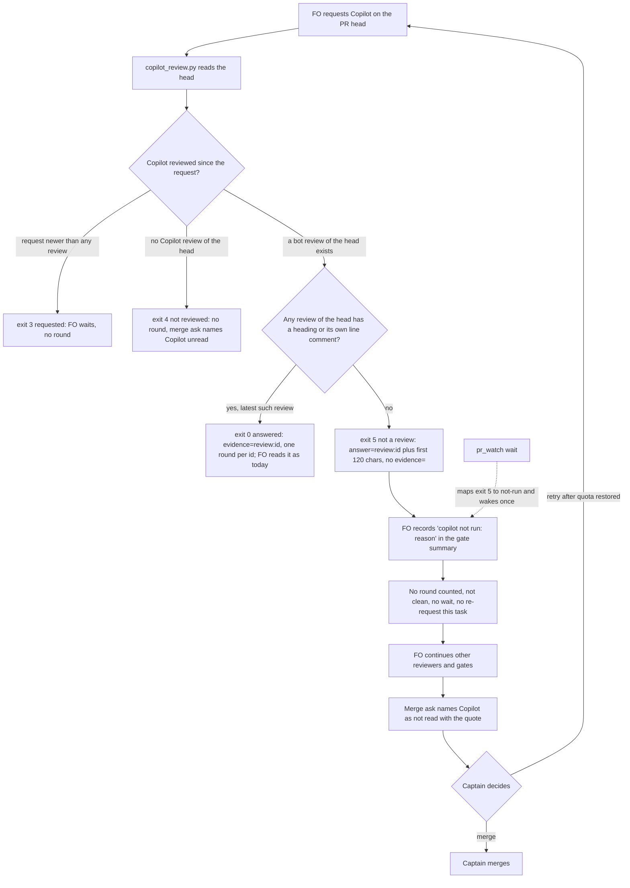

On 2026-10-13 FO requested Copilot on iamcxa/kc-claude-plugins #627 and #628 (task `journey-map-dev2-contract`). Six seconds later Copilot left a COMMENTED review on each: "Copilot was unable to review this pull request because the user who requested the review has reached their quota limit." `python3 <package>/extensions/copilot/copilot_review.py iamcxa/kc-claude-plugins 627` printed `answered on 32db12730: "no heading", 0 line comment(s); evidence=review:5499757433` and exited 0 (the same for #628, review:5499757731). Exit 0 is the reader's "answered" result, so a quota refusal reads like a review of the head with no findings unless FO reads the body.

## Captain's words

Captain 2026-10-13, in chat, after FO reported the quota refusal and asked whether to merge #627 without Copilot: 「不等 Copilot，也要修復它額度不足時的應對方式」

## Scope

- The reader and FO's handling when Copilot refuses for quota: it must not count as a round or as a clean read; it is reported as `copilot not run: <reason>`, as `## Extensions` already requires for a listed extension that cannot run.
- What FO does next when the second reviewer cannot run (the Captain ruled this time: do not wait).
- Non-goals: (1) changing how FO judges whether a real Copilot review is clean; (2) teaching Copilot's review layouts to the script (it still does not judge findings); (3) the Codex reader (`codex_review.py`) and kc-pr-flow, neither of which was observed to mishandle a refusal (see Upstream check); (4) fixing the requester's Copilot quota, which is the account's allowance, not the package's; (5) any change to the adopter's `## Extensions` rule, which already requires `<name> not run: <reason>`.

## Design

### Upstream check (2026-10-13, read only)

- Chain checked in order: spacedock (no Copilot logic), kc-dev-flow-2 package at `Package root` 0.21.0 whose `extensions/copilot/` is byte-identical to origin/main 133f1315 (`git show origin/main:kc-dev-flow-2/extensions/copilot/<file> | diff -q` for all three files), then kc-pr-flow.
- `codex_review.py`: no non-review-answer recognition. It stays fail-closed by construction: its EXTENSION.md Limits say "a shape it does not recognize reads as findings or as no verdict, never as clean", and a bot review without the clean sentence reads as findings. It was not observed to meet a refusal; out of scope.
- kc-pr-flow: `grep -rniE "quota|unable to review|cannot review" kc-pr-flow` finds only unrelated quota prose (Sentry, post quota). Nothing recognises a Copilot non-review answer there.
- The adopter README `## Extensions` already says: a listed extension that cannot run is `<name> not run: <reason>`, never a clean result; a merge ask names each unread listed reviewer. So the rule exists; the copilot reader gives FO no exit code that means "not run" for this case. Per the repository's own finding "a rule gap is usually an enforcement gap", the fix is in the reader and the EXTENSION.md Read paragraph, not a new rule.

### Existing-code check (bounded)

Observation, reproduced this stage: `python3 <package>/extensions/copilot/copilot_review.py iamcxa/kc-claude-plugins 627` prints `answered on 32db12730: "no heading", 0 line comment(s); evidence=review:5499757433 at 2026-10-13T06:46:13Z` and exits 0. `gh api repos/iamcxa/kc-claude-plugins/pulls/627/reviews/5499757433` and `.../628/reviews/5499757731` return body `Copilot was unable to review this pull request because the user who requested the review has reached their quota limit.` with `state: COMMENTED`, bot `copilot-pull-request-reviewer[bot]`, no line comment on either. (#628's head has since moved to 0286f8e74, so its live read is exit 4; the recorded body is the evidence.) Conclusion: repair the reader in place (about 8 changed lines plus tests), reuse `heading()` and the existing exit-code table; add nothing new. `pr_watch.py` maps unknown exit codes to `error`, so it needs one mapping line.

### PRFAQ

**Press release.** When Copilot cannot review a pull request, FO now says so: `copilot not run: <what Copilot wrote>`. The refusal is never counted as a review round, never read as a clean review, and FO does not wait for Copilot or ask again on its own. The merge ask names Copilot as not read, with Copilot's own words, and the Captain decides.

**FAQ**
- *What is a review?* An answer that has a review heading (`### ...` or `## Pull request overview`) or at least one line comment of its own. Anything else Copilot answers is "not a review", whatever the reason (quota, an error, another language, an empty body). The script does not need to know the reason; it quotes the first 120 characters.
- *Why not match the quota sentence?* A text match covers one wording in one language and fails open on the next refusal. Requiring positive review evidence fails closed on every non-review answer (the Codex reader already works this way). Cost: a future Copilot layout with no heading and no line comment reads "not run" until the script learns it, and FO reads the quoted body anyway.
- *Does a refusal erase an earlier real review of the same head?* No. The latest real review on the head decides; a refusal after it adds nothing. The refusal still answers the request, so `exit 3` (requested, waiting) ends.
- *What does FO do next?* Records `copilot not run:` in the gate summary, does not count a round, does not wait (the Captain ruled 「不等 Copilot」), keeps going with the other reviewers and gates, does not re-request Copilot for this task unless the Captain says its quota is back, and names Copilot as not read in the merge ask.
- *Who fixes the quota?* The account that requested the review (the refusal says "the user who requested the review"). Out of scope; the quote tells the Captain which allowance ran out.

### Mermaid

Actors and order match the prose: the reader is the only classifier; FO acts on the exit code; the Captain owns the merge and any retry.

### Surfaces

`Surfaces: none`: no UI and no schema; PRFAQ and Mermaid only.

### Delivery shape (for implementation, not decided here)

Changes in `kc-dev-flow-2/extensions/copilot/copilot_review.py` (state(): choose real reviews, exit 5, docstring), its `test_copilot_review.py`, `kc-dev-flow-2/extensions/copilot/EXTENSION.md` (Read paragraph and Limits), and `kc-dev-flow-2/scripts/pr_watch.py` plus `test_pr_watch.py` (one mapping, one `OUTCOMES` word). Conventional-commit title `fix(kc-dev-flow-2): ...`; release-please versions it; the adopter picks it up through the normal workflow sync. A prototype in `/tmp/cq-proto` (outside the repository, disposable) ran the two recorded bodies to exit 5 and failed exactly one existing test: `test_the_answer_is_reported_the_same_whatever_copilot_found` pins `"Looks good"` with no heading as answered; that test changes under Decision D1.

## Unresolved decisions for the Captain

- **D1: fail closed on any answer with no review heading and no line comment?** Recommend yes. It makes one existing test change (a heading-less, comment-less answer such as "Looks good" becomes `not a review`) and also covers errors, empty bodies and other languages with no wording list. Worse under yes: a future Copilot layout without a heading or line comment reads "copilot not run" until the script is taught, costing one quoted-body read. The alternative, matching the quota sentence only, leaves every other non-review answer reading as answered. Not a regression of a past ruling: no `Override:` line on a Copilot or reviewer decision and no ADR under `docs/adr` mentions Copilot (`git grep 'Override:'` in this checkout and `grep -rli copilot docs/adr`, 2026-10-13).
- **D2: after a refusal, may FO request Copilot again in this task?** Recommend no, until the Captain says the quota is back; he can then ask for it, and the merge ask lists "retry" as an option. Worse under no: if the quota resets mid-task Copilot stays unread until the Captain notices. The alternative (one retry per new head) sends a request that the recorded #627 and #628 refusals show is answered in seconds with another refusal, adds a bot review to the PR each time, and gains nothing while the quota is out.

## Acceptance criteria

Evidence commands run from `<package>/extensions/copilot/` (`<package>` is the Package root), using `python3 -B`.

**AC-1** The reader exits 5, never 0, on the recorded quota refusals of iamcxa/kc-claude-plugins #627 (review:5499757433, head 32db127303d4c913839952d7732e6c1693ea2305) and #628 (review:5499757731, head 7d89898e4d7a57f83144f3d2f6310d0256ef2524), and prints no `evidence=` token. Evidence: a unit test feeds `state()` those two review objects with the body copied verbatim from `gh api repos/iamcxa/kc-claude-plugins/pulls/627/reviews/5499757433` (and `.../628/reviews/5499757731`) and zero line comments, and asserts code 5, `answer=review:<id>` in the line and `evidence=` absent; run `python3 -B -m unittest test_copilot_review`. Falsifier: at the current code the same two inputs return code 0 with `evidence=review:5499757433` (reproduced live on #627 this stage), so the test fails on 0.21.0 and passes only with the repair. Status: not yet verified (implementation).

**AC-2** Any other answer with no review heading and no line comment is also exit 5: an empty body, an unrelated error sentence, and a non-English sentence. Evidence: three unit-test inputs in the same test class assert code 5. Falsifier: a denylist that matches only the English quota sentence passes AC-1 and fails this criterion. Status: not yet verified.

**AC-3** A real review still reads as answered, with the same line as today, for each existing layout: `### 🟢 Approval recommended`, `### 🟡 Changes recommended`, `## Pull request overview`, and a body with no heading but at least one line comment of its own. Evidence: the existing tests `test_an_answer_on_the_head_names_the_review_its_heading_and_line_comments`, `test_the_latest_review_of_the_head_is_named`, `test_a_heading_cannot_carry_its_own_evidence_id` pass unchanged, plus a new test for the heading-less review with a line comment (code 0, heading `no heading`). Falsifier: requiring a heading alone would fail the new line-comment test. The one changed test is `test_the_answer_is_reported_the_same_whatever_copilot_found`, whose `"Looks good"` case moves to code 5 under Decision D1. Status: not yet verified.

**AC-4** A refusal does not erase an earlier real review of the same head and does answer a pending request. Evidence: two unit tests: (a) a real review then a later refusal, both on the head, gives code 0 naming the real review's id; (b) a request, then a refusal after it, gives code 5, while a request newer than the refusal gives code 3. Falsifier: choosing `on_head[-1]` regardless of content fails (a); excluding the refusal from the review-time comparison fails (b). Status: not yet verified.

**AC-5** `pr_watch.py` reports `copilot=not-run` for exit 5 and wakes `wait` once on that change without recording an evidence id. Evidence: a unit test calls `watch.copilot()` with the subprocess stubbed to return code 5 and the refusal line, and asserts the pair `("not-run", "-")`; a second asserts `not-run` is in the copilot wake outcomes. Falsifier: without the mapping the pair is `("error", "-")`, which also wakes but mislabels a refusal as a failure of the reader. Status: not yet verified.

**AC-6** `EXTENSION.md` tells FO what to do on exit 5, and agrees with the script: it lists exit 5 as `copilot not run: <the printed reason>`, states that it is no round, not clean, not waited for and not re-requested in the task, and that the merge ask names Copilot as not read with the printed quote; Limits records the 2026-10-13 quota refusal and the residual that a refusal carrying its own heading would read as answered. Evidence (consistency only): a command that extracts the `Exit N` lines from the `copilot_review.py` docstring and checks each N appears in `EXTENSION.md`'s Read paragraph. Evidence (behaviour, observed later): at the next Copilot refusal, the observer reads the gate summary for a `copilot not run:` line, an unchanged round count and a merge ask naming Copilot unread. Falsifier: removing the exit 5 sentence from `EXTENSION.md` fails the consistency command. Status: not yet verified; the behaviour half is verifiable only at a future refusal, and until then it is a stated limit, not a passed result.

**AC-7** No change to Codex or kc-pr-flow files. Evidence: `git diff --name-only origin/main...HEAD` of the implementation PR lists only the four files above plus their tests. Falsifier: any path under `extensions/codex/` or `kc-pr-flow/` in that list. Status: not yet verified.

## FO alignment

Alignment: not needed before ideation; the Captain's two rulings fix the direction (do not wait for Copilot; repair the quota handling, scheduled now as Pilot). Open for ideation, not a Captain question: whether other non-review Copilot answers (an error, a "cannot review" text in another language) share the fix.
Release review: not needed: workflow maintenance, on no journey map.
Surfaces: none
Visible change: none

## Number guards

ADR: 0013

## Stage Report: ideation

- DONE: A design (PRFAQ and Mermaid) for how the copilot extension and FO treat a Copilot answer that is not a review (today's quota-limit refusal at minimum): reported as `copilot not run: <reason>`, never counted as a round or read as clean, and FO's next step when the second reviewer cannot run, consistent with the README's `## Extensions` rule and the Captain's rulings in the task
  `## Design` holds the upstream check, PRFAQ and flowchart; the reader gets exit 5, FO records `copilot not run:`, does not wait or re-request, and the merge ask names Copilot unread. `python3 <package>/scripts/design_surfaces.py check <task>` printed "design surfaces presentable", exit 0.
- DONE: Acceptance criteria with reproducible evidence clauses and falsifiers, including one that runs `copilot_review.py`'s reading logic on the recorded refusal bodies of iamcxa/kc-claude-plugins #627 (review:5499757433) and #628 (review:5499757731) and fails if they read as answered
  AC-1 is that test; a disposable prototype in `/tmp/cq-proto` (outside the repo) returned code 5 on both recorded bodies, and the unmodified 0.21.0 reader returns exit 0 on live #627. AC-1 through AC-7 each carry "Status: not yet verified" because implementation has not run.
- DONE: Unresolved decisions for the Captain, each with a recommendation and what gets worse under it
  D1 (fail closed on any heading-less, comment-less answer; changes one existing test) and D2 (no re-request after a refusal until the Captain says quota is back), both in `## Unresolved decisions for the Captain`.

### Per-criterion evidence

- AC-1: prototype result only (exit 5 on both bodies; live #627 at 0.21.0 exits 0). Not yet verified in the repository.
- AC-2 to AC-7: designed, not yet verified; AC-6's behaviour half can only be observed at a future Copilot refusal.

### Summary

Upstream check found no existing non-review recognition in `codex_review.py` or kc-pr-flow; the `## Extensions` rule already demands `copilot not run`, so the repair is one reader branch, one `pr_watch.py` mapping and an EXTENSION.md paragraph. The prototype also showed the one cost: a heading-less, comment-less answer ("Looks good" in an existing test) stops reading as answered (D1). No repository file, branch, commit or PR comment was made.

## Stage Report: implementation

- DONE: One Draft PR (fix(kc-dev-flow-2): ...) from a branch off origin/main changing only copilot_review.py, test_copilot_review.py, extensions/copilot/EXTENSION.md, scripts/pr_watch.py, test_pr_watch.py and ADR 0013; AC-1 to AC-7 green with each falsifier shown failing by a mutation run (AC-6's behaviour half named as a limit)
  Draft PR #630 (iamcxa/kc-claude-plugins, branch spacedock-ensign/copilot-quota-refusal-is-not-a-review, commit 218645da, base 9e68eb87); `git diff --name-only origin/main...HEAD` lists exactly those six paths (AC-7).
- DONE: ADR 0013 records D1 (fail closed on any heading-less, comment-less answer) and D2 (no re-request after a refusal until the Captain says the quota is back), with the Captain's words; adr_lint.py docs/adr --require 0013 passes
  `docs/adr/0013-a-copilot-answer-without-a-review-is-not-run-and-not-asked-again.md`; adr_lint printed "13 ADR file(s) checked, 0 legacy", exit 0.
- DONE: roborev_gate.py evidence= line, CI green on the PR head, and the CI cost per PR measured or stated as not measured
  `clean on 218645da7; evidence=roborev:604`; all four PR checks pass on 218645da (unit tests 29s, version parity 47s); cost: no job or step added, last four runs of the existing workflow 35-45 s wall clock, billed minutes not measured.

### Per-criterion evidence

- AC-1: `test_the_recorded_quota_refusals_are_not_a_review` feeds the verbatim bodies of review:5499757433 and review:5499757731 (copied from `gh api .../pulls/627/reviews`, `.../628/reviews`) and asserts code 5, `answer=review:<id>`, no `evidence=`. Fails on the 0.21.0 reader (mutation: `git show HEAD:` original), passes now. Live: `copilot_review.py iamcxa/kc-claude-plugins 627` now exits 5.
- AC-2: `test_any_other_answer_without_a_heading_or_line_comment_is_not_a_review` (empty, English error, Chinese sentence) asserts code 5. A quota-sentence-only denylist mutation passes AC-1 and fails this test and the quote test.
- AC-3: the three named existing tests pass unchanged; new `test_a_heading_less_review_with_its_own_line_comment_is_an_answer` fails under a heading-only mutation. The changed existing test `test_the_answer_is_reported_the_same_whatever_copilot_found` lost its "Looks good" no-heading case (D1), now covered by the line-comment test and the exit 5 tests.
- AC-4: `test_a_refusal_does_not_erase_an_earlier_real_review_of_the_head` fails under a latest-review-only mutation; `test_a_refusal_answers_the_request_before_it_and_a_newer_request_waits` fails when refusals are excluded from the request-time comparison.
- AC-5: `test_a_copilot_refusal_is_not_run_not_a_reader_error_and_wakes_wait` asserts `("not-run", "-")` from a fake reader exiting 5 and `outcome("copilot", "requested", "not-run")`; fails when the mapping or the OUTCOMES word is removed (each mutated separately).
- AC-6: consistency check (/tmp/ac6.py, not committed) finds every `Exit N` of the docstring in the Read paragraph and fails with 5 missing when the exit 5 sentence is removed. Behaviour half: not verified; observable only at the next Copilot refusal. A limit, not a pass.
- AC-7: six paths, none under `extensions/codex/` or `kc-pr-flow/`.
- Other checks: comment_ratio.py 0 comment lines of 57 code lines, met; doc_impact.py lists 0 documents; number_guards.py PASS (no migrations-path).

### Summary

The reader treats an answer as a review only with a heading or its own line comment; anything else is exit 5 and quoted, pr_watch maps it to `not-run`, and EXTENSION.md tells FO to record `copilot not run:`, not count, wait or re-request, and name Copilot unread in the merge ask. No new probe was added; the `/copilot_internal/user` measurement is in Limits as a non-predictor. The PR is Draft and has no review requested, per instructions.

Notes for FO: my first `gh api` of the single-review path returned 404 because of a zsh word-splitting slip of mine, not a GitHub fact; reruns worked. The worktree started at e2524e93 behind origin/main and was fast-forwarded to 9e68eb87 before any edit.

## Stage Report: validation

- DONE: Independent verdict on #630 head 218645da against AC-1 to AC-7, re-running each evidence command and at least one falsifier per criterion yourself rather than citing the implementation report; AC-6's behaviour half named as an unverified obligation
  Verdict PASSED at 218645da (base 9e68eb87): reader tests 15 OK, pr_watch tests 24 OK; per-criterion list below; AC-6 behaviour half is unverified.
- DONE: A minimal acceptance script the Captain can run (three to six steps, exact commands, expected output), run by you exactly as written in a fresh shell from a named checkout, with its observed output
  Script below, run with `env -i HOME PATH bash --noprofile --norc`; all six steps gave the expected output.
- DONE: adr_lint.py docs/adr --since <base> run with its exit code; verdict PASSED or REJECTED with findings classified by the workflow's Review-finding disposition
  `adr_lint.py docs/adr --since 9e68eb87 --require 0013`: "13 ADR file(s) checked, 0 legacy", exit 0. PASSED; no Material finding; one Deferred risk and one Polish note below.

### Per-criterion evidence (all run by me at 218645da, in a throwaway worktree later removed; mutations on a copy outside the checkout)

- AC-1: live `gh api` of review 5499757433 (#627) and 5499757731 (#628) returns the body the test pins, verbatim, bot author, COMMENTED. `test_the_recorded_quota_refusals_are_not_a_review` passes (code 5, `answer=review:<id>`, no `evidence=`). Live reader on #627 exits 5; the reader at base 9e68eb87 on the same PR exits 0 with `evidence=review:5499757433`. Against the base reader the new test file fails 5 of 15 tests.
- AC-2: `test_any_other_answer_without_a_heading_or_line_comment_is_not_a_review` (empty, English error, Chinese). Falsifier run: a quota-sentence denylist passes AC-1 and fails this test and the quote test (2 FAIL), as the criterion says.
- AC-3: the three named existing tests pass unchanged; heading-only mutation fails `test_a_heading_less_review_with_its_own_line_comment_is_an_answer` (1 FAIL). The one changed old test lost its "Looks good" no-heading case (D1, approved by the Captain).
- AC-4: `on_head[-1]` mutation fails `test_a_refusal_does_not_erase_an_earlier_real_review_of_the_head`; excluding refusals from the request-time comparison fails `test_a_refusal_answers_the_request_before_it_and_a_newer_request_waits` (1 FAIL each).
- AC-5: removing `5: "not-run"` from the copilot mapping, and separately removing `not-run` from OUTCOMES, each fail `test_a_copilot_refusal_is_not_run_not_a_reader_error_and_wakes_wait`.
- AC-6 consistency half: my own check (not committed) finds every `Exit N` of the docstring in the Read paragraph; with the exit 5 sentence cut (381 characters) it reports 5 missing. Behaviour half: NOT VERIFIED, observable only at the next Copilot refusal (observer reads the gate summary for `copilot not run:`, an unchanged round count and a merge ask naming Copilot unread). A stated limit, not a pass. EXTENSION.md prose was read by me and matches the script and ADR 0013.
- AC-7: `git diff --name-only origin/main...218645da` lists six paths: ADR 0013, EXTENSION.md, copilot_review.py, test_copilot_review.py, pr_watch.py, test_pr_watch.py; none under `extensions/codex/` or `kc-pr-flow/`. Only other reader of the script is pr_watch.py (grep).
- Other checks: comment_ratio.py 0 comment lines of 57 code lines, exit 0; number_guards.py PASS (no migrations-path); doc_impact.py 0 documents; design_surfaces.py presentable; dispatch_records.py "3 dispatch record(s) complete".
- Goal sufficiency and necessity: a refusal now exits 5 and cannot be read as answered; the changed lines are the reader branch, one watcher mapping/word, docs and ADR, each tied to an AC. Added comment lines in code: 0.

### Findings (Review-finding disposition)

- Deferred risk: a refusal that carries its own `###` heading, or a future Copilot layout with neither heading nor line comment, reads as answered or as exit 5 respectively. Trigger evidence needed to become Material: an observed Copilot refusal with a heading. Already stated in EXTENSION.md Limits and ADR 0013.
- Deferred risk: after a real review of the head, a later re-request that is refused reads exit 0 with the earlier review id (AC-4a, as designed); the round count does not change because the id is the same. Becomes Material only if FO is seen to treat it as a fresh clean read.
- Polish: the quote can contain double quotes, which makes the printed line's quoting ambiguous. No loss of the evidence= guard (tested).
- No Material finding.

### Minimal acceptance script (checkout: a detached worktree of 218645da made by step 1 from the colombo workspace; needs `gh` signed in and the kc-dev-flow-2 0.21.0 plugin install for step 6)

    PKG=/Users/kent/.claude/plugins/cache/kc-claude-plugins/kc-dev-flow-2/0.21.0
    git -C /Users/kent/conductor/workspaces/kc-claude-plugins/colombo worktree add --detach /tmp/accept630 218645da
    cd /tmp/accept630/kc-dev-flow-2/extensions/copilot && python3 -B -m unittest test_copilot_review 2>&1 | tail -3
    (cd /tmp/accept630/kc-dev-flow-2/scripts && python3 -B -m unittest test_pr_watch 2>&1 | tail -3)
    python3 -B copilot_review.py iamcxa/kc-claude-plugins 627; echo "exit=$?"
    git show 9e68eb87:kc-dev-flow-2/extensions/copilot/copilot_review.py > /tmp/accept630-base-reader.py && python3 -B /tmp/accept630-base-reader.py iamcxa/kc-claude-plugins 627; echo "exit=$?"
    cd /tmp/accept630 && python3 -B "$PKG/scripts/adr_lint.py" docs/adr --since 9e68eb87 --require 0013; echo "exit=$?"

Expected and observed: (2) "Ran 15 tests ... OK"; (3) "Ran 24 tests ... OK"; (4) `not a review of 32db12730: "Copilot was unable to review this pull request because the user who requested the review has reached their quota limit."; answer=review:5499757433 at 2026-10-13T06:46:13Z` then `exit=5`; (5) `answered on 32db12730: "no heading", 0 line comment(s); evidence=review:5499757433 ...` then `exit=0`; (6) `13 ADR file(s) checked, 0 legacy` then `exit=0`. Cleanup after: `git -C /Users/kent/conductor/workspaces/kc-claude-plugins/colombo worktree remove --force /tmp/accept630; rm /tmp/accept630-base-reader.py` (I ran it; /tmp/accept630 no longer exists, so step 1 works again).
Does not cover: FO's behaviour at a real refusal (AC-6 behaviour), a refusal that carries its own heading, Copilot's real review layouts beyond the tested ones, CI minutes. Steps 4 and 5 depend on #627 keeping head 32db12730; if it moves, step 4 reads exit 4 (not a defect).

### Summary

PASSED at 218645da. The refusal on #627 exits 5 live while the pre-repair reader exits 0 on it; every falsifier I ran failed the intended test, and the ADR lint and package checks are clean. The only unverified obligation is AC-6's behaviour half, observable at the next Copilot refusal.

### Feedback Cycles

- Cycle 1 (FO, 2026-10-13): validation recommended PASSED on #630 218645da and FO ran its acceptance script as written (`env -i` bash, every step as expected). Codex review round 1 (review:5500046230) left one P1, to fix (rounds 1 and 2 fix every finding); investigation first, then FO fix authorization, then a fresh validation recheck. Fresh implementation worker: the context-budget probe found no transcript for the first one.
  - P1 #630 `extensions/copilot/EXTENSION.md` (around line 35): when Copilot's refusal arrives before `pr_watch.py add --copilot` takes its first look (refusals came within seconds on 2026-10-13, and the extension says Request before Watch), `add` stores `copilot=not-run` as the baseline and prints only `watching ...`; `wait` then sees no change and polls until its timeout, so exit 5 is waited for after all. Register the watch before the request, or make `add` report an already-terminal `not-run`.

## Stage Report: implementation (Codex round-1 P1 repair)

- DONE: Investigation first, with no candidate change: reproduce the Codex round-1 P1 on #630 head 218645da
  Confirmed in /tmp/repro-quota.FjaxRf (real readers, fake gh): reader exit 5; `add --copilot` printed only `watching 1 PR(s)` and stored copilot=not-run; `wait 1` still polling after 6s. Sent to main before any edit.
- DONE: Fix with a test that fails without the fix (mutation run); push to #630's branch; CI green on the new head
  New head 22d9cc94e: `add` stores a codex/copilot outcome that is terminal and differs from the stored value as "-"/"-" and prints `<ref>: <key> <value> already (wait reports it)`; checks/mergeable untouched. Same repro after the fix: add prints the already line, `wait` returns `copilot - -> not-run`, exit 0, re-add is quiet. CI on 22d9cc94e: unit tests, version parity, route gate, GitGuardian all pass.
  Tests (test_pr_watch.py, 28 pass; reverting pr_watch.py to 218645da fails 3 of the 4 new ones, run with python3 -B): (a) refusal present at add -> add prints "already", first wait wakes with `copilot - -> not-run` [FAILS reverted]; (b) same for codex clean [FAILS reverted]; (c) re-add after wait reported it stays quiet, check shows no change [ERRORS reverted: wait never wakes]; (d) a non-outcome reading (copilot requested) is stored as read, no "already" [passes reverted by design; guards against over-blanking].
  Fixture changes: snap() now carries copilot columns and a "-" codex background (add would blank a "clean" background); two tests that needed a stored codex/copilot baseline seed it with watch.update.
- DONE: Stage report: new head, the roborev_gate.py evidence= line, test and mutation results, and anything left for FO
  roborev_gate.py --base 218645da: `clean on 22d9cc94e; evidence=roborev:605` (exit 0, first run). EXTENSION.md Watch bullets still true, not edited; pr_watch.py docstring gained 2 lines.

### Summary

The P1 is closed for codex and copilot: an outcome already there when `add` first looks is now reported by the next `wait`, once. Left for FO: checks green/failing and CONFLICTING at add still become the baseline and do not wake `wait` (left as ruled); the Codex round-1 thread on #630 is not answered or resolved by me.

## Stage Report: validation (cycle 2)

- DONE: Independent recheck of the cycle-1 repair on #630 head 22d9cc94: the Codex round-1 P1 (a codex or copilot outcome already terminal at `pr_watch.py add` becomes the baseline and `wait` never wakes) reproduced fixed against 218645da, its new tests shown failing under a mutation you run yourself, and AC-1 to AC-7 re-run at the new head with any change from the cycle-1 validation named
  Verdict PASSED at 22d9cc94 (base 9e68eb87). P1: with the real `copilot_review.py` reading the recorded refusal on #627 (the PR is merged now, so `view` was forced to OPEN), `pr_watch.py` at 218645da printed only `watching 1 PR(s)` and `wait` never woke (3 polls); at 22d9cc94 `add` printed `copilot not-run already (wait reports it)` and `wait` returned `copilot - -> not-run`. Mutations I ran on a copy of 22d9cc94 (python3 -B): M1 revert pr_watch.py to 218645da fails 3 of 28 (codex-already, copilot-already, re-add-quiet); M2 drop the blanking fails the same 3; M3 blank any non-"-" reading fails `test_a_non_outcome_or_unwatched_reading_at_add_is_stored_as_read`; M4 drop the stored-equality guard fails `test_adding_a_pr_again_after_wait_reported_its_outcome_stays_quiet`; M5 handle copilot only fails the codex-already test; AC-5 mappings (drop `5: "not-run"`, drop `not-run` from OUTCOMES) fail 1 and 3. Restored copy: 28 OK.
- DONE: The minimal acceptance script updated to the new head, run by you exactly as written in a fresh shell from a named checkout, with its observed output
  Script below, run as `env -i HOME PATH bash --noprofile --norc` from /tmp; all steps gave the expected output; its worktree and temp files are removed.
- DONE: adr_lint.py docs/adr --since <base> run at the new head with its exit code; verdict PASSED or REJECTED with findings classified by the workflow's Review-finding disposition
  `adr_lint.py docs/adr --since 9e68eb87 --require 0013` at 22d9cc94: "13 ADR file(s) checked, 0 legacy", exit 0. PASSED; no Material finding.

### Per-criterion evidence (22d9cc94, throwaway worktrees removed)

- Changed from cycle 1: only `pr_watch.py` (+16/-5) and `test_pr_watch.py` (+44/-4) differ from 218645da (`git diff --stat`); pr_watch tests 24 -> 28; code lines 57 -> 112 with 0 comment lines (comment_ratio exit 0); CI on the new head passes (unit tests 42s, version parity 39s, route gate, GitGuardian). Existing fixtures changed: `snap()` now defaults codex/copilot to "-", and two old tests seed their baseline with `watch.update` because `add` no longer stores a terminal outcome; both still assert the wake.
- AC-1: reader live on #627 exits 5 (`answer=review:5499757433`, no `evidence=`); reader at base 9e68eb87 exits 0 on the same PR; the new test file fails 5 of 15 against the base reader. Unchanged since cycle 1 (copilot files not in the repair diff).
- AC-2, AC-3, AC-4: `test_copilot_review` 15 OK at the new head, files byte-identical to 218645da, so cycle-1 mutation results stand; I re-ran only the base-reader mutation above.
- AC-5: mapping and OUTCOMES mutations above fail the intended tests. Stronger than cycle 1: the add path is covered too.
- AC-6 consistency half: all docstring exits (0,2,3,4,5) appear in the Read paragraph; with the 294-character exit 5 sentence cut, 5 is reported missing. The Watch bullet stays true. Behaviour half: NOT VERIFIED, observable at the next Copilot refusal.
- AC-7: `git diff --name-only 9e68eb87...22d9cc94` lists the same six paths; none under `extensions/codex/` or `kc-pr-flow/`.
- Other checks at 22d9cc94: number_guards PASS (no migrations-path), doc_impact 0 documents, design_surfaces presentable, dispatch_records "6 dispatch record(s) complete".
- Goal sufficiency and necessity: every changed pr_watch line serves the P1 (report-and-blank a terminal outcome at add, plus the stored-equality guard that keeps a re-add quiet); each of those two has a test only it fails (M2/M3/M4).

### Findings (Review-finding disposition)

- Deferred risk (carried, FO ruled it left): `checks` green/failing and `mergeable` CONFLICTING already there at `add` still become the baseline and do not wake `wait`. Material only if an observed missed wake on those columns at add.
- Deferred risk (carried): a refusal that carries its own `###` heading reads as answered; a future layout with neither heading nor line comment reads exit 5. Stated in EXTENSION.md Limits and ADR 0013.
- Deferred risk (carried): a refused re-request after a real review of the same head reads exit 0 with the earlier id (AC-4a, as designed).
- Polish: EXTENSION.md does not say that `add` may print `<ref>: <key> <value> already (wait reports it)`; FO sees the line and the next `wait` states the outcome, no loss. Carried Polish: the quote may contain double quotes.
- No Material finding.

### Minimal acceptance script (checkout: a detached worktree of 22d9cc94 made by step 1 from the colombo workspace; needs `gh` signed in and the kc-dev-flow-2 0.21.0 plugin install for the last step)

    PKG=/Users/kent/.claude/plugins/cache/kc-claude-plugins/kc-dev-flow-2/0.21.0
    git -C /Users/kent/conductor/workspaces/kc-claude-plugins/colombo worktree add --detach /tmp/accept630 22d9cc94
    (cd /tmp/accept630/kc-dev-flow-2/extensions/copilot && python3 -B -m unittest test_copilot_review 2>&1 | tail -3) && (cd /tmp/accept630/kc-dev-flow-2/scripts && python3 -B -m unittest test_pr_watch 2>&1 | tail -3)
    cd /tmp/accept630/kc-dev-flow-2/extensions/copilot && python3 -B copilot_review.py iamcxa/kc-claude-plugins 627; echo "exit=$?"; git show 9e68eb87:kc-dev-flow-2/extensions/copilot/copilot_review.py > /tmp/accept630-base-reader.py && python3 -B /tmp/accept630-base-reader.py iamcxa/kc-claude-plugins 627; echo "exit=$?"
    cat > /tmp/accept630-repro.py <<'EOF'
    import sys, io, contextlib, tempfile, importlib.util
    from pathlib import Path
    spec = importlib.util.spec_from_file_location("pr_watch", sys.argv[1])
    w = importlib.util.module_from_spec(spec); spec.loader.exec_module(w)
    REF = "iamcxa/kc-claude-plugins#627"
    def view(*a):
        d = w.gh(*a); d["state"] = "OPEN"; return d
    def look(ref, **kw): return w.look(ref, view=view, **kw)
    def stop(n):
        sys.exit("wait never woke (3 polls, nothing reported)")
    with tempfile.TemporaryDirectory() as t:
        st = Path(t, "s.json"); polls = []
        def run(args, **kw):
            out = io.StringIO()
            with contextlib.redirect_stdout(out):
                code = w.main(["--state", str(st), *args], look=look, **kw)
            return code, out.getvalue().strip()
        print("add :", run(["add", "--copilot", REF]))
        print("wait:", run(["wait", "1"], sleep=lambda s: (polls.append(s), stop(0) if len(polls) > 3 else None)))
    EOF
    cd /tmp/accept630/kc-dev-flow-2/scripts && python3 -B /tmp/accept630-repro.py "$PWD/pr_watch.py"; echo "exit=$?"
    git show 218645da:kc-dev-flow-2/scripts/pr_watch.py > pr_watch_old.py && python3 -B /tmp/accept630-repro.py "$PWD/pr_watch_old.py"; echo "exit=$?"
    cd /tmp/accept630 && python3 -B "$PKG/scripts/adr_lint.py" docs/adr --since 9e68eb87 --require 0013; echo "exit=$?"

(The heredoc body above is indented four spaces for this report's code block; strip that indent when saving it to a file, or paste the script lines flush left. The script was run flush left.)

Expected and observed: (2) "Ran 15 tests ... OK" then "Ran 28 tests ... OK"; (3) `not a review of 32db12730: "Copilot was unable to review this pull request because the user who requested the review has reached their quota limit."; answer=review:5499757433 at 2026-10-13T06:46:13Z` then `exit=5`, then `answered on 32db12730: "no heading", 0 line comment(s); evidence=review:5499757433 at 2026-10-13T06:46:13Z` then `exit=0`; (4) `add : (0, '...#627: copilot not-run already (wait reports it)\nwatching 1 PR(s)')`, `wait: (0, '...#627 ...: copilot - -> not-run')`, `exit=0`; (5) `add : (0, 'watching 1 PR(s)')`, `wait never woke (3 polls, nothing reported)`, `exit=1` (the pre-repair behaviour); (6) `13 ADR file(s) checked, 0 legacy` then `exit=0`. Cleanup after: `git -C /Users/kent/conductor/workspaces/kc-claude-plugins/colombo worktree remove --force /tmp/accept630; rm /tmp/accept630-base-reader.py /tmp/accept630-repro.py` (I ran it; step 1 works again).
Does not cover: FO's behaviour at a real refusal (AC-6 behaviour), a refusal with its own heading, Copilot's real review layouts beyond the tested ones, checks/CONFLICTING at add, CI minutes. Steps 3 to 5 read #627, whose head 32db12730 is fixed because the PR is merged; step 4 and 5 force its state to OPEN inside the script only.

### Summary

PASSED at 22d9cc94. The P1 reproduces at 218645da with the real reader on the recorded refusal and is fixed at 22d9cc94; the new tests fail under five mutations of the repair, and AC-1 to AC-7 hold as in cycle 1 with AC-5 now covering `add`. The only unverified obligation is AC-6's behaviour half.
