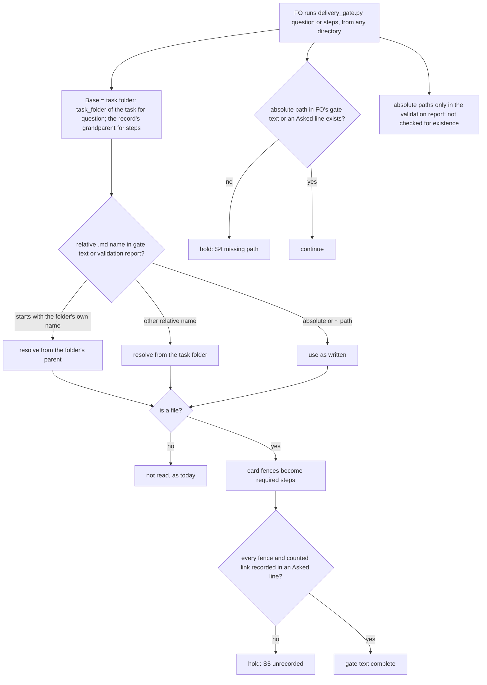

`delivery_gate.py question` and `check` read a relative `.md` path named in the gate text or the validation report from the task's own folder, so the result does not depend on where FO runs the command.

## Scope

- Source: the Captain 「開」 (chat, 2026-11-06), answering FO's batch 15 retrospective ask 「要為這個路徑解析的缺陷開一張待辦嗎？」.
- Bite: at the batch 15 validation gate of delivery-question-requires-worktree-clause (2026-11-06), `delivery_gate.py question` run from the repository root printed "Captain steps record fails: message S5: unrecorded command or link '/plugin marketplace add iamcxa/kc-claude-plugins'": the report names `validation/README.md`, and the check opened the repository's root README.md instead. Run from the task folder, the same text printed "gate text complete" (FO runs, 2026-11-06).
- Added 2026-11-06 from fo-feedback round 005 (qnow FO, operator report): on qnow #1338, `delivery_gate.py question` failed on web paths in the validator's report read as local files, and the Captain waived it (「豁免網址路徑誤判」); same resolver, so URLs belong in this task's scope.
- Upstream first: `delivery_gate.py` `inspect_steps` (the `markdown` path list and `Path(...)` resolution) and `captain_step_problems`.
- Non-goals: changing which links count as steps.

- Batch 16: the Captain 「可以，就這樣」 (chat, 2026-11-06), answering 「這批做 2、3、4、5、9 這 5 張，可以嗎？」, which named this task.

## Budget
- One package PR; the workflow word budget does not rise.

## Stop condition
- The same gate text and report give the same verdict whether `question` runs from the repository root, the state checkout or the task folder; a replay of the batch 15 case passes from the repository root.

## FO alignment

Alignment: not needed: a resolution bug in an existing check; the rule it applies does not change.
Surfaces: none
Visible change: none
Release review: not needed: workflow maintenance, on no journey map.

## Design (ideation, pilot)

Designed against kc-dev-flow-2 at origin/main `ba055b8a7a55` (plugin.json 0.35.0; main carries unreleased commits past the 0.35.0 tag, so the installed 0.35.0 cache differs). Bounded correction to the title: only `question` and `steps` read named Markdown files and absolute paths (`inspect_steps` is called from `steps` and `captain_step_problems`, and `captain_step_problems` only from `question`; `git show origin/main:kc-dev-flow-2/scripts/delivery_gate.py | grep -n inspect_steps`, 2026-11-06). `check` reads no step record and is unchanged.

### PRFAQ

**Press line.** FO's validation-gate check (`delivery_gate.py question`) now gives the same verdict wherever FO runs it. A Markdown file named by a relative path in the gate text or the validator's report is looked up in the task's own folder. A web route such as `/api/office/me` in the validator's report is no longer read as a missing local file.

**FAQ**
- *What broke?* There are two separate defects, not one resolver. (1) A relative `.md` name was opened from the shell's current directory. Run from the repository root, the #793 report's `README.md` opened the repository README, and its fenced `/plugin marketplace add …` became a required step. From the task folder the same text passed. (2) Every absolute path in the gate text plus the report had to exist. The qnow #1338 validator's report named nine web routes (`/api/office/me`, `/session-refused`, `/app` and six more). Each became `message S4: missing path` from every directory.
- *Is the bug only about where the command runs?* No. The replay gave three verdicts from three directories for #793: a hold from the repository root and a pass from the state root and the task folder. The state-root pass is incidental: there `validation/README.md` is not found and is silently skipped. The check must pin one base, not merely pass from two of three places.
- *Why the task folder?* It is where the records live (`<task>/captain-steps/<N>.md`, `<task>/validation/…`). Spacedock's `fo-gate-lifecycle` pins the same base for its own `ls-tree` ("the engaged task directory, never `.`"). kc-dev-flow-2 already resolves `Preview:` paths this way (`design_surfaces.py` `preview_target`). Corpus survey, 2026-11-06 (`ideation/survey.py`, the latest validation report plus validation briefings of 109 kc-claude-plugins and 68 qnow tasks): relative names written as `<slug>/…` from the state root are common (about 35 hits, many fenced), so that form resolves to the same folder.
- *What stops being read?* Repository-relative names such as `kc-dev-flow-2/skills/…/SKILL.md`, `CLAUDE.md` or `docs/adr/0053-….md`. Today their fences become required steps only when FO runs from the repository root. That happens in 40 kc-claude-plugins and 17 qnow tasks whose latest report names a fenced repository document (`ideation/fence_count.py`, 2026-11-06). Those are evidence citations, not Captain cards. After the change they are never read. The same is true of another task's files named via `_archive/<other>.md`.
- *Why S4 on FO's text only, not a rule about which roots exist?* Alternative: keep the report in S4 and skip any path whose first directory does not exist on this machine. That adds a filesystem heuristic and hides a mistyped root (`/Uesrs/…`) in FO's own text. FO's text and every `Asked:` line keep S4 unchanged. With the waiver line removed (the waiver was written after the failure), the #1338 question plus summary hold no S4 problem. All nine hits come from the report (`ideation/all_problems.py` split, 2026-11-06). ADR 0054's own motivating case was a path in a Captain card that FO handed over, not in a validator's report.
- *Do full URLs change?* Not under the base design. `https://` and `http://` links are already removed before path extraction. Whether a link counts as a step is decision D1 below.

### Flow

### Change (one package PR)

- `kc-dev-flow-2/scripts/delivery_gate.py`:
  - New `named_file(folder, value)`: an absolute or `~` path is used as written. A relative name whose first part is the folder's own name resolves from the folder's parent. Any other relative name resolves from the folder. This is the `preview_target` convention, plus the `<slug>/` form.
  - `inspect_steps(record_path, message, folder, evidence="")`: Markdown names in the message and the evidence resolve through `named_file`. The `message S4` loop reads only `message` (FO's gate text); `evidence` (the validation report) still feeds S1 matching, card discovery and S5.
  - `captain_step_problems`: it resolves the `Captain steps:` path through `named_file(task_folder(task), …)` and passes the report as `evidence`.
  - `question`'s task argument is used as written, like any CLI argument; the folder derived from it stays consistent with it. The implementation keeps FO's text in its own variable rather than slicing the joined message.
  - `steps`: it passes `record.resolve().parent.parent` as the folder, because the workflow places the record at `<task>/captain-steps/<N>.md` (references/sd/workflow.md § Captain steps).
  - The module docstring, `steps` paragraph: one sentence on the base and one on report paths (`--help` only; no emitted string changes).
- `kc-dev-flow-2/scripts/test_delivery_gate.py`: new tests for the ACs below. The existing `test_relative_markdown_card_is_read_by_the_real_cli` puts its record at the temporary root and relies on the current directory. It moves to the documented `captain-steps/1.md` layout with the CLI run from a different directory. With `extensions/` present, `python3 -B -m unittest test_delivery_gate` on the D1 prototype ran 162 tests: 161 pass and this one fails (`ideation/prototype-links-tests.log`, 2026-11-06). It is the only existing test whose result changes.
- Prototypes, not the deliverable: `ideation/prototype.diff` holds the base design (64 lines). `ideation/prototype-links.diff` holds the base design plus D1 (80 lines).
- Existing-code check: this repairs an already named broken seam (path resolution inside `inspect_steps`). It adds no capability, so the bounded check is skipped and nothing is replaced. Adopters carry no copy: `git ls-files | grep -c delivery_gate` gives 0 in subspace-relay, subspace-web and qnow-adopt-dev2 (2026-11-06).
- No ADR: the change narrows S4 to the text ADR 0054 targets and pins a base. It changes no rule FO follows. No workflow.md text changes.

### Words FO reads at each moment

Counted with `wc -w` on stdout (replay, 2026-11-06). The base is origin/main `ba055b8a7a55` and the candidate is the prototype.

| Moment | Base | Candidate |
| --- | --- | --- |
| startup, idle on an open PR, idle on a merged PR, after the archive | unchanged: no workflow.md, mod or script output text changes | unchanged, 0 |
| merge ask (`check`) | unchanged: `check` is not touched | unchanged, 0 |
| validation-gate preparation (`question`), #793 run from the repository root | 58 words of hold output, then 92 words after the rerun from the task folder that batch 15 needed | 92 words, one run |
| validation-gate preparation, a pass from any directory | 92 | 92 |
| `--help` (not a lifecycle moment) | 1085 | two docstring sentences, not yet written, not counted |

### Needs decision

Approval of this design also accepts, separately from D1: (a) a repository-relative document named in a report (`CLAUDE.md`, `docs/adr/…`, a `SKILL.md`) is never read as a step card; today it is read when FO runs from the repository root (40 kc-claude-plugins and 17 qnow tasks); (b) an absolute path that appears only in the validator's report is no longer checked for existence, while FO's text and `Asked:` lines still are.

**D1 — Links in files named only by the validator's report.** Once the base is pinned, the #1338 replay still holds from every directory. The validator's evidence README (`preview-sign-in-wildcard/evidence/validation-1/README.md`, named in the report) lists staging, localhost and PR links that are not Captain asks, and each becomes `S5: unrecorded command or link`. Before the fix, that file was read only when FO happened to run from the state root. The Captain waived exactly this (「豁免網址路徑誤判」). The backlog non-goal says "changing which links count as steps" is out of scope, so this needs his ruling.
- Recommendation: accept AC-7. Prose links count from FO's text and from files it names; a file named only by the report adds its fenced commands, not its prose links. The fenced command class that motivated ADR 0054 (a validator-written `captain-card.md` with a fenced script) is still caught.
- What gets worse: if a validator-written card asks the Captain to open a link in prose and FO forwards that card only by way of the report, the check no longer forces the link into an Asked line.
- Without it: tasks whose latest report names their own card carrying prose links (4 of 109 kc-claude-plugins, 5 of 68 qnow; count, 2026-11-06) hold at every gate until FO records each link or the Captain waives it again.
- Past rulings: the Captain once chose a stricter deterministic rule over a flexible one (`_archive/agent-reads-governing-adr.md`, `Override:` "Captain chose refusing branch refs"). D1 stays deterministic (which file named it), so it does not go against that lean.

### Batch overlap

Every task below that shares a file shares only `kc-dev-flow-2/scripts/delivery_gate.py` and `test_delivery_gate.py` (grep of each task file, 2026-11-06). None of them changes `inspect_steps`, `absolute_paths`, `captain_step_problems` or `steps`.
- delivery-check-passes-a-skipped-by-design-run (batch 16): same two files. It changes `runs_problem`, adds `required_checks`/`required_problem`, edits the docstring's Exit 1 sentence for `check`, and adds a `pr checks` route to the test stub. This task changes the `steps` docstring paragraph and the step functions. The functions are disjoint; rebase only.
- decline-becomes-task-only-with-a-bite (batch 16): its AC-3 keeps `delivery_gate.py` unchanged (README step 5, tests, an ADR). None.
- codex-security-only-prompts-code-review (batch 16): none.
- adr-reservation-crosses-workflows (batch 16): it changes `number_guards.task_facts`, which `delivery_gate.py` imports, and keeps the signature. No shared file; rerun `test_delivery_gate` after whichever lands second.
- merge-guard-stops-unasked-merges (validation, held): same two files, at the `ASK`/`ASK_UNQUOTED` constants. It is further along, so it lands first and this task rebases.
- comment-check-reaches-delivery-gate, fo-write-checks-parse-top-level (ideation): same two files, in `check` and `declined_items`. Rebase only.
- gate-summary-names-each-decline (held): decline parsing in the same file; rebase only.
- step-back-answer-has-a-record-line (held), captain-ruling-sources-checked (held), adoption-asks-which-extensions, archive-waits-for-observer-report: they cite delivery_gate.py output or tests as measurement only. None.
- adr-silent-undo-probe, dispatch-carries-reserved-adr-number, journey-canvas-hosted-poc, picky-reviewers-may-run-on-gemini, seed-check-requires-alignment-result, ops-inbox-r1-setup-and-isolation, pr-review-lite-value-pilot, adr-required-statement, journey-server-host-pilot: no reference to delivery_gate.py. None.
- Other workflow: qnow's `kc-dev-flow-2-gate-script-false-positives` (qnow dev2 state) lists this defect as item 2. FO can tell the qnow FO it is covered here; item 3 is delivery-check-passes-a-skipped-by-design-run.

Recommended order: merge-guard-stops-unasked-merges first (it is in validation); this task and the other batch 16 delivery_gate tasks in any order, each rebasing on the last merged one. No numbered record or shared index is touched.

## Acceptance criteria

**AC-1** — A relative name resolves from the task folder, whichever directory FO runs from. Evidence: a `test_delivery_gate.py` test builds a task folder holding `validation/README.md`, whose fence is recorded in an Asked line. A separate working directory holds a `README.md` with an unrecorded fence. `question` exits 0 when the current directory is set to the working directory, the state root and the task folder in turn. A second fixture leaves the `validation/README.md` fence unrecorded and exits 1 with `S5` from all three directories. Falsifier: replace `named_file(...)` with `Path(value)` and the working-directory run holds on the other README's fence, while the state-root run passes the unrecorded fixture.

**AC-2** — A name written as `<slug>/…` resolves to the task's own folder. Evidence: a test names `<slug>/validation-1/evidence.md`, which has an unrecorded fence; `question` exits 1 with `S5` from the repository-like directory. Falsifier: drop the own-name branch and it exits 0.

**AC-3** — `steps` resolves from the record's task folder. Evidence: the moved `test_relative_markdown_card_is_read_by_the_real_cli` puts the record at `<root>/captain-steps/1.md` and the card at `<root>/card.md`. It runs the CLI from another directory and still gets exit 1 with `S5: unrecorded command`. Falsifier: use the current directory as the base and the test exits 0.

**AC-4** — A web route that appears only in the validation report causes no `S4`. A missing local path still does. Evidence: a test's report names `/api/office/me`, and `question` holds no `S4`. In the same test, the gate text names a missing `<tmp>/missing.txt` and an Asked line names another; both still print `message S4` and `step 1 S4`. Falsifier: make the message S4 loop read the report again and the route holds.

**AC-5** — Replay of the two bites. Evidence: `ideation/replay.sh <candidate scripts dir>` prints `gate text complete` for #793 from the repository root, the state root and the task folder. On origin/main it prints the `/plugin marketplace add` hold from the repository root (`ideation/replay-origin-main.log`). For #1338 it prints one identical verdict from all three directories: `gate text complete` if D1 is accepted (`ideation/replay-prototype-links.log`), else the `S5` hold on the validator README's links (`ideation/replay-prototype.log`). This is bounded local evidence: it reads this machine's archived state and stands in a temporary directory for the removed qnow worktree.

**AC-6** — No other behaviour moves. Evidence: the full kc-dev-flow-2 suite passes in CI at the candidate head. `lint-skills.py` reports the unchanged workflow word count, and `git diff` shows no change to any `emit(...)` string. Falsifier: any change to emitted text appears in the diff.

**AC-7** (only if D1 is accepted) — A prose link counts as a required step only from FO's text and from Markdown files that FO's text names. A file named only by the validation report contributes its fences, not its prose links. Evidence: in a test, the report names a card whose prose has `https://example.test/a` and whose fence holds an unrecorded command. `question` holds on the command and not on the link. When the gate text names the same card, it holds on the link too. Falsifier: count links from report-only cards again and the first case holds on the link.

## Stage Report: ideation

- DONE: Design how /Users/kent/.claude/plugins/cache/kc-claude-plugins/kc-dev-flow-2/0.35.0/scripts/delivery_gate.py resolves relative Markdown links and web URLs in gate text and the validation report from the task folder, with a replay of the kc-plugin #793 case run from the repository root and the qnow #1338 web-path case
  `### Change` and `### Flow`. `ideation/replay.sh` on origin/main `ba055b8a7a55`: #793 holds from the repository root and passes from the state root and the task folder; #1338 holds on `S4 /api/office/me` from all three (`replay-origin-main.log`). On the prototype both pass from all three (`replay-prototype-links.log`).
- DONE: A `### Batch overlap` section naming each file the design would change and each other batch task and live task of other sessions that changes the same file or check, so FO can order implementation
  Five tasks share `delivery_gate.py` and `test_delivery_gate.py`, in disjoint functions. merge-guard-stops-unasked-merges lands first; adr-reservation-crosses-workflows changes an imported function and needs a suite rerun; qnow's own false-positive task is covered.
- DONE: The words FO reads at each lifecycle moment, before and after, per root learning.md "Measure the words FO reads at each moment, not one file's size"
  `### Words FO reads at each moment`: every moment is unchanged except validation-gate preparation from the repository root, which goes from 58 + 92 words (hold, then rerun) to 92 words, one run. `--help` gains two sentences, not yet counted.
- DONE: Acceptance criteria with reproducible evidence clauses and falsifiers, and unresolved decisions for the Captain, each with a recommendation and what gets worse under it
  AC-1 to AC-7, each with its own falsifier; one decision, D1 (links in report-only files), recommended with its cost and a count of 4/109 and 5/68 tasks.
  AC-1 relative name resolves from the task folder: not yet verified as a test; the #793 replay passing from three directories on the prototype is current evidence.
  AC-2 `<slug>/` form: not yet verified; the survey found about 35 such names in reports (`ideation/survey.py`).
  AC-3 `steps` base: not yet verified; the prototype fails the existing cwd-based test as predicted (`prototype-links-tests.log`).
  AC-4 report-only web route: the prototype replay of #1338 shows no S4 (`replay-prototype.log`); the falsifying test is not yet written.
  AC-5 replay: passed on the prototype (`replay-prototype-links.log`); bounded local evidence.
  AC-6 nothing else moves: not yet verified (implementation); on the prototype, 161 of 162 existing tests pass.
  AC-7 (if D1 is accepted): not yet verified; the #1338 replay passes only with the D1 prototype.
  design_surfaces.py check: `delivery-check-resolves-links-from-the-task.md: design surfaces presentable` (exit 0, 2026-11-06).

### Summary

There are two defects, not one. Relative `.md` names were opened from the shell's current directory; they now resolve from the task folder, or from its parent for `<slug>/…`. S4 missing-path checks read the validator's report as well as FO's text; they now read only FO's text and `Asked:` lines. With both repairs, #1338 still held on prose links in the validator's evidence README, now from every directory. Changing that touches the backlog non-goal ("which links count as steps"), so it is decision D1 for the Captain, recommended yes. Harness, prototypes and logs are in `delivery-check-resolves-links-from-the-task/ideation/`.

## Stage Report: implementation

- DONE: Implement the approved Pilot design and D1 with the two attached changes, in the assigned worktree and named files.
  Branch `spacedock-ensign/delivery-check-resolves-links-from-the-task`; base `ba055b8a7a55a787ac989c4cef52d07dd75661ad`; candidate `97dceebedd68108ef8e67fa5455f1e578c910ad6`. Only delivery_gate.py and test_delivery_gate.py changed; no version bump, ADR or workflow edit.
- DONE: AC-1, AC-2 and AC-3: task-relative, slug-prefixed and steps-record paths resolve independently of cwd.
  `TaskFolderCaptainTests` and the moved real-CLI card test exercise the repository/state/task directories, recorded and unrecorded fences, relative task arguments and record names; reverting named_file, its slug branch or the steps base each fails an assertion (`mutation-1.log` to `mutation-3.log`).
- DONE: AC-4: report-only routes do not cause S4; missing paths in FO text and Asked lines still hold.
  `test_report_routes_do_not_hide_missing_message_or_asked_paths` passes; restoring the report to the S4 loop fails its pass control (`mutation-4.log`).
- DONE: AC-5: replay both historical bites from the repository, state and task folders.
  `replay-candidate.log` has six gate-text-complete verdicts; the base reversion reproduces the root README /plugin fence and three /api/office/me S4 holds (`replay-base.log`). These are bounded local archived-state replays; the removed qnow worktree is a temporary stand-in.
- DONE: AC-6 local evidence: full package tests pass, workflow words and emitted text stay unchanged.
  `suite.json`: all 26 CI-listed local commands exit 0, 1162 unittest cases with one existing environment-gated replay skipped, plus model-free dispatch/recovery probes; local CLI 0.27.2/plugin root 0.27.3. `scope.json` confirms unchanged emit calls and out-of-scope functions; altered emitted text fails (`mutation-6.log`).
- DONE: AC-7: report-only cards contribute fences; FO-named cards also contribute prose links.
  `test_report_only_cards_require_fences_and_fo_named_cards_also_require_links` covers recorded/unrecorded commands, prose links, fenced URLs and absolute/relative aliases; restoring report-card prose links fails (`mutation-5.log`).
- DONE: Each falsifier was exercised without caches, and fresh-shell acceptance passes at the committed candidate.
  `bash --noprofile --norc /tmp/opencode/delivery-links/acceptance.sh <assigned worktree>` runs seven entrance tests plus six assertion-killed mutants in fresh copies with python3 -B and PYTHONDONTWRITEBYTECODE; `acceptance.log` and `mutations.json`. Base replay is AC-5's reversion falsifier.
- DONE: kc-dev-flow-2/scripts/lint-skills.py (the repository copy CI runs) and design_surfaces.py check exit 0.
  `lint.log`: 5939/5939 workflow words, unchanged; module help goes 1068 to 1096 words for the two approved sentences (`words.json`). `design.log`: design surfaces presentable; no budget raise.
- DONE: Package adr_lint.py docs/adr --since <base> and number_guards.py check exit 0.
  `adr.log`: 61 records, 0 legacy; `numbers.log`: PASS, migration guard skipped because no migrations-path is declared. No numbered record is added or changed.
- DONE: Package comment_ratio.py is within its maximum.
  `comments.log`: base ba055b8a7a55, head 97dceebedd68, 125 code lines, 0 comment lines, 0.0%, maximum 5% met.
- DONE: doc_impact.py <base> HEAD, with a disposition for every listed document.
  `doc-impact.json` and `doc-verdicts.json`: docs/adr/0044-delivery-gate-summaries-carry-review-facts-with-legacy-call-compatibility.md unaffected: separate-summary reviewer checks and legacy combined text remain.
  docs/adr/0051-the-merge-ask-check-requires-the-round-count.md unaffected: check and round-count refusal are unchanged; docs/adr/0062-a-gate-approval-grants-what-its-quoted-bound-question-says.md unaffected: ASK_FORM, ASK_UNQUOTED, check and ledger are unchanged.
- DONE: Commit locally and prepare the Conventional Commit PR title/body for FO.
  Product commit above is clean; `/tmp/impl-delivery-check-resolves-links-from-the-task-pr.md` contains the title on its first line. Logs and executable evidence are under `/tmp/opencode/delivery-links/`; repository tests are committed.
- SKIPPED: One Draft PR; product-branch push and opening its PR.
  No PR opened: no push grant. Read-only branch/PR queries found no published task branch and no open task PR (`prs.json`); FO owns publication.
- SKIPPED: RoboRev and hosted CI at the candidate head, including AC-6's CI-specific evidence.
  Not run, delegated to FO after publication. Local tests do not establish hosted CI, native worker execution, human approval or delivery.
- SKIPPED: CI cost measurement.
  Not measured; no CI workflow or trigger changes.

### Summary

The committed Pilot repair anchors Markdown and record names to the task folder, keeps report-only paths out of S4, and applies the approved D1 prose-link boundary while retaining fenced-step coverage. All required local checks pass; FO retains product publication, Draft PR creation, RoboRev, hosted CI and subsequent workflow decisions.

## Stage Report: validation

- DONE: Independent verdict on PR #799 head 97dceebe against every acceptance criterion in the task file, re-running each evidence command and at least one falsifier per criterion yourself, and judging each limit the implementation report states
  PASSED at `97dceebedd68108ef8e67fa5455f1e578c910ad6`, base `ba055b8a7a55a787ac989c4cef52d07dd75661ad`; candidate run from a fresh archive, no product edits. All seven criteria pass; evidence, limits and necessity are in `validation/README.md`; F1 below corrects the skipped-test aggregate.
- DONE: Replay AC-5's two historical bites yourself from the repository, state and task folders; PR #797 (task delivery-check-passes-a-skipped-by-design-run) edits the same delivery gate script and is not your candidate
  Existing `ideation/replay.sh` rerun at candidate and base: candidate gives six passes; base gives the #793 root-README fence hold and three #1338 route holds. Separately captured raw child exits are 0/0/0 for each candidate case, 1/0/0 and 1/1/1 at base (`validation/replay-exits.json`); no PR #797 bytes used.
- DONE: A minimal acceptance script the Captain can run (three to six steps, exact commands, expected output), run by you exactly as written in a fresh bash shell, with its observed output; /Users/kent/.claude/plugins/cache/kc-claude-plugins/kc-dev-flow-2/0.35.0/scripts/adr_lint.py docs/adr --since <base> with its exit code; your verdict naming the head, with findings classified by the workflow's Review-finding disposition
  `validation/acceptance.sh` has four steps and ran unchanged with `bash --noprofile --norc`, exit 0: seven entrance tests, six assertion-killed mutants, workflow lint (`validation/fresh-shell.log`). The dispatch-named ADR lint and the loaded Codex-package lint each exit 0: 61 records, 0 legacy (`validation/checks.json`).
- DONE: AC-1, AC-2 and AC-3 success and refusal boundaries, including relative records and task arguments.
  Recorded/unrecorded fences resolve consistently across three directories; own-slug and record-grandparent paths work. Cwd, removed-slug and wrong-steps-base mutants each fail assertions (`validation/mutation-1.log` through `mutation-3.log`); wrong-directory/missed-fence behavior is observed.
- DONE: AC-4 and AC-7 preserve missing asked paths and fenced steps while applying the accepted report-only boundaries.
  Report /api/office/me passes; missing FO/Asked paths refuse; report-only prose links do not count, but its fences and FO-named card links do. Restoring report S4 or report-card prose links fails assertions (`validation/mutation-4.log`, `mutation-5.log`).
- DONE: AC-6 hosted CI and the full local package suite at the exact candidate.
  GitHub run 42253937252 succeeds at the full candidate SHA (`validation/ci.json`); all 26 local commands exit 0, with 1162 discovered cases: 1151 passed, 11 skipped, plus passing model-free dispatch/recovery probes (`validation/suite-summary.json`). No native model execution is claimed.
- DONE: AC-6 unchanged output, word budget and scope; sufficiency and minimal necessity.
  Emit ASTs, unrelated functions and workflow bytes are unchanged; lint is 5939/5939 words. An emitted-text mutant fails (`validation/mutation-6.log`); mutations plus the historical base replay justify each retained change. Module docstring +28 words is separate from workflow startup cost (`validation/words.json`).
- DONE: Number guards, comment ratio, design surfaces, dispatch records and affected-document dispositions.
  All exit 0 (`validation/checks.json`); 125 code lines, zero comment lines, maximum 5% met. All three doc_impact documents have checked unaffected dispositions (`validation/doc-dispositions.json`); no ADR is added, changed or reserved.
- SKIPPED: Optional environment-dependent suite cases, native/model execution, RoboRev, and delivery authority.
  Eleven existing skips are enumerated in `validation/README.md` and `skip-evidence.json`. Historical replay uses archived local state and a stand-in for the removed qnow worktree. RoboRev remains FO-owned; installation, human approval and delivery are unverified; no CI change, and CI cost was not measured.

### Findings

- F1 Polish: the implementation report says one skipped test, but its five source logs and this rerun total eleven (`validation/skip-evidence.json`). Released user/workflow: FO reviewing the validation evidence; observable product harm: none established; affected value criterion: none unmet (AC-6 CI succeeds, affected entrance tests ran); trigger: report line 219 against the recorded logs. Corrected here; no product repair requested. No Material, Deferred risk or Needs decision finding.

### Summary

PASSED for PR #799 at `97dceebedd68108ef8e67fa5455f1e578c910ad6`: the accepted task-folder resolver and report boundary resolve both historical failures, and every criterion has a run falsifier. The one nonblocking evidence-summary correction and the exact proof limits are retained; the PR is still Draft, and FO retains finding disposition, the validation gate and delivery.

