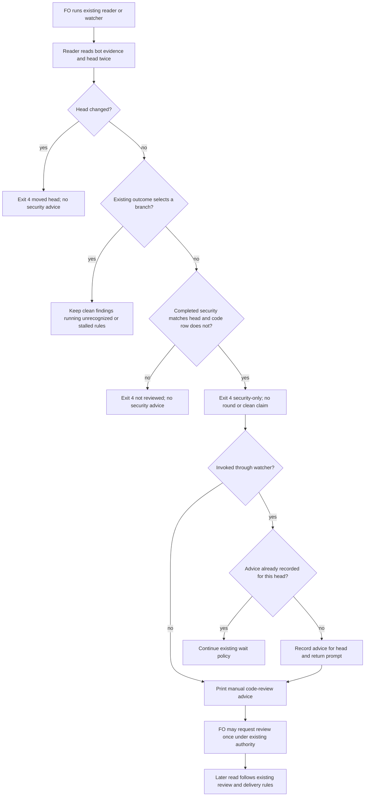

When Codex has posted only its security-review summary on a PR head, codex_review.py (or pr_watch.py) prints a next line that asks FO to request `@codex review`, so a merge ask is not prepared on a head with no code review.

## Scope

- Source: the Captain 「開」 (chat, 2026-11-06), answering 「要開這 4 張嗎？」 after fo-feedback round 005 (.notes/fo-feedback/round-005.md, closed 2026-11-06).
- Bite: ops-inbox PR #727 merged 2026-10-27 with Codex's code review only on an earlier commit d7eeeef26 (unresolved findings) and only a security review on the merged head 5dee91fb7 (Codex review-state comment, read by FO 2026-11-06); kc-paseo-plugins lost about 10 minutes per PR on #71 #72 #73 #75 waiting on exit 4 (operator report); Bridge outcome gap 7 (_l3-dogfood/OUTCOME.md, a94f9cd).
- Upstream first: kc-dev-flow-2 extensions/codex codex_review.py (exit 4 "not reviewed") and scripts/pr_watch.py.
- Non-goals: requesting the review automatically (a PR comment stays FO's step).

- Batch 16: the Captain 「可以，就這樣」 (chat, 2026-11-06), answering 「這批做 2、3、4、5、9 這 5 張，可以嗎？」, which named this task.

## Budget
- One package PR; the workflow word budget does not rise unless the design names a raise for the Captain.

## Stop condition
- A replay of a security-only head prints the code-review next line; a head with a code review prints none.

## FO alignment

Alignment: needed at ideation; the design choice is his to accept.
Result: aligned at backlog: Batch 16 backlog gate, the Captain 「核准（建議）」 (host question dialog, 2026-11-06), answering 「決定：第 16 批這五張（跳過的 CI 不擋、Codex 只貼安全摘要時提醒、交付檢查的相對路徑、ADR 編號跨流程預留、婉拒只在出過事時開任務）都用 Pilot，照各自寫下的範圍、預算與停止條件進入構想嗎？核准即接受「婉拒只在出過事時開任務」任務裡寫的標準（指出真的錯並說得出誰受害、再次出現、或你要求）。要改哪張直接說。」, approved the outcome and bounds in this file.
Surfaces: none
Visible change: none
Release review: not needed: workflow maintenance, on no journey map.

## Design

### PRFAQ

**Proposition.** When the First Officer (FO) reads a pull request whose current head has only a completed Codex security summary, the existing reader will identify it as not reviewed and name the manual code-review request. Security review remains neither a code-review round nor a clean result. This Pilot slice keeps the existing reader and watcher; the pinned checkout already implements the approved outcome, so no replacement or product change is proposed.

**Who acts?** FO runs `codex_review.py <owner/repo> <pr>` or the existing `pr_watch.py wait`. The reader only reads provider data. FO decides whether to post `@codex review` once under existing authority; printing advice sends no comment. The watcher records that it gave advice, not that a request was sent. After a real result, FO follows the existing review and delivery rules; this design grants no merge approval.

**Which input qualifies?** On a stable head, the latest recognized bot summary has a completed `security_review` row matching that full head, and its `code_review` row does not match that head. No current-head code-review evidence, unrecognized current-head comment, or running review has already selected another branch. The reader returns exit 4 with `security-only=summary:<id>` and `next: comment` advice naming `@codex review`; it emits no `evidence=` token.

**What remains unchanged?** Current-head clean results, findings, running/stalled reviews, failed or unknown code-review rows, old-head security summaries, human-authored imitations, and a head moving during the read keep their existing rules. Same-head findings still override later clean evidence. The security-specific prompt is absent when a current-head code review selects an existing outcome. The watcher maps the reader output to `security-only(summary:<id>)`, emits the advice once per head in its retained state, and permits a new prompt after the head changes. Direct reader calls may repeat their advice; the once-per-head policy belongs to the watcher.

**Why no new work?** The approved behavior exists at inspected HEAD and fetched origin/main `e8664a72b0f904e5dda3c391d52ab3abaca876b4`. Reusing it meets the recorded stop condition without a new PR. The one-package-PR budget is a ceiling, not a reason to create an empty change. FO retains the task/gate disposition; this report does not close or advance it.

**Bounds.** No automatic request, new polling service, database, UI, ADR, compatibility migration, workflow-word increase, or CI change. No production obligation is added. A mismatch on a later dispatched candidate returns to FO for a bounded repair decision. Remote provider verification and actual operator follow-through remain unverified.



The diagram and prose were checked for matching actors, branch order and authority. Rendering was not performed: this replay forbids browsers, and no renderer was established. Syntax/presentation is unverified; no UI surface is owed by the recorded `Surfaces: none`.

### Bounded existing-code check

- Boundary: `extensions/codex/codex_review.py:state/main`, `scripts/pr_watch.py:reader/security_only_lines/wait`, their existing package fixtures, and `extensions/codex/EXTENSION.md`. The dispatch-required fetch succeeded; `git show origin/main:kc-dev-flow-2/extensions/codex/codex_review.py` supplied the remote-tracking source. All remaining source inspection used the pinned local checkout.
- Two searches: definition/branch searches for `security-only`, `next:` and `codex_review`; caller/contract searches in `pr_watch.py`, the extension instructions and both fixture modules. The three inspected production/test files compared byte-identical between the dispatched package and pinned code. No missing-capability claim is made.
- Completeness: reader branch behavior and watcher scheduling were exercised with injected provider inputs and temporary state. Existing package tests pass; this is local fixture evidence, not live provider integration or proof that FO posted a request. The watcher test mocks the reader subprocess; real subprocess-to-provider wiring remains unverified.
- Need: the approved security-only stop condition still requires this behavior. Removing the security branch, adding an evidence token, allowing old security heads, repeating watcher advice on the same head, or suppressing advice on a new head would falsify the named checks below.
- Decision basis: accepted ADR 0004 (review rounds and blocking findings) and ADR 0039 (same-head findings survive later clean receipts); scoped archived review-task Override search disclosed no contrary ruling. Root `learning.md`, “Update every parser of a script mode in the change that adds a new output line”, informed checking the watcher parser. No enduring rule or numbered record is added.
- Prior task state: this task has no earlier stage report or PR field in the replay; its backlog approval and alignment result are present. Other replay tasks remain independently owned. Historical external PR outcomes were not reverified and do not establish this task's completion.

### Reproducible evidence

Run from the dispatched package; these are five selected package fixture checks, not application suites:

```sh
cd /private/tmp/denied-replay-release-astra-1/package/kc-dev-flow-2/extensions/codex
python3 -B -m unittest -v test_codex_review.CodexReviewTests.test_a_security_only_summary_asks_for_a_code_review_without_counting_a_round test_codex_review.CodexReviewTests.test_only_a_code_review_result_on_the_head_makes_a_summary_clean test_codex_review.CodexReviewTests.test_a_head_that_moves_while_reading_has_no_verdict test_codex_review.CodexReviewTests.test_a_completed_summary_after_findings_is_not_clean
cd /private/tmp/denied-replay-release-astra-1/package/kc-dev-flow-2/scripts
python3 -B -m unittest -v test_pr_watch.PrWatchTests.test_wait_asks_once_per_security_only_head_without_counting_a_round
```

Observed 2026-11-11: both commands exit 0. Raw outputs: `/private/tmp/denied-replay-release-astra-1/codex-replay.log` and `/private/tmp/denied-replay-release-astra-1/watcher-replay.log`. For another checkout, substitute its declared package root and first verify the source identity above; these logs are replay-local, not hosted evidence. No application unit, integration or E2E suites ran. No server, database or browser started. No remote write, PR, push, merge or code commit occurred.

### Batch overlap

The replay's top-level task inventory includes other ideation, implementation, validation and backlog tasks. This design changes only this task body and adds no code files, checks, tables, ADR files or shared ADR index. Thus the intersection with every other live task's proposed product writes is none. Adjacent `delivery-check-passes-a-skipped-by-design-run` concerns delivery checking and `codex-picky-reviewers` concerns release-walk model selection; neither is this reader outcome. Their ownership is not changed.
Recommended order: none for code writes; return this report to FO for the recorded batch gate, without independently advancing another task.

## Acceptance criteria

**AC-1**: A recognized current-head security-only summary prints the manual `@codex review` next step, returns exit 4 and supplies no review-round evidence token.
Verified by: `test_a_security_only_summary_asks_for_a_code_review_without_counting_a_round`; passed locally. Removing the prompt, counting security as clean, or adding `evidence=` makes it fail. Provider data is injected, so hosted behavior remains unverified.

**AC-2**: Current-head code-review outcomes and nonqualifying security inputs do not receive security-only advice; clean requires current-head code evidence and same-head findings retain precedence.
Verified by: that security-only test's negative inputs, `test_only_a_code_review_result_on_the_head_makes_a_summary_clean` and `test_a_completed_summary_after_findings_is_not_clean`; passed locally. Accepting old/human security summaries or letting later clean clear a finding makes these checks fail. Existing failed/unknown states are preserved, not redesigned.

**AC-3**: A head that changes during the read receives no security-only verdict or counted round for the former head.
Verified by: `test_a_head_that_moves_while_reading_has_no_verdict` checks exit 4, plus a direct security-only replay checks absent advice/evidence; both passed. Reproduce from the package's `extensions/codex` directory: import `test_codex_review as t`; obtain `call,pages = t.fake(comments=[t.marker(None,None,code=t.NONE,security=t.side(t.HEAD,'completed'))],heads=(t.HEAD,t.OLD))`; call `t.codex.state('o/r','1',call=call,pages=pages,now=t.NOW)` and assert exit 4, `head moved` present, and `security-only=`, `evidence=`, `next:` absent. Output: `/private/tmp/denied-replay-release-astra-1/head-moved-replay.log`. A stale verdict/prompt makes the direct assertions fail; concurrent provider traffic is unverified.

**AC-4**: The watcher treats security-only as no review outcome, prints a manual request once per head, retains that advice marker, and permits advice for a new head without posting a comment.
Verified by: `test_wait_asks_once_per_security_only_head_without_counting_a_round`; passed with fake reads and temporary on-disk watcher state. Dropping parser mapping, repeating advice or keeping the marker across a changed head makes it fail. Advice is not a send receipt; real provider/watcher integration and actual manual sending remain unverified.

## Unresolved decisions

None within the approved design scope. Recommendation: retain the existing capability; FO presents the bounded evidence and applies the existing gate/disposition rules. Design approval, independent validation and delivery are not implied by these local checks.

## Stage Report: ideation

- DONE: Produce the bounded ideation design, acceptance criteria, evidence and stage report for the recorded task, using its approved profile and scope.
  Pilot PRFAQ, Mermaid, existing-code audit and AC-1 through AC-4 are above; no product change is needed at pinned code e8664a72b0f904e5dda3c391d52ab3abaca876b4.
- DONE: AC-1 — security-only prompts without a code-review round.
  Selected existing reader replay passes; removing the prompt, returning clean or adding an evidence token falsifies it. See codex-replay.log.
- DONE: AC-2 — code-review and nonqualifying input branches retain their rules.
  Existing negative-input, clean-result and finding-precedence replays pass; accepting old/human security or clearing a same-head finding falsifies them. See codex-replay.log.
- DONE: AC-3 — a moving head has no stale verdict or security advice.
  Existing exit-4 replay and direct security-only assertions pass; returning stale advice/evidence falsifies the latter. See head-moved-replay.log and the reproduction above.
- DONE: AC-4 — watcher advice is once per head and never sends a request.
  Existing watcher replay passes with injected reads and temporary state; lost parser mapping or incorrect head-marker reuse falsifies it. See watcher-replay.log; live sending/wiring is unverified.
- DONE: Required design-surface check.
  `python3 /private/tmp/denied-replay-release-astra-1/package/kc-dev-flow-2/scripts/design_surfaces.py check <this task>` exits 0, “design surfaces presentable”; full output is /private/tmp/denied-replay-release-astra-1/design-check.log. This checks structure, not user approval or diagram semantics.
- SKIPPED: Application unit, integration and E2E suites; servers, databases and browsers.
  Forbidden by replay dispatch; only selected package fixture checks and the direct offline replay ran. Mermaid rendering and live GitHub seams remain unverified.
- SKIPPED: Remote publication, PR creation and product implementation.
  Dispatch permits only local task/report work; no push, merge, remote comment, application change or code commit. A task-only local state commit records this report.

### Summary

The approved outcome is already implemented in the pinned checkout; bounded offline reader and watcher observations support retaining it. The design keeps manual requests with FO, preserves review-round and finding rules, and adds no scope or profile obligation. FO still owns the design gate and next task disposition; local fixtures, a presentable structure check and this report do not prove hosted acceptance or authorize delivery.
