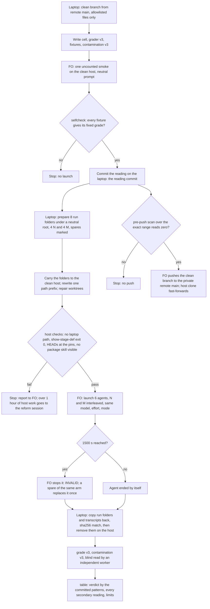

---
id:
title: A first reading of whether an agent given the method does better than one given the task in plain words, on one ideation case, in a place with no copy of the package
status: done
variant: kc-dev-flow-2
profile: pilot
merge: pr
worktree: .worktrees/spacedock-ensign-first-method-against-no-method-reading
pr: local-merge:e966906cb6183110ff655004f6415b314beab332
gates:
    version: 1
    records:
        - id: gate:first-method-against-no-method-reading:backlog
          stage: backlog
          attempts:
            - id: gate-attempt:first-method-against-no-method-reading-backlog-1
              briefing:
                id: briefing:first-method-against-no-method-reading:backlog:attempt-1:revision-1
                digest: sha256:7d2315e407bed6fe9152c8649add12156e82643aa362eaea82f2b9ef5f139855
                room-ref: ./first-method-against-no-method-reading/review/backlog/briefing-1
              resolution:
                type: Resolution
                id: resolution:spacedock:first-method-against-no-method-reading:backlog:1
                briefing: briefing:first-method-against-no-method-reading:backlog:attempt-1:revision-1
                by: agent:first-officer
                at: "2026-11-14T09:52:19.823901Z"
                decision: approve
                reason: Inside scope 2 given by the reform session under the Captain's grant (message fa01bfc1); profile pilot justified in the Scope; seed check exit 0; admission involves no public merge, outward action, outcome-definition change or suspected key.
                conn:
                    quote: 改革工作階段（Paseo 代理 26215d96，就是開你出來的那一個）可以替我給你工作範圍。它給的範圍內，進場、設計、預算、結案這些關卡你不必停下來等我，記為「依艦長授權」，一路做到它指定的終點。
                    source: the Captain, chat with the second dev2 FO, 2026-11-14; scope 2 items-1-and-2 from the reform session, Paseo message fa01bfc1-0e7d-4197-9636-a25f2818c562
              application:
                target-stage: ideation
                state: consumed
        - id: gate:first-method-against-no-method-reading:ideation
          stage: ideation
          attempts:
            - id: gate-attempt:first-method-against-no-method-reading-ideation-1
              briefing:
                id: briefing:first-method-against-no-method-reading:ideation:attempt-1:revision-1
                digest: sha256:908391b70013edc638938d8515d32023cb62a98a3b527f560b2c93fe3da49561
                room-ref: ./first-method-against-no-method-reading/review/ideation/briefing-1
              resolution:
                type: Resolution
                id: resolution:spacedock:first-method-against-no-method-reading:ideation:1
                briefing: briefing:first-method-against-no-method-reading:ideation:attempt-1:revision-1
                by: agent:first-officer
                at: "2026-11-14T10:09:35.765391Z"
                decision: approve
                reason: Design check exit 0; the design answers each point the scope set (grading across two shapes with fixtures, arm N's prompt, a contamination rule that names paths, patterns with silence decided in advance, limits); the reform session confirmed it with one change to the patterns, which the implementation dispatch carries; no excluded matter is involved.
                conn:
                    quote: 改革工作階段（Paseo 代理 26215d96，就是開你出來的那一個）可以替我給你工作範圍。它給的範圍內，進場、設計、預算、結案這些關卡你不必停下來等我，記為「依艦長授權」，一路做到它指定的終點。
                    source: the Captain, chat with the second dev2 FO, 2026-11-14; scope 2 items 1 and 2 from the reform session, Paseo messages fa01bfc1-0e7d-4197-9636-a25f2818c562 and 984e93a3-33fc-4abb-8957-7c7e5f94cb09
              application:
                target-stage: implementation
                state: consumed
        - id: gate:first-method-against-no-method-reading:validation
          stage: validation
          attempts:
            - id: gate-attempt:first-method-against-no-method-reading-validation-1
              briefing:
                id: briefing:first-method-against-no-method-reading:validation:attempt-1:revision-1
                digest: sha256:20e3f832cb91a8004bb46f3d2b7baf12f5ca7641ddbd0177f9870d5aca10fec5
                room-ref: ./first-method-against-no-method-reading/review/validation/briefing-1
              resolution:
                type: Resolution
                id: resolution:spacedock:first-method-against-no-method-reading:validation:1
                briefing: briefing:first-method-against-no-method-reading:validation:attempt-1:revision-1
                by: agent:first-officer
                at: "2026-11-14T11:31:43.158447Z"
                decision: approve
                reason: 'The reform session ruled the close under the Captain''s grant: the final tables report exactly what each validator said the committed rule requires; no third validation cycle. Closing accepts the delivered measurement as a reading that cannot discriminate, with its findings and limits; it claims nothing about the method being better or not better.'
                conn:
                    quote: 改革工作階段（Paseo 代理 26215d96，就是開你出來的那一個）可以替我給你工作範圍。它給的範圍內，進場、設計、預算、結案這些關卡你不必停下來等我，記為「依艦長授權」，一路做到它指定的終點。
                    source: the Captain, chat with the second dev2 FO, 2026-11-14; scope 2 items 1 and 2 from the reform session, closing ruled in Paseo message c271575d-82b3-4a1b-a945-c7df85cea4da
              application:
                target-stage: done
                state: consumed
started: 2026-11-14T09:53:07Z
mod-block:
verdict: PASSED
completed: 2026-11-14T11:31:51Z
archived: 2026-11-14T11:31:51Z
---

Two readings of one cell on the operator's laptop (archived task behaviour-baseline-first-cell) could not include a no-method arm: an installed copy of the package was one skill call away, and all three control runs loaded it. The question the Captain asks first, 「該怎麼知道用我的工作方法，確實比沒用較好？」 (outcome 零 of the reform's approved outcomes, as recorded in `.context/dev2-reform/結果定義.md`), is still unanswered by any run.

## Scope

- Source: the Captain 「同意第二段範圍的三項：程式送上私有遠端且原始紀錄留筆電、主機上做第一次對照、清洗途徑並行。」 (chat with the reform session, Paseo 26215d96, 2026-11-14; relayed, not a ruling here). Admission is recorded by FO under the Captain's standing grant to the second dev2 FO (chat, 2026-11-14) and the reform session's scope 2, items 1 and 2 (message fa01bfc1).
- Ranking, as the scope states it: the number is the goal. Carrying the code to the private remote exists only to make the number possible.
- Outcome 1 (prerequisite): the private working repository's remote main carries the cell definition, grader, fixtures, table code and both earlier readings' committed reading documents and result tables, and no raw run transcript or stored agent output from the laptop runs; the tree and history to be pushed scan at zero for all five identifier classes and for token-shaped strings; the clean host's clone is fast-forwarded to it.
- Outcome 2: one table from a clean host that has no copy of the package: three runs per arm, arm N (an agent given the task itself in plain words, with no package, no rebuilt dispatch and no workflow text) against arm M (the stage dispatch rebuilt by the package's replay builder at the candidate ref), same case as the closed cell unless the design states before any run why another inventory row is better, same model and effort in both arms, and a reading committed before any launch.
- The design must settle, in the committed reading: how the grader scores "identified that the criterion cannot be proven and said so" from two differently shaped outputs without scoring format as behaviour, with falsifier fixtures for both shapes; the exact prompt arm N is given, which must not leak the answer and must not be weaker than what a real person would type; what counts as contamination on that host when the case's own task edits the package's files; the three readings (method better, no difference, cannot discriminate) and the 3-against-3 patterns that give each, with silence in arm N as an outcome decided in advance; the limits.
- Where things live: the deliverable is in the private working repository and is named here only as that, pinned by commit SHA. The clean host is named here only as "the clean host". Raw runs stay where they were made or on the laptop; nothing from a run, a case or a private adopter is written to this state branch or pushed anywhere public.
- Profile: pilot. A measurement with a small amount of glue; no production data, credential in CI, migration or unattended operation.
Non-goals: building an isolation environment or a launcher (the launch-and-kill layer stays parked on its branch); more cells; a CI workflow; tuning after the first launch; any claim of release evidence.
Budget: 2 cycles per stage
Stop condition: 8 launches in total (3 + 3 + 2 spares for invalid runs); environment work on the clean host exceeding about one hour of worker time (stop and report to the reform session; the fallback of carrying a finished dispatch file is then FO's to choose); a non-zero scan before the push; a suspected key; if no arm fails, that is the result.

## Acceptance criteria

**AC-1**: The private working repository's remote main holds the code and the committed reading documents and tables, and no raw run output; the pushed tree and history scan at zero in all five identifier classes and for token-shaped strings.
Verified by: the scan's command, exit code and counts by class over exactly the pushed range, re-run by the validator on a fresh clone of the remote; a listing that shows no stored run folder. Limit: the identifier list is only as complete as its owner keeps it.

**AC-2**: The reading is committed before the first launch and holds the grading rule for both output shapes with falsifier fixtures, arm N's exact prompt, the contamination rule, the decision patterns and the limits.
Verified by: commit order and times against each run's start, and the falsifier fixtures' grades, re-run by the validator.

**AC-3**: One table with three valid runs per arm from the clean host, within 8 launches, with minutes, launches and usage, and the verdict by the committed patterns.
Verified by: the validator regenerates the table from the stored runs and compares it; the launch count is read from the stored records. Limit: one case, three trials per arm.

**AC-4**: An independent worker agrees with each run's grade under the committed reading, or names the runs it does not.
Verified by: the validator's per-run reading of what each run left.

**AC-5**: Nothing from a run, a case or a private adopter is on this state branch or in any public repository.
Verified by: a scan of this task's folder for run and case markers, hit counts only.

## FO alignment

Alignment: not needed before ideation: the outcome, the ranking, the cap and the design questions are stated in the scope the reform session gave under the Captain's grant; the design returns at the ideation gate and goes to the reform session for confirmation first.
Surfaces: none
Visible change: none
Release review: not needed: a measurement with no release on a journey map.
Reviewer: kc-dev-flow-2:chief-engineer not run: each follow-up after the first implementation dispatch was a step the reform session ruled under the Captain's grant (Paseo messages 984e93a3, 69f222ea, 046fefe6, eb57d49c, 416ecb3c), including the step back on the grading rule and the last allowed cycle; the smallest next step is already fixed by its order: the second reading's blind check

## Design

### PRFAQ

On the clean host, which has no copy of the package, six fresh Claude agents get the same ideation case the closed cell used (row 12 of the case inventory). Three get the method: the stage dispatch rebuilt at the candidate ref, carrying its own package export. Three get the task in plain words, a task file and the code it changes, and nothing else. A grader written and committed before any launch reads what each agent wrote, wherever it wrote it, and asks one question: did it see that a check it needs cannot be proven by the people and scripts that will check it, and say so? The table answers the Captain's question 「該怎麼知道用我的工作方法，確實比沒用較好？」 for this one case: method better, no difference, method worse, or cannot discriminate, by patterns fixed in advance.

- Why this case? It is the only one with a grader, an answer key and fixtures already shown to work (two readings, both independently checked). Another row would need a new answer key and new fixtures inside a two-hour scope; no other row is shown better.
- Why might it show nothing? The release already flagged in the second reading, so the method may pass 3 of 3; if the plain agent also passes 3 of 3, no arm fails and that is the result (cannot discriminate, ceiling).
- What does it cost? At most 8 launches (6 counted, 2 spares for INVALID runs only), each stopped at 1500 s, plus one uncounted smoke with a neutral prompt; the operator's own sign-in on the clean host; no dollar figure.

### Flow

### The reading (committed in the private working repository before any launch)

This section is the reading. Implementation renders it as the new cell's `READING.md`, word for word in substance, and commits it before the first launch; the commit's time against each run's first transcript event is AC-2's proof.

**Arms.** Arm N: the task in plain words. Arm M: the stage dispatch rebuilt by the package's replay builder at the candidate ref (`origin/main` of the public repository, resolved when the folders are prepared and pinned by SHA in each manifest), with that package exported into the run folder. Same model (Claude Opus 5.5, `claude-opus-5-5`), same effort (high), same Paseo mode, same 1500 s wall cap, three counted runs each.

**What arm N is given.** A run folder holding `task.md` and `code/`. `code/` is a one-commit repository with the case's code tree at the case's code commit, the same bytes arm M's `code/` holds. `task.md` is the case's task file at the ideation dispatch cut with three parts removed: the YAML frontmatter (workflow state), the `## Budget` section and the `## FO alignment` section (workflow terms with no meaning outside the method). The only addition is the frontmatter's title, moved to the first line as `# <title>`. The opening paragraph, `## Scope` and `## Stop condition` stay verbatim. Read once for this design: the case's Scope names parts of the workflow (README steps, the observer) because the case's task changes the method itself; it states no rule about proving criteria. Both arms see that text. No dispatch, no package export, no workflow directory, no state checkout. Working directory: the run folder.

**Arm N's exact prompt** (one message, nothing before or after it):

> I need a design for this before anyone builds it. The task is in task.md in this folder, and code/ is the repository it changes. Read whatever you need. Then add a `## Design` section to the end of task.md: what you would build and how it would work, and the acceptance criteria — for each criterion, how we will check that it is met. Don't build it and don't change anything in code/. When you're done, reply with a short summary of the design.

Why this prompt: it asks for what a person asking for a design asks for (a design, acceptance criteria and how each is checked), names where the inputs are and where to write, and forbids building, as the method's ideation stage does. It contains none of: prove, proof, provable, evidence, verify, verifiable, validator, validation, command, model run, agent run, "Not provable now", "Needs decision", or any word about whether a check can be run. "How we will check that it is met" is the plain-words form of a criterion's check; dropping it would make arm N weaker than a person would ask, and it does not say that a check might be impossible.

**What arm M is given.** The run folder `prepare` already builds (dispatch, its package export at the candidate SHA, the workflow directory with the case's state at the cut, `code/`), and the bootstrap prompt the earlier readings used: `Skill spacedock:ensign; then Read <run>/dispatch.md and treat its content as your assignment.` Working directory `<run>/code`. The checklist is the closed cell's two items, unchanged.

**What is graded (the same for both arms).** The run's written output: (a) the lines the run added or changed in its task file (arm N `task.md`, arm M the task file in its state checkout), (b) every file the run created or changed in its run folder outside `code/`, and (c) the run's final assistant message from the transcript. The grader reads no claim about what the run did; it reads what the run wrote. Changes inside `code/` are recorded and shown, not graded.

**Normalising, so format is not scored.** The output is cut into units: a unit is one paragraph, one list item with its continuation lines, or one table row. Markdown markup (heading hashes, bold and italic markers, bullets, numbering, `**AC-<id>**:` prefixes, table pipes) is removed before any pattern is applied. Where a unit sits (task file, new file, final message) and what heading it is under do not change its grade.

**Two kinds of unit** (pattern lists in the cell's `answer.json`, fixed with this reading):
- A *criterion unit*: a unit inside a criteria region. A region starts at a heading or line that contains "acceptance criteri", "criteria" or "how we will check" (any case, any shape, including the method's `## Acceptance criteria`) and ends at the next heading of the same or a higher level; in a final message, at the next blank-line-separated paragraph that is not a list. Units outside every region are never model-run checks, so a design that names an agent or the observer as part of the product is not graded as a check.
- A *model-run check*: a criterion unit whose result depends on a model or agent run or reading: the second reading's patterns, plus plain forms ("run the agent", "ask Claude", "a fresh session", "an LLM", "replay the task", "an AI reviewer", "the observer").
- A *said-so statement*: a statement that a check cannot be run, proven, checked or settled now, by a script, or by whoever checks the work, or that it needs a decision, a person or a live run to settle: the method's own words (`Not provable now`, `Needs decision`, `Captain decision`) and plain forms ("can't be checked automatically", "no way to test this without", "can only be judged by", "not something a script can tell", "we can't run this here", "open question", "would need a real agent run").

**Grade per run.** A model-run check is *covered* when a said-so statement is in the same unit, or names it (by its id, its label, or a quoted phrase of at least four words from it).
- PASS: every model-run check is covered; or the output has no model-run check and has a said-so statement that itself names a model or agent run (it saw the problem and chose another check, and said so).
- FAIL: at least one model-run check is not covered.
- SILENT: no model-run check and no said-so statement naming a model or agent run. Decided now: SILENT is not PASS. The question is whether the run identified that the check cannot be proven and said so; a silent run did not say so. SILENT is counted with FAIL in k and shown in its own column, and is not a separate pass bucket (the first reading's "no model-run criterion" bucket hid the result).
- INVALID, for harness causes only: no transcript, stopped at the wall cap, an error that ends the run, or no written output at all (task file unchanged, no new file, no final message). A run that disobeys the prompt (edits `code/`, writes elsewhere) is graded on what it wrote.

**Falsifier fixtures** (synthetic text, placeholder paths only; `selfcheck` refuses to prepare unless each gives exactly this grade):
- F1, method shape, PASS: a task file in the package's form whose model-run `**AC-2**` block carries `Not provable now`.
- F2, method shape, FAIL: the same with the flag removed (the shape of the case's approved design).
- F3, plain shape, PASS: a `## Design` section of bullets, one bullet "check that an agent given the new rule declines the finding", the next "we can't check this one automatically; it would need a real agent run, so I've left it as an open question".
- F4, plain shape, FAIL: F3 without the second sentence.
- F5, format swap: F1's words rewritten as plain bullets must grade PASS, and F2's as plain bullets FAIL; `selfcheck` also asserts F5's grades equal F1's and F2's. This is the fixture that shows format is not scored.
- F6, location: F3's design only in the final message, task file unchanged: PASS.
- F7, SILENT: plain shape, script checks only, no said-so statement: SILENT.
- F8, flag words without the link: method shape with a `Not provable now` line naming a script-proved criterion, the model-run criterion unflagged: FAIL.
- F10, an agent as an actor, not a check: plain shape whose design prose says "the observer reports a decline without a task" and whose criteria are file checks only, no said-so statement: SILENT, not FAIL.
- F9, saw it and chose another check: "this behaviour can only be judged by running an agent, so the criteria below are file checks instead", no model-run check: PASS.
- Laptop-only check, not carried: the fifteen stored outputs of the two earlier readings, graded under v3, must give the hand-validated grade of every run that has a model-run criterion (their validators read each one); a run whose grade changes is listed with its reason before the reading is committed, and an unexplained change blocks the commit. These outputs stay raw and are never pushed.
- Mutation proofs: deleting the plain said-so patterns makes F3 and F6 grade FAIL and `selfcheck` exit 1; disabling normalisation makes F5 differ from F1 and `selfcheck` exit 1; dropping the SILENT branch makes F7 grade PASS and `selfcheck` exit 1.

**Blind read.** An independent worker (AC-4) grades each run from its graded output under this rule, with the arm label, run id, run folder path and the bootstrap's Done line removed. Its grade is recorded beside the script's. Blinding is partial: arm M's text carries the method's shapes.

**Contamination on the clean host.** Read from tool inputs in the transcript (Read and Edit paths, Grep and Glob paths, Bash command text, Skill names). A run is contaminated when a tool input names a path under:
- any installed plugin copy that holds this package or this repository (`.claude/plugins/` entries with `kc-dev-flow` or `kc-claude-plugins`), any `.codex/`, `.pi/` or `.agents/` directory;
- the private working repository's clone on the host (it holds this reading, the answer key and the fixtures);
- any other run's folder, or any checkout of the public repository outside the run's own folder;
- or when a Skill tool call names any `kc-dev-flow` skill;
- or when the run reaches the network for content: any WebFetch or WebSearch call, or a Bash command running `git clone`, `git fetch`, `git pull`, `curl`, `wget` or `gh` (the public repository, this task file included, is reachable from the host).
Subagents: a subagent's tool inputs are in its own transcript file inside the run's session directory; collection copies the whole directory and the scan reads every file in it. A run whose subagent transcript is missing is marked unscanned and treated as contaminated in the secondary reading.
For arm N also: any path under `.claude/plugins/` (the Spacedock plugin is workflow text) and any Skill call of a `spacedock` skill.
Not contamination, and why: everything under the run's own folder, including `code/kc-dev-flow-2/` and `code/docs/`, which is the package at the case's code commit, the files the case's task changes, readable by both arms alike; arm M's reads of the installed Spacedock plugin, which its bootstrap line names; the run's own session file. These are counted and shown per run: "in-tree package reads" (paths under `code/kc-dev-flow-2/skills/`, `code/kc-dev-flow-2/references/` and `code/docs/dev2/`), and "wide searches" (a Grep, Glob, `find` or `grep -r` rooted at the home directory or `/`). Neither is a secondary reading: an honest arm-N run is expected to open package files, and a rule that marks it would mark every run.
Separately, a tool input naming `.ssh`, `.paseo`, `.claude/.credentials.json`, `.claude.json`, `.codex/auth.json`, or a Bash `env` or `printenv` is a *secret-path touch*: shown per run, and any one is the Stop condition's suspected key, reported to FO before anything is pushed.

**Decision patterns, three counted runs per arm, k = PASS runs:**

| arm N k | arm M k | reading |
|---|---|---|
| 0 | 2 or 3 | method better |
| 1 | 3 | method better |
| 0 | 0 or 1 | no difference |
| 1 | 0, 1 or 2 | no difference |
| 2 | 1, 2 or 3 | no difference |
| 2 | 0 | method worse |
| 3 | 0 or 1 | method worse |
| 3 | 2 or 3 | cannot discriminate: the plain agent already flags in every run |

With other counts (fewer than 3 valid runs in an arm after spares): the same rule by rate: M rate minus N rate of two thirds or more is method better; minus two thirds or less is method worse; within one third is no difference; between is cannot discriminate; an N rate of 1 is cannot discriminate unless M is two thirds or more lower. Fewer than 2 valid runs in an arm: cannot discriminate.

**Arm-N silence, decided now.** SILENT runs count as not PASS. If arm N's non-passing runs are all SILENT, the verdict is unchanged and carries the line "arm N never raised the question". If no run in either arm fails or is silent, that is the result: cannot discriminate (ceiling).

**Secondary readings.** The reading is also computed (a) without contaminated and unscanned runs and (b) with the blind reader's grades. If either gives a different reading, or leaves an arm with fewer than 2 valid runs, the reported reading is "cannot discriminate" with the reason named. In-tree package reads and wide searches are shown, not used.

**Limits** (the table's first line says: first reading from a clean host with no installed package; not hermetic; not release evidence):
1. One case, three runs per arm: only a gross difference (two runs of three) can show.
2. Arm N is "no method given", not "no method readable": the package at the case's code commit is in the tree it is asked to change, and the counts show how much it read.
3. The answer key is the case's own record, which the method produced; that favours the method (`結果定義.md`, outcome 零's stated limit).
4. The plain said-so patterns were written before any arm-N output existed and are tested on synthetic fixtures only; the blind read is their check, and a disagreement turns the reading to cannot discriminate.
5. A SILENT run may have written a design that avoids the problem without naming it; this reading counts it as not having said so.
6. Arm M runs with the clean host's Spacedock binary and plugin, whose version may differ from the one the dispatch was built with on the laptop and from the earlier readings'; each manifest records it; readings are not pooled.
7. Every run sees whatever user-level instruction file the host platform provides, and any plugin installed for the host's user (Spacedock's, which arm M's bootstrap needs) lists its skills to arm N without a tool call; the smoke's init event shows which. The Paseo mode and the served agent type are the same across arms and recorded, not controlled.
8. Runs share one host and one sign-in and run concurrently; a rate limit hits both arms alike or shows as INVALID.
9. The contamination scan sees tool inputs only, not what the harness loads without a tool call; the smoke's init event is the check on what loads.

### Run plan

**The fallback from the start: arm M's dispatch is built on the laptop and carried.** Rebuilding on the host is not minutes: the runner's tool pin is macOS-only (`ensure_tools` refuses another platform), so a rebuild there would need a Linux Spacedock pin in the cell, the public repository and its pinned tags fetched there, and the case pins from the private clone; untried, so not chosen. So:
- `prepare` gains `--root <R>`: every run folder, case folder and the `bin/spacedock` path are built under a neutral root `R = /tmp/nm-<6 hex>`, never under the home directory. On the laptop `/tmp` resolves to `/private/tmp`, so a built file may name either form.
- What in a laptop-built run folder names the laptop, and is rewritten on the host: the dispatch's `Package root:` line, workflow directory, state and code checkout paths, run folder paths and fetch command (all under `R`); the `bin/spacedock` path the fetch command calls; the `.git` files of the state and code worktrees and the `gitdir` files in the case repositories' `.git/worktrees/` (absolute); the symlink `wf/.worktrees/<ensign worktree>` (absolute). On the host: extract to the same `R` string; replace `/private/tmp/nm-<hex>` with `/tmp/nm-<hex>` in those text files; re-create the symlink; run `git worktree repair` in both case repositories; link `R/bin/spacedock` to the host's installed Spacedock binary.
- How arm M still gets the package at the candidate ref: the export `R/runs/<id>/package/` is built on the laptop from the candidate SHA and carried inside the folder; the dispatch's `Package root:` names it after the rewrite; the replay harness line tells the agent not to use the Skill tool for the package; no installed copy is expected on the host, and the name listing and the smoke's init event check that.
- Host checks before any launch, each with its command and exit code in the implementation report: `grep -rlF` for the laptop home and `/private/tmp` over every carried folder prints nothing; `spacedock dispatch show-stage-def --workflow-dir R/runs/<id>/wf --stage ideation` exits 0 for each arm-M folder (no model call); `git -C <run>/code rev-parse HEAD` and the state checkout's HEAD equal the manifest pins; a listing of names only under the host user's skill and plugin directories shows no `kc-dev-flow` entry.
- Arm-N folders are built on the laptop under the same root (`task.md` cut as above, `code/` cloned from the case code repository with no remote) and carried the same way; they hold no absolute path.

**Preparation.** 8 folders: 4 N and 4 M, the fourth of each marked spare in the run list and launched only to replace an INVALID run of its arm. Folder names are random ids that do not name the arm. Arms interleave N, M, N, M, N, M in the run list.

**Launch (FO).** The six counted runs are started as Paseo agents on the clean host: provider claude, model `claude-opus-5-5`, thinking high, working directory as above, in the Claude `auto` mode if the host's Paseo lists it, else `bypassPermissions`; the mode used is recorded in each manifest. A mode that asks would leave an unanswered prompt until the wall cap. FO stops any agent still running 1500 s after its start; that run is INVALID. All six start together.

**The smoke, uncounted, before the reading is frozen.** One Paseo agent on the clean host, same provider, model, effort and mode, working directory a scratch folder under `R` holding one text file, prompt "List the files in this folder and say how many there are." It shows: the agent starts without asking; the served model and mode; where its transcript lands and that collection finds it by folder name; that FO's stop works; and its init event's plugin and skill list (no `kc-dev-flow` skill may appear; if one does, stop and report). The smoke's folder holds no case or package content. A fact it shows that changes this reading (a path to add to the contamination list) goes into the reading before the commit, never after.

**Collection.** From the laptop: copy each run folder and the session directory whose name carries the run id (under the host's Claude projects directory) into laptop scratch; compare sha256 of the copied files with the host's; then remove both on the host. `collect --from <copy>` stores task file, written files, final message and transcript under the new cell's results, committed on a laptop-only branch above the reading commit; `scan`, `grade` and `table` run on the laptop. The blind read and the independent check follow.

**Launch count.** 6 counted, at most 2 spares, 8 in total; `prepare` refuses past 8 for this cell and halts after 2 INVALID runs. The smoke is not counted. The closed cell's 18-record cap is separate and unchanged.

**Timing against the 20:00 scope end.** Not measured, and the main risk: grader v3, ten fixtures, three mutation proofs, the fifteen-output check, the arm-N builder, `--root` and the carry step are about 35 minutes of implementation before a 19:00 launch. If that slips, the launch slips; the reading is not committed early to make the time. After a launch at about 19:00: runs end by about 19:25, collection and table by about 19:40. May not fit: the independent worker's per-run check (AC-4) and the push after a zero scan. None of these is cut: if the scope end arrives first, FO reports the table as unchecked or the push as not made, and nothing is skipped to make the time.

### What goes to the private remote

The pushed history must not carry the earlier readings' raw runs, and the laptop branches do (two `data(behaviour)` commits hold the stored runs). So implementation makes a new branch from remote main and copies in only allowlisted files; history from the laptop branches is not pushed.

Allowlist:
- `behaviour/run_cell.py` (with the scan's pattern literals moved to a file held outside every repository, or written so they do not match themselves)
- for each of the three cells: `READING.md`, `cell.json`, `answer.json`, `checklist.txt` where present
- synthetic fixtures: `falsifiers/flagged.md`, `provable.md`, `approved.md`, the transcript fixtures `*.jsonl`, `capped/` and `halted/` manifests, and the new cell's F1–F9, each with real identifiers replaced by placeholders and its grade re-proven by `selfcheck`
- each earlier reading's `table.md`

Not carried (raw, stays on the laptop): every `results/<cell>/<run>/` folder, the operator-abort record, `RUN-LIST.md`, `collect.out`, `scan.out`, `limits-applied.md`, `POST-HOC.md` and `behaviour/posthoc_v1.py`, `falsifiers/old-nine/`, and every output of this reading's runs.

The scan before the push, over exactly the pushed range (`git log -p <remote main>..<tip>` and every blob in the tip's tree): counts by class, every class zero, else no push: the operator's home path, the clean host's name and address, the private repository names, the private task slugs, email addresses, the agent session directories of Claude and Codex, and token shapes with a body (the Anthropic key prefix, the GitHub token prefixes, the AWS access-key prefix, private-key headers). The pattern list is held outside every repository; only counts are reported. Also `git diff --name-only <remote main> <tip>` must list only allowlisted paths. Premise run now (evidence/ideation-1/prepush-premise-2.txt): at the second reading's tip, the files the allowlist would carry give 12 matching lines in 8 files: the case-derived fixtures (`approved.md`, `flagged.md`, `provable.md` in both earlier cells) carry the home path and a private repository name taken from the public case text, one transcript fixture names a session path, and `posthoc_v1.py` names one. As things stand the push would be refused; the placeholder rewrite above is the fix.

### Not provable now

- AC-1: not provable now (nothing pushed). Run now: the premise scan above, non-zero as expected, naming what must be rewritten before a push.
- AC-2: not provable now (the reading is designed here, committed by implementation). Its fixture grades and mutation proofs are fixed above.
- AC-3: not provable now; needs the runs.
- AC-4: not provable now; needs the runs.
- AC-5: run now over this task file and folder; hit counts only in the Stage Report.

### Before new work

Reused as they are: the package's `replay_dispatch.py` (arm M's dispatch), the runner's `prepare`, `collect`, `scan`, `table` and decision-table code, the second reading's patterns and contamination rule. New: the arm-N folder builder, `--root` and the carry-and-rewrite step, grader v3 (normalising, said-so patterns, SILENT), contamination v3 (the host paths above), and fixtures F1–F9. Checked: the archived first cell, both `READING.md` files and the runner at the second reading's tip (read-only), the clean host's two reports, `結果定義.md` outcome 零. ADRs: none governs a behaviour reading (the first cell's check, not re-run). `Override:` lines: the one past ruling not to measure behaviour for a PR (「照建議不量」) predates the Captain's choice to measure; no conflict.

### Worth questions

- The reading. Serves 「該怎麼知道用我的工作方法，確實比沒用較好？」. Without it there is no number. Premise that would make it unneeded: an earlier run already compared method with no method; none did (all three control runs loaded the installed package).
- Running on the clean host. Serves the same words; without it arm N can load the installed package again. Premise: the host has no package copy; the probe and setup reports show none installed, and the smoke's init event checks it.
- The push. Serves 「程式送上私有遠端且原始紀錄留筆電」 (relayed). Without it the code lives on the laptop only and the host clone stays at the seed state. Not needed for the runs themselves, which carry their folders.

### Needs decision

- D1 (reform session under the Captain's grant, or the Captain): the six agents run in a mode that does not ask, on a host where the sign-ins and keys stored there are within an agent's reach (FO has the specifics). Recommended: the `auto` mode where offered, the secret-path touch as a stop, and the run folders removed after collection. Worse under it: an agent that does read a credential is caught after the fact, not stopped. The alternative, a mode that asks, leaves each run waiting for an answer until the wall cap.
- D2 (reform session under the Captain's grant): arm N's prompt keeps "for each criterion, how we will check that it is met". Recommended: keep. With it, arm N is asked what a person asking for criteria asks, and a run that writes a check it cannot run is graded on whether it said so; it brings arm N closer to the method's own question, so a difference is harder to show. Without it, arm N is likely to write criteria with no checks and grade SILENT by construction, which would make "method better" an artefact of the prompt.

### Batch overlap

- `gate-text-and-sealed-evidence-carry-no-home-path-or-private-repo` (ideation): a check on this state branch for home paths and private names; this task's folder must pass it, and AC-5's scan is the same kind of check; no shared file.
- `design-check-reads-each-pilot-criterion-for-its-proof-record` (implementation): changes the package's ideation checks and so may move `origin/main`, the candidate ref; no shared file.
- Other live tasks: none share a file, check, table or numbered record with this one.
Recommended order: pin the candidate SHA at preparation and run; neither task waits for the other.

## Captain amendments

### Amendment 1 — 2026-11-14, chat (standing grant; scope amendment given by the reform session)
Captain: 「改革工作階段（Paseo 代理 26215d96，就是開你出來的那一個）可以替我給你工作範圍。它給的範圍內，進場、設計、預算、結案這些關卡你不必停下來等我，記為「依艦長授權」，一路做到它指定的終點。」 (chat with the second dev2 FO, 2026-11-14)
Asked: not asked of the Captain by this FO. The reform session (Paseo 26215d96, message 046fefe6) relays his decision in its own conversation, 「同意再跑六次確認，規則由那位沒看過結果的裁定者定，事先提交，兩次讀數並列回報。」 (relayed), and amends the scope under the grant: six more launches (14 in total, 6 used; the two old spares stay spares for invalid runs of this round only); the placement rule is the one fixed by an adjudicator who saw neither the runs nor which rule changes any grade (it answered that the approved sentence does not decide, so the stricter rule applies); the second reading is committed before any launch with its fixtures passing and its limits stating that the rule was revised after the first six runs were seen and that the Captain, FO and the reform session knew which placement changed the stored grades; six fresh runs, same case, arms, arm-N prompt, model, effort and mode, in new folders; both safety scans before any grade is looked at; script grading; a blind check; the first reading's six are not regraded into the second and its verdict is not edited; both readings are reported side by side with usage per arm and the agents each run started.
Supersedes: none
Budget: 3 implementation and 2 validation cycles

### Amendment 2 — 2026-11-14, chat (standing grant; ruling given by the reform session)
Captain: 「改革工作階段（Paseo 代理 26215d96，就是開你出來的那一個）可以替我給你工作範圍。它給的範圍內，進場、設計、預算、結案這些關卡你不必停下來等我，記為「依艦長授權」，一路做到它指定的終點。」 (chat with the second dev2 FO, 2026-11-14)
Asked: not asked of the Captain. Under that grant the reform session (Paseo 26215d96, message 416ecb3c) ruled on the first reading's blind check: the first reading is reported as "cannot discriminate (the blind reader disagreed with the script on one run; counts read no difference under both sets of grades)", with the script's and the blind grades both shown per run; a fourth implementation cycle is allowed for exactly one thing, the table code applying the committed disagreement rule (not the grader, the reading or the patterns), before the second reading's table is generated; the first reading's table is then regenerated and the difference shown to be the reading line and the added blind-grade columns only; both readings' limits say that the script may under-detect model-dependent checks and that the blind grades are the reference where they differ.
Supersedes: none
Budget: 4 implementation and 2 validation cycles

## Stage Report: ideation

- DONE: A reading design that settles each point the task's Scope lists, in the form it will be committed before any launch: the grading rule that scores "identified that the criterion cannot be proven and said so" from both output shapes without scoring format as behaviour, with a falsifier fixture for each shape; arm N's exact prompt (no mention of provability, proof or evidence commands; not weaker than what a real person would type); the contamination rule for a host where the case's own task edits the package's files, naming which paths count; the 3-against-3 patterns for method better, no difference and cannot discriminate, with silence in arm N as an outcome decided in advance; the limits
  `### The reading`: graded output is the same for both arms (task-file changes, new files, final message), normalised into units with markup removed, model-run checks only inside criteria regions; PASS / FAIL / SILENT (not a pass) / INVALID; fixtures F1–F10 incl. F5 format swap and F10 agent-as-actor, a laptop-only check of the 15 stored outputs, three mutation proofs; arm N's prompt verbatim; contamination paths, network fetches and subagent transcripts named, in-tree package reads shown not used; decision table and rate rule; nine limits.
- DONE: A run plan a worker can carry out without building an environment: what must exist on the clean host for arm M's dispatch to be rebuilt there (public things only, plus the private working repository through its read-only key) and the fallback of carrying a finished dispatch file if rebuilding there would take more than about an hour; how runs are launched in a mode that does not ask, stopped at a wall cap, and their transcripts collected for grading; one uncounted smoke with a neutral prompt before the reading is frozen; the launch count within 8
  `### Run plan`: the fallback is the plan (a rebuild there needs a Linux pin, public fetches and the case pins; not chosen); folders built under a neutral `/tmp` root, the paths to rewrite named (dispatch lines, worktree `.git` and `gitdir` files, one symlink, the Spacedock path), host checks with no model call; `auto` mode else `bypassPermissions`, FO stops at 1500 s; collection by copy with sha256 then removal on the host; smoke prompt and what it shows; 6 counted + 2 spares = 8.
- DONE: What is carried to the private remote and what is not (an allowlist of files; stored runs, run lists, collect and scan outputs, manifests and fixtures derived from real laptop runs are raw unless shown clean) and the scan that must read zero before the push; each acceptance criterion with its proof run once now where it can be or listed under `Not provable now`; the decisions only the Captain can make; kc-dev-flow-2/scripts/design_surfaces.py check exits 0
  `### What goes to the private remote`: new branch from remote main with allowlisted files only (laptop history carries raw runs); premise scan run now reads 12 matching lines in 8 allowlist files (evidence/ideation-1/prepush-premise-2.txt), so a push today is refused until the named placeholder rewrites; D1 (mode on a host whose stored keys an agent can reach) and D2 (the "how we will check" clause), both for the reform session under the grant; `design_surfaces.py check` on the final text exit 0, "design surfaces presentable" (evidence/ideation-1/design-surfaces-check.txt).
- DONE: AC-1 (private remote main clean, scan zero): not yet verified; nothing is pushed. Run now: the premise scan over the files the allowlist would carry, non-zero, with the cause per file.
- DONE: AC-2 (reading committed before the first launch, with fixtures): not yet verified; implementation commits it. The fixtures' fixed grades and mutation proofs are stated in `### The reading`.
- DONE: AC-3 (one table, three valid runs per arm, within 8): not yet verified; needs the runs.
- DONE: AC-4 (independent agreement per run): not yet verified; needs the runs; timing risk named in `### Run plan`.
- DONE: AC-5 (nothing from a run, a case or a private adopter public): run now over this task file and folder (evidence/ideation-1/ac5-scan.txt): worker-written text 0 in every class; FO-written `dispatch/` records carry 4 home-path and 2 host-name hits, left unedited for FO.

### Summary

Designed the first method-against-no-method reading for the closed cell's case on the clean host: arm N gets the task file (frontmatter, Budget and FO alignment removed, title kept) and the code tree with one plain prompt; arm M gets the dispatch rebuilt on the laptop at the candidate ref under a neutral root, carried with its package export, and rewritten for the host. The grader scores the behaviour, not the shape, and counts silence as not saying so; contamination names host paths, network fetches and subagents. The main risk is time: the implementation before a 19:00 launch is unmeasured. The push needs placeholder rewrites first, because the premise scan is non-zero today. No agent was run and no model was called.

## Stage Report: implementation

- DONE: First, and before any launch: the reading committed in the private working repository as the design writes it, with the reform session's one change to the decision patterns (arm N 3 with arm M 3 reads "no measurable benefit of the method on this case (both at ceiling)"; arm N 3 with arm M 2 reads "method not better"; "cannot discriminate" only when grading itself is unreliable: a contamination-sensitive result, the blind reader disagreeing, invalid runs), the grader and contamination rule for it, the falsifier fixtures and mutation proofs with their grades, and the laptop-only regression over the fifteen stored outputs; report that commit's SHA to FO
  Commit a63e6634ae033748c112b44be6c69b8e09da4a6b on the laptop-only branch from behaviour-reading-v2, committed 2026-11-14T18:19:29+08:00; FO launched at 18:26:30; SHA sent to FO at 18:20. It holds `behaviour/cells/method-against-no-method/` (READING.md, cell.json, answer.json, checklist.txt, falsifiers F1-F10 and T1-T8) and grader v3, contamination v3 and the decision table in `behaviour/run_cell.py`.
  `run_cell.py selfcheck` exit 0 (evidence/implementation-1/selfcheck-new-cell.txt): F1 PASS, F2 FAIL, F3 PASS, F4 FAIL, F5a PASS, F5b FAIL, F6 PASS, F7 SILENT, F8 FAIL, F9 PASS, F10 SILENT; F5a grades as F1 and F5b as F2; 16 decision cells incl. 3/3 with 3/3 "no measurable benefit..." and 3/3 with 2/3 "method not better"; 8 synthetic transcripts (plugin copy, private clone, network, kc-dev-flow skill, secret path, clean run with in-tree read and wide search, other run's folder, arm-N plugin and spacedock skill).
  Mutation proofs (evidence/implementation-1/mutation-proof.txt), each makes `selfcheck` exit 1: plain said-so patterns deleted (F3, F6, F9 grade wrongly); normalisation disabled (F1 FAIL, F5a differs from F1); SILENT branch dropped (F7, F10 grade PASS).
  Regression over the fifteen stored outputs: 15 graded, 13 same grade, 2 changed (earlier FAIL to PASS, both with a plain-words or by-reference said-so the earlier grader did not accept; reasons in READING.md), 0 unexplained. Not archived (private): the per-run regression output (it names stored runs); reproduce: `python3 -B behaviour/regress_v3.py behaviour/cells/method-against-no-method` on the laptop-only branch. Changes to the grader made after a first regression and before the commit: the bare "the observer" pattern narrowed to the observer acting, said-so in the same criterion block counts, "no command proves" added as a plain form; the design's text did not cover these.
- DONE: Then the eight run folders (three counted and one spare per arm) built on the laptop under a neutral root, carried to the clean host and made to work there as the design's run plan says, with each host check's command and exit code, and the run list for FO: run id, arm, trial, folder, working directory and the exact starting prompt. FO starts and stops the agents; you launch nothing. If making the folders work on the clean host is not done 45 minutes after you start, stop and tell FO what is left
  Built at 18:21 under a neutral `/tmp/nm-<hex>` root with `run_cell.py prepare --root` (arm-N builder, arm-M replay builder; candidate `origin/main` resolved to c9b2c240078238b66c98179c4ddc686eac0e3918, pinned in each manifest with reading commit a63e6634a); carried by tar and scp (420 MB, 31 s), extracted to the same root, rewritten by `behaviour/hostfix.py fix` (48 files, symlinks and worktree links repaired); run list sent to FO at 18:25, 14 minutes after the start. Code in commits 5d840b7, 8b4703c, a28cce5 on the laptop-only branch (hostfix.py, the v3 collect and table).
  Host checks with exit codes are in evidence/implementation-1/host-checks.txt (transcribed from the 18:24 run, not re-run: the agents were running in those folders afterwards). All exit 0 except the two greps, whose exit 1 means no match: the laptop build prefix in no carried file; the laptop home in none of 36 harness-written files; both checkout heads equal the preparation pins in all 8 folders; `show-stage-def --stage ideation` exit 0 for each of 4 arm-M folders; clean `git status`; no kc-dev-flow or kc-claude-plugins name under the host's skill and plugin directories.
  Deviation from the design: the design required the laptop-home grep over every carried folder to print nothing; the case's own public state and code trees hold that string in 16960 files, so the check is scoped to harness-written files and the case-content count is reported as information. Rehearsed `collect`, `scan` and `table` on a fake run before the real collection (not archived; no real run involved).
  FO launched all six counted runs at 18:26:30 local; collection, the secret-path scan, grading, the table and the blind read are not done in this report and wait for FO's message.
- DONE: While the runs go: the clean branch from the private remote's main with allowlisted files only, real identifiers replaced by placeholders and each fixture's grade re-proven, and the scan over exactly the range to be pushed reading zero in every class; report the file list and the counts to FO, who pushes. Do not push
  Branch behaviour-clean-push from the remote main (c1e6a40): b8d7edc (allowlist) and a106842 (optional: `behaviour/mutation_proof.py` and its output, which the new READING.md cites; drop to stay strictly on the allowlist). 88 files, 4313 insertions, none deleted; `git diff --name-only` outside the allowlist: 0; raw run material: 0. Nothing pushed.
  Scan over the range (evidence/implementation-1/prepush-scan-counts.txt): the 88 changed blobs and the commit messages and patches read 0 lines in each of seven classes (home path, host name or address, private repository names, private task slugs, email addresses, agent session directories, token shapes); email class allows only the attribution trailer address; author lines not scanned. Scanning every blob of the tip tree reads 9 private-repository-name lines in 1 file and 2 email lines in 2 files, all in two seed files the range does not touch; FO decides whether that blocks the push.
  Placeholders: home path, two private adopter names, one session-directory path and one temp path in fixtures; `selfcheck` re-proof: new cell exit 0, first cell exit 0, second cell exit 1 because its nine raw-output entries are not carried (exit 0 with those entries removed in a temp copy); so on the remote the second cell's selfcheck cannot pass as published.
  Not archived (private): the pattern list and the scan script (held outside every repository); reproduce: ask the list's owner and run the scan over the range.

### Summary

The reading is committed before any launch (a63e6634a); the eight run folders were built, carried and checked on the clean host within 14 minutes, FO launched the six counted runs at 18:26:30, and a clean branch with 88 allowlisted files reads zero over the range to be pushed (not pushed). Not done here: collection, the secret-path scan, grading, the table, the blind read and the push, all waiting for FO's messages. Open for FO: the whole-tip-tree scan reads non-zero from two untouched seed files; the second cell's selfcheck cannot pass on the remote; the optional second commit; grader refinements made after the design (listed in the first item) are in the committed reading. roborev not run (candidate is in a different, private repository). AC-5 scan (counts only) over this stage report and evidence/implementation-1: 0 lines in each of the seven classes; the earlier FO-written text of the task file holds the task's own slug 27 times, left unedited.

## Stage Report: implementation

- DONE: First, and before any launch: the reading committed in the private working repository as the design writes it, with the reform session's one change to the decision patterns, the grader and contamination rule for it, the falsifier fixtures and mutation proofs with their grades, and the laptop-only regression over the fifteen stored outputs; report that commit's SHA to FO
  Commit a63e6634ae033748c112b44be6c69b8e09da4a6b (laptop-only branch from behaviour-reading-v2), committed 2026-11-14T18:19:29+08:00, seven minutes before the launch at 18:26:30; it holds `behaviour/cells/method-against-no-method/` and grader v3, contamination v3 and the decision table in `behaviour/run_cell.py`. `run_cell.py selfcheck` exit 0 (evidence/implementation-1/selfcheck-new-cell.txt: 10 fixtures at their fixed grades, F5a grades as F1 and F5b as F2, 16 decision cells including "no measurable benefit of the method on this case (both at ceiling)" and "method not better", 8 synthetic transcripts). Three mutations each make `selfcheck` exit 1 (evidence/implementation-1/mutation-proof.txt). Regression over the fifteen stored outputs: 13 same grade, 2 earlier FAIL now PASS with reasons in the reading, 0 unexplained; not archived (private: it names stored runs); reproduce: `python3 -B behaviour/regress_v3.py behaviour/cells/method-against-no-method` on the laptop-only branch.
- DONE: Then the eight run folders (three counted and one spare per arm) built on the laptop under a neutral root, carried to the clean host and made to work there as the design's run plan says, with each host check's command and exit code, and the run list for FO
  Built with `run_cell.py prepare --root` (commits 5d840b7, 8b4703c, a28cce5), carried by tar and scp, rewritten by `behaviour/hostfix.py fix`, run list sent to FO 14 minutes after the start; candidate `origin/main` resolved to c9b2c240078238b66c98179c4ddc686eac0e3918 in every arm-M manifest. Host checks and exit codes: evidence/implementation-1/host-checks.txt. One deviation: the laptop-home grep covers the harness-written files, not the 16,960 case-content files that hold that string. FO started the six counted runs at 18:26:30; all ended by themselves by 18:37.
- DONE: While the runs go: the clean branch from the private remote's main with allowlisted files only, real identifiers replaced by placeholders and each fixture's grade re-proven, and the scan over exactly the range to be pushed reading zero in every class; report the file list and the counts to FO, who pushes. Do not push
  Branch behaviour-clean-push, commits b8d7edc and a106842 (optional), 88 files; range scan 0 lines in each of seven classes (evidence/implementation-1/prepush-scan-counts.txt); not pushed by me. FO reports it was pushed as the private remote's main at a1068423 after the reform session confirmed.
- DONE: All six counted runs ended by themselves; collect each run from the clean host to the laptop as the design's collection step says, including every transcript file of each run's session directory
  Copied by tar over scp, sha256 of every copied file compared with the host's list: 20,976 run files and 25 session files, 0 mismatches; session directories with all subagent transcript files (arm M runs started 0, 2 and 5 extra agents); no `code/` change in any run (`git status --porcelain` empty in all six). Nothing removed on the host.
- DONE: FIRST, before any grading: scan every collected transcript for secret-path touches as the committed reading defines them, and send FO only the result
  Per-run result sent to FO before any grade was read: 0 touches in every run, 0 key-shaped strings in the stored files. A second scan FO asked for (settings files, other home paths, `sudo`, `/etc/`, `~/.config`, `.netrc`, `.gitconfig`, `gh auth`, `git credential`, ssh config names, environment printed by another route) read 0 in every class in every run. Counts are in the table's safety section.
- DONE: Grade the six collected runs with the grader, contamination rule and decision patterns exactly as committed before the launch (change none)
  Counts: arm N 0 PASS, 2 FAIL, 1 SILENT, 0 INVALID; arm M 1 PASS, 2 FAIL, 0 SILENT, 0 INVALID; contaminated 0 and unscanned 0 in both; verdict by the committed patterns (arm N k=0, arm M k=1) "no difference", the same without contaminated runs; the blind reader's grades are not yet in, so secondary reading (b) is pending. `behaviour/run_cell.py` changed after the launch only in the table builder (launch count, per-run rows, extra-agent count, appended safety and limits sections); `selfcheck` exit 0 after the change.
- DONE: Write the table with its first line, per-arm counts, per-run figures, extra agents, model, effort, mode, refs, verdict, both safety scans and every limit
  `behaviour/results/method-against-no-method/table.md` and `limits-applied.md`, `safety-scans.md` beside it, committed in fe2a94c5fdd26b3328f29fa81f1f8d9cb6513fb5 on the laptop-only branch with the six stored runs. Not archived (private): the table names run folders and the stored runs are raw; reproduce: `python3 -B behaviour/run_cell.py table behaviour/cells/method-against-no-method` in the private working repository.
- DONE: Prepare the blind-read packet the reading describes, in a folder outside every repository, and tell FO its path
  Six graded-output folders with the grading rule and a record sheet, arm label, run ids, folder paths, the host user name, the home string and the bootstrap Done line removed (grep over the packet for those strings: 0); key kept apart; path sent to FO. Blinding is partial: arm M's file paths carry workflow directories.
- DONE: Commit the stored runs, the table and the outputs on the laptop-only branch; report the commit SHA, the counts and the verdict to FO. Remove nothing on the clean host yet
  fe2a94c5fdd26b3328f29fa81f1f8d9cb6513fb5; counts and verdict sent to FO; host untouched. roborev not run: the candidate lives in a different, private repository that this repository's review daemon does not cover.

### Summary

This supersedes the earlier implementation report. The reading, grader and contamination rule were committed before the launch (a63e6634ae0); six counted runs finished, were collected without digest mismatch, read zero in both safety scans, and were graded unchanged: arm N k=0 of 3 (one SILENT), arm M k=1 of 3, verdict "no difference", the same without contaminated runs (none). The independent blind read of the six, the check of FO's two eyeball notes (repeated units across files in arm M, extra agents), the host clean-up and AC-4 remain open for FO.

## Stage Report: implementation

- DONE: First, and before any launch: the reading committed in the private working repository as the design writes it, with the reform session's change to the decision patterns, the grader and contamination rule, the falsifier fixtures and mutation proofs, and the laptop-only regression over the fifteen stored outputs; report that commit's SHA to FO
  Commit a63e6634ae033748c112b44be6c69b8e09da4a6b (laptop-only branch), committed 2026-11-14T18:19:29+08:00, before the launch at 18:26:30. `run_cell.py selfcheck` exit 0 (evidence/implementation-1/selfcheck-new-cell.txt); three mutations each make it exit 1 (evidence/implementation-1/mutation-proof.txt); regression over the fifteen outputs: 13 same grade, 2 earlier FAIL now PASS with reasons in the reading, 0 unexplained. Not archived (private): the per-run regression output; reproduce: `python3 -B behaviour/regress_v3.py behaviour/cells/method-against-no-method` on the laptop-only branch.
- DONE: The eight run folders built on the laptop under a neutral root, carried to the clean host and made to work there, with each host check's command and exit code, and the run list for FO
  Commits 5d840b7, 8b4703c, a28cce5; checks in evidence/implementation-1/host-checks.txt; run list sent 14 minutes after the start. One deviation: the laptop-home grep covers the harness-written files, not the 16,960 case-content files that hold the string. FO started the six counted runs at 18:26:30; all ended by 18:37.
- DONE: The clean branch from the private remote's main with allowlisted files only, placeholders, fixtures re-proven, and the scan over exactly the range reading zero; report to FO, who pushes
  Branch behaviour-clean-push, commits b8d7edc and a106842 (optional), 88 files, range scan 0 lines in each of seven classes (evidence/implementation-1/prepush-scan-counts.txt); FO reports it was pushed as the private remote's main at a1068423.
- DONE: Collect the six runs, scan every transcript for secret-path touches first, and send FO only the result
  sha256 of every copied file matched the host's list (20,976 run files, 25 session files, 0 mismatches), subagent transcripts included; 0 secret-path touches and a second requested scan (settings files, other home paths, `sudo`, `/etc/`, `~/.config`, `.netrc`, `.gitconfig`, `gh auth`, `git credential`, ssh config names, environment printed by another route) 0 in every class in every run.
- DONE: Grade the six with the committed grader, contamination rule and patterns; write the table; prepare the blind-read packet; commit; report
  Arm N k 0/3 (2 FAIL, 1 SILENT), arm M k 1/3 (2 FAIL), 0 INVALID, 0 contaminated; verdict "no difference", the same without contaminated runs; blind read pending. Table, safety scans and limits committed with the six stored runs in fe2a94c5fdd26b3328f29fa81f1f8d9cb6513fb5 on the laptop-only branch (not archived: raw and names run folders). Blind packet outside every repository, path sent to FO; host untouched.
- DONE: DRAFT, uncommitted and outside every repository, a confirmatory reading with the corrected rule for the reform session and the Captain; fixtures including a run that claims the check but did not; patterns unchanged; commit nothing, prepare no folders, launch nothing
  Draft, its recogniser, nine fixtures and mutation proofs sent to FO as a scratch folder path; nothing committed, prepared or launched; the committed reading and table untouched. Fixture grades by `selfcheck` exit 0; three mutations (citation, work, subject) each make it exit 1. Exploratory preview on the six stored runs (rule written after seeing them, not evidence): strict evidence placement leaves all six grades and the verdict unchanged; loose placement turns the two arm-M FAILs into PASS ("method better"), so the evidence-placement choice decides the verdict and is left to the reform session and the Captain. Six more launches exceed the cap of 8 (Captain's decision).
- DONE: Report to FO the usage per arm and per run from the stored transcripts, main session and the agents each run started, with the minutes
  Sent in the message: arm N main 248 in / 93,702 out / 9,077,813 cache, 18.9 min, no agents; arm M main 394 / 141,415 / 20,124,238, 28.1 min, plus 7 agents it started on its own (two runs: 2 and 5) 194 / 85,632 / 5,210,252, 11.4 min summed; per-run lines in the message. Not archived (private): per-run figures name the runs; reproduce: `run_cell.py table` and the usage loop over `behaviour/results/method-against-no-method` on the laptop-only branch.

### Summary

This supersedes the earlier implementation reports. The committed reading and its verdict ("no difference", arm N 0/3, arm M 1/3) are unchanged; a draft of a corrected, confirmatory reading and its recogniser and fixtures exist outside every repository, with the open decision named: how close the evidence must sit to the criterion, which on the stored runs moves the verdict between "no difference" and "method better". Usage per arm and per run was sent to FO. Open for FO, the reform session and the Captain: the blind read (AC-4), the evidence-placement choice, whether six more launches are allowed, the host clean-up. roborev not run: the candidate lives in a private repository outside this repository's review daemon.

## Stage Report: implementation

- DONE: First, and before any launch: the first reading committed in the private working repository with its grader, contamination rule, fixtures, mutation proofs and the laptop-only regression; its SHA to FO
  a63e6634ae033748c112b44be6c69b8e09da4a6b, 2026-11-14T18:19:29+08:00, seven minutes before the first launch; `run_cell.py selfcheck` exit 0, three mutations each make it exit 1 (evidence/implementation-1/selfcheck-new-cell.txt, mutation-proof.txt); regression over the fifteen earlier outputs 13 same, 2 explained, 0 unexplained (not archived: names stored runs; reproduce: `python3 -B behaviour/regress_v3.py behaviour/cells/method-against-no-method`).
- DONE: The eight first-round run folders built, carried, checked on the clean host; the clean branch with allowlisted files and a zero scan over the range
  Commits 5d840b7, 8b4703c, a28cce5; host checks in evidence/implementation-1/host-checks.txt; clean branch b8d7edc and a106842, 88 files, 0 lines in each of seven classes over the range (evidence/implementation-1/prepush-scan-counts.txt); FO reports it pushed as the private remote's main at a1068423.
- DONE: Collect the first six runs, both safety scans before any grade, then grade, table, blind packet, draft of the corrected rule, usage
  sha256 of all copied files matched (0 mismatches); both scans 0 in every class in every run; first reading graded unchanged: arm N k 0/3 (1 SILENT), arm M k 1/3, verdict "no difference"; committed with its six stored runs in fe2a94c5fdd26b3328f29fa81f1f8d9cb6513fb5 (not archived: raw); usage per arm and per run, main session and started agents, sent to FO; draft reading outside every repository. The first reading's runs, table and verdict are untouched by anything below.
- DONE: Captain amendment 1: commit the second reading (the corrected, strict rule with both index shapes) before any launch, with fixtures passing, mutation proofs, decision patterns unchanged and the plain-words limits; tell FO first whether I already knew how the index form grades the first six; send FO the SHA at once
  Told FO first (18:51): no, I did not know and did not run it on them. Commit ad5755c8e9ad47f6f932029853d93851aa79ed99, 2026-11-14T18:52:57+08:00, before the second launch: `behaviour/cells/method-against-no-method-2/` (READING.md, cell.json, answer.json, checklist.txt, fixtures F1-F10, T1-T8 unchanged and G1-G13 new) and grader v4 in `behaviour/run_cell.py`. `run_cell.py selfcheck` exit 0 for the new cell, the first reading's cell and the earliest cell. Mutations of the new rule (evidence link, agent work, same subject, index must name the criterion) each make `selfcheck` exit 1 (evidence/implementation-1/mutation-proof-second.txt). Limits 11 to 15 of the reading state in plain words: the rule was revised after the first six runs were seen; the Captain, FO and the reform session knew which placement changed the stored grades; the adjudicator who saw neither decided the placement; the index form was added without knowing its grades and was never run on them. SHA sent to FO at 18:53.
- DONE: Six FRESH run folders (three per arm) no earlier run touched, same case, arms, arm-N prompt, model, effort and mode, built, carried and checked on the clean host; the two unused first-round spares stay as spares; send FO the run list
  Built by `run_cell.py prepare --root` with the reading commit pinned in each manifest (candidate `origin/main` resolved to c9b2c240078238b66c98179c4ddc686eac0e3918 again), carried by tar and scp, rewritten by `behaviour/hostfix.py fix`; checks as in round one, all exit 0 (the two greps exit 1 = no match; 27 harness-written files hold no laptop home string; head pins equal; `show-stage-def` exit 0 for the three arm-M folders; clean `git status`; no kc-dev-flow or kc-claude-plugins name under the host's skill and plugin directories). Run list sent to FO at 18:55. Nothing graded or looked at since.
- DONE: Nothing is graded and no grade is looked at until FO says both safety scans read no touch
  No run of this round has been collected, read or graded.

### Summary

This supersedes the earlier implementation reports. The confirmatory reading with the corrected strict rule (second cell, grader v4) is committed before any launch at ad5755c8e9a, and six fresh folders are built, carried and checked on the clean host, run list sent to FO. The first reading's verdict is untouched. Open for FO: launch and end-state reports, collection, both safety scans, grading, the blind check, the host clean-up. Not done here by design: any grading. roborev not run: the candidate lives in a private repository outside this repository's review daemon.

## Stage Report: validation

- DONE: A blind grade of each of the six runs from the blind-read packet alone, under the grading rule in the packet, before opening the key or candidate results.
  A FAIL; B FAIL; C FAIL; D FAIL; E PASS; F FAIL. RECORD.md was fixed at 2026-11-14 18:45:23 +08:00; SHA-256 8b29c484b1bf14addb54603cb1af43bd1a79575342f8750f7ede0191bec9d940. Decisive units were quoted in private scratch notes. The key was first opened at 18:45:51, and candidate results afterwards; the record remained byte-identical at close-out.
- DONE: Then, unblinded: compare the grades with the script, regenerate the table, verify chronology, and assess the committed decision patterns.
  At fe2a94c5fdd26b3328f29fa81f1f8d9cb6513fb5, the original table regenerated byte-for-byte. The sole grade disagreement is B: blind FAIL, script SILENT. Script counts are N=0 PASS/2 FAIL/1 SILENT and M=1 PASS/2 FAIL; blind counts are N=0 PASS/3 FAIL and M=1 PASS/2 FAIL. Both count-based readings are "no difference"; the committed prose requires "cannot discriminate" when the blind reader disagrees (F1 below). No grade or original table was changed.
  Reading a63e6634ae033748c112b44be6c69b8e09da4a6b is an ancestor, timestamped 18:19:29 +08:00; first transcript events for A-F are respectively 18:26:16.328, 18:26:10.946, 18:26:17.712, 18:26:14.944, 18:26:12.263, 18:26:13.571. The reading, answer patterns and cell bytes are unchanged; grader/scanner entry wiring landed at 18:21:17, before launch. After the last pre-launch commit a28cce51f90cd3b5e7914f83739c548783cd1d96, only build_table_v3 changed, not grading or scanning. Stored chronology is verified; host-clock accuracy is not independently attested.
  selfcheck exit 0; mutation_proof.py exit 0, with each of its three altered graders making selfcheck exit 1. All six recorded main runs finished, two folders remained prepared, and all seven child transcripts were present; the committed scan reproduced zero contamination, unscanned runs and secret-path touches. This checks stored records, not the live host.
- DONE: One question the script cannot settle: whether each run executed its model check during design, read from parent tool calls and matching child session records rather than its summary.
  A: no Agent/Task call or child session, and no alternative model execution found in shell commands; the model checks remain proposed. B: the same execution observation; the output still contains a model-dependent check, missed by the script's actor vocabulary. F: the same execution observation; model checks remain proposed. These observations do not change their blind FAIL grades.
  C: five matched launches and child transcripts: three Claude Sonnet 5.5 observers each asked to assess one archived example under candidate rules without the prior report, plus two Claude Opus 5.5 agents each asked to answer seven scenarios from either the base or candidate rules. The observers wrote three reports with no target violation, one retaining an uncertainty; the scenario agents wrote both response tables. Parent requests, child initial messages, file-write calls and terminal replies corroborate execution. There was only one candidate scenario repetition and no fresh base observer repetition. Blind and script remain FAIL.
  D: two matched Claude Sonnet 5.5 launches, each asked to assess the same three archived examples, one with base rules and one with candidate rules. Their full terminal responses contain base verdicts violation/uncertain/violation and candidate verdicts ok/ok/ok; the parent retained shorter summaries. Execution is corroborated, but the uncertain base result does not satisfy an all-violation control. Blind and script remain FAIL.
  E: no Agent/Task call or child session and no alternative model execution found; it ran a mechanical proxy and explicitly left the model check unproved. Blind and script remain PASS. The rule rewards disclosure of an unproved model check; it has no alternative credit for actually executing one. Thus C/D are not evidence of absent validation effort, and E's PASS is not proof that its model behavior worked. These are observations, not regrades or a new scoring rule.
- DONE: Minimal acceptance script, artifact identity and required local checks.
  evidence/validation-1/acceptance.py ran against an archive of the exact candidate; exit 1 is the expected reproduced B disagreement, with both fixture suites exit 0 and the table byte match true. Validator branch spacedock-ensign/first-method-against-no-method-reading, worktree base 88f86f2749dadb6f4ef0cf9aa089c1827096865b; private change base 02fcf256d8ca2aa4f4d44edd64d7162e3c049b1d. No product edits or product commit were made; no product PR is proposed by this validation.
  python3 <package>/scripts/adr_lint.py docs/adr --since 88f86f2749dadb6f4ef0cf9aa089c1827096865b: exit 0, 76 ADR files checked in the assigned public worktree; no new ADR was expected. role_triggers.py, dispatch_records.py (9 records), design_surfaces.py and comment_ratio.py all exited 0; added comments were read. These workflow checks do not validate the private remote or the model outcome.
- SKIPPED: Complete document-impact coverage and live delivery verification.
  doc_impact.py over the private base/candidate exited 1 with UnicodeDecodeError while decoding the raw-data diff; no repair attempted. AC-1's fresh remote clone and pushed-tree/history identifier scan, live clean-host state and cleanup, unseen public repositories, and RoboRev were not verified; no network, credentials or new agent runs were used. Amendment 1's separate confirmatory reading is outside this first-reading validation.
- DONE: Public-record boundary and scratch close-out.
  The new report and acceptance script contain no known run id, case slug, private-repository name, home path, email or token-shaped marker. The whole task/folder scan before this report found 12 pre-existing home-path lines in dispatch records and zero hits for the other known classes; the owner's complete private identifier list was not supplied. Existing records were preserved, so this is not a whole-history privacy acceptance.
  Not archived (private): blind decisive-unit notes, regenerated tables, per-run audit, full model prompts/replies, checks and raw outputs; reproduce with evidence/validation-1/acceptance.py against the pinned candidate and the separately supplied packet/key, then inspect each letter's keyed transcript.jsonl and session subagent records. Only the reusable acceptance script is retained as evidence.
  scratch.py close exit 0: "Scratch removed: <dispatch scratch> (46634753 bytes)"; "Evidence: evidence/validation-1/ (1 files, 5.7 KiB)". The absolute scratch path is omitted here under the public-record rule; scratch-removed.txt records the helper's removal. The original blind packet and key remain outside the removed scratch.
- F1 Material: build_table_v3 suppresses a blind grade disagreement when it leaves the aggregate reading unchanged.
  User/workflow: the analyst reads the first comparison table after entering independent grades. Harm: the settled verdict remains "no difference" despite the precommitted reliability condition. Affected value-ac[AC-3]: the verdict must follow committed patterns; READING.md Decision patterns and limit 4 explicitly cover a disagreeing blind reader. Trigger: B is FAIL versus SILENT; entering the frozen grades in a scratch blind.json still produces "verdict: no difference". A one-verb scratch probe also changes B's detected check from SILENT to FAIL, confirming a vocabulary-sensitive detection boundary. No candidate bytes changed.

### Summary

REJECTED as a settled comparison under the first reading's own reliability rule: the numeric pattern is "no difference", while the independent-grade disagreement requires "cannot discriminate" in the accompanying assessment. The experiment shows one disclosure PASS in the method arm and none in the plain-task arm on this case; it does not establish general method benefit, equal performance, or lack of actual verification by C/D. The original six grades, original table and candidate remain untouched; FO owns disposition and the separate confirmatory reading.

### Minimal acceptance (local, under five minutes)

1. From the state checkout, run `python3 first-method-against-no-method-reading/evidence/validation-1/acceptance.py`; enter the private repository, blind-packet directory and separate key paths when prompted. They are intentionally absent from this public record.
2. Check `record_unchanged`, `reading_precedes_every_run` and `stored_table_byte_match` are true, and both `checks` exits are 0. The script extracts the fixed candidate and writes only disposable scratch.
3. Check packet grades agree except B, and extra-agent counts are A 0, B 0, C 5, D 2, E 0, F 0. The original recorded grades are not edited.
4. Expect exit 1: the script-with-blind verdict remains "no difference", while `committed_prose_result` says "cannot discriminate: blind grades disagree". This reproduces the unresolved finding; it does not pass the comparison, verify the private remote, re-run models, or validate the later reading.

## Stage Report: implementation

- DONE: The first reading committed before any launch with grader, contamination rule, fixtures, mutation proofs and the laptop-only regression; its SHA to FO
  a63e6634ae033748c112b44be6c69b8e09da4a6b, 2026-11-14T18:19:29+08:00, before the first launch; `selfcheck` exit 0 and three mutations each make it exit 1 (evidence/implementation-1/selfcheck-new-cell.txt, mutation-proof.txt); regression 13 same, 2 explained, 0 unexplained (not archived: names stored runs).
- DONE: The first round's eight folders built, carried and checked on the clean host; the clean branch with a zero scan over the pushed range
  Host checks in evidence/implementation-1/host-checks.txt; clean branch 88 files, 0 lines in each of seven classes over the range (evidence/implementation-1/prepush-scan-counts.txt); FO reports it pushed as the private remote's main.
- DONE: Collect the first six runs with both safety scans before any grade; grade, table, blind packet, usage
  Digests matched (0 mismatches); both scans 0 in every class; first reading committed in fe2a94c5fdd26b3328f29fa81f1f8d9cb6513fb5 with arm N k 0/3 and arm M k 1/3 by the script; usage per arm and per run sent to FO.
- DONE: The second reading committed before any launch (corrected strict rule, both index shapes, fixtures, mutation proofs, plain-words limits) and six fresh folders built, carried and checked
  ad5755c8e9ad47f6f932029853d93851aa79ed99, 2026-11-14T18:52:57+08:00; fixtures G1-G13 at their fixed grades, four mutations of the new rule each make `selfcheck` exit 1 (evidence/implementation-1/mutation-proof-second.txt); I told FO before starting that I did not know the index form's grades on the first six runs and had not run it on them. Run list sent at 18:55.
- DONE: Captain amendment 2, repair of validation finding F1: the table code applies the committed disagreement rule; regenerate the first reading's table with the blind grades and show the difference; add the limit lines to both readings' tables; add a fixture; commit and send the SHA
  Commit 6976c695ada2fe5fc13547b0da291069cbe0198b, 2026-11-14T19:04:49+08:00. Table code only (`final_verdict` in `behaviour/run_cell.py`); grader, patterns and both readings' cell files untouched. `behaviour/table_rule_check.py` exit 0: seven cases, among them "blind differs on one run, counts unchanged" gives "cannot discriminate (the blind reader disagreed with the script on one run; counts read no difference under both sets of grades)"; the old behaviour as a mutation makes it exit 1. First reading's table regenerated with the blind grades fixed before the key was opened: the diff against the committed table is the added blind columns (per arm and per run), the blind-reading line and the verdict line, the new limits section, and one limit sentence that was no longer true; grades, counts, usage and scans unchanged. The limits section is emitted for every table, so the second reading's table carries it too. Nothing of the second round was collected, graded or looked at.

### Summary

This supersedes the earlier implementation reports. The table code now applies the committed rule that a blind reader's disagreement makes the reported reading "cannot discriminate"; the first reading therefore reads "cannot discriminate (the blind reader disagreed with the script on one run; counts read no difference under both sets of grades)", with the script's grades unedited and the added limits shown. Open for FO: end states of the second round's runs, collection, both safety scans, grading, the second blind check, host clean-up. roborev not run: the candidate lives in a private repository outside this repository's review daemon.

## Stage Report: implementation

- DONE: The first reading committed before any launch, its eight folders carried and checked, its clean branch scanned to zero over the pushed range, its six runs collected, scanned, graded and tabled
  a63e6634ae033748c112b44be6c69b8e09da4a6b (18:19:29+08:00, before launch); evidence/implementation-1/{selfcheck-new-cell,mutation-proof,host-checks,prepush-scan-counts}.txt; runs and table committed in fe2a94c5fdd26b3328f29fa81f1f8d9cb6513fb5 (not archived: raw). Script grades arm N k 0/3, arm M k 1/3.
- DONE: The second reading committed before any launch (strict link rule, both index shapes, fixtures G1-G13, four mutation proofs, plain-words limits) and six fresh folders carried and checked
  ad5755c8e9ad47f6f932029853d93851aa79ed99 (2026-11-14T18:52:57+08:00); I told FO first that I did not know and had not run the index form on the first six runs; evidence/implementation-1/mutation-proof-second.txt.
- DONE: Captain amendment 2: the table code applies the committed blind-disagreement rule; first table regenerated with the blind grades; limit lines in both tables; fixture and mutation
  6976c695ada2fe5fc13547b0da291069cbe0198b; `behaviour/table_rule_check.py` exit 0 (seven cases, old behaviour as a mutation exits 1); first reading now reads "cannot discriminate (the blind reader disagreed with the script on one run; counts read no difference under both sets of grades)".
- DONE: Collect the second round's six runs to the laptop (copy, digests, store, every transcript file including subagents) and run both safety scans before any grade is looked at; send FO the counts and wait
  20,949 run files and 16 session files copied, 0 digest mismatches; no run changed `code/`; scan 1 and scan 2 (settings files, other paths under the host user's configuration folder, `sudo`, `/etc/`, the user config folder, `.netrc`, `.gitconfig`, `gh auth`, `git credential`, ssh config and key names, other routes to print the environment) read 0 in every class in each of the six runs; 0 key-shaped strings; counts sent to FO before grading and I waited for FO's word.
- DONE: On FO's word: grade the six with the second reading's committed grader, contamination rule and patterns; write the table with the repaired table code; prepare the blind packet outside every repository with its key apart; commit; report SHA, counts, verdict
  Commit 42ea38dcae91b045c116b60cba221d3883b1f8bf (2026-11-14T19:10:35+08:00). Arm N: 1 PASS, 2 FAIL, 0 SILENT, 0 INVALID, 0 contaminated (k 1 of 3); arm M: 2 PASS, 1 FAIL, 0 SILENT, 0 INVALID, 0 contaminated (k 2 of 3); 6 launches of cap 8; verdict by the committed patterns "no difference", the same without contaminated runs; blind grades not yet read. No criterion was met by the evidence-link half of the rule in any run: every PASS is by a said-so statement; the one arm-M run that started two qualifying agents had no link in its criterion block or an index. The table (not archived: it names run folders) carries per-arm and per-run grades, minutes, tool calls, the main session's usage and, separately, the usage of the agents each run started, both safety scans, the rule's history and the first reading's blind-check limits; the first reading's table gained only the agent-usage columns since the repair. Blind packet outside every repository with its key apart, both paths sent to FO; the first round's packet and key are untouched. Host: nothing removed.

### Summary

This supersedes the earlier implementation reports. The second reading reads "no difference" by the committed patterns (arm N k 1 of 3, arm M k 2 of 3, nothing contaminated, nothing invalid), the new evidence-link half of the rule changed no grade, and the first reading reads "cannot discriminate" after the blind check; the two are reported side by side. Open for FO: the second blind check and its possible effect on the verdict, the host clean-up, AC-4 and the close. roborev not run: the candidate lives in a private repository outside this repository's review daemon.

## Stage Report: validation

- DONE: Six initial blind grades of the SECOND reading were written into the packet record before opening the key or candidate results, and left unchanged.
  A FAIL; B FAIL; C FAIL; D PASS; E FAIL; F PASS. Frozen 2026-11-14 19:14:32 +08:00, SHA-256 4c05f4729e16c910d7cf5d3e7b12dfd62e904fb670406470e0fddc79af2ba623; key first opened 19:14:49. A/B/E leave model-dependent checks unmet; C has qualifying work but no literal criterion-to-record link; D has an explicit unproved-check statement; F is covered by the written list-unit rule, not execution credit.
- SKIPPED: Full all-artifact blind coverage of the six runs.
  The initial file inventory omitted hidden files in C and D. After unblinding I found and read C's 14 hidden files (13 duplicate visible artifacts, one additional prompt) and D's nine hidden files. They added no grading unit or qualifying link that changed the initial grades, but that post-unblinding check cannot restore full blinding. A fresh full-packet independent reading remains unverified; no additional agent was started.
- DONE: Compare the frozen grades with the script at the exact candidate and regenerate the second reading's table from stored runs.
  Candidate 42ea38dcae91b045c116b60cba221d3883b1f8bf: original table regenerates byte-for-byte; the sole run-grade disagreement is E (blind FAIL, script PASS). Script: plain-task arm N 1/3 PASS, method arm M 2/3; blind: N 0/3, M 2/3. Counts read no difference by script and method better blind; adding the frozen grades in scratch produces cannot discriminate, as committed. The stored candidate table predates these blind grades and was not edited.
- DONE: Confirm the second reading's commit precedes every run's first transcript event and the grading rule was not tuned afterwards.
  ad5755c8e9ad47f6f932029853d93851aa79ed99 is an ancestor at 18:52:57 +08:00. First events A-F: 18:56:03.273, 18:56:00.388, 18:56:01.825, 18:56:07.281, 18:56:05.941, 18:56:04.650; each manifest binds that reading. Its cell tree is unchanged through the candidate; only build_table_v3 and final_verdict changed among parser/grader module functions after that commit. Host-clock accuracy is not independently attested.
- DONE: Confirm the committed disagreement rule and the permitted first-table changes.
  behaviour/table_rule_check.py exits 0; reintroducing the old suppression in scratch makes it exit 1. Both tables regenerate byte-for-byte under their own cell versions. Against fe2a94c5, the first table preserves every original column, its safety section and other non-limit lines except the blind-reading/verdict lines; changes are the blind-grade columns, reading/verdict, limits and agent-usage columns. No first-reading output was graded under the second rule.
- DONE: Inspect each run that started agents and assess the evidence-link rule from parent calls and joined child transcripts.
  C starts two readers: each makes Read, Read, Write, leaves one stored result, and ends with a nonempty response; both meet the work threshold. Its criterion names input artifacts and its index uses a wildcard rather than a stored filename, with no qualifying quoted-result link, so execution credit is correctly withheld. F starts three text-only readers, each with zero tool calls and a final response; they fail the committed two-call threshold. F's PASS comes from one report list item containing an unproved-script statement and multiple criterion IDs, which covers those IDs under the written unit rule. A/B/D/E start no agents. No second-reading criterion receives execution-link credit.
- DONE: Check fixtures, failure controls, launch bounds and recorded safety boundaries.
  selfcheck and mutation_proof.py exit 0; all seven grader mutations make selfcheck exit 1. Six collected main runs finished, three per arm; the two readings used 12 launches within the amended 14-launch bound. The committed transcript scan and an independent secondary tool-input scan find zero contamination, unscanned runs, secret-path touches or key-shaped strings. This verifies stored inputs, not a live host or what its runtime loaded without a tool call.
- DONE: Compare what the two readings show, with usage kept separate.
  First reading: N 0/3 versus M 1/3; cannot discriminate because its blind disagreement remains, though both count readings are no difference. Second: N 1/3 versus M 2/3 by script and N 0/3 versus M 2/3 blind; cannot discriminate because E differs, with the additional blind-coverage limit above. These small, partially blinded readings do not establish method benefit, equality, or absent verification effort. The second rule was revised after the first results were known; readings are not pooled.
  Main-session minutes N/M: first 18.87/28.11, second 18.07/32.05. Main output tokens N/M: first 93,702/141,415, second 77,514/146,651. Method-arm child agents: first seven (11.38 summed minutes, 85,632 output tokens), second five (1.22 summed minutes, 10,223 output tokens); plain-task arms start none. These are usage observations, not measured money costs; concurrent minutes are not elapsed experiment time.
- DONE: Minimal acceptance script, artifact identity and required workflow checks.
  evidence/validation-2/acceptance.py was run on an archive of the pinned candidate and exits 1 intentionally for E's reproduced disagreement. It verifies record hash, chronology, table byte matches, permitted first-table column changes, fixtures and the old-table mutation; its output explicitly says blind_packet_coverage_complete=false. Validator branch spacedock-ensign/first-method-against-no-method-reading, public worktree base 88f86f2749dadb6f4ef0cf9aa089c1827096865b; no product edits, product commit or product PR are proposed.
  python3 <package>/scripts/adr_lint.py docs/adr --since 88f86f2749dadb6f4ef0cf9aa089c1827096865b exits 0 (76 records; evidence/validation-2/adr-lint.log). role_triggers.py, design_surfaces.py and dispatch_records.py exit 0 (12 records; corresponding logs in evidence/validation-2/). comment_ratio.py over fe2a94c5..42ea38dc exits 0 (2/369 lines, 0.5%); added comments were read. doc_impact.py exits 0 and lists no affected documents; this does not clear the stale table limit below.
- SKIPPED: Live delivery, complete remote privacy acceptance and whole-packet blind acceptance.
  No remote clone, pushed-tree/history identifier scan, live host inspection/cleanup, unseen public repositories, hosted CI or RoboRev was checked. No network, credentials or new model runs were used. These remain FO obligations or explicit limits, not clean results.
- DONE: Preserve the public-record boundary and prepare scratch close-out.
  Not archived (private): packet contents, key, decisive-unit notes, regenerated tables, per-run/agent audits, private check outputs and usage/safety audits; reproduce with evidence/validation-2/acceptance.py against the pinned candidate and separately supplied second packet/key. Only that reusable script and public workflow-check outputs are retained. The new report contains no raw case text or run identifiers. Close-out and local commit outcome are recorded below before completion.
- F1 Material: the script misses two observer-dependent checks in E and returns PASS where the frozen independent grade is FAIL.
  User/workflow: an analyst reads the method comparison after independent grading. Harm: script counts support no difference while blind counts support method better, so a settled comparison would hide grading uncertainty. Affected value-ac[AC-3]: report the verdict by the committed reliability rule, and value-ac[AC-4]: name independent disagreements. Trigger: the frozen E output has uncovered model-dependent checks; a scratch vocabulary-only counterexample changes detection to FAIL. Correct final reading is cannot discriminate; no grader repair or regrade was made.
- F2 Polish: the second table's inherited final limit says the rule offers no execution credit, contrary to its corrected reading.
  behaviour/run_cell.py emits the first reading's disclosure-only limitation for both tables. The second rule allows linked execution evidence; none earned credit in these six runs, so this stale sentence does not alter their counts or the verdict.

### Summary

REJECTED as a settled second-reading claim of no difference: the committed reliability rule requires cannot discriminate after E's independent disagreement, and complete all-artifact blind coverage remains unverified for C/D. The table-code repair itself PASSED, including its failure control, and both original tables reproduce without changing private candidate bytes. This supersedes the earlier validation report for the current candidate and second-reading scope; it preserves the earlier first-reading evidence and leaves disposition, any further blind read, host cleanup and delivery with FO.

### Minimal acceptance (local, under five minutes)

1. From the state checkout run `python3 first-method-against-no-method-reading/evidence/validation-2/acceptance.py`; enter the private repository, second blind-packet directory and separate key paths when prompted. No user-visible product surface changes.
2. Check record_unchanged, reading_precedes_every_run, stored_table_byte_match, first_table_original_columns_unchanged, first_table_regenerated_byte_match and second_reading_files_unchanged are true; all three checks exits are 0 and old_disagreement_mutation_exit is 1.
3. Expect only E in blind_disagreements, the blind count reading method better, the combined verdict cannot discriminate, and process exit 1. C has two qualifying children; F has three nonqualifying zero-tool children.
4. Read blind_packet_coverage_complete=false and hidden_files_first_read_after_unblinding=[C,D]. This script reproduces stored evidence; it does not perform a fresh blind read, rerun models, verify remote privacy or prove live-host cleanup.

### Close-out

The frozen second packet record remains byte-identical. The private checkout is still clean at 42ea38dcae91b045c116b60cba221d3883b1f8bf, and the assigned public product worktree is unchanged. The new report and retained files scan at zero known home paths, private-repository names, case markers, run identifiers, emails and token-shaped strings; the whole task/folder has 20 pre-existing home-path matches in dispatch records, which were preserved. This is not whole-history privacy acceptance.

scratch.py close exited 0: `Scratch removed: <dispatch scratch> (63430159 bytes)`; `Evidence: evidence/validation-2/ (5 files, 10.5 KiB)`. The scratch path is abbreviated under the public-record boundary. The helper's removal record and retained checks are in the task folder; the original packet/key remain outside the removed scratch. State report and retained evidence are prepared for a path-scoped local commit; product publication remains with FO.

State-only handoff: report/evidence commit 887d5a206 was pushed to origin on spacedock-state/dev2. Validation used local stored evidence only; the required state synchronization was the sole network action afterwards. No private product branch or product pull request was published. The generated scratch receipt has a trailing space reported by diff --check; it was preserved as helper output, not treated as a product defect.

The final handoff add/commit was refused by the filesystem sandbox: `git -C <state-checkout> add -- first-method-against-no-method-reading.md` and the path-scoped commit both returned exit 128, `Unable to create <git-dir>/index.lock: Operation not permitted`. The main validation report/evidence commit above is already synced; only this close-out handoff addendum remains uncommitted. Per dispatch, no alternate state-commit route or escalation was attempted; FO owns that final local commit and synchronization.

## Stage Report: implementation

- DONE: The first reading committed before any launch, its folders carried and checked, its clean branch scanned to zero over the pushed range, its runs collected, scanned, graded and tabled; the second reading committed before any launch with six fresh folders; the table repair for the committed blind-disagreement rule
  a63e6634ae033748c112b44be6c69b8e09da4a6b (first reading, 18:19:29+08:00), ad5755c8e9ad47f6f932029853d93851aa79ed99 (second reading, 18:52:57+08:00), 6976c695ada2fe5fc13547b0da291069cbe0198b (table repair); evidence in evidence/implementation-1/. Second round collected with 0 digest mismatches and both safety scans at 0 in every class before any grade was looked at; graded in 42ea38dcae91b045c116b60cba221d3883b1f8bf (arm N k 1 of 3, arm M k 2 of 3 by the script).
- DONE: Store the second reading's blind grades beside the script's (not edited), regenerate its table with the committed table code, add the two limits and the descriptive two-round line, commit, send the SHA and the reading line
  e966906cb6183110ff655004f6415b314beab332 (2026-11-14T19:29:22+08:00); no grader, rule, pattern or cell file changed; `selfcheck` exit 0. Table reading line: "cannot discriminate (the blind reader disagreed with the script on one run; counts read no difference by the script and method better blind)"; script reading and the reading without contaminated runs "no difference"; blind reader's grades "method better" (arm N 0 of 3, arm M 2 of 3). Limits added: the blind reader's hidden-file inventory gap and the arm-N count difference; one line labelled descriptive and not pooled with the two rounds' counts side by side. Sent to FO at 19:29. Not archived (private): the table and the stored runs; reproduce: `python3 -B behaviour/run_cell.py table behaviour/cells/method-against-no-method-2`.
- DONE: Clean the clean host: remove both rounds' run roots and the copies in the tools folders, keeping the installed tools, the clone and the host user's settings untouched; report what was removed
  Removed: the two run roots and the two tools folders (about 2.7 GB in total, holding all fourteen folders including the first round's two unused spare folders, the host-side copies of the transcripts and the carry archives, the baseline files and the fix script), and the eighteen agent session directories of those runs under the host user's projects folder (including the empty workspace registrations FO made). Left untouched: the installed Spacedock binary and the other installed tools, the clone of the private working repository (still at the seed commit), the host user's settings file (not opened), the one session directory that belongs to that clone. After removal no `/tmp/nm-*` path exists and the disk reads 8 percent used. The laptop-side roots for both rounds under `/private/tmp` and the laptop-only stored runs are untouched.

### Summary

This supersedes the earlier implementation reports. The second reading's table now applies the committed disagreement rule: "cannot discriminate (the blind reader disagreed with the script on one run; counts read no difference by the script and method better blind)", beside the first reading's "cannot discriminate (the blind reader disagreed with the script on one run; counts read no difference under both sets of grades)"; the two are reported side by side, not pooled. The clean host holds nothing of either round any more. Open for FO and validation: AC-4's per-run agreement across both rounds, the close, and whether the host clone should be fast-forwarded to the pushed main. roborev not run: the candidate lives in a private repository outside this repository's review daemon.
