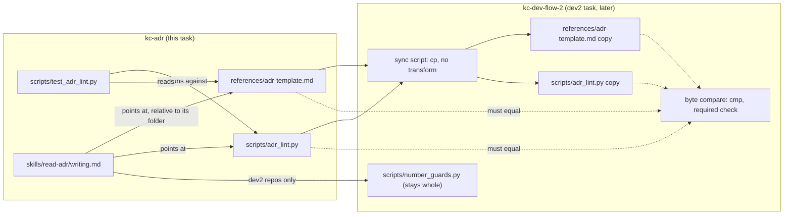

---
id:
title: kc-adr is the source of the ADR template and the ADR linter
status: done
variant: kc-dev-flow-2
profile: pilot
merge: pr
worktree: .worktrees/spacedock-ensign-kc-adr-format-source
pr: pr-merge:710
gates:
    version: 1
    records:
        - id: gate:kc-adr-format-source:backlog
          stage: backlog
          attempts:
            - id: gate-attempt:kc-adr-format-source-backlog-1
              briefing:
                id: briefing:kc-adr-format-source:backlog:attempt-1:revision-1
                digest: sha256:0ff592f3b9d7d312d87b0d8e04248b95e257c8ffb0fde8b9f651a4a9e8088212
                room-ref: ./kc-adr-format-source/review/backlog/briefing-1
              resolution:
                type: Resolution
                id: resolution:spacedock:kc-adr-format-source:backlog:1
                briefing: briefing:kc-adr-format-source:backlog:attempt-1:revision-1
                by: person:captain
                at: "2026-10-22T04:37:34.563536Z"
                decision: approve
                reason: Captain replied 「照建議」 (2026-10-22) to a two-item batch whose item 2 was this backlog gate; accepts the outcome, scope, non-goals, half-day budget and AC-1..AC-3 as filed, to run after read-adr-reporting-rule-followup.
              application:
                target-stage: ideation
                state: consumed
        - id: gate:kc-adr-format-source:ideation
          stage: ideation
          attempts:
            - id: gate-attempt:kc-adr-format-source-ideation-1
              briefing:
                id: briefing:kc-adr-format-source:ideation:attempt-1:revision-1
                digest: sha256:2a2be4db2113152eb9fbbf8e6c232f5b0ed9ba414e31d37676d5dc9c34f70430
                room-ref: ./kc-adr-format-source/review/ideation/briefing-1
              resolution:
                type: Resolution
                id: resolution:spacedock:kc-adr-format-source:ideation:1
                briefing: briefing:kc-adr-format-source:ideation:attempt-1:revision-1
                by: person:captain
                at: "2026-10-23T03:39:51.329924Z"
                decision: approve
                reason: Captain replied 「准」 (2026-10-23) to the ideation gate after asking what 'the recommender' means; accepts the design and the D1 and D2 scope additions as stated in the gate question.
              application:
                target-stage: implementation
                state: consumed
        - id: gate:kc-adr-format-source:validation
          stage: validation
          attempts:
            - id: gate-attempt:kc-adr-format-source-validation-1
              briefing:
                id: briefing:kc-adr-format-source:validation:attempt-1:revision-1
                digest: sha256:dc7fec93a25fa0ca52f40f329cb1ddb204bdcc0d840523be6b9a8212b14dcaba
                room-ref: ./kc-adr-format-source/review/validation/briefing-1
              resolution:
                type: Resolution
                id: resolution:spacedock:kc-adr-format-source:validation:1
                briefing: briefing:kc-adr-format-source:validation:attempt-1:revision-1
                by: person:captain
                at: "2026-10-23T04:05:40.400193Z"
                decision: revise
                reason: 'Captain 「照建議」 (accepts direction, returns to implementation): fix B1 restore 「第一步先測複製進去的目錄在兩個 host 上都裝得起來」 in boundary-contract.md; B2 restore the ruling''s words and where they were said in boundary-contract.md; B3 add ''one writer at a time'' to the README numbering line; fix 4 reword writing.md''s ''under kc-dev-flow-2, use `number_guards.py reserve` instead'' to ''under kc-dev-flow-2, the coordinator reserves it with `number_guards.py reserve`; ask for one.'''
            - id: gate-attempt:kc-adr-format-source-validation-2
              briefing:
                id: briefing:kc-adr-format-source:validation:attempt-2:revision-1
                digest: sha256:fc94b68db2c6264c8e6b99fae23cc2b4a0a7e32386f3c4ecd07cf0e1a9953c71
                room-ref: ./kc-adr-format-source/review/validation/briefing-2
              resolution:
                type: Resolution
                id: resolution:spacedock:kc-adr-format-source:validation:2
                briefing: briefing:kc-adr-format-source:validation:attempt-2:revision-1
                by: person:captain
                at: "2026-10-23T04:22:42.6248Z"
                decision: approve
                reason: 'Captain 「准」 (2026-10-23) to briefing-2: accepts validation on 0b5a9ddf and delivery as asked: push, Draft PR with the shown body, ready after CI, review rounds, merge with --match-head-commit once delivery_gate.py passes, then remove the candidate worktree and local branch.'
              application:
                target-stage: done
                state: consumed
started: 2026-10-23T02:38:26Z
verdict: PASSED
completed: 2026-10-23T04:40:05Z
archived: 2026-10-23T04:40:05Z
---

The Captain ruled on 2026-10-22, in this FO's Paseo session (「同意」, to the item 「縮小你 10/22 的裁決並採用上面的同步方式：kc-adr 只當模板和格式檢查的來源，配號留在 dev2。副本由同步腳本產生，必過檢查做逐位元比對。格式照 dev2 現有的採用，只把「FO」改成「推薦者」。」), and confirmed it in the dev2 FO's session (「ADR 工具要改用 kc-adr 那邊轉述的縮小版。」, recorded as amendment 1 of dev2 task `kc-adr-tools-with-dev2-copy`). The dev2 FO split the work: this task lands kc-adr's side, and the dev2 task generates dev2's copies from it and adds the byte compare. A repo that does not run dev2 (a future finance flow) can then get the ADR template and linter by installing kc-adr.

## Scope

- Add `kc-adr/references/adr-template.md` and `kc-adr/scripts/adr_lint.py` (with the `AdrLintTests` from `kc-dev-flow-2/scripts/test_adr_doc_checks.py`) as the source. Content is byte-identical to dev2's current files, except that the template's "the worker or FO" becomes "the recommender".
- In `kc-adr/skills/read-adr/writing.md`, point `## Where the tools are` at kc-adr's own template and linter, keep the number reserver as a kc-dev-flow-2 file, and add the single-writer numbering sentence: one above the highest number on the base branch; under dev2, use `number_guards.py reserve`.
- dev2's copies, the sync script and the byte compare are out of scope; dev2 task `kc-adr-tools-with-dev2-copy` owns them and starts from this task's merged head.

Non-goals: `number_guards.py` or any reservation logic; monorepo namespaces; `kc-adr/skills/read-adr/SKILL.md` (task `read-adr-reporting-rule-followup` edits it); a lighter format for non-dev2 repos.

Budget: half a working day. Stop if the dev2 template wording change would break dev2's own lint or tests.

## Acceptance criteria

**AC-1**: kc-adr carries `references/adr-template.md` and `scripts/adr_lint.py`. The linter is byte-identical to dev2's at the PR's base, and the template differs only in the "recommender" wording.
Verified by: `cmp` on the linter and `diff` on the template against the base commit's dev2 files.

**AC-2**: kc-adr's `AdrLintTests` pass when run from kc-adr, and dev2's own suite still passes unchanged.
Verified by: running both test files at the candidate.

**AC-3**: `writing.md` points at kc-adr's template and linter, keeps the reserver under kc-dev-flow-2, and states the single-writer numbering rule.
Verified by: a text check of `writing.md`, plus a single-writer dry run that numbers a new ADR one above the base branch's highest number and passes the kc-adr linter.

## FO alignment

Not needed before ideation: the Captain stated the narrowed scope and the split was agreed with the dev2 FO. Release review: not needed: the map was skipped for kc-adr by the Captain's authorization.
Surfaces: none
Visible change: none
Reviewer: kc-dev-flow-2:engineering-reviewer opus 2026-10-23 — do these amendments withdraw what the Captain approved, and what changes in the build? Result (before the validation gate): adjust. No approval silently withdrawn; all 7 files trace to scope, D1, D2 or amendment 1. Defects: amendment 1's Design line withdraws the whole SKILL.md non-goal while the Captain approved one sentence, so SKILL.md is graded against the Asked sentence only; the boundary-contract rewrite drops 「第一步先測複製進去的目錄在兩個 host 上都裝得起來」, which kc-adr-tools-with-dev2-copy still lists, and no longer cites the ruling's words; the README numbering line drops "one writer at a time". Residual: with SKILL.md's stop gone, writing.md's "under kc-dev-flow-2, use `number_guards.py reserve` instead" reads as telling the writer to run the reserver, where ADR 0002 has the First Officer reserve; no agent run measured it.

## Design

Profile: pilot. No promotion trigger: no production data, no consumer-required migration, no release duty. Base of every claim below: `8bfac961ddb0167acff2005e256493dfc7942bc5` (origin/main, read 2026-10-23).

### PRFAQ

**Headline.** kc-adr carries the ADR template and the ADR linter, so a repo that installs only kc-adr can write an ADR in dev2's format and check it with the same linter.

**Press release.** Today kc-adr's `writing.md` ends at "Neither: stop. A repo without kc-dev-flow-2 has no writing tools." After this task the template and linter are files of kc-adr, byte-identical to dev2's (the template differs in one phrase), and `writing.md` points at them. A repo without dev2 numbers a new ADR one above the highest on its base branch, one writer at a time. dev2 later generates its copies from kc-adr, so a dev2 user still installs one package; that part is dev2 task `kc-adr-tools-with-dev2-copy`, not this one.

**FAQ.**
- *Why copy and not move?* The Captain's narrowed ruling (see Scope): kc-adr is the source, dev2 keeps generated byte copies, `number_guards.py` stays whole in dev2.
- *What does this task change in dev2?* Nothing. `git diff --stat <base>..<candidate> -- kc-dev-flow-2` is empty (AC-2).
- *Existing-code check (bounded).* Exists: dev2's `references/adr-template.md`, `scripts/adr_lint.py`, `scripts/test_adr_doc_checks.py` (`AdrLintTests` plus `DocImpactTests`). Absent: `git ls-tree -r --name-only <base> -- kc-adr` lists six files (plugin and codex manifests, CHANGELOG, `SKILL.md`, `prefix.md`, `writing.md`); no template, no linter. Conclusion: copy what exists, rewrite nothing, edit one phrase.
- *Why can the tests not be copied byte for byte?* `test_adr_doc_checks.py` also loads `scripts/doc_impact.py` and holds `DocImpactTests`; kc-adr has no `doc_impact.py`, so the file would not import. kc-adr gets `scripts/test_adr_lint.py`: the same header, `record()` helper and `AdrLintTests` body, minus the `doc_impact` load and `DocImpactTests`. It lives at the same relative depth, so `ROOT = parents[1]` still resolves `scripts/` and `references/`.
- *Does the one-phrase wording change break dev2?* Rehearsed, no (see Evidence plan, AC-2). Nothing in the package greps the phrase "worker or FO" outside the template itself (`git grep -n 'worker or FO' <base>` hits only `kc-dev-flow-2/references/adr-template.md`); the only test that reads the template bytes is `test_adr_doc_checks.py`, and its `record()` helper replaces only `# NNNN.`, `Date: YYYY-MM-DD` and `## Status\n\nAccepted`.
- *Past rulings.* ADR 0002 binds the boundary: numbers are reserved by `number_guards.py`, which stays in dev2, and it records that `adr_lint.py` sees duplicate numbers inside one tree only. `git -C <state> grep -n 'Override:'` (2026-10-23) hits only archived design prose about unrelated areas; no past ruling went against a similar recommendation.



### Exact paths in kc-adr (the stable contract for the dev2 FO)

| kc-adr path | Content | dev2 copy path (dev2 task generates) | Relation |
| --- | --- | --- | --- |
| `kc-adr/references/adr-template.md` | dev2's template with "the option the worker or FO recommended" replaced by "the option the recommender recommended" | `kc-dev-flow-2/references/adr-template.md` | byte-identical after sync; `cp` then `cmp` |
| `kc-adr/scripts/adr_lint.py` | dev2's linter, unchanged | `kc-dev-flow-2/scripts/adr_lint.py` | byte-identical; `cp` then `cmp` |
| `kc-adr/scripts/test_adr_lint.py` | `AdrLintTests` extracted (8 tests) | none: dev2 keeps its own `AdrLintTests` in `test_adr_doc_checks.py` (9 tests, with `DocImpactTests`) | not synced, not byte-compared |

How dev2's copy is generated: a plain byte copy of the two files, in this table's direction, and no text transform (the one wording change is already in the kc-adr source, so sync does not edit). Reference form, rehearsed on 2026-10-23 against scratch copies of the base tree:

```
for f in references/adr-template.md scripts/adr_lint.py; do cp kc-adr/$f kc-dev-flow-2/$f; done      # sync
for f in references/adr-template.md scripts/adr_lint.py; do cmp kc-adr/$f kc-dev-flow-2/$f || r=1; done; exit ${r:-0}   # compare
```
Before sync the compare exits 1 and names `references/adr-template.md` ("differ: char 410, line 21"); after sync it exits 0. Interface requirements for the dev2 task (it owns the design, not this task): the compare's workflow trigger must include `kc-adr/references/adr-template.md` and `kc-adr/scripts/**`, because today `kc-dev-flow-2-tests.yml` triggers on `kc-dev-flow-2/**` only and a kc-adr-only edit would merge with no check; and no workflow runs anything under `kc-adr/` today, so `kc-adr/scripts/test_adr_lint.py` runs in CI only if that required check also runs it as one more step; this is a requirement on that task, not a Captain decision here.

### The exact `writing.md` change (`kc-adr/skills/read-adr/writing.md`)

`## Where the tools are` becomes:

```
## Where the tools are

This plugin ships the ADR template and the ADR linter. `<kc-adr>` is the folder two levels above this file's folder, the one that holds `skills/`; take it from the path you read this file at, not from a search.

- ADR template: `<kc-adr>/references/adr-template.md`
- ADR linter: `python3 <kc-adr>/scripts/adr_lint.py docs/adr --require NNNN`
- Number reserver, only in a repo that runs kc-dev-flow-2: `python3 <package>/scripts/number_guards.py reserve --kind adr --task <task>`

Numbering: where no number was reserved for you, one writer at a time adds an ADR, and its number is one above the highest on the base branch; under kc-dev-flow-2, use `number_guards.py reserve` instead.

Resolve `<package>` (needed only for the reserver) in this order, never as a literal path (`${CLAUDE_PLUGIN_ROOT}` is this plugin's root, not kc-dev-flow-2's):

1. The `Package root:` line in your dispatch notes or in the loaded kc-dev-flow-2 skill header.
2. The installed copy: on Claude Code the `installPath` of `kc-dev-flow-2@kc-claude-plugins` in `~/.claude/plugins/installed_plugins.json`; on Codex the version directory under `~/.codex/plugins/cache/kc-claude-plugins/kc-dev-flow-2/`.
3. Neither: there is no reserver; number as above.

The reserver's path is written against kc-dev-flow-2 <current version>. Read `version` in `<package>/.claude-plugin/plugin.json`; if it differs, still use the file and report "written against <current version>, found X".
```
What the diff removes: "Today the ADR template, linter and number reserver are files of the kc-dev-flow-2 package, and this skill ships no copy of them", the `<package>/references/adr-template.md` and `<package>/scripts/adr_lint.py` lines, and "Neither: stop. A repo without kc-dev-flow-2 has no writing tools." The version stamp stays because the reserver is still a dev2 file; the implementer writes the version actually read from `kc-dev-flow-2/.claude-plugin/plugin.json` at the PR base (the stamp says 0.27.0 and the package installed here is 0.28.0), not a guess.

The relative-path form is chosen because the old text already warns that `${CLAUDE_PLUGIN_ROOT}` is not a path to rely on for another plugin, and a sibling file read by path needs no variable on either host. AC-3 checks the two relative paths exist, not only that the words are present.

Conflict in the numbered list above this section (Decision D1): item 2 says "Invent none; no such section means ask the coordinator" and item 5 says "The coordinator reserves numbers with the number reserver", both true only under dev2. Proposed minimal edit: item 2 becomes "The number is the one the task reserved (`ADR: NNNN` in its `## Number guards` section), or, in a repo whose tasks reserve none, the one `## Where the tools are` gives. Invent none otherwise; ask the coordinator." Item 5 becomes "In a repo that runs kc-dev-flow-2 the coordinator reserves numbers with the number reserver. You do not run it."

### Risk: the template wording change against dev2's own lint and tests

The change is one phrase on the `**Recommended:**` line. Risk: it is the only line the linter's `--require` rule reads (`"**Recommended:**" not in Decision`), so a slip in the edit that damages the label breaks every required record. Catch: AC-2's overlay run puts kc-adr's template and linter on dev2's paths and runs dev2's suite. That is needed because this PR does not touch dev2's files, so dev2's suite run "unchanged" at the candidate is green by construction and proves nothing about the new wording. Rehearsed 2026-10-23: overlay, 9 of 9 pass; mutation damaging the label (`**Recommended:**` to `Recommended:`) fails 3 of 8 kc-adr tests; mutation renaming `## Status` fails 5 of 8. What no test can catch: the wording itself (no test reads that phrase). Stop condition from Scope ("stop if dev2's lint or tests would break") did not fire in the rehearsal.

## Evidence plan

Notation: `WT` is the candidate worktree, `B` the PR's base commit, `C` the candidate head. Commands were rehearsed on 2026-10-23 against scratch copies of `8bfac961` in `/tmp` (nothing written to the repository); the results below are rehearsal results, not candidate results.

**AC-1** (filed text unchanged). Clauses:
1. `git -C "$WT" show "$B:kc-dev-flow-2/scripts/adr_lint.py" | cmp - "$WT/kc-adr/scripts/adr_lint.py"` exits 0. Rehearsal: identical.
2. `git -C "$WT" show "$B:kc-dev-flow-2/references/adr-template.md" | diff - "$WT/kc-adr/references/adr-template.md"` prints exactly one hunk, line 21, `worker or FO` to `recommender`. Rehearsal: one hunk, `21c21`, one line changed.
3. `git -C "$WT" diff --stat "$B..$C" -- kc-dev-flow-2` is empty (this task edits no dev2 file).
Fails if: the linter differs by one byte, the template differs outside line 21, or any dev2 file is touched.

**AC-2** (filed text unchanged). Clauses:
1. `python3 -B "$WT/kc-adr/scripts/test_adr_lint.py"` prints `Ran 8 tests` and `OK`, run from kc-adr's folder (and again from another cwd). Rehearsal: 8 tests OK.
2. dev2's suite unchanged: `python3 -B "$WT/kc-dev-flow-2/scripts/test_adr_doc_checks.py"` and the three suites that name the linter (`lint-skills.py`, `test_lint_skills.py`, `test_dispatch_records.py`) pass at `C`.
3. Overlay run (the one that exercises the new wording): `git -C "$WT" archive "$C" kc-dev-flow-2 kc-adr scripts docs/adr .claude-plugin | tar -x -C "$SCRATCH"`, copy `kc-adr/references/adr-template.md` and `kc-adr/scripts/adr_lint.py` onto the `kc-dev-flow-2` paths, then run the same four commands there. Rehearsal: `test_adr_doc_checks.py` 9 of 9 OK, `lint-skills.py` exit 0, `test_lint_skills.py` 35 of 35, `test_dispatch_records.py` 47 of 47, and the repo's 28 ADRs pass the linter. Not run in the rehearsal: `test_sd_dispatch.py` (needs a pinned Spacedock plugin root; it names `adr_lint.py` in prose checks only) and the extension suites; the implementer runs `test_sd_dispatch.py` if the Spacedock root is available, else states it as a limit.
4. Falsifiers, run once and reported: damaging the `**Recommended:**` label in the kc-adr template makes clause 1 fail (rehearsal: 3 of 8 fail); renaming `## Status` makes it fail (5 of 8).
Fails if: any suite is red, or clause 1 passes with a damaged template.

**AC-3** (filed text unchanged). Clauses:
1. Text check of `$WT/kc-adr/skills/read-adr/writing.md`: under `## Where the tools are`, `<kc-adr>/references/adr-template.md` and `<kc-adr>/scripts/adr_lint.py` appear; `<package>/references/adr-template.md` and `<package>/scripts/adr_lint.py` do not; `<package>/scripts/number_guards.py reserve` does; the sentence containing "one above the highest" also contains `number_guards.py reserve`.
2. Path check: from `$WT/kc-adr/skills/read-adr`, `test -f ../../references/adr-template.md && test -f ../../scripts/adr_lint.py` exits 0.
3. Single-writer dry run, in a scratch git repo: base branch `main` holds `docs/adr/0001..0003` made from the template; on a feature branch, compute `HIGH=$(git ls-tree --name-only main docs/adr/ | sed 's|.*/||' | grep -E '^[0-9]{4}-' | cut -c1-4 | sort | tail -1)` and `N=$(printf '%04d' $((10#$HIGH+1)))`; write `docs/adr/$N-a-new-ruling.md` from the template; then `python3 ../../scripts/adr_lint.py docs/adr --require $N` and `--since <main sha>` both exit 0. Rehearsal: highest 0003, new 0004, both exit 0; a fourth file numbered 0003 exits 1 ("number 3 is also used by").
Limit stated with the criterion: the linter checks one working tree, so two writers on two branches can both take `$N` and each passes; it is caught at the merge, which is why the sentence says one writer at a time (ADR 0002 records the same limit). The dry run proves the numbering rule and the linter path, not concurrency safety.
Fails if: a required string is missing, a relative path does not resolve, or the linter exits non-zero on the dry-run ADR.

## Needs decision (Captain)

Two decisions, D1 and D2; they are independent.

- **D1. Do the numbered steps above `## Where the tools are` change too?** Recommend yes, the minimal edit to items 2 and 5 shown above. Without it `writing.md` tells a non-dev2 agent both "invent none, ask the coordinator" and "number it one above the highest". It adds two edited lines beyond the filed scope. Residual either way: `SKILL.md` ends "no reserved number means do not write one: ask the coordinator"; that file is task `read-adr-reporting-rule-followup`'s, so this task leaves it and reports it.
- **D2. Do the two claims this change makes false ship in the same PR?** Recommend yes: the `README.md` kc-adr paragraph ("One skill, `read-adr`, and no tool ... ships no copy"; also stamped 0.1.0 while the plugin is 0.1.1) and `docs/journey/kc-decision-log/boundary-contract.md` (the tools paragraph says kc-adr becomes the source of numbering "配號中 ADR 部分的來源" and "在那張任務完成前，read-adr 的寫入部分照舊指向 dev2 的工具", both overtaken by the narrowed ruling). The repo's README sync rule and the retained-document practice call for it; neither file is in the filed scope. Without it both documents state the opposite of the merged behaviour.

Not decisions, recorded as residual: the unverified assumption that `read-adr-reporting-rule-followup` (a task in another workflow, whose file is not in this state checkout) edits only `SKILL.md` and not `writing.md`, so a merge collision is possible and FO can check it; the kc-adr linter's docstring still says "dev2 ADR format" (byte-identical by the ruling); the substituted phrase reads "the option the recommender recommended" (the ruling's exact words); kc-adr's CHANGELOG and version move through release-please from a `feat(kc-adr):` commit, never by hand.

## Captain amendments

### Amendment 1 — 2026-10-23, chat
Captain: 「改」 (this FO's Paseo session, after implementation found SKILL.md still contradicting the single-writer numbering rule)
Asked: 「請你決定一件事：在這個 PR 順便改掉那一句嗎？」 with 「推薦改：把那句改成「沒有你的原話就不要寫，去問協調者；編號方式見 `writing.md`」。」 The sentence is SKILL.md's 「沒有你的原話，或沒有保留好的編號，就不要寫，去問協調者。」
Supersedes: none
Design: the non-goal "`kc-adr/skills/read-adr/SKILL.md` (task `read-adr-reporting-rule-followup` edits it)"

### Amendment 2 — 2026-10-23, chat
Captain: 「照建議」 (this FO's Paseo session, validation gate briefing-1)
Asked: "Approving the recommendation also approves fix 4, which rewords a sentence you approved: writing.md's \"under kc-dev-flow-2, use `number_guards.py reserve` instead\" becomes \"under kc-dev-flow-2, the coordinator reserves it with `number_guards.py reserve`; ask for one.\""
Supersedes: none
Design: the numbering sentence in `### The exact \`writing.md\` change`

## Stage Report: ideation

- DONE: Design kc-adr's side of the narrowed packaging ruling: the exact paths in kc-adr for the ADR template, `scripts/adr_lint.py` and `AdrLintTests`. They are byte-identical to dev2's files at base 8bfac961ddb0167acff2005e256493dfc7942bc5, except the template's "the worker or FO" becomes "the recommender". Show exactly how dev2's copy will be generated from them later, so the dev2 FO's sync script and byte compare can rely on stable paths.
  `## Design`, "Exact paths" table: `kc-adr/references/adr-template.md`, `kc-adr/scripts/adr_lint.py`, `kc-adr/scripts/test_adr_lint.py` (AdrLintTests only: the dev2 file also loads `doc_impact.py`, so it cannot be byte-identical); sync is `cp`, compare is `cmp`, both rehearsed on scratch copies (before sync exit 1, after exit 0).
- DONE: Show the exact `writing.md` change: `## Where the tools are` points at kc-adr's own template and linter, keeps the number reserver under kc-dev-flow-2, and adds the single-writer numbering sentence. Note the risk that the template wording change affects dev2's own lint or tests, and how the AC-2 run will catch it.
  `## Design`, "The exact writing.md change" and "Risk": full replacement text, plus items 2 and 5 conflict (D1). Overlay rehearsal: dev2 `test_adr_doc_checks.py` 9/9, `lint-skills.py` exit 0, `test_lint_skills.py` 35/35, `test_dispatch_records.py` 47/47; the AC-2 overlay run is needed because this PR leaves dev2's files untouched.
- DONE: Give AC-1..AC-3 reproducible evidence clauses and list decisions for the Captain.
  `## Evidence plan` (per AC, below) and `## Needs decision`: D1 (numbered steps 2 and 5), D2 (README and boundary-contract claims made false).
- DONE: AC-1 evidence (not yet verified at a candidate).
  Clauses: `cmp` on the linter, one-hunk `diff` on the template, empty `git diff --stat <base>..<C> -- kc-dev-flow-2`. Rehearsed on scratch copies of 8bfac961: linter identical, template differs only at `21c21`.
- DONE: AC-2 evidence (not yet verified at a candidate).
  Clauses: kc-adr test file run (rehearsal 8/8), dev2 suites unchanged, overlay run of dev2 suites with kc-adr's files, two falsifiers. Rehearsed: label-damaged template fails 3 of 8, `## Status` renamed fails 5 of 8. Not rehearsed: `test_sd_dispatch.py` (needs a Spacedock plugin root).
- DONE: AC-3 evidence (not yet verified at a candidate).
  Clauses: text check, relative-path `test -f` check, single-writer dry run. Rehearsed: highest 0003, new 0004, linter exit 0 with `--require` and `--since`; a duplicate 0003 exits 1. Limit: the linter sees one tree, so two concurrent writers are not caught (ADR 0002).
- DONE: Run `/Users/kent/.claude/plugins/cache/kc-claude-plugins/kc-dev-flow-2/0.28.0/scripts/design_surfaces.py check <task>`.
  `python3 .../0.28.0/scripts/design_surfaces.py check kc-adr-format-source.md` printed "kc-adr-format-source.md: design surfaces presentable", exit 0. The skill header resolved to 0.26.0; `diff -rq` of the two roots differs only in plugin.json and `.in_use`, so the checker is the same bytes.
- DONE: Write no repository file, branch or commit.
  `git status --short` in the worktree shows only the pre-existing ` M .gitignore` (not mine); my only writes are this state file and scratch copies under `/tmp/kc-adr-ideation-rehearsal`.

### Summary

kc-adr gets the template and linter as byte copies of dev2's (one phrase changed) plus an extracted `AdrLintTests` file, and `writing.md` points at them; dev2's sync is a `cp` and its compare a `cmp` over the two stable paths. The wording change did not break dev2's lint or tests in a scratch overlay run, but that run is the only thing that can show it, so AC-2 must include it. Two Captain decisions: D1 (steps 2 and 5 in `writing.md` contradict the new numbering sentence) and D2 (README and boundary-contract claims become false); the CI step for kc-adr's tests is a requirement on the dev2 task. Unverified: that `read-adr-reporting-rule-followup` does not also edit `writing.md`.

## Stage Report: implementation

- DONE: Build the approved design: kc-adr/references/adr-template.md ("the worker or FO" -> "the recommender"), kc-adr/scripts/adr_lint.py (byte-identical), kc-adr/scripts/test_adr_lint.py (AdrLintTests only); apply the approved writing.md replacement text; D1 and D2; no dev2 file changes.
  Commit 57b86de4 on spacedock-ensign/kc-adr-format-source, base c3514876339cb732d0bea8b2d2dd45c234bcdeaf (rebased ff from 8bfac961; the dev2 linter, template, test file, kc-adr, README and boundary-contract had no diff between the two). Six files: three new kc-adr files, `writing.md` (replacement section plus items 2 and 5 per D1, version stamp 0.28.0 read from `kc-dev-flow-2/.claude-plugin/plugin.json` at base), README kc-adr paragraph (0.1.0 -> 0.1.1, tools stated), boundary-contract tools paragraph.
- DONE: AC-1 evidence.
  `git show $B:kc-dev-flow-2/scripts/adr_lint.py | cmp - kc-adr/scripts/adr_lint.py` exit 0; template diff is the single hunk `21c21`; `git diff --stat $B..$C -- kc-dev-flow-2` is empty. Fails if the linter differs by one byte or any dev2 file is touched.
- DONE: AC-2 evidence.
  kc-adr `test_adr_lint.py`: Ran 8 OK, from kc-adr and from /tmp. dev2 at candidate: `test_adr_doc_checks.py` 9 OK, `test_lint_skills.py` 35 OK, `test_dispatch_records.py` 47 OK, `lint-skills.py` exit 0. Overlay (scratch `git archive` of C, kc-adr template and linter copied onto dev2 paths): same four green, repo's 29 ADRs pass the linter. Not run: `test_sd_dispatch.py` (requires `--sd-plugin-root`, no pinned Spacedock root provided; this change touches no dev2 file); extension suites.
- DONE: Two template falsifiers.
  Label `**Recommended:**` -> `Recommended:` in a scratch copy: `test_adr_lint.py` FAILED (failures=3) (asserts the required-record rule and the template-is-valid test); `## Status` -> `## State`: FAILED (failures=5). Neither would pass with a damaged template.
- DONE: AC-3 evidence.
  Text check on `## Where the tools are`: both `<kc-adr>/` paths present, both `<package>/` template/linter paths absent, `<package>/scripts/number_guards.py reserve` present, the "one above the highest" sentence also names `number_guards.py reserve`. From `kc-adr/skills/read-adr`, `test -f ../../references/adr-template.md && test -f ../../scripts/adr_lint.py` exit 0. Dry run in a scratch git repo: highest 0003 -> new 0004 written from the template; `adr_lint.py docs/adr --require 0004` and `--since <main sha>` both exit 0; a second file numbered 0003 exits 1 ("number 3 is also used by"). Limit as designed: one tree only, concurrent writers are not caught (ADR 0002).
- DONE: Closing checks.
  `version-parity-check.sh` exit 0 (kc-adr 0.1.1 all sources); `skill-frontmatter-lint.sh` exit 0; `comment_ratio.py` "code lines 216, comment lines 1, 0.5%, maximum 5% met" (the one comment is in the byte-identical linter); `design_surfaces.py check` exit 0 "presentable"; `doc_impact.py` lists 0 documents; sanitize-check on kc-adr (rules from `sanitize-rules.yaml`, 8 block literals, REJECT and WARN patterns): 0 BLOCK, 0 REJECT, 0 WARN. No ADR added or changed, no `## Number guards` section.
- DONE: Roborev step.
  `roborev_gate.py --repo <worktree> --base c3514876...` exit 0: `clean on 57b86de48; evidence=roborev:1066`.

### Summary

kc-adr now ships the ADR template and linter as byte copies of dev2's (one phrase changed) plus `test_adr_lint.py`, `writing.md` points at them with the single-writer numbering rule, and the README and boundary contract no longer say kc-adr ships no tools. No dev2 file, version or CI workflow was touched. Residuals for FO: `kc-adr/skills/read-adr/SKILL.md` still ends "no reserved number means do not write one: ask the coordinator" (owned by `read-adr-reporting-rule-followup`; it may also edit `writing.md`, so a merge collision is possible, unchecked); `test_sd_dispatch.py` not run; the CI step that runs `kc-adr/scripts/test_adr_lint.py` and the compare's trigger paths are owed by dev2 task `kc-adr-tools-with-dev2-copy`; push, PR and release are FO's.

## Stage Report: implementation (cycle 2)

- DONE: Apply Captain amendment 1: change only the sentence in kc-adr/skills/read-adr/SKILL.md, so that a missing person's words still mean do not write one and ask the coordinator, and numbering points to writing.md; frontmatter and every other line unchanged; commit on the worktree branch.
  Commit 91b9e8af (one line changed, 1 insertion 1 deletion): "...no words from the person means do not write one: ask the coordinator. How to number it is in `writing.md`." The first five lines of SKILL.md match the base byte for byte; the rest of the diff is that one line.
- DONE: Re-run the AC-3 text check so that it also covers SKILL.md and writing.md agreeing on numbering.
  The `## Where the tools are` checks pass again (both `<kc-adr>/` paths present, `<package>/` template and linter absent, reserver present, "one above the highest" sentence names `number_guards.py reserve`, `test -f` on both relative paths exit 0). Agreement: the phrase "no reserved number" is now in neither file (grep count 0 and 0), and SKILL.md line 48 sends numbering to `writing.md`, which holds the single-writer rule. This is a text check; no agent scenario was re-run for this sentence.
- DONE: Re-run the closing checks on the new head.
  `version-parity-check.sh` consistent; `skill-frontmatter-lint.sh` valid; `comment_ratio.py` 0.5%, maximum 5% met; `design_surfaces.py check` presentable; sanitize-check on kc-adr 0 BLOCK, 0 REJECT, 0 WARN; `git diff <base> HEAD --stat -- kc-dev-flow-2` empty.
- DONE: Roborev step on the new head.
  `roborev_gate.py --repo <worktree> --base c3514876...` exit 0: `clean on 91b9e8af2; evidence=roborev:1067`.
- DONE: State that no agent scenario was re-run for this sentence.
  No agent scenario ran in either cycle, so whether an agent now numbers correctly from SKILL.md is not measured; only the text agreement is.

### Summary

SKILL.md's numbering clause now defers to `writing.md` and keeps the "no words, do not write" rule, so the two files agree. Head is 91b9e8af; every earlier cycle-1 result still holds because the one-line change touches no script, template or dev2 file. The earlier cycle's `test_sd_dispatch.py` and extension-suite limit stands.

## Stage Report: validation

- DONE: Independent verdict on candidate 91b9e8af2538745e0f2f059a1c218e009e7f20fe against AC-1..AC-3, the approved design with D1 and D2, and Captain amendment 1.
  Verdict PASSED. Worktree HEAD is the candidate, base c3514876 is its merge-base, two commits (57b86de4, 91b9e8af), 7 files, `git diff --stat <base>..<candidate> -- kc-dev-flow-2` empty.
- DONE: AC-1, re-run: `cmp` on the linter and `diff` on the template against the base's dev2 files.
  Linter `cmp` exit 0; template diff is one hunk, `21c21`, "worker or FO" to "recommender". Fails if one byte of the linter differs or the template differs outside line 21.
- DONE: AC-2, re-run: kc-adr `test_adr_lint.py`, dev2's suites, and the overlay run on dev2's paths.
  Scratch `git archive` of the candidate: kc-adr tests Ran 8 OK (from kc-adr and from /tmp); dev2 `test_adr_doc_checks.py` 9, `test_lint_skills.py` 35, `test_dispatch_records.py` 47 OK, `lint-skills.py` exit 0. Overlay (kc-adr template and linter copied onto dev2 paths): same four green, repo's 29 ADRs pass the linter, and `cmp` of both pairs is clean. The extracted `AdrLintTests` body is identical to dev2's (compared programmatically).
- DONE: The two template falsifiers.
  `**Recommended:**` to `Recommended:` makes `test_adr_lint.py` FAIL (failures=3), asserting the required-record rule; `## Status` to `## State` FAILS (failures=5), asserting the format rule. A damaged template cannot pass.
- DONE: AC-3, re-run: text check, relative-path check, single-writer dry run, and SKILL.md/writing.md agreement on numbering.
  `## Where the tools are` has both `<kc-adr>/` paths, no `<package>/` template or linter path, the `number_guards.py reserve` reserver line, and the "one above the highest" sentence names `number_guards.py reserve`. `test -f ../../references/adr-template.md && test -f ../../scripts/adr_lint.py` from the read-adr folder exits 0. Dry run (acceptance step 6): highest 0003, new 0004 from the template, `--require 0004` and `--since <main>` both exit 0. "no reserved number" is in neither file; SKILL.md sends numbering to `writing.md`. Limit as designed: one tree only, two concurrent writers are not caught (ADR 0002).
- DONE: Review the code change: 7 files, no kc-dev-flow-2 file, README and boundary-contract accurate, D1 items 2 and 5 consistent with the numbering rule.
  README now says kc-adr ships template and linter and reservation stays in dev2, and 0.1.1 matches plugin.json, codex manifest and marketplace (`version-parity-check.sh` exit 0). boundary-contract states the narrowed ruling and names the dev2 task as owner of copy and sync. writing.md version stamp 0.28.0 equals `kc-dev-flow-2/.claude-plugin/plugin.json` at base. Two polish findings, below. Necessity: every surface maps to an AC, D1, D2 or amendment 1; the test file is what AC-2 and the falsifiers run on.
- DONE: `/Users/kent/.claude/plugins/cache/kc-claude-plugins/kc-dev-flow-2/0.28.0/scripts/adr_lint.py docs/adr --since c3514876339cb732d0bea8b2d2dd45c234bcdeaf`, run with its exit code.
  Run in the candidate worktree: "29 ADR file(s) checked, 0 legacy", exit 0. The candidate adds no ADR and the task has no `## Number guards`, so no `--require`.
- DONE: Package checks at the candidate.
  `comment_ratio.py` 216 code lines, 1 comment line (in the byte-identical linter), 0.5%, max 5% met, exit 0; `dispatch_records.py` "4 dispatch record(s) complete" exit 0; `design_surfaces.py check` presentable exit 0; `doc_impact.py` lists 0 documents; `skill-frontmatter-lint.sh` exit 0. The skill header resolved 0.26.0, the dispatch 0.28.0; `diff -rq` differs only in manifests and `.in_use`, so the scripts are the same bytes.
- DONE: Merge collision with the read-adr follow-up.
  `git merge-base --is-ancestor e1f43044 c3514876` true: the follow-up is already in this task's base, so there is no collision to resolve; its SKILL.md sentence is the line amendment 1 changed.
- DONE: A minimal acceptance script FO can run in a fresh shell.
  Below; run by me with `env -i` (empty environment but HOME and PATH): exit 0, all six steps as expected. Output of the scratch directory is under /tmp.
- SKIPPED: `test_sd_dispatch.py`, the extension suites, an agent scenario for the SKILL.md sentence, CI for `kc-adr/` and the byte compare.
  Not run: `test_sd_dispatch.py` needs `--sd-plugin-root`; no agent scenario was run, so whether an agent numbers correctly from SKILL.md is unmeasured; CI for kc-adr and the compare are owed by dev2 task `kc-adr-tools-with-dev2-copy`.

### Findings

- Polish: `writing.md` item 5 says "You do not run it" about the number reserver, while the section's numbering sentence says "under kc-dev-flow-2, use `number_guards.py reserve` instead". The sentence is the Captain's ruled wording and the design's approved text; it reads as an instruction to the coordinator. No current user-visible loss.
- Polish: README states kc-adr "0.1.1"; release-please will move the version from the `feat(kc-adr):` commit, so the stamp ages the same way the old 0.1.0 stamp did.

### Minimal acceptance script

Needs only the candidate worktree path below, `git`, `python3`. No secret. It does not cover: dev2's suites other than `test_adr_doc_checks.py` (steps run in the overlay above), concurrency of two writers, CI, or agent behaviour.

```sh
#!/bin/sh
set -u
REPO=/Users/kent/conductor/workspaces/kc-claude-plugins/colombo/.context/dev2-adoption/worktree/.worktrees/spacedock-ensign-kc-adr-format-source
B=c3514876339cb732d0bea8b2d2dd45c234bcdeaf
C=91b9e8af2538745e0f2f059a1c218e009e7f20fe
S=$(mktemp -d /tmp/kc-adr-accept.XXXXXX); rc=0
git -C "$REPO" archive "$C" | tar -x -C "$S" || exit 1
echo "1. linter byte-identical to base dev2 linter (expect: exit 0)"
git -C "$REPO" show "$B:kc-dev-flow-2/scripts/adr_lint.py" | cmp - "$S/kc-adr/scripts/adr_lint.py" && echo "   exit 0" || rc=1
echo "2. template differs from base dev2 template only at line 21 (expect exactly one line: 21c21)"
git -C "$REPO" show "$B:kc-dev-flow-2/references/adr-template.md" | diff - "$S/kc-adr/references/adr-template.md" | grep -E "^[0-9]+[acd]"
echo "3. no dev2 file touched (expect: 0)"
git -C "$REPO" diff --name-only "$B" "$C" -- kc-dev-flow-2 | wc -l
echo "4. kc-adr tests (expect: Ran 8 tests ... OK)"
(cd "$S/kc-adr" && python3 -B scripts/test_adr_lint.py 2>&1 | grep -E '^(Ran|OK|FAILED)')
echo "5. dev2 suite with kc-adr files on dev2 paths (expect: Ran 9 tests ... OK)"
for f in references/adr-template.md scripts/adr_lint.py; do cp "$S/kc-adr/$f" "$S/kc-dev-flow-2/$f"; done
(cd "$S/kc-dev-flow-2/scripts" && python3 -B test_adr_doc_checks.py 2>&1 | grep -E '^(Ran|OK|FAILED)')
echo "6. single-writer dry run (expect: new number 0004, then two exit=0 lines)"
D="$S/dry"; mkdir -p "$D/docs/adr" && cd "$D" && git init -q -b main && git config user.email a@b.c && git config user.name t
mk() { sed -e "s/^# NNNN\./# $1./" -e "s/^Date: YYYY-MM-DD/Date: 2026-01-01/" "$S/kc-adr/references/adr-template.md" > "docs/adr/$1-$2.md"; }
mk 0001 first; mk 0002 second; mk 0003 third
git add -A && git commit -q -m base && MAIN=$(git rev-parse HEAD) && git checkout -q -b feat
HIGH=$(git ls-tree --name-only main docs/adr/ | sed 's|.*/||' | grep -E '^[0-9]{4}-' | cut -c1-4 | sort | tail -1)
N=$(printf '%04d' $((10#$HIGH+1))); echo "   new number $N"
mk "$N" a-new-ruling
python3 "$S/kc-adr/scripts/adr_lint.py" docs/adr --require "$N" >/dev/null; echo "   --require exit=$?"
python3 "$S/kc-adr/scripts/adr_lint.py" docs/adr --since "$MAIN" >/dev/null; echo "   --since exit=$?"
exit $rc
```

### Summary

PASSED: the candidate meets AC-1..AC-3, D1, D2 and amendment 1; every check was re-run in scratch copies, and both template falsifiers fail the kc-adr tests as they should. Two polish findings, no repair needed. Unverified: `test_sd_dispatch.py`, extension suites, agent behaviour on the SKILL.md sentence, and CI for `kc-adr/` plus the byte compare (owed by dev2 task `kc-adr-tools-with-dev2-copy`).

## Stage Report: implementation (cycle 3)

- DONE: B1: in docs/journey/kc-decision-log/boundary-contract.md, restore the clause 「第一步先測複製進去的目錄在兩個 host 上都裝得起來」 in the tools paragraph, as the first step owned by dev2 task kc-adr-tools-with-dev2-copy.
  The paragraph now ends 「…由 dev2 任務 `kc-adr-tools-with-dev2-copy` 負責，第一步先測複製進去的目錄在兩個 host 上都裝得起來。」
- DONE: B2: replace 「已裁決（使用者 2026-10-22 縮小範圍）」 with the ruling's own words and where they were said; template sentence says the build replaces "the worker or FO" with "the recommender".
  Now 「使用者 2026-10-22 在 kc-adr 任務 FO 的 Paseo 工作階段回覆「同意」，裁示為「kc-adr 只當模板和格式檢查的來源，配號留在 dev2」，並在 dev2 FO 的工作階段確認」; 「模板裡的「the worker or FO」改成「the recommender」」. The place wording is my reading of the preamble's "this FO's Paseo session" and "dev2 FO's session"; correct it if the session names differ.
- DONE: B3: README.md kc-adr paragraph says one writer at a time adds an ADR and its number is one above the highest on the base branch.
  README line 143: 「one writer at a time adds an ADR and its number is one above the highest on the base branch, and number reservation stays in kc-dev-flow-2.」
- DONE: Fix 4 (Captain amendment 2): writing.md numbering sentence reworded, nothing else changed.
  Now 「…under kc-dev-flow-2, the coordinator reserves it with `number_guards.py reserve`; ask for one.」; the commit touches three files, one line each (3 insertions, 3 deletions, then the B2 place edit amended in).
- DONE: Commit on the worktree branch.
  Head 0b5a9ddf7eec59c0870175d7fa09da2e9626a4de on spacedock-ensign/kc-adr-format-source (one commit over 91b9e8af; base c3514876); only README.md, boundary-contract.md and writing.md changed; `git diff c3514876 HEAD --stat -- kc-dev-flow-2` is empty.
- DONE: Re-run AC-3 on the new head.
  Text check of `## Where the tools are`: both `<kc-adr>/` paths present (1,1), `<package>` template/linter paths absent (0), reserver present (1), new numbering sentence present (1); `test -f` on both relative paths exit 0; "no reserved number" in neither writing.md nor SKILL.md, and SKILL.md sends numbering to writing.md. Dry run in a scratch git repo with ADRs filled from the template: highest 0003, new 0004, `adr_lint.py --require 0004` and `--since <seed sha>` exit 0; a second 0003 exits 1 ("number 3 is also used by"). Falsified by: dropping the Date line fails the linter; the duplicate is rejected. Still one tree only (ADR 0002); no agent scenario was run.
- DONE: Re-run closing checks.
  `version-parity-check.sh` exit 0 (kc-adr 0.1.1 everywhere); `skill-frontmatter-lint.sh` exit 0; `comment_ratio.py` 0.5%, 5% max met; kc-adr `test_adr_lint.py` Ran 8 OK; linter `cmp` vs base dev2 exit 0, template differs only at line 21. Sanitize-check run inline from `~/.claude/kc-plugins-config/sanitize-rules.yaml` over the 8 kc-adr md/py files and the added README/boundary-contract lines: 0 BLOCK, 0 REJECT, 0 WARN.
- DONE: roborev_gate.py --repo <worktree> --base c3514876339cb732d0bea8b2d2dd45c234bcdeaf.
  Exit 0: `clean on 0b5a9ddf7; evidence=roborev:1071` (an earlier run on the pre-amend head ca4367e2 was also clean, roborev:1070).

### Summary

The four text fixes are in one commit on the worktree branch; every cycle-2 check was re-run on the new head and passes. The sanitize-check was run as the skill's rules by hand (grep over the rule file), not through the skill itself. Residuals unchanged: `test_sd_dispatch.py` not run, no agent run measured the reworded numbering sentence, and `read-adr-reporting-rule-followup` may collide on writing.md.

### Feedback Cycles

- Cycle 1 (Captain, 2026-10-23): validation gate briefing-1 closed revise (「照建議」) on 91b9e8af after the engineering reviewer returned adjust; routed to implementation as four text fixes, all to fix: B1 restore the two-host first step in boundary-contract.md, B2 restore the ruling's words and place there, B3 add "one writer at a time" to the README numbering line, fix 4 the writing.md numbering sentence per Captain amendment 2. Implementation cycle 3 landed them in 0b5a9ddf; fresh validation recheck next.

## Stage Report: validation (cycle 2)

- DONE: Independent verdict on candidate 0b5a9ddf7eec59c0870175d7fa09da2e9626a4de against AC-1..AC-3, the approved design with D1 and D2, and Captain amendments 1 and 2.
  Verdict PASSED. Worktree HEAD is the candidate, clean status, merge-base is base c3514876, three commits (57b86de4, 91b9e8af, 0b5a9ddf), 7 files, `git diff --stat <base>..<candidate> -- kc-dev-flow-2` empty.
- DONE: B1: the two-host first step is back in boundary-contract.md and agrees with kc-adr-tools-with-dev2-copy's Scope.
  boundary-contract ends 「…第一步先測複製進去的目錄在兩個 host 上都裝得起來」 (string match true); that task's Scope "First step" says a copied directory installs on Claude Code and Codex from the marketplace; same step, same owner.
- DONE: B2: the quoted ruling words and place match the task preamble.
  Checked by script: 「kc-adr 只當模板和格式檢查的來源，配號留在 dev2」 is a verbatim substring of the preamble and of boundary-contract; the doc's 「同意」, "this FO's Paseo session" (kc-adr task FO) and "dev2 FO's session" are the preamble's words; the template sentence says "the worker or FO" becomes "the recommender", which is what the diff does.
- DONE: B3: the README numbering line says one writer at a time.
  README line 143: 「one writer at a time adds an ADR and its number is one above the highest on the base branch, and number reservation stays in kc-dev-flow-2.」
- DONE: Fix 4: the writing.md sentence equals amendment 2's text and agrees with items 2 and 5 and with SKILL.md.
  grep count 1 for "under kc-dev-flow-2, the coordinator reserves it with `number_guards.py reserve`; ask for one."; item 5 says the coordinator reserves and "You do not run it", item 2 asks the coordinator, SKILL.md line 48 sends numbering to writing.md. The cycle-1 polish finding (sentence read as telling the writer to run the reserver) no longer applies.
- DONE: The round changed only README.md, docs/journey/kc-decision-log/boundary-contract.md and kc-adr/skills/read-adr/writing.md over 91b9e8af.
  `git diff --stat 91b9e8af 0b5a9ddf`: those three files, one line each (3 insertions, 3 deletions).
- DONE: AC-1 re-run: `cmp` on the linter and `diff` on the template against base dev2's files.
  Acceptance steps 1 to 3: linter `cmp` exit 0; template diff is `21c21` only; zero dev2 files changed. Fails if one linter byte differs or the template differs outside line 21.
- DONE: AC-2 re-run: kc-adr `test_adr_lint.py`, dev2 suites at the candidate, and the overlay run of dev2's suites.
  In scratch `git archive` copies at the candidate: kc-adr tests Ran 8 OK (from kc-adr and from /tmp); dev2 as filed `test_adr_doc_checks.py` 9, `test_lint_skills.py` 35, `test_dispatch_records.py` 47 OK, `lint-skills.py` exit 0; overlay (kc-adr template and linter copied onto dev2 paths, `cmp` clean): same four green, 29 repo ADRs pass the linter. The `AdrLintTests` body is identical to dev2's (compared by script).
- DONE: The two template falsifiers.
  `**Recommended:**` to `Recommended:` makes `test_adr_lint.py` FAILED (failures=3), asserting the required-record rule; `## Status` to `## State` FAILED (failures=5), asserting the format rule. A damaged template cannot pass.
- DONE: The single-writer dry run.
  Acceptance step 6: base highest 0003, new number 0004 from the template, `adr_lint.py --require 0004` exit 0 and `--since <main>` exit 0. Limit as designed: one tree only, two concurrent writers are not caught (ADR 0002).
- DONE: Package checks at the candidate.
  `comment_ratio.py` 216 code lines, 1 comment line (in the byte-identical linter), 0.5%, max 5% met, exit 0; `dispatch_records.py` "6 dispatch record(s) complete" exit 0; `design_surfaces.py check` presentable exit 0; `doc_impact.py` lists 0 documents; `version-parity-check.sh` exit 0; `skill-frontmatter-lint.sh` exit 0. Package root 0.28.0 used throughout; the task has no `## Number guards` and the candidate adds no ADR.
- DONE: `/Users/kent/.claude/plugins/cache/kc-claude-plugins/kc-dev-flow-2/0.28.0/scripts/adr_lint.py docs/adr --since c3514876339cb732d0bea8b2d2dd45c234bcdeaf`, run with its exit code.
  Run in the candidate worktree: "29 ADR file(s) checked, 0 legacy", exit 0.
- DONE: A minimal acceptance script FO can run in a fresh shell, run exactly as written with its observed output.
  Below; run with `env -i HOME PATH sh`: script exit 0, every step as expected.
- SKIPPED: `test_sd_dispatch.py`, the extension suites, an agent scenario for the SKILL.md and writing.md numbering sentences, CI for `kc-adr/` and the byte compare.
  `test_sd_dispatch.py` needs `--sd-plugin-root` (not run; no dev2 file changed); no agent ran either sentence, so whether an agent numbers correctly from them is unmeasured; CI for kc-adr and the compare are owed by dev2 task `kc-adr-tools-with-dev2-copy`. The read-adr follow-up e1f43044 is already in base, so no writing.md collision.

### Findings

- Polish: README states kc-adr "0.1.1" while release-please moves the version from the `feat(kc-adr):` commit, so the stamp ages as the old 0.1.0 stamp did. No current user-visible loss.
- Polish: boundary-contract's place wording ("kc-adr 任務 FO 的 Paseo 工作階段") is the implementer's reading of the preamble's "this FO's Paseo session"; it matches the preamble, and a different session name would be a one-word edit.

### Minimal acceptance script

Needs only the candidate worktree path, `git` and `python3`. No secret. It does not cover: dev2 suites other than `test_adr_doc_checks.py` (run above in the overlay), the two-host install of a copied directory (dev2 task owns it), concurrency of two writers, CI, or agent behaviour.

```sh
#!/bin/sh
set -u
REPO=/Users/kent/conductor/workspaces/kc-claude-plugins/colombo/.context/dev2-adoption/worktree/.worktrees/spacedock-ensign-kc-adr-format-source
B=c3514876339cb732d0bea8b2d2dd45c234bcdeaf
C=0b5a9ddf7eec59c0870175d7fa09da2e9626a4de
S=$(mktemp -d /tmp/kc-adr-accept.XXXXXX); rc=0
git -C "$REPO" archive "$C" | tar -x -C "$S" || exit 1
echo "1. linter byte-identical to base dev2 linter (expect: exit 0)"
git -C "$REPO" show "$B:kc-dev-flow-2/scripts/adr_lint.py" | cmp - "$S/kc-adr/scripts/adr_lint.py" && echo "   exit 0" || rc=1
echo "2. template differs from base dev2 template only at line 21 (expect exactly one line: 21c21)"
git -C "$REPO" show "$B:kc-dev-flow-2/references/adr-template.md" | diff - "$S/kc-adr/references/adr-template.md" | grep -E "^[0-9]+[acd]"
echo "3. no dev2 file touched (expect: 0)"
git -C "$REPO" diff --name-only "$B" "$C" -- kc-dev-flow-2 | wc -l
echo "4. kc-adr tests (expect: Ran 8 tests ... OK)"
(cd "$S/kc-adr" && python3 -B scripts/test_adr_lint.py 2>&1 | grep -E '^(Ran|OK|FAILED)')
echo "5. dev2 suite with kc-adr files on dev2 paths (expect: Ran 9 tests ... OK)"
for f in references/adr-template.md scripts/adr_lint.py; do cp "$S/kc-adr/$f" "$S/kc-dev-flow-2/$f"; done
(cd "$S/kc-dev-flow-2/scripts" && python3 -B test_adr_doc_checks.py 2>&1 | grep -E '^(Ran|OK|FAILED)')
echo "6. single-writer dry run (expect: new number 0004, then two exit=0 lines)"
D="$S/dry"; mkdir -p "$D/docs/adr" && cd "$D" && git init -q -b main && git config user.email a@b.c && git config user.name t
mk() { sed -e "s/^# NNNN\./# $1./" -e "s/^Date: YYYY-MM-DD/Date: 2026-01-01/" "$S/kc-adr/references/adr-template.md" > "docs/adr/$1-$2.md"; }
mk 0001 first; mk 0002 second; mk 0003 third
git add -A && git commit -q -m base && MAIN=$(git rev-parse HEAD) && git checkout -q -b feat
HIGH=$(git ls-tree --name-only main docs/adr/ | sed 's|.*/||' | grep -E '^[0-9]{4}-' | cut -c1-4 | sort | tail -1)
N=$(printf '%04d' $((10#$HIGH+1))); echo "   new number $N"
mk "$N" a-new-ruling
python3 "$S/kc-adr/scripts/adr_lint.py" docs/adr --require "$N" >/dev/null; echo "   --require exit=$?"
python3 "$S/kc-adr/scripts/adr_lint.py" docs/adr --since "$MAIN" >/dev/null; echo "   --since exit=$?"
exit $rc
```

Observed output (exit 0):

```
1. linter byte-identical to base dev2 linter (expect: exit 0)
   exit 0
2. template differs from base dev2 template only at line 21 (expect exactly one line: 21c21)
21c21
3. no dev2 file touched (expect: 0)
       0
4. kc-adr tests (expect: Ran 8 tests ... OK)
Ran 8 tests in 0.412s
OK
5. dev2 suite with kc-adr files on dev2 paths (expect: Ran 9 tests ... OK)
Ran 9 tests in 0.659s
OK
6. single-writer dry run (expect: new number 0004, then two exit=0 lines)
   new number 0004
   --require exit=0
   --since exit=0
```

### Summary

PASSED: candidate 0b5a9ddf meets AC-1..AC-3, D1, D2 and both amendments, and B1, B2, B3 and fix 4 are each fixed at this head with the round touching only the three named files. Every check was re-run in scratch copies and both template falsifiers fail the kc-adr tests as they should. Two polish findings, no repair needed. Unverified: `test_sd_dispatch.py`, extension suites, agent behaviour on the numbering sentences, and CI for `kc-adr/` plus the byte compare (owed by dev2 task `kc-adr-tools-with-dev2-copy`).
