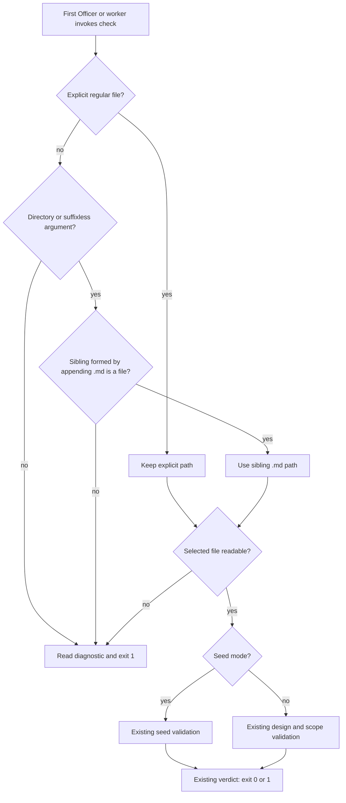

# Proposal: check the task file beside its record directory

Harness artifact only: proposed ideation content for the existing task; not a new task, state update, approval or implementation.

## Scope

Repair the documented design_surfaces.py check command when a task basename refers to a same-named record directory beside the task's .md file. Preserve the accepted task, stop condition and one-implementation/two-validation-cycle budget.

Non-goals: change content-validation rules, add folder-layout discovery, replace Spacedock's slug/id/prefix resolver, migrate tasks, modify Prod rules, add dependencies, or alter delivery authority.
Budget: 1 implementation and 2 validation cycles, in one package PR.
Stop condition: the basename command checks the sibling task file without IsADirectoryError, with a regression covering the collision.

## FO alignment

Alignment: not needed before ideation; the Captain confirmed filing it.
Release review: not needed: workflow maintenance, on no journey map.
Surfaces: none
Visible change: none

## Design

### Proposition

First Officers and stage workers will be able to run the documented `design_surfaces.py check <task>` and `check --seed <task>` from the state root even after a record directory appears beside `<task>.md`. They will receive the same content verdict as when naming the .md file explicitly.

### Existing work and chosen repair

The pre-design observations are in observations.md, with current CLI evidence in reproduction.json. The unmodified checker reproduces the directory crash; explicit .md succeeds. Upstream Spacedock already resolves workflow references, while adjacent package readers already recognize the two stored layouts. This task changes the current local-path entrance and reuses its validators; it adds no replacement capability or broad resolver. ADR 0083 governs the existing-chain check, ADR 0041 preserves seed semantics, and ADR 0027 preserves the scope check. No inaccessible source is needed to establish the local defect; real-adopter task behavior remains unverified because the bounded count probe exposed no state checkout.

Normalize once before either validation mode: retain an explicitly supplied regular file; otherwise, only for a directory argument or a suffixless basename, select the adjacent path formed by appending `.md` when that path is a regular file. An existing explicit file wins. A directory such as `task.v1/` maps to `task.v1.md`, not `task.md`. If no file can be selected, return a nonzero read diagnostic; do not call scope_hold on an unresolved directory or missing target. Apply the same controlled failure to a target that cannot be read.

Pass that one selected path to content validation, dispatch-record lookup and the existing scope-history check. Preserve valid/rejected exit semantics: 0 for success, 1 for a rejected or unreadable task; argparse usage errors remain 2. Seed mode still checks only seed rules; default mode still checks surfaces, criteria, amendments and its existing scope rule. A folder entity continues to work when its explicit `task/index.md` path is supplied; implicit index discovery is outside this repair.

Expected implementation files: `kc-dev-flow-2/scripts/design_surfaces.py` and its existing `scripts/test_design_surfaces.py`. Keep any command-help clarification local to the existing parser; the documented commands already name the intended entrance. No retained workflow claim needs changing.

### FAQ

**Why not require callers to append .md?** That works today, but leaves the accepted basename command broken after task records create a directory. The repair belongs at the existing entrance.

**Why not use native Spacedock resolution?** Its own help and a real read-only resolve call confirm that capability exists. This repair only needs a local sibling filename; native resolution adds workflow discovery and id/prefix matching that the task does not ask to change.

**What needs approval?** The existing design gate remains required. This proposal grants no implementation, state-write, merge or release authority. No new profile obligation or material unresolved scope choice was found.

### Worth questions

- Path normalization serves the Captain-approved task described as 「設計檢查腳本遇到同名資料夾會當掉」 in the batch question, accepted by 「五張都准，授權代記設計關卡（建議）」. Without it, the documented basename command fails once a record directory exists. The disqualifying premise is that the current command already checks the sibling file: the cheap current subprocess probe disproved that premise with IsADirectoryError while explicit .md passed.
- The narrow CLI regression and unreadable-target return serve the same approved stop condition, which explicitly requires a directory-case test. Without the regression, replacing the normalized path with Path(args.task) could silently restore the crash. The disqualifying premise is that existing coverage already exercises this exact CLI collision; the bounded inspected test setup uses explicit task paths and no observed basename collision. Implementation must place the regression in the existing test file and show that restoring the old entrance makes it fail.
- No proposed scope part serves unrelated Captain words. Broader resolver, layout migration and content-rule changes are excluded.

### Acceptance evidence and limits

The current probe establishes the defect, not a repaired result. No implementation acceptance criterion below is passed yet. The diagram's actors, ordering and branches were checked against the prose; rendering was not exercised under the no-browser harness. No application unit/integration/end-to-end suite or private task corpus was run. The original task and all product files remain read-only.

### Batch overlap

none in the supplied workflow snapshot, which contains only this entity. Other sessions and external workflow state were excluded by the harness. Recommended order: complete this task's design gate before implementation; broader batch ordering belongs to FO.

## Acceptance criteria

**AC-1** — With a valid `task.md` beside `task/`, both `check task` and `check --seed task` select the sibling file and return the same stdout and exit as the corresponding explicit-file command, without traceback. Cover relative and absolute arguments and verify input bytes remain unchanged. Evidence: future subprocess regression in the existing test file; restoring the raw Path(args.task) entrance must fail the collision case. Current evidence: the unmodified default mode crashes and seed mode rejects; explicit .md succeeds (reproduction.json).

**AC-2** — Explicit file paths retain precedence and their existing verdicts, including an explicit `task/index.md`; default content and scope checks and seed rules keep their separate semantics. Cover a suffixless file that exists beside a .md file with a different verdict, a dotted directory with a matching appended .md, and a malformed sibling task that must remain rejected. Evidence: future CLI fixtures with intentionally different content verdicts; a mutation that always selects .md or bypasses validation must fail a named case. Current evidence: source inspection and explicit-file success only; the repair and regressions are not yet implemented.

**AC-3** — A missing task or directory without a regular sibling task file yields exit 1 and a read diagnostic in each mode, with no traceback or successful verdict. A selected file that cannot be read must likewise not reach an unguarded scope read. Evidence: future CLI failure fixtures and a controlled read-failure case; restoring the unconditional scope read must fail. Current evidence: default missing-input traceback and seed controlled failure reproduced; corrected behavior remains unverified.
