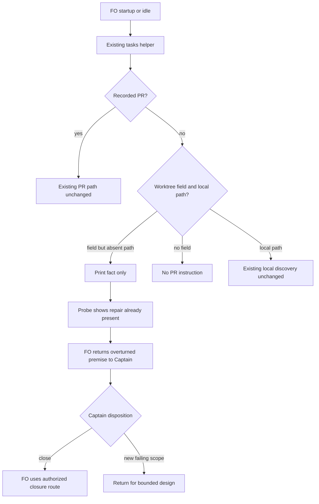

[Historical seed omitted: adopter identifiers; subject-authored report follows at its original line numbers.]

## Design

Disposition: hold for the Captain because the original premise is overturned. Do not dispatch a duplicate implementation. This is a recommendation, not closure or a gate ruling.

### PRFAQ

**Proposition.** FO will keep the existing absent-worktree fact and avoid a second patch for an already completed repair. Pinned origin/main is 88f86f2749dadb6f4ef0cf9aa089c1827096865b, package 0.41.0. Commit 9bdc9f73083d8b2cf6a317a10f91a10a3d9fbb58, locally recorded as PR #858, already changes the requested behavior and regression case; it is an ancestor of the pin. No hosted PR or release verification is claimed.

**Who benefits?** FO reading a shared workflow on a machine without every task worktree. An absent path is a local observation, not proof of another session's ownership.

**What changes?** No product file. Existing pr_watch.py tasks prints `fact: <slug> has no recorded PR; its worktree is not on this machine.` The local-PR discovery path remains unchanged. Retain evidence and request disposition of this stale task.

**Other historical next lines?** Keep both outside this repair. Local discovery still prints status-set then state-commit; proving a worker has stopped is a different ownership problem. Ready stays conditional on Delivery authority; Architecture Decision Record (ADR) 0015 reserves ready/merge for the Captain. Reclassifying either line alters separate lifecycle obligations and needs separately scoped authority. Their historical timing concerns remain unresolved.

### Existing chain and decisions

Checked Spacedock first: installed ensign contracts and its own mods/pr-merge.md describe state ownership, repository-qualified PR handling and commit discipline. Selected CLI reports 0.27.2 while the installed skill is 0.28.0; no runtime/package parity claimed. Real read-only Spacedock status calls ran inside the probe.

Checked the authoritative exported kc-dev-flow-2 package next: pr_watch.py tasks/opened_pr/next_for, its existing absent-worktree regression, the lifecycle mod, selected profile references and design checker. Exported script bytes equal pinned source (ideation-replay/source-identity.json). Reuse a completed repair; the broader capability inventory is inapplicable to this named broken seam.

Read ADRs 0015 (Draft PR and ready authority), 0020 (reading budget), 0037 (prior work and early handback), 0062 (bound-question authority), and top-level state Override records. None grants another patch or closure. No new ADR, index or numbered record is proposed.

Sibling adopter repositories: unavailable under the isolated-replay restriction; zero read. Checked the fourteen named public sibling task records, including journey-server-host-pilot/index.md. No private adopter contents were copied. Live PR states and other session ownership are unavailable.

### Probe

Probe: local branch `poc/pr-watch-tasks-foreign-worktree-replay`; base `88f86f2749dadb6f4ef0cf9aa089c1827096865b`; last commit `318fc7caf416a88a000c7e16f2155b547a7ceb81`. The original branch name already existed and was preserved. The probe worktree was created from origin/main under `.worktrees/poc-pr-watch-tasks-foreign-worktree-replay`, removed after capture, and the branch retained.

First hypothesis: the missing-path task still induces PR recording. Falsified: real command invocation printed exactly one fact, exit 0, no next action, no watch file and unchanged task bytes. Next hypothesis: a task with no worktree field is silently actionable. Falsified: exit 0, empty output, unchanged task and no watch file. Each final command ran once against the committed fixture; absent.json and bare.json record full argv, exit and output paths.

Initial invocations on uncommitted synthetic inputs exited 2 because role_triggers requires the task at HEAD. Both failures are preserved in initial-uncommitted-fixture/. Committing fixture inputs repaired that precondition without changing package code. One ideation dispatch/probe round; no implementation attempt. A gh shim rejects provider calls, and no credentials or network were used.

Reproduce: create a worktree from the retained branch inside this fixture, then run `python3 -B <worktree>/ideation-probe.py <authoritative-package> <worktree>/.probe-absent <task-folder>/ideation-replay absent` and the equivalent `.probe-bare` / `bare` command. Set TMPDIR to this replay's tmp directory. The committed synthetic workflow inputs are required. Python 3 and `/Users/kent/.local/bin/spacedock` are declared machine-specific runtime requirements, not a portable-installation claim.

### Worth questions

- Existing fact: serves the Captain's 「PR 監看不該對別台機器的任務提示」. Without it, FO may record a PR without a local worktree. Premise making more work unneeded: the repair already exists. Cheap test: absent-worktree command, passed.
- Preserve no-worktree-field silence: serves the same bounded goal. A broad replacement could prompt every unrecorded task. Cheap test: bare command, passed.
- Redesign commit/ready timing: no explicit Captain words require those additional changes. Recommend leaving them out; their historical concerns remain unresolved.

### Words FO reads at each lifecycle moment

Using Python str.split, the unchanged mod is 48 words and the synthetic fact is 13. Task-attributable before/after contributions: startup 61/61; idle on an open PR 61/61; idle on a merged PR 61/61; after archive 0/0 new words; merge ask 0/0 new words. words.json declares scope and mod-input.txt retains input. Complete live lifecycle totals are unavailable because provider/adopter reads are prohibited. These partial counts prove no reduction; a future changed implementation must measure every relevant passage/output at each moment.

### Needs decision

One decision: close this task as already satisfied after FO confirms disposition. Recommended: retain this proof and avoid duplicate implementation. Cost: the two other timing concerns and live adopter behavior remain unresolved. Alternative: continue only with a new failing case and Captain-approved scope. The overturned-premise stop prevents automatic use of the design-gate delegation.

### Not provable now

Application unit, integration and end-to-end suites were not run per harness. The existing regression was read, not run. No live adopter, hosted PR, ownership, delivery, merge or deployment verified. Mermaid remains source-only; no renderer/browser started. Full live reading totals unavailable. No new Production obligation; remain bounded Pilot ideation.

### Batch overlap

Designed product-file changes: none. Historical fix files are kc-dev-flow-2/scripts/pr_watch.py and kc-dev-flow-2/scripts/test_pr_watch.py. Only this entity and its ideation-replay evidence change; the local probe branch contains disposable inputs/driver.

- pr-watch-tasks-foreign-worktree: owns this report; no product changes.
- design-surfaces-task-dir-crash: no shared product file; shared design_surfaces.py report checker.
- new-work-checks-what-exists-first: no shared product file; existing before-new-work practice applied here.
- delivery-gate-s4-skips-removed-scratch: no shared product file; adjacent removed-evidence-path check.
- observer-check-learn-only-when-listed: no directly shared file; observer_check output is consumed on merged PRs.
- dispatch-close-out-archives-evidence-and-removes-scratch (dispatch says PR #854): shares pr_watch.py task sweep; live PR unverified.
- held-and-closed-tasks-leave-the-design-queue (dispatch says PR #856): shares pr_watch.py, test_pr_watch.py, lifecycle output/count checks; live PR unverified.
- adoption-asks-which-extensions: no directly shared file; dispatch_records --newest consumer explicitly unchanged.
- adr-required-statement: no shared product file; no ADR/index change here.
- adr-silent-undo-probe: no shared file or numbered record.
- comment-check-reaches-delivery-gate: no shared file; adjacent acceptance check.
- journey-canvas-hosted-poc: no shared file/check change.
- journey-server-host-pilot: no shared file; historical observed task, not edited.
- ops-inbox-r1-setup-and-isolation: no shared file/check change.
- pr-review-lite-value-pilot: no shared file; historical observed task, not edited.

Recommended order: resolve the already-fixed premise first; queue no duplicate implementation. If a new failing case changes scope, recheck both shared pr_watch owners before dispatch. Frozen records do not prove current ownership.

## Non-goals

No session-ownership inference, remote-worktree detection, PR/state writes, ready-state change, new lifecycle hook, private-adopter audit, workflow state transition or product patch.

## Acceptance criteria

**AC-1** No PR plus absent worktree emits only the exact fact. Evidence: absent.json command, exit 0, absent.stdout.txt, no next action, no watch state and unchanged task bytes. Falsifier: restoring a PR-recording next line or mutating task/state fails the probe. Passed on existing source, not new implementation.

**AC-2** No PR and no worktree field stays silent. Evidence: bare.json command, exit 0, empty bare.stdout.txt, no watch state, unchanged task. Falsifier: unconditional missing-PR text makes exact-output check fail. Passed.

**AC-3** No duplicate product patch and exact existing-fix identity. Evidence: source-identity.json; exported script equals pinned git-show bytes; existing fix is an ancestor; probe commit retained and worktree removed. Reproduce with git merge-base --is-ancestor and byte comparison against authoritative package. Falsifier: product delta or mismatched export invalidates no-change premise. Passed for fixture source only.

## Stage Report: ideation

- DONE: Current design definition and acceptance criteria with reproducible evidence clauses.
  PRFAQ, source-only Mermaid, non-goals, AC-1/2/3 and retained local probe identify the already-fixed premise; no product patch proposed.
- DONE: A `### Batch overlap` section naming each file the design would change and each other batch task and live task of other sessions that changes the same file or check, so FO can order implementation
  All named records checked; no new product file; historical pr_watch files overlap the two named task-sweep owners.
- DONE: The words FO reads at each lifecycle moment, before and after, per root learning.md
  ideation-replay/words.json records unchanged task-attributable contributions; complete live totals are explicitly unavailable, not claimed measured.
- DONE: Acceptance criteria with reproducible evidence clauses and falsifiers, and unresolved decisions for the Captain, each with a recommendation and what gets worse under it
  Recommend closure as already fixed; other timing concerns and live adoption remain unresolved. No closure or gate authority exercised.
- DONE: AC-1 — absent worktree has fact only.
  absent.json and absent.stdout.txt: command exit 0; exact fact, no next action, no watch file, unchanged task; historical next action would fail.
- DONE: AC-2 — missing worktree field stays silent.
  bare.json and bare.stdout.txt: command exit 0 and empty output; any generic missing-PR prompt would fail.
- DONE: AC-3 — no duplicate product change, pinned provenance and probe cleanup.
  source-identity.json; existing fix 9bdc9f730 is in base 88f86f274; probe 318fc7caf retained, worktree removed, product delta absent.
- DONE: Pilot probe before the design, with branch/base/last commit and evidence.
  One dispatch; initial uncommitted-input exits 2 retained, final committed-input runs pass. No suite, provider or private-adopter call.
- FAILED: Before reporting, run python3 <package>/scripts/design_surfaces.py check <task> and cite its output.
  Executed, exit 1: Scope changed after backlog gate faaccf50; design-surfaces.txt retains exact error. Scope and frontmatter remain byte-identical to initial task; no amendment invented. Gate preparation must remain held.
- SKIPPED: Live adopter/hosted PR checks and complete dynamic lifecycle word totals.
  Prohibited/unavailable in isolated replay; zero private repositories read. Existing regression read but not executed.
- SKIPPED: Application unit, integration and e2e suites; Mermaid rendering.
  Harness forbids application suites and browser/server startup; no rendering claim.

### Summary

The original requested repair is already present in pinned release 0.41.0 and two real CLI probes confirm its bounded behavior. Return the overturned premise plus the existing Scope/backlog checker failure to FO/Captain; do not advance implementation or prepare the gate. Pilot boundary retained; no push, remote message, state transition or production-code change.
