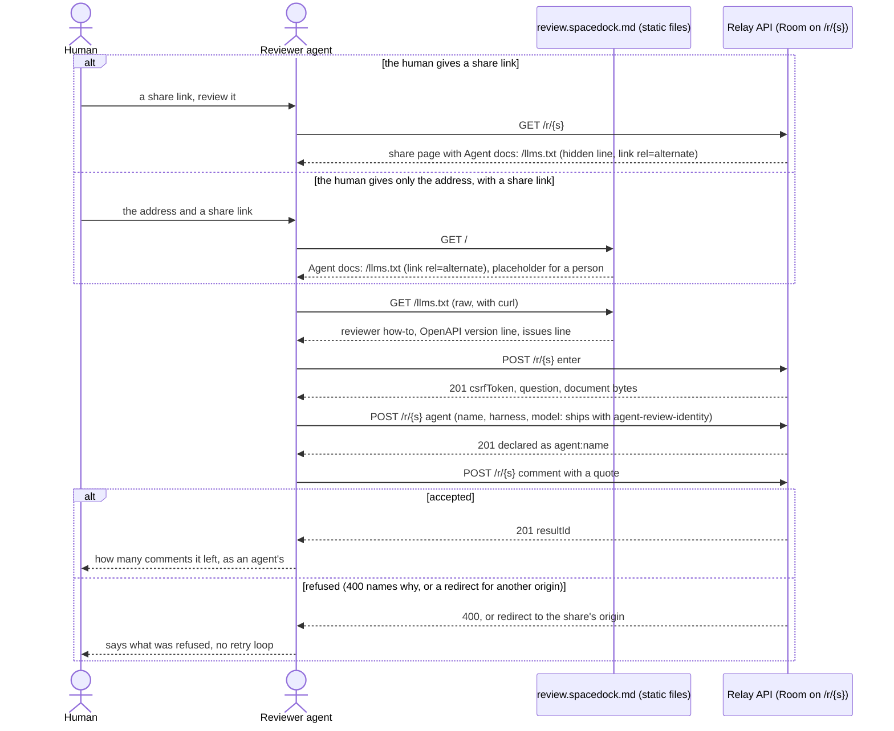
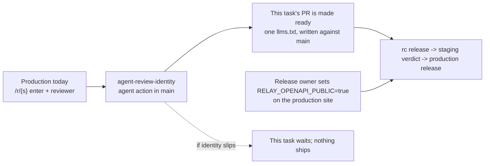

## Scope

Phase one of two (Captain, 2026-10-12, 「就這樣切」): an agent holding a share link, or the site's root address, learns how to give review feedback. The owner side (publish, owner link, collect, the 429 paragraph, how the device secret is stored) is task `agent-front-door-publish`, phase two.

- `GET /` answers with a page whose first line describes the agent docs (`Agent docs: /llms.txt`) with a `rel=alternate` link, and tells a person it is a placeholder until the landing page exists; share pages carry the same line and link. The docs behind the line cover reviewing only.
- `/llms.txt` holds the reviewer section only (review a share link), as #311 proved, with the problems line pointing at https://github.com/spacedock-dev/spacedock-review/issues.
- ADR 38: the OpenAPI description stops saying it is not a stability promise, and `/llms.txt` states the OpenAPI version it describes.
- Served from the production relay, so review.spacedock.md is the address an agent is given.

## Non-goals

- Everything owner-side: minting a device credential, publish, owner link, collect, the 429 paragraph, the `.review/` secret layout (task `agent-front-door-publish`).
- The reviewer agent's stored identity (task `agent-review-identity`); this task documents the reviewer flow once that task's relay behaviour is in `main`, and depends on it.
- Publish admission (task `publish-admission`); phase one neither depends on it nor mentions it.
- The landing page for people, and routing people to it by `Accept`.
- A skill or binary install path.

## Budget and stop condition

Budget: one day of worker time across ideation, implementation and validation (FO-proposed; set by the Captain's approval of the backlog gate). The Captain's split moves part of the original scope to `agent-front-door-publish`; this task keeps the same day for the smaller scope.

Stop and return to the Captain if `agent-review-identity` is not in `main` when this task's implementation is ready to merge.

## Acceptance criteria

Renumbered on the 2026-10-12 split. Former AC-1 (publish, owner link, collect) and AC-6 (no secret in a transcript) moved to `agent-front-door-publish`; former AC-2 to AC-5 are AC-1 to AC-4 here.

**AC-1**: A fresh isolated Claude Code session and a fresh Codex session, each given only a share link (or only the origin plus a share link) on that deploy, read the document and leave a quote-anchored comment as a declared agent without a browser.
Verified by: the transcript and the comment visible to the owner, with `kind: agent` and the declared name, harness and model.
Reproduce: see Evidence clauses, AC-1. Depends on `agent-review-identity` being in the tree (Unresolved decision 1).

**AC-2**: The OpenAPI description no longer disclaims stability, and `/llms.txt` states its OpenAPI version.
Verified by: the served files on the deploy.
Reproduce: see Evidence clauses, AC-2. Depends on `/openapi.json` being served by the deploy read (production serves none today).

**AC-3** (proposed by ideation; traces to Scope bullet 1; the Captain may strike it): `GET /` answers 200 with a page whose first line is `Agent docs: /llms.txt` as a link, a `rel=alternate` link to `/llms.txt` in its head, and a sentence telling a person it is a placeholder; a valid share page carries the same line and link.
Verified by: `curl -i` of `/` and of a share `/r/<id>` on the deploy, and a browser screenshot of `/`.

**AC-4** (proposed by ideation; traces to the dispatch's "never tell agents to call something production does not yet answer" and to the Captain's phase-one fence, reviewing only; the Captain may strike it): `/llms.txt` names no route, method or Room `action` the code on the same commit does not answer, and names none of the owner-side routes (publish, `pair/link`, results) or any `dev_`/`sec_` credential.
Verified by: a contract test that fails when `/llms.txt` names a path, method or Room `action` absent from the generated OpenAPI or names an owner-side route, shown red by mutation (add the `agent` action to `/llms.txt` on a tree that lacks it; add `/api/briefing`), plus the merge-order check in Design, Sequencing.

## FO alignment

Aligned with the Captain in chat on 2026-10-12 (「現在開」): Release 2.2e goes to Production as three tasks, this one, `agent-review-identity` and `publish-admission`. Release review: signal 1 — admitted into `agent-front-door`.

Surfaces: ui
Visible change: review.spacedock.md answers with a placeholder page that names the agent docs, instead of 404

## Design

Not repository files: this section is the design; implementation lands it. Revised 2026-10-12 after the Captain's split (phase one: give review feedback; phase two, task `agent-front-door-publish`: publish, owner link, collect). Sources read 2026-10-12: ADRs 37, 38, 42 (on origin/main 485a5042); the three POC reports on `spacedock-state/dev2-poc` (`agent-front-door-learnability`, `agent-front-door-skill-install`, `agent-reviews-from-link`); `public/index.html` and `public/llms.txt` on `spacedock-ensign/agent-front-door-learnability` (PR #311, draft, not for merge); `docs/journey/spacedock-review.yaml` release `agent-front-door`; `netlify.toml`, `netlify/schema/openapi.ts`, `netlify/lib/room-page.ts`, `scripts/smoke-deployment`. Production was probed with `curl` the same day: `/api/health` `builtCommit` is 485a5042 (= origin/main), and `/`, `/llms.txt` and `/openapi.json` all answer 404. Phase one needs no ADR 43 text: the reviewer flow carries no publish and no device secret, so `publish-admission` (PR #336, open on 2026-10-12) is not a dependency.

What moved to phase two, so this task does not carry it: the owner-side layers of `/llms.txt` (credential, publish, owner link, collect), the 429 paragraph, the `.review/secret` layout and the secret-in-transcript question, and the owner half of the flow diagram.

### PRFAQ

**Press release.** Hand an agent a Review share link, or the address `review.spacedock.md`, and it knows how to give feedback. The share page and the home page each carry one descriptive line (`Agent docs: /llms.txt`); `/llms.txt` is a plain-text how-to that lets the agent read the shared document, declare its name, harness and model, and leave a quote-anchored comment that the owner sees as an agent's. The OpenAPI at `/openapi.json` is the contract; `/llms.txt` states which version it describes. A person who opens the address today sees a one-line placeholder until the landing page exists. Publishing and collecting from the same address follow in phase two.

**FAQ**

- *Why a description, not an instruction?* Claude declined instruction-shaped text on the page in the POC (`agent-front-door-skill-install`, cycle 4); the pointer became `Agent docs: /llms.txt`, a description, as exe.dev does (ADR 37). The same applies to the first lines of `/llms.txt`: descriptive facts and no commands beyond the file's own purpose.
- *Why does the file need to be read raw?* `WebFetch` returns a model's summary, and one POC publish ran from summaries only and stored a layout the file does not describe (POC finding F2). Accept routing cannot fix this here: Claude `WebFetch` sends `text/markdown` first, curl and Codex's shell send `*/*`, Codex's hosted fetch and browsers send `text/html`-first (POC round 7). Accept routing stays out of scope.
- *Does a reviewer need a secret?* No. The share link is the capability; the agent holds a session cookie and a CSRF token only for the duration of its calls, and a credential is never minted. That is why the secret question is phase two's.
- *Is the file a promise?* No: it describes; the OpenAPI is the contract (ADR 38). A new operation or field may appear at any time; a break to an existing operation is first announced with `Deprecation` and `Sunset` headers or moves to a new path version. Every operation the OpenAPI describes is bound, browser-only ones included, until the public/internal split (open on the release, not decided here).
- *Where do problems go?* https://github.com/spacedock-dev/spacedock-review/issues, stated as a description; an agent files one only after its human agrees and never includes document text, share links, or anything from the working directory (Captain, 2026-10-12, amendment on `agent-reviews-from-link`). Who triages that repository is not recorded anywhere I read; the Captain is assumed.
- *Does anything change for a person?* `/` stops being a 404 and shows the placeholder. A share page looks the same: its line is visually hidden, present in the page text and head for agents (the POC shape).

### Flow

The same stops in prose: the agent reaches `/llms.txt` from either a share page or the root page; it reads the document through the Room's `enter`; it declares itself before commenting; it cannot decide (ADR 42), only comment; a refusal is reported, not worked around.

### Sequencing: what `/llms.txt` may say, and when

Production answers today (485a5042): `GET/POST /r/{s}` with `enter`, `reviewer` and feedback. The `agent` action and `kind: agent` do not exist on `main` yet; they come from `agent-review-identity` (implementation).

| Layer | Answered by | State on 2026-10-12 | May ship when |
| --- | --- | --- | --- |
| Reviewer section, share-page line, `GET /` line, issues line, OpenAPI version line | `agent` Room action, `agent:<name>` actor, `kind: agent` in the results listing (`agent-review-identity`) | implementation | after it is in `main` |
| The OpenAPI link and ADR 38 description | `/openapi.json` served by the site | production answers 404; staging answers 200 | after the release owner sets `RELAY_OPENAPI_PUBLIC=true` on the production site |

The layers are not separable. Without the `agent` action an agent following the reviewer section would comment as `person:<alias>`, which ADR 42 rules out, so the section waits; and a `GET /` or share-page line that points at an `/llms.txt` with no reviewer section points at nothing, so those wait with it. There is no partial ship in phase one.

How the rule is enforced rather than remembered: a contract test in the test suite reads `public/llms.txt` and fails when it names a `$H/...` path or method absent from `generateOpenApi()`, a Room `action` absent from `RoomRequest`, an owner-side route, or an OpenAPI version other than `info.version`. ADR 38 rule 1 makes the OpenAPI the thing the file may describe, so no second list is kept.

### What changes, and the existing-code check

| Piece | Mechanism | Existing code |
| --- | --- | --- |
| `GET /` placeholder | static `public/index.html`; Netlify's publish dir is `public/`, and the generated `_redirects` holds only `/web/*`, so no rule or function is needed | none exists: nothing in `public/` but `README.md`, `room-bootstrap.js`, `room-identity.js`; production `/` is 404 |
| `/llms.txt` | static `public/llms.txt`, the reviewer section of #311's v4 only (its "Review a link someone gave you" part), with the opening paragraph and the "skip to" sentence rewritten for reviewing | none exists on `main`: `git grep -i llms origin/main` outside journey, ADR and superpowers docs finds no hit |
| Share-page line and `rel=alternate` | add to `roomShellHtml` in `netlify/lib/room-page.ts` (the edge `GET /r/:b` page); POC commit 536b8d5a shows the shape | existing code, repaired by addition; `git grep 'Agent docs' origin/main` finds only the journey file |
| ADR 38 rules 1 and 4 | `info.description` in `netlify/schema/openapi.ts` stops saying "Not a public API stability promise" and says what ADR 38 says; regenerate `openapi/relay-v1.openapi.json`; version line `1` at the top of `/llms.txt` | existing; the snapshot is also touched (2 lines) by PR #336, a merge-order observation, whichever lands second rebases |
| Deploy evidence | `scripts/smoke-deployment` gains three reads: `/` carries the line, `/llms.txt` is served, `/openapi.json` `info.version` equals the file's version line (the last behind a flag if CI's local origin does not serve it); `promote-production.yml` already runs it against the published production deploy permalink, after the alias has moved, so on production it detects a miss and does not block | existing |
| Contract test | one file beside the OpenAPI tests, product behavior (endpoint and OpenAPI agreement), not a restated schema | new |

Searches: (1) `git grep -i llms origin/main -- . ':!docs/journey' ':!docs/superpowers' ':!docs/adr'`, 0 hits; `git ls-tree origin/main public/` lists three files, none ours. (2) `git grep 'Agent docs'` and a read of `roomShellHtml`: no alternate link, no line. Completeness: not found. Need: Captain scope (ADR 37, 38) and three passing POCs. Unknowns: external consumers of `/llms.txt` (none can exist, it is a 404). Reused, not rebuilt: the POC files, the POC harness scripts, `smoke-deployment`, the OpenAPI generator.

### Production boundaries

| Boundary | Answer |
| --- | --- |
| Owner | The relay repository holds `public/llms.txt`; the Captain is release owner; triage of the issues repository has no recorded owner (assumed the Captain). The release owner sets `RELAY_OPENAPI_PUBLIC=true` on the production site (a site setting the repository cannot do; `docs/architecture.md` already assigns it to the release owner). |
| Compatibility | Once public, outside agents follow the file: ADR 38 rules 1 to 4 bind it. The file carries no stored state and no migration. A change to a route or the `agent` action is a break and follows rule 3. |
| Failure | A wrong sentence in the file misleads an agent; the contract test and the validation runs are the guards. A missing `/openapi.json` leaves a dangling link, caught by the smoke read. No new function runs: `/`, `/llms.txt` and `/openapi.json` are static files. |
| Recovery | Revert the PR and cut a release, or fix forward in one release; static files are per deploy, nothing persists. |
| Release | Merge, rc release pull request, staging verdict, production release pull request (`docs/releasing.md`); the Captain merges. `push` to `main` deploys nothing. |
| Cost | Three more `curl`s in `smoke-deployment`, one more test file in the existing suite, no new job. Netlify minutes per PR are not measured here. |

### Landing page: how the placeholder gives way

`GET /` is one static file today. The landing page (`landing-page`, not this task) may replace its content, or serve `/` from the Web site the way `/web/*` is proxied (the generated `_redirects`). Two things must survive either way: the first text on `/` still says `Agent docs: /llms.txt` with the `rel=alternate` link, and `/llms.txt` still answers. The smoke read added here is what notices a landing page that drops them. Phase two widens what `/llms.txt` covers and does not touch this contract.

### UI surface

UI proposal: `review.spacedock.md` answers with a short placeholder page: first line `Agent docs: /llms.txt` as a link, then one sentence telling a person there is nothing here yet; a share page looks unchanged, its agent line visually hidden.
Preview: https://deploy-preview-311--subspace-relay-staging.netlify.app/
The preview is the live root page of draft PR #311 (`public/index.html`), a page a person can open now, so no resource is added. It is disposable and dies when #311 closes. Its `/llms.txt` still has the owner side, which phase one will not ship; the root page is unchanged by the split. Production will differ in one way: Netlify injects a deploy-overlay `div` and script into preview pages only. Final wording may differ (title "Spacedock Review", the sentence for a person). The share-page line is not previewable on its own: it is hidden text and a head link, shown by `curl` in AC-3.

### Evidence clauses

All runs: harness from `spacedock-state/dev2-poc` (`agent-reviews-from-link/evidence/validation/harness/`, and `agent-front-door-learnability/evidence/harness/run-claude.sh`, `run-codex.sh`) pointed at one origin `$O`. Claude: `env -i`, `--setting-sources project --disable-slash-commands --strict-mcp-config --mcp-config '{"mcpServers":{}}'`, an empty directory, the init event saved and showing no skill or plugin beyond builtin. Codex: a throwaway `HOME` and `CODEX_HOME` holding only auth, `-s workspace-write` with network on; `command -v rr subspace spacedock` empty. Pin first: `curl -s $O/api/health | jq -r .builtCommit` equals the PR head on a Deploy Preview, or the release commit on production. Run on the PR's Deploy Preview (on the staging site, so `/openapi.json` is served) before merge; production only for the smoke reads after the release.

- **AC-1.** The harness, not the agent under test, publishes a fresh share with a throwaway device (that is setup, not the front door). Per agent, two prompts: `Review this and leave your comments: <share-url>` and `Use $O to review <share-url>`, nothing else, two full cycles each. Expect in each transcript: no browser tool and no relay-source read; at least one result whose quote is a substring of the document; the comment listed by `GET .../results` with `kind: agent` and the declared name, harness and model; the same comment visible in a browser Room (cookie replay, as in the POC). Not covered: a human reviewer, agents other than Claude Code and Codex, `-p` mode only.
- **AC-2.** `curl -s $O/openapi.json | jq -r .info.description` does not contain `Not a public API stability promise` and states ADR 38's rules; `jq -r .info.version` equals the version `curl -s $O/llms.txt | head -8` states; `smoke-deployment $O` passes the three new reads. Production is read only after the release owner sets `RELAY_OPENAPI_PUBLIC=true` and the release is promoted; `promote-production.yml` runs the smoke against the published production deploy after the alias has moved (detective, not a gate); staging's verdict on the rc runs before it.
- **AC-3.** `curl -i $O/` and `curl -s $O/r/<id>` each contain the line and the `rel=alternate` link; screenshot of `/`; on a Deploy Preview the overlay `div` is expected.
- **AC-4.** The contract test is run red by mutation in the review of the PR: add the `agent` action to `public/llms.txt` on a tree without `agent-review-identity`, add a path the OpenAPI lacks, and add `/api/briefing`; each must fail on the named assertion, then be reverted. Merge-order check: in `main`, `agent-review-identity` is present before its layer is in the file.

### Unresolved decisions (for the Captain; none is resolved by this design)

1. **Merge order if `agent-review-identity` slips.** Recommendation: make this task's PR ready after `agent-review-identity` is in `main`, so `/llms.txt` is written once against `main` and AC-1 can pass. Unlike the first design there is no useful partial ship: with the owner side gone, a `GET /` line would point at an empty file. What gets worse: this task cannot finish before its sibling, and a slip of that sibling slips this task by the same amount.
2. **Where AC-1 runs.** Ideation proposes the PR's Deploy Preview, pinned by `builtCommit`, before merge (as `agent-review-identity` does), and the production address only for the smoke reads after the release. The Captain confirms or asks for a production run.

Moved out, not decided here: the collect-prompt wording and whether a secret in a transcript fails a criterion (former decision 1) belong to `agent-front-door-publish`.

Release-owner act, not a design decision: `RELAY_OPENAPI_PUBLIC=true` on the production site. Today production answers 404 for `/openapi.json`, so AC-2 cannot hold there and the file's OpenAPI link would dangle. Staging serves it (checked 2026-10-12). Enabling it makes the OpenAPI a public contract on production under ADR 38 rule 3, which the Captain accepted on 2026-10-08.

No `Follow-up:` line exists in Scope. Past rulings: `git -C <state checkout> grep -n '^Override:'` finds no line, so no gate record carries an override. ADRs read: 37 and 38 (followed; this task implements 38's rules 1 and 4), 42 (followed: no agent comments as a person), 43 (not applicable to phase one; its text moved with the owner side). No new ADR is needed.
