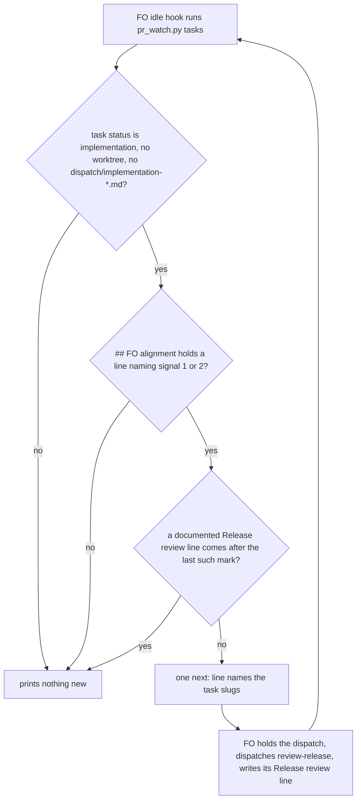

## Scope

- Source: the Captain 「照更正後的建議退回設計重做」 (chat, 2026-10-23), answering FO's 「「擋派工」這一段，是照我更正後的建議退回設計重做（不涵蓋），還是照 D2 不做（涵蓋）？」; recorded as release-acceptance Captain Amendment 2, which moves that task's AC-1 to AC-4 here.
- Bite: issue #571 item 1, qnow R4 (2026-10-10): an implementation was dispatched after the release changed (signals 1 and 2 recorded) with no new review. Evidence copies: release-acceptance/r4-acceptance.md.
- What exists (release-acceptance implementation phase-1 report, 2026-10-23): since #704 the review record is a file `reviews/<journey>/<release-id>.md` with `Reviewed:` and `map at <commit>`, checked by kc-journey-map/lib/journey-review.mjs; the design's `Release changed:` and timed `Release review:` marks do not exist on main; staleness can be read by comparing the map at the record's commit with the map now; workflow.md is under a word budget (ADR 0020) while extensions and pr_watch.py next: lines cost no README words; ADR 0029 D2 (no seed hold) is a different moment, ruled not to cover this.
- Shape asked for: hold the first implementation dispatch of a task in a release while its review record is stale, with the check placed where this package can run it.
- Upstream first: Spacedock dispatch build (no precondition input as of 0.27.2), kc-journey-map journey-review.mjs and the review record, kc-dev-flow-2 pr_watch.py and extensions.
- Non-goals: the release walk (release-acceptance keeps it); a seed-time hold (D2).

## FO alignment

Captain ruling (chat, 2026-10-23): 「重做檢查」, answering 「這一輪要你決定：要改用「讀任務自己的紀錄」重做這個檢查，還是關掉這張任務？CE 和我都建議重做。」: the hold is rebuilt on the dispatched task's own record (a signal 1 or 2 mark in its `## FO alignment` with no later `Release review: <journey>/<release-id> at <commit>` or `not needed: <reason>` line holds the first implementation dispatch), replacing the map-diff design of ideation cycle 1 and the "compare the map at the record's commit with the map now" wording of release-acceptance Amendment 2's Asked line. Override: recommended (cycle 1 design) the map-diff check; Captain chose the task-record check on chief-engineer advice; area: dispatch-time review hold.

Reviewer: kc-dev-flow-2:chief-engineer opus 2026-10-23 — the ideation replay shows the designed map-diff hold would not have caught R4 (its signals 1 and 2 were not map edits; only an unrelated card reword tripped it); what is the smallest next step?

Alignment: needed at ideation; where the check lives and whether it raises the word budget are his to accept.
Result: aligned 2026-10-23 by the Captain's 「重做檢查」 (recorded above): the check reads the dispatched task's own record; the remaining choices are the Captain decisions in the task.
Surfaces: none
Visible change: none
Release review: not needed: workflow maintenance, on no journey map.

## Design

Cycle 2 replaces cycle 1's Design, criteria and decisions (the map-diff hold, `review_stale.py` and the journey-map PR are gone; cycle 1's stage report below is history). Base read: origin/main a476b5ff69c27627220e96af27ee898641c6f100 (kc-dev-flow-2 0.28.0), after `git fetch origin`, 2026-10-23; Spacedock binary 0.27.2. Profile pilot holds: a normal published upgrade, no production data, no credential, no unattended recurring operation.

### PRFAQ

**Press release.** When a task in a release reaches the point where FO would dispatch its first implementation, and the task's own `## FO alignment` says the release changed (signal 1 or 2) with no review line after that mark, the idle script tells FO by task name to hold the dispatch until a review is recorded.

**FAQ.**
- *What does it read?* Only the dispatched task's own file: its `## FO alignment` lines. Not the journey map, not kc-journey-map, no network, no node.
- *Does it catch R4?* Yes. The primary fixture is R4's own record shape (qnow commit 51a251347, read 2026-10-23): `journey:` only, no `journey-release`, a prose line `Release: qnow-shop/r4. Signal 1 (...)`, no review line. The check holds it; the cycle 1 map-diff check did not (R4's signals were not map edits).
- *Is it a gate?* No. `spacedock dispatch build --help` (0.27.2, 2026-10-23) lists no precondition input, and with a held task in a scratch workflow `spacedock status --next --json` still listed it as dispatchable (2026-10-23). It is a `next:` line FO owes at the idle hook, the strength of the seed line (ADR 0027).
- *What does it cost the README?* Minus 5 words. The Release review bullet says "no script checks that line"; after this change a script reads it, so the clause is deleted (the repository rule: an absolute names its enforcement point or goes).



The words follow the picture: the idle script reads each task that is about to be dispatched, and prints one line only for a task whose last mark has no review line after it.

### Existing-code check (recorded conclusion)

Order: Spacedock, kc-dev-flow-2, sibling adopters.
- **Spacedock.** No precondition on `dispatch build` (0.27.2 help, above). Not designed; release-acceptance Captain decision 3 already says a Spacedock request is filed only if he asks.
- **kc-dev-flow-2.** `scripts/pr_watch.py` `seeds()` is the sibling: it reads task files and prints one `next:` line for backlog tasks failing a check (ADR 0027 places such rules in the script FO already runs). `tasks()` already reads `front(task)` for each task (`status`, `worktree`), so no new subprocess or dependency is needed. `references/sd/mods/kc-dev-flow-2.md` idle hook already says "Do each `next:` line it prints"; no FO step is added. The `Release review:` bullet in `workflow.md` and `FIXES` in `scripts/test_sd_dispatch.py` are the two readers of the rule's wording (below).
- **kc-journey-map.** Not read at all in cycle 2. The review record and `journey-review.mjs` stay as release-acceptance and #704 left them.
- **Sibling adopters.** qnow, subspace-relay, subspace-web run this package's `pr_watch.py`; none has its own hold script (`git ls-tree` of each clone's `origin/main`, and qnow's `origin/next`, lists no `pr_watch` file, 2026-10-23). Their task files are the replay input below, read with `git show` on local clones only.

### The check

For each task file in the state checkout, hold when all of:
1. `status` is `implementation`, `worktree` is empty, and `<task>/dispatch/implementation-*.md` does not exist (the point where FO builds the first dispatch; a rework cycle has a worktree and a record).
2. The task has a `## FO alignment` section (heading line exactly, as `seeds()` reads it) up to the next `## ` heading.
3. Some line in it matches `\bsignals?[ \t]+[12]\b` (case-insensitive) and is not a review line.
4. No review line comes after the last such mark. A review line starts `Release review:` and then either `not needed:` and a non-space, or `<journey>/<release>` (non-space, a slash, non-space) then `at` and a non-space: the two forms `workflow.md` and the review worker write.

No condition on `journey`, `journey-release` or `journey-story`, and none on the README listing `journey-map`: R4 had only `journey:`, and 3 of 17 replayed holds had none (the mark is what says the task is in a release). Signal 3 and 4 marks never hold. `workflow.md` says signal 4 is the checkpoint; this check holds at that checkpoint on a signal 1 or 2 mark and stops the line once review is documented.

The line (one per idle, all held slugs): `next: hold the first implementation dispatch of <slugs>: each ## FO alignment marks a release changed by signal 1 or 2 with no Release review: line after it. Dispatch kc-journey-map's review-release, write its Release review: line (or Release review: not needed: <reason>) under ## FO alignment, then run this again.` Fixed text 49 words, plus one word per slug (`len(line.split())`, draft, 2026-10-23).

A prototype of exactly this logic (scratch, `/tmp/ens-scratch/c2/proto.py`, not committed) passed 12 of 12 synthetic cases: the R4 shape holds; a later `Release review: j/r4 at abc1234` or `not needed:` line clears; a review line before the mark does not clear; a `Release review: j/r4 changed (signal 2).` line is a mark, not a review; a review line quoting a signal clears; backlog, worktree set, an existing implementation record, no section, no mark and signal 4 only do not hold.

### Replay on committed adopter history (mark forms and false holds)

Rule replayed: the first commit of each task file where `status: implementation` and `worktree:` is set (the dispatch moment), the task's `## FO alignment` read from that commit, the rule above applied. Inputs: `origin/spacedock-state/dev2` of three adopter clones and this repository's state branch (`git log --follow`, `git show`, 2026-10-23); scratch scripts `/tmp/ens-scratch/c2/replay2.py`, `timing.py`, `live.py` are machine-local, not a dependency. A validator rebuilds the count from the rule.

| Repository | Dispatched tasks read | Held | Marks followed by a review line (cleared) |
| --- | --- | --- | --- |
| qnow | 53 | 4 | 9 |
| subspace-relay | 57 | 12 | 0 |
| subspace-web | 25 | 0 | 0 |
| this repository | 61 | 1 | 0 |
| Total | 196 | 17 | |

**The five mark forms in qnow** (all matched by the one regex): `Release: <j>/<r>. Signal 1 (...)` (R4); `Release <r> marked changed (signal 1: ...)`; `Release review: <r> is marked changed by signal 1 (...)`; `Release review: <j>/<r> changed (signal 2).`; `Release review: signal 1, new ... membership proposed`. relay adds `Release review: signal 1 — admitted into <story>` and `marked changed: signal 1 (...) and signal 2 (...)`, also matched. Three of the five qnow forms begin `Release review:` yet are marks, which is why a review line is defined by its `not needed:` or `<j>/<r> at` tail, not by its prefix.

**What the 17 holds were** (timing from commit dates; "review landed" is the first commit adding a review record or review line):
- Verified true holds, 3: R4 itself (office-follows-antd-pro, dispatch 2026-10-08 15:33, no review line ever); booking-outcomes (dispatched 2026-10-12 14:43; its review record r8-review-1.md landed 2026-10-13 09:58); cash-at-pickup (dispatched 2026-10-17 11:24; r11-review-1.md landed 2026-10-18 12:55). All three are the R4 shape: review after dispatch.
- Verified false hold in substance, 1: qnow-release-migration (dispatched 2026-10-22). Its signal 2 line records a Captain ruling that explicitly adds no map story; nothing in the map changed. One line clears it: `Release review: not needed: ruling changed no map story`.
- Not classifiable, 13 (relay 12, this repository 1): 10 relay tasks and 1 here never gained a review line (relay's review reports live under `.context`, outside the state branch, so whether a review ran is not in what I read); 2 relay tasks gained a review line 7 and 13 minutes after the dispatch commit (late review or late bookkeeping, not distinguishable).

**Live tasks held today** (tasks at `implementation`, no worktree, no implementation record, on the same branches, 2026-10-23): 1. qnow production-go-live: its release review ran (`review/r12-review-1.md`, 2026-10-17) but no `Release review:` line was written, so FO writes one line to clear it; this is a false hold in substance with a one-line cost. The other three marked tasks still in backlog (qnow-migration-history, relay agent-front-door-publish, this repository's kc-decision-log-handoff-trial) are not held: condition 1 requires `implementation`.

### Where the words go (workflow.md and FIXES)

The Release review bullet ends `... or `Release review: not needed: <reason>`; no script checks that line. When FO approves ...`. The change deletes `; no script checks that line` and nothing else (measured on origin/main's file in a scratch copy: `wc -w` 5374 to 5369). `scripts/lint-skills.py` requires the README count to equal `WORKFLOW_BUDGET_START` plus the steps: the scratch copy failed with "5 under the budget of 5374; add a cut step of -5 with a 'why'" and passed after one `dict(delta=-5, why=...)` step was added. `FIXES` in `scripts/test_sd_dispatch.py` pins `goal-change` to two phrases and a regex spanning `A task whose `journey-story`...reason.`; neither touches the deleted clause: `fix_gaps(pinned_texts())` returned empty gap lists for all 43 fixes on the edited copy, and the `goal-change` revert regex still matched once. No `FIXES` entry is added (the deleted clause is not wording a revert must be detected on).

### Words FO reads at each lifecycle moment

Rule (learning.md "Measure the words FO reads at each moment, not one file's size"): `wc -w` of each passage FO reads, base against candidate, plus `len(text.split())` of the `tasks` output.

| Moment | What FO reads | Base (2026-10-23) | Candidate |
| --- | --- | --- | --- |
| Startup and resume | `workflow.md`; the mod hook; `journey-map/EXTENSION.md` where listed; the `tasks` output | 5374; 48; 593; 486 (cycle 1 measure, 0.28.0, scratch `--state`) | 5369; 48; 593 (not edited); 486 plus 0 unless a task is held |
| Idle on an open PR | the `tasks` output | as above | +0 with no held task; +49 fixed plus 1 per slug when held, once per idle |
| Idle on a merged PR | the `tasks` output | as above | same |
| First implementation dispatch | scope notes FO writes | unchanged | unchanged: no instruction line is added |
| After the archive; the merge ask | `after pr-merge:` lines; `delivery_gate.py` output | unchanged | unchanged |

Cycle 1's candidate (+25 per stale release plus a 60-word EXTENSION.md allowance, none at 0 README words) is withdrawn; this design moves 5 README words out and adds 49 only while a hold stands.

### ADR (draft, no number)

Ruling: a first implementation dispatch is held, by a `next:` line from `pr_watch.py tasks`, while the task's own `## FO alignment` marks its release changed by signal 1 or 2 and no documented `Release review:` line follows. Short title: "A release-changed mark with no later review line holds the first implementation dispatch". Records: reading the task file only, the line forms, the false holds above and the limits below; amends no ADR (ADR 0029 D2, no seed hold, is the earlier moment and stays). FO reserves the number at implementation dispatch.

### Limits

- Advice, not a gate: no script refuses `dispatch build`; an FO that does not idle between admission and dispatch, or ignores the line, still dispatches (the seed line's limit).
- Fail-open on an unseen phrasing: a mark with no `signal 1` or `signal 2` words (for example only `Release: r4, admitted`) is not read. Observed forms: all 17 replayed holds matched; unseen forms are unknown by definition.
- A task whose review ran but whose line was never written is held (production-go-live): the line is the record.
- A Captain ruling that is not written as a mark in `## FO alignment` is invisible; R4's signal 2 ruling is caught only if FO wrote it there.
- Not read: whether the review's content is sound (release-acceptance and the review worker own that).

### Delivery split

One PR `feat(kc-dev-flow-2)`: `scripts/pr_watch.py` (`holds()` beside `seeds()`, called from `tasks()` independent of `ready_rows`; docstring paragraph), `scripts/test_pr_watch.py`, `references/sd/workflow.md` (the 5-word cut), `scripts/lint-skills.py` (one cut step), one new ADR under `docs/adr/`. Stop and return to FO if the work needs a `workflow.md` addition, a Spacedock change, an extension, a kc-journey-map change or a model-judged check.

### Batch overlap

Files this design would change: `kc-dev-flow-2/scripts/pr_watch.py`, `kc-dev-flow-2/scripts/test_pr_watch.py`, `kc-dev-flow-2/references/sd/workflow.md`, `kc-dev-flow-2/scripts/lint-skills.py`, one new file under `docs/adr/`. Not touched: `kc-journey-map/**`, `extensions/journey-map/**`, `kc-dev-flow-2/README.md`, the CI workflow (`kc-dev-flow-2-tests.yml` already runs `test_pr_watch.py`; read 2026-10-23), `dispatch_records.py`, `delivery_gate.py`, `design_surfaces.py`, `contract-versions.json`.

Status read with `spacedock status --archived` and `gh pr list` on 2026-10-23:
- new-work-starts-from-a-story-map (#705), codex-reader-reads-receipt-marker (#693), merge-ask-holds-missing-clauses (#703), idle-names-failing-seeds (#694), agent-reads-governing-adr (#698): done, merged. #694 is the precedent for the idle line and its word table; no file is shared now.
- fo-write-checks-parse-top-level (live, ideation): `design_surfaces.py`, `delivery_gate.py`, `lint-skills.py` and `workflow.md` per its cycle record; shares `lint-skills.py` and `workflow.md` with this design only if it edits the budget list or the same bullet (check at its dispatch).
- release-acceptance (live, implementation; PR 1 Draft #709 edits no file here): its PR 2 plans a `pr_watch.py` next-line and its test: shared `pr_watch.py`, `test_pr_watch.py` and the tail of `tasks()`. Its task title still says "the pre-implementation release review is enforced at dispatch"; Amendment 2 moved that here, so FO retitles it.
- #708 (design director, open) edits `workflow.md` and `lint-skills.py`: both must append a step to `WORKFLOW_BUDGET_STEPS` and the word counts are summed, so whichever merges second re-measures and rebases. #707 (release PR, open) edits `workflow.md` only for the version marker.
- kc-decision-log-p1 (backlog), kc-decision-log-cli (done, #695), kc-decision-log-handoff-trial (backlog; its alignment carries a mark and would be held if it reaches implementation without a review line), pr-review-lite-value-pilot, journey-canvas-hosted-poc, journey-server-host-pilot: no shared file (`kc-pr-flow`, `kc-journey-map/server`, `docs/private-host.md`).
- #674 edits the CI workflow and `kc-dev-flow-2/README.md`: no shared file.

Recommended order: #708 first or last as it lands (word counts rebase only); this task before release-acceptance PR 2, which rebases onto its `pr_watch.py` and `test_pr_watch.py` edits.

## Acceptance criteria

All run from a candidate worktree off origin/main with the python3 the kc-dev-flow-2 CI job uses. "Fixture" means a scratch workflow directory built inside the test (README with an `implementation` stage, task files, a git repository where the check needs one), with synthetic names and no adopter data. Every criterion is not yet verified: ideation ran a prototype of the rule and a replay only.

**AC-1**: The R4 record shape is held. A fixture task with `status: implementation`, `journey:` only (no `journey-release`, no `journey-story`), no `worktree`, no `dispatch/implementation-1.md`, and under `## FO alignment` the line `Release: j/r4. Signal 1 (task filed into a release by the Captain's ruling).` makes `pr_watch.py tasks` print the hold line naming the slug.
Source: the Captain's 「重做檢查」 and FO's primary fixture; qnow commit 51a251347 read 2026-10-23.
Verified by: a new case in `test_pr_watch.py` `TasksTests`. Falsifier: requiring `journey-release` or `journey-story` fields, or a map comparison, makes the fixture print nothing.

**AC-2**: A documented review line after the last mark clears the hold; nothing else does. Each of these fixtures prints no hold line: a later `Release review: j/r4 at abc1234`; a later `Release review: not needed: map unchanged`; a later review line that quotes `signal 1`. Each of these still holds: a review line before the mark; a later line `Release review: j/r4 changed (signal 2).`; a later `Release review: not needed:` with nothing after the colon.
Source: `workflow.md` Release review bullet's two line forms; the replay (three of the five qnow mark forms start `Release review:`).
Verified by: `test_pr_watch.py`, one case per bullet. Falsifier: treating any `Release review:` prefix as a review clears the `changed (signal 2)` fixture; taking the last review line without ordering clears the before-the-mark fixture.

**AC-3**: Every mark form seen in adopter history holds. One fixture per form: the five qnow forms and the two relay forms listed under Design, written as synthetic lines of the same shape. Evidence also states the real count: rerunning the replay rule (Design) on the four committed state branches gives 17 holds of 196 dispatches (qnow 4 of 53, relay 12 of 57, web 0 of 25, this repository 1 of 61); a validator rebuilds it from the stated rule, not from the scratch scripts.
Source: Design, replay table, 2026-10-23.
Verified by: `test_pr_watch.py` for the forms; the replay rerun recorded in the validation report with its commands. Falsifier: a regex matching only a capitalised `Signal 1` at line start misses four of the five qnow forms; the replay count then falls below 17.

**AC-4**: The hold applies only at the first implementation dispatch. No line for: `status` other than `implementation`; `worktree` set; a `dispatch/implementation-1.md` (or any `implementation-*.md`) present; no `## FO alignment` heading; a section with no mark or signal 3 or 4 only; a mark that sits under a different `## ` heading.
Source: `workflow.md` ("Signal 4 is the single checkpoint: at the first implementation dispatch").
Verified by: `test_pr_watch.py`, one fixture per bullet. Falsifier: dropping the `worktree` or record condition prints a line after the dispatch (every `implementation` task in the replay would hold forever).

**AC-5**: Output shape. One line for all held slugs per run, placed after the seed lines and before `next: run ... wait`; `tasks` output is byte-identical to base when no task is held (existing `TasksTests` expectations unchanged); a task file that cannot be read prints the existing `next: report <slug> to the Captain: ...` shape and exits 2; the check runs even when `spacedock status --next` fails.
Source: ADR 0027; `seeds()` shape.
Verified by: `test_pr_watch.py` (position, two held slugs in one line, unreadable file, `ready_rows` failure). Falsifier: placing the call inside the `ready_rows` `else` branch fails the last case.

**AC-6**: The words. `git diff origin/main -- kc-dev-flow-2/references/sd/workflow.md` removes exactly `; no script checks that line` and the count is 5369 by `wc -w`; `python3 kc-dev-flow-2/scripts/lint-skills.py --root kc-dev-flow-2` reports 5369 of 5369 with one added `dict(delta=-5, why=...)` step; `fix_gaps(pinned_texts())` in `test_sd_dispatch.py` reports no gaps and `at_0_10_1(texts, 'goal-change')` still matches once per swap; the hold line's fixed text is at most 49 words by `len(line.split())` (slugs excluded) and `extensions/journey-map/EXTENSION.md` is unchanged (593). `workflow.md` gains no word.
Source: learning.md "Measure the words FO reads at each moment"; ADR 0020; the scratch run in Design.
Verified by: the commands, run by the validator with `wc -w` and `len(line.split())` independently of the implementation's counter. Falsifier: leaving the clause makes the absolute false once the script reads the line; a lint run without the budget step fails with "5 under the budget".

**AC-7**: Wiring, once, for real. In a scratch workflow with the real `spacedock status --next --json` and the real `pr_watch.py tasks`: the R4-shape task is listed as dispatchable by Spacedock and `tasks` prints the hold line; after one `Release review: j/r4 at abc1234` line is appended and the file committed, `tasks` prints nothing for it. Recorded in the implementation Stage Report with the commands and the printed lines.
Source: the global rule that unit tests prove isolated logic, not wiring; scratch observation 2026-10-23 that Spacedock still lists a held task as dispatchable.
Verified by: that scratch run. Not covered: a model run of FO obeying the line.

**AC-8**: The change stays inside the five listed files, adds no extension, no node call and no subprocess, and the ADR passes `python3 kc-dev-flow-2/scripts/adr_lint.py --require`; CI adds no job or step; the wall time of `tasks` on a 120-task state before and after is measured and recorded, not assumed.
Source: Delivery split; repository CI-cost rule.
Verified by: `git diff --stat origin/main`; `adr_lint.py`; the PR's check list; timed runs. Falsifier: a file outside the list in the diff.

## Captain decisions

1. **How a mark is recognised.** Recommend: a regex over the words `signal 1` or `signal 2` in the task's `## FO alignment`, with a review line defined by its `not needed:` or `<journey>/<release> at` tail, and no new words in `workflow.md`. It matches every one of the 17 holds I replayed and needs no change to the tasks already written. What gets worse: it fails open on a mark written without those words, and an unseen phrasing is unknown by definition; a quoted example of "signal 1" in a non-mark line would hold falsely (I classified none of the 17 that way, but 13 are unclassified). The other choice is a pinned format in `workflow.md`, for example `Release changed: <journey>/<release-id>, signal <1|2>`, replacing the first sentence of the bullet and the "no script checks" clause: measured on the scratch copy, +11 words, which is a budget raise needing his quoted words under ADR 0020; it is a firmer contract going forward, but none of the existing 17 marks match it, so the replay would hold 0 of 17 until each task is rewritten, and every adopter must resync.
2. **Delete the sentence "no script checks that line".** Recommend: delete (minus 5 words, a cut step with a reason). What gets worse: FO reads no pointer to the hold; it learns of it only from the `next:` line, as with the seed line. The other choice is to replace it with a pointer to `pr_watch.py tasks`, about +8 words, which needs a quoted ruling.
3. **Accept the known false holds.** Recommend: accept; each clears with one `Release review:` line. What gets worse: a hold of a task whose review ran but was never written down (production-go-live today), and one whose ruling changed no map (qnow-release-migration, historical), each stops the dispatch until FO writes the line, and 13 of the 17 historical holds could not be classified as true or false from the state branches. The other choice, holding only when no `Release review:` line exists at all, would skip qnow-release-migration but also miss booking-outcomes, a verified true hold whose mark line itself starts `Release review:`; it trades one false hold for one missed true one.

## Number guards

ADR: 0032

## Stage Report: ideation

- DONE: Design the dispatch-time hold on current origin/main: read the review record format (kc-journey-map release-review.md Record section, kc-journey-map/lib/journey-review.mjs), decide how staleness is read (the map at the record's map-at commit against the map now, by story ids and goals), where the check runs (a kc-dev-flow-2/scripts/pr_watch.py next: line, an extension, the implementation skill, or a Spacedock precondition, with the words FO reads at each moment and whether the workflow.md budget rises), and acceptance criteria with falsifiers including the R4 shape; read release-acceptance/index.md for the superseded AC-1 to AC-4 and the phase-1 drift report
  `## Design` at origin/main a476b5ff: baseline is the record's landing commit, not `map at` (reproduced born-stale in a scratch repo); placement table of the four options, chosen `pr_watch.py tasks` line, `workflow.md` +0 words; R4 measured from one adopter's history (map unchanged by both signals); superseded AC-1 to AC-4 and drift items 1 to 9, 14 read in `release-acceptance/index.md`.
- DONE: A `### Batch overlap` section naming each file the design would change and each other batch task (new-work-starts-from-a-story-map, codex-reader-reads-receipt-marker, merge-ask-holds-missing-clauses, fo-write-checks-parse-top-level, idle-names-failing-seeds, agent-reads-governing-adr) and live task of other sessions (kc-decision-log-p1, kc-decision-log-cli, kc-decision-log-handoff-trial, pr-review-lite-value-pilot, release-acceptance, journey-canvas-hosted-poc, journey-server-host-pilot (driven by other sessions; read only)) that changes the same file or check, so FO can order implementation
  `### Batch overlap` under Design: 12 files named; five of the six batch tasks are merged (#705, #693, #703, #694, #698); real overlaps are release-acceptance (README.md, pr_watch.py, test_pr_watch.py, CI file), #708, #674; ends with `Recommended order:`.
- DONE: The words FO reads at each lifecycle moment, before and after, per root learning.md "Measure the words FO reads at each moment, not one file's size"
  `### Words FO reads at each lifecycle moment`: base measured with `wc -w` and 0.28.0 `pr_watch.py tasks` (5374, 48, 593, 486); candidate is +0 README words, +0 when fresh, 25 fixed words per stale release; qnow and relay outputs not measured (ceiling stated).
- DONE: Acceptance criteria with reproducible evidence clauses and falsifiers, and unresolved decisions for the Captain, each with a recommendation and what gets worse under it
  Four decisions under `## Captain decisions`; the checker output is below. Per criterion, all not yet verified (implementation owes each): AC-1 not yet verified (the same logic was prototyped in scratch: one-commit edit+record fresh, record typo changes nothing); AC-2 not yet verified (prototype gave card edit stale, status-only fresh, other-release goal fresh, this-release goal stale, revert fresh); AC-3 not yet verified (prototype: deleted record gave stale, no record); AC-4 not yet verified (prototype: unknown ref gave exit 2); AC-5 not yet verified (no code written); AC-6 not yet verified (no code written); AC-7 not yet verified (history replay measured, fixture not built); AC-8 not yet verified (no code written); AC-9 base counts measured 2026-10-23, candidate not yet; AC-10 not yet verified (needs the built chain); AC-11 not yet verified (no code written).
- DONE: `design_surfaces.py check` run on the task before reporting
  `python3 .../kc-dev-flow-2/0.27.0/scripts/design_surfaces.py check <task>` and the 0.28.0 copy both printed `release-review-staleness-held-at-dispatch.md: design surfaces presentable`, exit 0 (the skill's root is 0.27.0, the dispatch names 0.28.0).

### Summary

I designed the hold as an idle `next:` line from `pr_watch.py tasks`, comparing the map at the commit that landed the review record with the trunk's map (not the `map at` commit, which makes every record stale on landing), in node beside the record format, with `workflow.md` untouched. The most material finding is that the map comparison would not have caught R4 as it happened (task admission and the Captain's ruling left the map unchanged); it would have held R4's first dispatch only through a builder's card reword, and a never-reviewed release holds only if the Captain picks Decision 2. Notes for FO: `## FO alignment` records alignment as needed with no `Result:` line, and I treated the dispatch checklist as that direction rather than stopping; I ran `git fetch origin` in three adopter clones (qnow, subspace-relay, subspace-web) to read their trunks, which updates their remote-tracking refs and nothing else; scratch files are under `/tmp/ens-scratch`, outside every repository.

## Stage Report: ideation (cycle 2)

- DONE: Cycle 2 redesign per the Captain ruling 「重做檢查」 under FO alignment and the chief-engineer advice (Reviewer line, 2026-10-23): the check reads the dispatched task's own record in kc-dev-flow-2/scripts/pr_watch.py tasks beside seeds(): a signal 1 or 2 mark in its ## FO alignment with no later documented Release review line holds the first implementation dispatch; the primary fixture is the R4 record shape (qnow commit 51a251347: journey only, prose Release line, Signal 1, no review line, expected hold); remove the map-diff stale mode, review_stale.py, the journey-map PR and their criteria; choose between a regex over the five mark forms found in qnow and a pinned format in workflow.md (with its word cost under ADR 0020), as a decision for the Captain with a recommendation and what gets worse; keep the workflow.md Release review bullet and the FIXES regexes of kc-dev-flow-2/scripts/test_sd_dispatch.py consistent; count the live adopter tasks the hold would stop and name any false hold
  `## Design` rewritten at origin/main a476b5ff: map-diff mode, review_stale.py, the journey-map PR and AC-1 to AC-11 of cycle 1 removed; R4 shape is AC-1; regex vs pinned format is Captain decision 1 (regex, 0 words; pinned +11 words); workflow.md loses `; no script checks that line` (5374 to 5369, lint cut step -5, `fix_gaps` empty on all 43 FIXES in a scratch copy); replay 17 holds of 196 dispatches (3 verified true, 1 verified false, 13 unclassified), 1 live task held today (production-go-live, false in substance).
- DONE: A `### Batch overlap` section naming each file the design would change and each other batch task (new-work-starts-from-a-story-map, codex-reader-reads-receipt-marker, merge-ask-holds-missing-clauses, fo-write-checks-parse-top-level, idle-names-failing-seeds, agent-reads-governing-adr) and live task of other sessions (kc-decision-log-p1, kc-decision-log-cli, kc-decision-log-handoff-trial, pr-review-lite-value-pilot, release-acceptance, journey-canvas-hosted-poc, journey-server-host-pilot (driven by other sessions; read only)) that changes the same file or check, so FO can order implementation
  `### Batch overlap` under Design: 5 files named; statuses read with `spacedock status --archived` and `gh pr list` 2026-10-23; real overlaps are release-acceptance PR 2 (pr_watch.py, test_pr_watch.py), #708 (workflow.md, lint-skills.py budget list), fo-write-checks-parse-top-level (possible); ends with `Recommended order:`.
- DONE: The words FO reads at each lifecycle moment, before and after, per root learning.md "Measure the words FO reads at each moment, not one file's size"
  `### Words FO reads at each lifecycle moment`: workflow.md 5374 to 5369 (`wc -w` on a scratch copy of origin/main), mod hook 48 and EXTENSION.md 593 unchanged, `tasks` output 486 plus 0 unless held, then 49 fixed words plus 1 per slug.
- DONE: Acceptance criteria with reproducible evidence clauses and falsifiers, and unresolved decisions for the Captain, each with a recommendation and what gets worse under it
  AC-1 to AC-8, each not yet verified (the rule is prototyped in scratch, 12 of 12 synthetic cases; wiring and CI not built); three decisions under `## Captain decisions`.
- DONE: `design_surfaces.py check` run on the task before reporting
  `python3 .../kc-dev-flow-2/0.28.0/scripts/design_surfaces.py check <task>` printed `release-review-staleness-held-at-dispatch.md: design surfaces presentable`, exit 0 (run after the cycle 2 rewrite).

### Summary

I rebuilt the hold on the dispatched task's own `## FO alignment`, as an idle `next:` line from `pr_watch.py tasks`; it catches the R4 record shape and needs no map, node or kc-journey-map. Replayed on committed history it holds 17 of 196 dispatches (three verified R4-shape true holds, one verified false hold, thirteen I could not classify) and stops one live task today (a false hold in substance, one review line clears it). Notes for FO: the checker the skill loaded is from the 0.27.0 cache while the dispatch names 0.28.0; the one decision that needs the Captain is regex versus pinned format; scratch files are under `/tmp/ens-scratch/c2`, outside every repository, and I ran no write against any adopter clone beyond the earlier `git fetch`.

## Stage Report: implementation

- DONE: One Draft PR (feat(kc-dev-flow-2): ...) from a branch off origin/main (a476b5ff69c27627220e96af27ee898641c6f100) implementing the approved cycle-2 design: kc-dev-flow-2/scripts/pr_watch.py holds() beside seeds() printing the hold next: line, kc-dev-flow-2/scripts/test_pr_watch.py, the workflow.md Release review bullet with the 5-word cut (5374 to 5369) and the kc-dev-flow-2/scripts/lint-skills.py cut step carrying the Captain's quoted words, ADR 0032; only the files the design's delivery line names
  Draft PR https://github.com/iamcxa/kc-claude-plugins/pull/711, branch spacedock-ensign/release-review-staleness-held-at-dispatch, commit 62ba1e71. Base moved: #708 merged (0701aa8d, workflow.md 5389) while I worked, so I rebased onto it as the dispatch said: the cut is now 5389 to 5384 and the lint step sits after #708's +15 step; the base a476b5ff in the checklist is superseded. `git diff --stat 0701aa8d` lists exactly the five files.
- DONE: Every acceptance criterion green with the evidence each names, including the R4 record shape (journey only, prose Signal 1, no review line) holding and the documented review-line tails clearing; each falsifier shown failing by a mutation you run (python3 -B, caches cleared); kc-dev-flow-2/scripts/test_sd_dispatch.py FIXES still match
  AC-1..5: seven new TasksTests in test_pr_watch.py (108 tests OK). Mutations killed by named tests (python3 -B, __pycache__ removed each run, /tmp/ens-mutate.py): M1 require journey-release (R4 shape, mark-form, review-line tests fail); M2 any `Release review:` prefix clears (review-line test, mark-form test fail); M3 no ordering (review-line test fails the before-the-mark case); M4 capitalised `Signal` only (mark-form test fails); M5 drop worktree condition and M6 drop record condition and M8 section not bounded by next heading (the not-held test fails); M7 hold call inside the ready_rows else branch (status-failure test fails).
  AC-6: workflow.md diff removes only `; no script checks that line`; `kc-dev-flow-2/scripts/lint-skills.py` prints 5384 of 5384 (5369 of 5369 before the rebase); clause left in place fails "exceeds the budget"; step removed fails "under the budget"; `fix_gaps(pinned_texts())` empty for all 43 FIXES; hold line fixed text is 49 words (tests pin 50 for one slug, 51 for two); EXTENSION.md untouched.
  AC-7: scratch workflow /tmp/ens-scratch-ac7.GMqBCh: real `spacedock status --next --json` listed r4 under dispatchable; real `pr_watch.py tasks` printed the hold line naming r4; after `Release review: j/r4 at abc1234` was appended and committed it printed nothing (exit 0 both). A model run of FO obeying the line is not covered.
  AC-3 count: replay of the committed `holds()` on the four state branches (read-only clone reads, /tmp/ens-replay-committed.py): qnow 4 of 53, relay 12 of 57, web 0 of 25, this repository 1 of 62 = 17 of 197. Design said 61 for this repository; the branch has one more dispatch now.
  AC-8: five files only; no extension, node call or subprocess added; CI adds no job or step; wall time of `tasks` on a 120-task scratch state, 3 runs each, base 29.7, 21.6, 20.4 s vs candidate 23.6, 20.1, 21.7 s (the per-task role_triggers.py subprocess dominates; difference is within run noise).
- DONE: /Users/kent/.claude/plugins/cache/kc-claude-plugins/kc-dev-flow-2/0.28.0/scripts/lint-skills.py, /Users/kent/.claude/plugins/cache/kc-claude-plugins/kc-dev-flow-2/0.28.0/scripts/adr_lint.py docs/adr --since <base> --require 0032 exit 0; /Users/kent/.claude/plugins/cache/kc-claude-plugins/kc-dev-flow-2/0.28.0/scripts/comment_ratio.py within its maximum; roborev evidence= line; push without force and without -u; CI green on the PR head; CI cost measured or stated as not measured
  `adr_lint.py docs/adr --since 0701aa8d --require 0032` exit 0 (31 files). `comment_ratio.py 0701aa8d HEAD`: 0 comment lines of 144 code lines, 0.0%, maximum 5% met. `number_guards.py check`: PASS, base 0701aa8d. roborev: `clean on 62ba1e714; evidence=roborev:1075` (earlier run on pre-rebase head 58a5bbf68: `evidence=roborev:1074`). Pushed with plain `git push origin <branch>`. CI on PR head: all five checks pass (unit tests job 1m30s, version parity 53s, route gate 7s, adr-path-check 7s, GitGuardian); no job or step added, so no new CI minutes beyond the existing unit job's added test time, which I did not measure separately.
  The 0.28.0 cache copy of lint-skills.py cannot pass for this candidate: run from the cache it fails on a missing repo-level `skill-frontmatter-lint.sh` and on its own older budget of 5374 (a cache copy has no repository around it). I ran the candidate's own `kc-dev-flow-2/scripts/lint-skills.py` (what CI runs): exit 0, 5384 of 5384.
- DONE: Affected documents (`doc_impact.py 0701aa8d HEAD`)
  Lists ADR 0020, kc-dev-flow-2/README.md, skills/maintain-flow/SKILL.md, learning.md: unaffected: each names lint-skills.py's mechanism (budget lint, how to run it), none quotes the budget number or the cut clause. docs/dev2/README.md and docs/dev2-poc/README.md carry synced copies of the clause "no script checks that line"; unaffected: they are resynced by the release sync (adopter copy), outside the design's five files.

### Summary

I built `holds()` beside `seeds()` in `pr_watch.py tasks`, with seven tests, the 5-word cut and lint step, and ADR 0032; Draft PR #711 is green on all five checks. The one change to the dispatch: #708 merged first, so I rebased and re-measured (cut 5389 to 5384, lint step added after #708's). Note for FO: the replay now counts 62 dispatches for this repository (design: 61), an unreadable task file is tested through `holds()` directly because `tasks()` already calls `front()` on every file before it; scratch files are under /tmp (ens-*), outside every repository; the PR is Draft, not requested for review, not marked ready.

## Stage Report: validation

- DONE: Independent verdict on PR #711 head 62ba1e71 against every acceptance criterion in the task file, re-running each evidence command and at least one falsifier per criterion yourself, and judging each limit the implementation report states
  PASSED at 62ba1e714894 (`gh pr view 711`: Draft, open, head matches; checked out detached in a throwaway worktree, removed after). AC-1..5: `test_pr_watch.py` 108 OK (python3 -B, 3.11.14); my own mutations (not the implementer's script) each fail only the named tests: require `journey-release` (R4 test and 8 more), any `Release review:` prefix clears (review-line, mark-form), no ordering (review-line), capital `Signal` at line start (R4, mark-form, 6 others), drop worktree / drop record / unbounded section / no trailing `\b` / drop status condition (the not-held test), `holds()` moved into the `ready_rows` else branch (status-failure test). AC-6: `wc -w` 5389 at base, 5384 at head; `lint-skills.py` 5384 of 5384; without the cut step "5 under the budget of 5389"; clause restored "5389 exceeds the budget of 5384"; `fix_gaps(pinned_texts())` empty for 43 FIXES and every `at_0_10_1` swap matches once; `test_sd_dispatch.py` exit 0 (spacedock 0.27.2 binary, 0.27.3 plugin root; CI pins 0.27.2 root); EXTENSION.md 593. AC-7: my acceptance steps 3 and 4 below (real `spacedock status --next --json` lists r4, real `tasks` holds it, one review line clears it). AC-8: five files by `git diff --stat`, no subprocess or node call in the `pr_watch.py` diff, no workflow job added, CI 5 of 5 pass (`gh pr checks`); the 120-task wall time was read from the implementation report, not re-measured. Limits judged: advice not a gate (`spacedock dispatch build --help` 0.27.2 lists no precondition flag; confirmed), fail-open on unseen phrasing, line-is-the-record, unwritten Captain ruling invisible, review content unread: all stated, none hides a defect; a model run of FO obeying the line is not covered by anything.
- DONE: The base moved to #708 (0701aa8d): judge the workflow.md cut as 5389 to 5384 and the lint cut step after the +15 step; replay AC-3 on the committed rule yourself on at least one adopter state branch; the R4 record shape must hold and a documented review line must clear it
  Cut and step: `git diff 0701aa8d 62ba1e71` removes only `; no script checks that line` (2 changed lines); the -5 step sits after the +15 step and carries the Captain's quoted 「可以」 (2026-10-23). Replay (my own script, committed `holds()` imported from the candidate, task file read at the first commit with `status: implementation` and `worktree:` set, worktree line stripped, `origin/spacedock-state/dev2` of each clone, local state checkout for this repository, no fetch): qnow 4 held (office-follows-antd-pro, booking-outcomes, cash-at-pickup, qnow-release-migration), relay 12, web 0, this repository 1 (kc-decision-log-cli) = 17, the design's list. My denominators are 52, 57, 25, 60 against the design's 53, 57, 25, 61/62: my path filter skips task files in subdirectories, so I do not confirm the denominators, only the held names and 17. Falsifier: with the capital-`Signal` regex the same replay holds 0 of qnow and 0 of relay. R4 shape holds (AC-1 test, acceptance step 3); `Release review: j/r4 at abc1234` clears it (step 4).
- DONE: A minimal acceptance script the Captain can run (three to six steps, exact commands, expected output), run by you exactly as written in a fresh bash shell, with its observed output; /Users/kent/.claude/plugins/cache/kc-claude-plugins/kc-dev-flow-2/0.28.0/scripts/adr_lint.py docs/adr --since <base> with its exit code; your verdict naming the head, with findings classified by the workflow's Review-finding disposition
  Script below, run as `env -i HOME PATH bash --noprofile --norc accept.sh` with the output shown. `python3 <0.28.0>/scripts/adr_lint.py docs/adr --since 0701aa8d --require 0032` printed "31 ADR file(s) checked, 0 legacy", exit 0 (0.27.0 copy: same, exit 0). Also exit 0 at the candidate: `comment_ratio.py` 0 comment lines of 144 code lines; `number_guards.py check` PASS (base 0701aa8d); `dispatch_records.py` 4 records complete; `design_surfaces.py check` presentable; `doc_impact.py` lists the four documents the implementation report marks unaffected, and I grepped them: none quotes the budget number or the cut clause. Verdict PASSED at 62ba1e714894456fe7e4a287d5381f55ca64e4df; findings F1 to F4 below, none Material.

### Findings

- F1 Polish: `docs/dev2/README.md` and `docs/dev2-poc/README.md` still carry `no script checks that line`; no current loss, they are synced copies that the release sync rewrites (the package's own `workflow.md` is the source). Becomes material only if an adopter copy is pinned past the release.
- F2 Polish: AC-5 says an unreadable task file prints the `next: report <slug>` shape. Through `tasks` an unreadable file stops earlier with the existing `configuration error: [Errno 13] ...`, exit 2, the same as base (0701aa8d); the `next: report` line is reachable only through `holds()` directly, which is what the test exercises. Behaviour is not worse than base.
- F3 Deferred risk: a review line written as a bullet (`- Release review: ...`) or with bold does not clear the hold (`RELEASE_REVIEW` allows leading whitespace only). Not observed: every `Release review:` line in the three adopter state branches is at column 0 (qnow 34, relay 26, web 20; the rest are prose that quotes the phrase). It fails closed with a one-line cost; it becomes Material if an FO is seen writing bulleted review lines and the hold loops.
- F4 Polish: the design's live-hold count was one (qnow production-go-live); on today's `origin/spacedock-state/dev2` of qnow `holds()` also names branch-price-copy. That one is a true hold (its mark is `qnow/r14 changed (signal 2)`, it says the release review runs at the first implementation dispatch, no review line yet). No action.

### Acceptance script

Needs git, python3 3.11, the installed `spacedock` binary and network access to github.com. Expected: step 1 shows two commits, 62ba1e7 then 0701aa8; step 2 `Ran 7 tests ... OK`; step 3 one `next: hold the first implementation dispatch of r4: ...` line, `tasks exit 0`, `dispatchable r4 matches: 1`; step 4 no hold line, `tasks exit 0`; step 5 `5384 of 5384 words`, `changed workflow.md lines: 2`, `5 files changed, 188 insertions(+), 3 deletions(-)`, `adr_lint exit 0`.

```bash
echo "== 1. fetch the candidate (PR 711 head) into a new directory"
C=$(mktemp -d) && git -C "$C" init -q && git -C "$C" fetch -q --depth 2 https://github.com/iamcxa/kc-claude-plugins.git 62ba1e714894456fe7e4a287d5381f55ca64e4df && git -C "$C" checkout -q FETCH_HEAD && git -C "$C" log --oneline -2

echo "== 2. run the seven new tests (R4 shape, review-line forms, adopter mark forms, not-held cases, line shape, status failure, unreadable file)"
(cd "$C" && python3 -B kc-dev-flow-2/scripts/test_pr_watch.py -k release_changed_task -k documented_review_line -k mark_form_seen -k outside_the_first_implementation -k the_hold_ -k unreadable_task_file 2>&1 | tail -3)

echo "== 3. scratch workflow with one task in the R4 shape (journey only, prose Signal 1, no review line): the idle script holds it by name, and Spacedock still lists it as dispatchable"
W=$(mktemp -d) && S=$(mktemp -d) && git -C "$W" init -q
printf -- '---\nentity-type: task\nid-style: slug\nentity-label: task\nentity-label-plural: tasks\nextensions: []\ntrunk: main\nstages:\n  defaults:\n    worktree: false\n    concurrency: 3\n    model: sonnet\n  states:\n    - name: backlog\n      initial: true\n      gate: true\n    - name: implementation\n      worktree: true\n    - name: done\n      terminal: true\n---\n\n# wf\n' > "$W/README.md"
printf -- '---\ntitle: R4 shape\nstatus: implementation\njourney: j\n---\n\n## FO alignment\n\nRelease: j/r4. Signal 1 (task filed into a release by the Captain ruling).\nSurfaces: none\n' > "$W/r4.md"
git -C "$W" add -A && git -C "$W" -c user.name=a -c user.email=a@b.c commit -q -m init
python3 -B "$C/kc-dev-flow-2/scripts/pr_watch.py" --state "$S" tasks "$W"; echo "tasks exit $?"
echo "dispatchable r4 matches: $(spacedock status --workflow-dir "$W" --next --json | grep -c '"r4"')"

echo "== 4. append the documented review line: the hold goes away"
printf 'Release review: j/r4 at abc1234\n' >> "$W/r4.md" && git -C "$W" -c user.name=a -c user.email=a@b.c commit -q -am review
python3 -B "$C/kc-dev-flow-2/scripts/pr_watch.py" --state "$S" tasks "$W"; echo "tasks exit $?"

echo "== 5. word budget, the one-clause diff, files touched, decision-record lint"
python3 -B "$C/kc-dev-flow-2/scripts/lint-skills.py" | sed -n 2p
echo "changed workflow.md lines: $(git -C "$C" diff HEAD~1 -- kc-dev-flow-2/references/sd/workflow.md | grep -c '^[-+] ')"
git -C "$C" diff --stat HEAD~1 | tail -1
(cd "$C" && python3 -B kc-dev-flow-2/scripts/adr_lint.py docs/adr --since HEAD~1 --require 0032; echo "adr_lint exit $?")
```

Observed output (fresh `bash --noprofile --norc`, 2026-10-23): step 1 `62ba1e7 feat(kc-dev-flow-2): hold the first implementation dispatch ...` / `0701aa8 feat(kc-dev-flow-2): a named design director ...`; step 2 `Ran 7 tests in 17.778s` `OK`; step 3 the hold line naming r4 (49 fixed words plus the slug), `tasks exit 0`, `dispatchable r4 matches: 1`; step 4 `tasks exit 0` with no line; step 5 `references/sd/workflow.md: 5384 of 5384 words; no unlisted passage repeats it`, `changed workflow.md lines: 2`, ` 5 files changed, 188 insertions(+), 3 deletions(-)`, `31 ADR file(s) checked, 0 legacy`, `adr_lint exit 0`. Not covered: an FO model obeying the hold line, the 120-task wall time, roborev (the implementation's `evidence=roborev:1075` was read, not re-run), or any adopter other than the committed state branches read.

### Summary

PASSED at 62ba1e714894: the hold catches the R4 record shape, the documented review lines clear it, and every falsifier I ran from my own mutations failed the test that names it; the replay on the committed rule holds the design's 17 (qnow 4, relay 12, web 0, this repository 1). No Material finding; F1, F2 and F4 are Polish and F3 is a Deferred risk with its trigger named. Notes for FO: the dispatch names package 0.28.0 and the loaded skill 0.27.0, so I ran the package scripts from both and they agree; scratch files are under /tmp/val-rrs (outside every repository); I ran no write in any adopter clone and no fetch there, and the PR was not commented on, pushed to or marked ready.
