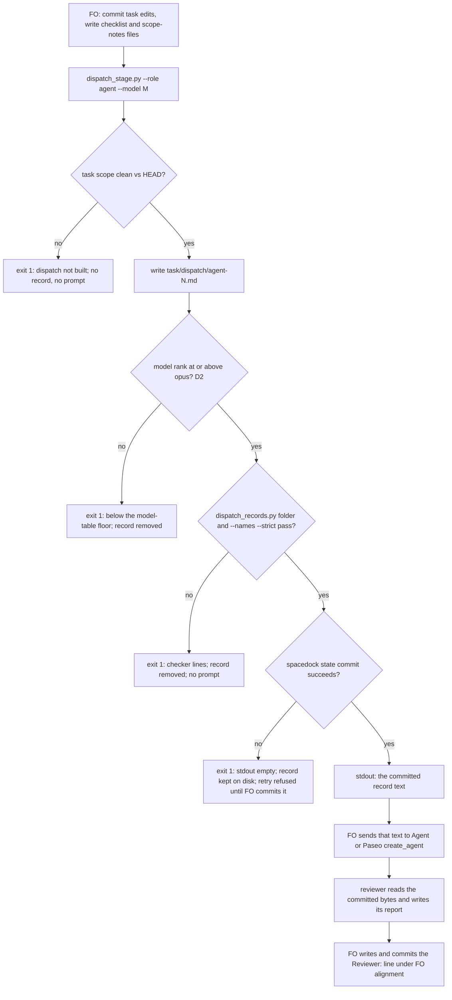

## Scope

- Source: the Captain 「驗證不讀 PR 審查意見（建議）, 特別角色派工紀錄手寫（建議）, 改驗收條件沒當下檢查（建議）, 合併檢查時間點看不出（建議）」 (host question dialog, 2026-11-08), answering 「批次 17 觀察者找到的問題，哪些要開成 kc-dev-flow-2 套件問題單（排進下一批的待辦）？建議四張都開，每張都真的發生過。」
- Bite: the batch 17 observer for worker-browser-checks-use-paseo-browser recorded a violation: FO hand-wrote dispatch/engineering-reviewer-1.md without the record fields; dispatch_records.py exited 1 on it until validation-2 reported it (state commits a113aa3e9, cc856a639).
- Non-goals: changing Spacedock; adopter AGENTS.md files.

## Budget
- One package PR; workflow word budget unchanged unless the design names a raise for the Captain.

## Stop condition
- An engineering-reviewer or chief-engineer dispatch made through the package writes a complete record before the agent starts, with a falsifier.

## FO alignment

Alignment: not needed; the Captain chose to file it from the batch 17 observer findings.
Surfaces: none
Visible change: none
Release review: not needed: workflow maintenance, on no journey map.

## Design

### PRFAQ

**Proposition.** When First Officer (FO) calls kc-dev-flow-2's chief-engineer or engineering-reviewer, it builds the call with the same package script that builds stage dispatches: `python3 <package>/scripts/dispatch_stage.py --role <agent>`. The script writes `<task>/dispatch/<agent>-<N>.md` from FO's checklist and scope-notes files, adds the `Dispatched:` workflow-checkout SHA and the `Model:` line, runs the two record checks a stage dispatch already passes, commits the record with `spacedock state commit`, and only then prints the record text on stdout. That text is the prompt FO hands to `Agent()` or Paseo `create_agent`, so the bytes the reviewer read are the committed record. A record missing a part never reaches a reviewer: the script exits 1 with the checker's lines and prints no prompt.

**FAQ**

- *Why not `spacedock dispatch build`?* It builds stage dispatches only. Checked 2026-11-10 against Spacedock 0.27.2: `spacedock dispatch build --workflow-dir docs/dev2 --entity-path <this task> --stage engineering-reviewer --checklist-file <file> --host claude` exits 1 with `error: stage 'engineering-reviewer' not found in …/docs/dev2/README.md`, and `spacedock dispatch` lists no role or agent subcommand. Role mode therefore skips the build and uses the commit seam the `--advance` branch already uses.
- *Does the checker need to change?* No. Reproduced 2026-11-10 with the 0.37.0 package on copies of the archived task: with the batch 17 hand-written bytes (`git show a113aa3e9:worker-browser-checks-use-paseo-browser/dispatch/engineering-reviewer-1.md`) in the full `dispatch/` folder, `dispatch_records.py <task folder>` exits 1 with six lines, all on `engineering-reviewer-1.md` (Dispatched, Model, Checklist, Scope notes, Package root, completion line); with the repaired record it exits 0 (`9 dispatch record(s) complete`). `--names --strict` on the hand-written record exits 0, so only folder mode sees it. The checker already tells the two apart; the defect is that nothing runs it before the reviewer starts. Role mode runs both checks at that moment.
- *Which defect class does this close, and which not?* It closes "a role record exists but is incomplete when the reviewer starts", when FO uses the script. It does not catch a call FO makes by hand with no record at all; D3 below is the check that would, and why it is not recommended now.
- *Why must FO run the script before writing the `Reviewer:` line?* `check_task_scope` refuses a task whose file differs from HEAD (`staged content … differs from HEAD`, `unstaged content … differs from index`). FO commits task edits, runs the script, then writes and commits the `Reviewer:` line, which stays FO-written: `role_triggers.py` reads it at the next gate.
- *What happens when a task-wide check refuses?* The `--names --strict` task-fact checks apply to every record in the folder, roles included. For example, a task whose `### Amendment N` no dispatch checklist names refuses a role record too; FO names `Captain amendment N` in the reviewer's checklist, which an engineering-reviewer call on amendments asks about anyway.
- *Where does a batch-wide chief-engineer review's record go?* § Batch gates calls one review for a whole batch, and today each member carries the same `Reviewer:` line (for example batch 8 on dispatch-carries-reserved-adr-number and archive-waits-for-observer-report) with no record anywhere. FO dispatches it once with `--entity-path` set to the first member the batch names; the checklist names every member task; each other member's `Reviewer:` line names that record's path. `role_triggers.py` reads only `Reviewer:` lines, so the other members' calls still clear.
- *What about a follow-up message to a live reviewer, design-director and observer?* Unchanged: follow-ups stay hand-recorded like stage follow-ups (ADR 0070), and the Captain's stop condition names only chief-engineer and engineering-reviewer; `--role` accepts those two values.

### Mechanism

`dispatch_stage.py` gains `--role {chief-engineer,engineering-reviewer}`, mutually exclusive with `--stage` (one is required). With `--role`: `--advance`, `--bare-mode`, `--host`, `--candidate`, `--symptom`, `--feedback-context-file` and `--feedback-reflow` are argument errors (exit 2); `--roster` and `--note` keep their meaning. The run reuses `resolve_scope`, `check_task_scope`, `select_record` (record name `<role>-<N>`, the same committed-record reuse rule on retry) and `remove_uncommitted`; adds the model-floor check (D2) with `role_triggers.rank`; skips `role_triggers.py --pending` (the role call is what that check asks for) and `dispatch build`; runs the same two `dispatch_records.py` checks; then runs `spacedock state commit <slug> --workflow-dir <dir>` as the `--advance` branch does, and on success writes the record text to stdout. A failed state commit keeps the record and prints nothing on stdout, matching `test_advance_commits_record_and_withholds_envelope_on_commit_failure`.

`references/sd/workflow.md` § Stages: "Record chief-engineer and engineering-reviewer calls under `## FO alignment` as" becomes "Build chief-engineer and engineering-reviewer calls with `<package>/scripts/dispatch_stage.py --role <agent>`; record each under `## FO alignment` as" (+6 words, D1). `test_sd_dispatch.py` `reviewer-record` gains that phrase as a `need`; `lint-skills.py` `WORKFLOW_BUDGET_STEPS` gains the +6 step with the Captain's words and its loaded moment.

ADR: `docs/adr/<reserved>-special-role-calls-are-built-by-the-stage-dispatch-script.md`, recording the Captain's ideation-gate words for D1 to D3. ADR 0070 decides stage-worker dispatches only and names follow-ups as manual; this record extends the writer to the two special roles, leaves 0070 unamended, and lists `kc-dev-flow-2/scripts/dispatch_stage.py` — `main`, the role branch under `**Protects:**`; `adr_lint.py` then requires a `see docs/adr/<that file>` comment line in `dispatch_stage.py`, beside the existing 0070 pointer.

### Existing-code check

Chain checked 2026-11-10. Spacedock 0.27.2: no role dispatch (FAQ above). kc-dev-flow-2 0.37.0 (`origin/main`, plugin.json `0.37.0`): `dispatch_stage.py` writes stage records only; `dispatch_records.py` folder mode already checks every `dispatch/*.md`, role records included; `role_triggers.py` reads `Reviewer:` lines and never reads role records. Sibling adopters, read-only: `git grep -l -E 'engineering-reviewer-[0-9N<]|chief-engineer-[0-9N<]' origin/HEAD -- '*.py' '*.sh' '*.ts'` in subspace-relay (8b3e2370), qnow (706b01fdb) and subspace-web (2a63a9a7) finds no writer. Conclusion: extend `dispatch_stage.py`, which holds every needed piece; a new script would copy `select_record` and the PR #812 index rules it encodes.

### Words FO reads at each moment

| Moment | Base (0.37.0) | Candidate |
| --- | --- | --- |
| Startup and resume (README) | 5931 words (`wc -w` on `references/sd/workflow.md`, the lint's count) | 5937 (+6, measured on a copy 2026-11-10) |
| Before a chief-engineer or engineering-reviewer call | the § Stages sentence; FO writes the record by hand, no script output | the same sentence; script stderr is empty on a clean task, else `dispatch_stage: dispatch not built; repair the dispatch record:` plus the checker's own lines (the stage path's existing output); stdout is the record FO wrote, passed on, not instructions. Measured at implementation |
| Stage worker dispatch, after a worker report, coverage | unchanged | unchanged (no stage path edit) |
| Idle on an open PR, idle on a merged PR, after the archive, the merge ask | unchanged | unchanged: `pr_watch.py`, `delivery_gate.py`, `role_triggers.py` untouched |

### Batch overlap

Files this design changes: `kc-dev-flow-2/scripts/dispatch_stage.py`, `kc-dev-flow-2/scripts/test_dispatch_stage.py`, `kc-dev-flow-2/scripts/test_sd_dispatch.py` (`reviewer-record` need), `kc-dev-flow-2/references/sd/workflow.md` (§ Stages, one sentence), `kc-dev-flow-2/scripts/lint-skills.py` (`WORKFLOW_BUDGET_STEPS` tail), one new ADR (number reserved by FO; shared ADR numbering).

| Task (state as read 2026-11-10) | Shared file, check or record | Effect |
| --- | --- | --- |
| issue-815-fo-record-gaps (batch 20, ideation) | its item 5 changes the `dispatch_records.py --coverage` message; role mode runs folder and `--names --strict`, not `--coverage` | none shared |
| amendment-checked-when-written (batch 20, ideation) | its scope checks amendments at commit; if its design adds a `--names` task-fact check, role records inherit it | shared check only; either order |
| delivery-gate-pr-body-attribution-link (batch 20, ideation) | `delivery_gate.py` only | none |
| adr-required-statement (validation) | edits `workflow.md` § Decision records and the budget; textual overlap on `WORKFLOW_BUDGET_STEPS` tail and the README total; ADR numbering | land it first; this rebases and recounts |
| merge-guard-stops-unasked-merges (validation) | `workflow.md` unchanged by its design; ADR numbering | ADR number only |
| validation-reads-pr-review-comments (implementation) | validation `principles.md` only | none |
| archive-waits-for-observer-report (implementation) | learn `EXTENSION.md`; observer records are not role dispatches | none |
| adoption-asks-which-extensions (ideation) | `dispatch_records.py` `extension_errors`, which reads only stage-named records | shared check only; either order |
| captain-ruling-sources-checked (ideation) | `design_surfaces.py`, peers `EXTENSION.md`, `adoption.md`, an ADR | ADR number only |
| comment-check-reaches-delivery-gate (ideation) | `delivery_gate.py`, validation principles | none |
| dispatch-carries-reserved-adr-number (ideation) | task body only by its design | none |
| fo-write-checks-parse-top-level (ideation) | names `workflow.md` only to count words | none |
| gate-summary-names-each-decline (ideation) | `workflow.md` and budget unchanged by its design | none |
| picky-reviewers-may-run-on-gemini (ideation) | `EXTENSION.md`; workflow budget unchanged | none |
| seed-check-requires-alignment-result (ideation) | `design_surfaces.py` seed branch | none |
| step-back-answer-has-a-record-line (parked) | `role_triggers.py`, `dispatch_records.py`; shared only under D3 | none unless D3 is taken |
| adr-silent-undo-probe, journey-server-host-pilot, ops-inbox-r1-setup-and-isolation, pr-review-lite-value-pilot, journey-canvas-hosted-poc | no mention of any file above | none |

Recommended order: adr-required-statement, then this task; the rest in any order. One ADR number to reserve.

## Acceptance criteria

All tests run against the real Spacedock binary in split-root fixtures, as `test_dispatch_stage.py` does: `SPACEDOCK_BIN="$HOME/.local/bin/spacedock" python3 -B kc-dev-flow-2/scripts/test_dispatch_stage.py`.

**AC-1** `dispatch_stage.py --role engineering-reviewer` writes `<task>/dispatch/engineering-reviewer-1.md` whose header is `# engineering-reviewer-1`, a `Dispatched:` line with the workflow checkout's 40-hex HEAD, the `Model:` line, then `## Checklist` and `## Scope notes` holding the two files' bytes; it exits 0, HEAD holds the record, and stdout equals the record's bytes. Verified by: a new test asserting each of those, plus `dispatch_records.py <task folder>` exit 0 on the result. Falsifier: deleting the role branch's `spacedock state commit` call fails the HEAD assertion.

**AC-2** A record shaped like the batch 17 bite is refused before any prompt exists: scope notes without a `Package root:` line or a completion line exit 1, stdout is empty, stderr carries `dispatch_records.py`'s part lines, and the record is in neither HEAD nor the worktree. Verified by: a test using those scope notes. Falsifier: skipping the two checks in role mode makes stdout non-empty and the test fails.

**AC-3** A failed state commit withholds the prompt: with a wrapper that refuses `state commit`, the run exits 1 with empty stdout and the record kept on disk; a retry is refused naming the record until FO commits it, after which the retry exits 0 without writing a `-2` record. Verified by: a test mirroring `test_advance_commits_record_and_withholds_envelope_on_commit_failure`. Falsifier: printing the record before the commit makes the empty-stdout assertion fail.

**AC-4** Role mode never calls `dispatch build` and is not held by `role_triggers.py --pending`: on a task that owes a chief-engineer call (four implementation reports), `--role chief-engineer` exits 0, and a spy binary records no `dispatch build` argv. Verified by: a test with the existing spy pattern. Falsifier: routing role mode through the build path makes the spy see `dispatch build` (and Spacedock exits 1 `stage … not found`).

**AC-5** (D2) The model floor holds: `--model sonnet` exits 1 naming the opus floor with no record left; `--model opus` and `--model "gpt-6-astra (Codex via Paseo, thinking xhigh)"` pass. Verified by: a test of the three values. Falsifier: removing the rank check lets `sonnet` exit 0.

**AC-6** `--role` with any of `--stage`, `--advance`, `--bare-mode`, `--host`, `--candidate`, `--symptom`, `--feedback-context-file`, `--feedback-reflow`, or with the value `design-director`, exits 2 and writes nothing. Verified by: a parameterised test. Falsifier: dropping one exclusion lets that pair pass.

**AC-7** Numbering and the stage path stay as they are: a second engineering-reviewer call writes `engineering-reviewer-2.md`; a chief-engineer call in the same folder writes `chief-engineer-1.md`; every existing `test_dispatch_stage.py`, `test_dispatch_records.py` and `test_role_triggers.py` case passes unchanged. Verified by: the full three suites. Falsifier: counting every record in the folder instead of the role's own makes the chief-engineer call write `chief-engineer-3.md`.

**AC-8** (D1) `workflow.md` § Stages carries "Build chief-engineer and engineering-reviewer calls with `<package>/scripts/dispatch_stage.py --role <agent>`; record each under `## FO alignment` as"; `test_sd_dispatch.py` `reviewer-record` needs that phrase; `lint-skills.py` has a +6 step with the Captain's quoted words and loaded moment, and `python3 -B kc-dev-flow-2/scripts/lint-skills.py` exits 0 at 5937 words. Falsifier: deleting the phrase from `workflow.md` fails `test_sd_dispatch.py`; deleting the step fails the lint.

**AC-9** The ADR lands with the Captain's words for D1 to D3 and the number FO reserved; `python3 kc-dev-flow-2/scripts/adr_lint.py docs/adr --since <base> --require <number>` exits 0. Falsifier: removing the `Words` line fails the lint.

**AC-10** The words FO reads match the table above: startup +6, the role-call moment measured on captured success and refusal outputs, every other moment unchanged by `git diff --stat` (no `pr_watch.py`, `delivery_gate.py` or `role_triggers.py` change). Verified by: `wc -w` on the captured outputs and the diff stat, saved in the validation folder.

## Decisions for the Captain

- **D1. Add six words to the workflow README so FO knows to use the script for role calls.** Recommended: yes, 5931 to 5937. Without the sentence FO meets `--role` only in `--help`, and the hand-written record recurs. Worse under it: every FO startup and resume reads six more words.
- **D2. The script refuses a role call below the model table's floor (opus, or astra).** Recommended: yes. ADR 0070 left the model FO-supplied and refused resolving it in the script; this checks the supplied value, using `role_triggers.rank`, and does not resolve one. Worse under it: a model name with no recognized word (a new family) blocks the call until `RANK` learns it. Limit: the floor is opus for every task; an engineering-reviewer call on a `profile: prod` or `Surfaces: db` task needs fable or astra, and the script does not read those task facts, so `role_triggers.py` still reports that amendment owed at the next gate.
- **D3. Also make `role_triggers.py` keep a call owed when its `Reviewer:` line has no matching dispatch record.** Recommended: not in this task. No absent record has bitten yet (the bite was an incomplete one); a batch-wide chief-engineer review is recorded on several tasks but dispatched once, so a per-task join would mark those owed; and ADR 0026 decides that a dated call line clears a call. Worse under the recommendation: a role call FO makes entirely by hand, with no record, stays uncaught; the rule stays prose-enforced, as ADR 0070's stage rule is.

## Number guards

ADR: 0074

### Feedback Cycles

- Cycle 1 (FO, 2026-11-10): validation-1 on #827 head 8574e879 recommended REJECTED with one finding, F1, assessed Material and owned (value-ac[AC-1]: the record holds the two files' bytes; the validator's CRLF inputs come back rewritten, evidence in special-role-dispatch-records-built-by-script/validation/independent-1/evidence/acceptance.log, validator's run, not re-run by FO), to fix; investigation first, then FO fix authorization, then a fresh validation recheck.
  - F1: dispatch_stage.py normalizes CRLF in the checklist and scope-notes inputs and in the stdout read, so a role record does not hold the supplied bytes.

## Stage Report: ideation

- DONE: Design how an engineering-reviewer or chief-engineer dispatch made through the package writes its complete dispatch record before the agent starts (the batch 17 hand-written dispatch/engineering-reviewer-1.md is the bite), naming the script that writes it and a falsifier that fails without it
  `## Design`: `dispatch_stage.py --role <agent>` writes, checks and state-commits `<task>/dispatch/<agent>-<N>.md`, then prints it as the prompt; falsifiers in AC-1 to AC-3. Bite reproduced 2026-11-10: a113aa3e9 bytes give folder-mode exit 1 (six part lines), repaired record exit 0, `--names --strict` exit 0 on both.
- DONE: A `### Batch overlap` section naming each file the design would change and each other batch task (issue-815-fo-record-gaps, special-role-dispatch-records-built-by-script, amendment-checked-when-written, delivery-gate-pr-body-attribution-link) and live task of other sessions (adr-required-statement, journey-server-host-pilot, merge-guard-stops-unasked-merges, archive-waits-for-observer-report, ops-inbox-r1-setup-and-isolation, pr-review-lite-value-pilot, validation-reads-pr-review-comments, adoption-asks-which-extensions, adr-silent-undo-probe, captain-ruling-sources-checked, comment-check-reaches-delivery-gate, dispatch-carries-reserved-adr-number, fo-write-checks-parse-top-level, gate-summary-names-each-decline, journey-canvas-hosted-poc, picky-reviewers-may-run-on-gemini, seed-check-requires-alignment-result, step-back-answer-has-a-record-line (in flight or parked; read only)) that changes the same file or check, so FO can order implementation
  `### Batch overlap`: six files; only adr-required-statement shares a file (`workflow.md` budget, `WORKFLOW_BUDGET_STEPS` tail); Recommended order: it first; one ADR number to reserve.
- DONE: The words FO reads at each lifecycle moment, before and after, per root learning.md "Measure the words FO reads at each moment, not one file's size"
  `### Words FO reads at each moment`: startup 5931 to 5937 (measured on a copy with the lint's `split()` count); role-call moment measured at implementation (AC-10); every other moment unchanged.
- DONE: Acceptance criteria with reproducible evidence clauses and falsifiers, and unresolved decisions for the Captain, each with a recommendation and what gets worse under it
  AC-1 (record written, committed, printed): not yet verified, implementation test.
  AC-2 (bite-shaped record refused, no prompt): not yet verified; the checker half is reproduced above.
  AC-3 (commit failure withholds prompt): not yet verified, implementation test.
  AC-4 (no `dispatch build`, no role-trigger hold): not yet verified; `dispatch build --stage engineering-reviewer` exit 1 "stage … not found" observed 2026-11-10.
  AC-5 (model floor, D2): not yet verified, implementation test.
  AC-6 (flag exclusions): not yet verified, implementation test.
  AC-7 (numbering, existing suites unchanged): not yet verified.
  AC-8 (README sentence, D1 +6): word count 5937 measured on a copy 2026-11-10; tests and lint not yet run.
  AC-9 (ADR lands): not yet verified; needs FO's reserved number.
  AC-10 (words per moment): startup measured; the rest not yet verified.
  Decisions D1 (+6 README words, recommend yes), D2 (model floor, recommend yes, follows ADR 0070), D3 (role_triggers join, recommend not now, follows ADR 0026). `git grep -n 'Override:'` in the state checkout: no ruling in the dispatch or role-call area.

### Summary

Role calls reuse `dispatch_stage.py` through a new `--role` mode that writes, checks and commits the record and only then prints it as the reviewer's prompt; Spacedock cannot build role dispatches, and the existing checker already rejects the bite shape, so no checker change is needed. `design_surfaces.py check` printed `design surfaces presentable` (exit 0). Three Captain decisions: a six-word README raise, a model-floor check, and not adding a record join to `role_triggers.py` now.

## Stage Report: implementation

- DONE: Implement the approved design and acceptance criteria; D1 the six README words, D2 reject a model below the opus/astra floor, D3 not in this task; only the files the design names; no version bump.
  Candidate `8574e879b85197d31239ee2d9a9af0c5d0cb5392`, branch `spacedock-ensign/special-role-dispatch-records-built-by-script`, base `6a495cb8c4055f9a6eba8a05419c2d2fad1a90f1`; six named files, clean product worktree. A final origin fetch still has that base; neither overlapping README change landed first.
- SKIPPED: One Draft PR (Conventional Commit title scoped to the plugin) from a branch off origin/main.
  No PR opened: no push grant. FO owns product push, Draft PR creation and reviews; all-state lookup found no existing PR for this branch. Prepared title/body: `/tmp/impl-special-role-dispatch-records-built-by-script-pr.md`.
- DONE: ADR 0074 records the ruling the design names, quoting the Captain's words from the task file and its gate records.
  `docs/adr/0074-special-role-calls-are-built-by-the-stage-dispatch-script.md` records D1–D3 and the 2026-11-10 ideation gate words; installed 0.37.0 `adr_lint.py docs/adr --since <base> --require 0074` exits 0, 66 records checked.
- DONE: Every acceptance criterion green with the evidence each names; each falsifier shown failing by a mutation you run (python3 -B, caches cleared).
  Evidence home: `special-role-dispatch-records-built-by-script/validation/implementation/`; `checks.json`, `mutations.json`, `result.json`, and per-control logs. All ten mutations caught; mutation copies have no `__pycache__`.
  AC-1: exact header, checkout SHA, supplied inputs, HEAD record and stdout bytes pass; bypassing state commit fails the HEAD assertion (`AC-1-no-commit.log`).
  AC-2: missing Package root/completion parts refuse with empty stdout and no record in HEAD/worktree; bypassing both checks fails (`AC-2-no-checks.log`).
  AC-3: failed commit withholds stdout, keeps the record, refuses retry until committed, then reuses it; early printing fails (`AC-3-prompt-before-commit.log`).
  AC-4: a task owing chief-engineer dispatches that role with no build argv; routing it through build fails and the spy records `dispatch build` (`AC-4-role-through-build.log`). Real Spacedock first refuses the status/stage mismatch, before its unknown-stage check.
  AC-5: sonnet refuses; opus and supplied gpt-6-astra pass; removing rank enforcement fails (`AC-5-no-floor.log`).
  AC-6: all eight excluded flags and design-director refuse with exit 2 and unchanged state; allowing advance fails (`AC-6-allow-advance.log`).
  AC-7: role-specific numbering and retry reuse pass; global numbering fails (`AC-7-global-numbering.log`). Existing cases retained: stage suite 35, records 115 (one optional skip), role triggers 49; all pass.
  AC-8: reviewer-record phrase and the Captain-quoted +6 budget step pass at 5937 words; removing the phrase fails the integration check and removing the step fails lint (`AC-8-*.log`).
  AC-9: ADR lint passes; isolated baseline exits 0, removing Words produces just the missing-Words defect and exit 1 (`AC-9-baseline.log`, `AC-9-no-words.log`).
  AC-10: captured `wc -w` outputs in `words/`: startup 5931→5937; successful prompts 39–44 words, zero stderr; refusal stdout zero, stderr 4–49 words depending on refusal, including argument usage. `words/diff-stat.txt` and byte comparisons show pr_watch.py, delivery_gate.py and role_triggers.py unchanged; other listed lifecycle moments unchanged.
- DONE: Repository lint-skills.py, installed adr_lint.py, number_guards.py check and comment_ratio.py pass; commit locally, no product push; PR text written for FO.
  28 CI-listed commands exit 0: 1270 unittest cases, 11 optional skips, plus dispatch transport/observer integration checks (`checks.json`). Lint 5937/5937; number guards base 6a495cb8c405, head 8574e879b851, no findings and no fetch warning; comments 1/135 code lines, 0.7%, maximum 5%.
- SKIPPED: FO pushes, opens the Draft PR, runs RoboRev and reads CI.
  Delegated and not run, never clean. Local seams used Spacedock CLI 0.27.2 and active plugin root 0.27.3; hosted CI's pinned 0.27.2 plugin run remains FO-owned. CI cost per PR not measured; workflow triggers unchanged.
- DONE: Affected-document verdicts from installed doc_impact.py <base> <candidate>.
  `docs/adr/0020-a-rise-in-the-workflow-word-budget-needs-a-captain-ruling-recorded-with-it.md` — unaffected: the quoted +6 step follows its existing raise rule.
  `docs/adr/0037-workers-check-shared-work-and-return-to-fo-early.md` — unaffected: collaboration rule and its linter unchanged.
  `docs/adr/0049-special-roles-and-stage-defaults-follow-one-model-table.md` — unaffected: existing rank reused; model table and linter unchanged.
  `docs/adr/0052-fo-answers-its-own-paseo-workers-permission-requests.md` — unaffected: permission-answer procedure and linter unchanged.
  `docs/adr/0064-a-round-three-declined-finding-becomes-a-backlog-task-only-with-a-bite.md` — unaffected: disposition and its wording pins unchanged.
  `docs/adr/0070-stage-worker-dispatches-are-built-by-a-package-script-that-writes-their-record.md` — unaffected: stage scope/manual follow-ups retained; 0074 adds role mode.
  `docs/adr/0074-special-role-calls-are-built-by-the-stage-dispatch-script.md` — updated.
  `kc-dev-flow-2/README.md` — unaffected: maintenance commands and stage-test description remain valid.
  `kc-dev-flow-2/references/sd/adoption.md` — unaffected: the named dispatch test command remains valid.
  `kc-dev-flow-2/skills/maintain-flow/SKILL.md` — unaffected: its budget/falsifier practices are followed without changing the practices.
  `learning.md` — unaffected: historical evidence and lifecycle measurement practice preserved; no learning entry changed.

### Summary

Added bounded role dispatches that write, check and state-commit the record before returning the prompt, with model-floor refusal, commit-failure recovery and the approved six-word instruction. The existing design capability audit was reused; no new abstraction or file outside the six approved files was needed, and local checks/falsifiers passed. Pilot scope remains local preparation: FO owns product publication, independent review and hosted CI; manual missing-record calls and the higher prod/database floor remain outside this role-mode check.
ADRs: 0074

## Stage Report: validation

- DONE: Independent verdict on PR #827 head 8574e879 against every acceptance criterion in the task file, re-running each evidence command and at least one falsifier per criterion yourself, and judging each limit the implementation report states
  REJECTED at `8574e879b85197d31239ee2d9a9af0c5d0cb5392`, base `6a495cb8c4055f9a6eba8a05419c2d2fad1a90f1`; AC-1 fails the supplied-byte boundary below. Full matrix, limits and document verdicts: `special-role-dispatch-records-built-by-script/validation/independent-1/validation.md`.
- FAILED: AC-1 preserves the supplied checklist and scope-note bytes in the committed record
  Valid UTF-8 CRLF inputs return 0 but both byte-preservation checks are false; fresh-shell reproduction and original bytes: `special-role-dispatch-records-built-by-script/validation/independent-1/evidence/acceptance.log` and `evidence/crlf-*`.
- DONE: A minimal acceptance script the Captain can run (three to six steps, exact commands, expected output), run by you exactly as written in a fresh bash shell, with its observed output; /Users/kent/.claude/plugins/cache/kc-claude-plugins/kc-dev-flow-2/0.37.0/scripts/adr_lint.py docs/adr --since <base> with its exit code; your verdict naming the head, with findings classified by the workflow's Review-finding disposition
  Four-step `special-role-dispatch-records-built-by-script/validation/independent-1/acceptance.sh`, run unchanged with `bash --noprofile --norc`: steps 1–3 pass, step 4 exits 1 (F1); the prescribed installed ADR command with base above and `--require 0074` exits 0 (`evidence/adr-lint-prescribed.log`).
- DONE: AC-2 and AC-3 refuse incomplete records and withhold prompts on commit failure
  Missing fields individually and together leave no prompt/record; failed commit retains the record and retry recovers only after reconciliation. Skipping checks and printing early fail the assertions (`special-role-dispatch-records-built-by-script/validation/independent-1/evidence/AC-2-no-checks.log`, `evidence/AC-3-early-prompt.log`).
- DONE: AC-4 through AC-7 preserve role routing, model floor, option exclusions, numbering and existing stage cases
  Real Spacedock 0.27.2 tests pass; build-path, floor, advance and global-number mutations are caught. Original cases are unchanged; details and full outputs: `special-role-dispatch-records-built-by-script/validation/independent-1/evidence/retained-test-cases.json`, `evidence/test_dispatch_stage.log`, `evidence/checks.json`, `evidence/mutations.json`.
- DONE: AC-8 through AC-10 preserve the approved instruction, ADR, word budget and other lifecycle readers
  Removing the instruction, budget step or Words line fails its check; modifying an idle reader fails the unchanged-file control. Startup is 5931→5937 words; role outputs and all captures: `special-role-dispatch-records-built-by-script/validation/independent-1/evidence/wc-words.log`, `evidence/words.json`, `evidence/diff-stat.log`.
- DONE: Required package replay, number guards, comment measurement, dispatch records, design checks and affected-document verdicts
  Independent command exits and suite totals are saved in `special-role-dispatch-records-built-by-script/validation/independent-1/evidence/checks.json`; number guards have no findings, and comments are 1/135 (0.7%, under 5%) in `evidence/comment-ratio.log`. Every listed document has a checked verdict in `evidence/doc-verdicts.json`.
- DONE: Implementation limits and hosted evidence assessed at the same candidate
  Manual calls without records still clear; prod Opus calls still leave the higher-floor review owed; unknown models refuse (`special-role-dispatch-records-built-by-script/validation/independent-1/evidence/limits.json`, `evidence/probes.json`). Exact-head hosted run 42769870457 succeeds with pinned 0.27.2 (`evidence/ci.json`, `evidence/ci-full.log`); local plugin integration uses active 0.27.3.
- SKIPPED: Live model dispatch, adoption, RoboRev and delivery actions
  Native reviewer behavior is outside this bounded script proof; RoboRev remains FO-owned and unclaimed. PR remains OPEN/Draft at the candidate; reviews/comments were empty when read. CI triggers are unchanged and cost per PR was not measured.
- F1 Material: `dispatch_stage.py:184-185` normalizes CRLF source inputs and line 242 normalizes stdout reads. User/workflow: FO supplies valid UTF-8 checklist/scope files through the documented role command. Harm: successful committed dispatch loses the promised input-byte identity. Boundary: `value-ac[AC-1]` requires both files' bytes; no LF-only restriction exists. Trigger: `special-role-dispatch-records-built-by-script/validation/independent-1/evidence/acceptance.log`, with original byte files and raw record in the same evidence folder. Repair is recommended through FO disposition; no product repair was applied.

### Summary

The role commit/refusal/recovery path and all specified removal controls were independently exercised from pinned exports. Recommend REJECTED solely for F1; existing LF-only tests and green hosted CI do not prove the accepted input-byte boundary. Product HEAD and bytes remain unchanged; FO owns disposition, any repair authorization, and delivery.
ADRs: 0074

## Stage Report: implementation

- DONE: Phase 1 only of the Cycle 1 repair: reproduce finding F1 as a failing test at head 8574e879, propose the smallest fix, and stop with no product commit or push until FO authorizes the fix.
  Exact candidate `8574e879b85197d31239ee2d9a9af0c5d0cb5392` exported under the assigned worktree; source bytes match the commit. Five raw-byte tests: role CRLF and stage CRLF fail while both LF controls and the LF renderer comparison pass (`validation/f1-investigation-phase1/baseline.log`, `baseline/tests.json`); commands return 0 yet neither CRLF source byte sequence survives in either saved record.
- DONE: Propose the smallest fix for F1, without applying it to the product.
  Diagnostic copy changes three existing lines in `dispatch_stage.py`: decode each input from `read_bytes()` as UTF-8, then emit role stdout with `sys.stdout.buffer.write(path.read_bytes())`; record construction and the existing encoded-byte retry comparison need no change. Five tests pass on that disposable proposal, including raw HEAD/disk/stdout identity and role retry reuse (`proposal.log`, `proposal/tests.json`); reverting just the stdout change leaves preserved disk/HEAD bytes but one failing stdout test (`input-only.log`).
- DONE: Say whether the same newline rewriting touches the existing stage path (non-role dispatches).
  Yes: `parse_args` shares both normalizing `read_text()` calls across stage and role modes; the native `--stage ideation --host codex` fixture independently commits rewritten CRLF bytes at the current candidate (`baseline/stage-crlf-facts.json`). The proposed shared input-read correction also preserves CRLF in stage records; only the raw stdout change is role-specific, and the stage builder still receives the original source-file paths.
- DONE: Say whether the fix changes any byte of an LF-only record.
  No in the exercised role and stage paths: both candidate and disposable proposal match an exact raw-byte expected record; direct before/after `parse_args`→`record_text` comparison on identical LF inputs yields identical bytes for both paths (`proposal/lf-differential.json`). The proposal adds no header, delimiter or numbering change and does not edit existing records.
- DONE: Append one complete `## Stage Report: implementation`, every item followed by its own indented evidence line.
  This complete phase-1 report and `special-role-dispatch-records-built-by-script/validation/f1-investigation-phase1/` preserve the raw bytes, test outcomes and summary; the reproducer and proposed diff remain under the assigned worktree's ignored `.context/special-role-f1-phase1/` (`summary.json` names their absolute paths).
- SKIPPED: Product repair, product commit, full package rerun, PR writes and all pushes.
  Investigation-only dispatch; product HEAD remains `8574e879b85197d31239ee2d9a9af0c5d0cb5392` with clean tracked status. FO must authorize the shared three-line correction and regression-test integration before implementation; state evidence/report are committed locally only, respecting the no-push instruction.

### Summary

F1 is reproduced and remains unfixed in the product; this phase-1 report supersedes the earlier implementation report's claim that AC-1 is green. The smallest proposed correction preserves input bytes through the shared reader and returns raw role-record bytes; disposable checks pass and LF-only record bytes are unchanged in both exercised paths. Pilot scope remains investigation only, awaiting FO repair authorization; no product or remote action was taken.
ADRs: none: this investigation proposes enforcement of the existing byte-preservation contract, without a new ruling.

## Stage Report: implementation

- DONE: Phase 2 of the Cycle 1 repair, FO fix authorization for finding F1: in kc-dev-flow-2/scripts/dispatch_stage.py change the three lines your phase-1 report proposes and nothing else in that file.
  Candidate `3567082b0ec1eeb59346b2d82887a07bc5ffc2fb`, prior `8574e879b85197d31239ee2d9a9af0c5d0cb5392`, existing branch `spacedock-ensign/special-role-dispatch-records-built-by-script`; `scope-check.json` confirms the exact three authorized substitutions and `summary.json` binds the committed source hashes. No version, workflow or other production file changed in this repair.
- DONE: Add the raw-byte regression tests to kc-dev-flow-2/scripts/test_dispatch_stage.py: role CRLF, stage CRLF, both LF controls and the LF before/after record comparison; show each new CRLF test failing with the fix reverted (python3 -B, caches cleared).
  Five new tests pass (`targeted.log`); original 35 test functions remain AST-identical. `revert-all-three.log` fails both CRLF tests; independent checklist, scope-note and role-stdout normalization mutations also fail the matching raw-byte assertions (`mutations.json`, four caught controls plus the positive baseline). Temporary copies run with python3 -B after cache removal; raw subprocess/Git output avoids newline-normalizing test capture.
- DONE: All package test files pass; one local commit on the existing branch, no push and no PR write; update the PR text file if its claims change.
  All 28 CI-listed checks exit 0, every package test file is listed, with 1275 unittest cases including 11 optional skips (`checks.json`); the real-binary stage suite has 40 passing cases. Single local repair commit `3567082b0ec1eeb59346b2d82887a07bc5ffc2fb` changes only the two named files; product worktree is clean. `/tmp/impl-special-role-dispatch-records-built-by-script-pr.md` now describes CRLF/LF preservation and these results; it was not posted.
- DONE: Append one complete `## Stage Report: implementation` naming the new candidate SHA, every item followed by its own indented evidence line, evidence kept in the task folder in the state checkout.
  This report and all raw outputs/metadata are under `special-role-dispatch-records-built-by-script/validation/f1-repair-phase2/`; logs cited here are relative to that evidence home. The state report/evidence are committed locally only; no branch push is performed.
- DONE: Required guard and document checks at the repaired candidate.
  Installed 0.37.0 ADR lint since base `6a495cb8c4055f9a6eba8a05419c2d2fad1a90f1` with `--require 0074` exits 0 (66 records); number guards exits 0 with no findings/fetch warning at head `3567082b0ec1`; design surfaces presentable. Repository lint remains 5937/5937 words. Comment ratio is 1/192 code lines, 0.5%, under 5% (`adr-lint.log`, `number-guards.log`, `design.log`, `lint-skills.log`, `comment-ratio.log`).
- DONE: doc_impact disposition for `docs/adr/0020-a-rise-in-the-workflow-word-budget-needs-a-captain-ruling-recorded-with-it.md`.
  unaffected: the Captain-quoted +6 budget step follows the existing raise rule.
- DONE: doc_impact disposition for `docs/adr/0037-workers-check-shared-work-and-return-to-fo-early.md`.
  unaffected: worker collaboration rule and its linter remain unchanged.
- DONE: doc_impact disposition for `docs/adr/0049-special-roles-and-stage-defaults-follow-one-model-table.md`.
  unaffected: existing model ranking is reused; the model table and its linter remain unchanged.
- DONE: doc_impact disposition for `docs/adr/0052-fo-answers-its-own-paseo-workers-permission-requests.md`.
  unaffected: worker permission-answer procedure and its linter remain unchanged.
- DONE: doc_impact disposition for `docs/adr/0064-a-round-three-declined-finding-becomes-a-backlog-task-only-with-a-bite.md`.
  unaffected: external-review disposition and its wording pins remain unchanged.
- DONE: doc_impact disposition for `docs/adr/0070-stage-worker-dispatches-are-built-by-a-package-script-that-writes-their-record.md`.
  unaffected: stage dispatch and manual follow-ups keep their existing scope; ADR 0074 adds role mode.
- DONE: doc_impact disposition for `docs/adr/0074-special-role-calls-are-built-by-the-stage-dispatch-script.md`.
  updated in the task candidate; retained unchanged in this repair, whose byte-preservation enforcement follows its existing record/prompt contract.
- DONE: doc_impact disposition for `kc-dev-flow-2/README.md`.
  unaffected: the maintenance command paths and described stage tests remain valid.
- DONE: doc_impact disposition for `kc-dev-flow-2/references/sd/adoption.md`.
  unaffected: the unchanged dispatch test command still exercises adoption.
- DONE: doc_impact disposition for `kc-dev-flow-2/skills/maintain-flow/SKILL.md`.
  unaffected: the word-budget and falsifier practices are followed without changing maintenance rules.
- DONE: doc_impact disposition for `learning.md`.
  unaffected: historical evidence and lifecycle measurement practice are preserved.
- SKIPPED: FO pushes and runs RoboRev; remote PR updates, hosted CI and fresh independent validation of the repaired candidate.
  Delegated to FO and not run by this worker, never clean. Local seams use real Spacedock CLI 0.27.2 and active plugin root 0.27.3; hosted pinned-0.27.2 validation for the new candidate remains separate. No CI trigger changed; cost per PR not measured.

### Summary

The authorized byte-preservation repair and five integrated regressions are committed as `3567082b0ec1eeb59346b2d82887a07bc5ffc2fb`; this complete phase-2 report supersedes the phase-1 report's unfixed/waiting-authorization status. CRLF input bytes now survive both record paths and raw role stdout, while the exercised LF records remain byte-identical; full local checks and removal controls pass. Pilot scope remains bounded; FO owns publication, RoboRev and a fresh validation decision on this candidate.
ADRs: none: no new ruling; existing ADR 0074 is retained and required by the guard.

## Stage Report: validation

- DONE: Independent verdict on PR #827 head 3567082b against every acceptance criterion in the task file, re-running each evidence command and at least one falsifier per criterion yourself, and judging each limit the implementation report states
  PASSED at `3567082b0ec1eeb59346b2d82887a07bc5ffc2fb`, base `6a495cb8c4055f9a6eba8a05419c2d2fad1a90f1`; all AC-1 through AC-10 pass. Full matrix, classified finding closure and limits: `special-role-dispatch-records-built-by-script/validation/independent-2/validation.md`.
- DONE: Recheck of the Cycle 1 repair: finding F1 of validation-1 (CRLF input bytes rewritten) is closed at this head for the role path and the stage path, and LF-only records are byte-identical to head 8574e879
  F1 Material is closed: independent raw subprocess/Git-byte captures reproduce the old CRLF defect on both paths and prove the candidate preserves inputs, commits and role stdout; both LF records have identical old/new hashes (`special-role-dispatch-records-built-by-script/validation/independent-2/evidence/repair-bytes.json`).
- DONE: A minimal acceptance script the Captain can run (three to six steps, exact commands, expected output), run by you exactly as written in a fresh bash shell, with its observed output; /Users/kent/.claude/plugins/cache/kc-claude-plugins/kc-dev-flow-2/0.37.0/scripts/adr_lint.py docs/adr --since <base> with its exit code; your verdict naming the head, with findings classified by the workflow's Review-finding disposition
  Four-step `special-role-dispatch-records-built-by-script/validation/independent-2/acceptance.sh` passes unchanged under `bash --noprofile --norc`; observed 2, 4 and 5 tests OK, then PASS (`evidence/acceptance.log`). The prescribed installed ADR command with base above and `--require 0074` exits 0 (`evidence/adr-lint-prescribed.log`, paths relative to that independent-2 directory).
- DONE: Refusal, recovery, routing, floor, flag, numbering, workflow, ADR and lifecycle falsifiers remain decisive
  Eleven criterion controls and four repair controls are caught by their intended assertions/diagnostics, including removing commit/checks, printing early, wrong build/rank/numbering, omitted instruction/budget/Words and changed idle output (`special-role-dispatch-records-built-by-script/validation/independent-2/evidence/mutations.json`, `evidence/repair-mutations.json`).
- DONE: Full package checks, retained tests and exact repair scope
  All 28 commands exit 0, with 1275 unittest cases including 11 optional skips and 40 real-binary stage cases; every package test file is accounted for in `special-role-dispatch-records-built-by-script/validation/independent-2/evidence/checks.json` and `evidence/summary.json`. The prior test functions are AST-identical and production repair is exactly the three authorized substitutions (`evidence/retained-test-cases.json`, `evidence/source-integrity.json`).
- DONE: Number guards, design, dispatch records, comment measurement and affected-document dispositions
  Required checks exit 0; live number-guard rerun has no fetch warning/findings; comments 1/192 (0.5%, below 5%); every affected document has a checked disposition (`special-role-dispatch-records-built-by-script/validation/independent-2/evidence/guards.json`, `evidence/number-guards-live.log`, `evidence/comment-ratio.log`, `evidence/doc-verdicts.json`).
- DONE: Implementation limits and same-candidate hosted evidence assessed
  Manual no-record calls, higher prod/database floor and unknown models match the accepted limits; real CLI 0.27.2/local plugin 0.27.3 checks are distinct from successful exact-head hosted run 42776608725 with pinned 0.27.2 (`special-role-dispatch-records-built-by-script/validation/independent-2/evidence/limits.json`, `evidence/probes.json`, `evidence/ci-refresh.json`, `evidence/ci-full.log`).
- DONE: Current PR and product ownership boundary checked
  PR remains OPEN/Draft at the candidate; remote Codex receipt reports no major issues on that head, inline comments were empty, and main remains the base (`special-role-dispatch-records-built-by-script/validation/independent-2/evidence/pr-final.json`, `evidence/pr-review-comments.json`, `evidence/remote-main.json`). Product branch/bytes remain unchanged and clean.
- SKIPPED: Live reviewer dispatch, adoption, RoboRev and delivery actions
  Native reviewer behavior and adoption remain unverified; RoboRev and delivery stay FO-owned. No product push, PR write, review request or merge was performed. CI triggers are unchanged; cost per PR was not measured.

### Summary

Recommend PASSED at `3567082b0ec1eeb59346b2d82887a07bc5ffc2fb`; this recheck supersedes the previous validation verdict for the repaired head, closing F1 without new findings. The bounded Pilot outcome and each retained change are supported by real commit/recovery evidence and removal controls, with raw-byte proof for both record paths and unchanged LF records. FO retains gate, remaining review and delivery ownership; the product candidate and task frontmatter are unchanged.
ADRs: 0074

## Stage Report: implementation

- DONE: Merge origin/main into the existing branch with a merge commit, resolve the lint-skills.py conflict so both changes stand, and recount the workflow words and budget.
  Candidate `39a76c68836f471fc0c42c18eab12641196860ed` has parents `3567082b0ec1eeb59346b2d82887a07bc5ffc2fb` and fetched main `d8dbfcb1051d7c696aca139ed9ade332ee85abaf` (includes #825, #826 and #828). The sole conflict retained both Captain-quoted +6 and +2 steps. `wc -w`/lint: main 5933, prior branch 5937, merged 5939 and budget 5939 (`word-budget.json`, `wc-words.log`); AC-8's earlier 5937 count belongs to the earlier base, with no new budget grant needed beyond the accepted joint +8.
- DONE: Re-run all package test files, repository lint-skills.py, installed adr_lint.py and number_guards.py checks at the new head; ADR 0074 still required.
  Final `exact-head/checks.json` has 28 exits of 0 with identical before/after head `39a76c68836f471fc0c42c18eab12641196860ed`: 1312 unittest cases including 11 optional skips, and 40 passing real-binary stage cases. Every package test file is CI-listed. Pre-commit preflight outputs are excluded from this proof; the source was unchanged when the final run began.
- DONE: Report anything in main that changes this task's behaviour.
  Main adds the bound-question reason check, scalar/list screenshot support, folder coverage input, numbered Captain-step path enforcement, the exact PR attribution exemption and L4 amendment-move reporting. Role records still call folder and names checks, not coverage; only `check_coverage` changed in dispatch_records.py. The writer, its 40-test file and role_triggers.py are byte-identical to the prior candidate (`integration-scope.json`); no adopted workflow pin or CI trigger was changed here.
- DONE: One local merge commit on the existing branch, no push and no PR write; update the PR text if its word counts change.
  `merge-identity.json` verifies one new first-parent merge commit, both prior histories retained and a clean product worktree. No rebase or force push occurred. `/tmp/impl-special-role-dispatch-records-built-by-script-pr.md` now gives 5939 words (main 5933 plus this task's six) and the new test count; no PR write or branch push was performed.
- DONE: Append one complete `## Stage Report: implementation` naming the new candidate SHA, every item followed by its own indented evidence line, evidence kept in the task folder in the state checkout.
  This report and `special-role-dispatch-records-built-by-script/validation/merge-main/` hold the final exact-head checks, raw outputs, merge identity, word measurements and guard results; paths below are relative to that evidence home. State report/evidence are committed locally only.
- DONE: Installed guard checks and affected-document scan against the new main base.
  Base `d8dbfcb1051d7c696aca139ed9ade332ee85abaf`; installed 0.37.0 ADR lint with `--require 0074` exits 0 (67 records), number guards exits 0 without findings/fetch warning, design surfaces presentable. Comment ratio 1/192, 0.5%, below 5%; repository lint 5939/5939 (`adr-lint.log`, `number-guards.log`, `design.log`, `comment-ratio.log`, `exact-head/lint-skills.log`). The PR diff against this base remains the six approved files (`pr-diff-stat.log`).
- DONE: doc_impact disposition for `docs/adr/0020-a-rise-in-the-workflow-word-budget-needs-a-captain-ruling-recorded-with-it.md`.
  unaffected: the Captain-quoted +6 budget step follows the existing raise rule.
- DONE: doc_impact disposition for `docs/adr/0037-workers-check-shared-work-and-return-to-fo-early.md`.
  unaffected: worker collaboration rule and its linter remain unchanged.
- DONE: doc_impact disposition for `docs/adr/0049-special-roles-and-stage-defaults-follow-one-model-table.md`.
  unaffected: existing model ranking is reused; the model table and its linter remain unchanged.
- DONE: doc_impact disposition for `docs/adr/0052-fo-answers-its-own-paseo-workers-permission-requests.md`.
  unaffected: worker permission-answer procedure and its linter remain unchanged.
- DONE: doc_impact disposition for `docs/adr/0064-a-round-three-declined-finding-becomes-a-backlog-task-only-with-a-bite.md`.
  unaffected: external-review disposition and its wording pins remain unchanged.
- DONE: doc_impact disposition for `docs/adr/0070-stage-worker-dispatches-are-built-by-a-package-script-that-writes-their-record.md`.
  unaffected: stage dispatch and manual follow-ups keep their existing scope; ADR 0074 adds role mode.
- DONE: doc_impact disposition for `docs/adr/0074-special-role-calls-are-built-by-the-stage-dispatch-script.md`.
  updated in this task relative to main; retained unchanged during this merge.
- DONE: doc_impact disposition for `kc-dev-flow-2/README.md`.
  unaffected: the maintenance command paths and described stage tests remain valid.
- DONE: doc_impact disposition for `kc-dev-flow-2/references/sd/adoption.md`.
  unaffected: the unchanged dispatch test command still exercises adoption.
- DONE: doc_impact disposition for `kc-dev-flow-2/skills/maintain-flow/SKILL.md`.
  unaffected: the word-budget and falsifier practices are followed without changing maintenance rules.
- DONE: doc_impact disposition for `learning.md`.
  unaffected: historical evidence and lifecycle measurement practice are preserved.
- SKIPPED: FO pushes and runs RoboRev, hosted CI and a fresh independent validation of the merged candidate.
  Delegated and not run by this worker, never clean. Local CLI is Spacedock 0.27.2 with active plugin root 0.27.3; hosted pinned-0.27.2 checks remain separate. CI cost per PR not measured; no CI trigger changed.

### Summary

Merged the fetched main while preserving both approved word-budget additions and the existing role/byte-preservation implementation. This complete report supersedes the previous implementation report's candidate/base, 5937-word count and test totals: the candidate is now `39a76c68836f471fc0c42c18eab12641196860ed`, based on main `d8dbfcb1051d7c696aca139ed9ade332ee85abaf`, at 5939 words with all 28 exact-head checks passing. Pilot scope and publication boundaries stand; FO owns push, RoboRev and a fresh validation decision.
ADRs: none: no new ruling; ADR 0074 is retained, and ADR 0073 is inherited from main.

## Stage Report: validation

- DONE: Independent verdict on PR #827 head 39a76c68 against every acceptance criterion in the task file, re-running each evidence command and at least one falsifier per criterion yourself, and judging each limit the implementation report states
  PASSED at `39a76c68836f471fc0c42c18eab12641196860ed`, base `d8dbfcb1051d7c696aca139ed9ade332ee85abaf`; all ten criteria and accepted limits assessed in `special-role-dispatch-records-built-by-script/validation/independent-3/validation.md`, with the per-criterion evidence and falsifiers in `special-role-dispatch-records-built-by-script/validation/independent-3/evidence/acceptance-matrix.json`.
- DONE: Recheck after merging main (which now holds #826, #825 and #828): the merge commit resolves kc-dev-flow-2/scripts/lint-skills.py so both budget changes stand, the README word count equals the budget (5939), every acceptance criterion still holds at this head, and nothing merged from main changes this task's behaviour
  Both parent histories and quoted +6/+2 steps survive; main 5933 + this task's six = 5939. Role writer/tests/triggers and the checker's imported symbols remain unchanged; only coverage mode changed in dispatch_records.py (`special-role-dispatch-records-built-by-script/validation/independent-3/evidence/integration-audit.json`, `imported-symbols.json`, `merge-main.patch`, `main-history.log`).
- DONE: A minimal acceptance script the Captain can run (three to six steps, exact commands, expected output), run by you exactly as written in a fresh bash shell, with its observed output; /Users/kent/.claude/plugins/cache/kc-claude-plugins/kc-dev-flow-2/0.37.0/scripts/adr_lint.py docs/adr --since <base> with its exit code; your verdict naming the head, with findings classified by the workflow's Review-finding disposition
  Five-step `special-role-dispatch-records-built-by-script/validation/independent-3/acceptance.sh` passed unchanged under `bash --noprofile --norc`: 2, 4, 5 tests OK, lint 5939/5939 and PASS (`evidence/acceptance.log`). Prescribed ADR lint with the base above and --require 0074 exits 0 (`evidence/adr-lint-prescribed.log`); no new findings in any disposition class.
- DONE: Every required package test file and repository lint rerun at the exact candidate
  All 28 commands exit 0, covering 1312 unittest cases including 11 optional skips and all 27 test files; real-binary stage suite has 40 passes (`special-role-dispatch-records-built-by-script/validation/independent-3/evidence/checks.json`, `summary.json`, `test_dispatch_stage.log`). Optional skips are not passed checks.
- DONE: Each accepted failure boundary and the prior raw-byte repair remain falsifiable
  Eleven criterion controls and four repair controls are caught by the intended assertions or diagnostics; missing commit/checks, early output, wrong routing/floor/flags/numbers, omitted instruction/budget/Words, changed idle code and each newline regression fail (`special-role-dispatch-records-built-by-script/validation/independent-3/evidence/mutations.json`, `repair-mutations.json`); old CRLF failure and unchanged LF bytes are independently recaptured in `repair-bytes.json`.
- DONE: Number guards, design, dispatch records, comment check and affected-document dispositions
  Required commands exit 0; the live number-guard rerun has no stale-fetch warning, 8 dispatch records are complete, comments are 1/192 (0.5%, maximum 5%) and every affected document has a checked disposition (`special-role-dispatch-records-built-by-script/validation/independent-3/evidence/guards.json`, `number-guards-live.log`, `dispatch-records.log`, `comment-ratio.log`, `doc-verdicts.json`).
- DONE: Implementation limits, hosted results and review evidence distinguished from local proof
  Manual no-record calls, higher prod/database model floors and unknown models reproduce the accepted limits (`special-role-dispatch-records-built-by-script/validation/independent-3/evidence/limits.json`, `probes.json`). Exact-head hosted run 42807539449 succeeds with pinned Spacedock 0.27.2; current-head Codex receipt reports no major issues and inline comments are empty (`ci.json`, `ci-full.log`, `pr-final.json`, `pr-review-comments-final.json`).
- DONE: Product identity, retained tests and same-candidate necessity verified
  Product branch and bytes stay clean at the assigned SHA; prior test functions are AST-identical, all six retained changed files map to the accepted goal or a decisive falsifier, and no product push or PR write occurred (`special-role-dispatch-records-built-by-script/validation/independent-3/evidence/final-integrity.json`, `retained-test-cases.json`, `source-integrity.json`).
- SKIPPED: Native live-reviewer dispatch, adopter rollout, FO-owned RoboRev and delivery
  Not run, never clean. Local CLI is 0.27.2 with plugin root 0.27.3; hosted pinned-0.27.2 proof is separate. Copilot's old-head quota refusal is not review proof; CI cost per PR was not measured and triggers are unchanged. The PR remains OPEN and the task remains at validation for FO's gate.

### Summary

Recommend PASSED at `39a76c68836f471fc0c42c18eab12641196860ed`; this report supersedes the prior validation for the merged candidate, without reopening the closed CRLF finding or adding findings. The original gate already accepts the joint 5939-word budget; the earlier 5937 total belongs to the premerge base. The bounded Pilot outcome and each retained change have real commit/recovery evidence and falsifiers; FO retains gate, remaining review and delivery ownership.
ADRs: 0074
