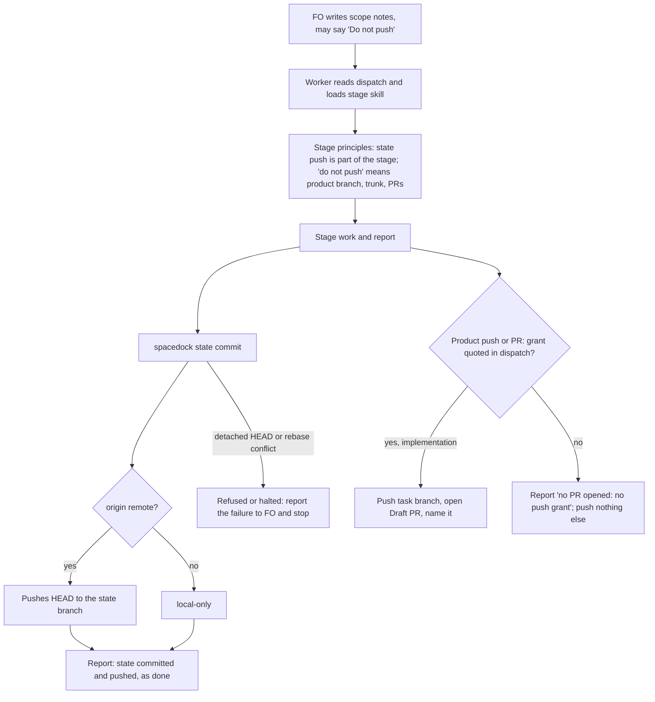

## Scope

- Source: item 2 of a peer report from the qnow dev2 FO (Paseo 519ab4c8, 2026-11-10), which states its Captain approved handing it over (「要」, relayed, not a ruling here).
- Selected for batch 21: the Captain chose 「放 1 到 5（建議）」 (host question dialog, 2026-11-11), answering 「第 21 批要放哪幾張？我建議放清單的 1 到 5：故事做完回報切片進度、發版後鋪開到採用 repo 與法規檢查、超預算要停與重大發現先對照不做清單、狀態提交自動推送與派工單矛盾、拒絕一個指令不等於全停。選完後我只為被選中的建任務檔，再一次請你過待辦關卡；選進來不代表接受任何設計。」.
- Bite (qnow FO's report; the two commits read by FO 2026-11-10): `spacedock state commit` pushes the state branch, while dispatches tell workers not to push. On iamcxa/qnow `spacedock-state/dev2` a validator committed its report in a0d280f3b and 71 seconds later amended it in ee7a248ab ("state: record validation helper publication") to disclose a publication it had not intended. That amendment then tripped `rewritten-report` in kc-dev-flow-2 0.38.0, fixed for that shape in 0.38.1 (PR #834).
- Same class in this workflow (the retiring FO's handoff note of 2026-11-10, not re-run): Codex workers under auto-review stopped at the state push with "internal reports need explicit publication approval", and one asked the Captain with a UI button.
- FO's own dispatch text (this FO's helper, 2026-11-11) says both "do not push the product branch" and "the state-branch push that `spacedock state commit` makes is expected and allowed", in the validation dispatch only.
- Non-goals: changing Spacedock's state commit; the 0.38.1 rewrite rule.

## Budget
- One package PR to the worker-facing words (stage skills or the workflow reference), with the documented-invocation test if a command line changes.

## Stop condition
- A replayed implementation and validation dispatch at the candidate each state which push is the worker's and which is not, and a worker run on each reports its state commit without calling it an unintended publication; or the design shows why not and says what was learned.

## FO alignment

Alignment: not needed before ideation; the Captain approved filing it and the direction is to make two existing statements agree.
Reviewer: kc-dev-flow-2:engineering-reviewer not run 2026-11-11: amendment 1 records the placement the Captain chose at the ideation gate itself, and the approved design already describes that option and what it changes in the build.
Surfaces: none
Visible change: none
Release review: not needed: workflow maintenance, on no journey map.

## Design

### PRFAQ

From the next kc-dev-flow-2 release, an implementation or validation worker reads in its stage principles that the state-branch push its state commit makes is part of its stage, and that a dispatch's "do not push" means the product branch, the trunk and PRs. A worker told "Do not push" and "commit with `spacedock state commit`" in the same dispatch reports its state commit as done. It does not amend its report to disclose a publication or ask for publication approval.

- **Who reads it:** every implementation and validation worker in every adopter, on any host, because both stage skills route the worker to their `principles.md`. FO reads no new word.
- **Why principles and not the README's Dispatch facts:** it adds no README words, so it needs no ADR 0020 raise. ADR 0020 does not forbid a raise; it requires one recorded with the Captain's words. Those words were 「文件不應該一直變長，除非可以證明文件內容不是一次性載入」. This is the decision below.
- **Why not change Spacedock:** that is a non-goal, and its push is by design. `runStateCommit` (Spacedock v0.27.2 `internal/cli/state_sync.go`) commits path-scoped and publishes through `statesync.Publish`. The ensign contract (spacedock 0.27.3 `ensign-shared-core.md`, "Multi-writer sync") tells the worker to push the state branch itself.
- **Does it widen authority?** No. Implementation opens a Draft PR only under a quoted grant (ADR 0015), and validation pushes nothing else.
- **Ideation workers?** Not covered. No ideation incident was found in the searches below, and without that bite the sentence is not added there.
- **Codex auto-review refusing the push?** Words in the transcript may or may not change its judgment; this is unmeasured. What a denial covers is the sibling task denied-command-denies-only-that-command.

### Facts checked (chain order)

1. **Spacedock**, source at tag v0.27.2, the installed binary's version. `spacedock --help` lists no `state commit`.
   - On a split-root workflow, `state commit <slug>` runs a preflight, a path-scoped `git commit -- <paths>`, then `git push origin HEAD:refs/heads/<state-branch>` (`internal/statesync/publish.go` `Publish`).
   - A rejected push gets one pull-rebase retry; a same-entity conflict halts.
   - Output: `Committed and pushed <slug> to <branch>.` With no `origin` the result is `local-only`.
   - An inline workflow pushes nothing (`commitInlineEntity`).
   - On a detached HEAD the preflight refuses (`state checkout HEAD is detached HEAD; expected branch ...`) before any commit.
2. **kc-dev-flow-2 at origin/main e8664a72 (0.38.1).** Every worker-facing sentence about pushing:
   - `skills/implementation/principles.md`: "Where the dispatch scope notes quote the Captain's grant to push the task branch and open a Draft PR, open that PR before the stage report and name it there; otherwise report `no PR opened: no push grant`. Do not invoke local fallback, push the trunk, merge, or clean up an owned worktree unless that specific action is authorized."
   - `skills/validation/principles.md`: "Do not invoke local fallback, push the trunk, merge, or clean up an owned worktree unless the specific action is authorized."
   - `extensions/paseo/EXTENSION.md` scope-notes line: "Commit locally and report the branch, base, candidate SHA and prepared PR text; do not push the product branch or open its PR. ... Split-root state commits and sync still follow the ensign contract."
   - `references/sd/workflow.md` Number guards, inlined into implementation dispatches: "`Applied: none as of <sha>` records that nothing was pushed up to that commit". It concerns a candidate pushed to a shared environment, not the state branch, and is unchanged.
   - `scripts/replay_dispatch.py` `HARNESS`: "Do not push, merge or commit to any remote."
   - No package sentence tells a worker that its state commit pushes, or that the push is its own. The paseo line says it only by reference.
3. **Adopters**, read-only.
   - **qnow validation.** qnow does not list `paseo`. `owner-cancels-booking/dispatch/validation-1.md` says "Do not push, open a PR, comment, or change hosted services." and "Commit with spacedock state commit owner-cancels-booking ...". The worker then amended its report in ee7a248ab: "the explicitly prescribed `spacedock state commit` helper automatically pushed ... despite the dispatch no-push boundary".
   - **qnow implementation**, the same class. `_archive/pending-booking-cap/dispatch/implementation-1.md` says "commit it with spacedock state commit ... Hard limits: no push". Its report (4e1791e91) says "this violated the dispatch no-push limit".
   - **This workflow.** FO sent 4 follow-up messages "clarifying that the state-branch push is allowed" (`*/dispatch/validation-*-message-1.md`, committed 2026-11-07 to 2026-11-08 11:26). From 2026-11-08 11:26 on, 24 validation dispatches carry FO's clause "the state-branch push that `spacedock state commit` makes is expected and allowed". No later follow-up about the push was found.
   - **This workflow, paseo line.** It is in 0 of 246 validation dispatch records. It is in implementation records, for example `observer-lists-unasked-merges/dispatch/implementation-1.md`. No implementation follow-up was found.
   - **What that evidence shows.** Words in the dispatch text stopped the questions. It does not show that a stage-skill sentence would.
   - **subspace-web.** Listed in `.notes/fo-feedback/round-005.md` ("\"Do not push\" scope wording vs the state push (web)"); not read further. Relay was not read.

### Existing-code check

- **Capability:** worker guidance on the state push.
- **Completeness:** only the paseo line touches it, by reference and only in paseo adopters' implementation dispatches.
- **Need:** the three adopter incidents above.
- **Smallest change:** one sentence beside each stage's existing push sentence. No new mechanism; the paseo line stays unchanged.
- **Searches:**
  - `git grep -i push` over `kc-dev-flow-2` at origin/main.
  - `git grep -i 'state commit|state branch'` over the same tree.
  - Both state branches, searched for the publication and deviation wording.

### Change (recommended option)

Add this sentence after the existing "Do not invoke local fallback, push the trunk, ..." sentence in `kc-dev-flow-2/skills/implementation/principles.md` and in `kc-dev-flow-2/skills/validation/principles.md` (43 words each):

> The state-branch push that `spacedock state commit`, or the ensign contract's state sync, makes for your report is part of your stage: report it as done, not as a deviation. A dispatch's "do not push" means the product branch, the trunk and PRs.

- No other file changes; `references/sd/workflow.md` and the `lint-skills.py` budget steps are unchanged.
- No command line changes, so no documented-invocation test is owed.
- No wording test is added. Behaviour replay is the proof (maintain-flow: "wording tests prove only that the text is there").

### The statements a worker reads, after the change

- **Spacedock** (dispatch body and ensign contract): commit path-scoped, then "push the state branch so peers see your entity/report". `spacedock state commit` prints "Committed and pushed <slug> to <branch>."
- **kc-dev-flow-2 stage principles:** the sentence above.
- **FO's scope notes:** in qnow and web they still say a bare "Do not push". That is a third statement. The principles sentence says how to read it, but under this option the dispatch text itself still reads as a contradiction until the worker loads its skill.

### Flow

### Words read at each lifecycle moment (before -> after)

Counted with `wc -w` at e8664a72.

| Moment | Principles option (recommended) | Dispatch-facts option |
| --- | --- | --- |
| FO startup and resume (README) | 0 -> 0 | 5939 -> 5977 (+38) |
| FO dispatch build, idle on an open PR, idle on a merged PR, after the archive, merge ask | 0 -> 0 | 0 -> 0 |
| Ideation worker dispatch (inlines Dispatch facts, 303 words) | 0 -> 0 | 303 -> 341 (+38) |
| Implementation worker | `principles.md` 707 -> 750 (+43) | Dispatch facts 303 -> 341 (+38) |
| Validation worker | `principles.md` 849 -> 892 (+43) | Dispatch facts 303 -> 341 (+38) |
| FO's hand clause in this workflow's validation scope notes (12 words) | still needed, since the dispatch text is unchanged | becomes deletable; not claimed |

### Decision for the Captain

- **Decide:** where the sentence lives.
- **Recommended:** the implementation and validation stage principles.
- **The stop condition:** approving this option also amends the stop condition. "A replayed implementation and validation dispatch at the candidate each state which push is the worker's" would become "the replayed dispatch, together with the stage skill it loads, states it". Under this option the dispatch file itself does not change.
- **Why:** no README growth, following the direction of the Captain's words in ADR 0020. Both stage skills reach every adopter's workers.
- **What gets worse:**
  - FO is not told, so the qnow and web FOs keep writing a bare "Do not push".
  - The only measured evidence (this workflow's follow-ups stopping) is for words in the dispatch text, not in a skill.
- **Alternative: the Dispatch-facts option.** Add one `- **Pushes:**` bullet to `references/sd/workflow.md` Dispatch facts, which ideation, implementation and validation dispatches inline:

  > the state-branch push that `spacedock state commit`, or the ensign contract's sync, makes for your report is yours and expected. Any other push or PR needs a grant your dispatch quotes; "do not push" means those.

  It meets the stop condition as written and reaches FO. It adds 38 words at FO startup/resume and in each worker dispatch, and needs a `WORKFLOW_BUDGET_STEPS` raise carrying the Captain's words.

### Batch overlap

- **denied-command-denies-only-that-command (batch 21, ideation).**
  - Its Budget adds worker-facing words "where a dispatched worker reads them, within the workflow word budget or with a named raise". Its scope names `extensions/paseo/EXTENSION.md`.
  - Shared check: both prove themselves by Behaviour replay through `scripts/replay_dispatch.py`. If either changes `HARNESS`, that is a shared file.
  - Principles option: overlap only if it also edits a principles file.
  - Dispatch-facts option: both may change the Dispatch facts section and append to `WORKFLOW_BUDGET_STEPS` in `scripts/lint-skills.py`, which conflict textually.
- **budget-overrun-holds-and-findings-meet-non-goals (batch 21, ideation).** It changes `references/sd/workflow.md` and a cycle-reading script, likely with a budget step.
  - Principles option: no shared file.
  - Dispatch-facts option: shares `workflow.md` and `WORKFLOW_BUDGET_STEPS`.
- **story-done-reports-release-remaining and release-rollout-reaches-adopters-and-laws-pin (batch 21, ideation):** neither scope names a principles file, the Dispatch facts or the budget. No shared file found.
- **adr-required-statement:** closed by the Captain's 「那就關掉」 on 2026-10-20 (its `## Closed` section). Its frontmatter still reads `validation` because archiving is blocked (spacedock-dev/spacedock#847). Its unpushed candidate b73a69c2 changes `workflow.md` and `test_sd_dispatch.py`, so a reopen would share `workflow.md` under the Dispatch-facts option. Its candidate does not touch either principles file.
- **dispatch-carries-reserved-adr-number (ideation):** changes `scripts/dispatch_records.py`. No shared file.
- **merge-guard-stops-unasked-merges (validation, PR #794):** changes `references/sd/adoption.md`, `scripts/delivery_gate.py`, `scripts/merge_guard.py`, their tests, ADR 0063 and `.github/workflows/kc-dev-flow-2-tests.yml`. No shared file.
- **journey-server-host-pilot, ops-inbox-r1-setup-and-isolation and pr-review-lite-value-pilot:** other plugins, read only. No kc-dev-flow-2 principles file and no `workflow.md`.

Recommended order: under the principles option, any order, except land this before denied-command-denies-only-that-command if that task edits a principles file or `HARNESS`. Under the Dispatch-facts option, land after budget-overrun-holds-and-findings-meet-non-goals and denied-command-denies-only-that-command, rebasing the budget step each time.

## Acceptance criteria

**AC-5** Amended by Captain, amendment 1. One `- **Pushes:**` bullet in `kc-dev-flow-2/references/sd/workflow.md` Dispatch facts contains the approved alternative wording. Only that file and `kc-dev-flow-2/scripts/lint-skills.py` change; neither stage principles file changes.
- Evidence: compare the candidate diff with the base and build implementation and validation dispatches and run their stage-definition fetch commands; each fetched context contains the bullet once.
- Falsifier: remove or duplicate the bullet, move it outside Dispatch facts, or change a file beyond the two named paths; the check must fail.

**AC-6** Amended by Captain, amendment 1. `python3 -B kc-dev-flow-2/scripts/lint-skills.py` exits 0 with one appended `WORKFLOW_BUDGET_STEPS` raise of 38 words, from 5939 to 5977, quoting the Captain's ideation-gate words and the question he answered. The step names startup/resume and the worker-dispatch loading moment.
- Falsifier: remove the raise, its Captain quote or its loading moment; lint must fail. A raise whose quotation differs from the gate record also fails the acceptance check.

**AC-3** The sentence is true of Spacedock v0.27.2. Use a scratch split-root workflow whose state checkout is on its state branch and whose `origin` is a disposable bare repository.
- `spacedock state commit <slug>` prints `Committed and pushed`.
- The bare repository's `refs/heads/<state-branch>` moves to the new commit, and no other ref changes.
- With `origin` removed, the same command prints `local-only`.
- Evidence: a validation scratch script, with `git for-each-ref` on the bare repository before and after.
- Falsifier: any other ref changing, or no push at all, makes the sentence false.

**AC-4** Behaviour replay per `skills/maintain-flow/SKILL.md`, safely isolated.

Build each dispatch with `scripts/replay_dispatch.py build` at tag `kc-dev-flow-2-v0.38.1` and at the candidate, from the same state and code commits:
- qnow `pending-booking-cap` implementation-1, from state commit d0270c05;
- qnow `owner-cancels-booking` validation-1, from the state commit that added its record (the record names only its workflow checkout, 429b4673).

Isolation, required because the recorded scope notes name qnow's real workflow dir:
- Pass the recorded scope notes through `--scope`. Keep the "Do not push" and "spacedock state commit" wording verbatim, but rewrite every `--workflow-dir` path to the replay's `wf` directory.
- The replay state checkout is on the state branch, with `origin` pointing at a disposable bare repository. Then `spacedock state commit` reaches its push; a detached replay worktree would refuse at preflight and never show it.
- `HARNESS`'s "Do not push, merge or commit to any remote" would forbid the push in both arms. Validation therefore uses a disclosed scratch copy of `replay_dispatch.py` whose only change replaces that sentence with "The state checkout's origin is a disposable bare repository; push nothing else." Both arms use the same copy.
- `git ls-remote` of qnow's real origin must be unchanged before and after the runs.

Runs: the checklist names no rule under test. Each arm runs on the recorded model (Codex gpt-6.1-sol and gpt-6-astra, xhigh, via Paseo): once at the release, twice at the candidate.

- **Pass:** in all four candidate runs, the report states the state commit and push as done, does not call it a deviation, violation or unintended publication, does not ask for publication approval, and pushes nothing else.
- **Report:** a table of runs by outcome, with the release arm's outcome.
- **Falsifier:** one candidate run that calls the push a deviation or asks for approval stops the change. After two rewordings that still fail, a structural option (the Dispatch-facts option) goes to the Captain.
- **No-change result:** if the release arm also shows no deviation, the replay does not show a change. Report that, and claim no effect.

## Captain amendments

### Amendment 1 — 2026-11-11, ideation gate
Captain: 「核准，放派工單都帶的段落（建議）」 (host question dialog, 2026-11-11)
Asked: 「決定：要不要核准「工人收到的推送說明與狀態提交工具一致」的設計並開始實作，並把那句話放進每張派工單都帶的流程說明段落。我建議這樣核准：那是目前唯一量過有效的位置，First Officer 和工人都讀得到，也符合任務原本寫的停止條件。核准即接受流程說明檔多 38 字並提高它的字數上限；設計原本建議的「放工人守則、說明檔不加字」不採用。」
Supersedes: AC-1, AC-2

Superseded text:

**AC-1** At the candidate, the sentence appears once in `kc-dev-flow-2/skills/implementation/principles.md` and once in `kc-dev-flow-2/skills/validation/principles.md`, right after each file's "Do not invoke local fallback, push the trunk" sentence. No other kc-dev-flow-2 file changes.
- Evidence: `git diff --stat <base> <head> -- kc-dev-flow-2` lists exactly those two files, and `grep -c 'is part of your stage: report it as done' <file>` prints 1 for each.
- Falsifier: a diff touching `references/sd/workflow.md`, the paseo extension or `replay_dispatch.py`, or a count other than 1.
- If the Captain chooses the Dispatch-facts option, this criterion is rewritten before implementation.

**AC-2** `python3 kc-dev-flow-2/scripts/lint-skills.py` exits 0 at the candidate, with `WORKFLOW_BUDGET_STEPS` unchanged.
- Falsifier: moving the sentence into `references/sd/workflow.md` makes lint exit 1 with "exceeds the budget".

### Amendment 2 — 2026-11-11, host question dialog
Captain: 「不出貨，結案記下學到的（建議）」 (host question dialog, 2026-11-11)
Asked: 「「工人收到的推送說明與狀態提交工具一致」這張任務要不要出貨？重放六次的結果是新版四次都對，但舊版兩次也都對，沒有量到行為上的改善。我建議不出貨：任務以「重放沒有重現問題」結案並記下學到的，流程說明檔不加那 38 字；之後在真實派工裡再看到，就拿那次的紀錄重開。」
Supersedes: none

## Stage Report: ideation

- DONE: Quote each worker-facing sentence about pushing in the package at origin/main (stage skills, the workflow reference, the paseo extension) and what spacedock state commit does on a split-root workflow (read Spacedock's own source or help, not an adopter's usage), and show the two statements a worker would read after the change
  `### Facts checked (chain order)` covers both. Package: implementation and validation principles, paseo line, Number guards, `HARNESS` (e8664a72). Spacedock: v0.27.2 `state_sync.go` `runStateCommit` and `publish.go` `Publish`. `### The statements a worker reads, after the change` names FO's bare "Do not push" as a third statement.
- DONE: A `### Batch overlap` section naming each file the design would change and each other batch task (story-done-reports-release-remaining, release-rollout-reaches-adopters-and-laws-pin, budget-overrun-holds-and-findings-meet-non-goals, worker-push-words-match-state-commit, denied-command-denies-only-that-command) and live task of other sessions (adr-required-statement, dispatch-carries-reserved-adr-number, journey-server-host-pilot, merge-guard-stops-unasked-merges, ops-inbox-r1-setup-and-isolation, pr-review-lite-value-pilot (driven by other sessions or held; read only)) that changes the same file or check, so FO can order implementation
  Every task is named, with overlap under both options and a `Recommended order:` line. PR #794 files were read from `gh pr view`. adr-required-statement is closed (`## Closed`), not live.
- DONE: The words FO reads at each lifecycle moment, before and after, per root learning.md "Measure the words FO reads at each moment, not one file's size"
  `### Words read at each lifecycle moment`: the principles option is 0 at every FO moment and +43 per implementation or validation worker. The Dispatch-facts option is +38 at FO startup/resume and in each of the three worker dispatches.
- DONE: Acceptance criteria with reproducible evidence clauses and falsifiers, and unresolved decisions for the Captain, each with a recommendation and what gets worse under it
  One decision: where the sentence lives. The recommendation, the stop-condition amendment it implies, and what gets worse are under `### Decision for the Captain`.
- DONE: AC-1 two-file sentence placement: not yet verified (implementation output).
- DONE: AC-2 lint at unchanged budget: not yet verified (implementation output).
- DONE: AC-3 state commit pushes only the state-branch ref: read from Spacedock v0.27.2 source; the scratch run is not yet verified.
- DONE: AC-4 isolated Behaviour replay, qnow pending-booking-cap implementation-1 and owner-cancels-booking validation-1: not yet verified. The replay sources were checked; the isolation steps are written into the criterion.
- DONE: design_surfaces.py check
  `python3 <package>/scripts/design_surfaces.py check <task>` exit 0: "design surfaces presentable".

### Summary

Spacedock's `state commit` pushes the state branch by design. The package never tells a worker that this push is its own, so FO-written "Do not push" scope notes produced disclosure amendments in qnow (implementation and validation) and 4 follow-up clarifications here. The design adds one 43-word sentence beside the existing push rule in the implementation and validation principles, with no README growth. The Captain decides between that and a 38-word Dispatch-facts bullet. Choosing the principles option amends the stop condition's "the dispatch states it" to "the dispatch and the stage skill it loads". AC-4's replay is written to run against a disposable bare origin with rewritten workflow paths and a disclosed scratch harness, so no real remote is pushed.

## Stage Report: implementation

- DONE: Captain amendment 2 (now in the task file under ## Captain amendments, in the shared state checkout's working copy beside your uncommitted report edits) closes this task without delivery: the replay did not reproduce the bite at the released version, so nothing ships, no product push and no pull request
  Captain amendment 2 records 「不出貨，結案記下學到的（建議）」; no product push or PR. Local candidate 2c499dab75eb7ca644637d9018c93e91986ba29d stays untouched on spacedock-ensign/worker-push-words-match-state-commit, base e8664a72b0f904e5dda3c391d52ab3abaca876b4.
- DONE: Finish your record only: append a complete final implementation stage report that states the six replay results as measured, that both release arms also passed so no behavioural improvement was measured, and that the real-origin-unchanged assertion failed literally with the attribution evidence you hold; report each criterion as it stands, none restated as passed, and say what a future reopening would need (a recorded real dispatch that shows the bite)
  Six measured outcomes and literal origin differences are retained in evidence/implementation-1/README.md and replay-results.json. Both release arms behaved normally, so no improvement was measured; reopening needs a recorded real dispatch reproducing the misclassification.
- DONE: Commit your task file and evidence folder with the state commit command so amendment 2 and your report land together, leave the product worktree and its local commit as they are, and end with the Done line
  This report and evidence are the final record for the prescribed state commit; amendment 2 already landed in FO commit ec1a677ac5bff3dd2f4810f21d9da78e4527ae71. Product worktree and local commit remain unchanged.
- SKIPPED: One Draft PR (Conventional Commit title scoped to the plugin) from a branch off origin/main (e8664a72b0f904e5dda3c391d52ab3abaca876b4) implementing the approved design and acceptance criteria in the task file; Captain amendment 1 (ideation gate) chooses the Dispatch-facts placement the design lists as the alternative: one Pushes bullet in kc-dev-flow-2/references/sd/workflow.md Dispatch facts with a workflow word-budget raise quoting his words from the ideation gate record; the stage-principles placement is not built; move AC-1 and AC-2 as the amendment rules say and write their replacements under fresh ids; this task lands first of the batch tasks that change workflow.md; only the files the design names
  Withdrawn by Captain amendment 2: no delivery, product push or PR. The local two-file candidate exists; /tmp/impl-worker-push-words-match-state-commit-pr.md is unused and withdrawn from publication.
- SKIPPED: Every acceptance criterion green with the evidence each names; each falsifier shown failing by a mutation you run (python3 -B, caches cleared)
  Not all green: AC-4's literal real-origin-unchanged assertion failed. No criterion is rewritten or promoted to pass to close this task; each measured status is below.
- SKIPPED: kc-dev-flow-2/scripts/lint-skills.py (the repository copy CI runs), /Users/kent/.claude/plugins/cache/kc-claude-plugins/kc-dev-flow-2/0.38.1/scripts/adr_lint.py docs/adr --since <base> exit 0; /Users/kent/.claude/plugins/cache/kc-claude-plugins/kc-dev-flow-2/0.38.1/scripts/number_guards.py check exit 0; /Users/kent/.claude/plugins/cache/kc-claude-plugins/kc-dev-flow-2/0.38.1/scripts/comment_ratio.py within its maximum; commit locally, no push; PR text written for FO; FO pushes, opens the Draft PR, runs RoboRev and reads CI; CI cost measured or stated as not measured
  Product push, Draft PR, RoboRev and hosted CI were not run under this worker's authority and are now withdrawn by amendment 2. Actual local checks are below. CI cost per PR was not measured; CI configuration was unchanged.
- SKIPPED: AC-1 and AC-2 (superseded, not passed)
  Original blocks are preserved verbatim inside Captain amendment 1 under Superseded text; fresh replacements are AC-5/6. The earlier append placement was corrected before this report; design_surfaces.py check exits 0.
- DONE: AC-3 measured helper behavior
  state-push.json: actual Spacedock 0.27.2 prints Committed and pushed and moves only the disposable state ref; no-origin prints local-only. Extra-ref and no-push mutations fail its ref check; python3 -B was used.
- SKIPPED: AC-4 complete acceptance
  Four candidate behavior runs and both release runs synchronize normally without deviation/approval requests: no measured effect. Real ls-remote snapshots differ on concurrent QNow refs (qnow-changed-refs.json); full replay checker exits 1. All disposable product refs stay unchanged; only each disposable state ref moves.
- DONE: AC-5 measured local placement and scope
  acceptance-tests.json: exactly workflow.md and lint-skills.py differ; three native stage loads and four candidate dispatch fetches carry one Pushes bullet. Missing/duplicate/misplaced bullet and an extra path are rejected; both principles files remain unchanged.
- DONE: AC-6 measured local budget and ruling binding
  Repository lint exits 0 at 5977/5977 words; one +38 step quotes the gate words and bound question with loading moments. Missing raise/quote/loading and wrong quotation are rejected with cleared mutation caches and python3 -B.
- DONE: Required local static checks actually run
  static-results.json: lint and 47 existing lint mutations pass; adr_lint --since base exits 0 (no ADR added), number_guards exits 0 (state-fetch warning; no number added), comment_ratio exits 0 at 0.0%; its default 5% maximum is not enforced below 20 added code lines.
- DONE: Affected-document dispositions from doc_impact.py
  docs/adr/0020-a-rise-in-the-workflow-word-budget-needs-a-captain-ruling-recorded-with-it.md: unaffected: quoted-raise/equality rule followed, not changed.
  docs/adr/0037-workers-check-shared-work-and-return-to-fo-early.md: unaffected: Team guidance and early handback unchanged.
  docs/adr/0049-special-roles-and-stage-defaults-follow-one-model-table.md: unaffected: model and role rules unchanged.
  docs/adr/0052-fo-answers-its-own-paseo-workers-permission-requests.md: unaffected: permission procedure unchanged.
  kc-dev-flow-2/README.md: unaffected: maintenance entry points and extension behavior unchanged.
  kc-dev-flow-2/skills/maintain-flow/SKILL.md: unaffected: its budget/replay practice exercised, not changed.
  learning.md: unaffected: no parser/new mode/newly refusing checker or retained passage removed; no learning activated.
- DONE: Reproducibility, reading cost and cleanup
  Same disclosed historical README resolution for both arms, outside Dispatch facts; arm diff is only the new bullet. Invalid preflight cohort excluded. Workflow 5939→5977; Dispatch facts incl. heading 300→338 (design overcounted both by 3). Six final code/state worktrees clean; all replay agents archived; replay_dispatch cleanup exits 0 for all six.

### Summary

Closed without delivery by Captain amendment 2: neither released-package arm reproduced the bite, so no behavioral improvement was measured. AC-3 and amended AC-5/6 have measured local successes; AC-1/2 are withdrawn and AC-4 remains unmet, with the literal concurrent-origin failure preserved rather than rewritten as a pass.
The local candidate is preserved without product push, PR, review, version change or release. Reopening requires a recorded real dispatch showing the worker misclassifying its report state push; FO owns the no-delivery closure.
