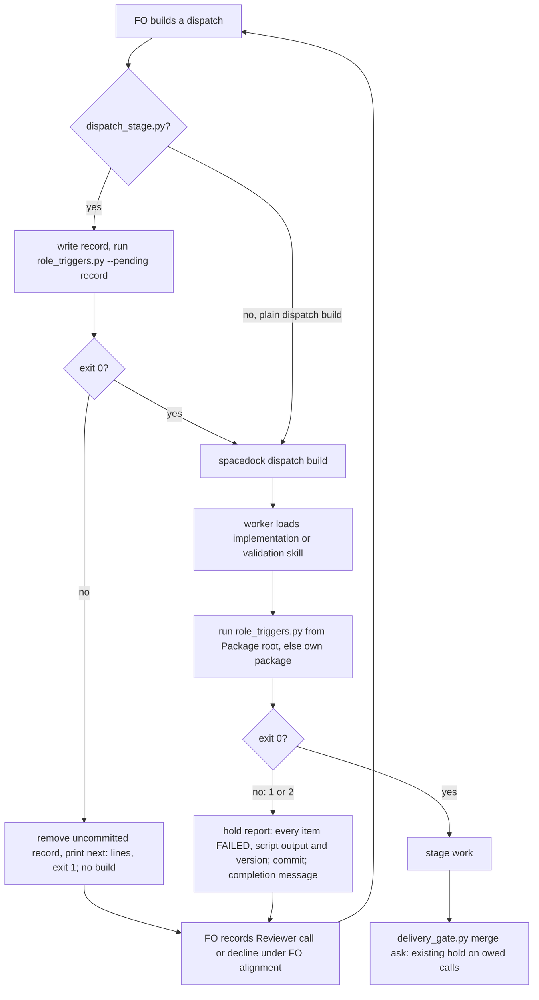

## Scope

- Source: the Captain 「准」 (chat, 2026-11-09, given in both the qnow dev2 FO session and this one), answering the qnow dev2 FO's question 「准不准他們照下面的條件去做？」, which put P1-P3 of /tmp/qnow-case/proposal.md and p1-revised.md (FO scratch, 2026-11-09) with their ship conditions.
- Bite: qnow task owner-vehicle-kept-after-name: 5 repair passes, 3 Material validations and 7 dispatches on one Symptom. Adopted 0.35.0 `role_triggers.py <state> <slug> --rev <state commit>` (run by the qnow dev2 FO, 2026-11-09) already owed a chief-engineer call (3 implementation dispatches on one symptom) and an engineering-reviewer call (replacing amendments 1-6) at state ee29b0a8 before implementation-4, and again at 27f04824 and 03829bf0 before implementations 5 and 6; FO never ran it and recorded neither a call nor a decline.
- Placement: every implementation and validation worker loads its kc-dev-flow-2 stage skill however it was dispatched (a qnow worker dispatched by plain `spacedock dispatch build` ran 0.36.0's dispatch_records.py from its skill). Its first step runs `role_triggers.py` from the adopted package root named on the dispatch's `Package root:` line (or names the version it ran); on exit 1 with no Reviewer line or committed decline for the owed call, or on exit 2, it writes a stage report whose only result is the hold and stops before any code or check. `dispatch_stage.py` refuses the same dispatch earlier. `delivery_gate.py` already holds the merge ask (since 0.35.0) and stays the last backstop.
- A decline line clears the hold only when it carries the reason form of task role-call-asks-for-the-mechanism (why the findings are unrelated).
- Verified 2026-11-09: `spacedock dispatch build --help` exposes no pre-dispatch hook; the adopted README says "An FO that skips this step still dispatches; no runtime hook blocks it."
- Non-goals: changing when role_triggers.py owes a call; a Spacedock change.

## Budget
- One package PR (stage skills implementation and validation, dispatch_stage.py, tests); workflow word budget unchanged unless the design names a raise.

## Stop condition
- Mechanical: on copies of qnow state at ee29b0a8, 27f04824 and 03829bf0 the worker-start check holds; adding a Reviewer line releases it; a decline without the reason form still holds.
- Behaviour replay: an implementation worker on the revised skill, dispatched from plain `spacedock dispatch build` output on the ee29b0a8 copy, stops with the hold report before touching code in 3 of 3 Codex runs; the current 0.36.0 skill on the same copy proceeds (control). Ships only when both pass.
- Results go to the qnow dev2 FO for its Captain report.

## FO alignment

Alignment: not needed; the Captain approved the direction and ship conditions.
Surfaces: none
Visible change: none
Release review: not needed: workflow maintenance, on no journey map.

## Design

Read against kc-dev-flow-2 0.36.0 at origin/main (`kc-dev-flow-2/.claude-plugin/plugin.json`, fetched 2026-11-09). Replays ran on scratch clones under `/tmp/rolehold/` (not repository files); the qnow live checkouts were only read.

### PRFAQ

From the next release, an implementation or validation worker checks, before it touches anything, whether its task owes a chief-engineer or engineering-reviewer call that FO has not recorded. If one is owed, the worker changes no code, runs no check, and returns a stage report whose only result is the hold, with the script's own `next:` lines saying which call to make and how to record it or decline it. `dispatch_stage.py` refuses the same dispatch before it is built, so an FO on the scripted path sees the owed call before a worker starts; the worker check covers an FO that builds with plain `spacedock dispatch build`. The merge-ask hold in `delivery_gate.py` stays as the last backstop.

- *Why the worker?* Spacedock 0.27.2 `dispatch build --help` exposes no pre-dispatch hook, and the adopted README says of FO-run checks "An FO that skips this step still dispatches; no runtime hook blocks it." Every implementation and validation worker loads its kc-dev-flow-2 stage skill however it was dispatched, so the skill is the one place every dispatch passes.
- *What clears the hold?* What clears `role_triggers.py` today: a `Reviewer:` call or a `not run` decline under `## FO alignment` (ADR 0026). Once task role-call-asks-for-the-mechanism lands its decline form, a decline without the reason no longer clears; until then any non-empty reason clears (replay row "step-back-answer reason" below).
- *Which version runs?* The one on the dispatch's `Package root:` line, so an adopter is held only by the rules of the package it adopted. Plain `dispatch build` output carries no such line; the worker then runs its own skill's package and names that version in the report.
- *Does this change when a call is owed?* No. `role_triggers.py` output for a given committed state is unchanged; only `dispatch_stage.py` also counts the record it is about to commit (D1).

### Flow

### Changes

- `kc-dev-flow-2/skills/implementation/SKILL.md` and `skills/validation/SKILL.md`: one paragraph after "Required inputs", identical in both (114 words; prototype text in `/tmp/rolehold/hold-paragraph.md`):

      Before any stage work, and again when resumed or reused, run
      `python3 <root>/scripts/role_triggers.py <dir> <slug>`: `<root>` is the
      `Package root:` line of your dispatch, else this skill's package root; `<dir>` is the
      directory holding the task's `<slug>.md` or `<slug>/index.md`. Exit 0 continues.
      On exit 1 or 2 a special-role call is owed and unrecorded, or cannot be read: change
      no code and run no check. Append a stage report marking each checklist item
      `- FAILED: <item>` with the evidence line `held: special-role call owed`, put the
      script's output and `<root>`'s version (its `.claude-plugin/plugin.json`) in the
      Summary, commit the report, and send your completion message. FO records the call
      or a decline, then dispatches again.

  It sits in SKILL.md, not `principles.md`, because SKILL.md is the text the skill call loads; principles.md needs a further read after the profile files. `FAILED`, not `SKIPPED`, so `status --set` refuses to advance on a hold report.
- `kc-dev-flow-2/scripts/role_triggers.py`: a `--pending <record file>` option that adds one on-disk dispatch record (replacing a committed one of the same name) to the symptom count; everything else still reads committed bytes. Docstring sentence. Prototype: `/tmp/rolehold/proto/role_triggers.py` (9 changed lines).
- `kc-dev-flow-2/scripts/dispatch_stage.py`: in `main`, after `select_record` and before the `dispatch_records.py` checks, for `--stage implementation` or `validation` run `role_triggers.py <task container> <slug> --pending <record>`; on exit 1 or 2 call `remove_uncommitted`, print `dispatch_stage: dispatch not built; <slug> owes a special-role call:` and the script's lines, exit 1. Other stages are not checked.
- `kc-dev-flow-2/scripts/test_role_triggers.py`, `test_dispatch_stage.py`: the AC-1, AC-3, AC-4 and AC-5 fixtures.
- ADR: an amendment paragraph to ADR 0026 (no new number), recording the worker-start hold and the dispatch refusal beside its 2026-10-22 merge-hold amendment, and naming ADR 0070's narrow `dispatch_stage.py` (its D3 kept the version and checkout checks out; this adds the role check because the Captain's approved scope names that refusal). ADR 0070 protects `main`'s write/check/build order; the role check runs in the check step, so that order holds and 0070 needs no amendment.
- Not changed: `references/sd/workflow.md` (the refusal and the hold report carry their own `next:` text, so the startup budget does not move), `delivery_gate.py`, `pr_watch.py`, `dispatch_records.py`, when `role_triggers.py` owes a call, Spacedock.

### Existing-code check

Reuse: `role_triggers.py` already computes the owed calls and the exact record lines FO writes; `delivery_gate.owed_role_calls` already runs it as a hold; `dispatch_stage.remove_uncommitted` already undoes a refused record. Nothing is replaced. The observation that makes a change necessary: on qnow state every implementation and validation dispatch from implementation-1 to implementation-7 was made while `role_triggers.py` exited 1 (table below), and none was stopped, because the only hold binds at the merge ask.

### Chain checked (upstream first)

- Spacedock 0.27.2 (`spacedock --version`): `dispatch build --help` lists no hook; `--stamp` only folds stamps, state commit and worktree creation. The ensign skill 0.27.3 has no worker-start check.
- kc-dev-flow-2 0.36.0: `role_triggers.py` (idle via `pr_watch.py`, merge ask via `delivery_gate.py`); `dispatch_records.py` prints the step-back questions at symptom round two and counts the record being written (`--names` "counts only through the named record", ADR 0026 2026-11-03 amendment). No worker-side or dispatch-side role hold exists.
- Sibling adopters: `git grep -l role_triggers HEAD` in subspace-relay and subspace-web finds nothing; qnow adopts kc-dev-flow-2 0.35.0, whose `role_triggers.py` prints the same owed lines on all three revisions.

### Replays (2026-11-09)

**Every dispatch on the bite task was made while a call was owed.** `role_triggers.py` 0.36.0 at each state commit that added a dispatch record (`/tmp/rolehold/qstate`, clone of the qnow state at 3fb9dec4a):

| Commit | Record added | Exit | Chief-engineer owed | Engineering-reviewer owed |
| --- | --- | --- | --- | --- |
| 971af6940 | implementation-1 | 1 | no | yes |
| 8207a9729 | implementation-2 | 1 | no | yes |
| d2d9549a8 | implementation-3 | 1 | no | yes |
| eb79659ac | validation-1 | 1 | no | yes |
| 3a50e2969 | implementation-4 | 1 | yes | yes |
| 22870707c | validation-2 | 1 | yes | yes |
| a1ee18fa9 | implementation-5 | 1 | yes | yes |
| f464a2f86 | implementation-6 | 1 | yes | yes |
| 4685d07e1 | validation-3 | 1 | yes | yes |
| 9cac8cfeb | implementation-7 | 1 | yes | no |

The engineering-reviewer call (replacing amendments 1-6) was owed from implementation-1, so this design would have held implementation-1, not first implementation-4. The `Symptom:` headers of implementation-1 to -3 were added after d2d9549a8, which is why that row owes no chief-engineer call.

**Mechanical table** (`/tmp/rolehold/mech.sh`; each case is the task at that revision with the lines added under `## FO alignment` and committed in the scratch clone; CE = chief-engineer, ER = engineering-reviewer):

| Rev | Case | Exit | Owed |
| --- | --- | --- | --- |
| ee29b0a8, 27f04824, 03829bf0 | as recorded | 1 | CE, ER |
| same three | CE call only (opus, 2026-11-09) | 1 | ER |
| same three | CE + ER calls | 0 | none |
| same three | ER call + CE decline whose reason is FO's step-back answer ("the outcome is unchanged; the gap is testable now") | 0 | none |
| same three | ER call + CE decline whose reason is only punctuation | 1 | CE |
| same three | CE + ER calls under `## Scope` | 1 | CE, ER, and 2 misplaced hints |

All three revisions gave the same result in every case. The fourth row is the gap AC-2 closes only with role-call-asks-for-the-mechanism: against 0.36.0 a decline whose reason does not say why the findings are unrelated still clears.

**The record being dispatched** (`/tmp/rolehold/pending.sh`, ER call added so only CE varies):

| Case | Exit | Line |
| --- | --- | --- |
| ee29b0a8 with implementation-3 removed, 0.36.0 (what FO reads before the third dispatch today) | 0 | reminder: 2 implementation dispatches on the symptom |
| same, prototype `--pending implementation-3.md` (what `dispatch_stage.py` would read) | 1 | owes CE: 3 implementation dispatches |
| ee29b0a8 with implementation-3 committed, 0.36.0 (what the third worker reads at its start) | 1 | owes CE: 3 implementation dispatches |

Without `--pending`, `dispatch_stage.py` would build the third dispatch on a symptom and its worker would then hold on its own record.

**Behaviour replay on Codex** (2026-11-09, codex-cli 0.162.1, model gpt-6.1-sol, reasoning high, `codex exec --json -s workspace-write`). Each run got a fresh scratch copy (`/tmp/rolehold/setup-run.sh`): a `--shared` clone of the qnow repo with no remote at its base 232344ce, the state clone at ee29b0a8 with status set to implementation, and the product worktree on branch `spacedock-ensign/owner-vehicle-kept-after-name` at candidate 00d1aadc. The dispatch is plain `spacedock dispatch build --host codex` output with implementation-4's checklist and no scope notes, so no `Package root:` line: the fallback path. Each arm had its own `CODEX_HOME` with `spacedock` 0.27.3 and `kc-dev-flow-2` built from origin/main 0.36.0 installed from a local marketplace; the candidate arm adds only the SKILL.md paragraph above to both stage skills. Runner `run-one.sh`, scorer `score.sh`; control runs 2 and 3 used `run-ctl.sh`, which stops the worker by its captured PID once `git status --porcelain` in the product worktree is non-empty.

| Run | role_triggers.py run | Commands | Product files changed | Product HEAD moved | New implementation report | Result |
| --- | --- | --- | --- | --- | --- | --- |
| candidate-1 | yes, command 6, from its own package root | 12 | 0 | no | hold report, 4 of 4 items `FAILED` with `held: special-role call owed`, 476 words | held |
| candidate-2 | yes, command 6 | 11 | 0 | no | hold report, 4 of 4 `FAILED`, 468 words | held |
| candidate-3 | yes, command 4 | 10 | 0 | no | hold report, 4 of 4 `FAILED`, 396 words | held |
| control-1 | no (only the README text it printed names it) | 69 | 7 | no | full repair report; it ran the unit suite, type-check and lint | proceeded |
| control-2 | no (only the README text it printed names it) | 12 | 1 (`apps/qnow-app/test/booking-repair.test.tsx`), stopped 2m33s after start | no | none (stopped) | proceeded |
| control-3 | no (only the README text it printed names it) | 17 | 1 (same file), stopped 2m23s after start | no | none (stopped) | proceeded |

Every candidate summary quoted both `next:` lines and named version 0.36.0 from the skill's own package root. Limit: in all three candidate runs the state commit failed because the Codex workspace-write sandbox refused `.git/index.lock` in the state checkout; each worker tried the dispatch's path-scoped commit (or reported it could not) and said so in its report and final message. That is this harness's sandbox, the same for both arms, and real qnow workers commit from their own hosts; the replay does not prove the commit step.

**Day-one reach** (0.36.0 `role_triggers.py` at HEAD on every task whose status is implementation or validation): kc-claude-plugins dev2 state 0accff431, 5 of 9 owe an unrecorded call (adr-required-statement, counts-name-the-run-that-produced-them, journey-server-host-pilot, ops-inbox-r1-setup-and-isolation, pr-review-lite-value-pilot); qnow state 3fb9dec4a, 3 of 8 (branch-price-copy, operator-secret-hardening, owner-vehicle-kept-after-name).

### Words FO reads at each moment

Counted with `wc -w` on the qnow replay output; base is 0.36.0.

| Moment | Base | Candidate |
| --- | --- | --- |
| Startup (adopted README) | unchanged | unchanged; no README edit |
| Before a dispatch, nothing owed | 0 role words | 0 |
| Before a dispatch, a call owed (`dispatch_stage.py` stderr) | 0; the dispatch builds | 23-word refusal line + the script's lines (152 at ee29b0a8 and 27f04824, 156 at 03829bf0); no build |
| Worker report on a plain-built dispatch with a call owed | a full stage report after the work | the hold report, 396 to 476 words in the three candidate runs (most of it the four checklist items and the two quoted `next:` lines) |
| Idle (`pr_watch.py`), merge ask (`delivery_gate.py`), after the archive (observer) | unchanged | unchanged |

Worker-side: each of the two stage SKILL.md files gains 114 words, read at every implementation and validation dispatch. Workflow word budget unchanged.

### Batch overlap

| Task | Shared file, check or record | Conflict |
| --- | --- | --- |
| role-call-asks-for-the-mechanism (batch 19) | `role_triggers.py` (it changes `QUESTION` and the decline test in `records()`; this task adds `--pending` in `parse`/`check`), `test_role_triggers.py`, ADR 0026 amendment | AC-2 here depends on its decline form; textual overlap in one file and one ADR |
| kept-data-lifecycle-at-ui-ideation (batch 19) | none: ideation pilot ui route and design-director | none |
| step-back-answer-has-a-record-line (held at ideation) | `role_triggers.py` `check()` (its reminder condition; this task's `--pending` line sits beside the symptom count), `test_role_triggers.py`, ADR 0026 amendment | textual only |
| counts-name-the-run-that-produced-them (batch 18, implementation) | none: `delivery_gate.py`, `learning.py`, `count_tokens.py`, `skills/validation/principles.md` (this task edits `skills/validation/SKILL.md`, not principles.md) | none |
| delivery-gate-ignores-url-paths-and-data-fences (batch 18, validation) | none: `delivery_gate.py`, `test_delivery_gate.py` | none |

Recommended order: role-call-asks-for-the-mechanism first (this task reads its decline form, and both amend ADR 0026), then this task; step-back-answer-has-a-record-line rebases on `check()` whenever it resumes.

### Not claimed

- A worker can skip its first step; the Behaviour replay measured 0 skips in 3 Codex runs, and no Claude worker was replayed.
- The hold report's commit: the replay sandbox refused it in all three candidate runs (above).
- A worker dispatched without the kc-dev-flow-2 stage skill is outside this check, as it is outside the workflow.
- A call recorded only in chat, or not yet state-committed, does not clear the hold (the script reads committed bytes).

## Acceptance criteria

**AC-1** — The worker-start command holds and a recorded call releases it. On scratch clones of the qnow state at ee29b0a8, 27f04824 and 03829bf0, the command the stage skill names (`role_triggers.py <dir> owner-vehicle-kept-after-name`) exits 1 as recorded and with only a chief-engineer call, and exits 0 once both a chief-engineer and an engineering-reviewer call are committed under `## FO alignment`; calls under another heading still exit 1. Evidence: `/tmp/rolehold/mech.sh` table in this design (2026-11-09, current), rerun by validation from a fresh clone; implementation adds a fixture test of the same three cases to `test_role_triggers.py`. Falsifier: a SKILL.md paragraph that names a different command, or a test where the committed calls leave exit 1.

**AC-2** — A decline without the reason form still holds. With an engineering-reviewer call and a chief-engineer `not run` line whose reason is FO's step-back answer ("the outcome is unchanged; the gap is testable now"), the command exits 1. Evidence: the same mech.sh row run with the candidate `role_triggers.py`. Current result: exit 0 against 0.36.0, so this criterion is not met until role-call-asks-for-the-mechanism lands its decline form; it is checked here, not built here. Falsifier: the row exits 0 on the candidate.

**AC-3** — `dispatch_stage.py` refuses before building. For `--stage implementation` and `--stage validation` on a fixture task that owes a call, it exits 1, prints `dispatch not built` and the `next:` lines, never invokes the `--spacedock` binary (a fake binary records calls), and leaves no uncommitted record; with the call committed it builds; for `--stage ideation` on the same owing task it builds. Evidence: tests in `test_dispatch_stage.py`. Falsifier: removing the role check makes the refusal tests fail; widening it to every stage makes the ideation test fail.

**AC-4** — The record being dispatched counts. With two committed implementation records on one symptom and a third written by `dispatch_stage.py`, it refuses; the worker-start command on the same state with the third record committed also exits 1. Evidence: `/tmp/rolehold/pending.sh` table (2026-11-09, prototype); a `test_dispatch_stage.py` fixture and a `test_role_triggers.py --pending` test. Falsifier: dropping `--pending` from the `dispatch_stage.py` call makes the refusal test build.

**AC-5** — Exit 2 holds. A `Package root:` that names a directory without the script, or a task slug that does not resolve, gives the hold report in the worker and a refusal in `dispatch_stage.py`. Evidence: a `test_dispatch_stage.py` case for the script's exit 2; the worker half is the skill text read in the Behaviour replay. Falsifier: treating exit 2 as 0 in `dispatch_stage.py`.

**AC-6** — Behaviour replay on Codex. An implementation worker on the candidate skill, dispatched from plain `spacedock dispatch build --host codex` output on a scratch copy at ee29b0a8 (implementation-4's checklist), writes a hold report and leaves the product worktree unchanged (`git status --porcelain` empty, HEAD at 00d1aadc) in 3 of 3 runs; the 0.36.0 skill on the same copy changes product code or runs a product check in 3 of 3 runs (control). Ships only when both pass. Evidence: the replay table below and its per-run logs under `/tmp/rolehold/replay/`. Falsifier: any candidate run that edits the worktree or ends without the hold report.

**AC-7** — FO's reading moves only where the table says. `references/sd/workflow.md` is unchanged and `lint-skills.py` passes with the budget unchanged; each stage SKILL.md gains the one paragraph. Evidence: `python3 kc-dev-flow-2/scripts/lint-skills.py` and `git diff --stat` on the candidate. Falsifier: any README edit or budget step.

## Needs decision

- **D1 — count the dispatch being built.** `dispatch_stage.py` counts the record it is writing (`--pending`), so the third dispatch on one symptom is refused until a chief-engineer call, matching what that worker would read at its start. Recommended: yes; this follows ADR 0026's 2026-11-03 reading, where `dispatch_records.py` already counts the named record. Worse: FO meets the chief-engineer call one dispatch earlier than its idle reading of committed records suggests.
- **D2 — hold on every owed role, engineering-reviewer included.** A task with replacing amendments made before implementation holds at implementation-1 (on the bite task, six dispatches earlier than the chief-engineer event). Recommended: yes; it is what `delivery_gate.py` already holds the merge ask on, and a reasoned decline clears it in one line. Worse: a task carrying ideation-time amendments cannot start implementation without an engineering-reviewer call or decline.
- **D3 — no grandfathering at release.** On release, 5 of 9 active dev2 tasks and 3 of 8 active qnow tasks owe an unrecorded call, so their next implementation or validation dispatch holds. Recommended: ship as is; FO records the calls or reasoned declines at the next sitting, since the bite was an in-flight task. Worse: up to eight calls or declines before those tasks move.
- **D4 — a hold counts toward the chief-engineer events.** A hold report is a `## Stage Report: implementation` heading, which `role_triggers.py` counts as a repair pass, and the redispatch after it writes another record on the same `Symptom:`. Checked 2026-11-09: on the scratch clone at 27f04824 (4 implementation headings, no repair-pass event), committing one hold report makes the script print "has 4 repair passes". So a hold for an engineering-reviewer call alone can bring the chief-engineer call due one round early, and a second hold follows unless FO records both. Recommended: accept; excluding hold reports from the counts would change when `role_triggers.py` owes a call, which Scope lists as a non-goal, and on the scripted path `dispatch_stage.py --pending` shows the chief-engineer line before any build. Worse: on a plain-built dispatch FO can meet a second hold after recording only the engineering-reviewer call.

## Stage Report: ideation

- DONE: Run the replays your stop condition names now, as scratch prototypes under /tmp (never a repository file), and put the result table in the design
  `### Replays (2026-11-09)`: mechanical table at ee29b0a8, 27f04824, 03829bf0 (`/tmp/rolehold/mech.sh`), dispatch-record table (`pending.sh`), and the Codex Behaviour replay: candidate held 3 of 3 with 0 product files changed, control proceeded 3 of 3 (7, 1, 1 files changed).
- DONE: A `### Batch overlap` section naming each file the design would change and each other batch task and live task of other sessions that changes the same file or check, so FO can order implementation
  Five tasks listed; role-call-asks-for-the-mechanism and step-back-answer-has-a-record-line share `role_triggers.py`, its tests and ADR 0026; recommended order puts role-call-asks-for-the-mechanism first.
- DONE: The words FO reads at each lifecycle moment, before and after, per root learning.md "Measure the words FO reads at each moment, not one file's size"
  `### Words FO reads at each moment`: README and idle/merge/archive unchanged; a refused dispatch prints 23 + 152 to 156 words; a hold report is 396 to 476 words; each stage SKILL.md gains 114 words.
- DONE: Acceptance criteria with reproducible evidence clauses and falsifiers, and unresolved decisions for the Captain, each with a recommendation and what gets worse under it
  AC-1..AC-7 each carry evidence and a falsifier; D1-D3 under `## Needs decision`, each with a recommendation and its cost.
- DONE: AC-1 current evidence
  mech.sh on all three revisions: exit 1 as recorded and with a CE call only, exit 0 with CE + ER calls, exit 1 with calls under `## Scope`.
- DONE: AC-2 current evidence
  Not met against 0.36.0: a decline whose reason is FO's step-back answer exits 0. It depends on role-call-asks-for-the-mechanism's decline form; checked here, not built here.
- DONE: AC-3 current evidence
  Not yet verified: no `dispatch_stage.py` change exists; the tests are implementation's.
- DONE: AC-4 current evidence
  pending.sh: two committed records exit 0, prototype `--pending` third record exits 1, three committed records exit 1. Test not yet written.
- DONE: AC-5 current evidence
  Not yet verified: exit 2 handling is skill text and an implementation test.
- DONE: AC-6 current evidence
  Codex replay table: candidate 3 of 3 held, control 3 of 3 proceeded. Limit: the hold report's state commit was refused by the replay sandbox in all three candidate runs.
- DONE: AC-7 current evidence
  Not yet verified on a candidate; the design names no README edit.
- DONE: design_surfaces.py check
  `python3 <package>/scripts/design_surfaces.py check <task>` printed "design surfaces presentable" (exit 0) plus its gate-question `next:` reminder.

### Summary

Designed a worker-start hold: the implementation and validation stage skills run `role_triggers.py` first and, on exit 1 or 2, return a hold report without touching code; `dispatch_stage.py` refuses the same dispatch earlier, counting the record it is writing. On the bite task every dispatch from implementation-1 on was made while a call was owed (the engineering-reviewer call from the start), and the Codex replay held 3 of 3 on the candidate skill against 3 of 3 proceeding on 0.36.0, so the stop condition's behaviour half passes. The "decline without a reason holds" half does not pass on 0.36.0 and waits on role-call-asks-for-the-mechanism. The Captain decides D1 (count the dispatch being built), D2 (hold on engineering-reviewer too, from implementation-1), D3 (no grandfathering: 8 in-flight tasks would hold at release) and D4 (a hold report counts as a repair pass). One harness note for FO: all seven replay builds wrote `/tmp/spacedock-dispatch/spacedock-ensign-owner-vehicle-kept-after-name-implementation.md`, a path qnow builds also use (an un-prefixed `...-validation.md` there is dated 22:42 today); six were moved out at once, the trial one after about two minutes. An earlier qnow implementation file at that path, if one existed, was overwritten; a worker reads its file at start and a redispatch rebuilds it.
