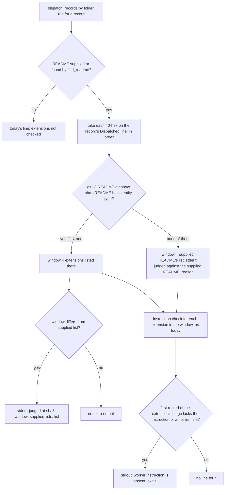

## Scope

- Source: intake from the kc-paseo-plugins dev2 FO (Paseo agent 8b2c2fc, 2026-10-21), relaying the Captain's 「dev2 問題開給維護它的 FO」 and his remark there 「理論上 adopt 時應該要問要用哪些 ext」 (relayed, not a ruling in this session).
- Bite: iamcxa/kc-paseo-plugins ran release r1's first four tasks with `extensions: []` (no roborev, codex, learn, journey-map) until the Captain ruled 「啟動全部除了 copilot 之外的 ext」 (iamcxa/kc-paseo-plugins#12). Verified 2026-10-21: kc-dev-flow-2 0.27.0 `references/sd/adoption.md` § Extensions says only to check each extension's `Needs:` before listing it, and `references/sd/workflow.md` ships `extensions: []`.
- Side effect reported: after the list changed, `dispatch_records.py` flags every earlier implementation record as missing the roborev instruction, and an observer counts it as a violation although the extension was not listed when that record was dispatched (the dev2-poc observer in this workflow found the same shape on interrogation-replay-on-batch-3-poc).
- Upstream first: `spacedock:commission` / `spacedock:refit` (what adoption asks), `adoption.md`, `dispatch_records.py`, the observer.
- The Captain in this session, 2026-10-22, while ruling that the adoption-time story-map ask belongs to this task (new-work-starts-from-a-story-map D3): 「可以，但這裡有個問題是，dev2 安裝時沒有問使用者要開哪些 ext，且也沒有預設開哪些，建議開哪些的機制」. So the shape covers three parts: adoption asks which extensions to enable; a default set; and a mechanism that recommends extensions for the repository (for example from what the repository already has: a journey map, Codex review set up, a db surface). The story-map question (keep a story map or not) is one of the asks.
- Non-goals: choosing extensions for any adopter.
- Narrowed 2026-10-25: the Captain (chat): 「可以縮小後處理」, answering 「接下來要你決定：那張重複的舊票要怎麼處理？我建議縮小，不要關掉。」 with the recommendation 「所以我建議把這張票縮小成只處理後一半：一筆派工紀錄只拿它當時已經開啟的擴充來檢查。」 The adoption ask, the defaults and the recommendation tiers shipped in iamcxa/kc-claude-plugins#716 (task extension-defaults-and-install-choice, ADR 0035); this task now owns only the second half: `dispatch_records.py` (and the observer reading it) judges a dispatch record only against the extensions the workflow README listed when that record was dispatched.

## FO alignment

Alignment: not needed: the default set and recommendation rules were settled in #716 (ADR 0035); what remains is one script's judgement window.
Surfaces: none
Visible change: none
Release review: not needed: workflow maintenance, on no journey map.

## Design

### Chain check and bounded existing-code check (2026-10-25, origin/main d496ac3d, package 0.29.0)

- Spacedock 0.27.2: `spacedock dispatch --help` lists build, show-stage-def, trunk and reconcile; it has no extension concept and does not write the `dispatch/<name>.md` records. Nothing to reuse there.
- kc-dev-flow-2: `scripts/dispatch_records.py` `extension_errors` is the one place the extension list meets a record; it reads `extensions:` from the README it is handed (`--readme`, else `find_readme`, the nearest README above the task folder) at run time. `references/sd/laws.md` L2 Bounds already says "a different README can judge the same range differently". #716 (ADR 0035) changed `test_dispatch_records.py` only; `dispatch_records.py` is unchanged since 18dbf490 (2026-10-19).
- Siblings, read in this state's `_archive/delivery-gate-verdict-form.md` (not re-read in the adopters): `Dispatched:` carries the workflow or state checkout in 68 of 104 records here, the PR head in subspace-relay, and `; candidate <40-hex>` in qnow. The package does not define what the SHA names.
- Existing code that is repaired, not replaced: `extension_errors` and `find_readme`. One small seam is added in `number_guards.py` (a text variant of `frontmatter`) so there is still one `extensions:` parser besides `laws_check.readme_extensions`.

### Scope claim checked against the repository (2026-10-25)

The Scope says the dev2-poc observer "found the same shape" on `interrogation-replay-on-batch-3-poc`. It did not: `git show ad44f0cb:docs/dev2-poc/README.md` (that record's `Dispatched:` SHA) has `extensions: [roborev, codex, copilot, learn, peers]`, so roborev was listed when it was dispatched and the observer's F2 was a correct flag. Measured with 0.29.0 `dispatch_records.py --readme <main README> <folder>` over `git archive` copies of both state branches:

| Workflow | Folders with records | Flag "roborev worker instruction is absent" | Late-listing (list at the record's SHA lacks it) | Listed at dispatch (true flag) |
| --- | --- | --- | --- | --- |
| dev2 | 55 | 2 | 1 (`_archive/journey-map-dev2-contract`, SHA 6d344bcb, 2026-10-08 README with no `extensions:`; the record itself says "the workflow README there was the 2026-10-08 copy") | 1 (`journey-server-host-pilot`, SHA 6d0f8da9, live task of another session: a real miss) |
| dev2-poc | 16 | 4 | 0 | 4 (`agent-board-poc`, `interrogation-replay-on-batch-3-poc`, `merge-grant-need-poc`, `readme-index-attention-poc`) |

So the bite in this repository is 1 record of 71 folders; the kc-paseo-plugins case (iamcxa/kc-paseo-plugins#12) is relayed and was not re-verified. The change must keep the other five flags.

### PRFAQ

**Press release (future).** A maintainer adds `codex` to the README halfway through a release. The next time anyone runs the dispatch-record check on the earlier tasks, it no longer calls their first implementation records unfaithful for lacking a codex instruction nobody was told to write. Each record is judged against the extensions the README listed when that record was dispatched; a record dispatched after the listing is still held to it.

**FAQ.**

- *How does the script know what was listed then?* The record already carries the commit FO's workflow checkout was at (`Dispatched: <40-hex>`). The script reads the README at that commit from the repository that holds the README it was handed: `git -C <README's directory> show <sha>:./<README file name>`. The anchor is the README's directory, never the task folder: in a state checkout `./` is the state branch's own root (measured: it returned `# kc-claude-plugins`, not the workflow README).
- *Which SHA when the line has several?* The first 40-hex on the line whose commit holds a README with an `entity-type:` frontmatter line (the `find_readme` test). `journey-canvas-hosted-poc/ideation-1` writes a state commit first (`35135584`, no README at the path) then `base origin/main 03045a47` (README, no `extensions:`): the second wins. No `extensions:` line means nothing listed.
- *What if no README is found at any SHA?* The record is judged against the README it was handed, exactly as today, and one stderr line says why. Skipping would silence the check wherever history is absent; see D2.
- *Does a removed extension escape?* No. The list at dispatch binds in both directions: listed then, removed later, instruction missing is still flagged.
- *Does CI change?* No. `laws_check.py` L2 judges each record at the push that adds it (ADR 0017) against `trunk/docs/dev2/README.md`, a one-file depth-1 sparse checkout where no dispatch SHA resolves, so L2 takes the fallback and its verdicts stay as they are. The bite is a later re-run (observer, validation, a maintainer), where full history is present. Not changing `references/sd/state-laws.workflow.yml` also avoids any CI cost change.
- *What does the observer see?* It runs the folder check itself (the dev2-poc observer did, in F2) and reads its output. `skills/observer/SKILL.md` is not changed: nothing observed shows an observer judging the rule without the script, and the script now prints the window it used.

### What the design changes

1. `kc-dev-flow-2/scripts/dispatch_records.py`: `extension_errors` takes the window per record (new helper `window_extensions(record, readme)`); module docstring states where the list comes from, the fallback and that the two informational lines go to stderr. stdout lines, exit codes and `--names`/`--newest` are untouched.
2. `kc-dev-flow-2/scripts/number_guards.py`: `frontmatter(path)` becomes a thin wrapper over `frontmatter_text(text)`.
3. `kc-dev-flow-2/scripts/test_dispatch_records.py`: temp git repo fixtures (AC-1 to AC-4).
4. `kc-dev-flow-2/scripts/test_laws_check.py`: one L2 test (AC-5). `laws_check.py` is not changed: `run_check` builds `lines` from stdout only, and `l2_dispatch_record_complete` fullmatches only those, so a stderr line cannot reach its regex; the test proves it rather than this sentence.
5. `kc-dev-flow-2/references/sd/laws.md`: the L2 Bounds sentence ("The folder run is given the README supplied at run time...") becomes the bounded claim the code supports: judged against the README at the record's `Dispatched:` SHA when the supplied README's repository holds it, otherwise against the supplied README.

Not changed: `references/sd/workflow.md` (its word budget is an exact count; no raise), `references/sd/state-laws.workflow.yml`, `observer_check.py`, `skills/observer/SKILL.md`, every `EXTENSION.md`, `laws_check.py`. No ADR draft: no ruling changes; ADR 0017 fixes which events a push judges, this fixes which README an event is read against, and laws.md L2 Bounds is where the old limit was written. `git -C <state> grep -n 'Override:'` over origin/spacedock-state/dev2 (2026-10-25, filtered for dispatch, extension, README, fallback, skip and laws) finds no gate ruling on dispatch-record judgement; ADR 0027 (FO-write rules are checked by the script FO already runs) is followed: FO writes nothing new.

Inputs the L2 verdict reads (learning.md "List every input before promising a verdict survives later history"): record bytes at the push, the task file, the supplied README, the package's `EXTENSION.md`, and now the README at the record's SHA. The new input is a commit, so it cannot change after the event; it narrows the Bounds sentence in laws.md and adds no persistence promise.

### Words FO reads at each moment (learning.md "Measure the words FO reads at each moment, not one file's size")

| Moment | What FO reads | Base | Candidate |
| --- | --- | --- | --- |
| startup | workflow README (`references/sd/workflow.md`) | unchanged, budget untouched | identical bytes, 0 |
| before `dispatch build` | `dispatch_records.py --names <record>` output | unchanged | identical, 0 |
| after writing a record (workflow.md "before committing") | `dispatch_records.py <task folder>` output | clean run: `N dispatch record(s) complete` | identical on the normal path (SHA README equals the supplied one, no extra line); one stderr line of about 25 words only when the window differs or no README is found |
| idle on an open or merged PR | `pr_watch.py tasks` (uses `--newest`) | unchanged | identical, 0 |
| after the archive / observer report | `observer_check.py` output, observer report | unchanged | script unchanged; the report loses one false violation line (about 40 words) where a late-listing record exists, which is the intended change |
| merge ask | `delivery_gate.py` output | unchanged | identical, 0 |

Measured by `wc -w` of each output on the same fixtures for base and candidate (AC-4); only the after-writing moment can differ and only on the anomaly path.

## Acceptance criteria

**AC-1** A record dispatched before an extension was listed is not faulted for lacking that extension's instruction. Verified by: a new test in `test_dispatch_records.py` builds a temp git repo (commit A: README `extensions: []`; commit B: `extensions: [roborev]`), writes `implementation-1.md` with `Dispatched: <A>` and no roborev instruction, runs `python3 -B kc-dev-flow-2/scripts/dispatch_records.py --readme <README at B> <folder>`, and requires no `worker instruction is absent` line and exit 0; the same fixture run with `scripts/dispatch_records.py` from origin/main d496ac3d exits 1 with that line. Falsifier: change `window_extensions` to return the supplied README's list; the test must fail. Current evidence: prototype (not committed) printed `([], 6d344bcb...)` for `_archive/journey-map-dev2-contract/dispatch/implementation-1.md`; the 0.29.0 script flags that record; the script change is not yet made.

**AC-2** The list at dispatch binds in both directions, so the check is not disabled. Verified by: in the same temp repo (a) a record with `Dispatched: <B>` and no instruction still exits 1 naming roborev; (b) commit C removes roborev, a record with `Dispatched: <B>` run with `--readme <README at C>` still exits 1 naming roborev. Falsifier: make `window_extensions` return an empty list; (a) and (b) must fail. Current evidence: not yet verified (no script change); real data for the "still flagged" side: prototype read roborev listed at `ad44f0cb` for `interrogation-replay-on-batch-3-poc`.

**AC-3** When no README can be read at any SHA on the line, the verdict is today's, with one stderr line and unchanged stdout and exit code. Verified by: fixtures for (i) a SHA that is not in the repository (`"a" * 40`, which every existing fixture uses), (ii) a SHA whose tree lacks the README path, (iii) a README outside any git repository, (iv) a README at the SHA with no `entity-type:` line; each is run against the supplied README that lists roborev and compared with the origin/main script's stdout and exit code (equal) and stderr contains `judged against the supplied README`. Plus the two-SHA line: first SHA a commit without the README path, second a commit with it, window read from the second. Falsifier: make the not-found path skip the extension check; (i) to (iv) must fail on the exit code. Current evidence: prototype on `Dispatched: 000...0` returned not-found with git's reason; not yet verified in the script.

**AC-4** The normal FO dispatch path prints nothing new. Verified by: a fixture where the SHA's README equals the supplied one runs to identical stdout, stderr (empty) and exit code against origin/main's script, and `wc -w` of the output equals the base on a clean and a failing folder; a fixture where the window differs prints exactly one stderr line of the form `extensions for <record> judged at <sha8>: <list>; the supplied README lists <list>`. Falsifier: print that line unconditionally; the identical-output assertion fails. Current evidence: not yet verified.

**AC-5** `laws_check.py` L2 still judges and never answers `Cannot` because of the new lines. Verified by: (a) `test_the_readme_supplied_decides_whether_the_instruction_is_required` and the rest of `test_laws_check.py` pass unchanged (its supplied README is a plain file outside git, so L2 takes the fallback); (b) a new L2 test with the supplied README inside a temp git repo that holds a record's SHA, window differing from the supplied list: exit 0, `0 violated`, no `does not parse`. Falsifier: print the window line on stdout; (b) fails with "output this runner does not parse". Current evidence: read `run_check` and `l2_dispatch_record_complete` on origin/main (stdout only); no test run yet.

**AC-6** Over the real committed corpus exactly one verdict changes. Verified by: `git archive` copies of `origin/spacedock-state/dev2` and `origin/spacedock-state/dev2-poc` into new empty directories, then for every folder with a `dispatch/` directory (55 and 16 at 2026-10-25) run origin/main's `dispatch_records.py` and the candidate with `--readme` set to that workflow's README at origin/main and compare exit code and stdout per folder: the only change is `_archive/journey-map-dev2-contract` losing its `implementation-1.md: roborev worker instruction is absent` line (its other lines unchanged), and the other five flagged folders (`journey-server-host-pilot`, `agent-board-poc`, `interrogation-replay-on-batch-3-poc`, `merge-grant-need-poc`, `readme-index-attention-poc`) keep theirs. Repeat once over a second adopter corpus the Captain's machine holds (subspace-relay, subspace-web or qnow), read-only; any other changed verdict is explained or repaired. Falsifier: the comparison on the AC-1 mutation shows zero changes. Current evidence: base side measured 2026-10-25 (2 and 4 flagged folders); the per-record split comes from a prototype; candidate side not yet run.

**AC-7** No FO-read text changes and the repository gates stay green. Verified by: `git diff --stat origin/main -- kc-dev-flow-2/references/sd/workflow.md` is empty; `python3 kc-dev-flow-2/scripts/lint-skills.py`, the package's test suite and `scripts/version-parity-check.sh` pass; `laws.md` L2 Bounds has no unqualified "exactly", "only" or "always" (CLAUDE.md "an absolute claim names its enforcement point"). Falsifier: any edit to workflow.md fails `lint-skills.py`'s exact word budget. Current evidence: not yet verified.

## Unresolved decisions for the Captain

D1 and D2 share one gate because D2 only exists if D1 is the SHA option.

**D1. Where does the list for a record come from?** Recommend the record's `Dispatched:` SHA and the README at that commit (no new words for FO, the README resolved at the record's SHA for 66 of 66 first implementation records here (50 dev2, 16 dev2-poc, measured 2026-10-25), repairs old records). Worse under it: the package never defined what that SHA names, and subspace-relay writes the PR head there; a PR-branch README can lag the trunk list FO had, so a missing instruction could pass (the stderr line shows the window used, so a reader can see it). Alternative: FO writes an `Extensions: <list>` line into every record. Exact and needs no git history, but fixes no existing record, adds a line FO must write on every dispatch (ADR 0027 prefers checking what FO already writes) and needs a new `dispatch_records.py` part.

**D2. When no README is found at any SHA, what does the check do?** Recommend judging against the README it was handed, with one stderr line (today's verdict). Worse under it: the false flag survives in exactly that case. Alternative: skip that record's extension check with a note. Worse under skip: in CI, where `trunk` is depth-1 and no dispatch SHA resolves, every record's extension check would go silent, and a corrupt SHA would silence it quietly.

### Batch overlap

Files the design would change: `kc-dev-flow-2/scripts/dispatch_records.py`, `kc-dev-flow-2/scripts/number_guards.py`, `kc-dev-flow-2/scripts/test_dispatch_records.py`, `kc-dev-flow-2/scripts/test_laws_check.py`, `kc-dev-flow-2/references/sd/laws.md`. No shared index (no ADR, no budget raise).

- new-work-starts-from-a-story-map, codex-reader-reads-receipt-marker, merge-ask-holds-missing-clauses, idle-names-failing-seeds, agent-reads-governing-adr: all `status: done` on origin/spacedock-state/dev2 with merged PRs (#705, #693, #703, #694, #698); none is live, none touches the five files.
- fo-write-checks-parse-top-level (ideation, same workflow): changes `delivery_gate.py`, `design_surfaces.py` and their tests; no shared file.
- kc-decision-log-handoff-trial (backlog), pr-review-lite-value-pilot (implementation), journey-canvas-hosted-poc (ideation), comment-check-reaches-delivery-gate (ideation; `delivery_gate.py`, `test_delivery_gate.py`, `skills/validation/principles.md`): no shared file. kc-decision-log-p1, kc-decision-log-cli (archived, done), release-acceptance and journey-server-host-pilot (a folder with records, no top-level task file at that tip; read only): not found as live tasks touching these files; the journey-server-host-pilot `implementation-1` record is one of the five true flags in AC-6.
- Backlog tasks that do touch the same code, named so FO can order: `extension-instruction-followups` (`dispatch_records.py` `extension_errors`, the single-line `extensions:` parse in `number_guards.frontmatter`, and a laws.md L2 "Judged by" omission of `--readme`): same function and file, and the laws.md sentence next to this one. `worker-loads-declared-package-followups` (laws.md L2 Rule wording): same section of laws.md, different sentence. `names-check-newest-followups` (`--newest`): same file, different function. `fo-written-lines-checked-before-dispatch` lists `dispatch_records.py` as upstream, design not yet written. `observer-check-learn-only-when-listed` (`observer_check.py`): reads `extensions:` too, no shared file.

Recommended order: this task first, then `extension-instruction-followups` (it fixes the block-list parse once, in the `frontmatter_text` this task introduces, which then serves both windows), then the other three in any order; each change to laws.md is a different sentence, so conflicts are textual.

## Stage Report: ideation

- DONE: Design the narrowed outcome under ## Scope: kc-dev-flow-2/scripts/dispatch_records.py, and the observer reading its output, judges a dispatch record only against the extensions the workflow README listed when that record was dispatched; say how the script finds that list, what it does when the list cannot be found, and the falsifier on a fixture where an extension is listed after earlier records; name every file and the evidence each criterion needs
  `## Design`: list from README at the record's `Dispatched:` SHA via `git -C <README dir> show <sha>:./<name>`; not found, judged against the supplied README plus a stderr line (D2); falsifier AC-1 (commit A without, B with roborev); files named under "What the design changes"; observer reads the script's output, no skill change.
- DONE: A `### Batch overlap` section naming each file the design would change and each other batch task and live task of other sessions that changes the same file or check, so FO can order implementation
  `### Batch overlap`: five files; the six named batch tasks and seven live tasks checked at origin/spacedock-state/dev2 (2026-10-25), none shares a file; five unnamed backlog tasks do, with `Recommended order:` this task first.
- DONE: The words FO reads at each lifecycle moment, before and after, per root learning.md "Measure the words FO reads at each moment, not one file's size"
  Table under `### Words FO reads at each moment`: workflow.md untouched, only the after-writing run can differ and only on the anomaly path.
- DONE: Acceptance criteria with reproducible evidence clauses and falsifiers, and unresolved decisions for the Captain, each with a recommendation and what gets worse under it
  AC-1 to AC-7 below; D1 (list source) and D2 (not-found behavior) under "Unresolved decisions".
- DONE: AC-1 a record dispatched before listing is not faulted
  Evidence now: base script flags `_archive/journey-map-dev2-contract` implementation-1 (run 2026-10-25); prototype reads `[]` at 6d344bcb. Script change and new test not yet made.
- DONE: AC-2 the list at dispatch binds both ways
  Evidence now: prototype reads roborev listed at `ad44f0cb`; fixtures (a)/(b) not yet verified.
- DONE: AC-3 not found gives today's verdict plus one stderr line
  Evidence now: prototype returns not-found with git's reason for `0`*40; fixtures (i) to (iv) and the two-SHA line not yet verified.
- DONE: AC-4 the normal FO dispatch path prints nothing new
  Not yet verified; the comparison runs at implementation.
- DONE: AC-5 laws_check L2 never answers Cannot because of the new lines
  Evidence now: read `run_check` and `l2_dispatch_record_complete` (stdout only); no test run yet.
- DONE: AC-6 exactly one verdict changes over the committed corpus
  Evidence now: base side measured (dev2 55 folders, 2 flagged; dev2-poc 16, 4 flagged); candidate side not yet run.
- DONE: AC-7 no FO-read text change, repository gates green
  Not yet verified; the diff and gates run at implementation.

### Summary

The Scope's example does not hold: `interrogation-replay-on-batch-3-poc` listed roborev at its dispatch, so its flag was true; the measured bite is one record (`journey-map-dev2-contract`) in 71 folders here, and the paseo case is relayed. The design reads each record's list from the README at its `Dispatched:` SHA, keeps the other five flags, changes no CI, no FO-read text and no observer skill. `python3 <package>/scripts/design_surfaces.py check adoption-asks-which-extensions.md` printed `design surfaces presentable`, exit 0.
