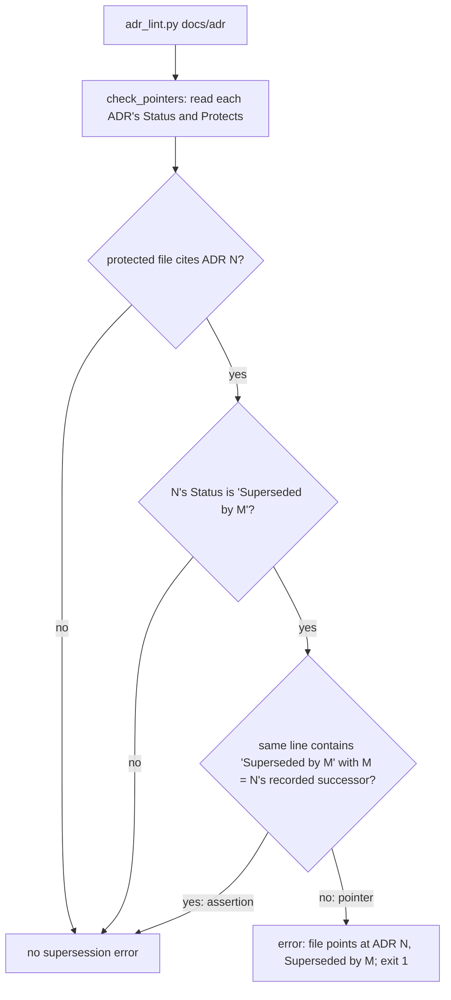

`adr_lint.py` no longer reports a file an ADR protects as "points at ADR N, Superseded by M" when the only citation is a test asserting that N's Status reads "Superseded by M".

## Scope

- Source: FO, from a bite in batch 16 (2026-11-07); no Captain words yet; the backlog gate is his.
- Bite: decline-becomes-task-only-with-a-bite implementation, worker report (Paseo ba392d9b, 2026-11-07): ADR 0064 lists `kc-dev-flow-2/scripts/test_sd_dispatch.py` under Protects; the required `adr_lint.py docs/adr --since ba055b8a7 --require 0064` then fails on that file's assertion `"## Status\n\nSuperseded by 0050" in (ROOT.parent / "docs/adr/0047-…").read_text()`, because `check_pointers` counts every `docs/adr/NNNN` string in a protected file as a pointer. The worker could only pass by splitting the path literal (dispatch record implementation-1-message-3), which hides the citation from the scan rather than fixing it.
- Upstream first: `check_pointers` in `kc-dev-flow-2/scripts/adr_lint.py`; its tests.
- Non-goals: changing which files an ADR may protect; the split path in test_sd_dispatch.py may stay or be reverted by this task.

## Budget
- One package PR touching adr_lint.py and its tests; workflow word budget unchanged.

## Stop condition
- A fixture whose protected file asserts a superseded ADR's Status passes the lint, and a fixture whose protected file cites a superseded ADR as its authority still fails.

## FO alignment

Alignment: not needed; a lint false positive with one observed bite.
Surfaces: none
Visible change: none
Release review: not needed: workflow maintenance, on no journey map.

## Design

### PRFAQ

**Proposition.** When a protected file only *checks* that an old ADR reads "Superseded by M", the ADR linter no longer reports that file as pointing at the old ADR. A file that still relies on the old ADR keeps failing. The worker who hit this in PR #800 would have kept the natural path literal instead of splitting it to hide it from the scan.

**FAQ**

- *What counts as an assertion?* One line that names `<adr folder>/N` and also contains the text `Superseded by M`, where M is the successor N's own Status records. That line states the supersession; it does not lean on N. Every other citation of N still counts as a pointer.
- *Why not count only `see <adr folder>/N` comments as pointers?* The pointer contract is wider: `test_a_correct_pointer_passes_in_full_path_and_number_only_forms` accepts `# (docs/adr/0002)`. A `see`-only rule for the supersession scan would let a stale pointer in that tested form pass, and would also hide a bare path load such as `test_sd_dispatch.py`'s `docs/adr/0050-…` line. Rejected.
- *Why not forgive a file that also cites the successor?* `test_a_file_pointing_at_a_superseded_adr_fails_naming_file_and_newer_adr` requires a file citing both 0002 and 0003 to fail. Rejected.
- *What does the "is N's own pointer present" check (Accepted records) see?* Unchanged. The exception applies only to the supersession scan; an Accepted record has no successor, so nothing it counts can change.
- *Which copy changes?* `kc-adr` is the source. `kc-dev-flow-2/scripts/adr_lint.py` is a byte-identical copy written by `scripts/kc-adr-copy-sync.sh sync` and checked in CI (`marketplace-parity.yml` runs `kc-adr-copy-sync.sh check`). The edit goes into `kc-adr`, then the sync writes the copy, in one PR across both plugin folders, as PR #713 did (`.github,kc-adr,kc-dev-flow-2,scripts`).

### Chain and existing-code check

- **Spacedock (0.27.3 plugin cache):** no ADR linter; `Superseded by` and `Protects:` appear only in roadmap prose.
- **kc-dev-flow-2 / kc-adr (origin/main 139feeaee, kc-dev-flow-2 0.35.0):** `check_pointers` in `kc-adr/scripts/adr_lint.py` (sha256 prefix 203f097c3779, identical to the dev2 copy). Its nested `cited_by` is a flat `findall` over the whole file, used by both the Accepted-pointer check and the supersession scan. This design repairs `cited_by`; it adds no new check.
- **Adopters:** none of the 24 repositories under `~/conductor/repos` tracks an `adr_lint.py` (`git ls-files` per repo, 2026-11-07); adopters run `<package>/scripts/adr_lint.py`, so they receive this through the released package. The change only removes errors, so no adopter can newly fail.
- **Ruling in this area:** no ADR governs `check_pointers`; the pointer rule lives in `read-adr/writing.md` steps 4 to 6, which stay true word for word. Past ruling lean: `_archive/agent-reads-governing-adr.md` `Override:` — the Captain chose the stricter deterministic rule. This design follows it: the exception needs the exact recorded successor on the same line, not a heuristic.

### Replay (2026-11-07)

At `ae7750375` the split already landed, so the lint passes there as is. Un-splitting the one line reproduces the bite:

    git worktree add --detach <tmp> ae7750375 && cd <tmp>
    sed -i '' 's#(ROOT.parent / "docs/adr" / "0047-#(ROOT.parent / "docs/adr/0047-#' kc-dev-flow-2/scripts/test_sd_dispatch.py
    python3 -B kc-dev-flow-2/scripts/adr_lint.py docs/adr --since ba055b8a7 --require 0064

Observed: `kc-dev-flow-2/scripts/test_sd_dispatch.py: points at ADR 0047, Superseded by 0050; point it at 0050 or the record in force`, exit 1. A scratch prototype of the same-line rule (applied to both copies, then discarded with its worktree) gave exit 0 on that replay, kept all 21 `kc-adr/scripts/test_adr_lint.py` tests passing, and of four new fixtures only the assertion fixture failed against unpatched origin/main.

### Files this design changes

- `kc-adr/scripts/adr_lint.py` — `check_pointers.cited_by` reads line by line; the supersession scan skips a citation of N on a line containing `Superseded by <N's successor>`.
- `kc-adr/scripts/test_adr_lint.py` — fixtures for AC-1 to AC-3 in `ProtectedPathTests`.
- `kc-dev-flow-2/scripts/adr_lint.py` — written by `scripts/kc-adr-copy-sync.sh sync`, never edited by hand.
- `kc-dev-flow-2/scripts/test_sd_dispatch.py` — revert the split at `exercise_model_roster` back to `"docs/adr/0047-…"`. Recommended (task Non-goals allow either): the real bite site becomes the live integration proof for one line of diff.

Release: one squash commit titled `fix(kc-adr): …` touches both plugin folders, so release-please proposes a patch for kc-adr and kc-dev-flow-2. No README, workflow, skill or doc text changes.

### Known limits (bounded claim)

- One shape only: an assertion whose path and `Superseded by M` text sit on different lines, or that matches by regex, still trips the scan.
- A `see docs/adr/N…` comment that happens to name N's successor on the same line is forgiven; it already tells the reader which ADR governs.
- A line asserting the wrong successor still fails with "point it at M", a misleading message for what is a broken assertion. Not changed.

### Words FO reads at each moment

No passage or script output FO reads at startup, idle on an open PR, idle on a merged PR, after the archive, or at the merge ask changes: base = candidate at every moment (0 words delta). The lint runs inside a validation worker; its output FO sees in a report loses only the false error line in the bite case. Evidence: the candidate diff names no file under `kc-dev-flow-2/references/`, `kc-dev-flow-2/skills/`, `kc-dev-flow-2/extensions/` or `kc-dev-flow-2/mods/`, and no lint message string changes.

### Batch overlap

- worker-browser-checks-use-paseo-browser (batch 17, ideation): no named file or check in common.
- dispatch-build-writes-the-dispatch-record (batch 17, ideation): names `dispatch_records.py`; none in common.
- design-check-says-not-run-without-a-scope (batch 17, ideation): names `design_surfaces.py`; none in common.
- observer-lists-unasked-merges (batch 17, ideation): names `delivery_gate.py`; none in common.
- merge-guard-stops-unasked-merges (live, validation, PR #794; read only): adds ADR 0063 protecting `merge_guard.py` and runs `adr_lint.py --require 0063`; does not change the linter. This change can only remove errors, so #794's lint result cannot get worse.
- gate-summary-names-each-decline (live, ideation; read only): AC-8 runs `adr_lint.py` on its new ADR; same as above. Shares the ADR list only through numbers FO reserves; this design adds no ADR.
- journey-map tasks (journey-map FO; read only): `journey-map-progress-and-provenance` (backlog) plans an `adr_lint.py --map-required` flag in the same file, a different function; whichever lands second rebases. Open PR #791 adds ADRs only.
- Other live tasks: `archive-waits-for-observer-report` (implementation) lists `scripts/test_sd_dispatch.py` among its files; the one-line revert here is in `exercise_model_roster`, a function it does not name, so a text conflict is unlikely. `kc-adr-dev2-sharing-better-way` (backlog) would replace the copy-sync mechanism this design uses.

Recommended order: this task can land at any time relative to the batch-17 tasks; land it before `kc-adr-dev2-sharing-better-way` and before `--map-required` so they rebase onto it, and after or before `archive-waits-for-observer-report` with a plain rebase.

## Acceptance criteria

**AC-1** A protected file whose only citation of a superseded ADR N is a line asserting N's Status reads `Superseded by M` (M = N's recorded successor) passes the lint. Evidence: a new `ProtectedPathTests` fixture in `kc-adr/scripts/test_adr_lint.py` passes at the candidate; falsifier: the same fixture fails at base `139feeaee` (reported `points at ADR 0002, Superseded by 0003`), and fails at the candidate if the same-line exception is removed.

**AC-2** A protected file that cites a superseded ADR as its authority still fails with the existing message. Evidence: a new fixture with `# see docs/adr/0002-a.md` fails naming `points at ADR 0002, Superseded by 0003`; the existing `test_a_file_pointing_at_a_superseded_adr_fails_naming_file_and_newer_adr` and `test_a_correct_pointer_passes_in_full_path_and_number_only_forms` stay unchanged and pass. Falsifier: an exception keyed on any `Superseded by` text, or on file-level successor presence, makes the existing both-pointers test pass and so fail its assertion.

**AC-3** The exception is exact: a line naming a successor other than N's recorded one still fails, and the assertion line does not stand in for the successor's own pointer (a file whose only line is the assertion still reports `has no pointer` for M). Evidence: two new fixtures, both exit 1 at the candidate.

**AC-4** The PR #800 bite replays clean on the real repository. Evidence: at the candidate, with `kc-dev-flow-2/scripts/test_sd_dispatch.py` carrying the unsplit `"docs/adr/0047-…"` literal, `python3 -B kc-dev-flow-2/scripts/adr_lint.py docs/adr` exits 0 and `python3 -B kc-dev-flow-2/scripts/adr_lint.py docs/adr --since <candidate base> --require 0064` exits 0; falsifier: the replay commands under `### Replay` exit 1 at `ae7750375` plus the un-split.

**AC-5** The two copies stay identical and the package suites pass. Evidence: `./scripts/kc-adr-copy-sync.sh check` exit 0; `python3 -B kc-adr/scripts/test_adr_lint.py`, `python3 -B kc-dev-flow-2/scripts/test_adr_doc_checks.py` and `python3 -B kc-dev-flow-2/scripts/test_sd_dispatch.py` pass at the candidate; falsifier: editing only one copy makes the sync check exit 1.

## Unresolved decisions for the Captain

None material. Routine choices are in the design with their recommendation: revert the split in `test_sd_dispatch.py` (what gets worse: one more file in the PR and a line shared with `archive-waits-for-observer-report`'s file list); keep the misleading message for a wrong-successor assertion (what gets worse: a broken test's author reads "point it at M" instead of "your assertion is wrong"). If the Captain wants a different discriminator than the same-line rule, that choice becomes a ruling and needs an ADR.

## Stage Report: ideation

- DONE: Design how /Users/kent/.claude/plugins/cache/kc-claude-plugins/kc-dev-flow-2/0.35.0/scripts/adr_lint.py check_pointers tells a test asserting a superseded ADR's Status from a file citing that ADR as its authority, replaying the PR #800 false positive at ae7750375 before the path split
  Same-line rule in `cited_by` (citation of N skipped by the supersession scan only on a line containing `Superseded by <N's recorded successor>`); source is kc-adr, dev2 copy synced. Replay at ae7750375 + un-split: exit 1 with the reported message; scratch prototype: exit 0, 21/21 existing kc-adr tests pass (`### Replay`).
- DONE: A `### Batch overlap` section naming each file the design would change and each other batch task (worker-browser-checks-use-paseo-browser, dispatch-build-writes-the-dispatch-record, design-check-says-not-run-without-a-scope, observer-lists-unasked-merges) and live task of other sessions (merge-guard-stops-unasked-merges and gate-summary-names-each-decline (held by the Captain; read only), and journey-map tasks driven by the journey-map FO (read only)) that changes the same file or check, so FO can order implementation
  Four batch tasks share no file; #794 and gate-summary only run the lint; journey-map's `--map-required` and archive-waits-for-observer-report (`test_sd_dispatch.py`) share a file; `Recommended order:` line given.
- DONE: The words FO reads at each lifecycle moment, before and after, per root learning.md "Measure the words FO reads at each moment, not one file's size"
  0 words delta at all five moments: no FO-read passage or script output changes; evidence clause names the directories the diff must not touch.
- DONE: Acceptance criteria with reproducible evidence clauses and falsifiers, and unresolved decisions for the Captain, each with a recommendation and what gets worse under it
  AC-1..AC-5 each with evidence and a falsifier; no material Captain decision, two routine choices recorded with their cost.
- DONE: AC-1 assertion fixture passes
  Not yet verified at a candidate; the scratch prototype's fixture failed at base 139feeaee and passed patched.
- DONE: AC-2 authority pointer still fails
  Not yet verified at a candidate; prototype `see` fixture exit 1 with the existing message; existing both-pointers test kept passing.
- DONE: AC-3 exception is exact
  Not yet verified at a candidate; prototype wrong-successor and assertion-only fixtures both exit 1.
- DONE: AC-4 PR #800 bite replays clean
  Not yet verified at a candidate; replay at ae7750375 + un-split exit 0 with the prototype.
- DONE: AC-5 copies identical and suites pass
  Not yet verified at a candidate; base copies share sha256 prefix 203f097c3779.
- DONE: design_surfaces.py check
  `python3 <package>/scripts/design_surfaces.py check <task>`: "design surfaces presentable", exit 0.

### Summary

The false positive is reproduced exactly (one-line un-split at ae7750375, exit 1) and a same-line rule fixes it without touching the Accepted-pointer check: a citation counts as an assertion only when its line names the successor N's own Status records. Upstream check found the linter's source is kc-adr, with the dev2 copy synced by script and CI, so the PR spans both plugin folders; Spacedock has no ADR linter and no adopter vendors one. The prototype and its scratch worktrees were deleted; no repository file, branch or commit was written.

## Stage Report: implementation

- DONE: Implement the approved Pilot design using only its four named files, with no Captain decisions or version bumps.
  Branch spacedock-ensign/adr-lint-tells-supersession-assertion-from-pointer; base 139feeaee7ce037a0c6535568cd6bd103155cbae; local candidate f429f0fac40511c6480fd92e2cccd4c0e94b2454; product worktree clean.
- SKIPPED: One Draft PR in iamcxa/kc-claude-plugins.
  no PR opened: no push grant; FO owns product push and Draft PR creation; Conventional Commit title/body prepared in /tmp/impl-adr-lint-tells-supersession-assertion-from-pointer-pr.md and implementation/pr.md.
- DONE: Every acceptance criterion green with the evidence each names; each falsifier shown failing by a mutation run with python3 -B and caches cleared.
  implementation/results/proof/proof.json records 11 expected outcomes: candidate suite, seven negative mutations, restored copy parity and historical fail/pass replay; acceptance.sh reproduces the evidence.
- DONE: AC-1 assertion fixture passes.
  test_asserting_the_recorded_supersession_is_not_a_stale_pointer includes literal escaped newlines; base and removed-exception mutations each fail with the original 0002/0003 pointer message.
- DONE: AC-2 authority pointer still fails.
  A new fixture retains a separate authority citation beside a valid assertion; the two named existing tests are unchanged and pass; file-wide successor forgiveness makes the existing both-pointers test fail.
- DONE: AC-3 exception is exact.
  Wrong successors 0004/00030 and missing successor pointer both produce exit 1; generic-successor and fabricated-pointer mutations make their corresponding fixtures fail.
- DONE: AC-4 the original false positive replays clean on the real repository with the unsplit path.
  Candidate full lint and --since 139feeaee --require 0064 each check 62 records and exit 0; ae7750375 plus unsplit fails, then passes with the candidate checker (results/proof/historical-*.log).
- DONE: AC-5 source/copy parity and package suites pass.
  Existing sync script wrote the dev2 copy; parity check, 25 kc-adr tests, 9 ADR/document checks and native dispatch integration exit 0; one-copy drift makes parity exit 1 (results/).
- DONE: Repository kc-dev-flow-2/scripts/lint-skills.py, design_surfaces.py check and number_guards.py check exit 0.
  results/repository-lint-skills.log, design-surfaces.log and number-guards.log; no ADR/schema added, migrations guard skipped because the workflow declares no migrations-path.
- FAILED: The required installed-package adr_lint.py docs/adr --since <base> exits 0.
  It actually exits 1 with the original ADR 0047/0050 error; results/receipt.json proves installed 0.35.0 checker bytes match the base, while the candidate checker passes; installed files were not changed and FO disposition is required.
- DONE: comment_ratio.py is within its maximum; CI cost is measured or stated as not measured.
  results/comment-ratio.log: 53 code lines, 0 comment lines, 0.0%, maximum 5% met; no CI configuration changes, CI cost per PR not measured.
- DONE: Affected-document verdicts are recorded for every doc_impact.py result.
  results/doc-impact.json lists the six documents below; no retained documentation update is needed for this bounded false-positive repair.
- DONE: docs/adr/0064-a-round-three-declined-finding-becomes-a-backlog-task-only-with-a-bite.md — unaffected.
  Protects still names the same dispatch-test file and its ROUND_RULE/follow-up wording pins; the one-line path restoration changes neither protected rule.
- DONE: docs/journey/kc-decision-log/p1-technical-contract.md and docs/journey/kc-decision-log/slice-map.md — unaffected.
  The former describes unchanged record-format/exit checks; the latter links to the same checker path without specifying supersession-pointer behavior.
- DONE: kc-dev-flow-2/README.md and kc-dev-flow-2/references/sd/adoption.md — unaffected.
  Both retain valid native-dispatch commands and scope; the integration suite exercised those commands with the existing required --sd-plugin-root argument.
- DONE: learning.md — unaffected; lifecycle instruction words unchanged.
  Its dispatch-test mention is historical evidence for an unchanged wording pin; no workflow/reference/skill text or lint diagnostic string changed (0 added instruction words at the five design moments).
- SKIPPED: RoboRev, product publication and remote CI.
  roborev not run: FO runs RoboRev because the Codex sandbox cannot reach its local daemon; FO also pushes, opens the Draft PR and reads CI; none is reported clean.

### Summary

The four-file candidate fixes the same-line supersession assertion false positive, synchronizes the kc-adr source into dev2 and restores the natural ADR 0047 path. All five accepted criteria, native integration and negative controls pass at f429f0fac; the fresh-shell acceptance wrapper exits 1 because the explicitly required installed old checker still reproduces the base defect, so that required-check discrepancy remains for FO disposition. Product publication, RoboRev and CI remain FO-owned.

## Stage Report: implementation

- DONE: Implement the approved Pilot design using only its four named files, with no Captain decisions or version bumps.
  Branch spacedock-ensign/adr-lint-tells-supersession-assertion-from-pointer; base 139feeaee7ce037a0c6535568cd6bd103155cbae; local candidate f429f0fac40511c6480fd92e2cccd4c0e94b2454; product worktree clean.
- SKIPPED: One Draft PR in iamcxa/kc-claude-plugins.
  no PR opened: no push grant; FO owns product push and Draft PR creation; Conventional Commit title/body prepared in /tmp/impl-adr-lint-tells-supersession-assertion-from-pointer-pr.md and implementation/pr.md.
- DONE: Every acceptance criterion green with the evidence each names; each falsifier shown failing by a mutation run with python3 -B and caches cleared.
  implementation/results/proof/proof.json records 11 expected outcomes: candidate suite, seven negative mutations, restored copy parity and historical fail/pass replay; acceptance.sh reproduces the evidence.
- DONE: AC-1 assertion fixture passes.
  test_asserting_the_recorded_supersession_is_not_a_stale_pointer includes literal escaped newlines; base and removed-exception mutations each fail with the original 0002/0003 pointer message.
- DONE: AC-2 authority pointer still fails.
  A new fixture retains a separate authority citation beside a valid assertion; the two named existing tests are unchanged and pass; file-wide successor forgiveness makes the existing both-pointers test fail.
- DONE: AC-3 exception is exact.
  Wrong successors 0004/00030 and missing successor pointer both produce exit 1; generic-successor and fabricated-pointer mutations make their corresponding fixtures fail.
- DONE: AC-4 the original false positive replays clean on the real repository with the unsplit path.
  Candidate full lint and --since 139feeaee --require 0064 each check 62 records and exit 0; ae7750375 plus unsplit fails, then passes with the candidate checker (results/proof/historical-*.log).
- DONE: AC-5 source/copy parity and package suites pass.
  Existing sync script wrote the dev2 copy; parity check, 25 kc-adr tests, 9 ADR/document checks and native dispatch integration exit 0; one-copy drift makes parity exit 1 (results/).
- DONE: Repository kc-dev-flow-2/scripts/lint-skills.py, design_surfaces.py check and number_guards.py check exit 0.
  results/repository-lint-skills.log, design-surfaces.log and number-guards.log; no ADR/schema added, migrations guard skipped because the workflow declares no migrations-path.
- SKIPPED: The required installed-package adr_lint.py docs/adr --since <base> exits 0.
  FO disposition in dispatch/implementation-1-message-1.md: installed 0.35.0 contains the defect this task repairs, and the approved ADR 0047 path un-split must reproduce its false positive; the candidate checker rules here, so the old check is intentionally skipped as an acceptance requirement.
  Installed exit 1 (implementation/results/installed-adr-lint-required-check.log): `kc-dev-flow-2/scripts/test_sd_dispatch.py: points at ADR 0047, Superseded by 0050; point it at 0050 or the record in force`.
  Candidate exit 0: `python3 -B kc-dev-flow-2/scripts/adr_lint.py docs/adr --since 139feeaee7ce037a0c6535568cd6bd103155cbae --require 0064`; log: implementation/results/candidate-adr-since-required.log (62 ADR records checked); rerun exit 0 at unchanged f429f0fac, /tmp/adr-pointer-followup-candidate.log.
- DONE: comment_ratio.py is within its maximum; CI cost is measured or stated as not measured.
  results/comment-ratio.log: 53 code lines, 0 comment lines, 0.0%, maximum 5% met; no CI configuration changes, CI cost per PR not measured.
- DONE: Affected-document verdicts are recorded for every doc_impact.py result.
  results/doc-impact.json lists the six documents below; no retained documentation update is needed for this bounded false-positive repair.
- DONE: docs/adr/0064-a-round-three-declined-finding-becomes-a-backlog-task-only-with-a-bite.md — unaffected.
  Protects still names the same dispatch-test file and its ROUND_RULE/follow-up wording pins; the one-line path restoration changes neither protected rule.
- DONE: docs/journey/kc-decision-log/p1-technical-contract.md and docs/journey/kc-decision-log/slice-map.md — unaffected.
  The former describes unchanged record-format/exit checks; the latter links to the same checker path without specifying supersession-pointer behavior.
- DONE: kc-dev-flow-2/README.md and kc-dev-flow-2/references/sd/adoption.md — unaffected.
  Both retain valid native-dispatch commands and scope; the integration suite exercised those commands with the existing required --sd-plugin-root argument.
- DONE: learning.md — unaffected; lifecycle instruction words unchanged.
  Its dispatch-test mention is historical evidence for an unchanged wording pin; no workflow/reference/skill text or lint diagnostic string changed (0 added instruction words at the five design moments).
- SKIPPED: RoboRev, product publication and remote CI.
  roborev not run: FO runs RoboRev because the Codex sandbox cannot reach its local daemon; FO also pushes, opens the Draft PR and reads CI; none is reported clean.

### Summary

This complete report supersedes the earlier implementation report; every other checklist item and its evidence remains unchanged. FO disposition classifies the installed 0.35.0 check as SKIPPED because it contains the repaired defect, while the candidate checker exits 0 and rules for the approved design. No product bytes or candidate revision changed; product publication, RoboRev and CI remain FO-owned.

## Stage Report: validation

- DONE: Independent verdict on PR #806 head f429f0fa against every acceptance criterion in the task file, re-running each evidence command and at least one falsifier per criterion yourself, and judging each limit the implementation report states
  PASSED at f429f0fac40511c6480fd92e2cccd4c0e94b2454, base 139feeaee7ce037a0c6535568cd6bd103155cbae; validation/README.md maps AC-1..AC-5 to independently rerun evidence and classifications; validation/pr.json binds the open Draft PR to these commits.
- DONE: Judge the FO disposition that the installed 0.35.0 adr_lint run is SKIPPED because it is the checker this task repairs (implementation-1-message-1), and confirm the kc-adr source and the dev2 copy stay byte-identical
  Installed checker equals base (SHA-256 203f097c3779...) and exits 1 with the original 0047/0050 error; candidate exits 0. Both candidate copies share 7313e0223883...; validation/results/checker-sha256.txt and installed-since.log justify the disposition without treating the installed run as green.
- DONE: A minimal acceptance script the Captain can run (three to six steps, exact commands, expected output), run by you exactly as written in a fresh bash shell, with its observed output; /Users/kent/.claude/plugins/cache/kc-claude-plugins/kc-dev-flow-2/0.35.0/scripts/adr_lint.py docs/adr --since <base> with its exit code; your verdict naming the head, with findings classified by the workflow's Review-finding disposition
  Five steps in validation/acceptance.sh, run by the exact bash --noprofile --norc command in validation/README.md; exit 0, actual output validation/acceptance.log; installed command exits 1 as expected and records the intentional acceptance skip separately.
- DONE: AC-1 assertion fixture passes and its falsifiers fail.
  25-test suite passes; base checker and removed-exception mutations each fail the new assertion test with the original 0002/0003 error; validation/results/proof/{base-fails-assertion,removed-exception-fails}.log.
- DONE: AC-2 authority remains rejected and the existing contracts stay intact.
  Existing both-pointer/full-path/number-only tests are unchanged and pass; file-wide successor forgiveness breaks the both-pointer test; validation/results/proof/file-wide-successor-fails.log and limits.json independently retain separate-line rejection.
- DONE: AC-3 wrong successors and absent successor pointers remain rejected.
  0004/00030 and missing-own-pointer fixtures reject; accept-any-successor and invented-pointer mutations fail their tests; validation/results/proof/{wrong-successor-fails,invented-successor-pointer-fails}.log.
- DONE: AC-4 real unsplit citation passes; historical replay exposes the original defect.
  Full lint and --since 139feeaee7ce037a0c6535568cd6bd103155cbae --require 0064 each exit 0 with 62 records; ae7750375 plus unsplit exits 1, then only replacing its checker makes it pass; validation/results/proof/historical-*.log.
- DONE: AC-5 source/copy parity and the three named package suites pass.
  25 ADR tests, 9 document tests, native dispatch integration and copy-sync exit 0; changing only the dev2 copy makes parity exit 1, restoration passes; validation/results/{adr-tests,doc-tests,native-dispatch,copy-sync}.log and proof/copy-*.log.
- DONE: Scope, necessity, workflow obligations, and every affected-document disposition checked.
  Only four approved files differ; skill lint, design surfaces, number guards, dispatch records (5 complete), whitespace, doc-impact and comment ratio pass. Six documents' unaffected reasons are independently checked in validation/README.md; no CI edit/cost measurement, added comments 0/53 (0.0%, max 5%).
- DONE: Assess every stated limit without widening the approved outcome.
  Seven direct probes in validation/results/limits.json confirm same-line behavior, separate-line authority, multiline/regex refusal, intentional comment forgiveness and wrong-successor diagnostics; F1..F3 below retain approved limits, with no Material or Needs decision finding.
- SKIPPED: Installed 0.35.0 checker exit 0 as an acceptance requirement.
  FO disposition dispatch/implementation-1-message-1.md is supported by independently identical base bytes and the exact reproduced false positive; its execution was NOT skipped (exit 1, validation/results/installed-since.log).
- SKIPPED: RoboRev, remote CI, human gate, merge, release and installed-package upgrade.
  roborev not run: FO owns local review; no remote CI or delivery result is claimed. Native integration is synthetic, using CLI 0.27.2 with plugin 0.27.3; these version bounds are explicit in validation/identity.json.
- DONE: Commit the stage report and evidence with the dispatched state helper; preserve product publication boundaries.
  dispatch/validation-1-message-1.md explicitly authorizes state-only sync; only this task's body and validation/ evidence are changed, product remains clean at f429f0fac40511c6480fd92e2cccd4c0e94b2454.

### Summary

PASSED for the approved Pilot outcome at f429f0fac40511c6480fd92e2cccd4c0e94b2454: all five criteria, their falsifiers, the real unsplit replay, and the final-path fresh-shell acceptance script were rerun independently. The installed-checker skip is justified, with its actual exit 1 preserved; report details and raw evidence are under validation/. FO retains acceptance replay, gate, review and delivery authority; no product bytes changed.

### Review findings

- F1 Deferred risk: multiline/regex assertions still reject outside AC-1's promised shape; observed in limits.json; becomes Material only if those forms become accepted scope (four evidence fields in validation/README.md).
- F2 Deferred risk: a same-line citation naming its recorded successor is forgiven by the approved textual rule; no supported-workflow loss demonstrated; semantic discrimination remains outside scope (README.md, limits.json).
- F3 Polish: a wrong-successor assertion gets the retained pointer diagnostic; rejection still satisfies AC-3, so no protected value is lost (README.md, limits.json).
