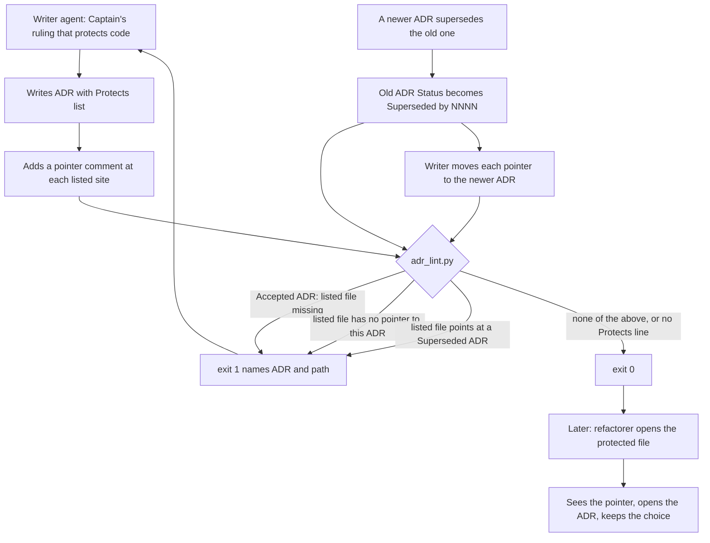

## Scope

- Source: the Captain 「開」 (chat, 2026-10-23) to FO's 「現在要決定的：要不要開一個 pilot 任務，做 ADR 路徑檢查？ 我建議開。」; then 「可以，先測試這個，然後再考慮其他方案。」 (backlog gate withdrawn for a code-side comment POC); then 「可以。」 (chat, 2026-10-23) to FO's 「你要決定的：要不要把 `adr-protected-path-guard` 改成這個範圍，再重新開它的 backlog 關卡？」, where "this scope" was: an optional ADR template field listing the files it protects; a `writing.md` rule to add a one-line `see docs/adr/NNNN-…md` pointer at each such site; a linter check that each listed file exists and carries the pointer, and that no code still points at a superseded ADR; no hook.
- Bite: dev2-poc `adr-hidden-reason-poc` (archived 2026-10-23): with the protecting ADR present, 2 of 8 refactor runs undid a choice only that ADR explains, both without reading it; control without the ADR 4 of 4. dev2-poc `adr-code-pointer-poc` (archived 2026-10-23): with one pointer comment at the site, 0 of 4 undone and 4 of 4 opened the ADR; in both Claude runs the trace shows the comment was the route to the ADR (a tie with 1 of 4 at this size, not shown to lower the rate).
- Upstream first: spacedock 0.27 and kc-dev-flow-2 0.28.0 have no ADR-to-code mapping (`adr-path:` is only the ADR directory; grep 2026-10-23); sibling adopters (carlove, subspace-relay) are checked at ideation.
- Ships in kc-adr: the optional field in `kc-adr/references/adr-template.md`, the pointer rule in `kc-adr/skills/read-adr/writing.md`, and the two checks in `kc-adr/scripts/adr_lint.py`, with tests.
- Non-goals: an edit-time hook; back-filling the field or pointers into existing ADRs; changing kc-dev-flow-2's copies (owned by `kc-adr-tools-with-dev2-copy`).

## Acceptance criteria

**AC-1**: An accepted ADR may list the files it protects; `adr_lint.py` fails when a listed file is missing or lacks a pointer to that ADR, and passes every existing ADR that has no list.
Verified by: linter tests for a missing file, a missing pointer and a correct pointer, plus a run over the repository's existing ADRs, exit 0.

**AC-2**: `adr_lint.py` fails when code points at an ADR whose Status is `Superseded by NNNN`, naming the file and the newer ADR.
Verified by: a linter test with a superseded ADR and a file still pointing at it, and a falsifier that removes the check and sees the test fail.

**AC-3**: `writing.md` tells a writer whose ADR protects code to list the files and add the pointer at each site, and an agent writing such an ADR does both.
Verified by: a text check of `writing.md`, and one recorded agent run per host (Claude, Codex) in a fictional repo that writes an ADR protecting a named file and passes the linter.

## Design

Ruling: an ADR lists the files it protects in one labelled line of its Decision; each listed file carries a comment naming the ADR's path; `adr_lint.py` refuses a listed file that is missing or unpointed (Accepted ADRs only) and any listed file that still points at a superseded ADR.

### PRFAQ

**Press line.** A writer who records a ruling that protects code lists the files and adds one comment line at each; later, `adr_lint.py` fails the moment a listed file loses its pointer, or keeps one to an ADR that a newer ADR replaced.

**Who uses it.** An agent that writes an ADR (reads `writing.md`), the linter run by that agent and by dev2 validation (`adr_lint.py docs/adr --since <base>`), and a later agent that opens a protected file and follows the pointer.

**FAQ.**
- Why a list and not a repository scan? The list is the index: the linter reads only named files, so docs and prose that cite an ADR are never judged as code (measured below).
- Does it stop a refactor? No. It keeps the pointer present and current. The POCs saw the pointer lead agents to the ADR (Scope, Bite); the linter only keeps that route from rotting.
- What does an existing ADR need? Nothing: no label, or `**Protects:** none`, lists nothing.
- What is not checked? That the pointer sits next to the protected code (only that the file carries it), dangling pointers to an ADR that does not exist, pointers to Deprecated ADRs, and unlisted files that carry a pointer.



### Existing-code check (what was checked, 2026-10-23)

- spacedock 0.27.3 and kc-dev-flow-2 0.28.0 (plugin cache): grep for `protects:`, `protected path`, `adr-to-code`, `code pointer` in `*.md`/`*.py`: 0 hits; dev2's only ADR tools are `adr_lint.py` and `adr-template.md`, byte-identical to kc-adr's linter at `0701aa8` (template differs by one word, "worker or FO" against "recommender").
- kc-adr at `0701aa8` (`adr_lint.py`, 114 lines, `test_adr_lint.py`, template, `writing.md`): no field, no pointer rule. The linter's `sections()` check demands exactly Status, Context, Decision, Consequences, so the field cannot be a new `## ` heading; it is a bold label in Decision, like `**Words:**`.
- `subspace-relay` (worktree `beirut-dev2`, 54 ADRs): no ADR-to-code field, no ADR script in `scripts/`; an ad hoc convention exists: 3 comment lines in 2 files (`netlify/lib/decision-claim.ts`, `netlify/lib/room-feedback.ts`) read `(docs/adr/0041)` / `(docs/adr/0039)`, number only, unchecked; 4 more files outside `docs/adr` (README, `docs/protocols`, `docs/journey`) cite `docs/adr/NNNN-…` as prose or links. Its two superseded ADRs (0003, 0026) are cited by nobody outside `docs/adr`.
- `carlove-v1` (5 worktrees under `conductor/workspaces`; none under `conductor/repos`; `buffalo` has a broken git link): no `docs/adr` or `adr` directory; "ADR" appears only in plan docs. Nothing to borrow.
- Past rulings: `git -C <state> grep -n '^Override:'` hits one ADR-adjacent line, `_archive/agent-reads-governing-adr.md`: the Captain chose the stricter, deterministic rule (refuse branch refs) over the recommended flexible one. Decision 3 follows that lean. No ADR at `0701aa8` (30, `0001`..`0030`) is about ADR format or code pointers.
- Conclusion: extend `adr_lint.py` and the two kc-adr text files; no new tool.

### Exact text

**1. Template** (`kc-adr/references/adr-template.md`): one line added in Decision, after `**Recommended:**`:

```
**Protects:** none
```

A writer whose ruling protects code replaces `none` with one bullet per file directly below the label:

```
**Protects:**
- `src/report_mailer.js` — the read-back before mailing, in each send function
```

Entry form: ``- `<path from the repo root>` — <where in the file the choice sits>``. The path is checked; the phrase is for the reader. "Format" of the pointer is one rule for the whole repo (section 2), not a per-entry field.

**2. Pointer.** The writer writes `see <ADR folder>/NNNN-short-title.md` (for example `see docs/adr/0024-report-emails-are-sent-from-the-stored-copy.md`) inside a comment in the file's own syntax (`//`, `#`, `--`, `<!-- -->`). The linter does not parse comment syntax; it reads each file as text. A file points at ADR N when its text contains `<adr folder relative to the repo root>/` followed by the four digits of N and no further digit. `<adr folder>` is taken from the real ADR directory, so a repo that keeps ADRs in `doc/decisions` works. The linter's error text suggests the full file name.

**3. `kc-adr/skills/read-adr/writing.md`**: step 4 and 5 are new; old 4 and 5 become 6 and 7 with these edits (shown):

```
4. If the ruling protects code that a later change could undo and the code does not explain, replace `**Protects:** none` with one line per file, `` - `path/from/repo/root` — where in the file the choice sits ``, and add a comment line `see docs/adr/NNNN-short-title.md` (this ADR's own file) at each such site, in the file's comment syntax. Keep `none` when no code is protected. The pointer says a ruling governs here; the reason stays in the ADR.
5. If your ADR supersedes one that lists files, list those it still protects and change each pointer to the new ADR; the linter fails while a listed file points at a superseded one.
6. Check it with the ADR linter, requiring that number; it also checks that each listed file exists and carries the pointer. Report a non-zero exit; do not work around it.
```

**4. Linter** (`kc-adr/scripts/adr_lint.py`; scratch prototype below was run in `/tmp`, nothing copied into a checkout):

Algorithm.
1. `check_file` (every non-legacy ADR): read the Decision lines; the first line starting `**Protects:**` is the field. Absent: nothing listed. Value starting `none` with no bullets: nothing listed. Value anything else with no bullets: error. Bullets are the consecutive `- ` lines right below; each must start with a backticked path that is not absolute and has no `..` part, else error.
2. `check_pointers` (after all files are read; legacy ADRs and files with an unparsable Status skipped): collect `(ADR, path, accepted?)` for every listed path of every ADR, and the map superseded-number to newer-number from `Superseded by NNNN`. If nothing is listed anywhere, return no errors (existing ADR sets are never touched). Root is `--root`, else `git -C <adr dir> rev-parse --show-toplevel`, else the current directory; `where` is the ADR directory relative to root (an ADR directory outside root is an error naming `--root`, raised only when something is listed).
3. Check 1, only for ADRs whose Status is exactly `Accepted`: the listed file must exist (`<root>/<path>` is a file), else `NNNN-title.md: protects <path>, which does not exist`; and its text must cite that ADR's number, else `NNNN-title.md: <path> has no pointer; add a comment line 'see <where>/NNNN-title.md'`.
4. Check 2, over the union of listed paths of all ADRs (any status), each read once: every number the file cites that is in the superseded map is an error `<path>: points at ADR NNNN, Superseded by MMMM; point it at MMMM or the record in force`.

```python
PROTECTS = re.compile(r"^\*\*Protects:\*\*\s*(.*)$")
ENTRY = re.compile(r"^- `([^`]+)`")

def protected_paths(decision_lines, name):
    lines = [l.strip() for l in decision_lines]
    at = next((i for i, l in enumerate(lines) if PROTECTS.match(l)), None)
    if at is None:
        return [], []
    rest = PROTECTS.match(lines[at]).group(1).strip()
    entries = []
    for line in lines[at + 1:]:
        if not line.startswith("- "):
            break
        entries.append(line)
    if not entries:
        return [], [] if rest.lower().startswith("none") else [
            f"{name}: Protects must be 'none' or a list of '- `path` — where in the file' lines"]
    paths, errors = [], []
    for line in entries:
        match = ENTRY.match(line)
        path = match.group(1) if match else ""
        if not path or path.startswith("/") or ".." in Path(path).parts:
            errors.append(f"{name}: Protects entry must start with a backticked path from the repo root: {line!r}")
        else:
            paths.append(path)
    return paths, errors

def check_pointers(files, root, adr_dir):
    records, listed, superseded = [], {}, {}
    for number, path in sorted(files.items()):
        found = sections(path.read_text())
        status = STATUS.match(next((l.strip() for l in found.get("Status", []) if l.strip()), ""))
        if not status:
            continue
        if status.group(2):
            superseded[number] = int(status.group(2))
        for listed_path in protected_paths(found.get("Decision", []), path.name)[0]:
            listed.setdefault(listed_path, []).append(number)
            records.append((path, listed_path, status.group(0) == "Accepted"))
    if not listed:
        return []
    try:
        where = adr_dir.resolve().relative_to(root.resolve()).as_posix()
    except ValueError:
        return [f"{adr_dir} is not inside the repository root {root}; pass --root"]
    errors = []
    cites = re.compile(re.escape(where) + r"/(\d{4})(?!\d)")

    def cited_by(site):
        return {int(c) for c in cites.findall(site.read_text(errors="replace"))}

    for path, listed_path, accepted in records:
        if accepted:
            site = root / listed_path
            if not site.is_file():
                errors.append(f"{path.name}: protects {listed_path}, which does not exist")
            elif int(path.name[:4]) not in cited_by(site):
                errors.append(f"{path.name}: {listed_path} has no pointer; add a comment line 'see {where}/{path.name}'")
    for listed_path in sorted(listed):
        site = root / listed_path
        if site.is_file():
            for cited in sorted(cited_by(site) & set(superseded)):
                errors.append(f"{listed_path}: points at ADR {cited:04d}, Superseded by {superseded[cited]:04d}; "
                              f"point it at {superseded[cited]:04d} or the record in force")
    return errors
```

Wiring: `check_file` appends `protected_paths(...)[1]`; `main` gains `--root` and, before printing, `errors += check_pointers({n: p for n, p in files.items() if n not in legacy}, Path(top), root)` with `top = args.root or git toplevel or "."`. About 65 lines added to a 114-line file; the exit codes and the existing output are unchanged.

**5. Tests** (`kc-adr/scripts/test_adr_lint.py`, fictional repo in a temp dir): template is a valid record with `**Protects:** none`; ADR without the line passes; listed file missing fails; listed file without pointer fails; pointer to a different ADR fails; correct pointer passes in the full-path and number-only forms, and `docs/adr/00021-x.md` does not count as `0002`; a file pointing at a Superseded ADR fails naming file and newer ADR; the same file pointing only at the newer one passes; Proposed, Deprecated and Superseded ADRs are not required to have their file; malformed entries (no backticks, absolute path, `..`, `**Protects:** maybe`) fail; a file no ADR lists is not scanned.

### Limits of what ran at ideation (scratch, not repository code)

A prototype of the code above ran in `/tmp/adrpg` (discarded after this stage; nothing in any checkout or branch). Feasibility only: kc-adr's 8 existing tests and 8 new scratch tests pass; dev2 0.28.0's `test_adr_doc_checks.py` (9 tests) passes with the new linter and template and with the old pair; the new linter exits 0 over this repo's 30 ADRs at `0701aa8` and over relay's 54, printing what the old linter printed. Four mutations were each caught by a named scratch test: dropping the superseded scan (2 tests), skipping the pointer test (2), skipping the existence test (1), requiring files for every Status (2). None of this is implementation evidence for AC-1..AC-3.

### Interaction with `kc-adr-tools-with-dev2-copy`

That task makes kc-adr the source and dev2 a generated byte-identical copy of `adr_lint.py` and `adr-template.md` (its Amendment 1), compared in a required check. This task edits the source only, so: (a) dev2 0.28.0 still has the old pair, and users of dev2 get the new checks only through the sync and a dev2 release; (b) until that task lands, an edit to either side alone widens the existing one-word template drift, so this task must not edit dev2's files (its non-goal) and the sync must carry the new template line and linter together; (c) once synced, dev2 validation's `adr_lint.py docs/adr --since <base>` runs both new checks with the default root from the adopter checkout, and does nothing in an adopter whose ADRs list no files (scratch dev2 test run above); (d) the dev2 test file `test_adr_doc_checks.py` is separate from kc-adr's `test_adr_lint.py`; the sync task decides whether the new tests travel.

### Evidence clauses (what `Verified by:` is run as)

- AC-1: from the candidate checkout, `python3 -B -m unittest discover -s kc-adr/scripts -p 'test_*.py'` exits 0 and names the template, no-field, missing-file, missing-pointer and correct-pointer tests above; `python3 kc-adr/scripts/adr_lint.py docs/adr` exits 0 in this repository (30 ADRs at `0701aa8`) and in relay's `docs/adr`; falsifier: deleting the existence test, or making the pointer test always true, makes a named test fail (scratch run: 1 and 2 failures).
- AC-2: the superseded-pointer test above (an Accepted newer ADR, a Superseded older ADR, a listed file citing both) exits 1 with `src/mailer.js: points at ADR 0002, Superseded by 0003`, and exits 0 once the file cites only the newer ADR; falsifier: replacing the superseded scan with an empty set makes both superseded tests fail (scratch run: 2 failures).
- AC-3: (a) `writing.md` contains the numbered step with `**Protects:**` and `see docs/adr/NNNN-short-title.md` (a text check; weak on its own). (b) One agent run per host (Claude `sonnet`, Codex `gpt-6.1-sol`) in the fictional `mira-app` world, reusing the harness at `_archive/adr-code-pointer-poc/harness/` in the dev2-poc state checkout (branch `spacedock-state/dev2-poc`: worlds, arm wiring `B1` that installs kc-adr from `KC_ADR_ROOT` on both hosts, isolation). New scenario S15, world C (no ADR 0024, no comment): the person's ruling in her own words that the read-back in `src/report_mailer.js` stays, and the task to record it; the prompt does not mention `Protects`, pointers or the linter. Pass rule written to `expectations-s15.json` and committed before the first run: exactly one new ADR file; the candidate `adr_lint.py docs/adr --require <N>` exits 0 on the final workspace; its Decision lists `src/report_mailer.js`; the site file carries a pointer to that ADR. `KC_ADR_ROOT` is the candidate commit (the harness refuses uncommitted kc-adr). (c) Falsifiers: three hand-built final workspaces (field with no pointer, pointer with no field, no ADR) must grade fail, and the same scenario with `KC_ADR_ROOT` at `0701aa8` (arm without the change), one run per host, is expected not to list or point; if it does, the writing rule is not what caused it and AC-3 does not stand. The scenario, grader and arm are implementation work; nothing of them exists yet. Cost: 4 agent runs; not measured.

### Profile check

No obligation here needs a profile change: kc-adr is published, and the change is a normal upgrade (release-please minor bump, fed by a `feat(kc-adr):` commit; the version files are the bot's); an adopter whose ADRs carry no `**Protects:**` line sees no new refusal (measured on this repository and relay).

### Decisions for the Captain

Decisions 2 and 3 are coupled: both define what "a pointer" means to the linter. Decision 1 is independent.

1. **Field name.** Recommend `**Protects:**` (his word in the task title and Scope). Alternatives: `**Guards:**`, `**Applies to:**`. Worse under the recommendation: "protects" says what the ADR does to the file, not that a pointer is required.
2. **Pointer format and match rule.** Recommend the writer writes the full path `see docs/adr/NNNN-short-title.md` (the form the POC proved agents open), and the linter accepts any `docs/adr/NNNN` (digits not followed by a digit) in both checks, so one rule covers check 1 and check 2 and survives an ADR retitle. Alternative: require the exact file name in check 1 (stricter, catches a wrong slug, but a retitle breaks every pointer and relay's three existing `docs/adr/0041`-style comments would not count). Worse under the recommendation: `docs/adr/0002` alone passes though an agent must glob to open it.
3. **How pointers are found for check 2.** Recommend only the files some ADR lists (deterministic, no repo scan, reads a handful of files). Alternative: scan every tracked file outside the ADR folder. Measured on relay: 6 files outside `docs/adr` cite an ADR path, 2 of them code and 4 prose or YAML (33 hits in `docs/journey`), so a whole-tree scan would judge history and links as code the first time a superseded ADR is cited in a doc. Worse under the recommendation: a pointer in an unlisted file (relay's 3 existing comments) is never scanned, so AC-2 holds for listed files only; a third check, "a pointer implies a listing", is deliberately not included.

## FO alignment

Alignment: needed at ideation: the field name, the pointer format and how the linter finds pointers are design choices for the Captain.
Result: direction aligned before dispatch: the Captain chose the pointer-and-linter route over a hook (「可以。」, then 「都准」 to the revised backlog gate, 2026-10-23); the field name, pointer format and pointer lookup are presented as options with a recommendation at the ideation gate.
Surfaces: none
Visible change: none
Release review: not needed: the map was skipped for kc-adr by the Captain's authorization.

## Captain amendments

### Amendment 1 — 2026-10-23, chat
Captain: 「准重跑」 (kc-adr FO's Paseo session)
Asked: "你要決定的：要不要准 Claude 重跑 2 次？ 用同一題的單一 repo 版本，ADR 和程式碼放在同一個 repo，判定規則不變，跑之前先存檔。"
Supersedes: none
Design: none

## Stage Report: ideation

- DONE: Design the kc-adr change at main 0701aa8debd45b3fe7eab7e930141319d52f3aa2: (1) the optional template field, (2) the exact pointer format and how the linter finds it, (3) the `writing.md` text for the writer, (4) the two linter checks. Show exact text and the check's algorithm.
  `## Design` > Exact text: template line `**Protects:** none` (a bold label in Decision, because the linter fixes the four `##` sections), pointer `see docs/adr/NNNN-short-title.md` matched as `<adr folder>/NNNN`, `writing.md` steps 4-6, algorithm in 4 steps plus the code (about 65 lines added to the 114-line linter). Ruling: sentence one of Design.
- DONE: Check the sibling adopters for an existing ADR-to-code mapping before designing.
  carlove*/subspace-relay* do not exist under conductor/repos; under workspaces: subspace-relay `beirut-dev2` (54 ADRs) has no field and no script, only 3 ad hoc number-only comment lines in 2 code files; carlove-v1 (5 worktrees, `buffalo` has a broken git link) has no docs/adr. Also none in spacedock 0.27.3 or dev2 0.28.0 (grep). Details in Design > Existing-code check.
- DONE: Give AC-1..AC-3 reproducible evidence clauses and list decisions for the Captain; note how this interacts with `kc-adr-tools-with-dev2-copy`.
  AC-1: not yet verified. Clause = kc-adr test run plus `adr_lint.py` exit 0 over 30 repo ADRs and relay's 54, with two falsifiers; scratch prototype only (16 tests pass, existing 8 included; both ADR sets exit 0). AC-2: not yet verified. Clause = superseded-pointer test exits 1 naming file and newer ADR, 0 when fixed; falsifier = drop the scan, 2 tests fail in the scratch run. AC-3: not yet verified. Clause = `writing.md` text check plus one run per host on harness `_archive/adr-code-pointer-poc/harness/` (branch spacedock-state/dev2-poc), new scenario S15, arm B1 at the candidate commit, a no-change arm at `0701aa8`, three hand-built failing worlds; scenario and grader do not exist yet. Three Captain decisions with recommendations (2 and 3 coupled): `**Protects:**`; full-path pointer matched by number prefix; check 2 scans listed files only (relay: 6 outside files cite an ADR path, 4 are prose). dev2 interaction: Design > Interaction (source-only edit, dev2 gets it through the sync and a release, dev2's 9 ADR tests pass with the new pair).
- DONE: Run `/Users/kent/.claude/plugins/cache/kc-claude-plugins/kc-dev-flow-2/0.28.0/scripts/design_surfaces.py check <task>`.
  Exit 0, `adr-protected-path-guard.md: design surfaces presentable`, package 0.28.0 as FO confirmed; the loaded skill header said 0.26.0 (orphaned cache), which also exits 0.
- DONE: Write no repository file, branch or commit.
  Only this task file changed in the state checkout (176 added lines, 0 removed; `## Scope`, ACs, FO alignment and frontmatter untouched). The prototype lives in `/tmp/adrpg`, outside every checkout, and is deleted after this stage.

### Summary

The design adds `**Protects:**` to the Decision, a pointer comment per listed file, and two checks in `adr_lint.py` (listed Accepted-ADR file exists and cites the ADR; no listed file cites a Superseded ADR), with scan limited to listed files. Three decisions go to the Captain, with recommendations; the earlier missing `Result:` line was recorded by FO. The scratch prototype proves feasibility only; every AC is not yet verified.

## Stage Report: implementation

- DONE: Build the approved design in the task's `## Design` (### Exact text) on a branch based on origin/main 0701aa8: the `**Protects:** none` label, steps 4-6 in `writing.md`, checks 1 and 2 in `adr_lint.py` with the `docs/adr/NNNN` prefix match and the listed-files-only scan, tests in `test_adr_lint.py`; `feat(kc-adr):` commit; no kc-dev-flow-2 file changed.
  Commit 286ba13a on `spacedock-ensign/adr-protected-path-guard` (4 kc-adr files, +191/-2; `git diff 0701aa8 HEAD --name-only` lists only kc-adr). Branch is local only, not pushed or PR'd; `HEAD:kc-adr` is 454c94e4 for every run below.
- DONE: AC-1 and AC-2: linter tests (new and existing), old-vs-new output comparison, falsifier that removes the superseded scan.
  `python3 -B -m unittest discover -s kc-adr/scripts -p 'test_*.py'` exit 0, 21 tests (8 old, 13 new). Old (0701aa8) vs new linter over this repo's 30 ADRs and relay's 54 ADRs (beirut-dev2): both exit 0, output byte-identical.
  Mutations on a copy, each caught by the named test: M1 superseded scan emptied -> `test_a_file_pointing_at_a_superseded_adr_fails_naming_file_and_newer_adr` (1 failure; the "passes when only newer" test cannot fail under M1); M2 pointer check always true -> `..without_a_pointer..`, `..different_adr_does_not_count`, `..longer_number..`, `..uses_the_real_adr_folder` (4); M3 existence check skipped -> `..listed_file_that_is_missing..` (1 error); M4 every Status required -> `test_only_accepted_adrs_must_have_their_file` x3, `..newer_adr_passes` (4); M5 digit boundary dropped -> `test_a_longer_number_is_not_the_same_adr` (1); M6 scan every file -> `test_a_file_no_adr_lists_is_not_scanned` (1).
- FAILED: AC-3: `writing.md` text check, then one recorded agent run per host (claude, codex) with S15, pass rule and grader committed before the first run, falsifier worlds.
  Codex candidate PASS; Claude candidate FAIL (new ADR written in `mira-decisions`, rule says `mira-app`). Codex no-change arm FAIL (no list, no pointer): the change caused the behavior on Codex. Claude no-change arm FAIL for the same wrong-repo reason: the Claude result is not caused by this change. AC-3 is verified on Codex, not on Claude. Detail under Summary.
  Text check: `writing.md` line 8 has `**Protects:**` and `see docs/adr/NNNN-short-title.md` (weak alone). Grader and pass rule committed at c47b9d7d before run 1; 16/16 falsifier cases ok (`harness/falsifiers-s15-output.txt`: field only, pointer only, no ADR, two ADRs, ADR in mira-decisions, wrong/longer-number pointer, pointer in another file, linter-refused ADR, 20000-char cut). Runs: `results/` candidate plugin_commit 286ba13a; `results-base/` plugin_commit 0701aa8 (codex cache confirmed to hold the old/new writing.md respectively); grader linter sha256 203f097c... in `results-s15.json`. 4 agent runs, no retries. Records: `adr-protected-path-guard/results*/`, `ledger.jsonl`, `CHANGES.md`.
- DONE: Closing checks on the head.
  `comment_ratio.py 0701aa8 HEAD` exit 0 (160 code lines, 0 comment lines, 0.0%); `scripts/version-parity-check.sh` exit 0; `scripts/skill-frontmatter-lint.sh` exit 0; sanitize rules (BLOCK/REJECT/WARN regexes from `sanitize-rules.yaml` over the 4 changed files) 0 hits; package `scripts/adr_lint.py docs/adr --since 0701aa8` exit 0 (30 ADRs). Roborev: `clean on 286ba13ac; evidence=roborev:1094`.

### Summary

AC-1 and AC-2 verified; AC-3 verified on Codex, not on Claude (repo-choice defect present in both arms). The Claude candidate trace shows the writing rule fired: it read the new `writing.md`, listed `mira-app/src/report_mailer.js`, the linter refused it ("does not exist", root was `mira-decisions`), and it then wrote `**Protects:** none` and still added a pointer comment (so the linter passes with nothing listed; the design leaves "a pointer implies a listing" out on purpose). SKILL.md already says the ADR goes in the current repo; Claude broke that in the no-change arm too, so this is an existing read-adr routing weakness that S15's two-repo world exposed, not something this change added. Not fixed here (no Captain ruling), and the scenario and pass rule were not changed after the first run. A rerun on Claude would exceed the 2-run budget and needs the FO's call. Note for the FO: a decision log kept in a separate repository (as in this world) cannot list code paths in another repo; the linter's root is the ADR repo.

## Stage Report: implementation (cycle 2)

- DONE: Add a single-repo variant of S15 to this task's harness copy (ADR folder and code in one repository, task prompt otherwise the same, pass rule and grader unchanged); commit it before the first new run and record the commit SHA and time.
  Commit 9e9ebaf5670e30a7ef43916ccd9c5bdf9cd41571, 2026-10-23T17:33:38+08:00, before both runs. `harness/run.py --single-repo` removes `mira-decisions` from the workspace, uses a one-repository header, and drops `--add-dir mira-decisions`; S15 task text, `expectations-s15.json`, `score_s15.py` and the falsifiers are untouched (`CHANGES.md`, section Cycle 2).
- DONE: Run Claude only, candidate arm (kc-adr at 286ba13ac488222b2cb338406207fad48d2c2f32 via KC_ADR_ROOT), two runs, unchanged pass rule, records apart from the earlier ones; no Codex or no-change rerun.
  `meta.json` of both runs: `variant` single-repo, `plugin.commit` 286ba13ac488222b2cb338406207fad48d2c2f32; `git rev-parse HEAD` of the worktree is the same and `kc-adr` is clean. 2 counted runs, no retries. Records in `adr-protected-path-guard/results-single/`; grades in `results-s15-results-single.json` and `.md` (grader linter sha256 as in the cycle-1 grades).
- DONE: Run 1, `results-single/S15-B1-claude-r1/`: PASS.
  Listed `src/report_mailer.js` under `**Protects:**` in new ADR 0024 (mira-app/docs/adr); added the pointer line `// see docs/adr/0024-report-emails-mail-the-copy-read-back-from-the-store.md`; the linter exited 0 (`--require 0024`, in the agent's own command and in the grader). Never cleared the field: one write command, no `**Protects:** none` in any command.
- DONE: Run 2, `results-single/S15-B1-claude-r2/`: PASS.
  Same: listed `src/report_mailer.js`, pointer line identical, agent's linter run exit 0, grader linter exit 0. One write command, no `**Protects:** none` in any command; the ADR title reads `# 0024.` (the linter accepts it).
- DONE: Keep the earlier two-repo Claude FAIL in the record and state it as the cross-repo routing limit.
  Cycle 1 Claude candidate (`results/S15-B1-claude-r1`, two-repo world) and Claude no-change arm (`results-base/S15-B1-claude-r1`) both FAIL: the ADR went to `mira-decisions`, so `mira-app/src/report_mailer.js` could not be listed (root is the ADR's repository); in the candidate trace the agent cleared the field to `none` to make the linter pass and kept the pointer. That FAIL stands as the limit: an ADR kept in a different repository from the code it protects cannot use this field. It is not changed by cycle 2.

### Summary

AC-3 now holds on both hosts for the single-repo world: Codex PASS (cycle 1) and Claude 2 of 2 PASS (cycle 2), each listing the file, adding the pointer and passing the linter, with no clearing of the field. The two-repo Claude FAIL is kept as the cross-repo routing limit, and that FAIL did not come from this change (the no-change arm failed the same way). Code is unchanged (head 286ba13a, `kc-adr` tree 454c94e4), so roborev and the closing checks from cycle 1 stand. Cycle 2 shows nothing about whether a Claude run in the two-repo world would route to `mira-app`.

## Stage Report: validation

- DONE: Independent verdict on candidate 286ba13ac488222b2cb338406207fad48d2c2f32 (base 0701aa8debd45b3fe7eab7e930141319d52f3aa2) against AC-1..AC-3, the approved design with its three decisions, and Captain amendment 1.
  Verdict: PASSED, with the limits under Unverified and Findings. No criterion is unmet. Artifact: `git rev-parse HEAD` of the candidate worktree is 286ba13a; clean tree; `git diff --name-only` base..HEAD lists 4 kc-adr files and nothing under kc-dev-flow-2.
- DONE: Re-run in a scratch copy: kc-adr `test_adr_lint.py` (21 tests); old-vs-new linter output over this repository's ADRs at base and the candidate.
  21 tests OK (`git archive` of the candidate under /tmp). All four pairings (old or new linter over the base or candidate `docs/adr`, 30 ADRs) exit 0 with identical output (same md5); relay's 54 ADRs (beirut-dev2 at 840a0039): old and new exit 0, identical output; none of them lists `**Protects:**`.
- DONE: The falsifier that empties the superseded scan.
  Replacing `cited_by(site) & set(superseded)` with `& set()` in a copy: 1 failure, `test_a_file_pointing_at_a_superseded_adr_fails_naming_file_and_newer_adr` (asserts exit 1 and the text `src/mailer.js: points at ADR 0002, Superseded by 0003`); the pass-when-only-newer test cannot fail under this mutation, it guards the opposite error. The design's scratch count was 2; the implementer reported 1; observed 1.
- DONE: dev2's `test_adr_doc_checks.py` with kc-adr's new template and linter overlaid on dev2's paths, to show what the dev2 copy will meet.
  Overlay of the candidate's `adr_lint.py` and `adr-template.md` onto `kc-dev-flow-2/scripts` and `references`: 9 of 9 pass (also 9 of 9 unmodified), and `test_dispatch_records` 47 and `test_pr_watch` 101 pass; the dev2 copy will meet two new checks that do nothing in an adopter whose ADRs list no files. dev2 template then differs from kc-adr's only by the existing one-word drift ("worker or FO") until the sync task lands. `lint-skills.py` fails only on the scratch layout (`skill-frontmatter-lint.sh` missing); not a candidate defect.
- DONE: AC-3 from stored evidence: re-grade the stored S15 runs with the committed grader; confirm the pass rule and grader commit (c47b9d7d) and the single-repo variant commit (9e9ebaf5) each precede their runs and nothing gradeable changed after.
  `score_s15.py --linter <candidate adr_lint.py>` (sha256 203f097c, as stored) in a scratch copy of the task folder reproduces all six stored grades byte for byte: candidate claude FAIL, codex PASS; no-change claude FAIL, codex FAIL; single-repo claude r1 PASS, r2 PASS. `falsifiers-s15.py` with the candidate linter: 16 of 16 ok. Order: c47b9d7d 17:22:59 before the first runs 17:23:16 and 17:23:23; 9e9ebaf5 17:33:38 before the cycle-2 runs 17:33:46; `git diff c47b9d7d HEAD -- harness` touches only `run.py` (the `--single-repo` change at 9e9ebaf5), nothing after 9e9ebaf5; `score_s15.py`, `expectations-s15.json`, `scenarios.json` unchanged since c47b9d7d. Every `meta.json` records plugin commit 286ba13a (candidate) or 0701aa8 (no-change) and the same two models.
- DONE: Judge whether the two-repo Claude FAIL is fully explained as the existing cross-repo routing limit (both arms) and whether the agent clearing the field to none is a risk this change introduces.
  The FAIL is explained: in both arms the agent wrote the ADR in `mira-decisions` (grade reason identical, ADR not in mira-app) before any new rule mattered; one run per arm. It does not explain the clearing: in the candidate trace the agent first listed `mira-app/src/report_mailer.js`, the linter said it does not exist, and it rewrote to `**Protects:** none` plus a prose line and kept the pointer, which is the "work around it" step 6 forbids. That exit exists only with this change and is a consequence of listing across repositories; recorded as a Deferred risk below.
- DONE: Review the code: four kc-adr files only, no kc-dev-flow-2 file; the template label keeps the four required sections; the prefix match and listed-files-only scan match the approved decisions; writing.md steps 4-6 match the design text.
  Template adds `**Protects:** none` inside Decision, tests still require exactly four `##` sections. `cites` is `<where>/(\d{4})(?!\d)`, scan runs over `listed` paths only (`test_a_file_no_adr_lists_is_not_scanned`, `..longer_number..`). `writing.md` steps 4-6 are the design text word for word; old 4-5 are now 6-7. `comment_ratio.py` exit 0 (160 code lines, 0 comment lines); I read the diff and found no added comment. `design_surfaces.py check` exit 0; `dispatch_records.py` exit 0 (4 complete).
- DONE: A minimal acceptance script FO can run in a fresh shell, and `/Users/kent/.claude/plugins/cache/kc-claude-plugins/kc-dev-flow-2/0.28.0/scripts/adr_lint.py docs/adr --since 0701aa8debd45b3fe7eab7e930141319d52f3aa2` with its exit code.
  Command run from the candidate worktree: `30 ADR file(s) checked, 0 legacy`, exit 0 (the 0.26.0 copy and the candidate's own kc-adr linter print the same, exit 0). The script below ran as written in `env -i bash`, all six steps with the expected observations.

### Findings

- Deferred risk (cross-repo clearing): evidence fields: released workflow, none promised (`read-adr/SKILL.md` home 5: the ADR goes in the current repo, "another repo is the user's choice"); harm, an ADR plus pointer that no list names, so the superseded check never sees that file; value criterion, none (AC-1..AC-3 hold); trigger, one two-repo trace. Would become Material if an adopter keeps its decision log in a repository other than its code and adopts kc-adr, or if the Captain rules that case supported. A "pointer implies a listing" check is the known remedy and is deliberately out of scope (Decision 3).
- Polish: `**Protects:** nonetheless` is read as `none` (prefix test, `rest.lower().startswith("none")`); no user-visible loss.
- Polish: `doc_impact.py` lists three documents (`kc-nightwatch/skills/kc-nightwatch/SKILL.md`, `kc-nightwatch/skills/kc-nightwatch-report/SKILL.md`, `kc-pr-flow/skills/break-point-probe/reference/precision-ladder.md`) on the word `repo_root`, and the implementation report records none of the three. Each is `unaffected: an unrelated placeholder or variable also named repo_root`; kc-adr's README and `read-adr/SKILL.md` describe the template and linter in general terms that stay true.
- Minimal necessity: each of the four files maps to AC-1..AC-3 or a named falsifier; no comment lines; `--root` serves an ADR folder outside the git toplevel and is tested by `test_an_adr_folder_outside_the_root_asks_for_root`.

### Unverified

- No agent run was repeated (budget spent); Claude single-repo is 2 of 2 PASS in a world chosen after the two-repo FAIL, under Amendment 1; no no-change Claude arm exists in the single-repo world. For Claude, the rule's effect rests on the two-repo pair: the no-change run wrote no list and no pointer, the candidate run listed the file and added the pointer before the linter refused it.
- Codex is one candidate run and one no-change run; the claim is the contrast (PASS against no list, no pointer), not a rate. Both hosts' behaviour in a two-repo world after the file is routed correctly is unknown.
- dev2 users get the checks only through the sync task and a dev2 release; this stage did not touch dev2 files.

### Minimal acceptance script

Run in a fresh bash. It needs the candidate worktree, the state checkout (step 6) and kc-dev-flow-2 0.28.0 in the plugin cache, named at its top. Not covered: any new agent run, the dev2 copy, a cross-repo ADR folder.

```bash
set -u
C=/Users/kent/conductor/workspaces/kc-claude-plugins/colombo/.context/dev2-adoption/worktree/.worktrees/spacedock-ensign-adr-protected-path-guard
STATE=/Users/kent/conductor/workspaces/kc-claude-plugins/colombo/.context/dev2-adoption/worktree/docs/dev2/.spacedock-state
PKG=/Users/kent/.claude/plugins/cache/kc-claude-plugins/kc-dev-flow-2/0.28.0
BASE=0701aa8debd45b3fe7eab7e930141319d52f3aa2
cd "$C"

echo "== 1. candidate identity (expect 286ba13ac488222b2cb338406207fad48d2c2f32, 4 kc-adr files, none under kc-dev-flow-2)"
git rev-parse HEAD; git diff --name-only $BASE HEAD

echo "== 2. kc-adr tests (expect: Ran 21 tests, OK)"
python3 -B -m unittest discover -s kc-adr/scripts -p 'test_*.py' 2>&1 | grep -E '^(Ran|OK|FAILED)'

echo "== 3. linter over this repository's ADRs and the package command (expect both: 30 ADR file(s) checked, exit=0)"
python3 -B kc-adr/scripts/adr_lint.py docs/adr; echo "exit=$?"
python3 -B $PKG/scripts/adr_lint.py docs/adr --since $BASE; echo "exit=$?"

echo "== 4. scratch repo: a listed file with no pointer is refused, then accepted once it carries one"
W=$(mktemp -d); cd "$W"; mkdir -p docs/adr src
sed -e 's/^# NNNN\./# 2./' -e 's/Date: YYYY-MM-DD/Date: 2026-10-23/' -e 's/^\*\*Protects:\*\* none$/**Protects:**\n- `src\/mailer.js` — the read-back/' "$C/kc-adr/references/adr-template.md" > docs/adr/0002-mail-the-copy.md
echo "export function send() {}" > src/mailer.js
python3 -B "$C/kc-adr/scripts/adr_lint.py" docs/adr --root .; echo "exit=$? (expect 1: ... src/mailer.js has no pointer; add a comment line 'see docs/adr/0002-mail-the-copy.md')"
echo "// see docs/adr/0002-mail-the-copy.md" >> src/mailer.js
python3 -B "$C/kc-adr/scripts/adr_lint.py" docs/adr --root .; echo "exit=$? (expect 0)"

echo "== 5. same scratch repo: ADR 0002 superseded by 0003, file still points at 0002"
python3 - <<'PY'
from pathlib import Path
old = Path("docs/adr/0002-mail-the-copy.md").read_text()
Path("docs/adr/0003-newer.md").write_text(old.replace("# 2.", "# 3."))
Path("docs/adr/0002-mail-the-copy.md").write_text(old.replace("## Status\n\nAccepted", "## Status\n\nSuperseded by 0003"))
PY
echo "// see docs/adr/0003-newer.md" >> src/mailer.js
python3 -B "$C/kc-adr/scripts/adr_lint.py" docs/adr --root .; echo "exit=$? (expect 1: src/mailer.js: points at ADR 0002, Superseded by 0003; point it at 0003 or the record in force)"
python3 - <<'PY'
from pathlib import Path
p = Path("src/mailer.js"); p.write_text(p.read_text().replace("// see docs/adr/0002-mail-the-copy.md\n", ""))
PY
python3 -B "$C/kc-adr/scripts/adr_lint.py" docs/adr --root .; echo "exit=$? (expect 0)"

echo "== 6. regrade the stored S15 runs with the committed grader in a scratch copy (expect: results fail+pass, results-base fail+fail, results-single pass+pass)"
G=$(mktemp -d); git -C "$STATE" archive HEAD adr-protected-path-guard | tar -x -C "$G"; cd "$G/adr-protected-path-guard"
for r in results results-base results-single; do python3 -I -B harness/score_s15.py --linter "$C/kc-adr/scripts/adr_lint.py" --results $r | grep -E '^\| B1' | cut -d'|' -f2,3; done
```

### Summary

PASSED: AC-1 and AC-2 hold on the exact candidate (21 tests, falsifier caught, old and new output identical over 30 and 54 ADRs); AC-3 holds on Codex and, in a single-repo world, on Claude 2 of 2, with every stored grade reproduced offline and both commits ordered before their runs. The two-repo Claude FAIL is the existing cross-repo routing limit in both arms, but the agent's clearing of the field to `none` is change-specific and recorded as a Deferred risk. Residuals: no no-change Claude arm in the single-repo world, three polish items, and dev2 gets nothing until the sync.
