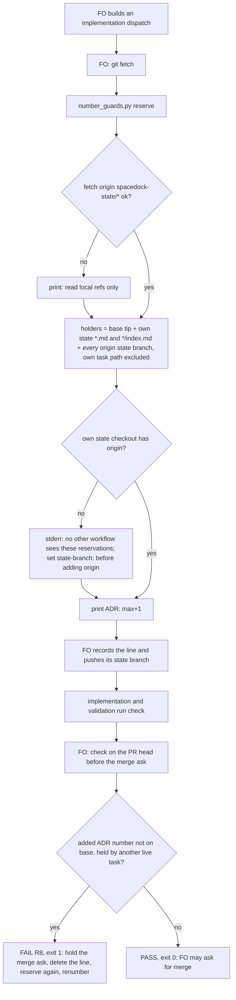

`number_guards.py` refuses a new ADR number that another workflow's live task has already reserved in the same repository, so two FOs sharing a repository cannot both land the same number.

## Scope

- Source: the Captain 「開」 (chat, 2026-11-06), answering FO's batch 14 retrospective ask 「Should I open these two backlog tasks?」, whose first item was this cross-workflow reservation gap.
- Bite: gate-presentation-asks-one-thing-plainly reserved ADR 0060 in this workflow (dispatch 2026-11-05); kc-journey-map #789 (a7c0bdbe0, merged 2026-11-05 23:31 +0800) landed docs/adr/0060 and 0061 from the journey-map private-host workflow; `number_guards.py check --base a7c0bdbe0` then failed R5 on #788, which cost one renumber round (0060 to 0062) and a second validation (FO read of origin/main docs/adr and the #788 worker report, 2026-11-06).
- Upstream first: kc-dev-flow-2 `number_guards.py` (R4/R5, `reserve`), the README's Number guards, ADR-reservation rules; Spacedock has no cross-workflow lock.
- Non-goals: renumbering any landed ADR.

- Batch 16: the Captain 「可以，就這樣」 (chat, 2026-11-06), answering 「這批做 2、3、4、5、9 這 5 張，可以嗎？」, which named this task.

## Budget
- One package PR; the workflow word budget does not rise unless the design names a raise for the Captain.

## Stop condition
- A replay where a second workflow reserves or lands a number another workflow's live task holds is refused before its dispatch or merge ask, and a free number passes.

## FO alignment

Alignment: needed at ideation; where the shared reservation lives is a package design choice for him to accept.
Result: aligned at backlog: Batch 16 backlog gate, the Captain 「核准（建議）」 (host question dialog, 2026-11-06), answering 「決定：第 16 批這五張（跳過的 CI 不擋、Codex 只貼安全摘要時提醒、交付檢查的相對路徑、ADR 編號跨流程預留、婉拒只在出過事時開任務）都用 Pilot，照各自寫下的範圍、預算與停止條件進入構想嗎？核准即接受「婉拒只在出過事時開任務」任務裡寫的標準（指出真的錯並說得出誰受害、再次出現、或你要求）。要改哪張直接說。」, approved the outcome and bounds in this file.
Surfaces: none
Visible change: none
Release review: not needed: workflow maintenance, on no journey map.

## Design

Read 2026-11-06 after `git fetch origin`: `origin/main` carries kc-dev-flow-2 0.35.0 (`kc-dev-flow-2/.claude-plugin/plugin.json`), and its `kc-dev-flow-2/scripts/number_guards.py` is byte-identical to the dispatched package root's copy (`diff` empty).

### Proposition

When a First Officer (FO) reserves an ADR number, `number_guards.py reserve` now also counts every number held by a live task on any `origin/spacedock-state/*` branch of the same repository, and by folder-form tasks (`<task>/index.md`) in its own state checkout. When FO checks a candidate before the merge ask, `number_guards.py check` refuses (new rule R8) an added ADR number that another live task holds anywhere it can read. A workflow whose own state checkout has no `origin` is told, at reserve, that no other workflow can see its reservations. Nothing new is stored: the reservations are the `ADR: NNNN` lines FO already writes under `## Number guards` and already pushes with its state branch.

### FAQ

- **Where does the shared reservation live?** In each workflow's own state branch on the repository's `origin`, which Spacedock already pushes (`spacedock-state/<workflow dir basename>`, or the README's `state-branch:` override; Spacedock `StateBranch` in `internal/status/state.go`). The script reads all of them after fetching them itself. This is decision D1 below.
- **Why the script fetches.** The journey-map checkout is a `blob:none` clone whose only fetch refspec is `+refs/heads/main:refs/remotes/origin/main` (read-only `git config --get-all remote.origin.fetch`, 2026-11-06), so the FO step's plain `git fetch` never brings any state branch in. `reserve` and `check` each run `git fetch --quiet origin '+refs/heads/spacedock-state/*:refs/remotes/origin/spacedock-state/*'` (no config write). If that fetch fails (no network in a worker sandbox, no `origin`), the script reads the local `refs/remotes/origin/spacedock-state/*` refs and prints that it did, so a blind read is never silent. Putting the refspec in the FO step instead would add about 15 words FO reads at every implementation dispatch.
- **Which copy of my own tasks counts?** The local state directory is authoritative for the workflow's own tasks. On the workflow's own branch on `origin` the script skips only the reserving or checked task's own path. The own branch is the README `state-branch:` or `spacedock-state/<basename>`, and only when the own state checkout has an `origin` remote (the same probe as Spacedock `stateHasOrigin`). A checkout with no `origin` skips nothing on `origin`. This matters: the journey-map workflow directory's basename is also `dev2`, so a basename-derived "own branch" would wrongly be this workflow's branch.
- **Which numbers does R8 judge?** Only an added ADR number that is not already on the base tip; a number on the base is R5's, so stale holders (journey-map's live `private-host-parity.md` still holds 0031 to 0035, already on `main`) do not double-report.
- **What does FO do on R8?** The printed line says it: `FAIL R8: <path>: <NNNN> is held by <ref>:<task>; delete this task's ADR: line, run reserve again and renumber`. The task whose candidate R8 refuses is the one that renumbers.
- **Migrations?** `reserve` reads both kinds through the same scan, so a migration reservation can only rise. R8 judges ADR numbers only; a cross-workflow migration rule is outside this task.

### Replay of the 0060 collision

On 2026-11-05 this workflow's task `gate-presentation-asks-one-thing-plainly` held `ADR: 0060` in its `## Number guards`, pushed on `origin/spacedock-state/dev2`. The kc-journey-map private-host FO renumbered its slice-3 branch: 「ADR 改號為 0060/0061」 (its state `private-host-parity/fo-notes/overnight-plan-20261104.md`, read-only). The dev2 FO's report of 2026-11-06 says those workers checked `origin/main` and open PRs only. No journey-map task records `ADR: 0060` under `## Number guards`. #789 (`a7c0bdbe0`) landed `docs/adr/0060` and `0061` at 23:31 +0800, and this workflow's #788 then failed R5 and renumbered to 0062 (`b804d81d3`). The journey-map state checkout has zero remotes (`git remote -v` empty) and branch name `spacedock-state/dev2`.

From that checkout, 0.35.0 `reserve` prints 0060 (replay A1), so running it would not have helped. Under the candidate, `reserve` prints a free number (AC-1). If a number is chosen without `reserve`, as here, `check` refuses 0060 at the merge ask (R8, AC-2). Both halves are in the stop condition.

A second bite of the same blindness, inside one workflow: `release-acceptance/index.md` (folder form) recorded `ADR: 0031` at 2026-10-23 11:46 +0800 (state commit `ed51606ce`); `ops-inbox-r1-setup-and-isolation.md` recorded `ADR: 0031` at 13:26 (`ed16df78b`). `reserve` globs only `*.md`, so it never read the folder-form task; ops-inbox renumbered to 0040 after #714 merged 0031.

Replay script (`replay.sh <number_guards.py>`, builds everything in a temporary directory, network-free):

```bash
#!/usr/bin/env bash
set -euo pipefail
NG=$1; R=$(mktemp -d); cd "$R"; c() { git -c user.email=r@x -c user.name=r commit -qm "$1"; }
git init -q -b main origin; mkdir -p origin/docs/adr
for n in 0058 0059; do echo "# $n" > origin/docs/adr/$n-x.md; done
git -C origin add -A; (cd origin && c base)
git -C origin checkout -q --orphan spacedock-state/dev2; git -C origin read-tree --empty; git -C origin clean -fdq
printf -- '---\ntitle: g\n---\n\n## Number guards\n\nADR: 0060\n' > origin/gate-presentation.md
git -C origin add gate-presentation.md; (cd origin && c state); git -C origin checkout -q main
git clone -q --single-branch -b main origin jm; mkdir -p jm/docs/dev2/st
printf -- '---\nstate: st\ntrunk: main\n---\n' > jm/docs/dev2/README.md
printf -- '---\ntitle: s\n---\n\n## Number guards\n\n' > jm/docs/dev2/st/slice3.md
echo "A1 reserve:"; python3 "$NG" reserve --kind adr --repo jm --workflow-dir jm/docs/dev2 --task jm/docs/dev2/st/slice3.md || true
printf -- 'ADR: 0060\n' >> jm/docs/dev2/st/slice3.md
git -C jm checkout -qb s3; echo x > jm/docs/adr/0060-distinct.md; git -C jm add docs/adr; (cd jm && c s3)
echo "A2 check, held 0060:"; python3 "$NG" check --repo jm --workflow-dir jm/docs/dev2 --task jm/docs/dev2/st/slice3.md --head s3 || echo "exit $?"
git -C jm checkout -qb s3free main; echo x > jm/docs/adr/0061-free.md; git -C jm add docs/adr; (cd jm && c free)
sed -i.bak 's/^ADR: 0060$/ADR: 0061/' jm/docs/dev2/st/slice3.md
echo "A3 check, free 0061:"; python3 "$NG" check --repo jm --workflow-dir jm/docs/dev2 --task jm/docs/dev2/st/slice3.md --head s3free || echo "exit $?"
mkdir -p w/st/rel; printf -- '---\nstate: st\ntrunk: main\n---\n' > w/README.md
printf -- '---\ntitle: r\n---\n\n## Number guards\n\nADR: 0060\n' > w/st/rel/index.md
printf -- '---\ntitle: o\n---\n\n## Number guards\n\n' > w/st/ops.md
echo "B1 reserve, folder-form sibling holds 0060:"; python3 "$NG" reserve --kind adr --repo origin --workflow-dir w --task w/st/ops.md || true
rm -rf "$R"
```

Run 2026-11-06 against the 0.35.0 package script: A1 `ADR: 0060`; A2 `PASS: no findings` (exit 0); A3 `PASS: no findings`; B1 `ADR: 0060`. Both collisions reproduce. The candidate owes A1 `ADR: 0061`, A2 `FAIL R8` exit 1, A3 PASS exit 0, B1 `ADR: 0061`.

A disposable prototype of the holder scan (outside the repository, not kept) read this machine's real state on 2026-11-06. From the journey-map state directory with this repository's refs, the holders were its own 0030 to 0035 plus 0009, 0015, 0040 and 0063 on `origin/spacedock-state/dev2`; with `main` at 0062, `reserve` would print `ADR: 0064` there. That matches the line the dev2 FO recorded on 2026-11-06: journey-map work takes 0064 or later.

### Chain checked

- **Spacedock 0.27.3 (installed plugin source):** no number or reservation concept, and no cross-workflow lock. It does own the state branch name: `StateBranch` derives `spacedock-state/<basename>` unless the README sets `state-branch:`, and `stateHasOrigin` probes `git remote get-url origin`. The design reuses both rules and adds nothing to Spacedock.
- **kc-dev-flow-2 0.35.0 (`origin/main`):** `number_guards.py` `reserve` reads `Path(state).glob("*.md")` only; `check` R4 and R5 compare the candidate with its own task lines and the base tip only. ADR 0002 ("each task holds its own migration and ADR number") governs; ADR 0025 (a reserved ADR lands or is released) and ADR 0036 are unaffected. `Override:` lines in gate records: none about numbering or reservation (`git grep -n 'Override:'` in this state checkout, 2026-11-06).
- **Sibling adopters (read-only `git ls-remote --heads <repo> 'spacedock-state/*'`, 2026-11-06):** subspace-relay has dev, dev2, dev2-poc, plan and ship; subspace-web has dev, dev2 and dev2-poc; qnow has dev, dev2, dev2-poc and ship. Several workflows per repository is the normal case, all pushing under `spacedock-state/`, so the scan applies there unchanged. No adopter carries its own cross-workflow reservation workaround.

### Existing-code check

Repair, not replace: `reserve` and `check` in `number_guards.py` gain the holder scan, and `task_facts` is split so its parse also runs on text read with `git show` (a `frontmatter_text` seam, the same one `adoption-asks-which-extensions` proposes). No new script, store, flag, remote write or config key. Observation that the change is needed: the replay above, A1/A2/B1 at 0.35.0.

### Flow



### Words FO reads at each moment

Counted with `lint-skills.py` `normalized_words` on `origin/main` `kc-dev-flow-2/references/sd/workflow.md` (5993 words). Two text edits, both in sections FO already reads: Number guards "lists the flags and rules R1 to R6;" becomes "lists the flags and rules;" (`--help` already lists R7 there, so the old text is stale), and the Collision parenthesis "(`check` reports R3 or R5 on the later candidate; nothing compares task files)" becomes "(`check` reports R3, R5 or R8 on the later candidate)". After this change `check` does compare task files, so the old text would be false. The renumber step moves into R8's printed line.

| Moment | Base words | Candidate words |
| --- | --- | --- |
| FO startup, whole adopted README | 5993 | 5987 |
| Implementation dispatch: `FO steps: number guards` Reserve bullet + `reserve` output | 84 + 2 | 84 + 2; +27 only in a workflow whose state has no `origin`; +15 only when the fetch fails |
| Worker context, implementation and validation: `## Number guards` section | 224 | 221 |
| Merge ask: Check bullet + `check` output on a clean candidate | 44 + PASS lines | unchanged |
| Merge ask on a held number | base prints nothing; the collision surfaced after the other PR merged as `FAIL R5` (8 words) and cost a renumber round plus a second validation | `FAIL R8` line, 20 words, before the merge |
| Collision handling: Collision bullet | 204 | 201 |

`WORKFLOW_BUDGET_STEPS` gains a `delta=-6` step in the same change; the workflow word budget does not rise.

### Limits

- A workflow whose state checkout has no `origin` stays invisible to others; it is warned at its own `reserve` but no one else is. Today that is the journey-map private-host workflow. D1 decides the obligation.
- Not atomic: between `reserve` and the state push, a second FO can take the same number. Both candidates then get R8, and the first one checked renumbers. Window: minutes. The bite was a day-long gap.
- A `state-branch:` outside `spacedock-state/` is not read.
- The one-number-per-kind-per-task rule is not enforced here. The journey-map data shows one task holding five ADR lines, and 0032 held by two tasks. That is outside this task.
- `--help` and the module docstring name R8; `test_number_guards.py` `HelpTests` moves from R1-R7 to R1-R8. Existing fixtures have no `origin`, so every `check` there prints the local-refs-only line; tests that compare the whole output move to `assertIn`.

### ADR

If the Captain accepts D1, the ruling is a rule later work must respect. It amends ADR 0002 ("An applied migration is frozen and each task holds its own migration and ADR number") with an `Amended 2026-…` paragraph carrying his words: a workflow writing ADRs to a shared repository pushes its state checkout to that repository's `origin` under a unique `state-branch:`, and `reserve`/`check` read every live task on `origin/spacedock-state/*`. An amendment needs no new ADR number and no reservation. If he declines D1, no ADR is written.

### Unresolved decisions

- **D1. Where the shared reservation lives.** Recommendation: in the state branches each workflow already pushes to `origin/spacedock-state/*`. A workflow that writes ADRs to a shared repository must push its state there under a unique `state-branch:` (ADR 0002 amendment). Reasons: nothing new to store or keep in sync; the dev2 workflows of relay, web and qnow already push this way; and it closes both observed bites. What gets worse: the journey-map private-host workflow owes a one-time change. It must set a unique `state-branch:` before it adds `origin`, or its first push lands on this workflow's `spacedock-state/dev2`. Its task state also becomes visible on GitHub, in the same repository whose dev2 state is already public there. Until that change, this workflow cannot see journey-map's reservations; journey-map can see this workflow's. Rejected alternative: dedicated reservation refs pushed atomically per number (for example `refs/reservations/adr/0060`). That is a true lock with no race window, but it adds a remote-write path. It also needs a POC on whether GitHub accepts and hides such refs and whether a push triggers CI. Both are more than one Pilot PR.

### Batch overlap

- `kc-dev-flow-2/scripts/number_guards.py`: `adoption-asks-which-extensions` (ideation) turns `frontmatter(path)` into a wrapper over `frontmatter_text(text)`, the seam this design needs too. If it lands first, this task reuses that seam; otherwise this task adds it and that task rebases onto it. The two change different functions.
- `kc-dev-flow-2/scripts/test_number_guards.py`: no other task listed changes it.
- `kc-dev-flow-2/references/sd/workflow.md` § Number guards, second line, and § FO steps: number guards, Collision bullet: `adr-required-statement` (validation) rewrites the Number guards applicability line, adjacent to this task's edit. No other listed task touches either section (grep of each task file for `Collision`/`FO steps: number guards`, 2026-11-06).
- `kc-dev-flow-2/scripts/lint-skills.py` `WORKFLOW_BUDGET_STEPS`: `merge-guard-stops-unasked-merges` (validation), `adr-required-statement` (validation), `adoption-asks-which-extensions`, `comment-check-reaches-delivery-gate`, `gate-summary-names-each-decline`, `step-back-answer-has-a-record-line`, `picky-reviewers-may-run-on-gemini`, `fo-write-checks-parse-top-level`, `delivery-check-resolves-links-from-the-task`, `archive-waits-for-observer-report` and `seed-check-requires-alignment-result` each name the budget. Every one appends a step, so each later PR rebases its step and the README count.
- `docs/adr/0002-…`: amended only under D1; no listed task amends it. ADR numbering: this design reserves no number. `merge-guard-stops-unasked-merges` holds 0063 and lands it before this task.
- Consumers of `number_guards.task_facts` whose signature stays: `dispatch-carries-reserved-adr-number` (concluded no package change), `seed-check-requires-alignment-result`, `step-back-answer-has-a-record-line` (`dispatch_records.py`), and the delivery-check tasks (`delivery_gate.py`). They reuse the predicate; rerun their suites after this lands.
- `ops-inbox-r1-setup-and-isolation`, `journey-server-host-pilot`: run `check` only. Their next run gains R8, which can only add a refusal for a number another live task holds. `journey-server-host-pilot`'s exit 2 (`Surfaces: db`, no `migrations-path`) is unchanged.
- No shared file or check: `delivery-check-passes-a-skipped-by-design-run`, `codex-security-only-prompts-code-review`, `decline-becomes-task-only-with-a-bite`, `adr-silent-undo-probe`, `captain-ruling-sources-checked`, `gate-summary-names-each-decline` (budget only), `journey-canvas-hosted-poc`, `pr-review-lite-value-pilot`.

Recommended order: `merge-guard-stops-unasked-merges` and `adr-required-statement` (both in validation) first; then this task; `adoption-asks-which-extensions` either side, sharing the `frontmatter_text` seam.

## Acceptance criteria

**AC-1** Another workflow's held number is skipped at reserve. Replay A1 with the candidate script prints `ADR: 0061`; with 0.35.0 it prints `ADR: 0060`. The second workflow is a `--single-branch` clone, so this also proves the script fetches the state namespace itself.
Verified by: a new `test_number_guards.py` case built like the replay script; falsifier: removing the explicit `spacedock-state/*` fetch, or the scan of origin state branches, makes it print `ADR: 0060`.

**AC-2** The stop condition at the merge ask. Replay A2 exits 1 with `FAIL R8: docs/adr/0060-distinct.md: 0060 is held by origin/spacedock-state/dev2:gate-presentation.md` followed by the renumber step. Replay A3 (free 0061) prints `PASS: no findings` and exits 0.
Verified by: test case; falsifier: deleting R8 makes A2 exit 0 with `PASS`.

**AC-3** Folder-form tasks count in the own workflow. Replay B1 prints `ADR: 0061`, and a candidate adding 0060 while `rel/index.md` holds it gets `FAIL R8`.
Verified by: test case; falsifier: restoring the `*.md`-only glob makes B1 print `ADR: 0060`.

**AC-4** Exclusion is branch-qualified. (a) The own workflow's state checkout has `origin`, and its own task's pushed copy on its own branch holds 0060; that task's candidate adding 0060 passes. (b) A workflow whose state checkout has no `origin`, whose directory basename gives the same branch name as a foreign branch, and whose task has the same slug as the foreign holder, gets `FAIL R8`.
Verified by: two test cases; falsifier: skipping the whole own branch, or deriving the own branch without the origin probe, fails (b); dropping the own-path exclusion fails (a).

**AC-5** No double report for a number on the base. A candidate adding a number that is already on the base tip and held by a live task elsewhere gets `FAIL R5` and no `FAIL R8`.
Verified by: test case; falsifier: running R8 over every added number adds an R8 line.

**AC-6** A blind read is visible. `reserve` in a workflow whose state checkout has no `origin` prints the no-origin warning on stderr, still prints the number, and exits 0. When the fetch fails, `reserve` and `check` each print the local-refs-only line.
Verified by: test cases asserting each stderr line; falsifier: removing either line fails its case.

**AC-7** Words. `references/sd/workflow.md` changes only the two passages named under "Words FO reads at each moment", and `lint-skills.py` passes with a `delta=-6` step (or the measured delta against the base at implementation time if another task lands first).
Verified by: `python3 kc-dev-flow-2/scripts/lint-skills.py` exit 0, and the per-moment table recounted on the candidate by the validator with an independent copy of the counter, no README moment above base.

**AC-8** `--help` names R1 to R8 and the holder sources.
Verified by: `HelpTests` updated to R8; falsifier: dropping R8 from the docstring fails it.

**AC-9** Only under D1 approved: ADR 0002 carries an `Amended` paragraph with the Captain's words and the obligation stated in § ADR.
Verified by: `python3 kc-dev-flow-2/scripts/adr_lint.py docs/adr --since <base>` exit 0, plus a reader check of the quoted words against the gate record.

**AC-10** No regression. The full package suite (`python3 -m unittest discover -s kc-dev-flow-2/scripts`) and `test_number_guards.py` in CI (`kc-dev-flow-2-tests.yml`) pass, and `check` on this task's own candidate prints PASS.
Verified by: CI run on the PR head.

## Stage Report: ideation

- DONE: Design how a reserved ADR number in one workflow is seen by another workflow writing ADRs to the same repository (/Users/kent/.claude/plugins/cache/kc-claude-plugins/kc-dev-flow-2/0.35.0/scripts/number_guards.py and the Number guards rule), with a replay of the 0060 collision between this workflow and kc-journey-map #789
  Design § Proposition, FAQ, Flow: `reserve`/`check` read live holders on every `origin/spacedock-state/*` branch plus own `*/index.md`; new R8. The replay script reproduces 0060 (A1, A2) and the same-workflow 0031 (B1) at 0.35.0; `check` R8 stops a number chosen without `reserve`, as #789's was; `reserve` stops it at reservation.
- DONE: A `### Batch overlap` section naming each file the design would change and each other batch task (delivery-check-passes-a-skipped-by-design-run, codex-security-only-prompts-code-review, delivery-check-resolves-links-from-the-task, decline-becomes-task-only-with-a-bite) and live task of other sessions (adoption-asks-which-extensions, adr-silent-undo-probe, captain-ruling-sources-checked (held), comment-check-reaches-delivery-gate, dispatch-carries-reserved-adr-number, fo-write-checks-parse-top-level, gate-summary-names-each-decline (held), step-back-answer-has-a-record-line (held), merge-guard-stops-unasked-merges (held), journey-canvas-hosted-poc, picky-reviewers-may-run-on-gemini, seed-check-requires-alignment-result, archive-waits-for-observer-report, ops-inbox-r1-setup-and-isolation, pr-review-lite-value-pilot, adr-required-statement, journey-server-host-pilot (stalled, held or driven by other sessions; read only)) that changes the same file or check, so FO can order implementation
  Five files named, each with its overlapping tasks; the budget table is shared by 11 tasks; `adr-required-statement` touches the adjacent Number guards line; recommended order given.
- DONE: The words FO reads at each lifecycle moment, before and after, per root learning.md "Measure the words FO reads at each moment, not one file's size"
  Table in Design: startup 5993→5987, worker Number guards 224→221, Collision 204→201, dispatch and clean merge ask unchanged; warning lines appear only when blind. Design arithmetic with the `normalized_words` regex, not an independent recount.
- DONE: Acceptance criteria with reproducible evidence clauses and falsifiers, and unresolved decisions for the Captain, each with a recommendation and what gets worse under it
  AC-1 to AC-10, each with a verification and a falsifier; one Captain decision, D1 (where the reservation lives, and the push-under-a-unique-state-branch obligation), with a rejected alternative.
- DONE: AC-1 reserve skips another workflow's holder: not yet verified on the candidate; replay A1 prints `ADR: 0060` at 0.35.0 (2026-11-06).
- DONE: AC-2 R8 at the merge ask, free number passes: not yet verified on the candidate; replay A2 prints `PASS` exit 0 at 0.35.0.
- DONE: AC-3 folder-form tasks count: not yet verified on the candidate; replay B1 prints `ADR: 0060` at 0.35.0.
- DONE: AC-4 branch-qualified exclusion: not yet verified; the hazard is real: journey-map's dir basename is `dev2` and its state has zero remotes.
- DONE: AC-5 no R5/R8 double report: not yet verified; the prototype shows live stale holders 0030-0035 that are already on `main`.
- DONE: AC-6 blind read visible: not yet verified; fixture clone with `--single-branch` reproduces journey-map's main-only refspec.
- DONE: AC-7 words: not yet verified by an independent recount; design arithmetic only (−6).
- DONE: AC-8 help names R8: not yet verified.
- DONE: AC-9 ADR 0002 amendment: not yet verified; conditional on D1; no ADR number reserved.
- DONE: AC-10 suites: not yet verified.
- DONE: `design_surfaces.py check` on this task file
  `adr-reservation-crosses-workflows.md: design surfaces presentable`, exit 0 (2026-11-06).

### Summary

Reservations stay where FO already writes them, the `ADR:` lines in each workflow's pushed state branch. `number_guards.py` fetches and reads every `origin/spacedock-state/*` branch and its own folder-form tasks, and a new check rule R8 refuses an added ADR number another live task holds. In the 0060 bite, 0.35.0 `reserve` from the journey-map checkout prints 0060 too. The candidate's `reserve` gives a free number, and R8 refuses at the merge ask a number chosen by hand. The design found a second bite of the same blindness: the 0031 folder-form miss. The open item is the Captain's D1. Until the journey-map workflow pushes its state under a unique `state-branch:`, this workflow cannot see its reservations. Its directory basename `dev2` would also collide with this workflow's branch if it added `origin` without that setting. The README falls by 6 words.

## Stage Report: implementation

- DONE: Approved D1 implementation on the assigned branch off fetched origin/main, only the files the design names, no version bump.
  Branch `spacedock-ensign/adr-reservation-crosses-workflows`; base `ba055b8a7a55a787ac989c4cef52d07dd75661ad`; candidate `12e669af26d5ce2ead329f30ec5d700ba9cea69e`; five named files, clean product worktree. Existing-code repair follows the approved A1/A2/B1 replay, without a new store, flag or remote-write path.
- SKIPPED: One Draft PR in iamcxa/kc-claude-plugins.
  No product push grant: FO owns publication. No PR opened (GitHub branch query returned `[]`); Conventional Commit title and prepared body are `/tmp/impl-adr-reservation-crosses-workflows-pr.md`.
- DONE: Every locally owned acceptance criterion with the evidence each names; each named behavioral falsifier shown failing by a mutation run with python3 -B and fresh cache-free mutation files.
  AC-1: single-branch local-origin clone reserves 0061; removing explicit namespace fetch or origin-branch scanning each makes its assertion fail (0060). AC-2: held 0060 fails R8 naming origin/spacedock-state/dev2:gate-presentation.md with renumber steps, free 0061 passes; removing R8 fails the assertion.
  AC-3: own rel/index.md makes reserve return 0061 and check refuse 0060; flat-only scan fails. Remote folder tasks count too; archived and review documents do not count. Migration reserve also reads remote holders, without adding a migration check rule.
  AC-4: own pushed task passes, another task on that own branch fails, foreign same-basename/same-slug without state origin fails, explicit state-branch override passes; skipping the whole own branch, dropping the origin probe, and dropping own-path exclusion each fail their assertion.
  AC-5: a base-held number gets R5 without R8; making R8 independent of R5 fails. AC-6: no-origin warning and both reserve/check fetch-failure stderr warnings asserted, cached remote holder still refuses; deleting each warning fails. AC-8: help names R1-R8 and holder sources; removing R8 from the docstring fails.
  Evidence: `/tmp/adr-reservation-crosses-workflows/number-tests.log` (37 passed); `mutations.json`, `mutations.log`, `probes.py` (11 caught, no runtime errors). At unchanged base the nine new cross-workflow cases produce seven assertion failures, proving the goal is absent without this patch.
- DONE: AC-7 words: only the two approved workflow passages change; lint-skills.py passes with delta=-6 and no README moment above base.
  Independent counter in `context-checks.py`, `words.json`: startup normalized 5993→5987, whitespace lint budget 5939→5933, worker Number guards including heading 224→221, Reserve 84→84, Check 44→44, Collision 204→201; normal reserve/PASS output unchanged. Blind-read warnings remain conditional, as designed; removing the -6 step produces the budget defect.
- DONE: AC-9 D1 as recommended; the rule goes into ADR 0002 as an amendment, with no new ADR number.
  `context-checks.log`: Captain's 「核准（建議）」 and entire bound ideation question match the gate bytes; wrong-quote reader mutation and invalid-Status linter mutation refuse. Installed `adr_lint.py docs/adr --since ba055b8a7a55a787ac989c4cef52d07dd75661ad` exits 0, 61 checked, 0 legacy; original record/recommendation preserved; ruling digests at base in `rulings.json`.
- FAILED: AC-10 local full package suite; repairing its remaining assertion needs a file the design does not list.
  Full discover: 965 run, 1 failure, 7 skipped; `test_dispatch_records.DesignAdrTests.test_raw_740_bytes_refuse_then_allocator_recovery_and_missing_line_controls`, line 2745, requires empty stderr from reserve, conflicting with AC-6 warnings. No out-of-scope edit made; FO decision needed to add `kc-dev-flow-2/scripts/test_dispatch_records.py`; concrete one-line proposal: `/tmp/adr-reservation-crosses-workflows/proposed-dispatch-test.patch`. Seven skips require optional historical corpora/native-builder inputs.
- DONE: Supplemental local checks.
  codex 35, roborev extension 5, copilot 15, journey footprint 23 passed; release-acceptance 122 run, 4 missing-integration skips. `test_sd_dispatch.py --sd-plugin-root /Users/kent/.claude/plugins/cache/spacedock/spacedock/0.27.3` exits 0, model-free local contract checks; GitHub CI pins 0.27.2, so this is not CI parity proof.
- SKIPPED: AC-10 test_number_guards.py in GitHub CI on the PR head, and RoboRev.
  FO runs both after product publication; no PR/CI result or live RoboRev result exists here. Local roborev extension unit tests are not a RoboRev review. CI cost per PR not measured; no CI configuration changed.
- DONE: Repository lint-skills.py, installed adr_lint.py, number_guards.py check and comment_ratio.py within its maximum.
  Logs under `/tmp/adr-reservation-crosses-workflows/`: lint exits 0 (5933/5933); ADR lint exits 0; installed and candidate number checks exit 0 at candidate/base above, candidate also rerun with successful real-origin state fetch after sandbox-only fallback; comment ratio 1 added comment / 201 code lines = 0.5%, max 5%; design_surfaces.py check exits 0. `git diff --check` passes.
- DONE: Consumer/parser and affected-document check at the candidate.
  `corpus.json`: task_facts results match base on 142 committed live/archive tasks. delivery_gate and workflow_checkout pass in the full suite; the dispatch allocator assertion above is the sole failure; consumer search found the additional stderr assertion above; the task_facts/frontmatter APIs remain compatible. doc_impact.py listed eight documents; complete evidence and reasons in `doc-impact-disposition.json`.
  `docs/adr/0020-…`: unaffected: existing arithmetic rule preserved, new -6 cut follows it. `docs/adr/0037-…`: unaffected: protected +144 step and Team rule unchanged. `docs/adr/0049-…`: unaffected: agent effort and roster comparisons unchanged. `docs/adr/0052-…`: unaffected: historical extension counts and permission workflow unchanged.
  `docs/journey/kc-decision-log/slice-map.md`: unaffected: link still resolves, no visible journey change. `kc-dev-flow-2/README.md`: unaffected: maintenance commands unchanged. `kc-dev-flow-2/skills/maintain-flow/SKILL.md`: unaffected: budget/duplicate/review contract unchanged. `learning.md`: unaffected: prior evidence retained and per-moment practice applied. ADR 0002 and the workflow template were updated.
- DONE: Commit locally, no product push; PR text written for FO; split-root implementation report committed path-scoped and state synchronized.
  Product commit above; report in shared state entity only. FO owns Draft PR publication, exact-head RoboRev, CI, validation dispatch and all later gates; no review request, PR comment, ready or merge action performed.

### Summary

Implementation is handed back HOLD: the approved behavior passes its 37 tests, but the full suite exposes one stale stderr assertion in an unlisted test file; FO must approve that scope before repair. Reservations remain the existing task lines, now read across own flat/folder tasks and fetched origin state branches; R8 refuses another task's held ADR before the merge ask. D1 amends ADR 0002, and the workflow shrinks by six words. Limits remain the approved non-atomic reservation-to-push window, invisible unpushed/no-origin state, and stale local refs on a warned fetch failure; local transport checks do not prove native workers or hosted CI.

## Stage Report: implementation

- DONE: Dated addendum, 2026-11-07 00:47 +08:00: implementation-1-message-1 approved one extra test file while retaining stderr checks.
  Follow-up record: `adr-reservation-crosses-workflows/dispatch/implementation-1-message-1.md`; only one expected-stderr constant changes in `test_dispatch_records.py`, covering both AC-6 lines because the no-origin fixture also cannot fetch. `followup-scope.json` proves no other syntax/test changed.
- DONE: Approved D1 implementation on the assigned branch off fetched origin/main, the five design files plus the one authorized assertion, no version bump.
  Branch `spacedock-ensign/adr-reservation-crosses-workflows`; base `ba055b8a7a55a787ac989c4cef52d07dd75661ad`; candidate `6a0a4aec60bb5900a0d363bae912acc5714f5974`; six authorized files across two product commits, clean product worktree. Existing-code repair follows the approved A1/A2/B1 replay, without a new store, flag or remote-write path.
- SKIPPED: One Draft PR in iamcxa/kc-claude-plugins.
  No product push grant: FO owns publication. No PR opened by this worker (original GitHub branch query returned `[]`); Conventional Commit title and prepared body are `/tmp/impl-adr-reservation-crosses-workflows-pr.md`.
- DONE: Every locally owned acceptance criterion with the evidence each names; each named behavioral falsifier shown failing by a mutation run with python3 -B and fresh cache-free mutation files.
  AC-1: single-branch local-origin clone reserves 0061; removing explicit namespace fetch or origin-branch scanning each makes its assertion fail (0060). AC-2: held 0060 fails R8 naming origin/spacedock-state/dev2:gate-presentation.md with renumber steps, free 0061 passes; removing R8 fails the assertion.
  AC-3: own rel/index.md makes reserve return 0061 and check refuse 0060; flat-only scan fails. Remote folder tasks count too; archived and review documents do not count. Migration reserve also reads remote holders, without adding a migration check rule.
  AC-4: own pushed task passes, another task on that own branch fails, foreign same-basename/same-slug without state origin fails, explicit state-branch override passes; skipping the whole own branch, dropping the origin probe, and dropping own-path exclusion each fail their assertion.
  AC-5: a base-held number gets R5 without R8; making R8 independent of R5 fails. AC-6: no-origin warning and both reserve/check fetch-failure stderr warnings asserted, cached remote holder still refuses; deleting each warning fails. AC-8: help names R1-R8 and holder sources; removing R8 from the docstring fails.
  Behavioral files are byte-identical to prior candidate `12e669af26d5ce2ead329f30ec5d700ba9cea69e`; only the authorized test expectation changed. Evidence: `/tmp/adr-reservation-crosses-workflows/number-tests.log` (37 passed); `mutations.json`, `mutations.log`, `probes.py` (11 caught, no runtime errors). At unchanged base the nine new cross-workflow cases produce seven assertion failures, proving the goal is absent without this patch.
- DONE: AC-7 words: only the two approved workflow passages change; lint-skills.py passes with delta=-6 and no README moment above base.
  Independent counter in `context-checks.py`, `words.json`: startup normalized 5993→5987, whitespace lint budget 5939→5933, worker Number guards including heading 224→221, Reserve 84→84, Check 44→44, Collision 204→201; normal reserve/PASS output unchanged. Blind-read warnings remain conditional, as designed; removing the -6 step produces the budget defect.
- DONE: AC-9 D1 as recommended; the rule goes into ADR 0002 as an amendment, with no new ADR number.
  `context-checks.log`: Captain's 「核准（建議）」 and entire bound ideation question match the gate bytes; wrong-quote reader mutation and invalid-Status linter mutation refuse. Installed `adr_lint.py docs/adr --since ba055b8a7a55a787ac989c4cef52d07dd75661ad` exits 0, 61 checked, 0 legacy; original record/recommendation preserved; ruling digests at base in `rulings.json`.
- DONE: Follow-up checklist: run the complete dispatch test file and retain exact stderr assertions.
  `followup-target-test.log`: original failure replay, 1 passed, exit 0. `followup-dispatch-file-tests.log`: 115 run, 1 optional native-builder skip, exit 0; exact stdout, exit code and both full warning lines asserted.
- DONE: AC-10 local full package suite rerun at the new candidate.
  `followup-package-tests.log`: python3 -B -m unittest discover -s kc-dev-flow-2/scripts, 965 run, 0 failures, 7 optional-input skips, exit 0; finished 2026-11-07 00:47:37 +08:00. `followup-tests.json` binds both reruns and exit codes to candidate `6a0a4aec60bb5900a0d363bae912acc5714f5974`; earlier failure resolved. Full suite includes all 37 number-guard tests.
- DONE: Supplemental local checks.
  codex 35, roborev extension 5, copilot 15, journey footprint 23 passed; release-acceptance 122 run, 4 missing-integration skips. `test_sd_dispatch.py --sd-plugin-root /Users/kent/.claude/plugins/cache/spacedock/spacedock/0.27.3` exits 0, model-free local contract checks; GitHub CI pins 0.27.2, so this is not CI parity proof.
- SKIPPED: AC-10 test_number_guards.py in GitHub CI on the PR head, and RoboRev.
  FO runs both after product publication; no PR/CI result or live RoboRev result exists here. Local roborev extension unit tests are not a RoboRev review. CI cost per PR not measured; no CI configuration changed.
- DONE: Repository lint-skills.py, installed adr_lint.py, number_guards.py check and comment_ratio.py within its maximum.
  Logs under `/tmp/adr-reservation-crosses-workflows/`: original lint exits 0 (5933/5933); ADR lint exits 0; `followup-installed-number-check.log` and `followup-candidate-number-check.log` exit 0 at the new candidate/base above, candidate fetch succeeded from real origin; `followup-comment-ratio.log`: 1 added comment / 207 code lines = 0.5%, max 5%; design_surfaces.py check exits 0. `git diff --check` passes.
- DONE: Consumer/parser and affected-document check at the candidate.
  `corpus.json`: task_facts results match base on 142 committed live/archive tasks. the full dispatch file now passes at the new head; full package rerun covers its consumers; the task_facts/frontmatter APIs remain compatible. doc_impact.py listed eight documents; the same eight documents remain; reasons in `followup-doc-impact-disposition.json`.
  `docs/adr/0020-…`: unaffected: existing arithmetic rule preserved, new -6 cut follows it. `docs/adr/0037-…`: unaffected: protected +144 step and Team rule unchanged. `docs/adr/0049-…`: unaffected: agent effort and roster comparisons unchanged. `docs/adr/0052-…`: unaffected: historical extension counts and permission workflow unchanged.
  `docs/journey/kc-decision-log/slice-map.md`: unaffected: link still resolves, no visible journey change. `kc-dev-flow-2/README.md`: unaffected: maintenance commands unchanged. `kc-dev-flow-2/skills/maintain-flow/SKILL.md`: unaffected: budget/duplicate/review contract unchanged. `learning.md`: unaffected: prior evidence retained and per-moment practice applied. ADR 0002 and the workflow template were updated.
- DONE: Commit locally, no product push; PR text written for FO; split-root implementation report committed path-scoped and state synchronized.
  Product commit above; report in shared state entity only. FO owns Draft PR publication, exact-head RoboRev, CI, validation dispatch and all later gates; no review request, PR comment, ready or merge action performed.

### Summary

This dated addendum supersedes the earlier implementation report and resolves its one full-suite failure under FO's explicit sixth-file approval; exact diagnostic checking is retained. Reservations remain the existing task lines, now read across own flat/folder tasks and fetched origin state branches; R8 refuses another task's held ADR before the merge ask. D1 amends ADR 0002, and the workflow shrinks by six words. Limits remain the approved non-atomic reservation-to-push window, invisible unpushed/no-origin state, and stale local refs on a warned fetch failure; local transport checks do not prove native workers or hosted CI.
