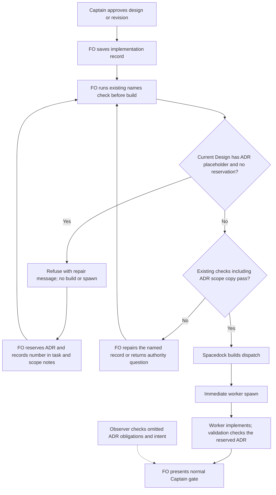

## Scope

- Source: the Captain 「全准」 (chat, 2026-10-28), answering FO's batch-8 closing sitting, item 二 (open two package tasks so a check refuses what FO kept getting wrong).
- Bite: seed-check-requires-schema-fields (#740, 2026-10-28): its design records the ruling as an ADR, the first implementation dispatch carried no number, and the worker had to ask FO; codex-reader-same-head-unresolved (#728, 2026-10-27): an enduring ruling shipped without an ADR, fixed later by #732. dispatch-carries-reserved-adr-number was closed because the existing check only covers a number already reserved.
- Upstream first: `scripts/dispatch_records.py` (`check_task_facts`), `scripts/number_guards.py`, README Number guards.

## Non-goals

- Checking prose quality or whether a summary is faithful; only the structure the README already states.

## Budget

- One package PR; no new script.

## Stop condition

- Per the Captain's 2026-10-29 ideation-gate revise, the actual candidate check refuses the original #740 design-with-placeholder/no-reservation dispatch and accepts its correctly reserved recovery. #728 is removed from the required replay. Preserve valid reservations and unrelated baseline verdicts; stop and return to FO if this requires semantic ADR classification, a universal declaration, a new lifecycle hook or an adopter migration. Batch ruling A leaves unobservable intent and omitted obligations with the observer.

## FO alignment

Alignment: needed before ideation; where the check runs is a package design choice.
Result: aligned at backlog: the Captain 「同意這些內容」 (chat, 2026-10-29) to FO's batch-10 backlog sitting, which asked 「決定：六張全照建議（五張進設計，被取代條件那張先留在待辦）？要改哪張直接說。」, approved the outcome and bounds in this file. Where the check runs is a package design choice ideation proposes and the ideation gate rules.
Surfaces: none
Visible change: none
Release review: not needed: workflow maintenance, on no journey map.
Reviewer: kc-dev-flow-2:chief-engineer opus 2026-10-29 — batch-10 review before the joint ideation sitting: approve, revise or cut each task, the Captain's decisions, overlap and order

## PRFAQ

**Proposition.** Before an implementation worker starts, FO's existing dispatch check will refuse a Pilot/Prod task whose current design explicitly lists an unnumbered `docs/adr/` deliverable but whose `## Number guards` reserves no ADR. FO reserves through the existing allocator, records the number, copies it into the dispatch, and reruns the existing check before building the worker prompt.

**Who benefits?** FO and the implementation worker: the worker no longer has to stop the #740-shaped assignment to request a number that the design already says it needs.

**Does this decide whether a ruling deserves an ADR?** No. Batch ruling A, accepted by the Captain on 2026-10-29, means the check covers observable structure and the observer keeps the remainder. #728, whose design named no new ADR, is explicitly removed from the required replay; an enduring ruling omitted from the design remains outside this check.

**Is this a new mandatory field or native Spacedock lock?** No. It repairs `check_task_facts` in the existing pre-build `--names` command. Success stays silent; the procedural boundary still depends on FO running and honoring that command. No universal ADR yes/none declaration, semantic classifier, auto-reservation, new script, new hook or new CI trigger is introduced.

## Design

This revision supersedes the earlier held design and resolves its sole scope question through the recorded ideation-gate revise. Authority: Captain 「照建議」, 2026-10-29, and `adr-reserved-when-design-names-one/review/ideation/briefing-1/index.json` question: refuse only a design naming a docs/adr placeholder without an ADR reservation; replay #740; drop #728. Earlier Stage Report bytes below are preserved. Profile remains Pilot, one package PR, `Surfaces: none`.

### Chain, source and prior decisions

1. **Spacedock first.** Read 0.27.3's own `skills/first-officer/references/fo-dispatch-core.md`: dispatch build owns assembly/state; successful build must be followed immediately by worker spawn. There is no package-specific ADR classifier there. Keep this check before build, with no operation inserted between build and spawn.
2. **Package next.** `git fetch origin` succeeded; source is `5725d495bb83a17ec13616bb5421bf5ffdc71f70`, released manifest 0.33.0. Loaded Codex package `/Users/kent/.codex/plugins/cache/kc-claude-plugins/kc-dev-flow-2/0.33.0`; its dispatch checker, number parser and laws checker byte-match source. `--names` calls `check_task_facts`; `--newest` calls only `check_names`; folder completeness and `--coverage` are separate paths. Only `implementation-1.md` currently compares existing reservations with scope notes, so an empty ADR set passes. `laws_check.py:l2_dispatch_record_complete` has a closed diagnostic grammar and must recognize the added error in the same change.
3. **Adopters last, read-only.** Relay `/Users/kent/conductor/workspaces/subspace-relay/dhaka` at `5c75e36b5b220c44911c4575286d24bd973d53f6` retains the prose reservation rule. Web `/Users/kent/conductor/workspaces/subspace-web/dev2-fo` at `485195ec9b30833a3b55e937d7598041932d312e` also contains the pre-build `--names` call. This corrects the earlier report's different web checkout observation; neither is a hosted-state claim. QNow's earlier report recorded local `278f79ca3eb03a8c1286817f542c4ec4b744bfed` with the same rule and pre-build command; that checkout was not located for a fresh read in this revision, so QNow remains a prior local observation, not refreshed proof. No adopter-specific mechanism is used as the authority for Spacedock behavior.
4. **Existing seam, not a replacement.** The exact #740 CLI replay below establishes the empty-set hole. Source searches covered the checker, allocator, workflow caller and historical consumer; native enforcement outside those paths is not claimed. Read Accepted ADRs 0002 (reservation ownership), 0017 (event-time history), 0020 (reading budget), 0025 (land or release a reservation), and 0027 (structured checks at the writer). The rejected phrase classifier in ADR 0027 stays rejected. State `Override:` records supplied no permission to revive it or the closed Captain-rulings ledger. This repairs existing obligations; no new ADR or number reservation is proposed for this task.

### Exact observable boundary

- Apply the new missing-reservation predicate only to `implementation-N.md` and `implementation-N-message-M.md`, for recorded Pilot/Prod tasks. Keep flat `<slug>.md` and folder `<slug>/index.md` lookup as today. Other record names/modes keep their existing behavior. POC retains its no-number rule and does not acquire this new refusal or an ideation requirement.
- Read the current design as the last top-level `## Design` section, permitting a title suffix beginning ` — ` or `: `, including its level-three/four subsections until the next top-level heading. Headings inside fenced blocks are not section boundaries. A design written under another title, a report-only obligation or a free-form ruling is not structurally classified by this slice; the observer still reads it. This is a documented parser bound, not a new mandatory design heading for every task.
- In that section, recognize an explicit path `docs/adr/<placeholder>-short-title.md`: `<placeholder>` is a nonempty single-line angle-bracket token; the title is nonempty and may itself contain a title placeholder. Support the existing `<FO-reserved-number>` and `<reserved number>` spellings, inline code, list items and table cells. Ignore fenced code blocks and blockquotes, including space-indented blockquotes. A numbered `docs/adr/0041-title.md` citation is not an unnumbered deliverable. Do not infer from the words ADR, ruling, approved, required, or none.
- An explicit matching path in the current Design is the entire signal; prose around it is not interpreted for intent, approval or negation. Put withdrawn alternatives outside the current Design or in quoted/fenced historical material through the existing authorized correction route. Do not silently delete a Captain obligation or an old report to make the check pass. This boundary can miss unusual forms or flag a literal example left in active design prose; that limitation is visible, not disguised as semantic proof.
- Refuse when this signal exists and the existing `number_guards.task_facts(task)['adr']` set is empty. Reuse the numeric parser and allocator; their existing grammar/collision limits remain. An unrelated migration number cannot satisfy it. A reserved ADR clears only this new predicate, not other existing checks.
- Preserve the existing scope-notes comparison exactly, including its implementation-1.md boundary for ADR and Migration. FO still copies the reservation into every dispatch as the current README instructs, but this slice does not add a new missing-copy refusal on continuation records. A missing/corrected reservation produces no automatic file edit or allocation.
- Emit one record-attributed line, preserving the established `<record>:<line>:` format. Proposed text: `record.md:1: design ADR placeholder has no reserved ADR; reserve with number_guards.py, record ADR: NNNN under '## Number guards', copy it into scope notes, then rerun this check`. Retain the matched task path/line in test evidence without adding a success banner. Existing scope-copy errors retain their existing vocabulary.
- Teach the laws consumer that this diagnostic is an L2 dispatch violation, not an unparseable result. It reads the task and dispatch as of the event commit using its existing temporary snapshot, not today's repaired task. Inputs: event commit, task bytes, dispatch bytes and filename, parser version, and the existing workflow/extension inputs for the other checks. No all-history sweep, permanent-red promise, backfill or new law is added; current push-range behavior remains.
- Releasing a number under ADR 0025 does not excuse a still-current placeholder obligation. If the Captain releases the deliverable, the authorized current design revision must remove that obligation while preserving prior reports/rulings. Numeric-path-only designs, obligations recorded only in feedback, authentication of Captain approval, and whether one reserved number is the correct decision remain outside this predicate.

### Journey and stops

The POC/no-placeholder branch reaches the existing checks; it does not bypass them. FO cannot turn an authority question into a self-approved design change. Prose/diagram comparison checks actors, order, refusal/retry and approval boundary; rendering was not exercised in this revision, so no rendered-preview claim is made.

### Historical replay and current evidence

Original #740 state commit: `09da6be7ad5aaf687ea3f80e9553f3efb525cc17`. Export `seed-check-requires-schema-fields.md` and `seed-check-requires-schema-fields/dispatch/implementation-1.md` with `git -C <state> show <commit>:<path>` into the same relative temporary layout, then run `python3 -B <package>/scripts/dispatch_records.py --names <temp>/seed-check-requires-schema-fields/dispatch/implementation-1.md`.

- Task SHA-256: `9cdb2a04175c91eb996fb8c314067cfd6fe5fe4636ef399b97fc0effa4288406`; record SHA-256: `5f80555583c521fc2f21cca8ea407d542335b8d371a8f34c934e8b1b40ae6c20`.
- Observed released checker: exit 0, empty stdout. A disposable design-predicate experiment extracted `docs/adr/<FO-reserved-number>-seed-admission-enforces-required-fields.md` from Design and found no Number guards section, so the proposed decision is refuse. This is feasibility evidence, **not a candidate CLI refusal**; implementation must exercise that exact raw pair without adding intent to it.
- Provider check succeeded: `gh pr view 740 --repo iamcxa/kc-claude-plugins --json number,state,mergeCommit` returned MERGED, `60896216d1c4ca842327e6a5beb2191a64993657`. No GitHub API failure occurred in this revision. Git supplies the replay bytes independently.
- #728 is removed from the acceptance replay and remains a stated uncovered omission. The earlier report is historical evidence, not a promise to refuse it.
- The previous ADR 0043 control and already-red renumbered/amendment records are retained as corpus inputs, not a claim that all current records are green. Candidate corpus comparison, continuation missing-reservation behavior and laws classification remain implementation/validation proof obligations.

### Words FO reads at each lifecycle moment

No workflow, mod, skill, extension, adoption wording or recurring output changes. Measured with `len(text.split())` against the pinned installed package and Spacedock 0.27.3, plus actual `test_pr_watch.TasksTests` output under its disposable GitHub/Spacedock stubs. These are bounded reading scenarios, not a live FO/GitHub execution. Proposed-after figures are design targets, not candidate measurements.

| Moment | Measured before | Proposed after | Included executed output |
| --- | ---: | ---: | --- |
| startup, feedback extension unlisted | 6967 | 6967 | open PR with existing codex-error output, 37 words |
| idle on that open PR | 870 | 870 | same 37 words |
| idle on a merged PR, learn unlisted | 833 | 833 | 0 words |
| after archive, learn listed | 333 | 333 | 5 words |
| merge ask, four validation gates waiting | 2408 | 2408 | 90 words |
| valid implementation dispatch | existing task/record and checks | same | new predicate adds 0 words |
| #740 refusal, before recovery | 0 diagnostic words | 27 diagnostic words | proposed exact line above; base CLI was silent |
| recovery reread after refusal | none from this predicate | 468 existing words plus 27-word diagnostic | FO steps: number guards; allocator output counted additionally at implementation |

Reading manifest: startup = full workflow (5754) + dev skill (763) + package mod (48) + upstream pr-merge startup (365) + output (37). Each idle = package mod (48) + upstream pr-merge idle (100) + workflow Delivery authority and Extensions (685) + output. After archive = mod (48) + learn extension (280) + output (5). Merge ask = Delivery authority/Extensions (685) + upstream fo-gate-lifecycle and present-gate skills (1633) + output (90). Exact newline headings select sections, not frontmatter mentions. Count each component once per arm. Host/runtime context and variable task/review content are held constant outside this bounded comparison, not asserted to cost zero.

Reproduce outputs by importing the shipped `test_pr_watch`, invoking `TasksTests.setUp`, and always `doCleanups`: use `readme('roborev, codex')`, `task('some-task', pr='o/r#7')`, then `tasks({'pr view 7': view('OPEN')})` or `view('MERGED')`; archive uses `readme('learn')`, `archive('some-task')`, merged view; merge ask uses four `gates((slug, 'validation', 'awaiting-captain'), ...)` rows a/b/c/d and `tasks({})`. These tests create only disposable repositories; no real repository config is written. Candidate repeats the same scenarios and includes every actual new diagnostic, allocator response and retry. No total reading reduction or workflow budget increase is claimed. CI files remain unchanged; cost per PR was not measured.

### Unresolved decisions

None for this revision. The Captain already accepted the narrow structural boundary and the #728 coverage loss. Recommend proceeding with that bounded design; what gets worse remains explicit: an omitted ADR obligation or an unrecognized design form can still escape, and an actual refusal adds recovery reading. If a real corpus case demands semantic classification, a universal new declaration, adoption migration or a native lock, stop and return that scope change to FO rather than widening this implementation.

### Batch overlap

Changed files proposed: `kc-dev-flow-2/scripts/dispatch_records.py` (predicate, its CLI contract), `scripts/test_dispatch_records.py` (raw replay, limits and positive controls), `scripts/laws_check.py` and `scripts/test_laws_check.py` (diagnostic classification/event snapshot), `VALIDATION.md` (evidence and remaining limits). All abbreviated paths in this paragraph are under `kc-dev-flow-2/`. No `number_guards.py`, workflow, mod, skill, CI, adopter README, ADR file, ADR index or number namespace change is proposed.

| Other task, plain meaning | Shared file/check; implementation consequence |
| --- | --- |
| seed-check-requires-alignment-result — seed alignment presence | design_surfaces.py's existing predicate is consumed by dispatch_records.py; rerun dispatch tests, no direct proposed file overlap except any shared VALIDATION.md evidence |
| captain-amendment-form-checked — amendment form and history | direct overlap in dispatch_records.py, test_dispatch_records.py, laws_check.py, test_laws_check.py and VALIDATION.md; integrate its shared parser first |
| adr-reserved-when-design-names-one — this task | owns the five proposed files above in future implementation; only this entity body/report now |
| validation-rerun-waits-for-captain-ruling — hold unresolved validation | direct dispatch checker/tests and laws consumer/tests overlap; preserve both diagnostic vocabularies |
| gate-requires-recorded-reviews — gate review presence | delivery_gate.py/workflow path; no direct runtime overlap, check shared VALIDATION.md if its final plan edits it |
| adoption-asks-which-extensions — event-time extension context | dispatch_records.py, test_dispatch_records.py, test_laws_check.py; preserve historical workflow resolution before this integration |
| adr-required-statement — old ruling ledger | Captain closed it 2026-10-20 despite stale validation status; no active overlap/dependency, do not import ledger or occupied number |
| adr-silent-undo-probe — ADR reversal experiment | moved to dev2-poc as adr-silent-undo-poc; old ideation copy is not dispatched; no shared proposed file |
| comment-check-reaches-delivery-gate — comment evidence gate | Captain closed it 2026-10-20; no active dependency or shared proposed runtime |
| journey-canvas-hosted-poc — hosted journey canvas | kc-journey-map files; no shared proposed file/check |
| journey-server-host-pilot — private journey server | read folder task index.md, validation; kc-journey-map server/host and docs; no shared file, useful folder-task corpus input |
| ops-inbox-r1-setup-and-isolation — isolated operations intake | kc-ops-inbox files; no shared file; its pre-renumber dispatch is an existing failure to preserve |
| pr-review-lite-value-pilot — bounded review experiment | kc-pr-flow review runtime/journey artifacts; no shared proposed file/check |

Read-only sibling snapshot was taken during concurrent state work (tip observed `ceea17cae7c3a2bfb9180aa07ad0eceae6f7c365`); task-status statements describe local records, not current hosted PRs. Recommended order: adoption's event-time context, amendment parser integration, this repair, then validation-rerun on the rebased checker; run combined dispatch/laws checks after each. Seed and gate-review work may proceed independently subject to evidence-file conflicts; do not wait on closed or unrelated tasks. Pilot boundary: no production obligation or implementation authorization is added by this report.

## Acceptance criteria

**AC-1** — Raw #740 replay refuses and recovery succeeds. Export the exact task/dispatch pair and SHA-256 values above; released base must remain exit 0/empty and candidate `--names` must exit 1 with the new diagnostic. In a separately labelled recovery fixture, reserve via the existing allocator, write its ADR line under Number guards and in scope notes, then require the new refusal to disappear. Falsifiers: remove the predicate call, delete the ADR line, supply only Migration, or leave only a scope-note number; the missing-reservation case must still fail. Current evidence: actual base CLI and structural design experiment only; candidate/allocator recovery unverified.

**AC-2** — Boundary and compatibility remain explicit. Exercise flat/folder tasks, first/repeated/message implementation records, Pilot/Prod and POC, the accepted placeholder spellings, lists/tables/inline code, fences and indented blockquotes, numbered citations, last Design versus superseded reports, no-placeholder tasks and authorized removal of the current obligation. Compare pinned committed task+dispatch corpora on base/candidate, listing each changed verdict and preserving pre-existing amendment/renumber failures. Existing correctly reserved tasks retain their baseline verdicts, including the existing first-record-only scope-copy check. Falsifiers: classify a historical/fenced ADR example, require a number for POC, let an unreserved placeholder on a continuation pass, or silently change folder/newest/coverage behavior. #728 is not a required refusal. Current evidence: source and sibling reads; candidate matrix/corpus unverified.

**AC-3** — Refusal reaches the existing caller and historical consumer. Run the actual candidate CLI before a disposable dispatch sequence; nonzero means zero build/spawn calls, and corrected input reaches the normal build/immediate-spawn sequence. Exercise laws L2 over the event commit: missing reservation is a violation, not Cannot; a later task repair must not change that earlier event snapshot's result within the same tested range. Include all verdict inputs listed in Design and preserve the existing before..after event policy. Falsifiers: disconnect check_task_facts, remove the diagnostic parser arm, read today's task instead of the event bytes, or test only a helper. Current evidence: actual base command and source wiring; candidate/native sequence and laws result unverified.

**AC-4** — Reading cost and instruction ownership stay bounded. Repeat the fixed lifecycle recipes on exact base/candidate source and executed outputs, including the refusal, allocator output, existing Number guards reread and retry. Require normal-path counts unchanged, no added success/polling output and no workflow-budget change; explain every measured failure-path addition. Falsifiers: omit moved text or diagnostic consumer output, report only workflow.md's size, or silently add a universal ADR disposition field. Current evidence: base counts 6967/870/833/333/2408, actual fixture outputs and proposed 27-word error; candidate/recovery totals unverified. CI cost per PR was not measured; no CI change is in scope.

## Stage Report: ideation

- FAILED: A design for refusing an implementation dispatch for a task whose approved design or ruling calls for an ADR until ## Number guards reserves an ADR number, in kc-dev-flow-2/scripts/dispatch_records.py (check_task_facts) beside the existing number checks; the #740 (seed-check-requires-schema-fields) and #728 (codex-reader-same-head-unresolved) records replayed as refused, and current tasks that reserved their numbers passing
  Historical 09da6be7 / 4fb24769 task-and-record pairs both return 0 in 0.33.0 --names; PR 728 names no new ADR obligation. A raw refusal would require an unapproved declaration requirement or semantic inference. No candidate refusal claimed.
- DONE: A `### Batch overlap` section naming each file the design would change and each other batch task (seed-check-requires-alignment-result, captain-amendment-form-checked, adr-reserved-when-design-names-one, validation-rerun-waits-for-captain-ruling, gate-requires-recorded-reviews) and live task of other sessions (adoption-asks-which-extensions, adr-required-statement, adr-silent-undo-probe, comment-check-reaches-delivery-gate, journey-canvas-hosted-poc, journey-server-host-pilot, ops-inbox-r1-setup-and-isolation, pr-review-lite-value-pilot (driven by other sessions; read only)) that changes the same file or check, so FO can order implementation
  Batch overlap above names all thirteen tasks, minimum four files and conditional contract/budget files; closed/moved tasks are distinguished from active work.
- SKIPPED: The words FO reads at each lifecycle moment, before and after, per root learning.md "Measure the words FO reads at each moment, not one file's size"
  No final mechanism/candidate exists pending the scope decision; lifecycle inventory above records unchanged base behavior and the exact future measurement scope, not invented numeric totals.
- DONE: Acceptance criteria with reproducible evidence clauses and falsifiers, and unresolved decisions for the Captain, each with a recommendation and what gets worse under it
  AC-1 through AC-4 give reproducible inputs, limits and falsifiers; one decision recommends narrowing the raw PR 728 refusal promise and explicitly states the missed-classification cost.
- DONE: AC-1 current-stage evidence
  Two original snapshots exercised, both base exit 0; candidate proof unverified, and adding intent to a fixture is explicitly forbidden as a raw-replay claim.
- DONE: AC-2 current-stage evidence
  ADR 0043 control returns 0; existing unrelated amendment/renumbering failures recorded separately; candidate corpus proof unverified.
- DONE: AC-3 current-stage evidence
  Source/caller inspection binds the existing --names seam and laws parser; native candidate proof unverified.
- DONE: AC-4 current-stage evidence
  Lifecycle measurement inputs specified; no candidate totals claimed and no CI change or measured cost per PR.

- DONE: Required design-surfaces invocation
  Supplied 0.33.0 design_surfaces.py check exits 0, 'design surfaces presentable'; this marker/AC check does not resolve the scope hold or prove an authored Mermaid, so no approval-gate readiness is claimed. git diff --check passes; prior task bytes/frontmatter are unchanged.

### Summary

Held: the assignment asks a structural check to reject an original record that never declares the new ADR obligation. FO must resolve the one scope/replay decision before the final design, numeric reading measurement and candidate refusal proof; this report does not authorize a new universal field, a prose classifier or revival of the closed ledger task. The original four checklist items are 2 DONE, 1 SKIPPED, 1 FAILED; current-stage evidence mappings are additional, not completion claims for future implementation.

## Stage Report: ideation

- DONE: Revise the design under the Captain's ideation-gate revise of 2026-10-29 (「照建議」; the asks are in the gate question): refuse only a design that names a docs/adr placeholder with no ADR reserved under ## Number guards; replay #740 as refused; drop the #728 replay; batch ruling A applies; update criteria and the stop condition to match
  Current PRFAQ/Design, AC-1 through AC-4 and Stop condition implement the accepted narrow scope; exact #740 released CLI exits 0, design predicate identifies the missing reservation, and candidate CLI refusal remains explicitly owed at implementation; #728 is removed, not relabelled as caught.
- DONE: A `### Batch overlap` section naming each file the design would change and each other batch task (seed-check-requires-alignment-result, captain-amendment-form-checked, adr-reserved-when-design-names-one, validation-rerun-waits-for-captain-ruling, gate-requires-recorded-reviews) and live task of other sessions (adoption-asks-which-extensions, adr-required-statement, adr-silent-undo-probe, comment-check-reaches-delivery-gate, journey-canvas-hosted-poc, journey-server-host-pilot, ops-inbox-r1-setup-and-isolation, pr-review-lite-value-pilot (driven by other sessions; read only)) that changes the same file or check, so FO can order implementation
  Five proposed files and all thirteen named tasks are mapped; order is adoption context, amendment parser, this repair, validation rerun; closed/moved tasks are not dependencies and no sibling was edited.
- DONE: The words FO reads at each lifecycle moment, before and after, per root learning.md "Measure the words FO reads at each moment, not one file's size"
  Executed shipped watcher fixtures and counted the declared instruction corpus: base 6967/870/833/333/2408; proposed normal path equal, new error 27 words plus 468-word existing recovery reread; candidate/allocator totals remain future proof, no CI cost measured.
- DONE: Acceptance criteria with reproducible evidence clauses and falsifiers, and unresolved decisions for the Captain, each with a recommendation and what gets worse under it
  AC-1 through AC-4 bind original bytes, compatibility, the caller/laws seam and lifecycle reading; no unresolved decision remains after the recorded revise; missed semantic omissions and failure-path reading are explicit costs.
- DONE: AC-1 current-stage evidence
  Original #740 task/record digests and CLI exit/stdout reproduced; deleting the proposed predicate would leave that baseline acceptance unchanged, so actual candidate refusal/recovery must still be proved and is not claimed here.
- DONE: AC-2 current-stage evidence
  Number parser, supported record paths and sibling contracts read; matrix and frozen corpus comparison unverified until implementation; historical/fenced examples and POC refusal are named false-positive falsifiers.
- DONE: AC-3 current-stage evidence
  Pre-build caller, immediate-spawn ownership and L2 closed diagnostic grammar read; actual base CLI exercised; candidate sequence/laws proof unverified, with disconnect/parser-arm/event-time mutations specified.
- DONE: AC-4 current-stage evidence
  Fixed watcher scenarios executed under provider stubs and instruction counts recomputed; candidate rerun must catch any normal-path increase or omitted refusal/allocator/retry text.
- DONE: Required design-surfaces invocation and state boundaries
  Supplied 0.33.0 design_surfaces.py check exits 0, 'design surfaces presentable'; git diff --check passes; frontmatter, original report and sibling files preserved; no product implementation, ADR reservation or gate mutation performed.

### Summary

Cycle 2 supersedes the earlier held report: the Captain's narrowed structural design is complete, with PRFAQ/Mermaid, four criteria, updated stop condition, all named overlaps and measured baseline reading. Source remains origin/main 5725d495bb83a17ec13616bb5421bf5ffdc71f70 / package 0.33.0; GitHub #740 read succeeded, while QNow was not freshly relocated and diagram rendering was not exercised. Candidate refusal, full compatibility and native orchestration remain implementation/validation evidence, not design-stage passes; Pilot scope and Captain gate authority remain unchanged.
