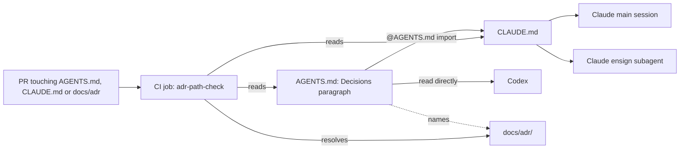

## Scope

- Source: finding relayed by the decision-log Paseo session (agent 1bcf070c, 2026-10-20), compared against "The ADR your agent never read" (https://tianpan.co/blog/2026/07/02/the-adr-your-agent-never-read). Captain ruling in this session: 「ADR 部分按你說的做」 (2026-10-20), approving FO's proposal 「在 dev2 開一張待辦任務，不開 GitHub issue。做法照你說的，從各 repo 這一層下手」: an instruction-file pointer to `docs/adr`; a hook that lists every ADR title at session start or dispatch, derived from the files so it cannot go stale; a check that the ADR paths AGENTS.md and CLAUDE.md name resolve; this repository and qnow first; a package rule only after the effect is measured.
- Bite, read 2026-10-20: qnow origin/next AGENTS.md lines 24-27 point agents at branch `docs/qnow-target-architecture-adr`, which `git ls-remote` does not find, while `docs/adr/0001-qnow-target-architecture.md` exists on `next` at 165414 bytes (handed to the qnow FO the same day); kc-claude-plugins origin/main CLAUDE.md and AGENTS.md mention ADR 0 times.
- Present in kc-dev-flow-2 0.26.0 (per the relayed finding, to re-read at ideation): verbatim Words/Options/Recommended, FO decision records, ideation reads ADRs in its area, the Precedent rule, comments cite ADRs, `adr_lint.py` checks a Superseded-by target exists. Missing: the implementation worker is not told to read ADRs; no way to find the ADRs "in its area"; validation checks format, not contradiction; no staleness audit or size limit.
- Upstream first: Spacedock and kc-dev-flow-2 hooks and dispatch; ADR 0003 (adopter-owned hooks); the kc-decision-log CLI (PR #681, planning) may later serve as the find-and-read tool; merge-guard-stops-unasked-merges also adds adopter hooks, so the two designs share a hook layout.
- Non-goals: splitting qnow's 165 KB ADR 0001 (qnow's call); contradiction checking at validation unless measurement shows the pointer and list are not enough.

## FO alignment

Reviewer: kc-dev-flow-2:engineering-reviewer opus 2026-10-22 — do these amendments withdraw what the Captain approved, and what changes in the build?

Correction (FO, 2026-10-21): the ideation gate resolution reason recorded 2026-10-21 reads "add  to CLAUDE.md" because a shell substitution dropped the token; the Captain's D3 ruling is to add one `@AGENTS.md` import line to CLAUDE.md, as the quoted 「可以」 answered.

Peer: kc-decision-log (renamed kc-adr) = Paseo agent 1bcf070c (Captain asked 「可以，但也找adr fo討論一下」, 2026-10-21). Asked: whether the hook slot and later S30 swap match D10/S30, whether the hook should call or avoid duplicating anything of theirs, and any Codex or adopter conflict. Answered 2026-10-21: (1) the slot and swap match; titles from each ADR's H1 are right; nothing needed from them now. (2) Their P1 CLI is dropped; their POC dev2-poc `adr-read-and-route-poc` (96 runs, Claude sonnet and Codex gpt-6.1-sol high) found agents read the governing ADR before deciding in every arm including no help (35/35); the real gap was placing new information (Claude 6/10 to 9/10 with a skill, Codex 5-6/10). The pointer and hook should list titles and say where ADRs live and when to look, never restate an ADR's Decision text. (3) No conflict with a pointer-only AGENTS.md; Codex 0.162.1 silently skipped an untrusted SessionStart hook, so a Codex hook needs a one-time per-project trust step. FO to check their POC record before relying on the 35/35 figure.

Alignment: needed at ideation; which adopters and which hook moment are his to accept.
Result: aligned 2026-10-21 at the batch-5 sitting through D1 to D4 (recorded in the ideation gate resolution reason): first adopters this repository (qnow as its own task), no title hook now (reopen: dev2-poc task moment-of-use-rules-long-session-poc, which exists in the dev2-poc state checkout, not this one), pointer in a new AGENTS.md imported by CLAUDE.md, path check as a path-filtered non-required CI job.
Surfaces: none
Visible change: none
Outside this repository's surfaces: each first adopter's AGENTS.md or CLAUDE.md and its user- or repo-level hook files (this repository and qnow).

## Captain amendments

### Amendment 1 — 2026-10-22, chat
Captain: 「問題是 qnow 那種錯誤是怎樣發生的？」 then 「ADR 讀取那張，路徑檢查改成「禁止指向分支」」 (chat, 2026-10-22, batch-5 sitting)
Asked: 「我改建議用這個更簡單的做法：檢查程式遇到「指向分支」的寫法就直接報錯，要求改成指向主線上的檔案；不去遠端查分支是否存在。」
Supersedes: AC-4
Design: the path check refuses any ADR reference that names a branch or other ref (a `git show REF:path` form) with a reason telling the author to point at the file on the trunk; it does not fetch or resolve refs. A plain repository path is checked for existence. The remote-resolution half of the design is dropped.
Superseded text: **AC-4**: The path check resolves, and fails for the stated reason. Evidence: `python3 scripts/adr-path-check.test.py` exit 0, one case each, each asserting the printed reason: good path 0; missing file 1 `no such file in the tree`; `docs/adr` removed 1 `directory missing or holds no NNNN-*.md`; ref on origin 0; tag 0; ref only in a local branch 1 `not a branch or tag on origin`; `docs/adr/NNNN-x.md` placeholder 0; a fixture holding the five stale lines of qnow's pointer (generic branch name) 1. Falsifiers (run once each by the implementation worker, reported): replace the fetch resolver by `git cat-file -e REF:PATH` and the local-only case turns red; make the directory test always pass and the removed-directory case turns red; make the printed reason empty and every failing case turns red. Current: prototype run 2026-10-21 (above), test file not written.
Override: recommended resolving refs against origin (design D1 option A); Captain chose refusing branch refs; area: ADR path check

## Design

Revision (cycle 2, 2026-10-21): the Captain's gate ruling `revise` removes the title hook (cycle 1 `SessionStart`/`SubagentStart` script, +451 words), keeps the pointer and the named-path check, puts the pointer in a new `AGENTS.md` with one `@AGENTS.md` import line in `CLAUDE.md`, limits the pointer to where ADRs live and when to look, lands qnow as its own task, and runs the check as a path-filtered, non-required CI job. The `## Scope` bullets that describe the hook are the original request and stand as history. The hook's reopen is the dev2-poc task `moment-of-use-rules-long-session-poc`; no task of that name exists in the state checkout today (`ls` 2026-10-21), so FO files it.

Alignment note: `## FO alignment` records `Alignment: needed at ideation` and carries no `Result:` line; FO records the result before `gate prepare`, as in cycle 1.

### Chain check (2026-10-21)

- Spacedock 0.27.2: `spacedock --help` lists nothing about ADRs or instruction files. kc-dev-flow-2 at origin/main c27e765: `git grep -n -E 'AGENTS\.md|CLAUDE\.md' origin/main -- 'kc-dev-flow-2/scripts/*.py'` finds no non-test script that reads either file, and `adr_lint.py` (docstring: "Check a docs/adr directory against the dev2 ADR format") reads only `docs/adr`. Nothing checks that an instruction file's ADR path resolves, and nothing tells a worker where ADRs live. Completeness of the missing parts: not found by these two searches.
- Peer boundary rule (kc-adr/kc-decision-log, relayed 2026-10-21; its task `kc-decision-log-cli` states it as "Instruction files point, they do not restate"): the pointer says where ADRs live and when to look, never an ADR's Decision text. This design follows it.
- ADR 0003 (the adopter, not the package, owns hooks) no longer bears: this design ships no hook. ADR 0020 budgets the workflow README (`lint-skills.py`), not `CLAUDE.md`; the word rise below is disclosed anyway.
- Sibling adopters (read-only, 2026-10-21): qnow `origin/next` 348a79d69 `AGENTS.md` lines 24-27 still point at `docs/qnow-target-architecture-adr`; `git ls-remote --heads origin docs/qnow-target-architecture-adr` returns 0 heads, while a local branch of that name exists in `~/conductor/repos/qnow`. qnow is its own task (Captain, D2).
- This repository, `git ls-tree -r --name-only origin/main`: no `AGENTS.md`; `CLAUDE.md` and the five plugin `CLAUDE.md` files name `docs/adr` or ADR 0 times (`grep -c -i -E 'docs/adr|\bADR\b'`); `docs/adr/` holds 28 `NNNN-<slug>.md` files whose slug is the title.

Observed facts (2026-10-21, Claude Code 2.1.305, Codex CLI 0.162.1, scratch repo `/tmp/adrprobe2/imp` with `CLAUDE.md` = `@AGENTS.md` and a marker sentence in `AGENTS.md`):
- `claude -p --model haiku` answered the marker; a `general-purpose` subagent answered it; a real `subagent_type: spacedock:ensign` call answered it. So the import reaches the main session and an ensign.
- `codex exec -s read-only` answered the marker from `AGENTS.md` alone.
- Control: the same `AGENTS.md` with a `CLAUDE.md` that has no import line: `claude -p --model haiku` answered `NONE`. So the import line is what carries the paragraph to Claude Code.
- Not probed: after-compaction reload of `CLAUDE.md`, and a Codex subagent.

### PRFAQ

Press release: every Claude session and ensign in this repository, and every Codex session, now opens with one short paragraph saying decisions are ADRs in `docs/adr/` and to read the one whose title covers what it is about to decide. A CI job refuses a pull request whose `AGENTS.md` or `CLAUDE.md` names an ADR path or `git show REF:path` that does not resolve.

FAQ
- Does an agent now read the ADR when it decides? Not guaranteed, and this task does not claim it. The paragraph reaches the agent (probed); opening the file stays the agent's act. The peer's 96-run POC found the governing ADR read in 35 of 35 runs with no help (relayed, not re-verified here), so the pointer's marginal effect is unmeasured and may sit at a ceiling. That goes to the PR's `without-it unanswered`.
- Why no title list? Ruled out for now; the long-session POC reopens it.
- What breaks without each part? Pointer: qnow shows the failure of a hand-written pointer (stale branch, 0 heads on origin); this repository has no pointer at all (0 hits), which is the recorded gap. Check: it is the only part that would have caught qnow's stale pointer. Import line: without it Claude Code does not see `AGENTS.md` (control probe above answered `NONE`).
- What does it cost? +40 words at FO start and each ensign start (below); one path-filtered CI job per matching PR, minutes not measured (AC-5 records the run).

### Mechanism

1. `AGENTS.md` (new, repo root), 39 words:

       # AGENTS.md

       ## Decisions

       Decisions that bind this repository are ADRs: one file each in `docs/adr/`, named `NNNN-<title>.md`. Before you decide or recommend something a title could cover, run `ls docs/adr` and read the file whose title covers it.

2. `CLAUDE.md`: one added line at the end, `@AGENTS.md`. Nothing else in `CLAUDE.md` moves; moving the rest is task `agents-md-holds-instructions`.
3. `scripts/adr-path-check.py` (Python 3 standard library, run as `python3 -I scripts/adr-path-check.py`) over every tracked `AGENTS.md` and `CLAUDE.md`: (a) each `docs/adr/<name>.md` path named must exist in the tree; (b) each `git show REF:docs/adr/...` must resolve: `HEAD` or a 40-hex SHA by `git cat-file -e`, any other REF by `git fetch --depth=1 origin refs/heads/REF` (then `refs/tags/REF`) and `git cat-file -e FETCH_HEAD:path`, so a branch that exists only locally fails; (c) a bare `docs/adr/` named must exist and hold a `NNNN-*.md`. `NNNN` and `<...>` placeholders are not paths. Exit 1 prints file, reference and reason, one line each.
4. `scripts/adr-path-check.test.py`: fixture repo plus a local bare `origin`; one case per row of AC-4, each asserting the printed reason, not only the exit code.
5. `.github/workflows/adr-path-check.yml`: `on.pull_request.paths` = `AGENTS.md`, `CLAUDE.md`, `**/AGENTS.md`, `**/CLAUDE.md`, `docs/adr/**`, `scripts/adr-path-check*`, the workflow file; `permissions: contents: read`; checkout pinned like `kc-dev-flow-2-tests.yml` (`persist-credentials: false`); two steps, the test then the check. Not added to branch protection (Captain, D4). The repository's required check `marketplace-parity.yml` carries a comment explaining why a required check must not be path-filtered; this job is not required, so the filter is safe.
6. No ADR lands: one paragraph, one import line and one non-required job are cheap to reverse and the Captain's words are in the gate record. No `## Number guards` entry.

Prototype (not a deliverable, `/tmp/adrprobe2/proto/adr_path_check.py`, 2026-10-21): on a scratch repo holding qnow `origin/next` 348a79d69's `AGENTS.md` with qnow's real `origin` URL, the stale text exits 1 with `ref docs/qnow-target-architecture-adr is not a branch or tag on origin`. On a fixture with a bare `origin`: good path 0, branch on origin 0, tag 0, bare `docs/adr/` 0, missing file 1 "no such file in the tree", local-only branch 1, and a plain `git cat-file -e localonly:path` on the same text succeeds (the false pass the fetch resolver avoids). The candidate `AGENTS.md` and `CLAUDE.md` over `docs/adr` from origin/main c27e765: exit 0. Defect found in the prototype: with `docs/adr` deleted it crashed with a traceback and exit 1, so exit 1 alone proved nothing; AC-4 asserts the reason text.

Bite and consumer: bite: qnow's stale pointer (above) and this repository's absent pointer. Consumers: every Claude session, ensign and Codex session in this repository (the paragraph); the CI job (the check); and qnow's own task, which copies the script (the only place the `git show REF:` form can bite today; this repository names no ref, so here the check guards only that `docs/adr/` exists and holds ADR files).

### Words FO reads at each moment

Rule (root learning.md "Measure the words FO reads at each moment, not one file's size"): `len(text.split())` over every passage that instructs a step due at the moment, same count for base and candidate. Counted 2026-10-21 with `wc -w` and Python `len(text.split())` on origin/main c27e765 `CLAUDE.md` (1,314) against the candidate files built in `/tmp/adrprobe2/cand` (`CLAUDE.md` 1,315, `AGENTS.md` 39).

| Moment | Base | Candidate | Change |
| --- | --- | --- | --- |
| FO startup, also resume, clear, fork | workflow text (513 at 0.22.1, not recounted) plus `CLAUDE.md` 1,314 | same plus `CLAUDE.md` 1,315 and `AGENTS.md` 39 | +40 |
| Each ensign start | dispatch file plus `CLAUDE.md` 1,314 | same plus 1,315 and 39 (ensign sees the import: probed) | +40 |
| After compaction | not probed | at most +40 if the host reloads `CLAUDE.md` | at most +40 |
| Idle on an open PR | unchanged text | unchanged | +0 |
| Idle on a merged PR | unchanged text | unchanged | +0 |
| After the archive | unchanged text | unchanged | +0 |
| The merge ask | unchanged text | unchanged | +0 |

Cycle 1 added +451 at the same startup and ensign moments; the hook's removal takes that to +40. No workflow README, mod, skill or script output is edited, so the four non-start rows are equal by construction (AC-6 lists the changed paths; AC-7 recounts).

### Needs decision

The five rulings (no hook, pointer in `AGENTS.md` with the import line, pointer-only boundary, qnow separate, non-required path-filtered job) are the Captain's and are not reopened. Two choices remain:

- **D1: does the `git show REF:path` form belong in this repository's script?** Plainly: this repository names no ref, so only qnow can use that part. Options: (A) build it now, tested by fixtures; (B) check only file paths and the bare directory here, and let qnow's task add the ref form. Recommend A: the recorded bite is a ref form, and a script without it would not have caught it; qnow's copy then stays one file. Worse under A: about half the script serves a consumer outside this repository and is exercised here only by fixtures.
- **D2: does a behaviour measurement gate this task?** Plainly: whether the pointer changes what an agent reads is not measured here, and the peer's POC found reading at 35 of 35 without help. Options: (A) no gate; the PR body lists the unmeasured effect under `without-it unanswered`; (B) a two-arm run (no pointer, pointer; n=5; metric: opened the governing ADR before its first Edit) must run before the PR opens. Recommend A: the peer's ceiling means B would likely show no difference, and the Captain already kept the pointer. Worse under A: the repository ships a paragraph whose read-effect is unknown, and the PR cannot say it works, only that it reaches the agent.

Past rulings: the Captain's batch-5 sitting words are in the gate record above (D1-D4); `git -C <state> grep -n 'Override:'` finds none about instruction-file pointers beyond them.

### Limits

- The paragraph reaches the agent; reading the ADR stays the agent's act and nothing checks it.
- The check sees path and `git show REF:` forms only. Prose such as "the ADR lives on branch X" with no path is not detected.
- Fetching a named ref needs network at check time; in CI a deleted or renamed branch fails the job, which is the intended signal.
- `CLAUDE.md` reload after compaction and Codex subagent loading are unprobed; the plugin-level `CLAUDE.md` files name no ADR and are not changed.
- A non-required job can be merged past (Captain's D4).
- Non-goals: any title list or hook; a package script, rule or `adoption.md` section; qnow, relay and web edits; moving the rest of `CLAUDE.md` (`agents-md-holds-instructions`); splitting qnow's ADR 0001.

### Batch overlap

Files this design changes: `AGENTS.md` (new), `CLAUDE.md` (one line), `scripts/adr-path-check.py` (new), `scripts/adr-path-check.test.py` (new), `.github/workflows/adr-path-check.yml` (new). No `docs/adr/` file, package path, `docs/dev2/` path, `.claude/` or `.codex/` file. Checked 2026-10-21 by grepping each task file in the state checkout for `CLAUDE.md|AGENTS.md`, `.github/workflows` and `docs/adr`.

- new-work-starts-from-a-story-map (ideation): no shared file. Its overlap table lists "agent-reads-governing-adr (one new ADR)" in `docs/adr/`; this revision lands no ADR, so that row is now wrong and FO should drop it.
- codex-reader-reads-receipt-marker: no shared file (`extensions/codex/`, `pr_watch.py`; it mentions `.github/workflows` in its own text, not as a file it changes).
- merge-ask-holds-missing-clauses: no shared file (`delivery_gate.py`, `role_triggers.py`).
- fo-write-checks-parse-top-level: no shared file.
- idle-names-failing-seeds: no shared file.
- agent-reads-governing-adr: this task.
- agents-md-holds-instructions (backlog; not in the dispatch list, same files): it moves the rest of `CLAUDE.md` into `AGENTS.md`, so it must land after this one and keep the `## Decisions` paragraph; the check reads both files, so it survives the move unchanged. Land this first.
- kc-decision-log-p1: no task file in the state checkout (`ls`, 2026-10-21); no shared file known. kc-decision-log-cli (ideation): its text states the pointer-only rule and a placement rule naming `CLAUDE.md or AGENTS.md`, edits neither file. kc-decision-log-handoff-trial (backlog): none.
- pr-review-lite-value-pilot (implementation): its text records an immutable target tree with `CLAUDE.md` files and no tracked `AGENTS.md`; this change creates an `AGENTS.md` on `main` only, so the frozen target is unaffected unless the pilot re-reads `main`; FO confirms before ordering.
- release-acceptance, journey-server-host-pilot: no task file in the state checkout; none known. journey-canvas-hosted-poc: none.
- merge-guard-stops-unasked-merges (backlog): none now (no hook is added here).

Recommended order: this task before agents-md-holds-instructions; otherwise no ordering constraint.

## Acceptance criteria

**AC-1**: The pointer exists, is short and restates no ADR. Evidence: `AGENTS.md` holds the `## Decisions` paragraph; `python3 -c 'print(len(open("AGENTS.md").read().split()))'` prints a number at most 45; for every file in `docs/adr/`, its slug (name without number and `.md`) is not a substring of `AGENTS.md` or of the lines `git diff origin/main -- CLAUDE.md` adds. Falsifier: add one ADR slug to the paragraph and the substring step fails. Current: draft is 39 words, no slug (checked on `/tmp/adrprobe2/cand`).
**AC-2**: `CLAUDE.md` changes by one added line, `@AGENTS.md`. Evidence: `git diff --numstat origin/main -- CLAUDE.md` prints `1	0	CLAUDE.md`. Falsifier: any other count. Current: built in the scratch copy; the committed file not yet.
**AC-3**: The pointer reaches the main session, an ensign and Codex. Evidence: in a clean checkout of the candidate, `claude -p --model haiku` asked "which command do your project instructions tell you to run before deciding?" answers `ls docs/adr`; the same question through a `subagent_type: spacedock:ensign` call answers it; `codex exec -s read-only` answers it. Falsifier: delete the `@AGENTS.md` line and the Claude main and ensign answers lose it (Codex still has it). Current: probed 2026-10-21 with a marker sentence in a scratch repo (main, `general-purpose`, `spacedock:ensign`, Codex all returned it); committed files not yet.
**AC-5**: The job runs on the intended pull requests only and is not required. Evidence: on the implementation PR, a commit adding a nonexistent `docs/adr/` path to `AGENTS.md` gives a red `adr-path-check` run and the fix commit a green one (`gh run list --workflow adr-path-check.yml`); a push touching only an unrelated file starts no run of it; `gh api repos/iamcxa/kc-claude-plugins/branches/main/protection/required_status_checks --jq '.contexts'` does not list it; the green run's duration is recorded as the cost. Falsifier: the broken path runs green, an unrelated push starts the job, or the context is listed as required. Current: not run; cost not measured.
**AC-6**: The change reaches nothing else. Evidence: `git diff --name-only origin/main` lists exactly the five paths in `### Batch overlap`; no path under `kc-dev-flow-2/`, `docs/dev2/`, `docs/adr/`, `.claude/` or `.codex/`. Falsifier: any other path. Current: not yet verified.
**AC-7**: Words are recounted with an independent copy of the counting script. Evidence: base (origin/main) against candidate gives FO startup +40 and ensign start +40 (these two numbers are the measured ones; a different count is reported as measured), and the four non-start moments' texts byte-equal because AC-6's list touches none of them; the report states that the rise is disclosed and that ADR 0020 does not cover `CLAUDE.md`. Falsifier: a differing non-start text, or a startup delta above 45. Current: 1,314 to 1,354 measured in the scratch copy; recount at the candidate not yet run.

**AC-8** (Amended by Captain, amendment 1; replaces AC-4) The path check passes a trunk path and refuses for the stated reason. Evidence: `python3 scripts/adr-path-check.test.py` exit 0, one case each asserting the printed reason: an existing `docs/adr/` path exits 0; a missing path exits 1 naming it; a `git show <branch>:docs/adr/...` reference exits 1 with a reason that says to point at the file on the trunk, with the branch present locally and absent on origin alike. Falsifier: resolving the ref (the branch case exits 0 when the branch exists locally), or exit 1 without the reason.

## Stage Report: ideation

- DONE: Design the adopter-level pointer, the derived ADR-title hook and the named-path check for this repository and qnow, reading the cited article and the kc-decision-log P1 brief's non-goal on hooks (D10); bring the hook moment and the first adopters back as decisions for the Captain
  `## Design` (Chain check, Mechanism, Flow); article read in full (names no hook, list or check); D10 read in `docs/journey/kc-decision-log` p1-development-brief.md and slice-map.md at origin/main; D1 hook moment and D2 qnow landing with D3, D4 in `### Needs decision`; adopters shown as settled by his 「ADR 部分按你說的做」.
- DONE: A `### Batch overlap` section naming each file the design would change and each other batch task (new-work-starts-from-a-story-map, codex-reader-reads-receipt-marker, merge-ask-holds-missing-clauses, fo-write-checks-parse-top-level, idle-names-failing-seeds, agent-reads-governing-adr) and live task of other sessions (kc-decision-log-p1, kc-decision-log-cli, kc-decision-log-handoff-trial, pr-review-lite-value-pilot, release-acceptance, journey-canvas-hosted-poc, journey-server-host-pilot (driven by other sessions; read only)) that changes the same file or check, so FO can order implementation
  `### Batch overlap`: no file or check shared with any listed task; shared ADR index with release-acceptance; merge-guard-stops-unasked-merges added (adopter hook layout); recommended order line present.
- DONE: The words FO reads at each lifecycle moment, before and after, per root learning.md "Measure the words FO reads at each moment, not one file's size"
  `### Words FO reads at each moment`: five moments plus compaction and ensign start; startup +451 (this repository) / +712 (qnow), compaction +417 / +694, ensign start +451 / +712, four other moments +0; base figures are the archived 0.22.1 recount, not recounted (AC-9 does).
- DONE: Acceptance criteria with reproducible evidence clauses and falsifiers, and unresolved decisions for the Captain, each with a recommendation and what gets worse under it
  `## Acceptance criteria` AC-1 to AC-9 each carry evidence and a falsifier; `design_surfaces.py check` exit 0 from the 0.27.0 root and from the loaded 0.26.0 root ("design surfaces presentable"); D1 to D4 each with a recommendation and what gets worse. Per criterion, current evidence:
  AC-1: prototype only (28 / 40 ADRs, 417 / 694 words), script not written. AC-2: not yet verified. AC-3: not yet verified (cap rule from docs; no 200-ADR run). AC-4: plumbing verified 2026-10-21 with probe strings (SessionStart to main only, SubagentStart to `spacedock:ensign` payload and matcher scoping); committed files and `compact` source not yet verified.
  AC-5: not yet verified. AC-6: prototype run on qnow `origin/next` 012e079: stale text flagged by the remote-only resolver, passed by a plain `git cat-file` because a local branch exists; script not written. AC-7: not yet verified, cost not measured. AC-8: not run. AC-9: inputs measured, recount not run.

### Summary

The design puts the work in each adopter, not the package: a one-paragraph pointer, a byte-identical standard-library script run by `SessionStart` and by `SubagentStart` on ensigns (probed: each reaches only its own party), and a path-filtered CI check that resolves ADR paths and refs against remotes and tags only, because a local-only branch hid the qnow bite. The notable costs are a deliberate word rise at session and ensign start (D1) and an effect nobody has measured yet (AC-8 gates any package rule). `## FO alignment` carries no `Result:` line; this worker read checklist item 1 as the alignment and designed, and FO records the result before `gate prepare`. Package note: `Skill(kc-dev-flow-2:ideation)` loaded from the orphaned 0.26.0 cache while the dispatch names 0.27.0; I ran `design_surfaces.py check` from both roots and both exit 0 (the `### Batch overlap` rule exists only in 0.27.0 `principles.md`), so FO's choice of root changes nothing here.

## Stage Report: ideation (cycle 2)

- DONE: Redesign per the Captain's rulings in the ideation gate resolution reason (revise, 2026-10-21): no title hook (remove it from the design, criteria and word counts, and name the dev2-poc long-session POC as its reopen); keep the pointer and the named-path check; the pointer lives in a new AGENTS.md and CLAUDE.md gains one `@AGENTS.md` import line; the pointer only says where ADRs live and when to look and restates no ADR text (kc-adr peer's boundary rule); qnow lands as its own task, not here; the path check runs as a path-filtered, non-required CI job; rewrite the criteria to match and recount the words FO reads
  `## Design` rewritten (hook, settings, byte-identical copy and ADR removed); pointer 39 words plus one import line; check script with fetch-based ref resolver; non-required path-filtered job; AC-1 to AC-7. Probes 2026-10-21 in `/tmp/adrprobe2`: import reaches `claude -p`, `general-purpose` and `spacedock:ensign` subagents and `codex exec`; without the import Claude answers NONE. The dev2-poc task `moment-of-use-rules-long-session-poc` does not exist in the state checkout, so FO files it.
- DONE: A `### Batch overlap` section naming each file the design would change and each other batch task and live task of other sessions that changes the same file or check, so FO can order implementation
  `### Batch overlap`: five files; agents-md-holds-instructions shares `CLAUDE.md`/`AGENTS.md` (this first); new-work-starts-from-a-story-map lists a new ADR from this task that no longer exists (FO drops that row); pr-review-lite-value-pilot frozen-target note; release-acceptance, journey-server-host-pilot and kc-decision-log-p1 have no task file in the state checkout.
- DONE: The words FO reads at each lifecycle moment, before and after, per root learning.md "Measure the words FO reads at each moment, not one file's size"
  `### Words FO reads at each moment`: `CLAUDE.md` 1,314 to 1,315 plus `AGENTS.md` 39, so startup and each ensign start +40 (was +451 in cycle 1), compaction at most +40 (unprobed), four other moments +0 by construction; counted with `wc -w` and `len(text.split())`; AC-7 recounts.
- DONE: Acceptance criteria with reproducible evidence clauses and falsifiers, and unresolved decisions for the Captain, each with a recommendation and what gets worse under it
  AC-1 to AC-7, each with evidence, falsifier and current state (prototype exit codes and reasons measured for the check; AC-2, AC-3 committed files, AC-5 CI run and cost, AC-6 not yet verifiable at ideation). Decisions: D1 whether the `git show REF:` form ships here (recommend A, build it), D2 whether a behaviour measurement gates the task (recommend A, no; peer's 35 of 35 ceiling). The Captain's five rulings are not reopened.

### Summary

The design shrinks to a 39-word `AGENTS.md` paragraph, one `@AGENTS.md` line in `CLAUDE.md`, a standard-library check script with a test, and a path-filtered non-required CI job; the startup rise falls from +451 to +40 words. The check's `git show REF:` form can bite only on qnow today, which D1 states; the pointer's read-effect is unmeasured and goes to `without-it unanswered` (D2). `## FO alignment` still carries no `Result:` line; FO records it before `gate prepare`.

## Stage Report: implementation

- DONE: One Draft PR (feat(scripts): ...) from a branch off origin/main (7244594bef4e1c9c42db0ed8ff42509ba6d48dd3) implementing the cycle-2 design with Captain Amendment 1; only the five files
  iamcxa/kc-claude-plugins#698 (Draft), head 589c54e5, base 7244594b; `git diff --name-only 7244594b` lists AGENTS.md, CLAUDE.md, scripts/adr-path-check.py, scripts/adr-path-check.test.py, .github/workflows/adr-path-check.yml (AC-6); AC-2 `git diff --numstat` prints `1 0 CLAUDE.md`. Net diff is the five files: commits fae04b78 (red probe) and 589c54e5 (its revert) cancel.
- DONE: AC-1 pointer short, restates no ADR; AC-2 one-line CLAUDE.md change
  /tmp/adrmut/ac1.py: 39 words, 0 of 28 ADR slugs found; falsifier (a slug added to the paragraph) exits 1, 40 words, slug hit. AC-2 falsifier: an extra blank line gives `2 0`.
- DONE: AC-3 pointer reaches the main session, an ensign and codex exec
  Clean clone of 3120bd18: `claude -p --model haiku`, a `spacedock:ensign` Agent call (`by_type` spacedock:ensign 1) and `codex exec -s read-only` each answered `ls docs/adr`; clone without the `@AGENTS.md` line: main `NONE`, ensign `NONE`.
- DONE: AC-5 job runs on intended PRs only and is not required
  Red run 39658927004 (`AGENTS.md:7: docs/adr/9999-does-not-exist.md: no such file in the tree`), green after revert run 39659320119; `required_status_checks` contexts are version parity and multi-profile route gate only. A push touching only an unrelated file cannot be shown on #698 itself (a pull_request path filter reads the whole PR diff, which holds AGENTS.md); shown on a stacked throwaway Draft PR #699 (one unrelated file): no adr-path-check run. #699 and branch spacedock-ensign/adr-path-check-probe-unrelated are left open for FO/Captain to close.
- DONE: AC-7 words recounted with an independent script (/tmp/adrmut/words.py)
  CLAUDE.md 1316 to 1317 plus AGENTS.md 39 = +40 at FO start and ensign start; no other moment's text changed (AC-6 list). The rise is disclosed; ADR 0020 budgets the workflow README, not CLAUDE.md.
- DONE: AC-8 the path check passes a trunk path and refuses for the stated reason; each falsifier shown failing by a mutation (python3 -B, caches cleared)
  `python3 scripts/adr-path-check.test.py` 14 cases, exit 0, each asserting the printed reason. Mutants (/tmp/adrmut/run.py), each turning only its named case(s) red: resolve ref locally -> `..._exists_only_locally`; directory test always true -> 2 directory cases; empty ref reason -> 4 refusal cases; empty missing-file reason -> 3 cases; `git fetch origin` when a remote exists -> `test_no_remote_is_contacted`; on-disk existence -> `test_untracked_file_does_not_count`; refusal removed -> 4 ref cases.
- DONE: roborev evidence= line
  `clean on 3120bd18c; evidence=roborev:1005` (run before the push; later commits only add and remove a probe line in AGENTS.md). Not rerun.
- DONE: CI green on the PR head; the new job's cost per PR
  Head 589c54e5: adr-path-check, multi-profile route gate, review CI routing, version parity, GitGuardian all pass. adr-path-check job 6 s on ubuntu-latest (one sample, run 39659320119).
- DONE: PR body lists the unmeasured read effect under without-it unanswered (D2)
  #698 body `## without-it unanswered`: read effect unmeasured; `REF:` refusal has no consumer in this repository; compaction reload and Codex subagent not probed.
- DONE: comment_ratio and affected documents
  `comment_ratio.py`: code lines 209, comment lines 2, 1.0%, max 5% met. `doc_impact.py` lists learning.md: unaffected: it mentions `run_check` only as a function in laws_check.py. `design_surfaces.py check` exit 0. No ADR landed, no Number guards.

### Summary

#698 lands the 39-word pointer, the `@AGENTS.md` import, a standard-library check that tests tracked paths and refuses any `REF:docs/adr/...` form without fetching, and a path-filtered non-required job. Two slips of mine: a `git commit --amend` after a failed `git revert -q` rewrote the probe commit locally (push was rejected, nothing remote changed; I reset to the pushed commit and redid the revert), and the `claude -p` and codex probes ran the host's global hooks. Limits: the check sees `REF:docs/adr` and `docs/adr` path forms only (GitHub blob URLs and prose are not read); the read effect is unmeasured.

## Stage Report: validation

- DONE: Independent verdict on PR #698 head 589c54e5 against every acceptance criterion in the task file, re-running each evidence command and at least one falsifier per criterion yourself, and judging each limit the implementation report states
  Head 589c54e57fe969b6049bad737be8615e96b7b54e (base 7244594b), detached throwaway worktree, removed after. AC-1: 39 words, 0 of 28 ADR slugs found; a slug added gives a hit. AC-2: `1 0 CLAUDE.md`. AC-4 is superseded by Amendment 1 (AC-8). AC-5: runs 39658774234 success, 39658927004 failure (`AGENTS.md:7: docs/adr/9999-does-not-exist.md: no such file in the tree`), 39659320119 success (6 s); `required_status_checks` lists only version parity and the multi-profile route gate; #699 head 55cd9f1e ran two other workflows and no adr-path-check. AC-6: exactly the five paths; no `kc-dev-flow-2/`, `docs/dev2/`, `docs/adr/`, `.claude/`, `.codex/` path. AC-7: own count CLAUDE.md 1316 to 1317 plus AGENTS.md 39 = +40; non-start texts untouched by the five paths. AC-8: 14 cases exit 0, plus my nine mutants (below). `comment_ratio.py` exit 0, 1.0% (2 shebang lines); module docstrings read, they carry exit codes and the trunk rule. `doc_impact.py` lists learning.md; its only hit is `run_check` as a function name, so `unaffected` holds. `design_surfaces.py check` exit 0; `dispatch_records.py` exit 0 (4 records); no `## Number guards`, no migration. Merge result with current origin/main e66c9b32: `git merge-tree` clean, check exit 0.
- DONE: Re-run AC-3's probes yourself in a clean clone of the head with an isolated config where a probe could write host settings, and AC-8's cases and mutants; judge the without-it unanswered items in the PR body; note that throwaway probe PR #699 is still open (closing it is the Captain's)
  AC-3 in a clean clone of 589c54e5 with `--setting-sources project,local`, `--strict-mcp-config` and an empty MCP file, `--no-session-persistence`, `DISABLE_PLUGIN_AUTOLOAD=1` (no host hooks), and `codex exec --ephemeral --ignore-user-config` under a temp `CODEX_HOME` (temp copy removed): main `ls docs/adr`; `spacedock:ensign` Agent call `ls docs/adr` (2 of 2, task_started subagent_type confirmed); Codex `ls docs/adr`. Same clone minus `@AGENTS.md`: main NONE, ensign NONE (2 of 2), Codex still answers (as the task says). First probe with `--setting-sources local` showed the ensign and a general-purpose subagent with no CLAUDE.md at all (main still had it), so the ensign sees the import only when project settings are a source (see F4). AC-8 mutants on a copy (python3 -B), each turns only its named case(s) red: ref resolved locally -> `..._exists_only_locally`; directory test always true -> 2 directory cases; ref reason emptied or refusal removed -> the 4 ref cases; missing-file reason emptied -> 3 cases; on-disk existence counts -> `test_untracked_file_does_not_count`; always exit 0 -> 9 cases; nested files ignored -> `test_nested_instruction_file_is_read`; control unmutated green. Two of my first mutants were invalid (wrong cwd, missing import) and I rebuilt them before trusting them. Real text: qnow `origin/next` AGENTS.md lines 20-30 exit 1 naming `docs/qnow-target-architecture-adr`. #699 (head 55cd9f1e, base the #698 branch) is still open as are its branch; closing is the Captain's. Without-it items: judged in F2, F3, F4.
- DONE: A minimal acceptance script the Captain can run (three to six steps, exact commands, expected output), run by you exactly as written in a fresh bash shell, with its observed output; /Users/kent/.claude/plugins/cache/kc-claude-plugins/kc-dev-flow-2/0.26.0/scripts/adr_lint.py docs/adr --since <base> with its exit code; your verdict naming the head, with findings classified by the workflow's Review-finding disposition
  Script and observed output below. `adr_lint.py docs/adr --since 7244594bef4e1c9c42db0ed8ff42509ba6d48dd3` from the 0.26.0 root: `28 ADR file(s) checked, 0 legacy`, exit 0 (0.27.0 root: same, exit 0). Verdict: PASSED at 589c54e57fe969b6049bad737be8615e96b7b54e; no Material finding.

### Findings

- F1 Polish: `@AGENTS.md` is the last line of CLAUDE.md directly under a sentence with no blank line, so GitHub renders it inside that paragraph; the import works (probed). No user-visible loss.
- F2 Deferred risk: the pointer's read effect is unmeasured and the peer's 35-of-35 no-help figure is relayed, not re-verified; without-it, agents may read the ADR anyway. Captain ruled D2 (no measurement gate). Becomes Material if a two-arm run (pointer vs none) shows no difference, which would fail the without-it test for AGENTS.md and the import.
- F3 Deferred risk: the `REF:` refusal has no consumer in this repository (it names no ref); it is what Amendment 1 asked for and qnow's task copies it. Keep. Becomes Material if qnow's task does not adopt the script.
- F4 Deferred risk: after-compaction reload and a Codex subagent are unprobed; in my first probe a subagent got no CLAUDE.md when project settings were excluded, so the pointer reaches an ensign only where project settings load, which is the normal dispatch. Becomes Material if a supported dispatch excludes project settings.
- F5 Polish: the check reads `docs/adr` paths and `REF:docs/adr` forms only; GitHub blob URLs and prose ("lives on branch X") pass, as stated. A `word:docs/adr/` with no space is read as a ref (`note:docs/adr/` flagged in my probe).
- F6 Polish: the design counted 0 ADR mentions in CLAUDE.md at c27e765; at base 7244594b a `grep -i 'adr'` finds 2, both the plugin name `kc-adr`, not pointers. The kc-adr `read-adr` skill (#695) is a different layer (skill vs instruction-file pointer) and does not conflict.

### Minimal acceptance script (run by me in `env -i bash --noprofile --norc`, 2026-10-22)

Run in order in one shell; needs git, python3 and network.

1. `rm -rf /tmp/adr698-accept && git init -q /tmp/adr698-accept && cd /tmp/adr698-accept && git fetch -q --depth 1 https://github.com/iamcxa/kc-claude-plugins.git 589c54e57fe969b6049bad737be8615e96b7b54e && git checkout -q --detach FETCH_HEAD && git rev-parse HEAD`
   Expected and observed: `589c54e57fe969b6049bad737be8615e96b7b54e`
2. `python3 -B scripts/adr-path-check.test.py 2>&1 | tail -3`
   Observed: `Ran 14 tests in 7.101s`, blank line, `OK`
3. `python3 -B -I scripts/adr-path-check.py; echo "exit $?"`
   Observed: `exit 0` (no other output)
4. `printf '\nSee `docs/adr/9999-nope.md`.\n' >> AGENTS.md; python3 -B -I scripts/adr-path-check.py; echo "exit $?"; git checkout -q -- AGENTS.md`
   Observed: `AGENTS.md:7: docs/adr/9999-nope.md: no such file in the tree` then `exit 1`
5. `printf '\n`git show some-branch:docs/adr/0001-x.md`\n' >> AGENTS.md; python3 -B -I scripts/adr-path-check.py; echo "exit $?"; git checkout -q -- AGENTS.md`
   Observed: ``AGENTS.md:7: some-branch:docs/adr/0001-x.md: names ref `some-branch`; point at the file on the trunk (`docs/adr/0001-x.md`), not at a branch or ref`` then `exit 1`
6. `wc -w < AGENTS.md | tr -d ' '; tail -n 1 CLAUDE.md`
   Observed: `39` then `@AGENTS.md`

Not covered: whether an agent then reads the ADR; that Claude Code and Codex carry the paragraph (my probes above, needs logged-in `claude` and `codex`); the CI job and its not-required status (runs 39658927004, 39659320119, branch protection); words at other moments; compaction and Codex subagents.

### Summary

PASSED at 589c54e5: every live criterion re-run, each falsifier turns only its own test red, the pointer reaches the Claude main session, an ensign and Codex, and the job is red on a bad path, green on the fix and not required. Six findings, none Material; the unanswered items are Deferred risks the Captain already ruled on (D2, Amendment 1). My probes ran with host hooks off and a temp Codex home; I did not probe the host-settings-write risk beyond `--no-session-persistence`, so a trust entry in `~/.claude.json` for the temp clone path is possible.
