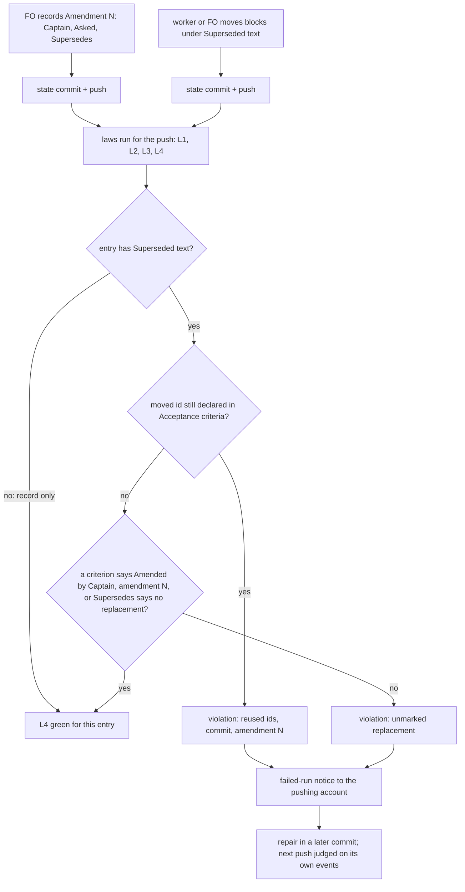

## Scope

- Source: the Captain 「驗證不讀 PR 審查意見（建議）, 特別角色派工紀錄手寫（建議）, 改驗收條件沒當下檢查（建議）, 合併檢查時間點看不出（建議）」 (host question dialog, 2026-11-08), answering 「批次 17 觀察者找到的問題，哪些要開成 kc-dev-flow-2 套件問題單（排進下一批的待辦）？建議四張都開，每張都真的發生過。」
- Bite: the batch 17 observer for worker-browser-checks-use-paseo-browser recorded that FO rewrote AC-1, AC-2 and AC-4 in place under reused ids (state a113aa3e9); design_surfaces.py caught it only when the implementation worker ran it.
- Non-goals: changing Spacedock; adopter AGENTS.md files.

## Budget
- One package PR; workflow word budget unchanged unless the design names a raise for the Captain.

## Stop condition
- Committing a task whose amendment reuses an id or lacks the 'Amended by Captain, amendment N' marker is refused or flagged at that commit, with a falsifier.

## FO alignment

Alignment: not needed; the Captain chose to file it from the batch 17 observer findings.
Surfaces: none
Visible change: none
Release review: not needed: workflow maintenance, on no journey map.
Reviewer: kc-dev-flow-2:engineering-reviewer gpt-6-astra 2026-11-10 — Amendment 1: do these amendments withdraw what the Captain approved, and what changes in the build?

## Design

### PRFAQ

**Proposition.** When a commit to the state branch moves a superseded criterion under an amendment's `Superseded text:` and leaves the same id declared in `## Acceptance criteria`, or moves criteria with no replacement marked "Amended by Captain, amendment N" and no `no replacement` on its `Supersedes:` line, the state-branch laws run for that push names the commit, the amendment, and the reused ids. It does not wait for the next worker to run `design_surfaces.py check`. A new law, L4 `amendment-moves-use-fresh-ids`, in `kc-dev-flow-2/scripts/laws_check.py` does this. Its rule is one predicate in `kc-dev-flow-2/scripts/design_surfaces.py`, and `check` uses the same predicate.

**FAQ.**
- *Why not run the whole `design_surfaces.py check` at commit time?* That check flags a missing marker even when FO has only recorded the amendment and the worker has not moved anything yet (`check_amendments`, final condition: it does not depend on whether the move or the dispatch has happened). If it ran at every commit, it would fail every legitimate FO record-only commit. L4 judges an entry only after it holds a `Superseded text:` payload. The payload is the moment a move has been written, so it is the moment both rules can be checked.
- *What does it catch that nothing catches today?* The reuse: an id held under `Superseded text:` and also declared live. `check_amendments` tests `held - named` and `named & declared`, and the latter waits until a dispatch checklist names the amendment. No current code tests `held & declared`. At the bite commit, current `origin/main` (6a495cb8) `design_surfaces.py check` prints only the unmarked line. `laws_check.py` over `b91e7434adde..a113aa3e9` prints L2 lines about the hand-written reviewer record and no line about the criteria (replayed 2026-11-10; the hosted run 42442764436 at that push printed the same L2 set).
- *Refuse or flag?* It flags, after the push. It cannot stop the commit; see D1.
- *Does FO read more?* No, at any moment it reads today. See "Words FO reads".
- *A partial move (clauses moved, id kept)?* L4 flags it as reuse. That matches the Captain's #650 delivery-gate ruling on `staff-multi-branch` amendment 1: 「a form break the refusal is right about」 (archived `amendment-form-check` AC-8).

**Acceptance evidence plan.** Replay the bite range, run unit fixtures for the three legitimate shapes and the two defects, replay three adopter state histories read-only, run the registry test, and observe one hosted run after the pin moves (D2).

### Mechanism

1. `design_surfaces.py` gains one function, `move_defects(lines)`. For each entry under `## Captain amendments` that has a `Superseded text:` payload, it returns `("reused", N, ids)` for ids declared both in the payload and in `## Acceptance criteria`. It returns `("unmarked", N)` when the entry's `Supersedes:` names ids, has no `no replacement` waiver, and no live or other-entry moved declaration carries "Amended by Captain, amendment N". The shared unit is the marker predicate, `unmarked(entry, live, others)`, moved out of `check_amendments`. `check_amendments` keeps calling it for every entry, with or without a payload, as it does today. `move_defects` calls it only for entries that have a payload, and adds the `held & live` reuse test. So `check`'s output is unchanged, `test_design_surfaces.py` passes unchanged, and the marker logic exists in one place.
2. `laws_check.py` gains `l4_amendment_moves_use_fresh_ids` and a `LAWS["L4"]` entry. Event: a commit in the existing `walk()` range that changes a task file (flat, `index.md` and `_archive/` forms, the same path and rename matching as L3's `amendment_pairs`/`amendment_blob`) where `move_defects` at that commit returns a defect absent at its first parent. Each defect is reported once, at the commit that introduced it (ADR 0017). An unreadable blob or an ambiguous match raises `Cannot`, like L3. A file whose `parse_amendments` reports structural issues is left to L2/L3 and not judged by L4.
3. `references/sd/laws.md` gains `## L4 amendment-moves-use-fresh-ids` with Rule, Event, Judged by, Bit and Bounds. `test_laws_file_matches_registry` fails if the heading and the registry differ.
4. No change to `references/sd/workflow.md`, `dispatch_records.py`, skills, `state-laws.workflow.yml`, Spacedock or any adopter file. No ADR: ADR 0005 (the worker moves), 0016 (what `check` refuses) and 0017 (laws judge push events) stand unchanged. L1–L3 also have no ADR of their own.

### Chain checked (2026-11-10)

- **Spacedock 0.27.2:** `spacedock --help` lists no state-commit hook. Changing Spacedock is a non-goal.
- **kc-dev-flow-2 at origin/main 6a495cb8 (0.37.0):** `design_surfaces.py check` has the marker rule and the waiting `still declared` rule, and is run by implementation, validation and FO at the ideation and ui-validation gates. `dispatch_records.py --names` and L2 run `amendment_form` (form only) and the named-in-checklist test, not `check_amendments`. L3 protects entry bytes. `laws_check.py` already judges every state commit per push. That is the existing commit-time point, so this design extends it instead of adding a hook.
- **Siblings:** the qnow and relay state histories were read with read-only `git log`/`git show` on the local checkouts (`qnow-adopt-dev2` at 62423c60e and `beirut-dev2` at 0bd9429d, both 2026-11-10, not fetched). `git grep -l "Superseded text"` over each trunk's `*.py *.sh *.ts *.mjs *.yml` (state excluded) finds nothing, so no adopter has its own amendment check.

### Existing-code capability check

The boundary is the Captain-amendment journey: FO records, a worker moves, and the commit is pushed and judged. Completeness: the marker rule works through the journey but runs only when a worker or a gate runs `check`. The reuse rule (`held & declared`) is not found. Two bounded searches support that: `git grep -n "held"` over `design_surfaces.py`, `dispatch_records.py` and `laws_check.py` at origin/main shows one set test, `held - named`, and the L2/L3 Rule text in `laws.md` names no reuse test. Need: the bite. A prototype of `move_defects` (scratch `/tmp/acw-proto/walk.py`, not committed) was run over whole state histories, comparing each version with its first parent. Out of 1175 task-file versions that hold `Superseded text:` (dev2 644, qnow 261, relay 270), it fires at 7 commits:

| Repository | Commit | Task, amendment | Defect | Known as |
| --- | --- | --- | --- | --- |
| dev2 | a113aa3e9 | worker-browser-checks-use-paseo-browser, 1 | reused AC-1, AC-2, AC-4; unmarked | the bite |
| dev2 | 7326e2a11 | delivery-gate-verdict-form, 2 | unmarked | the break ADR 0016 was filed on |
| dev2 | bf8c73be9 | release-acceptance, 2 | unmarked | repaired by 5ca46d186, the next push 38 s later (waiver added) |
| qnow | 3a384063e, 4ad692922 | staff-multi-branch, 1 | unmarked; reused AC-6, AC-7 | the partial move the Captain ruled a form break (#650) |
| qnow | 4993b5b60 | booking-outcomes, 1 | unmarked | ADR 0016 corpus break |
| relay | 06cadae76 | owner-sees-all-feedback-room, 3 | unmarked | written before the waiver form existed; clears with it |

Only 1 of the 7 commits added a dispatch record (`git show --name-status`), so a check placed at dispatch would have seen only the bite.

### Words FO reads

| Moment | Before | After |
| --- | --- | --- |
| Startup, idle on an open PR, idle on a merged PR, after the archive, the merge ask (root learning.md) | unchanged files: workflow.md, `pr_watch.py`, `delivery_gate.py`, `observer_check.py` output | identical: none of these files changes |
| Recording an amendment (workflow.md § Captain amendments) | that section as it is | identical (file untouched) |
| Before a dispatch (`dispatch_records.py --names`) | its output | identical (script untouched) |
| A state push, green | 0: FO reads no green run | 0 |
| A state push, red (GitHub failed-run notice, then the log) | the L1–L3 lines | plus one 9-word `L4 …: n events judged in <range>, m violated` head line, and at most one violation line per defect kind per entry: 31 words for reuse, 28 for unmarked, as drafted on the bite |

The workflow word budget does not change. `laws.md`, which FO reads once at the laws rollout, grows by one section, at most 250 words (base 1345).

### Bounds

- L4 flags after the push. It does not block a commit, a dispatch, a gate or `merge guard`.
- On dev2, L4 is inert until `.github/workflows/dev2-laws.yml` on the state branch pins a release that contains it. Today it pins 22219a3e (`kc-dev-flow-2-v0.26.0`). See D2.
- Not seen: an in-place rewrite of a superseded id with no move. That state looks the same as "FO recorded, the worker has not moved yet". The prototype found 2 such edits (the bite, and qnow `staff-multi-branch` AC-10 at 71ac1120e), and in both tasks another commit already fired L4. A task with no amendment entry at all stays an observer duty (L3 Bounds).
- A waiver forgotten at record time has no L3-clean repair: adding it to `Supersedes:` is an L3 metadata edit. This is unchanged by this design and belongs to amendment-form-check-round3-followups.
- CI cost per push is not measured. L4 reads the two blobs per changed task file that L3 already reads. No trigger or job is added.

### Decisions for the Captain

- **D1. Where the check runs. Recommend: the new state law L4 (flags each commit after its push).** Why: it judges every state commit, and it fires on all 7 events above. A check before dispatch (`dispatch_records.py --names` / L2) sees 1 of 7. An adopter-installed pre-commit or `PreToolUse` hook would refuse at the commit, but the package can only ship a template for it, like the secret-reads hook. Commits written by `spacedock` itself and by hosts without hooks would bypass it. What gets worse: the bad commit is already pushed, and the signal is a failed-run email FO can miss. The repair is a later commit.
- **D2. Turn L4 on for dev2. Recommend: after the release that carries L4, FO commits the `dev2-laws.yml` pin to that published tag on your word (adoption.md: rollout 「on the Captain's word」), and this task closes only after one state push run prints the L4 head line (AC-7).** What gets worse: the task stays open after merge until a push runs. Moving the pin from 0.26.0 also turns on, at once, every L2/L3 check added since that release. Each run judges only its own push (ADR 0017), so old history stays green, but new pushes may go red on those checks too.

### Batch overlap

Files this design changes: `kc-dev-flow-2/scripts/laws_check.py` (new L4 function, `LAWS` entry, docstring), `kc-dev-flow-2/scripts/design_surfaces.py` (new `move_defects`; the `check_amendments` marker test calls it), `kc-dev-flow-2/scripts/test_laws_check.py` (L4 cases), `kc-dev-flow-2/scripts/test_design_surfaces.py` (only if the helper split needs one direct case), `kc-dev-flow-2/references/sd/laws.md` (new L4 section). No ADR number and no shared index.

| Task | Shares | Kind |
| --- | --- | --- |
| issue-815-fo-record-gaps (batch 20) | `design_surfaces.py` (its built-screen `preview:` check) | same file, different function; rebase only |
| special-role-dispatch-records-built-by-script (batch 20) | the same bite commit; it changes the dispatch-record route, and this design leaves `dispatch_records.py` alone | none; its fix removes the bite's L2 lines and L4's lines stay |
| delivery-gate-pr-body-attribution-link (batch 20) | `delivery_gate.py` only | none |
| adoption-asks-which-extensions | `laws.md` (its L2 Bounds sentence) and `test_laws_check.py` (one L2 test) | same files, different sections; textual rebase |
| captain-ruling-sources-checked | `design_surfaces.py`, `test_design_surfaces.py` (provenance checks) | same files, different functions |
| fo-write-checks-parse-top-level | `design_surfaces.py` `scope_lines`, `ScopeCheckTests` | same files, different functions |
| seed-check-requires-alignment-result | `design_surfaces.py` seed branch, seed tests | same files, different functions |
| comment-check-reaches-delivery-gate | `delivery_gate.py`; it explicitly adds no law | none |
| dispatch-carries-reserved-adr-number | recommends no package change | none |
| adr-required-statement, merge-guard-stops-unasked-merges, archive-waits-for-observer-report, gate-summary-names-each-decline, step-back-answer-has-a-record-line, validation-reads-pr-review-comments | `adr_lint.py`, `delivery_gate.py`, `adoption.md`, observer and role files, validation principles | none |
| journey-server-host-pilot, journey-canvas-hosted-poc, pr-review-lite-value-pilot, ops-inbox-r1-setup-and-isolation, adr-silent-undo-probe, picky-reviewers-may-run-on-gemini | run `design_surfaces.py check` at most, or write `kc-ops-inbox/**`, or change no file | none: `check` output is unchanged |
| superseded-criterion-without-dispatch-caught, amendment-form-check-round3-followups (backlog, not in the list) | `check_amendments` and its marker test | same function; whichever lands second rebases onto `move_defects`. L4 covers part of the first one's "no later dispatch" gap, for moved criteria only |

Recommended order: no ordering is needed within batch 20. Among the `design_surfaces.py` editors, whichever merges first goes first and the others rebase, since they touch different functions. adoption-asks-which-extensions rebases `laws.md`/`test_laws_check.py` textually, in either order.

## Acceptance criteria

**AC-1** The bite is flagged at its commit. Evidence: at the candidate, `python3 -B kc-dev-flow-2/scripts/laws_check.py <dev2 state checkout> --before b91e7434adde --after a113aa3e9 --readme <trunk>/docs/dev2/README.md` prints `L4 amendment-moves-use-fresh-ids: 1 events judged …, 1 violated`, one violation naming `worker-browser-checks-use-paseo-browser.md`, commit `a113aa3e9a3d`, amendment 1 and AC-1, AC-2, AC-4 as reused, and one unmarked violation for amendment 1. At base 6a495cb8 the same command prints no L4 line. Falsifier: deleting the `held & live` test drops the reuse line; deleting the marker test drops the unmarked line. Not yet verified (prototype output only).

**AC-2** The legitimate shapes stay green. Evidence: `test_laws_check.py` fixtures (temporary git repositories, as its `Repo` class builds) for (a) FO records `Supersedes: AC-2` with no `Superseded text:`, (b) a worker moves AC-2 and declares AC-5 "Amended by Captain, amendment 1", and (c) a move whose `Supersedes:` says `(no replacement: …)`. Each yields zero L4 violations, while (d) a move that keeps AC-2 declared and (e) a move with no marked replacement each yield one. Falsifier: removing the payload gate makes (a) fail. Not yet verified.

**AC-3** A defect is reported once, at the commit that adds it. Evidence: a fixture range whose first commit introduces the reuse and whose second commit only edits another section reports one event, at the first commit. A range that starts after the defect reports none, and a commit that repairs it reports none. Falsifier: judging the tip state instead of each commit against its first parent reports the defect again in the later range. Not yet verified.

**AC-4** The corpus replay matches the table under "Existing-code capability check". Evidence: the candidate `laws_check.py` with `--before` at each history's root, run read-only over the dev2, qnow and relay state checkouts, prints L4 events exactly at the seven commits named there. Any extra event from history newer than the tips named there is listed with its cause. Falsifier: an L4 event on a state that the current form accepts (for example a record-only entry). Not yet verified at the candidate; the prototype reproduces the seven.

**AC-5** Registry, docs and FO reading. Evidence: `laws.md` has `## L4 amendment-moves-use-fresh-ids` (Rule, Event, Judged by, Bit citing a113aa3e9, Bounds) and adds at most 250 words; `test_laws_file_matches_registry` passes; `git diff --stat origin/main...<candidate> -- kc-dev-flow-2/references/sd/workflow.md kc-dev-flow-2/scripts/dispatch_records.py kc-dev-flow-2/skills kc-dev-flow-2/references/sd/state-laws.workflow.yml` is empty; `python3 kc-dev-flow-2/scripts/lint-skills.py` passes. Falsifier: adding the registry entry without the heading fails the registry test. Not yet verified.

**AC-6** One marker predicate for both checks. Evidence: `check_amendments` and `move_defects` both call the shared marker predicate, `check_amendments` still for every entry; `test_design_surfaces.py` passes unchanged; a mutation of the marker test inside `move_defects` fails at least one test in each of `test_design_surfaces.py` and `test_laws_check.py`. Falsifier: a copy of the marker logic left in `check_amendments` lets the mutation pass `test_design_surfaces.py`. Not yet verified.

**AC-7** Hosted on dev2 (per D2). Evidence: after the release, the pin commit on `spacedock-state/dev2` names the published tag, and the next state push's `dev2-laws.yml` run log (`gh run view <id> --log`) prints the L4 head line. Falsifier: a run on the old pin prints no L4 line. Not yet verified; it runs after merge and on the Captain's word.

## Captain amendments

### Amendment 1 — 2026-11-10, host question dialog
Captain: 「改成 5 次（建議）」 (host question dialog, 2026-11-10)
Asked: 「決定：「修改驗收條件的檢查」那張的歷史重跑驗收條件，要從抓到 7 次改成 5 次嗎？建議改成 5 次。你核准的設計同時寫了「歷史重跑抓到 7 次」和「任務檔格式有問題時新規則不判，留給既有的格式規則」，兩者衝突：照後者實作只抓到 5 次，少的 2 次檔案都有格式問題（實作工人的報告，我沒重跑）。同意即把這條驗收條件改成 5 次，並寫明另外 2 次留給既有格式規則；缺點是格式壞掉的檔案裡的編號重用，要等格式修好才會被新規則看到。」
Supersedes: AC-4

### Amendment 2 — 2026-11-10, host question dialog
Captain: 「這張就做到 7 次」 (host question dialog, 2026-11-10)
Asked: 「決定：「修改驗收條件的檢查」這張，要維持 5 次先交付、漏掉的 2 次另開待辦任務嗎？建議這樣做。我上一題說錯了：工程審查員重跑後發現，被跳過的 2 次並沒有被既有規則接住——dev2 那次只回報「無法判定」，relay 那次整次通過、沒有任何警訊；格式修好之後也不會補報。同意即接受：驗收條件寫成 5 次並照實寫明這 2 次的結果，程式不動；我另開一張待辦任務，把跳過範圍縮小到只跳過格式壞掉的那一筆修改紀錄。缺點是那張待辦做完前，同一份檔案裡有別的修改紀錄格式壞掉時，新寫入的編號重用不會被抓到。」
Supersedes: none
Design: A file whose `parse_amendments` reports structural issues is left to L2/L3 and not judged by L4.

## Stage Report: ideation

- DONE: Design the check that refuses or flags, at the commit that writes it, a task amendment that reuses an acceptance-criterion id or lacks the 'Amended by Captain, amendment N' marker (the batch 17 in-place AC rewrite is the bite); name where it runs at commit time, what kc-dev-flow-2/scripts/design_surfaces.py already catches, and the falsifier
  New state law L4 in `laws_check.py`, run per push and judging each commit, using one `move_defects` predicate in `design_surfaces.py`. Today `check` catches only the unmarked replacement, and only once a worker or gate runs it; the reuse (`held & declared`) is caught nowhere. Bite replayed at origin/main 6a495cb8: no line on the criteria from either script. Falsifiers are in AC-1 and AC-2.
- DONE: A `### Batch overlap` section naming each file the design would change and each other batch task (issue-815-fo-record-gaps, special-role-dispatch-records-built-by-script, amendment-checked-when-written, delivery-gate-pr-body-attribution-link) and live task of other sessions (adr-required-statement, journey-server-host-pilot, merge-guard-stops-unasked-merges, archive-waits-for-observer-report, ops-inbox-r1-setup-and-isolation, pr-review-lite-value-pilot, validation-reads-pr-review-comments, adoption-asks-which-extensions, adr-silent-undo-probe, captain-ruling-sources-checked, comment-check-reaches-delivery-gate, dispatch-carries-reserved-adr-number, fo-write-checks-parse-top-level, gate-summary-names-each-decline, journey-canvas-hosted-poc, picky-reviewers-may-run-on-gemini, seed-check-requires-alignment-result, step-back-answer-has-a-record-line (in flight or parked; read only)) that changes the same file or check, so FO can order implementation
  Names five files and every listed task, plus two backlog tasks on `check_amendments`. Overlaps are textual only (different functions or sections). `Recommended order:` none is required.
- DONE: The words FO reads at each lifecycle moment, before and after, per root learning.md "Measure the words FO reads at each moment, not one file's size"
  "Words FO reads" table: identical at the five learning.md moments, at recording an amendment and before a dispatch. A red push adds a 9-word head line plus a 28–31-word line per defect. workflow.md is untouched.
- DONE: Acceptance criteria with reproducible evidence clauses and falsifiers, and unresolved decisions for the Captain, each with a recommendation and what gets worse under it
  AC-1 bite replay: not yet verified at a candidate (prototype reproduces it). AC-2 legitimate shapes green: not yet verified. AC-3 reported once: not yet verified. AC-4 corpus of 7 events over 1175 versions: prototype reproduces it; not yet verified at a candidate. AC-5 registry/docs/FO words: not yet verified. AC-6 one predicate: not yet verified. AC-7 hosted run: not yet verified (after merge). D1 (law vs hook) and D2 (pin bump, close after one hosted run) each carry a recommendation and what gets worse. `python3 -B /Users/kent/.claude/plugins/cache/kc-claude-plugins/kc-dev-flow-2/0.37.0/scripts/design_surfaces.py check amendment-checked-when-written.md` printed `amendment-checked-when-written.md: design surfaces presentable` (plus its `next:` gate-question line) and exited 0.

### Summary

Designed state law L4 `amendment-moves-use-fresh-ids`. It flags, at the commit that writes it, a move that redeclares a moved id or leaves the replacement unmarked. The marker test is shared with `design_surfaces.py check` through one predicate, so the two cannot drift. Measurement: on three adopter histories a prototype fires at 7 commits. Each is a known form break or a defect repaired in the next push. 6 of the 7 added no dispatch record, which is why the check goes at the push and not at dispatch. The material risk is D2: dev2's laws run pins 0.26.0, so L4 does nothing on dev2 until the Captain approves moving the pin.

## Stage Report: implementation

- DONE: Implement the approved Pilot design within the named product files, based on origin/main.
  Branch `spacedock-ensign/amendment-checked-when-written`; base `6a495cb8c4055f9a6eba8a05419c2d2fad1a90f1`; candidate `71eb2ec4298812d831573386324641ca6babff5d`; four approved files only, clean worktree; artifact manifest `/tmp/opencode/amendment-checked-when-written/artifact.json`.
- SKIPPED: One Draft PR (Conventional Commit title scoped to the plugin) from a branch off origin/main implementing the approved design and acceptance criteria; decisions as approved at the ideation gate; only the files the design names.
  No PR opened: no push grant. Product publication belongs to FO; local candidate preserves D1 per-push L4 and D2's unchanged adopter pin. AC-4 remains a specification hold, so this is not a publication recommendation.
- FAILED: Every acceptance criterion green with the evidence each names; each falsifier shown failing by a mutation you run (python3 -B, caches cleared).
  AC-4 expects seven historical events, but the approved whole-file structural skip excludes dev2 `bf8c73be99c4` and relay `06cadae7681f`: both have unrelated amendment headings outside the amendment section; the former is also malformed and duplicate. Details and source lines: `/tmp/opencode/amendment-checked-when-written/seven-events.json`; both per-commit CLI counterexample logs are beside it. FO must resolve expected corpus versus skip scope; candidate and accepted criteria were not changed to hide the conflict.
- DONE: AC-1 — reproduce the original defect and its two falsifiers.
  Candidate CLI on `b91e7434adde..a113aa3e9` reports one L4 event with reused AC-1, AC-2, AC-4 and an unmarked replacement; base prints no L4. Disabling each check removes its corresponding line and fails the L4 fixture: `candidate-bite.log`, `base-bite.log`, `mutation-{reuse,marker}-bite.log` under `/tmp/opencode/amendment-checked-when-written/`.
- DONE: AC-2 and AC-3 — legitimate shapes pass and defects belong to their introducing commit.
  `test_laws_check.py`: 73 run, 72 passed, 1 optional environment fixture skipped; covers record-only, marked/waived moves, each defect, later unrelated edits, post-defect ranges and repair. Removing the payload gate or first-parent suppression fails its named case; `laws-tests.log`, `mutation-payload-0.log`, `mutation-parent-0.log` in the evidence directory.
- DONE: Complete the read-only three-adopter history replay required by AC-4, including current tips.
  Pinned dev2 `5254e465b7a3`, qnow `69ac9bed19ab`, relay `e6751812e914`: L4 reports 2/3/0 events, no extra event. Full CLI and final-candidate L4 replay agree; full CLI exits 2 on existing L3 history debt. `corpus-inputs.json`, `corpus-reconciliation.json`, `corpus-{dev2,qnow,relay}.log` retain ranges/results; the seven-event assertion fails with exactly the two missing commits above.
- DONE: AC-5 — registry, docs and FO reading remain within the approved boundary.
  Registry test passes and removing the L4 heading fails it; `laws.md` grows 1345 to 1570 words (+225, below 250). Workflow, dispatch_records.py, skills, CI template and versions are byte-unchanged from base, preserving lifecycle reading; `mutation-heading-0.log` and `artifact.json` in the evidence directory.
- DONE: AC-6 — share one marker predicate while preserving existing checks.
  Both callers use `unmarked`; unchanged `test_design_surfaces.py`: 217 run, 213 passed, 4 optional environment fixtures skipped. Disabling the shared marker fails one test in each suite; six mutation controls reject their regressions with absent caches and python3 -B. Three pinned tips produce 1032 identical base/candidate check/seed verdicts; `mutations.json`, `design-tests.log`, `check-comparison.json` in the evidence directory.
- SKIPPED: AC-7 — hosted dev2 activation and its old-pin falsifier.
  Deferred by approved D2 until a containing release, Captain-approved pin change and one observed state-push L4 headline; no adopter file or pin was changed, and no hosted activation/run is claimed.
- DONE: kc-dev-flow-2/scripts/lint-skills.py (the repository copy CI runs), package adr_lint.py docs/adr --since <base>, number_guards.py check, and comment_ratio.py within its maximum.
  All exit 0 at candidate; ADR lint checks 65 records with no new ADR; number guards show no findings; comment ratio is 0/173 = 0.0%, maximum 5%. Logs `lint.log`, `adr-lint.log`, `number-guards.log`, `comment-ratio.log` are under `/tmp/opencode/amendment-checked-when-written/`.
- DONE: doc-impact — docs/adr/0041-seed-admission-enforces-required-fields.md is unaffected.
  Seed admission is unchanged; pinned check/seed verdicts match the base. Recorded in `doc-verdicts.json` beside the raw `doc-impact.json` output.
- DONE: doc-impact — docs/adr/0057-rewritten-criteria-are-compared-with-the-captains-words.md is unaffected.
  `added_words` and its dispatch comparison are unchanged; the shared replacement-marker predicate preserves check output. Recorded in `doc-verdicts.json`.
- DONE: doc-impact — kc-dev-flow-2/references/sd/laws.md is updated.
  Added L4 Rule, Event, Judged by, Bit and Bounds; the registry and heading mutation exercise its entry point. Recorded in `doc-verdicts.json`.
- DONE: doc-impact — learning.md is unaffected.
  Historical practices remain applicable; this task follows the word, history-input and corpus checks without rewriting those records. Recorded in `doc-verdicts.json`.
- DONE: Commit locally, no product push; write the PR title and body for FO.
  Local candidate is `71eb2ec4298812d831573386324641ca6babff5d`; `/tmp/impl-amendment-checked-when-written-pr.md` contains the scoped Conventional Commit title, body, checks and explicit AC-4 hold; no version bump or empty commit.
- SKIPPED: FO pushes, opens the Draft PR, runs RoboRev and reads hosted CI.
  Delegated and not run by this worker; no clean review or hosted delivery claimed. CI cost per PR and per state push is not measured; no trigger, job or adopter pin changes.

### Summary

Implemented L4 with the approved whole-file structural skip and the shared `unmarked` predicate; local behavior, five acceptance criteria and six mutation controls pass. AC-4 fails because two of its seven expected historical events have parser structural issues and are therefore excluded by the approved design; return this conflict to FO before further product changes/publication, while AC-7 stays open under D2.

## Stage Report: implementation

- FAILED: Apply Captain amendments Amendment 1: move the AC-4 block verbatim from `## Acceptance criteria` into the entry under a `Superseded text:` line, and write the replacement under a fresh id that says "Amended by Captain, amendment 1": the corpus replay prints L4 events at five commits, and the two commits the whole-file structural skip excludes (dev2 bf8c73be99c4, relay 06cadae7681f) are named as left to the existing form laws
  held: special-role call owed
- FAILED: Show the replacement criterion green at the unchanged candidate 71eb2ec42 with its evidence and falsifier, and keep that evidence in the task folder in the state checkout, not only under /tmp
  held: special-role call owed
- FAILED: Append one complete new `## Stage Report: implementation`, every DONE or SKIPPED item followed by its own indented evidence line; no product code change unless the replacement criterion needs one, and then say so and stop
  held: special-role call owed

### Summary

This complete report supersedes the earlier implementation report for the follow-up's readiness; implementation is held before applying the amendment or running product checks. Package `/Users/kent/.claude/plugins/cache/kc-claude-plugins/kc-dev-flow-2/0.37.0`, version `0.37.0`: `role_triggers.py` exited 1 with the following output; FO must record the call or a decline and dispatch again. Product candidate remains `71eb2ec4298812d831573386324641ca6babff5d`; no criterion, amendment entry or product code was changed.

next: amendment-checked-when-written has replacing amendment 1; dispatch kc-dev-flow-2:engineering-reviewer on opus or gpt-6-astra with the question "do these amendments withdraw what the Captain approved, and what changes in the build?" and record `Reviewer: kc-dev-flow-2:engineering-reviewer <model> <date> — <question>` under ## FO alignment; or, to decline, record `Reviewer: kc-dev-flow-2:engineering-reviewer not run <date>: <reason>` instead.
