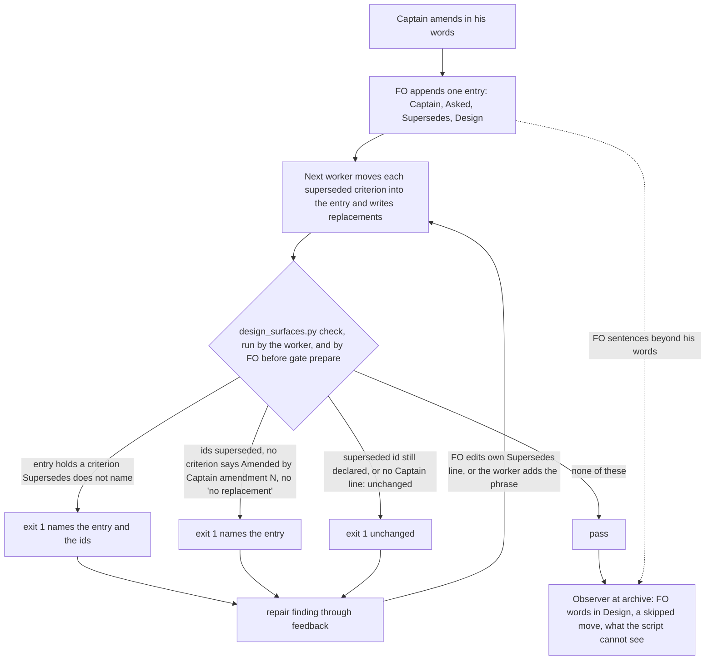

Filed from a learn package-issue candidate the Captain approved (「好」, chat, 2026-10-15). The observer reports on `delivery-gate-verdict-form` and `fo-lifecycle-mod` found FO-written amendments that break the README `## Captain amendments` rules, and `scripts/design_surfaces.py check` passed both tasks.

## Scope

- An amendment `Design:` line carries FO's own sentences beyond the Captain's words and his `Asked:` question (delivery-gate-verdict-form amendment 2; acceptance criterion AC-12 then attributed one of them to the Captain). Rule: "FO adds no words of its own".
- Replacement criteria AC-9 to AC-14 under amendment 2 lack "Amended by Captain, amendment N" (delivery-gate-verdict-form). Rule: "writes any replacement as a new `**AC-N**` ... that says 'Amended by Captain, amendment N'".
- A `Supersedes:` line reads `none` while criteria were moved under that amendment (fo-lifecycle-mod amendments 3 and 6). `design_surfaces.py` checks only that a superseded id is no longer declared, not that a moved criterion is named in `Supersedes:`.
- Candidates for ideation to keep or drop; the first is a judgement of meaning and may stay with the observer.

## Design

The prototype named below lives on a temporary copy of origin/main `1383c911` under `/tmp`; no repository file, branch or commit changed, and the scratch scripts that read adopter state (read-only) are machine-local, so the committed tests carry one fixture per case instead of a corpus run.

### Ruling

A script checks two of the three breaks, the two that are about where text sits: a moved criterion its `Supersedes:` line does not name, and a replacement no criterion marks with "Amended by Captain, amendment N". FO's own words in `Design:` stay with the observer, because no text rule tells a pointer from a paraphrase (measured below).

### Chain check (read 2026-10-16)

- **Spacedock** 0.27.2: `spacedock status --help` has no amendment or supersede flag (`grep -i 'amend\|supersed'` over it printed nothing); ADR 0005 records that Spacedock reads no task body at dispatch or `gate prepare`. Nothing to reuse.
- **kc-dev-flow-2** at origin/main `1383c911` (0.23.0): `scripts/design_surfaces.py` `check_amendments` refuses an entry with no `Captain:` line and a superseded id still declared. Nothing else reads an entry: `git grep -n 'Superseded text\|Amended by Captain' origin/main -- kc-dev-flow-2/scripts kc-dev-flow-2/skills kc-dev-flow-2/extensions kc-dev-flow-2/references` finds the README prose (`references/sd/workflow.md`) and two test fixtures, never the script. `skills/observer/SKILL.md` reads the README rules and found all three breaks at archive, after the PR.
- **Sibling adopters**: relay, qnow and subspace-web hold no copy of the script (`find` for `design_surfaces*` under the qnow-adopt-dev2, relay and subspace-web checkouts, 2026-10-16, found one worktree copy of the package itself). Their archived tasks are the corpus below.
- **Past rulings**: ADR 0005 is the area; this extends its closing sentence ("`check` exits 1 for an entry without `Captain:` and for a superseded id still declared"). `git -C <state> grep -n 'Override:'` (2026-10-16) hits only prose in archived designs; none bears on amendments.

### Existing-code capability check

Boundary: `check_amendments` plus the README `## Captain amendments` form. Completeness: the two existing refusals work through their journey (tests and the `--ac-scan` parity case in `scripts/test_sd_dispatch.py`). Need, observed 2026-10-16 by running origin/main's `design_surfaces.py check` on the committed `spacedock-state/dev2:_archive/delivery-gate-verdict-form.md` and `_archive/fo-lifecycle-mod.md`: both print `design surfaces presentable` and exit 0, while the observer reports on both name the breaks. The change extends the one function; it adds no script.

### The corpus, read only (2026-10-16)

40 task files with real amendment entries (one copy per file name, largest kept) across this workflow, relay, qnow and subspace-web: 67 entries, 31 of them superseding. Candidate refusals that origin/main does not make: 8 errors on 6 tasks.

| Rule | Entries refused | Cause |
| --- | --- | --- |
| Moved criterion not named by `Supersedes:` | 2 | `fo-lifecycle-mod` amendment 3 (AC-1 to AC-7 moved, line says `none`: the filed break); `staff-multi-branch` amendment 1 (AC-6 and AC-7 partly moved, ids reused in place) |
| Replacement without the phrase | 6 | `delivery-gate-verdict-form` amendment 2 (six replacements, the filed break); `accept-branch-invitation` amendments 1 and 2 (replacements say "replaces AC-13" and "replaces AC-19", no phrase); `booking-outcomes` amendment 1 (AC-1 moved, no replacement criterion at all); `owner-sees-all-feedback-room` amendment 3 and `staff-multi-branch` amendment 1 (criteria moved to a new task, no replacement belongs here) |

The last two are legitimate. Without a way to say "no replacement" the check would push a worker to invent a criterion, so the escape is part of this design: `Supersedes: AC-1, AC-2 (no replacement: moved to a new task)`. A scratch copy of `owner-sees-all-feedback-room` with that line no longer draws the refusal. Rule 1 refused no entry that was fine (0 of 67).

The `Design:` line: 35 entries carry a value other than `none`; 1 is a verbatim quote of text in the file, 34 are FO sentences (a name for the paragraph, or a summary of it). Any text rule flags 34 of 35, including every legitimate pointer the README form allows ("the design paragraph it overrides"), so the first break stays with the observer.

### PRFAQ

**Press release.** An amendment record that breaks the README form now stops at the checker instead of at the observer after the PR. `check` refuses an entry that holds criteria its `Supersedes:` line does not name, and an entry that supersedes criteria when no criterion says "Amended by Captain, amendment N" and the line does not say "no replacement". FO's own words in `Design:` remain the observer's to read.

**FAQ.**
- *Why not check `Design:`?* 34 of 35 non-`none` values in the corpus are FO prose by the form's own allowance; a verbatim rule cannot tell the pointer from the paraphrase. Changing the form so `Design:` must quote its paragraph would rewrite almost every entry and is the Captain's, not a script's.
- *What is a replacement, to the script?* It does not decide. It asks that at least one criterion, in `## Acceptance criteria` or in the moved text of another entry, carries the phrase for this amendment's number. That covers a twice-amended task: a criterion written under amendment 1 and later moved under amendment 2 still counts for amendment 1 (the replay of `delivery-gate-verdict-form` amendment 1 relies on it). It does not prove every replacement is marked; five of six marked passes.
- *Why the exact phrase and not "replaces AC-N"?* The README already says the criterion "says 'Amended by Captain, amendment N'"; accepting a variant would change that rule, and two corpus entries use the variant.
- *Who repairs a refusal?* For a moved criterion the entry does not name, FO edits its own `Supersedes:` line to add the ids (ids, no words; FO wrote `none` before the worker's redo existed). For a missing phrase, the worker who wrote the replacement adds it, or FO adds `no replacement`. Both return as the existing repair finding.
- *What does it not see?* A skipped move (amendment 6 of `fo-lifecycle-mod` changed AC-9 and AC-11 in the report while the section stayed byte-identical and nothing was moved), which ADR 0005 already names as `check`'s limit; and a worker who types `no replacement` falsely.

### Replay on the two archived tasks

Method: `git -C <state> show spacedock-state/dev2:_archive/<task>.md > /tmp/x.md`, then `python3 <package>/scripts/design_surfaces.py check /tmp/x.md`; base is origin/main's script, candidate is the prototype.

| Task | Base | Candidate |
| --- | --- | --- |
| `delivery-gate-verdict-form` | exit 0 | exit 1: amendment 2 supersedes AC-1, AC-2, AC-3, AC-5, AC-6, AC-7, AC-8 but no criterion says "Amended by Captain, amendment 2" (amendment 1 is not named: AC-8 carrying the phrase sits in amendment 2's moved text) |
| `fo-lifecycle-mod` | exit 0 | exit 1: amendment 3 holds AC-1 to AC-7 in the entry but its `Supersedes:` line does not name them (amendment 6 is not named: nothing was moved under it) |

Observed mutations of the prototype on the same two files: dropping the moved-criterion rule leaves `fo-lifecycle-mod` at exit 0; dropping the replacement rule leaves `delivery-gate-verdict-form` at exit 0; dropping the chain rule adds a second line (amendment 1) to `delivery-gate-verdict-form`; dropping the escape makes the scratch copy with `no replacement` exit 1.

### Change, in files

- `kc-dev-flow-2/scripts/design_surfaces.py`: `check_amendments` gains the two rules. A criterion counts as moved when `**AC-N**` appears on any entry line that does not start with `Captain:`, `Asked:`, `Supersedes:` or `Design:`; this does not depend on the `Superseded text:` label, and its limit is a `**AC-N**` bold written in a continuation line of `Asked:` or `Design:`, which would read as moved text (none in the corpus). The error lines are one per entry, ids listed.
- `kc-dev-flow-2/scripts/test_design_surfaces.py`: new cases and mutations; the `AMENDMENT` fixture (`Supersedes: AC-2`, no replacement) and the cases built from it change deliberately.
- `kc-dev-flow-2/scripts/test_sd_dispatch.py`: the amendment parity block (the `criteria`/`amendment` fixtures asserting `checked.returncode == 0` for a relocated criterion with no replacement) has the same fixture shape and changes the same way. I did not run it: this machine caches Spacedock plugin 0.27.0 and the binary is 0.27.2, and the test needs `--sd-plugin-root`; CI's pinned root is the proof.
- `kc-dev-flow-2/references/sd/workflow.md`: two edits inside `## Captain amendments`, the `Supersedes:` template line and the check paragraph. The adopted copies `docs/dev2/README.md` and `docs/dev2-poc/README.md` arrive through the usual sync change after release, not this one.
- ADR draft, no number (FO reserves it): short title `the-amendment-check-refuses-an-unnamed-move-and-an-unmarked-replacement`. Ruling: `check` also exits 1 for a criterion held in an entry that `Supersedes:` does not name and for superseding entries no criterion marks, and `Supersedes:` may say "no replacement". It supplements ADR 0005 and leaves its decision standing. Limit it must state: `check` still cannot see a skipped move or FO words in `Design:`.

### Batch overlap

Read as the four other seeds stand on 2026-10-16 (none has a design yet), so this is from their Scope text.

| File | This task | Other batch-1 task on the same file or check |
| --- | --- | --- |
| `kc-dev-flow-2/scripts/design_surfaces.py` | edits `check_amendments` | `dev2-laws-check` lists `design_surfaces.py check` as an existing law; if its runner executes `check` over `_archive/`, this change's 8 new corpus errors become failures on closed tasks nobody can repair under the rules. Recommend this task lands first, or laws-check runs `check` only on tasks not yet archived |
| `kc-dev-flow-2/scripts/test_design_surfaces.py` | edits | none named |
| `kc-dev-flow-2/scripts/test_sd_dispatch.py` | edits the amendment parity block | `names-check-before-dispatch` and `extension-instruction-reaches-dispatch` follow the existing `dispatch-records-check` entry style and may add entries in the same file, different region |
| `kc-dev-flow-2/references/sd/workflow.md` | edits `## Captain amendments` (net minus 1 word) | `names-check-before-dispatch` (README Stages rule) and `extension-instruction-reaches-dispatch` ("or the README's stage text names it") may add text; `prod-security-review-gates` may edit stage text. All five share one word budget: `lint-skills.py` prints `5495 of 5511` at origin/main, so 16 words remain, and this task adds none |
| `kc-dev-flow-2/scripts/lint-skills.py` (`WORKFLOW_WORD_BUDGET`) | untouched | any task that pushes the README past 5511 must raise it with a reason; two raising it in one batch conflict on the constant |
| `kc-dev-flow-2/scripts/dispatch_records.py` | untouched | belongs to `names-check-before-dispatch` and `extension-instruction-reaches-dispatch`, not here |
| `docs/adr/` | one new ADR, number reserved by FO | `dev2-laws-check`, `prod-security-review-gates` may also reserve; FO reserves in dispatch order |

Order: this task first among those editing `workflow.md` and `design_surfaces.py`, since it is net minus 1 word and changes what laws-check would run; the README tasks then recount against the merged text.

### Words FO reads at each moment

Rule: `len(text.split())` over every passage that instructs a step due at that moment and every script output the step runs, counted the same way for origin/main `1383c911` and the prototype text (learning "Measure the words FO reads at each moment, not one file's size"). Moments are the ones this change touches; the five lifecycle moments in that learning (startup, idle on an open PR, idle on a merged PR, after the archive, the merge ask) read no passage this change edits: both README hunks sit inside `## Captain amendments`.

| Moment | Base | Candidate |
| --- | --- | --- |
| FO records an amendment: README `## Captain amendments` section (heading to `## Affected documents`) | 414 | 413 (template line +6, check paragraph 60 to 53) |
| FO prepares the ideation gate: `check` output on a presentable task | 4 | 4 |
| FO receives a repair finding: `check` output on the two replays | 4 (a silent pass of the break) | 24 and 26, only when a break exists |
| Whole `workflow.md` by `lint-skills.py` | 5495 of 5511 | 5494 of 5511 |

### Limits

- The corpus is 40 files from this workflow and three adopters; I did not check which package versions or models wrote them. It shows the rules refuse no fine entry in it, not that none exists. The 6 phrase refusals were classified by reading each entry (4 breaks, 2 legitimate moves).
- The replacement rule asks for one marked criterion per amending entry, not one per replacement.
- The prototype ran the 22 `test_design_surfaces.py` tests: 20 pass and 2 fail, both on the `AMENDMENT` fixture that has no replacement; `lint-skills.py` and `test_lint_skills.py` pass.
- Cost: `test_design_surfaces.py` already runs as a CI step (`.github/workflows/kc-dev-flow-2-tests.yml`); no new job. The 22 existing tests ran in 0.1 s here.
- Non-goals: reading `Design:`; checking that a replacement is faithful to the Captain's words; seeing a skipped move; any change to `skills/observer/SKILL.md`; any Spacedock change.

## Acceptance criteria

Paths are relative to `kc-dev-flow-2/` in `iamcxa/kc-claude-plugins`; base is origin/main `1383c911` (0.23.0). `<state>` is the `.spacedock-state` checkout on `spacedock-state/dev2`. Traces: AC-1 to the third Scope bullet; AC-2 and AC-3 to the second; AC-4 to all three; AC-5 to the first bullet and the closing line ("the first is a judgement of meaning and may stay with the observer"); AC-6 to the dispatch checklist's per-moment words requirement (root `learning.md`); AC-7 to the CI step that already runs these suites.

**AC-1** An entry that holds a criterion its `Supersedes:` line does not name exits 1, naming the entry and the ids.
Verified by: tests in `scripts/test_design_surfaces.py` for an entry with `Supersedes: none` and `**AC-2**` in its moved text (exit 1, message names the entry and AC-2); `Supersedes: AC-1` with AC-1 and AC-2 moved (names only AC-2); `Supersedes:` naming every moved id (exit 0); a `**AC-9**` bold on the `Captain:` line only (exit 0). Replay: `git -C <state> show spacedock-state/dev2:_archive/fo-lifecycle-mod.md > /tmp/x.md` then `python3 scripts/design_surfaces.py check /tmp/x.md` exits 0 at base and 1 at the candidate with one line naming amendment 3 and AC-1 to AC-7 (observed on the prototype 2026-10-16).
Falsifier: delete the rule; the first test fails and the replay exits 0 (observed: mutant exit 0).
Limit: amendment 6 of that task is not refused, because nothing was moved under it.

**AC-2** Superseding entries with no criterion saying "Amended by Captain, amendment N" exit 1, naming the entry and the superseded ids.
Verified by: tests for an entry superseding AC-2 with a replacement lacking the phrase (exit 1); the same with `Amended by Captain, amendment 1` on the replacement's `**AC-N**` block (exit 0); the phrase for amendment 2 on a criterion does not satisfy amendment 1 (exit 1); the phrase only in the intro line above the first `**AC-N**` of `## Acceptance criteria` does not count (exit 1). Replay: `git -C <state> show spacedock-state/dev2:_archive/delivery-gate-verdict-form.md > /tmp/y.md` then `check` exits 0 at base and 1 at the candidate with one line naming amendment 2 and AC-1, AC-2, AC-3, AC-5, AC-6, AC-7, AC-8 (observed on the prototype 2026-10-16).
Falsifier: delete the rule; the first test fails and the replay exits 0 (observed: mutant exit 0).
Limit: one marked criterion satisfies it; a second unmarked replacement passes.

**AC-3** A replacement later moved under another entry still satisfies the entry that wrote it, and `no replacement` on the `Supersedes:` line waives the rule.
Verified by: a test with amendment 1's replacement carrying the phrase inside amendment 2's moved text, entry 1 passing and entry 2 judged on its own (exit 0 when entry 2 has its marked replacement); a test with `Supersedes: AC-1, AC-2 (no replacement: moved to a new task)` and no replacement (exit 0); the replay of `delivery-gate-verdict-form` prints one line, not two.
Falsifier: remove the other-entry lookup; the replay prints a second line for amendment 1 (observed: 2 lines). Remove the waiver; the waiver test exits 1 (observed on a scratch copy: exit 1).

**AC-4** The rules refuse no entry that was fine at the corpus's own reading, and the legitimate moves are covered by the waiver.
Verified by: at the candidate, the check over the 40-file corpus (reproduced by listing task files with a `## Captain amendments` heading and `### Amendment` entries under `~/conductor/repos` and `~/conductor/workspaces`, one copy per file name, running base and candidate `check` and diffing the error lists) prints 8 new errors on 6 tasks, each in the table under `### The corpus, read only`; the 2 legitimate moves (`owner-sees-all-feedback-room` amendment 3, `staff-multi-branch` amendment 1) are the only entries the waiver is for. Not yet verified at validation: that the 2 legitimate moves clear with the waiver text in place (observed for `owner-sees-all-feedback-room` only).
Falsifier: any corpus entry the rules refuse that a reader of it judges fine and the waiver cannot cover fails this criterion.
Limit: the corpus script is machine-local and not committed; the tests carry one fixture per case.

**AC-5** `check` does not read `Design:`.
Verified by: a test whose entry carries a `Design:` line of FO sentences beyond the Captain's words and passes every other rule exits 0; `git diff origin/main -- skills/observer/SKILL.md` is empty at the candidate.
Falsifier: add a rule that scans `Design:`; the test exits 1 and fails.
Limit: the first break (FO's own words in `Design:`) stays with the observer; 34 of 35 non-`none` values in the corpus are FO prose, so a text rule would refuse nearly all of them.

**AC-6** FO reads no more words than at base at any moment this change touches, and none at the five lifecycle moments.
Verified by: `len(text.split())` as in the learning "Measure the words FO reads at each moment": the `## Captain amendments` section of `references/sd/workflow.md` is at most 414 at the candidate (design-time 413); `python3 scripts/lint-skills.py` prints at most `5495 of 5511` (design-time `5494 of 5511`); `check` on a presentable task prints 4 words at base and candidate; `git diff origin/main -- references/sd/workflow.md` has hunks only inside `## Captain amendments`.
Falsifier: add one sentence to that section; its count passes 414 and the comparison fails. Limit: counts text and script output, not a measured FO session; the failing-path output grows from 4 to 24 or 26 words by design.

**AC-7** The tests that pinned the old fixtures follow, and the suites that run in CI pass.
Verified by: `python3 scripts/test_design_surfaces.py` exits 0 at the candidate (at design time the prototype failed exactly 2 of 22, the cases built on the `AMENDMENT` fixture); `python3 scripts/test_sd_dispatch.py --sd-plugin-root <root>` exits 0 where CI's pinned root is available, with the amendment parity block's relocated-criterion fixture carrying a replacement or the waiver; `python3 scripts/lint-skills.py` and `scripts/test_lint_skills.py` exit 0. The commit message names the fixtures that changed deliberately. Not yet verified: `test_sd_dispatch.py` was not run at design time.
Falsifier: restore the old `AMENDMENT` fixture; the two cases fail.

## Unresolved decisions for the Captain

- **D1: refuse a replacement with no marking phrase, with a waiver written on the `Supersedes:` line (recommended), or refuse only a moved criterion the line does not name?** The two parts are coupled because the waiver exists only to make the replacement rule safe. Recommended: both, because 4 of 31 superseding entries in the corpus broke the written replacement rule in two weeks and the observer saw it only after the PR. What gets worse: every FO must know one more token on the `Supersedes:` template, a worker can type `no replacement` to skip the rule falsely, and the README form (which ADR 0005 fixed) changes by 6 words. Without the replacement rule: no waiver, one fewer ADR sentence and no README form change; what gets worse: the `delivery-gate-verdict-form` break stays visible only to the observer, after the PR.

## FO alignment

Alignment: not needed before ideation; the Captain approved filing it.
Release review: not needed: workflow maintenance, on no journey map.
Surfaces: none
Visible change: none

## Stage Report: ideation

- DONE: A design (PRFAQ and Mermaid) for which of the three amendment-form breaks a script can check (FO's own words in Design:, replacement criteria without 'Amended by Captain, amendment N', a Supersedes: line that does not name criteria moved under it) and which stays with the observer, with a replay on delivery-gate-verdict-form and fo-lifecycle-mod (archived)
  `## Design`: script checks the moved-criterion and replacement-phrase breaks, observer keeps `Design:` (34 of 35 non-`none` values are FO prose). Replay on both archived tasks: origin/main script exit 0, prototype exit 1 with one line each; four prototype mutations each change the result. Prototype on a `/tmp` copy; no repository file changed. Chain: Spacedock, kc-dev-flow-2, adopters checked, ADR 0005 and `Override:` lines read.
- DONE: A `### Batch overlap` section naming each file the design would change and each other batch-1 task (prod-security-review-gates, dev2-laws-check, extension-instruction-reaches-dispatch, names-check-before-dispatch, amendment-form-check) that changes the same file or check, so FO can order implementation
  Seven rows including `design_surfaces.py` (laws-check hazard: 8 new corpus errors on closed tasks), `workflow.md` and `lint-skills.py` (shared 16-word margin), `test_sd_dispatch.py`; the other four tasks are seeds with no design yet, so the rows rest on their Scope text.
- DONE: The words FO reads at each lifecycle moment, before and after, per root learning.md "Measure the words FO reads at each moment, not one file's size"
  `### Words FO reads at each moment`: 414 to 413 (amendments section), 4 to 4 (`check` on a presentable task), 4 to 24 and 26 on a failing path, `lint-skills.py` 5495 to 5494; the five learning moments read no edited passage.
- DONE: Acceptance criteria with reproducible evidence clauses and falsifiers, and unresolved decisions for the Captain, each with a recommendation and what gets worse under it
  `## Acceptance criteria` AC-1 to AC-7 and one decision D1 (recommendation, what gets worse each way). `python3 /tmp/kdf2_main/kc-dev-flow-2/scripts/design_surfaces.py check <task>` (origin/main `1383c911` script): `amendment-form-check.md: design surfaces presentable`, exit 0.
  - AC-1: replay observed (fo-lifecycle-mod base 0, prototype 1, mutant 0); committed tests not yet written.
  - AC-2: replay observed (delivery-gate-verdict-form base 0, prototype 1, mutant 0); tests not yet written.
  - AC-3: chain mutant adds a second replay line and waiver mutant exits 1, both observed; tests not yet written.
  - AC-4: corpus run observed (40 files, 67 entries, 8 new errors on 6 tasks); waiver clearing observed for one of two legitimate moves; the other not yet verified.
  - AC-5: not yet verified; design only (no test, observer file untouched at design time).
  - AC-6: counts observed on the prototype (413, 4, 24 and 26, 5494 of 5511); shipped text not yet counted.
  - AC-7: prototype failed 2 of 22 `test_design_surfaces.py` cases as predicted; `test_sd_dispatch.py` not run (Spacedock 0.27.0 cache, 0.27.2 binary).

### Summary

Two of the three breaks are scriptable and the replay shows both archived tasks, which pass today, would exit 1; FO's words in `Design:` stay with the observer because a text rule would refuse 34 of 35 non-`none` values. One decision for the Captain: add the replacement rule with a `no replacement` waiver (recommended; 2 of 6 corpus hits are legitimate moves out of the task). Implementation order matters for `dev2-laws-check` (it must not run `check` over closed tasks) and for the shared 16-word `workflow.md` margin.

## Number guards

ADR: 0016

## Stage Report: implementation

- DONE: One Draft PR (fix(kc-dev-flow-2): ...) from a branch off origin/main implementing D1 as recommended: kc-dev-flow-2/scripts/design_surfaces.py check refuses a moved criterion its Supersedes: line does not name and a replacement criterion without 'Amended by Captain, amendment N', with the 'no replacement' waiver; every acceptance criterion in the task file green, each falsifier shown failing by a mutation you run (python3 -B, caches cleared)
  PR https://github.com/iamcxa/kc-claude-plugins/pull/650 (Draft), branch `spacedock-ensign/amendment-form-check`, one commit `58eb738e` on origin/main `1383c911`. Files: `design_surfaces.py`, `test_design_surfaces.py`, `test_sd_dispatch.py`, `references/sd/workflow.md`, `docs/adr/0016-...md` (ADR 0016 reserved by FO; `adr_lint.py docs/adr --since origin/main --require 0016` exit 0).
  - AC-1 green: test `test_an_entry_holding_a_criterion_its_supersedes_line_does_not_name_is_refused` (fails if `held - named` rule is dropped; mutation test run) ; replay on archived `fo-lifecycle-mod`: base exit 0, candidate exit 1 naming amendment 3 and AC-1 to AC-7; mutant (rule dropped) exit 0.
  - AC-2 green: tests for no phrase, phrase of another number, number 10 vs 1, phrase only in the intro line (each fails when its rule or the `from_first_criterion` cut is mutated); replay on `delivery-gate-verdict-form`: base 0, candidate 1, one line naming amendment 2 and AC-1, AC-2, AC-3, AC-5, AC-6, AC-7, AC-8; mutant exit 0.
  - AC-3 green: `TWICE` fixture (entry 1's replacement inside entry 2's moved text passes) and the waiver test; mutant without `live + others` prints a second replay line (2 lines vs 1); mutant without the waiver fails the waiver test.
  - AC-4 met with one exception: corpus rerun at candidate (43 files, 74 entries, base vs candidate error diff) prints 10 new errors on 8 tasks, not the design's 8 on 6: the corpus grew by 3 files, and `office-header-shows-phone` (phrase variant "Amended by Captain, validation revise") and `remote-review-waits-and-acts` (partial supersession, already refused at base by the still-declared rule) are the two added. Waiver clears `owner-sees-all-feedback-room` amendment 3 (scratch copy, no error on that entry). `staff-multi-branch` amendment 1 does NOT fully clear: the waiver covers its move to a new task, but it also moved clauses (`**AC-6 fixture clause:**`, `**AC-7 second sentence:**`) of criteria that stay declared; unnamed it draws the moved-criterion error, named it draws the still-declared error. Recorded in ADR 0016 Consequences; the form has no partial move. FO or the Captain may rule whether that entry counts as fine under the AC-4 falsifier.
  - AC-5 green: `test_the_design_line_is_not_read`; mutation that stops excluding `Design:` lines fails it; `git diff origin/main -- skills/observer` is empty.
  - AC-6 green: Captain-amendments section 414 words (base 414, design said at most 414), `lint-skills.py` `5495 of 5511`, `check` on this task prints 4 words, workflow.md hunks only inside `## Captain amendments`. Failing-path output is 23 words (`fo-lifecycle-mod`) and 33 (`delivery-gate-verdict-form`) against the design's 24 and 26. To fit the budget I dropped the old clause "relocation, not annotation in place, is the route"; ADR 0005 still holds it.
  - AC-7 green: `test_design_surfaces.py` 34 tests pass (22 + 12 new, 6 are mutations); `test_sd_dispatch.py --sd-plugin-root <cache 0.27.0>` with the 0.27.2 binary exits 0, and with the old parity fixture restored it fails at `exercise`; `lint-skills.py` and `test_lint_skills.py` exit 0; the other 13 CI unit tests also exit 0 locally.
- DONE: No FO-read word added beyond the design; the candidate's own kc-dev-flow-2/scripts/lint-skills.py exits 0; roborev evidence= line; push without force; CI green on the PR head; CI cost measured or stated as not measured
  Roborev: `clean on 58eb738ea; evidence=roborev:704`. `comment_ratio.py origin/main HEAD`: 99 code lines, 3 comment lines (markdown headings inside test fixtures), 3.0%, maximum 5% met. `doc_impact.py`: `kc-dev-flow-2/README.md` unaffected: names `test_sd_dispatch.py` only as a command to run; `references/sd/adoption.md` unaffected: names the same test only as the sync check. Number guards: no `## Number guards` section needed beyond FO's ADR 0016 record; no migration.
  CI on head `58eb738e` (all four checks pass): unit tests 49 s, version parity 57 s, multi-profile route gate 6 s, GitGuardian 1 s (job times from `gh pr checks 650`); no new job added.

### Summary

`check` now refuses an entry holding a criterion its `Supersedes:` line does not name and an entry superseding ids with no "Amended by Captain, amendment N" criterion, unless the line says "no replacement"; `Design:` is not read. Both archived replays flip from exit 0 to exit 1 with one line each and each mutation changes the result. Open for FO: corpus count is 10 errors on 8 tasks (design: 8 on 6), and `staff-multi-branch` amendment 1 is only partly clearable by the waiver (partial clause moves), so AC-4's "legitimate moves covered by the waiver" holds for one of two legitimate entries.
