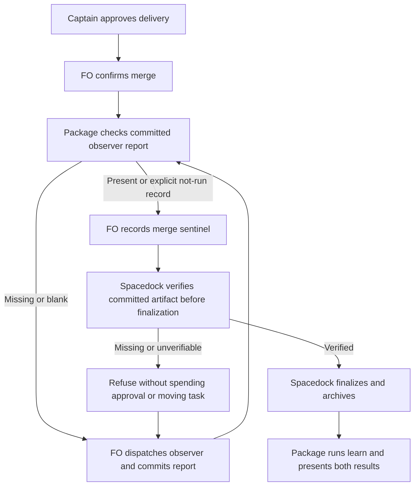

## Scope

- Source: the Captain 「同意開 1 到 5，第 6 項併進「GPT 夥伴」提案」 (chat, 2026-10-27), answering FO's list of package-issue candidates (items 2 to 5 relayed by the relay FO, Paseo 1671c3a9, from its pair-once and room-specs-follow-web-part-select observer reports; item 1 relayed by the kc-ops-inbox FO, Paseo 46c2ebdf).
- Bite: relay pair-once (relay#442): `merge guard --verdict passed` archived the task before observer.md existed; it was committed after archive commit 64ac8c39. Same order here on fo-written-lines-checked-before-dispatch (#724, observer finding 2026-10-26: the sentinel was written before observer.md). `observer_check.py` names the step but nothing refuses the archive.
- Added 2026-10-27: a third bite, relayed by the kc-ops-inbox FO (Paseo 46c2ebdf, data): its task ops-metric-event-protocol (PR #727, merged d7eeeef2) ran the sentinel and archive before the observer report (its observer.md at state commit f25c224f6). Same relay: `spacedock state commit` refuses an archived slug, so an observer report written at archive needs a raw git commit.
- Upstream first: Spacedock `merge guard` (upstream), `scripts/observer_check.py`, `extensions/learn/EXTENSION.md`, the package mod's merge hook.

## FO alignment

Alignment: needed before ideation; where the check runs is a package design choice.
Surfaces: none
Visible change: none
Release review: not needed: workflow maintenance, on no journey map.
Result: aligned 2026-10-27 on the outcome by the Captain's 「全准」 answering this task's backlog briefing-1 question, which named refusing the archive of a learn-listed task before its observer report is committed; where the refusal lives (Spacedock merge guard upstream or the package mod) is put to him at the ideation gate.
Reviewer: kc-dev-flow-2:chief-engineer opus 2026-10-27 — batch 8 review at the ideation gate (the Captain's batch ruling 2026-10-27): per-task disposition, the Captain's decisions, order and batch risk.

## Design

### PRFAQ

**Proposition.** A First Officer (FO) closing a task in a workflow that lists `learn` can retain the merged-delivery fact without losing the live task: Spacedock refuses finalization until the observer report is committed. The package continues to tell FO how to obtain that report and, after archive, run learning. The refusal belongs in Spacedock's terminal writer; package-only printed instructions cannot enforce the native command.

**Who benefits?** FO and the Captain get a recoverable stop before the task leaves the live state directory. A code PR can already be merged; this stop does not undo or repeat delivery.

**Why not repair the existing checker?** `observer_check.py` already returns 1 for missing committed bytes and 2 for unverifiable state. The broken seam is that the native finalizer never consumes that verdict. A wrapper around `merge guard`, an extra `Hook: merge`, or another sentence would still leave direct invocations and restart paths unguarded; an extra merge hook would also change the mod selected for arming. Reuse the checker for recovery instructions and upstream's existing writer for the refusal.

**Does a report mean a clean audit?** No. Preserve the current allowance for a committed `observer not run: <reason>` record when dispatch is unavailable, and show that limitation unchanged to the Captain. Neither a nonblank report nor that record authenticates authorship, verifies findings, or grants approval. Report findings may be violations; their existence alone is not a reason to prevent archive.

**What ships here?** This ideation delivers a design and upstream request draft only. No issue or upstream message is sent. After the Captain accepts the ownership choice, FO must obtain upstream support before dispatching package integration as a complete fix. A package release that merely prints another warning does not satisfy this task. No provider deployment, adoption change, history rewrite, new background job, or PR merge is included.

### Evidence chain and existing-code check

1. **Spacedock first.** Read the assigned `/Users/kent/.local/bin/spacedock merge guard --help`, installed 0.27.3 `skills/first-officer/references/fo-merge-core.md`, `mods/pr-merge.md`, and `internal/status/merge.go` (`MergeGuard`, `finalize`, lines 409 onward). The installed mod records and commits a landed sentinel, then calls native `merge guard`; an already-sentinel row calls it directly. `finalize` validates gate authority, clears the mod block, spends terminal approval, archives, commits and publishes; no observer prerequisite is read. Two bounded searches were help/skill discovery and the actual finalizer/mod source. The separate source checkout `/Users/kent/conductor/repos/spacedock-v1` at `70daeb659` has older merge semantics and is not used as current runtime authority.
2. **Version boundary.** The assigned executable reports **0.27.2**, while the installed plugin is **0.27.3**. The executable's current help includes terminal-approval and publication recovery behavior. A disposable copy of installed `internal/status/testdata/merge-pr-workflow`, with `extensions: [learn]` added and `080-pr-merged.md` committed but no report, ran the assigned binary with `merge guard 080-pr-merged --verdict passed --json`: exit 0, `signal: finalized`, archived entity present, report absent. This is executable evidence for that binary, not a run of a rebuilt 0.27.3 source candidate. Scratch: `/tmp/observer-archive-design-ulsrohmn/workflow`; no adopter was mutated.
3. **Package next.** `git fetch origin` succeeded; baseline is `origin/main` **8bf4f3582411e8e4238f19fbadda8ddeca6767be**, released manifest **0.32.0**. Read baseline package mod, learn extension, and `pr_watch.py`; run helpers only from the assigned Codex 0.32.0 package. Its `observer_check.py` equals the baseline source (SHA-1 file digest `83d16febaea5f5af7a2957a82ab06daa90375ac5`). `pr_watch.tasks` emits a keep-out instruction when the report is absent but does not invoke or intercept `pr-merge`. It skips sentinel PR values because they are not bare/qualified PR references. `test_observer_recovery.py` deliberately demonstrates the current hole and late-report repair; extend that existing behavioral harness rather than invent another one.
4. **Adopters last, read only.** Relay `beirut-dev2`, web `dev2-fo`, and qnow `qnow-adopt-dev2` workflow READMEs all list `learn` and already say the sentinel waits for a committed report. State pins read: relay `f2aa776f24ac1e73470da8750fd90080d9386fff`, web `905be98f3f9d1099092e3ffa7046a66675362503`, qnow `8cbfed6ac3d55dcf1a42c6ffaafc2e601f707573`. No adopter workaround is used as an upstream contract. The three task-history replays below use local Git objects, not current GitHub PR status. GitHub API was not queried; no claim about current open PRs or hosted execution is made.

Related decisions read: ADR 0020 (workflow word budget), ADR 0027 (checks at the existing writer), ADR 0035 (`learn` default), plus the state checkout's `Override:` records. ADR 0027 explicitly distinguishes prose from a deterministic hook; no read ruling authorizes calling a package wrapper unskippable. No applicable override rejects an upstream archive prerequisite. The only new enduring ruling would be an unnumbered ADR draft, **“Archive prerequisites are enforced by the terminal writer”**; FO reserves its number if implementation is authorized. Existing rules on authoring, gate authority, report waivers and separately authorized adoption remain intact.

### Read-only replay of the three cases

Commands are reproducible with `python3 <package>/scripts/observer_check.py <state> <slug> --rev <revision>`. `<package>` is the assigned Codex package; relay uses its state checkout, and the two package-repository cases use this workflow's state checkout, whose object database contains those revisions even when they are from another state history. A check at a historical revision reads Git only.

| Case | Before archive / faulty moment | Report commit | Actual conclusion |
| --- | --- | --- | --- |
| relay `pair-once` (one-time pairing) | `64ac8c39^`: exit 1; archive `64ac8c39`: exit 1 | `f3d39a53`: exit 0, archived report | Proposed native prerequisite refuses the pre-archive state. Report arrived after archive. |
| `fo-written-lines-checked-before-dispatch` (FO record checks) | sentinel `e0cdb3e0`: exit 1; archive parent `1158adc58^` = `0b214ad2d`: exit 0 | `0b214ad2d`: exit 0, live report; archive `1158adc58`: exit 0 | Violated the existing pre-sentinel rule, but **did not archive before the report commit**. Native prerequisite should allow the actual archive parent. Preserve the package's earlier check; do not claim this repair fixes every late sentinel audit. |
| `ops-metric-event-protocol` (operations event contract) | sentinel `f7c825bd9`: exit 1; archive parent `55f9929ee^`: exit 1; archive `55f9929ee`: exit 1 | `f25c224f6`: exit 0, archived report | Proposed native prerequisite refuses the pre-archive state. Report arrived after archive. |

This is predicate replay plus one isolated native baseline reproduction, not a claim that the proposed upstream enforcement exists. No historical archive is rerun or repaired. The ops report's `spacedock state commit` difficulty is consistent with the current help: archived tasks can resume publication, but that does not stage a newly authored late report; the package recovery harness already checks that distinction.

### Proposed boundary and upstream request draft

**Draft title:** Refuse finalization when a configured committed artifact is missing.

**Draft request, not sent:** `merge guard` currently trusts a landed sentinel even when a workflow's prerequisite report is absent. Supply a small declarative prerequisite at the native terminal/archive boundary, before clearing the mod block, spending terminal approval or moving files. Make the same predicate protect direct non-forced archive entry so it cannot silently bypass the ceremony. Missing, blank or unverifiable committed content must return a nonzero refusal with the slug, state root and required path, leaving task bytes, index, approval and archive location unchanged. Normal arm/open-PR behavior and `--rework` remain unchanged. Validate again under the writer's existing concurrency discipline; a changed state revision or changed report between check and write must retry the check or refuse, not consume a stale pass. Existing archive publication recovery must remain publication-only and must not reopen or re-audit an already archived task.

The smallest proposed declaration lives in the existing package mod, consumed by Spacedock rather than the language model:

```yaml
---
archive-requires:
  - when-extension: learn
    path: "{slug}/observer.md"
---
```

This is a **proposed API, not syntax supported today**. `when-extension` is an exact membership test on the selected workflow's extension list; Spacedock need not hardcode `learn` or know observer findings. `path` is relative to the resolved state root, with only the resolved slug substituted; reject traversal, symlinks and paths outside the entity's companion folder. The only predicate needed here is a regular committed nonblank blob at the pinned state HEAD, with the report's worktree/index bytes consistent with that revision so archive cannot commit a different report. Both flat and folder-form entities use `<slug>/observer.md`. Missing configuration on a supported ordinary workflow preserves its behavior; a declared but unsupported requirement must fail validation/adoption rather than be silently ignored. No shell callback, new approval field or package-specific runtime daemon is introduced.

On the package side, keep `observer_check.py` as the early diagnostic and recovery owner. Keep Spacedock's `pr-merge.md` unmodified. Add the declaration, capability verification at adoption/refit, accurate learn limits and package README claims, and actual native-boundary cases in `test_observer_recovery.py` / `test_sd_dispatch.py`. The capability probe must exercise a disposable configured workflow and observe refusal; a version string or metadata substring alone is insufficient. This package integration is conditional on upstream agreeing and shipping a compatible API; if its final shape differs, return a material interface change to this design before implementation.

**Recovery text proposed for a native refusal:** `blocked: archive requires committed nonblank sample/observer.md. Task remains live; commit the report, then rerun merge guard.` FO then uses the existing `observer_check.py` output to dispatch/save/commit and retries the same native command. An unverifiable checkout names its cause and holds; it does not invent a waiver. Explicit `observer not run: <reason>` remains the existing documented fallback for unavailable dispatch, not for Git errors.



The diagram depicts the normal delivered path and recovery; upstream direct-archive, rejection and local-delivery cases owe the same prerequisite when they would archive a learn-listed task. Rendering completed with the existing local Mermaid CLI into `/tmp/observer-archive-design-ulsrohmn/flow.svg` and `.png`; visually checked actors, order, refusal loop and final learn step against the prose. Initial browser launch was sandbox-blocked; the approved local renderer retry succeeded. The diagram source is retained above; temporary renders are not required inputs.

### Words FO reads at each moment

Measured baseline with `len(text.split())`, following root learning.md. This task adds enforcement, not a word-reduction promise. Count the same explicit reading bundle for each moment, including referenced hook logic and actual script output. These are reproducible single-task fixture bundles, not telemetry of a model's cache or a claim that all possible provider replies have a fixed length. Other unchanged host instructions and task-specific review findings are outside the bundle in both columns; no saving is claimed from omitting them.

Fixed inputs: complete workflow 5565; package mod 48; installed `pr-merge` startup section 365; idle section 100 (plus its referenced startup logic); merge core 580; learn extension 282. A local fixture with one qualified `o/r#7`, status validation, `extensions: [learn]`, and no reviewers produces `pr_watch.tasks` output of 29 words when OPEN/ready, 68 when MERGED/report absent, 20 when MERGED/report committed. Network reads and empty ready-gate rows are stubbed; actual installed checker/subprocesses run. An archived committed ops report produces 28 words from `observer_check.py`; no network is needed for that output. Fixture scratch `/tmp/archive-reading-p3in4vlu`.

| Moment and counted passages | Before | Proposed after | Change |
| --- | ---: | ---: | ---: |
| Startup, one open ready PR: workflow + mod + startup hook + OPEN output | 6007 | 6015 | +8 declaration words |
| Idle, same open PR: mod + idle hook + referenced startup hook + OPEN output | 542 | 550 | +8 |
| Idle, merged PR missing report: mod + both hook passages + learn extension + missing output | 863 | 867 | +8 declaration, -4 limits rewrite |
| Native finalization, report ready: preceding bundle with ready output + merge core | 1395 | 1399 | +4; native successful output unchanged |
| After archive, handoff to learn: mod step 3 (12) + printed after-lines (15) + archived output (28) + learn extension | 337 | 333 | -4 |
| Merge ask: Delivery authority and reviewer-ask passages (551), before variable gate/provider output | 551 | 551 | 0; gate/provider output unchanged |

The proposed mod header above is 8 words. Replace only the learn extension's existing 60-word `Limits` bullet with the exact 56-word text below, making that file 278 words; no workflow README prose or its 5565-word budget changes. The one-time adoption probe and its output must be counted separately when upstream chooses the real interface; they have no executed candidate yet. A native missing-report refusal adds the proposed 16-word refusal once at that attempted boundary; it replaces premature finalization, not a successful path. The final upstream diagnostic/capability interface remains unmeasured, so these are **design counts**, not final implementation acceptance results.

> **Limits:** Spacedock enforces the mod's committed-artifact requirement before finalization. Adoption holds on an unsupported runtime. The report proves committed nonblank bytes, not authorship or a clean audit; an explicit `observer not run: <reason>` remains visible. The pre-sentinel check and post-archive learn steps remain package-owned. The observer reads committed state, so chat-only rules remain `can't tell`.

Reproduce counts from the pinned files: split `mods/pr-merge.md` at `## Hook: startup`, `## Hook: idle`, `## Hook: merge`; count the entire package mod and learn extension, and count the workflow span `## Delivery authority` to `## Extensions` plus `A merge ask names each listed reviewer` to `## Workflow State`. Run installed `pr_watch.tasks` on a disposable committed fixture with explicit watch-state path, injected OPEN/MERGED snapshots, empty review-comment pages and empty ready-gate rows; commit the report between missing/ready observations. Do not run the watcher against an adopter to obtain these counts. At validation, store this fixture and raw outputs in the existing behavioral test harness, compare base/candidate, and independently recount every changed message. Entering the learn skill and its evaluation is unchanged downstream work, not hidden by a claimed reduction here.

## Acceptance criteria

**AC-1** Native refusal before mutation. On an isolated split-root workflow that lists learn and installs the proposed declaration, invoke the actual supported Spacedock binary directly with an existing landed sentinel and missing, untracked-only, staged-only or whitespace-only report. Require nonzero exit and unchanged state HEAD, index, entity bytes/location, mod block and pending approval, with no remote publication. Include a folder-form task and a flat task. Falsifier: remove the native prerequisite call; the sentinel fixture finalizes and the test fails. Current evidence: baseline hole reproduced; candidate not implemented.

**AC-2** Committed report permits one archive. After path-scoped report commit, the same pending approval and sentinel finalize once; archive retains the identical report blob, verdict and delivery proof. Repeat publication/restart using the supported state command without a second archive commit. Preserve a committed explicit `observer not run: reason` as visible non-audit evidence. Falsifier: read disk/index instead of HEAD, omit the companion directory, or spend approval twice. Current evidence: three historical report revisions return exit 0; new native behavior unverified.

**AC-3** Correct applicability and independent routes. No-learn and no-declaration workflows keep existing arm/open-PR/rework/finalization behavior. Learn-listed configured workflows cannot bypass the requirement through an already-sentinel startup row, a local-merge sentinel, terminal-but-not-archived recovery, rejected finalization, or direct non-forced archive. Test unavailable/invalid Git state and unsupported runtime: hold with a cause, no fallback to an unguarded command. Falsifier: gate only the package wrapper, one merge policy, or the `passed` branch. Current evidence: source tracing only; candidate unverified. Explicit forced/manual Git mutations remain outside this bounded guarantee.

**AC-4** Freshness and isolation. Change HEAD/report between check and terminal write; the writer revalidates or refuses. A dirty replacement of the report cannot be included in the archive as if the earlier blob passed. Sibling staged task files remain untouched and uncommitted. Reject a report symlink/path escape. Falsifier: cache a prior pass, check code HEAD instead of state HEAD, or broad-stage the checkout. Current evidence: requirements derived from the real split-root seam; candidate unverified.

**AC-5** Three-case replay and existing-state compatibility. Preserve the exact revision table above: two late-archive parents refuse; this workflow's actual archive parent allows, while its earlier sentinel revision refuses. Repeat using immutable local commits and no adopter mutations. Compare base/candidate checker verdicts over committed active/archive tasks from this workflow, relay, web and qnow, with state pins and each changed verdict explained; scope enforcement to new finalization, not reopening history. Falsifier: label all three as late archives or test only today's HEAD. Current evidence: all table exits exercised read only; proposed native replay/corpus comparison still owed.

**AC-6** Wiring, recovery and reading cost. Extend the existing native recovery harness to prove refusal, report commit, successful retry, and archived publication recovery; keep the historical late-report repair fixture explicit. Run the actual installed declaration/capability probe with supported and unsupported binaries. `test_sd_dispatch.py` must still show merge-hook ownership as pr-merge, not the package mod. Preserve no-learn behavior and existing learn/observer presentation. Recount the lifecycle table using final emitted bytes and all changed due-at-moment passages, including the one-time adoption probe, refusal output and any upstream text; keep successful-path additions within the stated +8/+4 design deltas or return the increase to the Captain. Falsifier: a warning-only native pass, duplicated recovery prose, or a version-only capability test. Current evidence: baseline outputs counted; candidate counts and integration remain unverified. No CI configuration change is proposed; CI cost per PR is not measured.

### Needs decision

**One decision: accept upstream enforcement as the prerequisite for this package fix?** Recommend yes: Spacedock owns the irreversible transition; the current checker already detects the missing file; the three histories show two native archive misses and a distinct earlier ordering error. What gets worse: delivery of this fix waits for an upstream API and a separately approved adopter refit, and the proposed reading bundle grows by up to eight words at startup/idle. A package-only wrapper is faster but remains bypassable by the exact native command in the reported failures, so it cannot meet AC-1/AC-3. Upstream issue text stays draft until FO has the appropriate authorization to send it. The proposed configuration syntax is an interface proposal requiring upstream agreement, not another Captain wording choice.

### Batch overlap

Files this design would change after upstream support: `kc-dev-flow-2/references/sd/mods/kc-dev-flow-2.md` (declaration only; no merge hook); `extensions/learn/EXTENSION.md` (limits); `references/sd/adoption.md` (capability/refit probe); `README.md` (enforcement and minimum-capability claims); `scripts/test_observer_recovery.py` (native refusal/retry plus retained historical recovery); `scripts/test_sd_dispatch.py` (registration, compatibility and hook ownership). The latter relative paths are all under `kc-dev-flow-2/`. One unnumbered `docs/adr/<reserved>-archive-prerequisites-are-enforced-by-the-terminal-writer.md` would record the accepted decision; its shared number namespace is an overlap even with unrelated ADRs. No version manifest, workflow prose/budget, `pr_watch.py`, `observer_check.py`, `learning.py`, CI configuration or adopter file is changed by this design. Proposed upstream areas, draft only: Spacedock's `internal/status/merge.go`, non-forced archive writer, mod/config parser/schema, their behavior fixtures, CLI help and merge-core docs; upstream owns exact file placement.

Read-only task snapshot: this task and the other six batch tasks are ideation; adr-required-statement and journey-server-host-pilot are validation; ops-inbox-r1-setup-and-isolation and pr-review-lite-value-pilot are implementation; adr-silent-undo-probe, comment-check-reaches-delivery-gate and journey-canvas-hosted-poc are ideation. No sibling body was edited. The following mappings use each task's present Scope/design; a still-unwritten sibling design can broaden them and FO must recheck before dispatch.

| Task (meaning) | Same file, check or numbered namespace |
| --- | --- |
| archive-waits-for-observer-report (this archive prerequisite) | Owns the six package files and prospective unnumbered ADR above. |
| idle-hook-names-merged-tasks-without-learn (missing-learning reminders) | Direct overlap: learn EXTENSION; its Scope also names observer_check/pr_watch/learning, which this design preserves. Coordinate post-archive wording and the recovery harness's printed-line expectations. |
| copilot-not-run-line-carries-quote (quote missing reviewer outcome) | No direct planned file overlap; shares lifecycle word-count fixture and delivery/close behavior. |
| dispatch-carries-reserved-adr-number (dispatch includes reserved decision number) | No direct package file; shares ADR reservations if it lands a record and script-name checks exercised by test_sd_dispatch. |
| seed-check-requires-schema-fields (validate task seed fields) | No direct file; shares test_sd_dispatch workflow-fixture validity, so rebase fixtures if new requirements land. |
| journey-probe-finds-nested-maps (find nested journey files) | Direct overlap: references/sd/adoption.md; distinct install probe. |
| read-adr-honors-adr-folder (respect supplied decision folder) | No direct file/check; source and copy-sync are outside this design. |
| adr-required-statement (require decision-record statement) | Shared docs/adr number namespace; no same planned package file (its workflow/test_poc_readme changes stay separate). |
| journey-server-host-pilot (hosted journey server) | No same package file/check; any new ADR shares docs/adr numbering. |
| ops-inbox-r1-setup-and-isolation (operations inbox isolation) | Shared docs/adr namespace for its two records; its kc-ops-inbox code/CI are separate. |
| pr-review-lite-value-pilot (bounded review comparison) | No same file/check found; do not inherit its experimental authority. |
| adr-silent-undo-probe (measure silent decision reversal) | No same file/check: existing archived scenario harness only. |
| comment-check-reaches-delivery-gate (bind comment review to delivery) | No direct file: its delivery_gate.py/test_delivery_gate.py/validation principles are separate; both exercise final-delivery sequencing. |
| journey-canvas-hosted-poc (hosted canvas experiment) | No same file/check found. |

Recommended order: Captain ownership ruling, then upstream supported prerequisite, then this package integration and missing-learning reminder integration serialized on the learn extension; serialize the nested-map probe on adoption.md. Re-run combined dispatch/recovery/reading checks after those merges. Reserve ADR numbers against all live tasks immediately before implementation; do not take a number during ideation. Adopter refits remain separate FO-owned work.

## Stage Report: ideation

- DONE: A design for refusing the archive of a learn-listed task before its observer report is committed: read Spacedock's own merge guard (`spacedock merge guard --help`, the installed spacedock plugin's skills) and the package mod and /Users/kent/.claude/plugins/cache/kc-claude-plugins/kc-dev-flow-2/0.32.0/scripts/observer_check.py, say whether the refusal belongs upstream in Spacedock (draft text only, no issue) or in the package, and replay it over the three bites (relay pair-once, this workflow's fo-written-lines-checked-before-dispatch, kc-ops-inbox ops-metric-event-protocol) read only
  Chain checked against fetched origin/main 8bf4f3582 (0.32.0), installed Spacedock 0.27.3 source and assigned 0.27.2 executable. Native scratch fixture archived without a report; historical checker replays distinguish two late archives from one pre-sentinel violation. Draft requests native enforcement; no upstream issue sent.
- DONE: A `### Batch overlap` section naming each file the design would change and each other batch task (archive-waits-for-observer-report, idle-hook-names-merged-tasks-without-learn, copilot-not-run-line-carries-quote, dispatch-carries-reserved-adr-number, seed-check-requires-schema-fields, journey-probe-finds-nested-maps, read-adr-honors-adr-folder) and live task of other sessions (adr-required-statement, journey-server-host-pilot, ops-inbox-r1-setup-and-isolation, pr-review-lite-value-pilot, adr-silent-undo-probe, comment-check-reaches-delivery-gate, journey-canvas-hosted-poc (driven by other sessions; read only)) that changes the same file or check, so FO can order implementation
  ### Batch overlap lists the six proposed package files, unnumbered ADR namespace, every named batch/live task, direct/adjoining overlaps and recommended order; sibling tasks and adopters were read only.
- DONE: The words FO reads at each lifecycle moment, before and after, per root learning.md "Measure the words FO reads at each moment, not one file's size"
  ### Words FO reads at each moment records executed base outputs, explicit reading bundles and proposed deltas (+8 startup/open idle, +4 merged paths, -4 archive handoff, unchanged merge ask); final upstream output and one-time adoption probe remain unmeasured.
- DONE: Acceptance criteria with reproducible evidence clauses and falsifiers, and unresolved decisions for the Captain, each with a recommendation and what gets worse under it
  AC-1 through AC-6 each name evidence, falsifiers and current limits; one Captain decision recommends upstream enforcement first and states the resulting delivery dependency. ADR 0020/0027/0035 and applicable Override records were read.
- DONE: PRFAQ/Mermaid and the recorded none surface are presentable.
  `design_surfaces.py check` exited 0: `archive-waits-for-observer-report.md: design surfaces presentable`; Mermaid rendered and was visually checked. This checks design form and agreement, not native enforcement.
- DONE: AC-1 current evidence and future proof boundary recorded.
  Assigned binary finalized the no-report scratch fixture (exit 0); proposed direct-command refusal and unchanged-state assertions remain unverified until upstream support.
- DONE: AC-2 current evidence and future proof boundary recorded.
  Historical committed report revisions returned checker exit 0; one-archive retry, preserved blob and publication recovery are future native acceptance checks.
- DONE: AC-3 current evidence and future proof boundary recorded.
  Installed mod/source reveal direct sentinel routes; applicability, rejected/local/direct archive and unsupported-runtime refusals remain future tests, falsified by wrapper-only wiring.
- DONE: AC-4 current evidence and future proof boundary recorded.
  Split-root writer seam was read; HEAD-change, dirty-report, symlink and sibling-index cases remain unverified, with stale-pass and broad-stage falsifiers specified.
- DONE: AC-5 read-only historical predicate replay completed.
  Relay archive parent exit 1; FO-record task archive parent exit 0; ops archive parent exit 1. Claiming all three were late archives contradicts observed commits; candidate corpus/native replay remains future work.
- DONE: AC-6 baseline reading/wiring evidence and future proof boundary recorded.
  Existing pr_watch.tasks emitted 29/68/20-word OPEN/missing/ready outputs in isolated fixtures; proposed supported/unsupported native probe and combined tests remain unverified. No CI configuration was changed; cost per PR not measured.
- SKIPPED: Product implementation, upstream publication, adopter refits and current GitHub PR verification.
  Ideation authorizes the task design/report only; API and refits await the ownership ruling/upstream support. Git fetch succeeded; the GitHub API was not queried.

### Summary

Recommend enforcing the committed report prerequisite in Spacedock's native finalization/archive writer and keeping the package's existing checker for early diagnostics and recovery. Two of the three histories archived too early; the third committed its report before archive but after the sentinel, so its earlier ordering rule remains separate. Pilot boundary: task-state design only, one unresolved ownership decision, no claim that the future API or implementation has passed.
