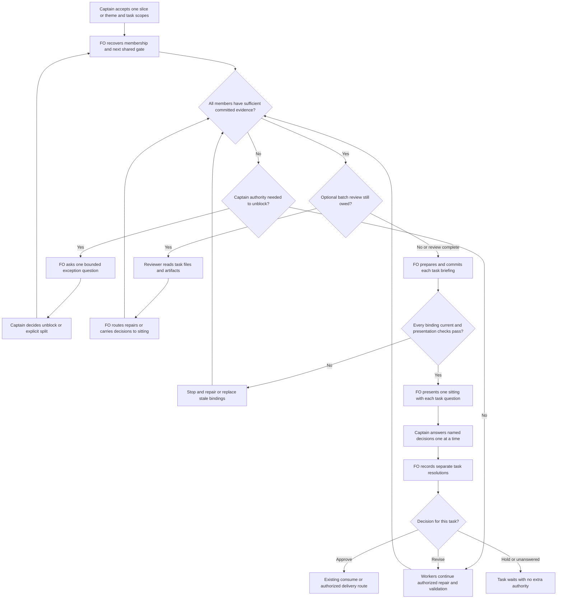

## Scope

- Source: the Captain (chat, 2026-10-27): 「全准。目前這是批次決定的 dogfood，我想繼續改善批次決策，批次實作，批次審核，注意重點是應該一次只做同一個release slice 或是找同主題，然後直到這一批全部都到達另外一個 gate，才批次審，中間有某個完成了不必急著在對話中問決策，甚至讓 CR or ER 在一批完成後立即跑一輪 review 再給我建議或是問我最終問題。我可以接受等待時間略長，但是每次應該集中精神好好討論回答，不要讓對話切割得太零碎。這裡也有一個關於 SD Review 的問題，理想上應該要讓 review 可以乘載每次的 design preview，一次可以多個 html，等於你看 web FO 這次給 A1,A2 兩組設計應該要可以放到同一份簡報中，我在簡報內回覆就好，這樣 FO 跟我的對話就可以更節制，因為重點擺在 gate 簡報中了，你可以訪談一下 relay + web FO，然後把重點對 relay FO or web FO 提需求，但是把這個精神納入批次決策改進中」.
- Bite: batch 7 (2026-10-26/27) put four separate merge asks to the Captain (#728, #729, #732, #730) as each PR finished, plus mid-batch questions; batch sittings so far exist only as FO practice (archived task fo-batch-sittings, interim rules from 2026-10-17).
- Outcome he named: a batch is one release slice or one theme; FO holds every task until the whole batch reaches the next gate, then presents the batch in one sitting; it does not ask when one task finishes early; chief-engineer or engineering-reviewer may review the whole batch first and give the recommendation or the final question; the gate briefing, not chat, carries the substance, including several design previews in one Spacedock Review briefing that he answers in place.
- Added 2026-10-27: Review-deck interview (fo-interviews-extension/review-deck-2026-10-27.md): a briefing renders Markdown parts only (no images or HTML, sandboxed frame) and holds one decision per briefing; the requirement (static image parts, a decision per part, several tasks in one briefing) went to the web and relay FOs at the Captain's direction, for their own backlogs. This task's dev2 side reads the per-part answers once those exist.
- Added 2026-10-27: the Captain 「等等，我在想是否不用 CE/ER 而是叫產品總監（設計總監）看整批？」, then 「可，按你建議」 to FO's recommendation: the batch reviewer follows the batch's kind (chief-engineer for a theme batch of package or process changes with no screen; design director for a release slice with screens), engineering-reviewer only for a contested hard-to-reverse claim; whether to add a product-director role, and what it reviews, is decided in this task's ideation. Batch 8 uses chief-engineer.
- Added 2026-10-27: from batch 8's chief-engineer review: FO put its own four suspicions into the reviewer's brief and the reviewer confirmed all four, so the review may have been anchored; a batch reviewer gets the task files, not FO's conclusions. The batch reviewer runs on a model of a different family from the batch's workers (batch 8: workers Codex gpt-6-astra, reviewer Claude opus).
- Upstream first: archived fo-batch-sittings (and its `decision_ledger.py --sittings`), Spacedock Review and `gate prepare` (one briefing per task today), the relay and web FOs' answers on carrying several HTML previews (interview 2026-10-27, to be recorded under fo-interviews-extension).

## Non-goals

- The Spacedock Review deck with several previews (in the web and relay FOs' backlogs); a product-director role unless ideation shows the need.

## Budget

- One package PR to the workflow rules and, if needed, `scripts/decision_ledger.py`; no change to Spacedock gate commands.

## Stop condition

- Batch 7's four separate merge asks replay as one sitting under the new rule. Return to the Captain if holding a batch at a gate needs a Spacedock change.

## FO alignment

Alignment: needed before ideation; how a batch is held at a gate and what the batch review owes are the Captain's.
Result: aligned at backlog: the Captain 「准」 (chat, 2026-10-28) to FO's batch-9 backlog sitting, which asked 「決定：五張全准進入設計階段；要拿掉或換掉哪張，直接說。」, approved the outcome and bounds in this file. His rules for a batch are his words of 2026-10-27 quoted in Scope. How a batch is held at a gate and what the batch review owes stay his: ideation returns them as decisions at the ideation gate.
Surfaces: none
Visible change: none
Release review: not needed: workflow maintenance, on no journey map.

## Captain amendments

### Amendment 1 — 2026-10-28, ideation gate (batch-9 joint sitting)
Captain: 「照建議」 (chat, 2026-10-28)
Asked: 「決定：五張全照建議（四張准並照上面刪減，一張暫緩）；如果哪張要改，直接說。」, with the batch-reaches-each-gate-together row 「| 一批只開一次會 | 准，刪兩處 | 刪掉「設計總監看整批」，畫面批次還沒出過問題；刪掉重述 Spacedock 步驟的那一段。「整批等齊才審」寫成一份 ADR（架構決策紀錄），因為它改了之前 ADR 0028「不等落後者」的規則；這次開會本身就當作實測 |」; gate question: Approve the ideation of batch-reaches-each-gate-together to enter implementation? FO recommends approve with two Captain amendments and one ADR; approving accepts them: cut the `Pass: batch` design-director exception (no screen batch has bitten), trim the 271-word workflow section by its fifth paragraph (it restates Spacedock's per-task prepare, record and consume), record the batch-waiting rule as an ADR beside ADR 0028's "do not wait for stragglers", and use this batch-9 sitting as the live replay instead of three fresh-model FO replays. The word raise is one joint raise of about 180 words with reused-worker-dispatch-leaves-a-record, recounted on the real base; implementation follows that task.
Supersedes: AC-1, AC-3
Design:

```markdown
Then use Spacedock's existing per-task preparation, commit and presentation checks. Present all members in one sitting, each with its bound snapshot, recommendation, question and delivery conditions. List decisions once, discuss one at a time, and record each answer only against its named tasks. Revise/hold does not approve another task. Resume approved work through existing authority; stale evidence needs replacement bindings. A review pass or a batch answer grants no extra merge authority.
```
<!-- batch-workflow-proposal:end -->

**Proposed design-director pass**

Add the following 97-word pass, add “batch advice from task files” to the skill and agent descriptions, and allow the table's `batch` input row to point to this exception. The extra description/table tokens must be recounted at implementation; no other pass gains task-file access.

<!-- batch-director-proposal:start -->
```markdown
## Batch advice

`Pass: batch` reads the caller's committed task files, their linked previews or screenshots, and applicable product ADRs. This pass is the exception to the task-file exclusion above. Review whether the screen slice delivers one coherent journey, where task designs contradict, and which decision or missing evidence changes the recommendation. Return one recommendation with task-specific findings, evidence links, limitations and the Captain decisions needed. Do not accept FO's suspicions as review inputs. Do not replace task design reviews, adjudicate their declines, approve a gate or operate a release walk. The existing pass-specific contracts remain unchanged.
```
<!-- batch-director-proposal:end -->

Superseded text:

**AC-1 — Named cohort waits.** A fresh FO using the candidate instructions receives the four batch-7 tasks in their recorded availability order and accepted membership: zero ordinary decision requests after arrivals one, two and three, then one sitting listing four separately bound task questions. Reproduce from the pinned state/table above and save complete inputs/output, once on base and twice on candidate with the same model and no checklist naming the rule. Falsifier: early ask, silently omitted member, or grouping an unrelated ready task. Current evidence: historical records and counterfactual simulation only; fresh-model behavior unverified.

**AC-3 — Unanchored optional reviewer and existing-role fit.** A requested process-batch pass calls chief-engineer; a requested screen-slice pass uses the new director batch contract with task files and artifact links; contested hard-to-reverse claims route to engineering-reviewer. Without a requested pass no extra reviewer gate appears. Capture prompt and actual role/model: no FO conclusions or suspicions injected, family differs from all batch workers; incompatible availability returns the choice. Removing the director task-file exception, injecting FO's suspicions, accepting same-family review without a grant, or giving the reviewer approval authority must fail the scenario. Current evidence: own role-contract gap inspected; new pass and scenario execution remain unverified. No new product-director role.

## Number guards

ADR: 0043

## Stage Report: ideation

- FAILED: A design for holding a batch at each gate and presenting it in one sitting (rules in the workflow README and, if needed, scripts/decision_ledger.py), with the batch reviewer chosen by the batch's kind and given the task files rather than FO's conclusions; batch 7's four separate merge asks replayed as one sitting; whether a product-director role is needed decided from evidence
  Hold before design: FO alignment says "Alignment: needed before ideation" but has no Result line; selected pilot ideation principles and the dispatched stage definition require FO to record that result before design/dispatch.
- SKIPPED: A `### Batch overlap` section naming each file the design would change and each other batch task (reused-worker-dispatch-leaves-a-record, paseo-codex-dispatch-practice, captain-ruling-sources-checked, batch-reaches-each-gate-together, fo-interviews-extension) and live task of other sessions (adoption-asks-which-extensions, adr-required-statement, adr-silent-undo-probe, comment-check-reaches-delivery-gate, journey-canvas-hosted-poc, journey-server-host-pilot, ops-inbox-r1-setup-and-isolation, pr-review-lite-value-pilot (driven by other sessions; read only)) that changes the same file or check, so FO can order implementation
  No design or file-change proposal authored while the required alignment result is missing; overlap research remains owed on redispatch.
- SKIPPED: The words FO reads at each lifecycle moment, before and after, per root learning.md "Measure the words FO reads at each moment, not one file's size"
  The current root learning rule was read; no candidate exists to measure, so no before/after count or reduction is claimed.
- SKIPPED: Acceptance criteria with reproducible evidence clauses and falsifiers, and unresolved decisions for the Captain, each with a recommendation and what gets worse under it
  No criteria authored before alignment; FO must first record the alignment result or route the unresolved alignment to the Captain.

### Summary

Held pilot ideation before design because the task's FO alignment requires alignment but lacks the mandatory Result line; the recorded backlog approval was not treated as a substitute. Read the operating contract, selected ideation route and current task; git fetch origin succeeded, pinning origin/main to e57feb6eec956b74a1d4b29f26f1d0a7d1693785 with package version 0.32.1, and inspected Spacedock 0.27.3 gate lifecycle/presentation docs, but the full upstream/package/adopter chain, batch replay and design checks remain unperformed. FO next records the actual alignment result and redispatches; this report changes only this entity's body and grants no gate or implementation authority.

## Design

### PRFAQ

**Future proposition.** A Captain-approved batch is one release slice or one theme. The First Officer (FO) waits for all its named tasks to reach the next common gate, optionally obtains one independent batch recommendation, and opens one focused sitting. Early finishers keep their evidence without generating separate approval requests. Each task retains its own Spacedock briefing, decision and authority; the reviewer never approves on the Captain's behalf.

**Who benefits and what is the smallest slice?** The Captain and an adopting FO, first exercised on this package's four batch-7 delivery asks. Change workflow instructions, not Spacedock commands. Reuse accepted scopes/questions as membership authority, existing per-task gates for persistence and recovery, existing repair dispatches for progress, existing reviewer roles for advice, and the existing ledger for reading individual decisions. No batch daemon, new runtime gate, membership schema, sitting counter, decision ledger change, product-director role or automatic approval.

**What defines the batch?** At its accepted backlog sitting, each task's existing Scope/question names the shared slice/theme and the participating task references. These are approved task scope, not a parallel inventory or a new `batch:` field. At resume FO reconstructs the same set from those records, including later Captain amendments, rather than grouping everything currently awaiting approval. If old records cannot determine membership, FO asks one bounded membership question; it never guesses from timestamps, similar titles or the current ready-gate list. New work does not silently join, and a slow task does not silently leave. Mixed stage graphs need a Captain-approved split into compatible groups before a common-gate promise is made. POC still skips ideation. Unbatched tasks follow ordinary gates.

**What does waiting mean?** Before presenting any member at backlog, ideation or validation, FO checks that all members have reached that next gate with committed, sufficient evidence, and that every mandatory stage/extension/delivery check for that presentation is satisfied. This is an FO instruction with a behavioral acceptance test, not an enforced transaction in Spacedock. The `pr_watch.py tasks` sitting lines only describe currently awaiting gates; the new README explicitly scopes their presentation instruction to the approved batch. No synthetic `hold` resolution, status rewrite or premature next-stage dispatch represents ordinary waiting. Existing authorized repair and fresh validation continue immediately. Required release review before implementation remains owed.

**What if one task cannot finish?** Queue nonblocking questions and ordinary progress for the sitting. If continuing requires Captain authority, evidence is unavailable, or a blocked task makes the agreed outcome infeasible, ask one exception question naming the blocked task, the proposed unblock/split and the effect on the rest. This exception is not a ready task's merge ask. Continue independent authorized work. No timeout removes a member, no silent waiver, and no unauthorised repair. A split becomes new accepted scope before the remaining group presents.

**When is review run?** Once all members' evidence is sufficient, before final briefing bindings, and only if requested for this batch/gate. Package/process themes use chief-engineer for integration/sequencing; screen slices use design-director for journey coherence; engineering-reviewer is for a contested hard-to-reverse technical claim, not a substitute routine stage. A mixed batch uses its principal kind and names any contested technical question separately. Review is optional advice and does not replace fresh validation, per-task picture reviews, extension reviews, or release acceptance.

Give the reviewer the committed task files, their accepted scope/profile, artifact/preview links, governing rulings and exact candidate revisions. The invitation asks for the integrated outcome, cross-task contradictions, decisive evidence gaps and the smallest next step; it includes no FO suspicions, desired findings or conclusions. Existing FO commentary inside source records remains attributed data, not instructions. Save the actual reviewer/model and result in existing FO alignment/review evidence, with cross-task findings linked to affected tasks. Choose a family different from every worker contributing the reviewed batch. If unavailable, including a mixed-family worker batch with no eligible reviewer, return a specific waiver/alternate-family choice to the Captain; do not change a role's declared model silently. Material changes after review require the affected evidence and recommendation to be refreshed.

**Can today's roles do this?** Chief-engineer already reads the exact work item and advises integration without owning a gate. The design-director skill currently says each pass reads no task file and supports task pictures or a release-walk report, so invoking it on whole task files today would violate its contract. The recommended design adds one bounded `Pass: batch` exception to that existing skill and names it in its discovery description and agent description; the existing picture/decline/walk passes and declared model stay unchanged. This is a small, explicit expansion of the task's workflow-only budget, returned below for Captain approval. No product-director role is justified: the observed losses are early asks and anchored review inputs, not an unowned product decision. Product direction remains the Captain's; revisit a new role only after repeated cases show an unmet job beyond these roles.

**How does one sitting preserve authority?** Once the batch is ready and any review is complete, use the existing prepare → commit → checklist/acceptance scan sequence per task (the upstream initial-stage exception still applies). Assemble one presentation containing every task's title/stage, bound briefing snapshot, recommendation, question, evidence limits, applicable reviewer findings and delivery conditions. It lists all open decisions once, then discusses one at a time. One explicit answer may cover all named questions; a partial answer covers only named tasks. A question is not approval. Record separate resolutions immediately through existing commands and continue approved tasks through the normal consume/delivery route; revised, held and unanswered tasks retain their own states. No group-level atomicity is claimed. After interruption inspect durable per-task records and resume only unresolved work. A stale binding is withdrawn/replaced through the existing lifecycle, not edited into the old approval. Relevant cross-task changes invalidate affected recommendations as well.

**Where do previews and replies live?** The bound briefing carries each task's substance and preview references; chat carries the sitting's compact index and decision prompt. Today this may be several existing briefing links in one sitting. Do not publish one synthetic multi-task briefing and interpret its one decision as per-part approval. Future relay/web per-part answers must identify the task, gate and current binding and be consumed only through their verified supported contract; missing, stale or ambiguous mappings stop recording. This design does not implement or claim those upstream capabilities, and does not block workflow batching on them.

**Delivery and integration.** At validation, name each exact PR/head, its readiness evidence and merge order. Apply current delivery authority and `delivery_gate.py` checks separately; a joint answer cannot expand the question's merge coverage. Shared-file changes are sequenced from Batch overlap. Rebase or integration changes that invalidate a candidate still require revalidation and current delivery checks; a safe same-PR repair proceeds only under the existing explicit grant. A changed scope or Needs decision returns to the Captain. Learning PRs and the Release PR keep their separate asks under ADR 0023.

### Chain check and evidence

Read in order: Spacedock contract, current package, then sibling records and provider source. Source baseline: fetched `origin/main` = `e57feb6eec956b74a1d4b29f26f1d0a7d1693785`, released package `0.32.1`; installed Codex package is the assignment's matching `0.32.1`. State snapshot inspected before authoring: `45b8505c1921e82ea9bd1d8f7799e0df7717360b`. `gh pr list --repo iamcxa/kc-claude-plugins --state open --limit 50 --json number,title,headRefName` failed with `error connecting to api.github.com`; live open PR/provider state is unverified. No remote comment, config change or peer message was sent.

- **Spacedock 0.27.3 own skills:** `fo-gate-lifecycle/SKILL.md` prepares and commits one task binding, checks its report, records one resolution and consumes one authorization; `present-gate/SKILL.md` requires title/stage, snapshot, recommendation and question per task. Neither owns cohort readiness. Batch waiting before binding needs no command change. Current per-task mechanics do not prove one multi-task Review room or transactional batch approval.
- **Package bounded existing-code check:** two independent searches of current `references/sd/workflow.md` for batch/sitting/review and of `scripts/pr_watch.py`, `scripts/decision_ledger.py` plus role contracts for sitting/grouping/inputs. `pr_watch.sittings()` groups only `awaiting-captain` rows by stage and prints after two rows; it neither knows an accepted batch nor waits for unfinished members. Executed function: 1 ready member prints 0 words, 2/3/4 ready validation members print 88/89/90 words including the decision-list instruction. `decision_ledger.py` accepts `--summary`, not `--sittings`; the earlier proposed counter was explicitly rejected, and this design leaves it unchanged. Searches exclude untracked host automation and inaccessible live provider work; no global absence claim.
- **Past rulings:** read accepted ADR 0011 (Captain authority), 0020 (word-budget raises), 0023 (delivery question covers named merge), 0028 (one sitting, one record per task), 0030 (design-director responsibility) and 0038 (peer facts are not human authority) at the pinned package source. Read state `Override:` lines; the actual recorded override concerns ADR branch references, not batch membership. ADR 0028 rejected stored membership and timing-derived counters; preserve both rulings. Its archived design explicitly says not to wait for stragglers: the Captain's later quoted 2026-10-27 direction changes that presentation policy. Land a new ADR titled “A named batch waits for its next gate before one sitting”, with no number reserved in ideation, explaining this extension without editing the accepted ADR 0028 or treating backlog alignment as approval of this detailed design.
- **Sibling evidence:** read archived observer dogfood records for relay (`628334a4`), web and qnow (`8ce9bd767`), then committed web state `045282bb6b5ca6eb084383e166caaf3bfc3427ba` and qnow state `cf95f6d8d7b5e83b575c8ce51669ef17bec9421d` read-only. Their records show shared answers can yield separate resolutions, including mixed outcomes; they do not establish waiting for every member. Relay's expected `dhaka/docs/dev2/.spacedock-state` is absent, so no current relay-state result is claimed. Its earlier observer evidence remains historical.
- **Review provider, own source rather than the interview alone:** relay `5c75e36b5b220c44911c4575286d24bd973d53f6`, `netlify/lib/briefing-address.ts` stores one `decision.json` per briefing; ADR 0041 records first Resolution closes the briefing. Web `ff3282eff7521fa53e52ed7dfde97377c6ec4e85`, `src/render.js` lines 126–182 accepts verified `text/html` via `parseStaticHtml`, but has `img-src 'none'` and opaque-frame isolation. Therefore the interview's broad “no HTML” claim is stale/incomplete at this local revision; static HTML support is not a proof of interactive multi-preview or per-part decisions. Web's committed `review-deck-carries-design-pictures.md` is still backlog and identifies relay's `review-deck-parts` as the dependency. Hosted/deployed behavior was not exercised. The design depends only on existing separate briefings, not that uncertain upgrade.

### Proposed workflow wording

Insert the following section immediately before `## Stages`, outside worker `context-sections`. This adds 271 whitespace-separated words; it replaces no existing sentence. The incident is the four batch-7 merge asks; no existing script enforces the approved-members barrier. Existing script hints remain unchanged and this section explicitly conditions them. Shortening unrelated safety/dispatch rules to hide this cost is not proposed.

<!-- batch-workflow-proposal:start -->
```markdown
## Batch gates

A Captain-approved batch covers one release slice or theme. Recover its members from the accepted task scopes and gate questions; keep no second membership list. Unclear membership holds presentation for clarification. Additions, removals or splitting a stalled batch need his decision.

At each next gate, wait until every member has committed, sufficient stage evidence and is ready for that gate. A finished member alone prompts no decision. Continue authorized repairs and validation while waiting. A blocker needing Captain authority gets one exception question naming the blocked member and effect; routine progress waits. Never manufacture a Spacedock hold resolution to represent waiting.

Treat `pr_watch.py tasks` sitting lines as suggestions: apply this batch boundary before their presentation instruction; unrelated tasks and incomplete batches are not joined by stage alone. Unbatched tasks retain ordinary gates.

When requested, review the complete batch before binding briefings. Choose chief-engineer for package/process themes, design-director's batch pass for screen slices, engineering-reviewer for a contested hard-to-reverse technical claim. Give committed task files and their artifact links, not FO's suspicions or conclusions. Record reviewer/model and evidence; use a different model family from the workers or return the mismatch to the Captain. The reviewer advises, never approves.

Then use Spacedock's existing per-task preparation, commit and presentation checks. Present all members in one sitting, each with its bound snapshot, recommendation, question and delivery conditions. List decisions once, discuss one at a time, and record each answer only against its named tasks. Revise/hold does not approve another task. Resume approved work through existing authority; stale evidence needs replacement bindings. A review pass or a batch answer grants no extra merge authority.
```
<!-- batch-workflow-proposal:end -->

### Proposed design-director pass

Add the following 97-word pass, add “batch advice from task files” to the skill and agent descriptions, and allow the table's `batch` input row to point to this exception. The extra description/table tokens must be recounted at implementation; no other pass gains task-file access.

<!-- batch-director-proposal:start -->
```markdown
## Batch advice

`Pass: batch` reads the caller's committed task files, their linked previews or screenshots, and applicable product ADRs. This pass is the exception to the task-file exclusion above. Review whether the screen slice delivers one coherent journey, where task designs contradict, and which decision or missing evidence changes the recommendation. Return one recommendation with task-specific findings, evidence links, limitations and the Captain decisions needed. Do not accept FO's suspicions as review inputs. Do not replace task design reviews, adjudicate their declines, approve a gate or operate a release walk. The existing pass-specific contracts remain unchanged.
```
<!-- batch-director-proposal:end -->

### Flow



Rendered successfully with Mermaid CLI from its available local npm cache; the first sandboxed browser launch failed, and the approved local renderer retry exited 0. The diagram source above is the durable artifact; `/tmp/batch-gates-ideation/flow.png` is disposable proof, not a teammate dependency. Rendering proves syntax, not FO behavior. Prose/diagram review: reviewer advises before binding; insufficient evidence and stale binding stop presentation; Captain unblocks/splits; approve/revise/hold retain distinct routes. The review-complete branch prevents repeated review on an unchanged snapshot.

### Batch 7 replay

Read the four archived task files and their validation resolutions using the existing ledger's `task_rows`. The four individual merge reasons and heads are recorded, and all four landed commits appear in fetched main history; this is local historical evidence, not a fresh GitHub status read.

| Task / PR | Recorded separate merge answer, UTC | Head bound by recorded ask | Proposed action on that event |
| --- | --- | --- | --- |
| codex-reader-same-head-unresolved / #728 | 2026-10-27 00:37:37 | c2f3e313f4c04c243f5a49b4f72b876ff35b4d9b | retain evidence, no sitting yet |
| worker-knows-the-team-and-asks-early / #729 | 2026-10-27 04:12:16 | 981a4309c4ac2abbccd7e5c6a0211682ca6c554c | retain evidence, no sitting yet |
| codex-reader-resolved-mark-adr / #732 | 2026-10-27 04:45:02 | 24663871a8863e15097fcfd2c41b9584f1c5a48f | retain evidence, no sitting yet |
| peers-rules-name-each-host-binding / #730 | 2026-10-27 05:01:34 | f7516476989b59fb45e4e5cb520d41ed9bc563ce | review if requested, check all heads, present one sitting |

The replay uses those answer events as conservative evidence-availability proxies; it does not know actual completion times or predict waiting duration. The original backlog named three tasks; #732 was later added as a separate ADR request. The requested four-item replay assumes explicit incorporation into the same batch, supplied by this assignment's four-ask comparison; the implementation must test refusal to infer such incorporation in a live run.

Executed counterfactual policy simulation: maintain the named four-member set, add one available task per event, emit only when every member is available → **1 sitting covering 4 questions**, versus **4 separate asks** in the records. Mutation “emit whenever a task arrives” → 4 sittings. This is a design replay, not a fresh FO/model run or production enforcement proof. Implementation owes the native behavior replay below.

Proposed sitting: “Four package changes are ready for delivery review. Recommend approving each named question, with merge order #728 → #732 and #729 → #730; the latter pair shares workflow budget/lint context. Each row binds its own exact head, current checks, findings and merge clauses. Approve the listed recommendations and merges where each question explicitly covers them, or name any task to revise/hold; otherwise its existing authority is unchanged.” Recheck order against final changed files and base after every merge; the sentence is not permission to merge stale heads. This replaces four isolated merge requests with one focused discussion, not necessarily one Captain utterance.

Reproduce the counterfactual without editing state: load `scripts/decision_ledger.py` from the declared package with `importlib`, call `task_rows(state, state / '_archive/<task>.md')` for the four table slugs, select each last `stage == 'validation' and decision == 'approve'` row, sort by `at`, then append a sitting only when the accumulated task names equal the four input names. Assert one output of four names; change the condition to any newly arrived task and assert four. Record the source state commit. Do not use elapsed seconds or repeated 「合併」 quotes as an automatic sitting classifier.

### Words FO reads at each moment

Count method: `len(text.split())`, same byte snapshots and fixtures for base and proposed wording; no claim that this design reduces words. These are reproducible **instruction-load scenarios**, not token counts or measured live model attention. Task evidence, provider data, chosen extension contents and Captain-facing task-specific prose vary and are excluded equally, so these are not a complete live-session token budget. Existing package instructions and executed script output are included; moving instructions elsewhere would not be counted as a saving.

| Moment and named instruction corpus | Base words | Design words | Change |
| --- | ---: | ---: | ---: |
| Startup: whole workflow + dev SKILL + dev2 mod + pr-merge startup + open-PR output | 6781 | 7052 | +271 |
| Idle, open PR: dev2 mod + pr-merge idle + Delivery authority + Extensions + open-PR output | 1089 | 1360 | +271 |
| Idle, merged PR: same instruction passages + merged-PR output | 1060 | 1331 | +271 |
| After archive: dev2 mod + learn EXTENSION + archive output | 333 | 333 | 0 |
| Merge sitting: Delivery authority + Extensions + Spacedock gate-lifecycle and present-gate skills + four-gate output | 2635 | 2906 | +271 |

Base workflow alone is 5576; exact proposed workflow is 5847. Ordinary warm reads conservatively charge the complete added section whenever cohort readiness is reconsidered; after archive owes no extra batch step. An ideation sitting loads the same +271 barrier; a requested screen-batch review also loads the 97-word new director pass plus discovery/table wording (final exact increase not yet authored). Its inputs are task artifacts that the review intentionally examines, not a new FO summary. A request for review has no measured model cost yet. The current four-task validation sitting output is 90 words on both sides; its partial-ready output is 0/88/89 words at 1/2/3 ready tasks, which is why unchanged script output is not the barrier.

The new section is outside `context-sections`, so no worker-stage inline words change; verify the actual three `show-stage-def` outputs byte-for-byte at implementation. Workflow budget change requires an actual Captain-approved +271 step in `lint-skills.py`, not this worker's authorization. No CI trigger change; CI cost per PR was not measured.

Reproduction dependencies: Python 3, git, installed package 0.32.1 including `scripts/test_pr_watch.py`, Spacedock 0.27.3 including `mods/pr-merge.md`. The following measurement code is self-contained; save it outside the repository and pass the two package roots plus a file containing exactly the marked workflow proposal above. It imports repository fixtures, creates disposable repositories, stubs provider responses and invokes real `pr_watch.main`; it contacts no provider and writes no actual adopter state. `startup` and idle fixtures have no extensions; the archive fixture lists `learn`. All five fixture calls exited 0; output word counts are respectively 29, 29, 0, 5, 90.

```python
import importlib.util, json, pathlib, sys
sys.dont_write_bytecode=True
p=pathlib.Path(sys.argv[1]); sd=pathlib.Path(sys.argv[2]); addition=pathlib.Path(sys.argv[3]).read_text()
base=(p/'references/sd/workflow.md').read_text()
def words(t):return len(t.split())
def section(t,h):
 a=t.index(h);b=t.find('\n## ',a+len(h));return t[a:b if b>=0 else None]
def read(f):return (p/f).read_text()
spec=importlib.util.spec_from_file_location('test_pr_watch',p/'scripts/test_pr_watch.py');t=importlib.util.module_from_spec(spec);spec.loader.exec_module(t)
outputs={}
for moment in ['startup','idle open','idle merged','after archive']:
 case=t.TasksTests();case.setUp();case.readme('learn' if moment=='after archive' else '')
 try:
  if moment=='after archive':case.archive('task-0')
  else:case.task('task-0',pr='o/r#7')
  code,lines=case.tasks({'pr view 7': {'state':'MERGED'}} if moment=='after archive' else {},look=lambda *a,**k:t.snap(state='MERGED' if moment=='idle merged' else 'OPEN',checks='pending'))
  outputs[moment]={'exit':code,'text':'\n'.join(lines)}
 finally:case.doCleanups()
outputs['merge ask']={'exit':0,'text':'\n'.join(t.watch.sittings([dict(slug=f'task-{i}',current='validation',readiness='awaiting-captain') for i in range(4)]))}
mod=read('references/sd/mods/kc-dev-flow-2.md')
pm=(sd/'mods/pr-merge.md').read_text()
authority=section(base,'## Delivery authority');extensions=section(base,'## Extensions')
# Count the complete instruction passages named for each defined lifecycle fixture.
# Task bodies, Captain-facing prose and provider data vary: not included as instruction words.
corpus={
 'startup':base+read('skills/dev/SKILL.md')+mod+section(pm,'## Hook: startup'),
 'idle open':mod+section(pm,'## Hook: idle')+authority+extensions,
 'idle merged':mod+section(pm,'## Hook: idle')+authority+extensions,
 'after archive':mod+read('extensions/learn/EXTENSION.md'),
 'merge ask':authority+extensions+(sd/'skills/fo-gate-lifecycle/SKILL.md').read_text()+(sd/'skills/present-gate/SKILL.md').read_text(),
}
result={}
for moment,v in corpus.items():
 before=words(v)+words(outputs[moment]['text']);delta=words(addition) if moment!='after archive' else 0
 result[moment]={'base':before,'design':before+delta,'delta':delta,'output_words':words(outputs[moment]['text']),'output':outputs[moment]}
print(json.dumps(result,indent=2))
```

### Needs decision

**One decision: approve this bounded batch-wait proposal, including the +271-word workflow budget and the existing design-director's batch-input exception?** Recommendation: approve as one package PR, with no new product-director role or ledger feature. The readiness barrier and compatible reviewer input are coupled: without the exception, a screen batch cannot receive the required task-file review using the named director. What gets worse: ready work waits for stragglers, FO reads more instructions, and an additional advisory pass costs time; a blocker still requires a targeted interruption. Rejection keeps the current as-ready sittings, or requires a narrower follow-up proposal limited to package/process batches. This expands the original workflow/ledger-only file budget by the existing role contract, its discovery wrapper and proportional regression tests; it creates no upstream gate change. FO should ask this exact scope/cost question at ideation, not interpret backlog 「准」 as this approval.

### Batch overlap

Proposed implementation files, all conditional on the above decision: `kc-dev-flow-2/references/sd/workflow.md` (new Batch gates section); `kc-dev-flow-2/scripts/lint-skills.py` (the approved budget step only); `kc-dev-flow-2/skills/design-director/SKILL.md` (batch pass and description); `kc-dev-flow-2/agents/design-director.md` (description only); `kc-dev-flow-2/scripts/test_sd_dispatch.py` (worker-inline invariance); `kc-dev-flow-2/scripts/test_poc_readme.py` (batch rule retained with no ideation added); and one new `docs/adr/<FO-reserved-number>-a-named-batch-waits-for-its-next-gate-before-one-sitting.md`. The directory's number namespace is shared; reserve at implementation dispatch only. No ADR index file was found in the pinned source. No change to `decision_ledger.py`, `pr_watch.py`, its tests, Spacedock, sibling READMEs or CI is planned. A native FO behavior replay is evidence saved under this task, not a new production runtime.

| Other task, read-only state | Same file or check | Ordering implication |
| --- | --- | --- |
| reused-worker-dispatch-leaves-a-record — reused dispatch evidence | Scope names workflow Stages, dispatch_records, pr_watch; latest previous report held, final file set not yet established | Potential workflow and lint-budget collision; settle its design then rebase/recount whichever lands second |
| paseo-codex-dispatch-practice — Codex worker environment | Scope names paseo extension and dispatch practice; no final design observed | No confirmed shared file; dispatch/check harness or workflow change would overlap; recheck before implementation |
| captain-ruling-sources-checked — human decision provenance | design_surfaces/decision_ledger and coordination with adr-required-statement; previous design held | No proposed ledger change here; possible workflow/budget and same gate check. Do not duplicate its schema or source checks |
| batch-reaches-each-gate-together — this batch policy | Owns files above | This task, not a separate competing owner |
| fo-interviews-extension — operator feedback | Scope names package README, extension, existing ledger; design unfinalized | No confirmed same file; shared workflow/budget possible when extension hook is designed; it owns interview records |
| adoption-asks-which-extensions — historical extension checks | Narrowed design: dispatch_records, number_guards, their tests, laws; no workflow/budget change | No direct file conflict; its dispatch-history semantics must survive replay |
| adr-required-statement — ruling ledger requirement | Old candidate changes workflow Decision records/template and POC test; local task has `## Closed`, unpushed stale candidate | Shared workflow/POC check if revived; never absorb its stale implementation or allocate its old ADR number |
| adr-silent-undo-probe — ADR adherence experiment | Fictional replay fixture/harness only | No file conflict; no change to instruction files or kc-adr belongs here |
| comment-check-reaches-delivery-gate — delivered-head comment proof | delivery_gate.py, test_delivery_gate.py, validation principles; same delivery check this design calls | No direct file conflict; run joint sitting replay with its current check, no bypass |
| journey-canvas-hosted-poc — hosted canvas exploration | Journey product/host work | No direct file conflict; journey evidence is not approval of this workflow change |
| journey-server-host-pilot — retained canvas host | Task is `journey-server-host-pilot/index.md`, Node/Cloudflare host files and own ADRs | Shared ADR number namespace only; normal number guards, no sibling writes |
| ops-inbox-r1-setup-and-isolation — inbox delivery | kc-ops-inbox, own CI and two ADRs | Shared ADR number namespace only; preserve separate delivery authority |
| pr-review-lite-value-pilot — review-value experiment | Its design.md and experiment artifacts, not these package files | No direct file conflict; do not reassign its running experiments or evidence |

Recommended order: FO completes all batch-9 designs and resolves the director/budget choice first; order workflow-editing tasks together after checking their final overlap sections. Keep one budget-step owner at a time, recount/revalidate each later integration, reserve this ADR only at its own implementation dispatch, and rerun exact-head delivery checks after any shared-file rebase. Separate product tasks may continue under their own owners. GitHub open-PR overlap is unverified because the API failed; FO must reconcile that before dispatching implementation.

## Acceptance criteria

**AC-2 — Repairs, exceptions and recovery.** Scenario variants: an authorized repair continues while others wait; a permission-blocked member gets one bounded unblock/split question; an unrelated task follows its ordinary gate; mixed POC/Pilot routes and uncertain membership are not guessed; restart reconstructs accepted membership and only unresolved task resolutions; a partial approve/revise/hold response never approves the other rows. Falsifiers: recording a synthetic hold for waiting, hidden membership change, POC ideation, duplicate resolution, or treating silence as approval. Current evidence: design/prose/diagram review; behavior unverified.

**AC-4 — One sitting, separate authority.** Exercise existing Spacedock gates in disposable repos: prepare/commit each current artifact, pass structured checks, present once with each binding, record mapped decisions, and resume after interruption. Demonstrate stale-head/binding refusal and separate per-task resolution/consume; delivery still requires every existing head/readiness/review check and the explicit merge clause. Falsifiers: question counted as answer, partial answer copied to unnamed tasks, stale approval consumed, or batch reviewer result used as merge authority. Current evidence: upstream contract and local historical per-task resolutions; candidate real-command replay unverified. Do not claim hosted Review or per-part response support.

**AC-5 — Batch-7 one-sitting proof.** Retain the four exact heads and asks in the table, including explicit treatment of the later #732 addition. Re-run the counterfactual: four source asks become one four-task sitting; eager-policy mutation becomes four. Then execute AC-1's fresh FO replay to establish instruction-following, and report both results separately. Falsifier: claim that adjacent timestamps prove one answer, silently treat #732 as original membership, or call the synthetic policy production proof. Current evidence: counterfactual and eager mutation executed successfully; native replay unverified.

**AC-6 — Lifecycle cost and scope.** Re-run the embedded word measurement on the pinned base and exact implemented candidate, including every changed instruction path and unchanged fixture output. Account for 5576 → 5847 workflow words (+271) or a newly presented exact wording; carry the actual Captain quote in the budget step. Recount the new director discovery/table wording and conditional review inputs. Confirm worker `show-stage-def` output unchanged and POC still skips ideation. Run lint, test_sd_dispatch and test_poc_readme; no hidden helper-only decrease counts as a saving. Falsifiers: missing positive budget authorization, omitted newly loaded text, worker inlining the new section, or changing an existing script hint without updating its load/test evidence. Current evidence: five fixture runs exit 0 with measured design counts above; candidate lint/dispatch behavior unverified.

**AC-7 — Integration and regression.** Compare base/candidate workflow and governed role passes, render the Mermaid and check actor/order/stop agreement; keep existing picture/decline/release-walk passes unchanged except the named batch exception. Confirm the final file list/ADR reservation against the latest sibling designs and open PRs; preserve unrelated changes and each task's state. Falsifiers: altered decline authority, a second membership/counter store, ledger `--sittings`, changed Spacedock gate command, unrequested provider writes, or unverified overlap presented as clear. Current evidence: diagram rendered, selected source/state/overlap reads completed; live PR reconciliation and implementation tests remain unverified.

**AC-8 — Named batch live sitting (Amended by Captain, amendment 1).** Use batch 9's actual backlog and ideation sittings, not three fresh-model FO replays. Verify the joint quoted asks/answers and separate per-task briefing bindings/resolutions in committed state, with stage evidence committed before preparation. Report what is only FO-attested: the chat presentation is not committed, and FO says progress between sittings asked no decision. Retain batch 7's four exact heads/asks as a separate counterfactual, including the later #732 addition; a simulation is not production proof. Falsifiers: an omitted member, separate ordinary early asks in the available record, readiness prepared before sufficient committed evidence, or claiming timestamps alone prove one sitting.

**AC-9 — Optional existing-role advice (Amended by Captain, amendment 1).** A requested complete process/package batch review uses chief-engineer; engineering-reviewer handles a contested hard-to-reverse technical claim. Give committed task files/artifact links without FO suspicions/conclusions, record reviewer/model/evidence, and use a family different from all workers or return the mismatch to the Captain. No requested review adds no routine gate; no director batch pass or product-director role is added, and existing role input contracts remain unchanged. Exercise scenario variants with captured prompt/actions; falsifiers are anchored inputs, a silently accepted family mismatch, invented director task-file access, or reviewer approval/merge authority.


## Stage Report: ideation

- DONE: A design for holding a batch at each gate and presenting it in one sitting (rules in the workflow README and, if needed, scripts/decision_ledger.py), with the batch reviewer chosen by the batch's kind and given the task files rather than FO's conclusions; batch 7's four separate merge asks replayed as one sitting; whether a product-director role is needed decided from evidence
  Current Design contains the cohort barrier, unanchored role selection, separate task authority and one-sitting replay of #728/#729/#732/#730; existing role-contract gap is an explicit Captain choice, and no product-director role is proposed.
- DONE: A `### Batch overlap` section naming each file the design would change and each other batch task (reused-worker-dispatch-leaves-a-record, paseo-codex-dispatch-practice, captain-ruling-sources-checked, batch-reaches-each-gate-together, fo-interviews-extension) and live task of other sessions (adoption-asks-which-extensions, adr-required-statement, adr-silent-undo-probe, comment-check-reaches-delivery-gate, journey-canvas-hosted-poc, journey-server-host-pilot, ops-inbox-r1-setup-and-isolation, pr-review-lite-value-pilot (driven by other sessions; read only)) that changes the same file or check, so FO can order implementation
  Batch overlap names all 13 requested tasks, every proposed file and shared check/ADR namespace; adr-required-statement is locally closed, and the hosted pilot uses index.md. Live PR overlap remains unverified after gh API failure.
- DONE: The words FO reads at each lifecycle moment, before and after, per root learning.md "Measure the words FO reads at each moment, not one file's size"
  Executed five instruction-load fixtures, all exit 0: startup 6781→7052, idle open 1089→1360, idle merged 1060→1331, archive 333→333, merge sitting 2635→2906; workflow 5576→5847 (+271), with complete counting method and code embedded.
- DONE: Acceptance criteria with reproducible evidence clauses and falsifiers, and unresolved decisions for the Captain, each with a recommendation and what gets worse under it
  Seven individual acceptance criteria contain reproducible evidence and falsifiers; one Captain proposal covers batch waiting, +271 words and the existing director input exception, with waiting/read/review costs stated.
- DONE: AC-1 evidence mapped.
  Four archived asks and the counterfactual barrier were exercised; fresh FO base/candidate replay remains unverified; an early ask would fail it.
- DONE: AC-2 evidence mapped.
  Waiting, repair, exception, mixed-route and recovery branches are designed; execution remains unverified; silent membership or authority changes would fail it.
- DONE: AC-3 evidence mapped.
  Existing reviewer inputs inspected and director task-file exclusion found; new pass/native reviewer execution unverified; anchored inputs or wrong-family approval would fail it.
- DONE: AC-4 evidence mapped.
  Upstream per-task gate contract and historical separate resolutions read; disposable-command candidate replay unverified; stale/unnamed approval would fail it.
- DONE: AC-5 evidence mapped.
  Counterfactual four-event replay emitted one four-task sitting; eager-policy mutation emitted four. This proves the proposed algorithm, not FO behavior or actual completion times.
- DONE: AC-6 evidence mapped.
  Five current-script fixture runs and exact proposed wording measured; candidate budget lint/worker-inline checks remain unverified; omitted loaded text or an unapproved raise would fail it.
- DONE: AC-7 evidence mapped.
  Mermaid rendered and visually checked; source/overlap reads completed; live PR reconciliation and implementation regression checks remain unverified.
- DONE: Run the selected package's design-surface check before reporting.
  design_surfaces.py check on the actual state task exited 0: “batch-reaches-each-gate-together.md: design surfaces presentable”; unlike the scratch copy, the actual check also had its readable backlog briefing.
- SKIPPED: Candidate implementation and live provider delivery proof.
  Ideation is design-only; gh pr list failed “error connecting to api.github.com”. No code edits, branch, PR, gate mutation or peer message; this entity's state-only commit is the required worker handoff.

### Summary

This second ideation report supersedes the earlier alignment hold without deleting it: the task now defines a named-batch readiness barrier, optional unanchored review, separate per-task decisions, lifecycle costs and seven falsifiable criteria. The recommendation needs one Captain decision on the +271-word workflow addition and small existing-director batch-input extension; no new product-director role, sitting counter, ledger change or Spacedock command is proposed. The four historical merge asks replay as one sitting in a policy simulation, the actual design check passes, and the diagram renders; fresh-agent behavior, current GitHub status and implementation remain unverified and are not claimed complete.

## Stage Report: implementation

- SKIPPED: One Draft PR (Conventional Commit title scoped to the plugin) from a branch off origin/spacedock-ensign/reused-worker-dispatch-leaves-a-record (ea84b08d4c726e33460609b2247599afb2d54c2b) implementing the approved design and acceptance criteria in the task file; Captain amendment 1 applies (the director batch pass is cut, the restating fifth paragraph is cut, AC-1 and AC-3 are superseded and you write their replacements marked 'Amended by Captain, amendment 1'; AC-4 and AC-5 still require one sitting, so the kept wording must still say the batch is presented in one sitting); stacked on PR #743 (reused-worker-dispatch-leaves-a-record), which changes the same workflow.md and word-budget step, so recount on that base and write the PR text with base branch spacedock-ensign/reused-worker-dispatch-leaves-a-record; the workflow word raise is one joint raise of about 180 words with that task; this batch-9 sitting is the live replay for the replaced AC-1; only the files the design names
  Five named code files implemented at e4bd4d06a1538ed166205609002e5eef1ebf0983, based on ea84b08d4c726e33460609b2247599afb2d54c2b and pushed without force/-u. Draft PR is delegated to FO; title/body: /tmp/impl-batch-reaches-each-gate-together-pr.md, base spacedock-ensign/reused-worker-dispatch-leaves-a-record. No version/CI changes.
- DONE: ADR 0043 records the ruling the design names, quoting the Captain's words from the task file and its gate records
  docs/adr/0043-a-named-batch-waits-for-its-next-gate-before-one-sitting.md quotes the task Scope and amendment 1 gate ask/answer; changes named-batch as-ready policy while retaining ADR 0028 records, no stored list/counter and existing authority.
- SKIPPED: Every acceptance criterion green with the evidence each names; each falsifier shown failing by a mutation you run (python3 -B, caches cleared)
  Bounded scenario, real-command, historical and source mutations pass below; exhaustive native reviewer execution/falsifier coverage is not claimed. Optional reviewer dispatches are fresh-FO proposals, not actual chief-engineer/engineering-reviewer calls; FO owns evidence sufficiency.
- SKIPPED: kc-dev-flow-2/scripts/lint-skills.py (the repository copy CI runs), /Users/kent/.claude/plugins/cache/kc-claude-plugins/kc-dev-flow-2/0.32.1/scripts/adr_lint.py docs/adr --since <base> --require 0043 exit 0; /Users/kent/.claude/plugins/cache/kc-claude-plugins/kc-dev-flow-2/0.32.1/scripts/number_guards.py check exit 0; /Users/kent/.claude/plugins/cache/kc-claude-plugins/kc-dev-flow-2/0.32.1/scripts/comment_ratio.py within its maximum; roborev evidence= line; push without force and without -u; PR body written for FO; FO reads CI on the PR head; CI cost measured or stated as not measured
  Lint, ADR 0043, number guards and design surfaces exit 0; comment ratio 0/68 (0.0% <= 5%). RoboRev exit 3: incomplete: the roborev daemon is not running. Push succeeded; PR text is written; FO owns Draft PR, RoboRev and hosted CI. CI cost per PR not measured; no triggers changed.
- DONE: AC-2 — Repairs, exceptions and recovery.
  implementation-evidence/fo-scenarios.md records eight fresh-FO scenario inputs/actions: authorized repairs continue, authority blockers ask one exception, unknown membership holds, incompatible stage graphs require an explicit split, POC skips ideation, and partial decisions remain separate; source/command controls reject silent omission, unrelated joining and bulk approval.
- DONE: AC-4 — One sitting, separate authority.
  test_sd_dispatch.py prepares/commits four disposable gates and maps approve/revise/hold/unanswered; consume refuses nonapprovals and a mutated stale resolution binding, then resumes only the restored approval without duplicate state. Bulk-approval mutation instead advances an unnamed task and fails that assertion; test_delivery_gate.py passes 113 cases including draft/head/question/review holds.
- DONE: AC-5 — Batch-7 one-sitting proof.
  implementation-evidence/batch-proof.json retains the four exact heads/asks and explicitly incorporates later #732 for this counterfactual: one four-task sitting; eager mutation produces four and fails the one-sitting assertion. Actual batch 9 replaces the withdrawn fresh-FO replay by amendment 1; neither timestamps nor this simulation prove production behavior.
- DONE: AC-6 — Lifecycle cost and scope.
  On stacked base: workflow 5605→5754 (+149); single joint step is +178 including the base share +29, with Captain quote/loaded moment. Startup 6810→6959; idle open 1089→1238; idle merged 1060→1209; archive 333→333; merge sitting 2635→2784; fixture stdout words 29/29/0/5/90 unchanged, no director-input cost.
- DONE: AC-6 — Worker and budget falsifiers.
  Real pilot show-stage-def output is byte-identical at 630/1365/1550 words; POC output is also invariant and skips ideation. Inlining controls expose Batch gates in both profiles; missing quote/loaded moment, omitted budget word and early-presentation wording fail their named checks. POC 8 tests and lint 45 tests pass; python3 -B used with empty separate cache prefixes/copies excluding caches.
- DONE: AC-7 — Integration and regression.
  Five-file diff only; role passes/descriptions, pr_watch, decision_ledger and upstream commands byte-unchanged from ea84b08. Mermaid rendered with local CLI after an approved browser launch and visually checked: all-members barrier, reviewer-before-binding, exception/split, stale-binding stop and separate outcomes agree. Tests use actual installed Spacedock CLI 0.27.2 with skill/mod package 0.27.3; no hosted behavior claimed.
- DONE: AC-8 — Named batch live sitting (Amended by Captain, amendment 1).
  implementation-evidence/batch-proof.json and backlog-bindings.json verify all five committed per-task briefing hashes, joint quoted asks/answers, sufficient final ideation reports before bound snapshots, and four approve/one hold at f763dd267/cdbd5e8f3/902af94aa/aebbf2adf/77f509f9a; omission and changed-artifact mutations fail. Full chat is uncommitted; no between-sitting decision asks is FO-attested, not independently observed.
- SKIPPED: AC-9 — Optional existing-role advice (Amended by Captain, amendment 1): native reviewer execution.
  Fresh-FO scenarios record the neutral chief-engineer prompt, role/model/family selection and refusal of anchored inputs, wrong-family substitution, unsupported director task-file access and reviewer approval authority; no live reviewer pass was requested/executed here. Existing role contracts remain unchanged; actual reviewer execution is unverified.
- DONE: Follow-up implementation-1-message-1: batch-9 evidence, its limits, open-PR overlap and bounded scope.
  Read committed follow-up; independently verified the named state bindings/rulings. FO read GitHub on 2026-10-28: only base #743 overlaps workflow/budget; #742 and parked #674 do not. This is FO/provider evidence, not my API verification; gh was not run. Draft PR/RoboRev/CI remain with FO.
- DONE: Captain amendment 1 and task record structure.
  Moved AC-1/AC-3 verbatim under Superseded text; fresh AC-8/AC-9 replacements are marked Amended by Captain, amendment 1. Added the missing opening fence and formatted the withdrawn director subsection as a label so fence-aware readers see the amendment, criteria and reports; Captain words/frontmatter unchanged.
- DONE: Affected documents: docs/adr/0020-a-rise-in-the-workflow-word-budget-needs-a-captain-ruling-recorded-with-it.md; docs/adr/0037-workers-check-shared-work-and-return-to-fo-early.md.
  doc_impact.py ea84b08 HEAD: both unaffected — budget equality/quote obligations and Team/early-handback rule retained.
- DONE: Affected documents: kc-dev-flow-2/README.md; kc-dev-flow-2/references/sd/adoption.md; kc-dev-flow-2/skills/maintain-flow/SKILL.md; learning.md.
  doc_impact.py: all unaffected — existing commands, bounded harness claims, adoption/derivation, maintenance/replay duties and historical learning retained; full lifecycle differential applied.

### Summary

Implemented and pushed the amended named-batch rule and ADR 0043 at e4bd4d06a1538ed166205609002e5eef1ebf0983; local checks and bounded replay controls pass, with one joint 178-word budget raise. Code worktree is clean, all original task frontmatter is preserved, and four task evidence artifacts are saved under implementation-evidence; this report grants no gate or merge authority. FO must open the stacked Draft PR, run RoboRev, read CI and judge the explicitly unverified native reviewer coverage before treating all acceptance proof as green.

## Stage Report: validation

- DONE: Independent verdict on PR #744 head e4bd4d06 against every acceptance criterion in the task file, re-running each evidence command and at least one falsifier per criterion yourself, and judging each limit the implementation report states
  PASSED at e4bd4d06a1538ed166205609002e5eef1ebf0983 against ea84b08d4c726e33460609b2247599afb2d54c2b; independent commands, mutations, scenario replay and judgments are in [validation evidence](batch-reaches-each-gate-together/validation-evidence/evidence.md); one Deferred risk below, no Material finding or Needs decision.
- DONE: Captain amendment 1 applies (director batch pass and the restating fifth paragraph cut; AC-1 and AC-3 superseded, replacements AC-8 and AC-9 written by implementation); PR #744 is stacked on #743 (base spacedock-ensign/reused-worker-dispatch-leaves-a-record at ea84b08d4), so judge the diff against that base and the joint word raise (+29 from #743, +149 here, budget step +178) against the Captain's recorded approval; RoboRev evidence=roborev:1298 clean on e4bd4d06a, run by FO
  Verified the five-file stacked diff, withdrawn paragraphs, fresh replacement IDs and joint gate question at cdbd5e8f3; workflow 5605→5754 (+149), one joint +178 step within “about 180”; RoboRev 1298 and hosted checks are FO-supplied exact-head evidence, not independently queried.
- DONE: A minimal acceptance script the Captain can run (three to six steps, exact commands, expected output), run by you exactly as written in a fresh bash shell, with its observed output; /Users/kent/.claude/plugins/cache/kc-claude-plugins/kc-dev-flow-2/0.32.1/scripts/adr_lint.py docs/adr --since <base> with its exit code; your verdict naming the head, with findings classified by the workflow's Review-finding disposition
  [Four exact steps](batch-reaches-each-gate-together/validation-evidence/acceptance.sh), run with bash --noprofile --norc, exit 0; [observed output](batch-reaches-each-gate-together/validation-evidence/acceptance-output.txt); selected Codex package adr_lint.py docs/adr --since ea84b08d4c726e33460609b2247599afb2d54c2b --require 0043 exits 0: 41 ADR files, 0 legacy.
- DONE: AC-2 — Repairs, exceptions and recovery.
  Fresh-context nine-scenario replay continues authorized repair, separates exceptions/unbatched work and refuses invented hold/drop; independent silent-removal/unrelated-join controls reject; real commands preserve separate answers and one consumption; full FO restart remains scenario-level.
- DONE: AC-4 — One sitting, separate authority.
  Real Spacedock suite passes; four prepared/committed bindings pass eight structured checklist/AC reads before the synthetic sitting; stale binding/nonapprovals refuse and resumed approval is one-use; copying approvals to all advances an unnamed task and trips the existing assertion (exit 1), with raw commands retained.
- DONE: AC-5 — Batch-7 one-sitting proof.
  Declared-package ledger independently re-read all four exact heads/asks and the later #732 incorporation: barrier emits one four-task sitting, eager mutation four; this is a counterfactual, while amendment 1 substitutes AC-8's actual batch-9 records for withdrawn AC-1's fresh replay.
- DONE: AC-6 — Lifecycle cost and scope.
  Reproduced 6810→6959 startup, 1089→1238 open idle, 1060→1209 merged idle, 333→333 archive, 2635→2784 merge sitting; unchanged fixture outputs 29/29/0/5/90 words; quote/load/budget/early-presentation controls reject, worker output stays byte-identical and inline mutations reach Pilot/POC; lint, 45 lint tests and 8 POC tests pass.
- DONE: AC-7 — Integration and regression.
  Exactly five authorized files, unchanged roles/ledger/provider/CI commands, number guard clean and 113 delivery tests pass; altered-director-file scope control rejects; rendered and visually inspected [flow.png](batch-reaches-each-gate-together/validation-evidence/flow.png), with authority/order/stop agreement; remote overlap remains FO-sourced.
- DONE: AC-8 — Named batch live sitting (Amended by Captain, amendment 1).
  Independently checked ten committed binding hashes, ancestor snapshots, joint quoted asks/answers and sufficient latest ideation reports: five backlog approvals, then four approve/one hold; changed artifact and omitted member reject; full chat/no-intervening-ask claim stays FO-attested as AC-8 explicitly allows.
- DONE: AC-9 — Optional existing-role advice (Amended by Captain, amendment 1).
  [Fresh-reader inputs/actions and exact proposed prompts](batch-reaches-each-gate-together/validation-evidence/scenario-replay.md) refuse anchored inputs, silent family substitution, invented director access and reviewer merge authority; no-request adds no gate; this is executed scenario reasoning, not a native reviewer launch.
- DONE: Required checks, affected documents and implementation limits.
  Dispatch records: 5 complete; design surfaces presentable; comment ratio 0/68=0.0% ≤5%; six doc-impact results each independently judged unaffected in evidence.md; every reported limit is dispositioned there, including actual CLI 0.27.2/skill package 0.27.3, provider attestations, unmeasured unchanged-CI cost and unverified hosted/reviewer behavior.
- DONE: Goal sufficiency, minimal necessity and candidate preservation.
  Named-cohort waiting is supplied where unchanged stage-only hints lack it; budget/ADR edits are required obligations and two test changes cover accepted boundaries; no extra store/role/provider surface; detached throwaway removed, original candidate worktree clean at the exact head, no product repair or PR operation.

### Summary

PASSED for the amended Pilot instruction change at e4bd4d06a1538ed166205609002e5eef1ebf0983, with local command proof, committed live-sitting records and independent scenario behavior kept distinct. The four-step fresh-shell acceptance script passes; FO retains gate/delivery authority and must recheck the actual integration head after the stacked base lands.

- F1 Deferred risk: native optional-reviewer execution remains unverified. Released user/workflow: FO requesting advice on a complete process batch; possible harm: wrong role/family, anchored input or advisory authority mistaken for approval; boundary: value-ac[AC-9] neutral, eligible advisory review; trigger evidence: scenarios pass but no live reviewer was launched, so no observed harm. A supported live invocation that violates one of those boundaries would make this Material.
