## Scope

- Source: the batch-10 chief-engineer delivery review (2026-10-29), listing what is owed after the release that carries PRs #748 to #751; filed by FO with no Captain ruling yet. Precedent: amendment-form-check-round3-followups.
- Owed: (1) #751 adr-reserved-when-design-names-one AC-3 native build-and-spawn proof at the first Pilot or Prod implementation-1 dispatch after that release (its Captain amendment 1, 2026-10-29); (2) #749 captain-amendment-form-checked's law L3 is inactive until `dev2-laws.yml` on spacedock-state/dev2 moves its pin (22219a3e at review time); five live tasks it newly refuses (kc-decision-log-handoff-trial, adr-required-statement, relay limit-telemetry-posthog, qnow branch-hours-generate-starts and operator-secret-hardening) are repaired before the pin moves, then one real state-push run is watched; (3) #748 gate-requires-recorded-reviews: one observed adopted delivery gate; (4) archive-waits-for-observer-report reserves its ADR by hand (its placeholder sits outside the headings #751 reads).
- Known limit, not owed: #751 reads only some design headings (6 of 13 tasks with an ADR placeholder use one it reads).

- Added 2026-10-29: Codex P2 on PR #749 (review 5695880112, kc-dev-flow-2/scripts/laws_check.py): an amendment with an unmatched fence makes laws_check report `cannot judge` (exit 2) even when its bytes are unchanged, so unrelated updates of that task fail the law indefinitely; accept byte-identical records before the unmatched-fence comparison. Fix before moving the dev2-laws pin, since L3 is inactive until then.
- Added 2026-10-29: Codex P2 on PR #750 (review 5696325365, kc-dev-flow-2/scripts/dispatch_records.py): the new rerun check builds historical task paths from the Git root, so a workflow whose state is inline in trunk (supported by references/sd/adoption.md) gets exit 2 `uncommitted-report` on validation dispatch; include the state directory's repository-relative prefix. No current adopter is affected: every dev2 and dev2-poc README read on 2026-10-29 sets `state: .spacedock-state` (split root).
## Non-goals

- New checks; widening #751's headings (a separate task if the Captain wants it).

## Budget

- No package PR unless an obligation fails; state edits and one CI pin bump PR at most.

## Stop condition

- Under the 2026-10-30 ideation revise, complete the two bounded fixes, normal publication, immediate pin update and watched-run receipt without waiting for owner form repairs; return the five original form defects to their owners, and retain the real startup (Paseo accepted), adopted gate and archive ADR receipts. Close only when each obligation has its receipt or an explicit authorized disposition; wider scope or missing evidence returns to FO/Captain and holds only that obligation.

## FO alignment

Alignment: not needed before ideation: obligations from approved tasks.
Surfaces: none
Visible change: none
Release review: not needed: workflow maintenance, on no journey map.
Reviewer: kc-dev-flow-2:chief-engineer opus 2026-10-30 — batch-11 review before the joint ideation sitting: approve, revise, split or hold each task, the Captain's decisions, overlap and order

## Design

### PRFAQ

**Proposition.** FO (First Officer, workflow coordinator) closes the obligations left by batch 10 with observed receipts or explicit returns. This revised Pilot design repairs two existing checkers, updates the deployed history-check version immediately after normal repair publication, and returns old amendment-form defects to their record owners independently. A real worker started through Paseo is eligible startup evidence; a build-only recorder is not.

**What authorizes the revision?** The Captain's 「准」 at the 2026-10-30 ideation gate accepts `review/ideation/briefing-1/index.json` (briefing digest `05264cd604d5e323218b39c64021c91c0503c60801331c2d8e0f9c70ddfe0a8e`): compare raw amendment bytes before parsing; update the pin after the two fixes without waiting for form repairs; return those repairs to their owners; accept Paseo-started workers; exercise real records. This definition replaces the rejected design, not its preserved first Stage Report. The recorded grant permits an in-scope revision to proceed to implementation without another sitting; FO applies that grant through Spacedock, not this worker.

**What changes for users?** An unrelated task update no longer fails the amendment history law solely because unchanged old amendment bytes contain a malformed heading, duplicate number or unmatched fence. A validation rerun under inline state resolves its own committed task history. Full amendment-form checks still refuse the old malformed records at their next applicable gate: enabling history checks does not normalize or waive them.

**What closes the work?** Each receipt identifies the obligation, owner, exact source/task/commit or dispatch, actual command and outcome, and the observed boundary. Owner-return entries identify the old record and its still-failing form check; the Captain has already approved returning that repair work, so a second migration decision is not a prerequisite for the pin. Other failed or missing operational receipts return to FO with a precise Captain decision, rather than being called passed.

**What is outside?** No new law, schema, migration/waiver mechanism, broader ADR (Architecture Decision Record, durable repository ruling) discovery, new polling service, adopter-state rewrite, or new test agent. No source, branch or product commit in ideation. Broader transport policy, relaxed build order, a retrospective replacement for a missed first dispatch, form-check leniency, or an unsupported owner migration goes back to FO; none is designed here.

### Existing chain and current evidence

1. **Spacedock first.** Read 0.27.3 ensign contract, `skills/first-officer/references/fo-dispatch-core.md` and `docs/runtime-support.md`. Spacedock owns split-root state and gate/dispatch lifecycle. Its successful build must be followed by worker spawn, with unchanged emitted assignment fields and the returned handle retained before other actions; build success alone is not evidence of a worker. No Spacedock change is proposed.
2. **Package second.** `git fetch origin` succeeded. `origin/main` is `a6612948936a4f075625147b21aabd3b10b19eee`; its manifest says 0.33.1. The loaded Codex package is `/Users/kent/.codex/plugins/cache/kc-claude-plugins/kc-dev-flow-2/0.33.1`. Compared laws/dispatch/design scripts, laws/dispatch tests and adoption reference byte-for-byte with that main: all equal. `amendment_blob` calls `parse_amendments` and rejects malformed/duplicate headings before `l3_amendment_append_only` reaches its per-entry comparison. Moving equality within that later loop cannot fix the real relay record. The existing inline path defect remains: split-root fixture exits 0; equivalent history under `docs/dev2` exits 2, `uncommitted-report`.
3. **Paseo's own reference.** Read `/Users/kent/.agents/skills/paseo/SKILL.md`, Agents and CLI semantics: `create_agent` accepts `initialPrompt`, provider/settings and workspace placement and returns an agent ID; `paseo run` starts an agent; status/activity can expose its subsequent work. The Captain's task-specific acceptance includes this actual worker-start route. Preserve assignment bytes and build-to-start ordering; do not require a second Agent-tool launch or create a dummy worker to prove the transport.
4. **Sibling adopters, read only.** Read plugin, relay, web and qnow workflow READMEs and relevant task bytes; all still declare `state: .spacedock-state`. Pinned local state snapshots for this cycle: plugin `af41b314b294bf4a802cb5df13b0c3e7786ace5c`, relay `2019310178b25a3742ff8ec51bfda09aad634f2c`, web `589bc9aff0b2f12ff821cd0dad4a3344e17f5bad`, qnow `eb250716ab9938dc80d83d45c7af1406dd3af538`. These are local evidence, not freshly fetched adopter remote inventories. No adopter workaround supplies the semantics of Spacedock or Paseo.
5. **Prior decisions and ownership.** ADR 0005 assigns amendment moves to the worker, 0016 retains full form checking, and 0017 judges each push's added events, not accumulated historical form debt. Relevant state `Override:` search found no additional permission to rewrite old records. The Captain's current ruling removes the earlier pin prerequisite but grants no such rewrite. Read all named batch/sibling scopes and overlap sections; correct the prior design's missed direct model-roster overlap below. `adr-required-statement` and `comment-check-reaches-delivery-gate` bodies explicitly closed on 2026-10-20 despite stale frontmatter. `gh pr list --repo iamcxa/kc-claude-plugins --state open ...` failed `error connecting to api.github.com`; hosted PR inventory and CI remain unverified.

### Ordered obligations and closing receipts

1. **Raw equality before semantic parsing.** Repair `laws_check.py` at the blob-read boundary, before either side enters `parse_amendments` or raises its malformed/duplicate diagnostic. First read both committed blobs without newline/whitespace normalization. Compare an ordered raw protected-region view that includes every amendment heading and its content, including malformed and out-of-section entries, duplicate occurrences, owning-section identity and fence context. Boundary detection is lexical, not validation of amendment numbers, dates or fields; do not build this comparison from successfully parsed records or from a map keyed by number. Ignore only text proven outside those regions, so a Scope update and a later report append can pass while an old raw entry remains identical. If boundaries cannot be isolated conservatively, retain the existing refusal; never guess a smaller region. An unclosed fence keeps its uncertain tail protected.
   For equal regions, bypass amendment grammar parsing for that pair and record it as checked unchanged, not as skipped or newly well-formed. For unequal regions, use the existing parser and append-only comparison: retain known metadata/deletion refusals, ambiguity exit 2, unreadable/missing-history refusals and allowed worker payload appends. Task correspondence and removal checks still precede any equality shortcut; a deleted nonempty amendment region is not equal to a missing region. A whole-file equality shortcut alone is insufficient because the real trigger changes Scope while keeping the amendments unchanged. This is a bounded repair inside the existing law, not a new amendment parser API or permission for invalid content changes. Receipt: exact candidate SHA, five real-record before/after results and negative controls, then independent validation and normal package publication. If the early raw comparison needs broader grammar changes to meet these cases, stop and return that expansion to FO.
2. **Inline history repair, unchanged scope.** In `dispatch_records.py`, derive the state directory from the actual flat/folder and live/archive task location, prefix the four existing historical task candidates with its Git-root-relative directory, and retain an empty prefix for split root. Preserve strict ancestry, committed report identity, shallow-history refusal, non-Git behavior and ambiguity refusal; never borrow the same slug from another workflow. Receipt: real `--names` command matrix for both roots and all four layouts, own versus foreign workflow ruling, old/same-commit/uncommitted ruling, and missing history. The currently reproduced 0 versus 2 result is a baseline, not repair proof.
3. **Pin immediately after both fixes are validated and normally published.** Do not wait for any of the five owner form repairs or invent a migration gate. FO prepares at most one pin-change PR on `spacedock-state/dev2`, changing only `.github/workflows/dev2-laws.yml`'s package ref from `22219a3e4bc48a69a893bd757923e8c034d1ba6e` to the immutable published repair commit. Recheck the final integration and exact proposed push range locally; use the existing release/PR authority. Retain `push.branches: [spacedock-state/dev2]`, full history, and all three law verdicts; no added PR lane, cron, suppressing exit 2, or path filter. Observe one actual state-push run through completion and retain its URL/id, before/after SHAs, resolved package and README revisions, and all summaries, including one legitimate amendment-bearing event judged by the amendment law. Do not manufacture or rewrite an old entry to make the run nonempty. A zero-event pin push may prove loading but does not alone close the watched-event receipt; activation itself need not wait for that later observation. A failed/unavailable run returns to FO/Captain. CI cost per PR is not measured; no new PR trigger is proposed. Measure actual run duration/billed usage when available without inventing cost.
4. **Return the five form defects to their existing owners, independently.** Keep the original bytes and record each disposition in the inventory below. The accepted gate is authority for these owner returns, not for a repair. FO routes the record/path, current diagnostic, original source and evidence boundary to its owner through normal workflow handling; this worker neither edits nor messages siblings. An owner's next applicable gate remains held by `design_surfaces.py check` until its own supported resolution. Closed/archived tasks remain closed/archived. A requested normalization that cannot satisfy existing append-only rules returns to that owner's FO/Captain; no migration design belongs here. Retain owner return/handoff reference when executed; the pin does not depend on acknowledgement or repair completion.
5. **Capture the first eligible post-0.33.1 real implementation startup.** The clock is the original 0.33.1 release (`923a1d155b7845c74a9a2650140283d6493360cf`), not this future repair release. FO audits dispatch history before naming an event “first.” After prechecks, reservation, model and placement choices, capture successful build followed immediately by the real worker start. A Paseo `create_agent`/`paseo run` start satisfies the accepted transport requirement when its assigned prompt/scope match the emitted artifact, the returned agent identity is tied to that task/workspace, and actual first task-bound activity plus the eventual committed stage report establish execution. Retain build command/status, artifact bytes/hash, actual start arguments, returned host/agent handle, event ordering and worker response/report. Do not require literal identity between different APIs' field names; retain an explicit mapping with no assignment-content change. A recorder, idle created agent, restored envelope, or this ideation dispatch is insufficient. A missed first event still returns for a timing ruling; the Captain changed eligible transport, not timing or evidence truth.
6. **Observe one adopted delivery gate.** Unchanged obligation: use the 0.33.1 `delivery_gate.py question <task> --text-file <question> --summary-file <summary>` recipe before native gate preparation. Keep the adopted README/source SHA, candidate, configured reviewer receipts, exact checked summary/hash, check output and prepared/presented gate identity. `External rounds: N` and the configured second-reviewer outcome must be in that bound summary. Missing or substituted evidence returns to FO/Captain; a fixture/legacy call is not an observed adopted gate.
7. **Hand-reserve the archive task's ADR under its owner.** `archive-waits-for-observer-report.md` still has no `## Number guards` section in this read. Its placeholder is outside the headings the released checker reads. FO checks existing reservation/dispatch history and uses the existing `number_guards.py reserve --kind adr --workflow-dir <workflow> --repo <repo> --task <task>` before that task's next eligible dispatch; record allocator output in Number guards and dispatch notes and run number checks. Preserve any missed-timing finding. Do not choose a number here, widen heading discovery, or reserve twice.

### Five-record disposition inventory

All rows use committed source bytes, then a disposable Git pair with only an unrelated Scope insertion; the source repositories were read only. The real amendment entries' raw views were equal. The full source task was retained in the fixture, not replaced with a synthetic unmatched-fence example. Current exits below are history-law behavior; form diagnostics are independently exercised with `check_criteria` and `check_amendments` and are not a full-task green claim.

| Owner / exact task path | Source SHA-256 / present result | Accepted disposition and candidate requirement |
| --- | --- | --- |
| plugin `kc-decision-log-handoff-trial.md` | `1ef6106d7ca0b82762dd4a27b463709005fa604c22584ecaa98f4455a9763571`; law exit 0, one event/zero violations; one Supersedes form error | Return amendment 2 to plugin FO; preserve original and deferred trial. Candidate stays 0. |
| plugin `adr-required-statement.md` | `7da9ac22b26e4513cc9b87f0403a8fc091d524783e6025a560e5fc997ecc1115`; law exit 0; one Supersedes form error | Return historical amendment 1 to plugin FO; task remains closed. Candidate stays 0. |
| relay `limit-telemetry-posthog.md` | `475b3efd443bc16ea41bacc3a55d4d1c5df2912433d82f2fa087aec1605499b8`; law exit 2, malformed/duplicate heading at original line 414; six form errors | Return amendment 2 and out-of-section repair note to relay FO; preserve both. Candidate must change 2 to 0 for unchanged raw regions, with no form leniency. |
| qnow `_archive/branch-hours-generate-starts.md` | `9bde3671a17cd4bd34a1d6ff9f667450f46d0d2694578f9af326a7c08ac1464d`; law exit 0; one Supersedes form error | Return historical amendment 2 to qnow FO; remain archived. Candidate stays 0, including archive layout. |
| qnow `operator-secret-hardening.md` | `a2c115e3416132f1050b88d42211e5fb1a22130f6f562aea807224fb9ec1958b`; law exit 2, malformed unnumbered heading at original line 121; four form errors | Return original AC-2 interaction amendment to qnow FO; no secret/security edits. Candidate changes 2 to 0 only for unchanged regions. |

The 150-commit plugin replay from `a944a5ea98a267512c718a0ccce30356a61298f6` to `af41b314b294bf4a802cb5df13b0c3e7786ace5c` yielded `(17, [], None, 0)` from the actual amendment law: 17 events, zero violations. This independently confirms the briefing's local L3 result, not all-law CI or future candidate behavior. Neither those green history verdicts nor the new raw fast path clears a form error.

### Flow

```mermaid
flowchart TD
 A[FO applies recorded Captain revision] --> B[Worker repairs raw comparison and inline history]
 B --> C[Independent validation and normal repair publication]
 B -->|failure or wider scope| H[FO returns exact failure or decision]
 C -->|failure| H
 C --> D[FO moves deployed pin without waiting for form repair]
 D --> E[FO watches a real state push and records receipts]
 E -->|missing or failed proof| H
 E -->|receipt complete| S[FO accounts for each obligation]
 A --> F[FO returns five preserved form defects to owners]
 F --> S
 A --> G[FO audits first eligible implementation timing]
 G --> I[Build then real worker start including Paseo]
 I -->|matched start and task activity| J[Retain handle and committed worker report]
 I -->|missed timing or missing proof| H
 J --> S
 A --> K[Adopter FO checks summary and observes bound delivery gate]
 K -->|complete receipt| S
 K -->|missing or substituted| H
 A --> L[Archive task FO reserves ADR and records it before dispatch]
 L -->|receipt or explicit timing return| S
 H --> S
 S --> M{Receipts and authorized dispositions complete}
 M -->|yes| N[FO closes task through normal delivery]
 M -->|no| O[Keep named obligation open and return to Captain]
```



The owner-return branch has no dependency edge into pin activation. Paseo is an accepted real-start transport, and evidence failures still return through FO. Rendering and actor/order review are reported in the new Stage Report; a successful diagram render alone is not behavioral proof.

### Reproducible current defect evidence

Prerequisites are Python 3, Git, the declared package with shipped tests, and read-only access to the pinned state repositories above. No network, credentials or worker creation is needed. Substitute installation/checkout paths on another machine; use `git show <pinned-sha>:<path>` and verify the table's hash rather than relying on mutable working files. The recipe below uses the existing test fixture writer, which creates temporary Git repositories with a test identity; its `t.md` is a replay of the complete real task, not a synthetic task. Implementation must additionally retain each actual layout in its matrix and run the candidate via its own declared package path.

```python
import hashlib, subprocess, sys, tempfile
from pathlib import Path
package = Path('/Users/kent/.codex/plugins/cache/kc-claude-plugins/kc-dev-flow-2/0.33.1')
sys.path.insert(0, str(package / 'scripts'))
import test_laws_check as laws
import design_surfaces as forms
# Repeat for each inventory row, using that owner's state path and pinned SHA.
state = Path('/Users/kent/conductor/workspaces/subspace-relay/beirut-dev2/docs/dev2/.spacedock-state')
revision = '2019310178b25a3742ff8ec51bfda09aad634f2c'
path = 'limit-telemetry-posthog.md'
raw = subprocess.check_output(['git', '-C', str(state), 'show', revision + ':' + path])
print(hashlib.sha256(raw).hexdigest())
body = raw.decode('utf-8')
changed = body.replace('## Scope\n', '## Scope\n\nUnrelated cycle-2 observation.\n', 1)
assert changed != body
# Independent evidence only: this parser call is NOT the proposed fast path.
a, _ = forms.parse_amendments(body.split('\n'))
b, _ = forms.parse_amendments(changed.split('\n'))
assert [e.raw for e in a] == [e.raw for e in b]
errors = []
ids = forms.check_criteria(path, body.splitlines(), errors)
forms.check_amendments(path, body.splitlines(), ids, errors)
print(errors)
with tempfile.TemporaryDirectory() as tmp:
    repo = laws.Repo(Path(tmp) / 'state')
    before = repo.commit('real committed source', t=body)
    after = repo.commit('unrelated scope only', t=changed)
    readme = Path(tmp) / 'README.md'
    readme.write_text('---\nextensions: []\n---\n')
    print(laws.laws(repo.path, '--before', before, '--after', after, '--readme', readme))
```

Reproduce the 150-commit result with `laws_check.Context(state, before+'..'+after, laws_check.walk(state,before,after), readme)` and `laws_check.l3_amendment_append_only(ctx)` at the exact endpoints above; it deliberately isolates L3 from unrelated laws. Run the full CLI on the candidate's actual proposed activation push range as a separate acceptance check. The inline defect replay uses shipped `test_dispatch_records.LiveValidationRulingTests`: commit its `REPORT`, then `native_ruling()` in a later commit; its normal `cli()` exits 0. Repeat in a fresh Git root with task `docs/dev2/task.md` and record `docs/dev2/task/dispatch/validation-2.md`, retaining the `Candidate:` line and separate commits; released `cli()` exits 2 `uncommitted-report`. No temporary repository is publication evidence.

### Words FO reads at each lifecycle moment

Count `len(text.split())` over loaded passages plus executed output, with variable task/provider payload held constant. Recounted the five normal scenarios against 0.33.1 and Spacedock 0.27.3 in this cycle; their code and reading passages are not changed by this design. After values are candidate targets until implementation measures its exact integrated bytes. No recurring word-budget increase or new startup/idle instruction is proposed.

| Moment/scenario | Measured before | Proposed after | Included passages and output |
| --- | ---: | ---: | --- |
| Startup, open PR, feedback unlisted | 6994 | 6994 | workflow 5781 + dev skill 763 + package mod 48 + upstream startup 365 + output 37 |
| Idle, open PR | 897 | 897 | mod 48 + upstream idle 100 + Delivery authority/Extensions 712 + output 37 |
| Idle, merged PR, learn unlisted | 860 | 860 | same passages 860 + output 0 |
| After archive, learn listed, missing observer receipt | 401 | 401 | mod 48 + learn 280 + recovery output 73 |
| Merge ask, four validation gates awaiting Captain | 2435 | 2435 | Delivery authority/Extensions 712 + gate skills 1633 + output 90 |
| Real malformed relay/qnow record, unrelated edit | 46 / 40 | 27 / 27 target | Include all CLI output, not only the L3 line; no new normal-path instruction |
| Valid inline validation rerun | 16 | 0 | actual released path/diagnostic versus silent successful candidate |
| Pin activation / owner return / startup receipt / ADR reservation | event-specific output not yet observed | retain and count actual event-specific output | One-time existing actions; do not invent hosted-run, Paseo or allocator counts |

Reproduce ordinary outputs through `test_pr_watch.TasksTests`: `setUp`, `readme('roborev, codex')`, `task('some-task', pr='o/r#7')`, then `tasks({'pr view 7': view('OPEN')})` and MERGED. Change to `readme('learn')`, `archive('some-task')`, then MERGED for 73 words. Fresh fixture with four `gates((slug,'validation','awaiting-captain'),...)` rows a/b/c/d and no task yields 90 words. Always `doCleanups`. Count complete files for workflow/dev/mod/learn and gate skills; count `## Hook: startup` and `## Hook: idle` to the next level-two heading in Spacedock's pr-merge mod, and workflow Delivery authority plus Extensions to Workflow State. These provider stubs measure reading only. Recount normal scenarios and changed diagnostic scenarios independently at final integration, including sibling additions; no isolated README-size claim substitutes for lifecycle totals. The rejected design's synthetic-fence 32-to-27 forecast is retired; real-record outputs govern AC-1.

### Unresolved decisions and stop boundary

No new Captain decision is required to apply these accepted asks. The earlier recommendation to hold activation pending migration is withdrawn by the recorded 「准」; retaining it as an unresolved question would contradict that ruling. The downside accepted here is that the five old form defects remain visible and can hold their owners' next applicable gates while history checking is active.

Return to FO only if a concrete event exceeds the grant: wider parser/form migration, changed first-dispatch timing, missing or failed live evidence, transport requirements beyond accepting an actual Paseo-started worker, or extra package/CI scope. Recommendation for each such return: preserve original records and the failed receipt, hold only the affected obligation, and request the smallest new ruling. Cost: that obligation stays open; independent pin activation and already-authorized lanes proceed whenever their own two-fix/publication prerequisites hold. Do not turn a future possible gap into a new design or a pre-emptive approval request.

### Batch overlap

Product files proposed: `kc-dev-flow-2/scripts/laws_check.py`, `kc-dev-flow-2/scripts/test_laws_check.py`, `kc-dev-flow-2/scripts/dispatch_records.py`, `kc-dev-flow-2/scripts/test_dispatch_records.py`, `kc-dev-flow-2/VALIDATION.md`. No change to `design_surfaces.py`, workflow source, mod, extension, version manifest or new ADR. State work: this entity/report; `.github/workflows/dev2-laws.yml` for the authorized pin; existing owner-return records; archive task Number guards and actual dispatch; selected native-start/delivery-gate receipts in their owning tasks. FO names dynamic receipt paths before execution and rechecks ownership. The five original amendment files are read-only inputs here, not proposed repairs.

| Task (routing identifier; meaning) | Shared files/checks and order |
| --- | --- |
| batch10-after-release-obligations — this release obligation ledger | Owns the five product files and state work above; this worker edits only this entity. |
| names-check-says-what-it-skipped — dispatch diagnostic coverage | Direct dispatch_records.py/test_dispatch_records.py/test_laws_check.py overlap; laws_check.py is its output consumer. This path fix first, then diagnostics and combined consumer tests. |
| peers-paseo-rule-matches-practice — peer transport applicability | No direct product file overlap; peers/paseo/adoption prose and shared release/ADR namespace. Its broader policy does not condition this task's accepted startup transport. |
| peer-status-reaches-fresh — current peer facts | No direct product overlap; peers/paseo prose. Status notices must not interrupt measured build-to-start order. |
| model-roster-per-repo — repository role model choices | Direct overlap in dispatch_records.py, laws_check.py and both test files; its current design names all four. Land this repair and names diagnostics first; roster rebases, preserves root/history semantics, repeats combined tests. Its own ADR allocation is shared with archive reservation. |
| paseo-human-surfaces-visible-and-reachable — usable worker surfaces | No direct file overlap; paseo extension. Prepare placement/visibility before the measured build; no inserted action between build and start. |
| adoption-asks-which-extensions — historical extension context | Direct dispatch_records.py/test_dispatch_records.py/test_laws_check.py overlap; its number_guards.py and laws.md stay owner-owned. Integrate its historical context first or agree a rebase with one final test owner. |
| adr-required-statement — closed ADR ledger proposal | No live product dependency: body closed 2026-10-20. Its malformed amendment is an owner return, not a reopened implementation. |
| adr-silent-undo-probe — ADR reversal experiment | No shared product file/check; scenario harness and migrated experiment remain separate. |
| comment-check-reaches-delivery-gate — closed comment evidence proposal | Body closed 2026-10-20; no live dependency or shared repair file. Observing a gate does not revive it. |
| journey-canvas-hosted-poc — hosted canvas experiment | No shared product file/check; shared ADR allocation namespace only if it reserves one. |
| journey-server-host-pilot — private journey server | No shared product file/check; shared ADR namespace; possible real gate only if chosen by its FO, never inferred. |
| ops-inbox-r1-setup-and-isolation — isolated event intake | No shared product file/check; kc-ops-inbox and its workflow stay separate; shared ADR namespace. |
| pr-review-lite-value-pilot — bounded review trial | No shared product file/check; own kc-pr-flow trial and worktree remain separate. |
| archive-waits-for-observer-report — archive prerequisite | Shared state Number guards/dispatch and ADR allocation; its FO reserves at the actual dispatch boundary. No expanded discovery. |

Recommended order: refresh hosted ownership when API access returns; integrate adoption's historical-context work, these two repairs, names diagnostics, then roster changes with combined history/consumer tests and one final VALIDATION.md owner. Publish repairs normally and move the pin immediately thereafter; form repairs and their acknowledgement are not prerequisites. In parallel return the five records, preserve first eligible startup and observe an adopted delivery gate; reserve the archive ADR before its next eligible dispatch. Serialize state writes per entity and ADR allocations. This is an implementation ordering plan, not a message or mutation of another session's work.

## Acceptance criteria

**AC-1** — Raw comparison precedes parsing and preserves append-only protection. Replay all five pinned real task bodies with an unrelated Scope insertion and separately a report append outside amendment regions, in their flat/archive layouts. Released exits are 0/0/2/0/2; candidate must be 0 for every unchanged protected-region case, retaining exact old bytes and treating the event as checked unchanged. Instrument the parser so calling it on the equal-region path fails the test; removing the pre-parse shortcut or moving it into the post-parse per-entry loop must fail relay and qnow operator cases. Change old heading/metadata/content, delete/reorder an entry, move it across a section, change a fence boundary, and supply missing/unreadable history: the unchanged shortcut must not apply; known edits still refuse and ambiguous history remains exit 2. Keep normal permitted worker payload appends and the existing unmatched-fence regressions. A whole-file-only comparison, normalization, duplicate-number map or blanket malformed-record skip is a falsifier. Evidence: actual base matrix and hashes recorded; candidate and mutations not implemented.

**AC-2** — Inline history resolves only the owning workflow. Exercise the real `--names` CLI on split-root and nested-inline histories in flat/folder/live/archive forms, each with a committed report and strictly later committed Captain ruling. Candidate passes the valid matrix, retains old/same-commit/uncommitted/shallow/missing-history refusals and separately labels non-Git behavior. A same-slug sibling workflow with a newer ruling must not clear this task. Falsifiers: remove the repository-relative state prefix, broaden candidate search across workflows, or weaken ancestry; the corresponding valid or negative row must fail. Evidence: released split-root 0 and inline 2 `uncommitted-report` re-exercised this cycle; full candidate matrix future.

**AC-3** — Five form defects are returned without holding the pin or altering originals. Retain each exact source SHA/hash, diagnostic and named owner from the inventory, and FO's executed return/handoff reference. Candidate full form checks must continue to report the existing defects; no broad leniency, migration or editing of original entries is included. Closed/archived records keep their disposition. The Captain's existing revise is authority for returning this work; owner acknowledgement/repair is not a pin prerequisite. Falsifier: rewrite an old Supersedes/heading, call history-law green a form repair, reopen a closed task, or add a five-repair prerequisite. Evidence: all five base diagnostics exercised and returns designed; actual owner routing remains FO work.

**AC-4** — Both fixes reach the deployed pin and a real watched run. After exact candidate validation and normal publication, update the one state workflow package ref to that immutable published commit, without waiting for form repair. Retain pin PR/revision, publication receipt, real state-push run URL/id, before/after SHAs, resolved package/README SHA, terminal verdict and all law summaries; record at least one legitimate amendment-bearing event judged by L3 and replay that exact range locally. Keep the state-push-only trigger and full history. A zero-event pin run is partial evidence until the event receipt exists. Falsifiers: stale or predicted pin, form-repair hold, local-only success, suppressed exit 2, skipped law or unrelated green run. Evidence: old ref inspected; 150-commit base L3 replay yields 17 events/zero violations, not hosted activation. Candidate, published pin, live run and CI cost are unverified.

**AC-5** — The first eligible post-0.33.1 implementation-1 really starts; Paseo qualifies. Audit original release-to-dispatch timing, retain task/profile/version and prechecks, successful build artifact and actual immediately following start, unchanged assignment content/field mapping, returned handle, first task-bound activity and eventual committed stage report. For Paseo retain host/agent ID, workspace and actual create/run arguments; do not require a separate native Agent-tool receipt. Falsifiers: idle creation without activity, recorder-only success, changed prompt, intervening action, missing worker identity, rejecting an otherwise matching Paseo receipt solely for its transport, or silently using a later event after missing the first. Evidence: upstream contracts and the Captain's transport acceptance read; no qualifying implementation startup observed by this ideation worker. A timing gap returns to FO/Captain.

**AC-6** — An actual adopted delivery gate binds the checked summary. Preserve adopted recipe/source, exact candidate and reviewer receipts, checked summary/hash, successful opted-in question check and native prepared/presented briefing identity. Removing External rounds or the configured second-reviewer outcome must fail the opted-in command; substituted summary bytes fail receipt comparison. Keep legacy-call compatibility. Falsifiers: question-only facts, changed candidate, local fixture alone or a different bound summary. Evidence: current recipe and prior design obligation retained; observed gate still future.

**AC-7** — Archive reservation and lifecycle reading remain accounted for. Under that task's owner, allocator output, Number guards and actual dispatch notes must agree and pass existing number checks; retain any missed timing instead of backdating. Independently recount all five normal lifecycle scenarios and changed real-record/inline diagnostics against exact integrated base/candidate sources and executed output; routine normal-path totals remain unchanged by this repair. Count one-time reservation, pin, owner-return and actual start outputs when they occur. Falsifiers: invented ADR number, no collision/readback check, workflow-size-only count, omitted output, candidate counts claimed from this design, or excluding sibling integration changes. Evidence: reservation still absent in current read; five ordinary baseline totals rerun; allocator, candidate recount and operational receipts future.

## Stage Report: ideation

- DONE: A design that orders the batch-10 obligations listed in Scope: the two Codex P2 fixes (kc-dev-flow-2/scripts/laws_check.py unchanged amendment with an unclosed fence; kc-dev-flow-2/scripts/dispatch_records.py inline-state task paths), repair of the five live amendments in supported form without violating append-only, moving the dev2-laws pin on spacedock-state/dev2 with one watched state-push run, the native spawn receipt at the first Pilot or Prod implementation-1 dispatch after 0.33.1, one observed adopted delivery gate, and the ADR hand-reservation for archive-waits-for-observer-report; for each, the receipt that closes it, or what returns to the Captain
  Ordered obligations cover both reproduced defects, five protected-record conflicts, published pin/watch, first native dispatch, adopted gate and archive ADR reservation; unsupported migration returns to the Captain and holds activation.
- DONE: A `### Batch overlap` section naming each file the design would change and each other batch task (batch10-after-release-obligations, names-check-says-what-it-skipped, peers-paseo-rule-matches-practice, peer-status-reaches-fresh, model-roster-per-repo, paseo-human-surfaces-visible-and-reachable) and live task of other sessions (adoption-asks-which-extensions, adr-required-statement, adr-silent-undo-probe, comment-check-reaches-delivery-gate, journey-canvas-hosted-poc, journey-server-host-pilot, ops-inbox-r1-setup-and-isolation, pr-review-lite-value-pilot (driven by other sessions; read only)) that changes the same file or check, so FO can order implementation
  Batch overlap names all requested tasks plus the archive owner; direct dispatch/laws/test/evidence conflicts and shared state/ADR allocation are ordered, with closed-task drift preserved.
- DONE: The words FO reads at each lifecycle moment, before and after, per root learning.md "Measure the words FO reads at each moment, not one file's size"
  Executed bounded reading fixtures: startup 6994, open idle 897, merged idle 860, archive recovery 401, merge ask 2435; proposed normal-path delta zero, candidate recount still owed.
- DONE: Acceptance criteria with reproducible evidence clauses and falsifiers, and unresolved decisions for the Captain, each with a recommendation and what gets worse under it
  AC-1 through AC-7 each name reproducible evidence, a falsifier and current limits; one material decision recommends preserving old entries and holding the pin pending supported migration.
- DONE: AC-1 current-stage evidence
  Released unchanged-fence defect reproduced at exit 2; candidate fix is unverified. Removing equality handling must fail the positive test; blanket ambiguity skipping must fail negative controls.
- DONE: AC-2 current-stage evidence
  Equivalent split-root and freshly created inline histories yield 0 versus 2/uncommitted-report; candidate path/ancestry matrix is future work, falsified by cross-workflow authority borrowing.
- DONE: AC-3 current-stage evidence
  Five targeted amendment failures exercised read-only; one archived and one explicitly closed record found. No old bytes changed; owner repair/ruling receipts remain owed.
- DONE: AC-4 current-stage evidence
  State pin remains 22219a3e4bc48a69a893bd757923e8c034d1ba6e; hosted activation/cost unverified. A local-only or zero-event receipt cannot close this criterion.
- DONE: AC-5 current-stage evidence
  Native immediate-spawn contract and prior timing ruling inspected; this ideation is not native implementation evidence. Missing handle/worker response or a substituted later event falsifies closure.
- DONE: AC-6 current-stage evidence
  0.33.1 optional summary recipe and ADR 0044 inspected; no adopted delivery gate observed. Summary substitution or question-only reviewer facts cannot close the live obligation.
- DONE: AC-7 current-stage evidence
  Existing allocator and missing archive reservation inspected; no number reserved. Reading scenarios exercised; candidate totals and actual reservation remain future evidence.
- DONE: Design presentability and scope preservation
  design_surfaces.py check: design surfaces presentable (exit 0); Mermaid rendered and visually checked. No product/adopter edits, provider comments, peer messages or frontmatter changes.
- DONE: Current source and provider boundary
  Fetched origin/main a6612948936a4f075625147b21aabd3b10b19eee, manifest 0.33.1, matched relevant installed source bytes. gh failed connecting to api.github.com; open PR/hosted CI inventory remains unverified.

### Summary

Designed the bounded post-release closure sequence and verified the two current defects, five legacy form conflicts, existing pin and lifecycle reading costs. The sole Captain decision recommends holding activation while preserving protected originals; native startup, adopted gate, owner dispositions and hosted-run receipts are future obligations, not ideation results. Pilot remains design-only; this state report records no implementation or operational completion.

## Stage Report: ideation (cycle 2)

- DONE: Revise the design under the Captain's ideation-gate revise of 2026-10-30 (「准」); the asks are in this task's newest ideation gate question (review/ideation, newest briefing); do exactly those asks, update criteria and the stop condition to match, and name anything that would go beyond them as a return to FO rather than designing it; test against the real records named in the question
  Current Design, AC-1/3/4/5 and Stop condition follow the accepted briefing: raw comparison before parsing, immediate post-repair pin, owner form returns and actual Paseo startup; five real records rerun, no migration or new transport policy designed.
- DONE: A `### Batch overlap` section naming each file the design would change and each other batch task (batch10-after-release-obligations, names-check-says-what-it-skipped, peers-paseo-rule-matches-practice, peer-status-reaches-fresh, model-roster-per-repo, paseo-human-surfaces-visible-and-reachable) and live task of other sessions (adoption-asks-which-extensions, adr-required-statement, adr-silent-undo-probe, comment-check-reaches-delivery-gate, journey-canvas-hosted-poc, journey-server-host-pilot, ops-inbox-r1-setup-and-isolation, pr-review-lite-value-pilot (driven by other sessions; read only)) that changes the same file or check, so FO can order implementation
  Batch overlap names every requested task and five product files; corrected direct model-roster overlap in both checker scripts/tests, retained adoption/names ordering and independent owner-return lane.
- DONE: The words FO reads at each lifecycle moment, before and after, per root learning.md "Measure the words FO reads at each moment, not one file's size"
  Re-executed normal totals 6994/897/860/401/2435; real relay/qnow diagnostic outputs 46/40 words, candidate 27/27 targets; inline 16-to-0 target; operational output and candidate recount remain future.
- DONE: Acceptance criteria with reproducible evidence clauses and falsifiers, and unresolved decisions for the Captain, each with a recommendation and what gets worse under it
  Each AC-1 through AC-7 states evidence, falsifiers and current limits. No new Captain choice: current revise settles the prior pin hold; wider scope or concrete missing evidence returns to FO with recommendation/cost.
- DONE: AC-1 current-stage evidence
  Five real committed bodies replayed: law exits 0/0/2/0/2 with unchanged raw entries; relay duplicate/malformed and qnow unnumbered headings fail before per-entry comparison. Candidate pre-parse path and mutation controls remain unverified.
- DONE: AC-2 current-stage evidence
  Released split-root 0 versus inline 2/uncommitted-report reproduced again; complete candidate root/layout and foreign-ruling matrix remains future, falsified by missing prefix or borrowed authority.
- DONE: AC-3 current-stage evidence
  All five form diagnostics re-exercised (1/1/6/1/4 errors); hashes, owners and closed/archive status recorded. Original files untouched; owner handoff receipts remain FO work, not pin prerequisites.
- DONE: AC-4 current-stage evidence
  Old pin inspected; exact local 150-commit L3 replay a944a5ea98a2..af41b314b294 yields 17 events/zero violations. Candidate publication, pin and watched CI unverified; a local or zero-event receipt cannot close activation evidence.
- DONE: AC-5 current-stage evidence
  Spacedock immediate-start and Paseo create/run contracts read; current Captain accepts Paseo transport. No qualifying implementation startup claimed; recorder-only or missed-first substitution fails acceptance.
- DONE: AC-6 current-stage evidence
  Opted-in summary recipe and observed-gate evidence contract retained; actual adopted gate remains unobserved. Substituted summary or fixture-only evidence fails acceptance.
- DONE: AC-7 current-stage evidence
  Archive task still lacks Number guards; no ADR allocated. Normal lifecycle fixtures rerun and source counts checked; exact candidate and actual operational outputs remain future.
- DONE: Design presentability, rendering and preservation
  design_surfaces.py check exits 0; Mermaid rendered locally and visually checked: owner-return lane does not block pin, actual Paseo start has receipt/failure exits. Scope, frontmatter and first report preserved byte-for-byte (first-report SHA-256 e4e9fa73f47c3961739fd0b25201f06bb72c962596528db231c45e79296139e1).
- DONE: Current source and provider boundary
  Fetched origin/main a6612948936a4f075625147b21aabd3b10b19eee, version 0.33.1; relevant installed/source files match. gh open-PR inventory failed connecting to api.github.com; no hosted ownership/CI claim or sibling message/edit.

### Summary

Revised only the accepted gate asks: compare raw amendment regions before parsing, publish both repairs then move the pin independently of five owner form returns, and accept a real Paseo-started implementation worker. Replayed the real records and local history, corrected shared-file ordering, and preserved all prior report/frontmatter/Scope bytes. Pilot remains design-only; implementation and operational receipts belong to the next stages, with no extra Captain sitting required for this in-scope revision.

## Stage Report: implementation

- DONE: Implement the approved revised design in only its five named product files; commit locally and prepare PR text without version bumps.
  Branch spacedock-ensign/batch10-after-release-obligations; base a6612948936a4f075625147b21aabd3b10b19eee; candidate 0c55b9a574b8abd845e2ab969c200aa44b1588e4; PR title/body /tmp/impl-batch10-after-release-obligations-pr.md; clean code worktree.
- DONE: AC-1 raw comparison precedes parsing, preserving existing append-only protection and exact real-record inputs.
  RealAmendmentTests: five asserted source hashes, Scope/report pairs 0/0/2/0/2 -> all 0, original flat/archive layouts, protected-heading edits refuse; parser spy rejects premature parsing; full source forms remain refused. Evidence /tmp/batch10-obligation-evidence/{sources,real-records,form-checks}.json.
- DONE: AC-2 inline history resolves only the owning workflow through the real --names CLI.
  Eight split-root/inline x flat/folder/live/archive cases pass; released inline exits 2/uncommitted-report. Foreign and uncommitted rulings hold; old/same/missing/shallow/rewritten/ambiguous history and non-Git tests retain their boundaries; removing prefix or weakening ancestry fails. Evidence inline-matrix.json in the same directory.
- DONE: Every implemented criterion has its named falsifiers exercised with fresh Python -B processes and caches excluded.
  Final law+dispatch suites: 152 tests, exit 0, real-record inputs enabled; 22 mutation controls fail their target assertions, including absent/delayed shortcut, whole-file comparison, normalized/deduplicated bytes, malformed skip, foreign history, missing prefix and same-commit ruling. Evidence mutations.json.
- DONE: Take implementation-1-message-1's bounded reading; preserve existing fallback semantics and show a section move invokes parsing instead of the shortcut.
  RawAmendmentTests spies two parser calls on section moves; valid-entry placement remains the existing form boundary, not a new L3 refusal. Exact a944a5ea98a267512c718a0ccce30356a61298f6..af41b314b294bf4a802cb5df13b0c3e7786ace5c replay stays (17, [], None, 0), including 5f1674bef0de8464347266f8838fa625fb5a0112; history-replay.json.
- DONE: AC-3 preserve the five original form defects and named owners independently of pin activation.
  Pinned hashes asserted; amendment diagnostics remain 1/1/6/1/4 and five full form CLIs exit 1. No sibling record, closure/archive disposition or form parser edited; no owner-acknowledgement or repair prerequisite added.
- SKIPPED: AC-3 executed owner returns/handoff receipts.
  FO-owned by dispatch; source/path/diagnostics retained in sources.json and form-checks.json for the existing plugin, relay and QNow owners. No sibling messages or edits sent by this worker.
- SKIPPED: AC-4 normal publication, deployed pin and actual watched state-push run; AC-5 first eligible post-0.33.1 real implementation startup; AC-6 actual adopted delivery gate.
  FO-owned operational receipts after integration; no local fixture is claimed as publication, hosted CI, real startup or gate acceptance. CI cost per PR not measured; CI triggers/full-history settings unchanged.
- DONE: AC-7 independently recount five normal lifecycle scenarios and changed real-record/inline diagnostics at the exact integrated base/candidate.
  Base/candidate 6994 startup, 897 idle/open, 860 idle/merged, 418 archive/missing-observer, 2435 merge ask; outputs 37/0/90/90. Archive corrects design forecast 401: actual watcher 5 + observer recovery 85 + passages 328. Relay/operator outputs 46/40 -> 27/27; inline 16 -> 0. reading-{base,candidate}.json.
- SKIPPED: AC-7 archive task ADR reservation and one-time operational output counts.
  Existing task owner/FO reserves at its actual dispatch; no ADR selected or fabricated; pin, owner-return, actual-start and allocator receipts remain unobserved here.
- DONE: Repository lint, ADR lint, number guards and comment ratio meet the completion checklist.
  Repository lint exit 0, workflow 5781/5781 words; adr_lint docs/adr --since base exit 0 (44 checked); number_guards check exit 0/no findings; comment_ratio base HEAD exit 0, 1/230 comment/code lines = 0.4%, maximum 5%; git diff --check clean.
- DONE: Existing form, watcher and Spacedock consumer checks preserve their boundaries.
  Form suite 202 tests exit 0 (4 explicitly object-dependent skips); watcher suite 129 exit 0; test_sd_dispatch.py --sd-plugin-root Spacedock 0.27.3 package exit 0, harness reports 0.27.2; model-free dispatch/gate fixtures do not prove native worker execution.
- DONE: Affected-document dispositions and task presentability.
  doc_impact: VALIDATION.md updated; ADR 0045 unaffected because supported ruling/strict-order semantics are retained; learning.md unaffected because consumer/output checks and lifecycle measurement practices remain applicable. design_surfaces check task exit 0; no diagram changed; no new ADR, skill or workflow document required.
- SKIPPED: Complete RoboRev review; product push, Draft PR opening and hosted CI.
  Exact candidate gate invoked after commit, exit 3: incomplete: the roborev daemon is not running. FO owns rerun, publication and CI; no clean review claimed and no product branch push/PR opened. Hosted open-PR inventory was read successfully; no existing PR for this branch.

### Summary

Implemented and locally committed the two bounded repairs, retained original form debt, and prepared the PR text for FO. FO's committed follow-up preserves the existing section-placement boundary; all local behavior/consumer checks pass, while RoboRev and the named operational/publication receipts remain with FO. Pilot scope and the five-file product boundary are unchanged; this report is implementation evidence, not task closure or delivery approval.

## Stage Report: validation

- DONE: Independent verdict on PR #755 head 0c55b9a5 against every acceptance criterion in the task file, re-running each evidence command and at least one falsifier per criterion yourself, and judging each limit the implementation report states
  PASSED for the two bounded product repairs at 0c55b9a574b8abd845e2ab969c200aa44b1588e4, base a6612948936a4f075625147b21aabd3b10b19eee; independent detached worktree, candidate unchanged. This is not closure of the FO-owned operational obligations.
- DONE: AC-1 exact real-record replay, pre-parser shortcut and append-only failure boundaries.
  Fresh law suite: 63 tests exit 0 with all five pinned hashes enabled; ten Scope/report cases retain flat/archive paths, base exits 0/0/2/0/2 become all 0; parser spy, metadata/heading/content/deletion/order/fence/history controls and all 22 mutation assertions pass. Removing/delaying equality or normalizing/deduplicating regions fails its target assertion; section moves call parsing twice and retain the FO-disposed existing form boundary (implementation-1-message-1), not a new law refusal.
- DONE: AC-2 owning-workflow inline history, strict ordering and evidence refusals.
  Fresh dispatch suite: 89 tests exit 0; eight real --names split/inline x flat/folder/live/archive rows pass, released inline exits 2/uncommitted-report; foreign/uncommitted/old/same-commit rulings hold. Missing prefix, foreign-history lookup and weakened ancestry mutations fail; shallow/broken/missing/ambiguous history and separately labelled non-Git behavior retain existing tests.
- DONE: AC-3 preserve original form debt and owner/disposition inventory.
  All five committed source hashes match the Design inventory; full form CLIs still exit 1 and amendment errors remain 1/1/6/1/4. Malformed-skip and form-leniency mutations fail; no source entry or closure/archive disposition changed, and no form-repair prerequisite was added. Owner handoffs remain FO-owned, not claimed executed.
- DONE: AC-4/AC-5/AC-6/AC-7 operational boundary and applicable falsifiers assessed without substituting fixtures for receipts.
  Five-file diff leaves CI trigger/full history/pin, launch contracts, delivery recipe and allocator unchanged; therefore stale pin/local law green cannot establish AC-4, recorder/idle creation cannot establish AC-5, fixture summary cannot establish AC-6, and invented reservation cannot establish AC-7. Delivery suite 119 tests exit 0 includes missing count/second reviewer and legacy-call mutation controls. Actual pin/run, startup, adopted gate and allocator falsifiers require their FO-owned event and were not run as operational evidence.
- DONE: AC-7 exact base/candidate lifecycle reading and historical compatibility recount.
  Independently executed existing watcher measurement: both 6994/897/860/418/2435 words (startup/idle-open/idle-merged/archive/merge ask); outputs 37/0/90/90. Archive 418 correctly replaces design forecast 401 (328 passage + 5 watcher + 85 recovery); relay/operator full CLI diagnostics 46/40 -> 27/27, inline 16 -> 0. All 150 historical commits replay to L3 (17, [], null, 0), retaining the known container-repair event. Watcher 129 tests exit 0 exercises missing-observer recovery; no candidate counts invented from workflow size alone.
- DONE: The operational receipts the design leaves to FO after integration (pin move, first real startup, adopted delivery gate, owner returns) are not your candidate; judge them as FO-owned and say so
  AC-3 owner returns, AC-4 publication/pin/live amendment-bearing state push, AC-5 first eligible post-0.33.1 startup timing/activity/report, AC-6 checked-summary/native gate identity and AC-7 archive ADR reservation/one-time output counts remain FO-owned and unverified here; none blocks this bounded candidate verdict, none is closed by it.
- DONE: A minimal acceptance script the Captain can run (three to six steps, exact commands, expected output), run by you exactly as written in a fresh bash shell, with its observed output; /Users/kent/.claude/plugins/cache/kc-claude-plugins/kc-dev-flow-2/0.33.1/scripts/adr_lint.py docs/adr --since <base> with its exit code; your verdict naming the head, with findings classified by the workflow's Review-finding disposition
  Five steps below ran unchanged via bash --noprofile --norc, exit 0; observations shown per step. No new Material, Deferred risk, Polish or Needs decision findings. No UI surface; script proves bounded CLI behavior, not operational receipts or full real-source replay.
- DONE: Required route checks, every implementation limit and affected-document dispositions.
  Active-package adr_lint exit 0 (44 checked, 0 legacy), number_guards exit 0/no findings, comment_ratio 1/230=0.4% <=5%, dispatch_records 5 complete, task design check exit 0, lint exit 0 (5781/5781 words), diff --check clean. Read the sole added comment: explains the separator ownership boundary. doc_impact lists VALIDATION.md updated; ADR 0045 and learning.md unaffected for the implementation's stated reasons, independently confirmed.
- DONE: Consumer checks and external evidence boundary.
  Form suite 202 tests exit 0/4 object-dependent skips, separately offset by the five exact source form checks above; watcher 129 and delivery 119 tests exit 0. Existing SD consumer harness passes using installed 0.27.3 passages and executable 0.27.2: model-free compatibility only. Implementation's RoboRev exit 3 is incomplete evidence, FO-owned; no clean local review inferred. Live PR #755 remains Draft/OPEN at the exact head with four successful checks; hosted PR checks do not establish pin activation, release or acceptance. CI cost per PR unmeasured; no CI change.

### Summary

The candidate fixes the two reproduced defects with minimal product scope; base failures, fresh negative cases and 22 failing mutations justify both retained changes. All implementation caveats are retained or refreshed with explicit evidence boundaries; task closure and delivery authority remain with FO/Captain. Independent raw outputs are in /tmp/pr755-validation/{laws,dispatch,forms,watcher,delivery,sd,acceptance}.log and {real-records,inline-matrix,mutations,form-checks,history-replay,reading-base,reading-candidate}.json; these are local supporting artifacts, while the findings and commands are retained here.

### Minimal acceptance script (one fresh bash shell, five steps)

1. Exact checkout; observed `candidate verified`, exit 0:
   `cd /Users/kent/conductor/workspaces/kc-claude-plugins/colombo/.context/dev2-adoption/worktree/.worktrees/spacedock-ensign-batch10-after-release-obligations; test "$(git rev-parse HEAD)" = 0c55b9a574b8abd845e2ab969c200aa44b1588e4; printf 'candidate verified\n'`
2. Raw/history boundaries; observed `Ran 15 tests`, `OK`, exit 0:
   `PYTHONPATH=kc-dev-flow-2/scripts python3 -B -m unittest test_laws_check.RawAmendmentTests test_laws_check.L3Test -q`
3. Eight root/layout CLI cases and ruling order; observed `Ran 2 tests`, `OK`, exit 0:
   `PYTHONPATH=kc-dev-flow-2/scripts python3 -B -m unittest test_dispatch_records.LiveValidationRulingTests.test_split_and_inline_layouts_use_only_the_owning_workflow_history test_dispatch_records.LiveValidationRulingTests.test_inline_old_same_and_missing_reports_retain_refusals -q`
4. ADR lint; observed `44 ADR file(s) checked, 0 legacy`, exit 0:
   `python3 /Users/kent/.claude/plugins/cache/kc-claude-plugins/kc-dev-flow-2/0.33.1/scripts/adr_lint.py docs/adr --since a6612948936a4f075625147b21aabd3b10b19eee`
5. Product bytes/whitespace; observed `clean candidate`, exit 0:
   `git diff --exit-code HEAD -- kc-dev-flow-2; git diff --check a6612948936a4f075625147b21aabd3b10b19eee HEAD; printf 'clean candidate\n'`

Run all steps in order with `set -euo pipefail`. Requires this complete candidate checkout, Python 3/Git and the declared installed package for step 4; teammates must provide those same inputs. The real-record suites additionally require the five source repositories and pinned objects named in Design and DEV2_OBLIGATION_SOURCES as documented in candidate VALIDATION.md; they were enabled in this validation, but are outside this small acceptance script.
