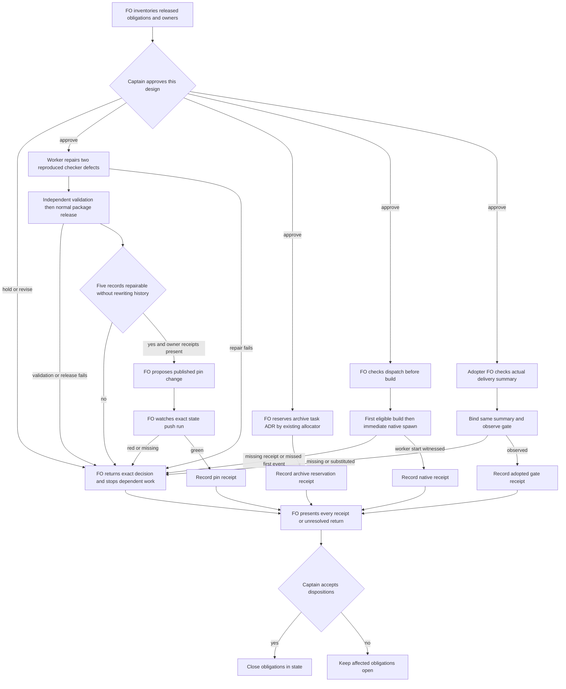

## Scope

- Source: the batch-10 chief-engineer delivery review (2026-10-29), listing what is owed after the release that carries PRs #748 to #751; filed by FO with no Captain ruling yet. Precedent: amendment-form-check-round3-followups.
- Owed: (1) #751 adr-reserved-when-design-names-one AC-3 native build-and-spawn proof at the first Pilot or Prod implementation-1 dispatch after that release (its Captain amendment 1, 2026-10-29); (2) #749 captain-amendment-form-checked's law L3 is inactive until `dev2-laws.yml` on spacedock-state/dev2 moves its pin (22219a3e at review time); five live tasks it newly refuses (kc-decision-log-handoff-trial, adr-required-statement, relay limit-telemetry-posthog, qnow branch-hours-generate-starts and operator-secret-hardening) are repaired before the pin moves, then one real state-push run is watched; (3) #748 gate-requires-recorded-reviews: one observed adopted delivery gate; (4) archive-waits-for-observer-report reserves its ADR by hand (its placeholder sits outside the headings #751 reads).
- Known limit, not owed: #751 reads only some design headings (6 of 13 tasks with an ADR placeholder use one it reads).

- Added 2026-10-29: Codex P2 on PR #749 (review 5695880112, kc-dev-flow-2/scripts/laws_check.py): an amendment with an unmatched fence makes laws_check report `cannot judge` (exit 2) even when its bytes are unchanged, so unrelated updates of that task fail the law indefinitely; accept byte-identical records before the unmatched-fence comparison. Fix before moving the dev2-laws pin, since L3 is inactive until then.
- Added 2026-10-29: Codex P2 on PR #750 (review 5696325365, kc-dev-flow-2/scripts/dispatch_records.py): the new rerun check builds historical task paths from the Git root, so a workflow whose state is inline in trunk (supported by references/sd/adoption.md) gets exit 2 `uncommitted-report` on validation dispatch; include the state directory's repository-relative prefix. No current adopter is affected: every dev2 and dev2-poc README read on 2026-10-29 sets `state: .spacedock-state` (split root).
## Non-goals

- New checks; widening #751's headings (a separate task if the Captain wants it).

## Budget

- No package PR unless an obligation fails; state edits and one CI pin bump PR at most.

## Stop condition

- Each of the four is met with its receipt recorded here, or returned to the Captain with what failed.

## FO alignment

Alignment: not needed before ideation: obligations from approved tasks.
Surfaces: none
Visible change: none
Release review: not needed: workflow maintenance, on no journey map.

## Design

### PRFAQ

**Proposition.** After the batch-10 release, FO can account for every outstanding obligation with either its exact closing receipt or a specific return to the Captain. A published package, a green local test, a state commit and a real worker start are separate evidence. This Pilot slice repairs two reproduced defects, coordinates existing owners, and records the remaining operational evidence without adding another checker or expanding ADR discovery.

**Who uses it?** This workflow's FO owns the obligation ledger and package delivery. Each adopter FO owns its own task state and original Captain sources. The implementation worker changes only the approved package files; the independent validator judges the delivered bytes. The Captain decides unresolved authority and scope; this design does not grant another session write access.

**Why now?** Release tag `kc-dev-flow-2-v0.33.1` is commit `923a1d155b7845c74a9a2650140283d6493360cf`, dated 2026-10-30 13:49:45 +08:00. Two known P2 review findings reproduce on the current released implementation. The state workflow still pins `22219a3e4bc48a69a893bd757923e8c034d1ba6e`, so the new amendment history law is not deployed there.

**What closes an obligation?** A receipt names the obligation, owner, source/version, exact task and commit or dispatch identity, command and exit/output, the observable result, and any remaining boundary. A return names the attempted check, failure, protected original bytes, recommendation and cost; it is unresolved until the Captain disposes it. Merely listing a failure does not discharge it.

**What stays outside?** No new law, no broadened design headings, no new recurring service, no global amendment waiver, no new ADR for these two bug fixes, no adopter writes by this worker, no invented native receipt and no claim that the historical build recorder launched a worker. State/report commit and sync record this ideation only.

### Existing chain and current evidence

1. **Spacedock first.** Read the installed 0.27.3 `skills/ensign/references/ensign-shared-core.md`, `skills/first-officer/references/fo-dispatch-core.md`, Codex runtime binding and `docs/runtime-support.md`. Its own contract owns split-root state, dispatch and gates. A successful build's next host action must be native worker spawn, with the returned handle retained before any other action. A build envelope is not startup evidence. This task uses that contract; it does not patch Spacedock or invent a native amendment-migration hook.
2. **Package next.** `git fetch origin` succeeded after the linked-worktree FETCH_HEAD permission boundary was granted. Pinned `origin/main`: `a6612948936a4f075625147b21aabd3b10b19eee`; manifest version 0.33.1. Loaded package `/Users/kent/.codex/plugins/cache/kc-claude-plugins/kc-dev-flow-2/0.33.1`. Its laws/dispatch scripts and tests, workflow source and pr_watch.py match those main bytes. `laws_check.py:l3_amendment_append_only` compares the unmatched-fence case before accepting equal raw entries. `dispatch_records.py:later_captain_ruling` constructs four historical task candidates at the Git root, omitting an inline state-directory prefix. `references/sd/adoption.md` permits inline state; repair the existing implementation rather than introduce another resolver.
3. **Sibling adopters last, read only.** Read README and task bytes at relay `/Users/kent/conductor/workspaces/subspace-relay/beirut-dev2/docs/dev2`, web `/Users/kent/conductor/workspaces/subspace-web/dev2-fo/docs/dev2`, and qnow `/Users/kent/conductor/repos/qnow-adopt-dev2/docs/dev2`. Their READMEs all declare `state: .spacedock-state`. Observed local state tips: relay `2019310178b25a3742ff8ec51bfda09aad634f2c`, web `e8c96bf22e455163d0beb062c3c503b626955258`, qnow `8a4eb114943778cfc1bad3ac59820e4e80329e09`; plugin state first read `8952eaf680ffa6b7d3b36ef393437b786c2c452f`. These are local snapshots, not a fresh remote census. No adopter workaround supplies authority to change package or Spacedock semantics.
4. **Actual exercise.** Using the installed test helpers in disposable Git repositories: an unrelated Scope edit with byte-identical unclosed-fence amendment exits 2, `ambiguous protected spans at unmatched fence`; a committed report followed by a later native ruling passes at a split root (0), then equivalent task/record history created beneath `docs/dev2` fails (2, `uncommitted-report`). No repair was applied. See the reproducible recipes below.
5. **Ownership and authority.** Read ADRs 0002 (reserve numbers), 0005 (FO records; worker moves), 0016 (strict amendment form), 0017 (judge only push-added events), 0044 (optional delivery summary) and 0045 (later committed ruling). State `Override:` search found no applicable permission to rewrite protected amendment metadata. The older adr-required-statement and comment-check-reaches-delivery-gate bodies explicitly record closure on 2026-10-20 despite stale frontmatter; do not revive them. `gh pr view 749 --repo iamcxa/kc-claude-plugins --json state,mergedAt,headRefOid` failed `error connecting to api.github.com`; hosted PR inventory, review state and CI are unverified.

### Ordered obligations and closing receipts

1. **Repair unchanged unclosed-fence handling before any pin change.** In `laws_check.py`, preserve removal, number/order and header checks; accept an otherwise unchanged entry whose raw bytes are equal before entering unmatched-fence ambiguity handling. Changed unknown fenced spans remain exit 2, known metadata edits remain exit 1, supported worker payload appends still work. Do not treat all malformed records as equal or skip unreadable history. Receipt: exact repair SHA, regression and counterexample outputs, independent validation, and the published release/tag that contains the repair. Failed negative controls return this obligation to the Captain; no activation follows.
2. **Repair inline historical task paths in the same bounded package repair.** Derive the workflow state directory from the current flat or folder task location, including an `_archive` location, then prefix the four supported historical task candidates with that directory relative to the Git root. Split-root prefix stays empty. Preserve strict ancestry, report identity, shallow-history refusal, non-Git skip and ambiguous-path refusal; never search unrelated workflows by slug. Receipt: exact-SHA flat/folder/live/archive matrix under split-root and nested inline state, including two workflows with the same slug. A later ruling must clear only its own task; old/same-commit/uncommitted rulings must retain their existing refusal. Failure returns to the Captain and holds this repair's delivery, independently of whether current adopters happen to use split roots.
3. **Resolve the five amendment records through their owners before activation.** First export each current committed original and check its source ruling. An allowed criteria move appends exact withdrawn criterion bytes under `Superseded text:` and gives replacements fresh marked ids; it does not rewrite prior metadata. But the observed failures below are protected metadata/heading failures, so simply appending a correctly formed new amendment does not make the old entry pass. Run the actual form checker and history law on any proposed repair in a disposable full-history copy. If both cannot pass while preserving original entries, return the exact record to the Captain; do not “repair before the pin” as a loophole. Existing implementation authority is insufficient for an exception to append-only. This design recommends holding activation and retaining originals, pending a separately decided supported migration route; it does not implement that route.
4. **Move the state pin only after prerequisites and normal release.** Once the repair is actually published and all five records have supported owner receipts (or a new explicit Captain ruling changes this prerequisite), FO opens at most one pin-change PR targeting `spacedock-state/dev2`, changing only `.github/workflows/dev2-laws.yml`'s package ref to the immutable published commit. Validate the exact push range locally with the candidate package and the trunk README. Preserve `push.branches: [spacedock-state/dev2]`, full history and all laws; no polling schedule, path filter that misses task events, ignored exit 2 or manufactured historic rewrite. Watch one real state push, retain run URL/id, state before/after SHAs, resolved package SHA and the L1/L2/L3 summaries. A pin-only run with zero amendment events is insufficient: include or observe a legitimate controlled amendment-bearing update with L3 judging at least one event. Red, cancelled, skipped or unreachable run returns to the Captain; a push acknowledgement alone is not closure. Cost per PR has not been measured; this is the existing state-push job, not an added PR-triggered lane. Record actual duration/billed usage if available without inventing a cost.
5. **Capture the first eligible native dispatch without waiting for the pin lane.** This obligation's clock started with 0.33.1, not the future repair release. Before the first real Pilot/Prod implementation-1 dispatch after that release, FO identifies the task and installed version, performs all checks/reservations and prepares recording. On successful build the next host action is the real worker spawn; no log edit, extra probe or visibility action may be inserted between them. Retain build command/status, full emitted envelope or its durable source and hash, matching native spawn arguments, returned handle, event order and worker's first task-bound response, plus the eventual committed worker report. A recorder, mock, restored envelope or this ideation dispatch does not count. Local plugin state log listed no implementation-1 addition since release during this read; external host history is unverified. FO must audit the actual dispatch history before calling the next event “first.” If it already happened without evidence, report the missed first event and request a new timing ruling; never substitute a later dispatch silently.
6. **Observe one adopted delivery gate, independently of the pin lane.** Select a real task whose adopted README has the 0.33.1 summary recipe. FO runs the existing `delivery_gate.py question <task> --text-file <question> --summary-file <summary>` before native gate preparation; nonzero holds. Retain adopted README/source SHA, candidate SHA, configured reviewers, actual review receipts, exact checked summary bytes/hash, check output, native prepared briefing identity and the presented gate/decision receipt. Confirm the bound summary is unchanged and includes `External rounds: N` plus the configured second-reviewer outcome. Local omission/substitution tests support the check but cannot replace an observed gate. If no eligible gate exists or the adopter still uses the legacy call, return the missing observation to the Captain; do not force an unsolicited adopter sync or claim legacy compatibility is proof of adoption.
7. **Hand-reserve the archive task's ADR at its implementation dispatch.** `archive-waits-for-observer-report.md` is locally in implementation and its unnumbered draft is outside #751's recognized headings; no Number guards receipt was found. FO first checks existing reservation and dispatch history, fetches code, then uses the existing `number_guards.py reserve --kind adr --workflow-dir <workflow> --repo <repo> --task <archive-task>` under that task's ownership. Record the printed `ADR: NNNN` in its Number guards and actual dispatch scope notes; run the normal number checks. Do not pick a number here, widen heading recognition, or reserve twice. If implementation already started without a reservation, report the missed-before-dispatch boundary and reserve before its next authorized dispatch; do not backdate it. Closure of this obligation needs allocator/readback/check receipts, not a newly authored ADR file by this task. The archive task retains eventual land-or-release responsibility.

The package defects can share one fix PR because both obligations have demonstrably failed; this satisfies Scope's “no package PR unless an obligation fails.” The five-record decision blocks the pin lane, not preservation of an imminent first native dispatch or an independently eligible adopted gate. No state-pin activation is performed during ideation.

### Five-record disposition inventory

| Owner and current path | Reproduced current form failure | Supported next action / return |
| --- | --- | --- |
| plugin `kc-decision-log-handoff-trial.md`, amendment 2 | `Supersedes: AC-1 (replacement written at this task's ideation: ...)` contains unsupported explanation | Preserve original; owner checks actual replacement/source. Changing this field is a metadata rewrite: return migration choice; do not dispatch its deferred trial as a side effect. |
| plugin `adr-required-statement.md`, amendment 1 | `Supersedes: AC-10 (its "before that task's next dispatch" backfill clause; ...)` | Body says closed 2026-10-20; stale validation status is not permission to reopen. Return whether to leave it frozen or authorize a supported historical migration; no old ledger implementation. |
| relay `limit-telemetry-posthog.md`, amendment 2 and repair note | prose after AC ids; `### Amendment 2 criteria move (repair note)` outside section, duplicate number and malformed heading | Preserve both source records. Renaming/moving that note or changing the old Supersedes line is not a permitted append; adopter owner supplies original source and returns exact conflict. |
| qnow `_archive/branch-hours-generate-starts.md`, amendment 2 | `Supersedes: AC-18 "proposal only, not decided"` | Now archived, contradicting the seed's “five live” description. Do not unarchive/reopen. Return historical-record disposition with source ruling and archived SHA. |
| qnow `operator-secret-hardening.md`, unnumbered amendment heading | outside Captain amendments, malformed date/number form, no structured Captain or Supersedes line | Original prose quotes `准 ac2` and describes Ctrl-D input. Owner verifies that source; a new canonical entry alone leaves the legacy malformed entry refused. Return migration decision; do not change security criteria or operational secrets. |

All five yielded the targeted amendment diagnostic with 0.33.1's `check_criteria` + `check_amendments` functions. This isolates the form issue; it is not a full-task green verdict. A future supported repair must also run the full surface check, names check on the actual record, and history law with explicit before/after endpoints. No waiver, de-duplication or metadata edit is silently approved here.

### Flow



The diagram and prose retain the independent native/gate lanes, the pin prerequisite, and the Captain-owned return. Mermaid CLI rendered the source to a disposable SVG successfully; its first browser launch hit the sandbox and the granted rerun exited 0. Renderer: cached `@mermaid-js/mermaid-cli`; this is optional diagram tooling, not a dependency of acceptance commands. The exact Mermaid source is retained above so another installation can render it. No online design resource was created.

### Reproducible current defect evidence

Prerequisites: Python 3, Git, installed 0.33.1 package and its shipped test files. The following creates only temporary fixture repositories and uses the tests' synthetic identity; it changes no adopter or repository configuration. Run from any directory, replacing the one absolute package path with that installation's path. Both “before” failures must be observed before the repair; run the expanded matrix in AC-1/AC-2 against the candidate later.

```python
import sys, tempfile
from pathlib import Path
package = Path('/Users/kent/.codex/plugins/cache/kc-claude-plugins/kc-dev-flow-2/0.33.1')
sys.path.insert(0, str(package / 'scripts'))
import test_laws_check as laws
with tempfile.TemporaryDirectory() as tmp:
    repo = laws.Repo(Path(tmp) / 'state')
    broken = laws.AMENDED.rsplit('````', 1)[0]
    before = repo.commit('base', t=broken)
    after = repo.commit('unrelated scope', t=broken.replace(
        '## Captain amendments', '## Scope\nUnrelated note\n\n## Captain amendments'))
    readme = Path(tmp) / 'README.md'
    readme.write_text('---\nextensions: []\n---\n')
    print(laws.laws(repo.path, '--before', before, '--after', after, '--readme', readme))
import test_dispatch_records as dispatch
case = dispatch.LiveValidationRulingTests()
case.setUp()
try:
    case.save(dispatch.REPORT, dispatch.native_ruling())
    case.commit('later ruling')
    print('split-root', case.cli())
    case.root = Path(case.tmp.name) / 'inline'
    case.root.mkdir()
    case.git('init', '-b', 'main')
    nested = case.root / 'docs/dev2'
    nested.mkdir(parents=True)
    case.task = nested / 'task.md'
    case.record = nested / 'task/dispatch/validation-2.md'
    case.record.parent.mkdir(parents=True)
    case.record.write_text(dispatch.COMPLETE.replace(
        'Model:', f'Candidate: {dispatch.HEAD}\nModel:'))
    case.save(dispatch.REPORT)
    case.commit('inline report')
    case.save(dispatch.REPORT, dispatch.native_ruling())
    case.commit('later inline ruling')
    print('inline-state', case.cli())
finally:
    case.doCleanups()
```

Observed 2026-10-30: laws exit 2 at unchanged ambiguous amendment; split-root `(0, '')`; inline-state exit 2 `uncommitted-report`. These are current defect reproductions, not completed repair tests. No network or native worker is involved.

### Words FO reads at each lifecycle moment

Count `len(text.split())`, including passages and actual script output; do not compare just README size. Measured the loaded 0.33.1 package and Spacedock 0.27.3. Candidate values below are explicit design targets, not implemented observations. Host/runtime and variable task/review payloads are held constant outside this bounded scenario; the one-time obligation design is counted separately and is not loaded into startup/idle rules.

| Moment and scenario | Measured before | Proposed after | Passages/output included |
| --- | ---: | ---: | --- |
| Startup, open PR, feedback unlisted | 6994 | 6994 | workflow 5781 + dev skill 763 + package mod 48 + upstream pr-merge startup 365 + executed output 37 |
| Idle, that open PR | 897 | 897 | package mod 48 + upstream pr-merge idle 100 + Delivery authority/Extensions 712 + output 37 |
| Idle, merged PR, learn unlisted | 860 | 860 | same passages 860 + output 0 |
| After archive, learn listed, observer receipt absent | 401 | 401 | mod 48 + learn extension 280 + executed observer/recovery/learn output 73 |
| Merge ask, four validation gates waiting | 2435 | 2435 | Delivery authority/Extensions 712 + native gate-lifecycle/present-gate skills 1633 + output 90 |
| Unchanged broken amendment, controlled fixture | 32 | 27 target | current three law lines, versus ordinary L1/L2/L3 summaries; count entire actual candidate output before acceptance |
| Valid inline validation rerun, later ruling committed | 16 | 0 target | current path token plus uncommitted-report diagnostic; successful released split-root path is silent |
| Manual archive ADR reservation | existing number-guards passage and allocator/readback output | same commands/output | one owed execution, no new recurring instruction; actual variable reservation output is measured when FO executes it |
| Pin activation | no new law output at old pin | existing three-law output, event-dependent | include real watched-run summary in the receipt; no numeric CI-output claim before the run |

Reproduce lifecycle outputs with shipped `test_pr_watch.TasksTests`: `setUp`, `readme('roborev, codex')`, `task('some-task', pr='o/r#7')`, then `tasks({'pr view 7': view('OPEN')})` and MERGED; count joined output lines. In that fixture switch to `readme('learn')`, call `archive('some-task')`, then MERGED: 73 words because no observer report is committed. For the merge ask use a separate fresh fixture with four `gates((slug, 'validation', 'awaiting-captain'), ...)` rows a/b/c/d and no task; output 90. Always call `doCleanups`. These are disposable provider stubs measuring reading, not live adoption proof. Select exact `##` sections, not frontmatter mentions. Recount independently on final integrated bytes after sibling merges. Routine path delta must remain zero; failure recovery and this bounded one-time task are not falsely advertised as a global reading reduction. No workflow word-budget raise is proposed.

### Unresolved decision for the Captain

**One decision: keep the pin activation held and preserve the five original records while their owners return the unsupported migration?** Recommend yes. Existing full-form checking still reads the old invalid entries, while the history law forbids editing their protected metadata; adding a new valid entry cannot resolve that contradiction. The task's “met or returned” stop condition permits an explicit return, not a false repair. What gets worse: the new history law stays undeployed until a separately approved supported migration or revised prerequisite exists; two stale/archived records remain visibly malformed. The two code fixes and time-sensitive native/gate evidence can proceed under their normal gates. Do not ask to relax an enforcement rule implicitly through the pin PR. If the Captain instead wants all five normalized now, return that new migration scope for design before any original is changed.

No other decision is needed in this design. Package fix PR permission follows the two reproduced failures and normal implementation gate. A genuinely missed first dispatch, unavailable observed gate or failed hosted run becomes a specific later evidence return rather than a pre-emptive timing waiver.

### Batch overlap

Implementation file set: `kc-dev-flow-2/scripts/laws_check.py`, `kc-dev-flow-2/scripts/test_laws_check.py`, `kc-dev-flow-2/scripts/dispatch_records.py`, `kc-dev-flow-2/scripts/test_dispatch_records.py`, and `kc-dev-flow-2/VALIDATION.md` for exact proof/limits. No workflow, mod, extension, adoption-source, version manifest or new ADR file is proposed. State-owned work: this task's body/report; conditional pin `.github/workflows/dev2-laws.yml` on `spacedock-state/dev2`; owner-only amendment paths in the five-record inventory if a supported route is later approved; archive task `## Number guards` and its actual next dispatch record; selected real native dispatch/gate receipts in their existing task homes. The chosen native/gate task and exact record names cannot be invented in advance: FO records them before execution and rechecks overlap then. `docs/adr/` remains a shared allocation namespace through the archive task, even though this task authors no ADR.

| Task (slug and meaning) | Shared file/check or state; order |
| --- | --- |
| batch10-after-release-obligations — this obligation ledger | Owns the five package files and conditional state work above; this ideation writes only its entity. |
| names-check-says-what-it-skipped — dispatch diagnostic coverage | Direct overlap: dispatch_records.py/test_dispatch_records.py; possible laws diagnostic consumer/test_laws_check.py and VALIDATION.md. Integrate the path repair first or explicitly rebase one owner; retain non-Git versus inline-Git distinctions and rerun combined tests. |
| peers-paseo-rule-matches-practice — peer messaging applicability | No direct product-file overlap; it edits peers/paseo extensions and adoption.md. Share package release timing and any new ADR allocation; its policy cannot substitute native evidence. |
| peer-status-reaches-fresh — current peer facts | No direct declared product-file overlap; peer/paseo prose and native event timing. Do not inject peer notices between build and spawn. Recheck its final design. |
| model-roster-per-repo — per-repository model selection | No named product-file overlap with this repair; shares pre-build model/dispatch seam and ADR namespace. Select model before the measured build, preserve exact envelope, and coordinate first implementation event. |
| paseo-human-surfaces-visible-and-reachable — visible worker terminals/tabs | No direct product-file overlap; paseo extension changes. Visibility preparation precedes build, never interrupts build-to-spawn evidence. |
| adoption-asks-which-extensions — historical extension context | Direct dispatch_records.py/test_dispatch_records.py/test_laws_check.py overlap; its number_guards.py/laws.md changes stay with that owner. Preserve historical snapshot/root semantics and event-time extension choice. Integrate before this final validation; do not infer its completion. |
| adr-required-statement — old ADR ledger proposal | Body explicitly closed 2026-10-20; no live product dependency despite validation frontmatter. Same state entity is one of five repair dispositions. Its owner must approve any later migration; do not revive its abandoned candidate or ADR number. |
| adr-silent-undo-probe — ADR reversal experiment | No same package file/check; its scenario harness and migrated POC ownership remain separate. No new experiment or messages here. |
| comment-check-reaches-delivery-gate — comment evidence gate | Body explicitly closed 2026-10-20; no live code dependency. Its old delivery_gate.py/tests/validation principles do not overlap this repair; observed gate cannot revive it. |
| journey-canvas-hosted-poc — hosted canvas trial | No same package file; possible shared ADR number namespace only. Its hosted evidence is unrelated. |
| journey-server-host-pilot — private journey server | No same product file; shared ADR allocation and a possible eligible real delivery gate only if its FO chooses it. Do not adopt its verdict or edit its folder task. |
| ops-inbox-r1-setup-and-isolation — isolated ops intake | No same product file; shared ADR allocation. Its kc-ops-inbox workflow and producer activation remain separately owned. |
| pr-review-lite-value-pilot — bounded review trial | No same product file/check; kc-pr-flow trial and worktree ownership remain unchanged. |
| archive-waits-for-observer-report — terminal archive prerequisite | Direct state Number guards/dispatch ownership; shared ADR namespace. Reserve only through its FO and current dispatch boundary, without widening #751. |

Recommended order: recheck actual open PR ownership when API access returns; coordinate adoption's historical-root changes, then the two bounded repairs, then names diagnostics with combined dispatch/laws regressions and one final VALIDATION.md owner. Publish repair normally. Before the pin change, obtain five supported owner dispositions and a Captain decision on any migration gap. In parallel preserve the first eligible native event and observe an eligible adopted gate; the archive reservation precedes that task's next dispatch. Serialize all state edits per entity and all ADR allocations. These are ordering constraints, not instructions to another session; no sibling task was edited or messaged.

## Acceptance criteria

**AC-1** — Unchanged ambiguous amendment no longer blocks an unrelated commit. Execute the fixture recipe on base and exact candidate: base exit 2, candidate exit 0. Candidate still exits 1 for changed known metadata/deletion and 2 for changed ambiguous fenced content or unreadable parent; ordinary allowed append passes. Falsifier: remove raw-equality fast path and the positive case fails; broaden it to skip all ambiguous records and the changed-content negative fails. Current evidence: base reproduced; candidate not implemented.

**AC-2** — Historical task resolution supports split and inline state without borrowing another workflow's authority. Run the same committed-report/later-ruling scenario through real --names CLI for flat/folder and live/archive forms in empty-prefix split root and nested inline state. Add same-slug sibling workflow with a different ruling, same-commit/older/uncommitted ruling, and missing/shallow history. Record actual command, paths, expected and observed verdict per case; non-Git legacy behavior remains separately labelled. Falsifier: drop prefix, reuse another workflow's task, or weaken ancestry; the corresponding row changes incorrectly. Current evidence: split-root 0 and inline 2 reproduced; complete repair matrix future.

**AC-3** — All five amendment obligations have supported owner receipts or explicit Captain dispositions preserving history. Retain before/after blobs and hashes; full surface/name checks and `laws_check.py <state> --before <before> --after <after> --readme <readme>` must agree for any claimed repair. Otherwise keep original bytes and name the exact unresolved record in a Captain return; closure needs the resulting ruling, not this recommendation alone. Falsifier: delete/rename an old entry, silently change Supersedes, skip an archived record, or call an appended correction sufficient while the original remains refused. Current evidence: all five targeted form failures exercised; qnow archive and plugin closed-task drift recorded; no repairs or migration authority claimed.

**AC-4** — The deployed state pin and a watched real run prove activation. Prerequisites in Design must hold; retain pin-change PR, published tag/commit, run URL/id, exact push before/after and resolved package/README SHA, terminal conclusion and all law summaries, including L3 judging an event. Re-run that exact range locally. Missing/red/cancelled results return to the Captain. Falsifier: old ref, zero-event-only run, a local-only green, skipped law or suppressed exit 2 cannot satisfy activation. Current evidence: old ref read; no pin change, CI run or cost measurement performed.

**AC-5** — The first eligible post-0.33.1 implementation-1 has real native startup evidence. FO audits event timing, records task/profile/version, prechecks and reservation, then captures build followed immediately by native spawn with identical fields, handle, first worker response and later committed report. A missed first event requires a new Captain timing ruling. Falsifier: insert an intervening host action, use a recorder, omit handle/worker response, change envelope or silently select a later event. Current evidence: upstream contract and prior deferral read; native event not observed in this ideation.

**AC-6** — One actual adopted delivery gate binds the checked summary. Retain the adopted recipe, actual reviewer receipts, candidate, exact summary bytes/hash, successful question check and corresponding prepared/presented gate identity. Locally removing External rounds or second-reviewer outcome must fail the opted-in command, and a changed bound summary fails receipt comparison; no legacy-call rejection is introduced. Falsifier: question-only facts, substituted summary, local fixture alone or a different candidate cannot satisfy the live receipt. Current evidence: current recipe and ADR 0044 read; real adopter gate not yet observed.

**AC-7** — Archive task reservation and bounded reading are accounted for. FO's current allocator output, task Number guards and dispatch notes must agree and pass number guards; previously missed timing remains explicit. Independently recount every lifecycle row and both diagnostic scenarios against exact integrated base/candidate bytes and outputs, with recurring normal-path totals unchanged. Falsifier: hard-code an ADR number, ignore collision/readback, count only workflow size, omit output or treat this design as an actual reservation. Current evidence: absent reservation and existing allocator contract inspected; lifecycle baselines exercised; allocation/candidate counts future.

## Stage Report: ideation

- DONE: A design that orders the batch-10 obligations listed in Scope: the two Codex P2 fixes (kc-dev-flow-2/scripts/laws_check.py unchanged amendment with an unclosed fence; kc-dev-flow-2/scripts/dispatch_records.py inline-state task paths), repair of the five live amendments in supported form without violating append-only, moving the dev2-laws pin on spacedock-state/dev2 with one watched state-push run, the native spawn receipt at the first Pilot or Prod implementation-1 dispatch after 0.33.1, one observed adopted delivery gate, and the ADR hand-reservation for archive-waits-for-observer-report; for each, the receipt that closes it, or what returns to the Captain
  Ordered obligations cover both reproduced defects, five protected-record conflicts, published pin/watch, first native dispatch, adopted gate and archive ADR reservation; unsupported migration returns to the Captain and holds activation.
- DONE: A `### Batch overlap` section naming each file the design would change and each other batch task (batch10-after-release-obligations, names-check-says-what-it-skipped, peers-paseo-rule-matches-practice, peer-status-reaches-fresh, model-roster-per-repo, paseo-human-surfaces-visible-and-reachable) and live task of other sessions (adoption-asks-which-extensions, adr-required-statement, adr-silent-undo-probe, comment-check-reaches-delivery-gate, journey-canvas-hosted-poc, journey-server-host-pilot, ops-inbox-r1-setup-and-isolation, pr-review-lite-value-pilot (driven by other sessions; read only)) that changes the same file or check, so FO can order implementation
  Batch overlap names all requested tasks plus the archive owner; direct dispatch/laws/test/evidence conflicts and shared state/ADR allocation are ordered, with closed-task drift preserved.
- DONE: The words FO reads at each lifecycle moment, before and after, per root learning.md "Measure the words FO reads at each moment, not one file's size"
  Executed bounded reading fixtures: startup 6994, open idle 897, merged idle 860, archive recovery 401, merge ask 2435; proposed normal-path delta zero, candidate recount still owed.
- DONE: Acceptance criteria with reproducible evidence clauses and falsifiers, and unresolved decisions for the Captain, each with a recommendation and what gets worse under it
  AC-1 through AC-7 each name reproducible evidence, a falsifier and current limits; one material decision recommends preserving old entries and holding the pin pending supported migration.
- DONE: AC-1 current-stage evidence
  Released unchanged-fence defect reproduced at exit 2; candidate fix is unverified. Removing equality handling must fail the positive test; blanket ambiguity skipping must fail negative controls.
- DONE: AC-2 current-stage evidence
  Equivalent split-root and freshly created inline histories yield 0 versus 2/uncommitted-report; candidate path/ancestry matrix is future work, falsified by cross-workflow authority borrowing.
- DONE: AC-3 current-stage evidence
  Five targeted amendment failures exercised read-only; one archived and one explicitly closed record found. No old bytes changed; owner repair/ruling receipts remain owed.
- DONE: AC-4 current-stage evidence
  State pin remains 22219a3e4bc48a69a893bd757923e8c034d1ba6e; hosted activation/cost unverified. A local-only or zero-event receipt cannot close this criterion.
- DONE: AC-5 current-stage evidence
  Native immediate-spawn contract and prior timing ruling inspected; this ideation is not native implementation evidence. Missing handle/worker response or a substituted later event falsifies closure.
- DONE: AC-6 current-stage evidence
  0.33.1 optional summary recipe and ADR 0044 inspected; no adopted delivery gate observed. Summary substitution or question-only reviewer facts cannot close the live obligation.
- DONE: AC-7 current-stage evidence
  Existing allocator and missing archive reservation inspected; no number reserved. Reading scenarios exercised; candidate totals and actual reservation remain future evidence.
- DONE: Design presentability and scope preservation
  design_surfaces.py check: design surfaces presentable (exit 0); Mermaid rendered and visually checked. No product/adopter edits, provider comments, peer messages or frontmatter changes.
- DONE: Current source and provider boundary
  Fetched origin/main a6612948936a4f075625147b21aabd3b10b19eee, manifest 0.33.1, matched relevant installed source bytes. gh failed connecting to api.github.com; open PR/hosted CI inventory remains unverified.

### Summary

Designed the bounded post-release closure sequence and verified the two current defects, five legacy form conflicts, existing pin and lifecycle reading costs. The sole Captain decision recommends holding activation while preserving protected originals; native startup, adopted gate, owner dispositions and hosted-run receipts are future obligations, not ideation results. Pilot remains design-only; this state report records no implementation or operational completion.
