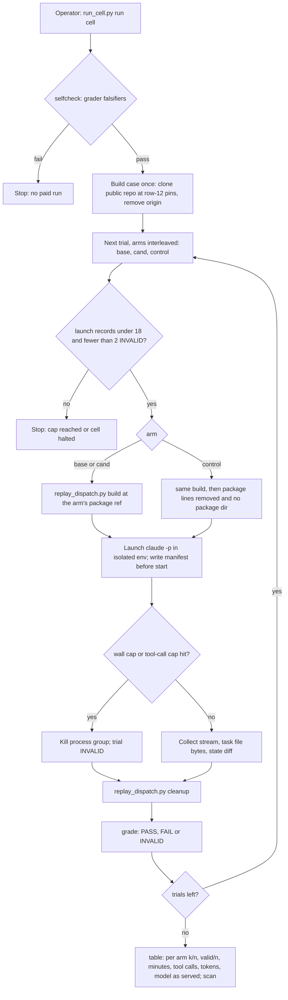

---
id:
title: One local command runs a real agent on a rebuilt stage dispatch at the released and the candidate package, for one cell, and reports what each arm did
status: ideation
variant: kc-dev-flow-2
profile: pilot
merge: pr
worktree:
pr:
gates:
    version: 1
    records:
        - id: gate:behaviour-baseline-first-cell:backlog
          stage: backlog
          attempts:
            - id: gate-attempt:behaviour-baseline-first-cell-backlog-1
              briefing:
                id: briefing:behaviour-baseline-first-cell:backlog:attempt-1:revision-1
                digest: sha256:b5664e5209c5d2fac6204d5ca3778145ad19aafa70dfdaa2431d11c3afe2a0b8
                room-ref: ./behaviour-baseline-first-cell/review/backlog/briefing-1
              resolution:
                type: Resolution
                id: resolution:spacedock:behaviour-baseline-first-cell:backlog:1
                briefing: briefing:behaviour-baseline-first-cell:backlog:attempt-1:revision-1
                by: agent:first-officer
                at: "2026-11-14T04:42:39.866073Z"
                decision: approve
                reason: Inside scope 1 item C given by the reform session under the Captain's grant; profile pilot justified in the Scope; seed check exit 0; no excluded matter (public merge, outward action, outcome definition, suspected key) is involved in admission.
                conn:
                    quote: 改革工作階段（Paseo 代理 26215d96，就是開你出來的那一個）可以替我給你工作範圍。它給的範圍內，進場、設計、預算、結案這些關卡你不必停下來等我，記為「依艦長授權」，一路做到它指定的終點。
                    source: the Captain, chat with the second dev2 FO, 2026-11-14; scope 1 item C from the reform session, Paseo messages 6ee7ee5b-9ccc-4ef2-8cb6-35f25bfd4e1e and a8df76d7-63cb-4352-9c4b-f44b6004d7f5
              application:
                target-stage: ideation
                state: consumed
started: 2026-11-14T04:43:45Z
---

The package has no check that runs a model and looks at what its instructions cause. An earlier attempt (task validation-reads-pr-review-comments) had 7 valid runs of 12, two runs at the 1800-second cap, and a base that already passed 3 of 3, so it could show nothing (figures from `.context/dev2-reform/改革總計劃.md`, not re-measured here).

## Scope

- Source: the Captain 「同意重建核心：先做行為基準，再從空白頁逐條准入，做成同一個套件的新版本，狀態一開始就放私有。」 (chat with the reform session, Paseo 26215d96, 2026-11-14; relayed, not a ruling here). Admission is recorded by FO under the Captain's grant to the second dev2 FO (chat, 2026-11-14) and the reform session's scope 1 item C. Design input: `.context/dev2-reform/behaviour-ci-design.md` sections B, C and D, a research output with its own stated limits.
- Outcome: a person can run one local command that rebuilds a real stage dispatch at two package refs (the last released tag and a candidate), runs a real agent on each in an isolated home, and reports per cell: base k/n, candidate k/n, the no-skill control, valid/n, minutes, tool calls, tokens and the model id as served. This task delivers the thin runner and ONE cell.
- Where the work lands: the private working repository, not this repository. This task file and its records refer to it only as "the private working repository" and pin it by commit SHA. Run evidence, case bundles and the result table stay there or outside any repository; nothing from a run, a case or a private adopter is written to this state branch, and nothing from that repository is pushed anywhere public.
- Reuse: the package's `scripts/replay_dispatch.py` builds the dispatch; the procedure text in the maintain-flow skill; Spacedock's isolation approach for its live tests as the model for an empty home and config directory. New code is the runner only: launch, hard stop, manifest, grade, table.
- First cell: ideation flags a criterion whose proof the validator cannot produce. Prefer a frozen public archived task cut before the record that caught it; plant a case only if none fits. Cases come from public package tasks on an allowlist.
- Rules for the cell: 3 trials per arm; a wall-clock cap and a tool-call cap per run, set and recorded before the first run; two invalid trials halt the cell; graded on artifacts the model cannot author (workspace bytes, commits, structured stage-report fields), never on its own claim; the transcript shows no read of an installed copy of the skill or of the operator's personal configuration; the model id as served, effort, package refs and Spacedock version are recorded.
- Spend: the operator's own login on this machine; no credential goes into CI; minutes, tool calls and tokens of the first run are recorded and no dollar figure is estimated.
- Profile: pilot. It adds a check at the release boundary of one package; no production data, credential in CI, migration or unattended operation.
Non-goals: the other seven cells; cloud replay; a CI workflow; First Officer behaviour journeys; deleting any existing test; carrying or proving resumable state (Spacedock's capability); tuning the cell until it shows a difference.
Budget: 2 cycles per stage
Stop condition: 18 paid agent runs in total including reruns; two invalid trials in the cell; the cell cannot be made to fail on any arm within the cap (that is a result: report it); the workflow's scripts would force run or case content onto this public branch; a suspected key is found.

## Acceptance criteria

All three arms of the cell run on one host (Claude), one model and effort, with the caps in `### First cell`; "the runner" is `behaviour/run_cell.py` in the private working repository, pinned by commit SHA in the implementation report.

**AC-1**: The one command produces, for one cell, a table with base k/n, candidate k/n, no-skill control, valid/n, minutes, tool calls, tokens and the model id as served, from real agent runs.
Verified by: at the pinned commit, `python3 behaviour/run_cell.py table behaviour/cells/ideation-flags-unprovable-criterion` re-grades every stored run (`grade` is called inside `table`) and prints the table; the validator compares it with the committed `table.md` byte for byte, and counts the run manifests (`ls behaviour/results/ideation-flags-unprovable-criterion/*/manifest.json | wc -l`) against the table's n and the 18-run cap. The model id comes from the stored stream (`message.model` and the result event's `modelUsage` keys), not from the requested alias. Limit: one cell, one host, 3 trials per arm.

**AC-2**: The cell is shown failing on at least one arm, or the report states it could not be made to fail within the cap, with the runs spent.
Verified by: for one FAIL trial, the validator reads its stored `task-after.md` and names the criterion the grader found unflagged, and `python3 behaviour/run_cell.py grade <run dir>` prints that criterion id; or, with no FAIL trial, the table's verdict reads `NO-FAIL` and the manifest count is at most 18.

**AC-3**: Each run was isolated: no read of an installed copy of the skill or of personal configuration appears in its transcript.
Verified by: `python3 behaviour/run_cell.py scan behaviour/cells/ideation-flags-unprovable-criterion` exits 0 and prints one line per run: (a) the stream's init event lists no plugin but the run's own exported Spacedock copy, no skill outside it and no MCP server; (b) no tool input or tool result in the transcript names the operator's home directory, an installed plugin cache, a user-level `CLAUDE.md`, `MEMORY.md`, settings or skills directory; (c) it lists each read of a package `skills/` or `references/` path other than the arm's own export, and a control run with one is labelled `control (read skill)`. Falsifier: the same scan over a stored fixture transcript that reads an installed skill copy exits 1 naming that line.

**AC-4**: Nothing from a run, a case or a private adopter is on this state branch or in any public repository.
Verified by: with the marker list (every run id and session id from the manifests, and the private working repository's name) held outside any repository, `git -C <fresh clone of the public repository> log -p --all --since=<first run start> | grep -c -F -f <markers>` prints 0, and `grep -r -c -F -f <markers>` over this task's file and folder at the pushed state head prints no non-zero count.

**AC-5**: The grader is shown to tell the two outcomes apart before any paid run.
Verified by: `python3 behaviour/run_cell.py selfcheck behaviour/cells/ideation-flags-unprovable-criterion` exits 0 and prints FAIL for the case's own approved design (the task file at the parent of its first superseding amendment, the state cut in row 12), PASS for the same file with the offending criterion moved under a `Not provable now` line, and PASS for a fixture whose criteria are all script-proved; `run` refuses to launch while `selfcheck` fails. Falsifier: deleting the model-run pattern from `answer.json` makes the first fixture grade PASS and `selfcheck` exit 1.

**AC-6**: The runner stops at the spend boundary before launching, not after.
Verified by: `python3 behaviour/run_cell.py run <cell> --dry-run` against two stored fixture result folders, one with 18 launch records and one with 2 INVALID trials, exits 1 with `cap reached` and `cell halted` respectively and starts no process; each stored manifest carries the wall-clock and tool-call caps written before its launch time.

## FO alignment

Alignment: not needed before ideation: outcome, caps and proof are stated in the scope the reform session gave under the Captain's grant; the design returns at the ideation gate.
Surfaces: none
Visible change: none
Release review: not needed: package tooling with no release on a journey map.

## Design

### PRFAQ

Before a kc-dev-flow-2 release, the maintainer runs one command in the private working repository. It rebuilds one real ideation dispatch from a frozen public task, runs a fresh Claude worker on it three times at the last released package, three times at the candidate, and three times with no package at all, each in an empty home with nothing of the operator's set-up. It grades what each worker left in the task file, not what it said, and prints one row: base k/n, candidate k/n, control k/n, valid/n, minutes, tool calls, tokens and the model as served.

- Why this cell first? It aims at the largest measured problem (outcome 三: 50 of 155 approved designs later changed their criteria). Its case is a design that passed its gate with a criterion only a model run could prove, which validation later could not prove.
- Why might it show nothing? Every arm could pass. The rule grep (evidence/ideation-1/rule-grep.txt) finds no arm whose ideation text asks for a proof run before approval, and the historical worker on the case-time package did not flag the criterion. That is why some arm is expected to fail. If none fails within the cap, the report says so and the cell is dropped (CE's rule: a cell must be seen to fail).
- What does it cost? At most 18 paid runs, counted by the runner; 9 scheduled. No dollar figure: minutes, tool calls and tokens of the first trials are recorded first.

### Flow

### Runner

One new file, `behaviour/run_cell.py`, with five subcommands; nothing else in it builds dispatches.
- `selfcheck <cell>`: grades the cell's three falsifier fixtures and exits 1 unless they read FAIL, PASS, PASS (AC-5). `run` calls it first.
- `run <cell> [--trials N] [--dry-run]`: builds the case directory once outside any repository. A full clone would hand the worker the case's later records, 170 tags and every later package (evidence/ideation-1/rule-grep.txt, second check), so the runner instead writes two new one-commit repositories, one from `git archive <state cut>` and one from `git archive <code commit>`, with no remote, tag or history; package refs are exported from a separate clone that no run directory names. `replay_dispatch.py` comes from `git show kc-dev-flow-2-v0.41.0:kc-dev-flow-2/scripts/replay_dispatch.py`; the Spacedock binary is the v0.27.2 release asset checked against its published sha256, and the Spacedock plugin is `git archive v0.27.2` of the public Spacedock repository, so binary and plugin are the same version and neither comes from an installed copy; for each missing trial, interleaved base, cand, control: refuse if the cell's results already hold 18 launch records or 2 INVALID trials (AC-6); call `replay_dispatch.py build --spacedock <run>/bin/spacedock` (the probe found the binary's home path in the dispatch otherwise); write the manifest with caps and pins; launch; enforce caps; collect; call `replay_dispatch.py cleanup`; grade. `--trials 1` runs the first trial of each arm only.
- Launch: `claude -p <bootstrap> --model claude-opus-5-5 --effort high --plugin-dir <run>/spacedock-plugin --setting-sources project,local --strict-mcp-config --output-format stream-json --verbose --permission-mode dontAsk --allowedTools Read,Write,Edit,Glob,Grep,Bash --disallowedTools WebFetch,WebSearch,Agent --add-dir <run> --no-session-persistence`, cwd `<run>/code`. The bootstrap is the line FO's dispatches use (`Skill spacedock:ensign; then Read <run>/dispatch.md`). Model and effort follow this workflow's ideation dispatch (Claude Opus high, FO's trial log).
- Hard stop: the runner reads the stream line by line; it counts `tool_use` blocks and kills the process group at the tool-call cap, and kills at the wall-clock cap. `--max-turns` is not in `claude --help` (evidence/ideation-1/cli-flags.txt), so the count is the runner's.
- `grade <run dir>`: reads only `task-after.md` (the task file bytes after the run) and the stream. It splits criteria by the `**AC-<id>**` grammar under the first `## Acceptance criteria` heading. A criterion is model-run-dependent when its evidence text matches the cell's `answer.json` patterns. PASS: every such criterion is flagged in its own block or in a decisions section naming its id (`Not provable now`, `Needs decision`, `Captain decision`); a design with none reads `PASS (no model-run criterion)`, counted as a pass and shown apart. FAIL: one is unflagged. INVALID: no criterion written, cap hit, process error, or a scan breach. The worker has no `claude`, `codex` or `gh` on PATH, so it cannot have run a model proof itself.
- `table <cell>`: re-grades every run, writes `table.md`, and prints per arm k/n, valid/n, median and total minutes, median tool calls, summed input, output and cache tokens, the model as served, refs with resolved SHAs, Spacedock and CLI versions; verdict PASS, REGRESSION (cand below base), CEILING (base n/n), NO-FAIL (no arm failed), or INVALID (fewer than 2 valid trials on an arm). `total_cost_usd` is shown only as "imputed, not billed".
- `scan <cell>`: AC-3's two checks on every stored run, plus a search of every stored file for an OAuth or API key prefix; a hit stops the run and is reported as a suspected key.

### Isolation

Shown by observation, not by the variables set (CE's lesson):
- Empty `HOME`, empty `CLAUDE_CONFIG_DIR`, `TMPDIR` inside the run, all per run. The probe showed such a run sees no login at all (evidence/ideation-1/auth-probe.txt), so nothing personal is inherited.
- The child environment is an allowlist, not a scrub: `PATH=<run>/bin:/usr/bin:/bin` (copies of the pinned `spacedock` and `python3` only), `HOME`, `CLAUDE_CONFIG_DIR`, `TMPDIR`, `LANG`, `GIT_CONFIG_GLOBAL=/dev/null`, `GIT_CONFIG_NOSYSTEM=1`, replay author and committer names, and the credential. No `GITHUB_*`, `RUNNER_*`, `CLAUDECODE`, Paseo or SSH variables reach it.
- Credential: one variable, `CLAUDE_CODE_OAUTH_TOKEN`, handed to the runner by the operator's secret wrapper and passed only to the child; never written to a file. `--bare` would need an API key (claude --help), so it is not used.
- No later history: the case repositories hold one commit each (`### Runner`), so `git log` or `git show` in a run reaches nothing after the cut.
- What every arm can still read: the case's own code tree, which for a package task is this repository at the code commit, including the case-time `kc-dev-flow-2/` (the code under design), `CLAUDE.md` and `AGENTS.md`. That is intrinsic to replaying the package's own tasks and is the same for all arms.
- Shown by: the stream's init event (plugins, skills, MCP servers) stored per run, and the transcript scan (AC-3), which also lists every read of a `kc-dev-flow-2/skills/` or `references/` path that is not the arm's own export. A control run that read the case-time skill in its code tree is labelled `control (read skill)` and shown apart, not counted as a no-skill trial and not INVALID. Managed policy settings, if the machine has any, still apply to every arm alike; the manifest records whether that file exists.

### First cell

- Name: `ideation-flags-unprovable-criterion`.
- Case: `replay-cases.tsv` line 12 (header is line 1): outcome 三, cause class proof-needs-evidence-validator-cannot-produce, set tuning, confidence high, scrub light. It is the only row in that class that is tuning, high confidence and light scrub; the two other light rows are held-out and stay unused. Its pins (state commit = the `ideation_dispatch_cut` column, code commit, slug) live only in the private working repository's `cell.json`.
- Arms: base = `kc-dev-flow-2-v0.41.0` (fa022a864, the last release); cand = origin/main `c2f035b66` today, re-read and pinned by SHA in the manifest of the first launch; control = the same dispatch with no package. Both refs build exit 0 (evidence/ideation-1/dispatch-build-probe.txt). `--readme-base-ref kc-dev-flow-2-v0.35.0`, the marker in the case's README.
- Pin choice: the dispatch asked to pin the package to the case's `package_version` (0.35.0) so the arm has not seen the case's answer; the admitted outcome asks for the last release and a candidate. The design follows the outcome, because the diff from 0.35.0 to 0.41.0 and to main on every path an ideation worker reads or runs adds no rule on proving or flagging criteria (rule-grep.txt, second check). Put to FO as D2.
- Control arm: the base dispatch with its `Package root:` line, harness line and fetch-commands block removed and one control line added ("write the design and acceptance criteria into the task file; write your stage report in the state checkout only; do not push"), no package directory in the run, and a workflow README cut to its frontmatter, so nothing tells the worker to hold for a missing skill. Same task, checklist and Spacedock ensign contract as the other arms.
- Checklist: the two items in the probe's `checklist.txt` (a design with criteria in the task file; a stage report naming each criterion with its current evidence). It names no rule under test (maintain-flow).
- Grading: on artifacts, as in `### Runner`; the answer key is the case's own record (the criterion its amendment later superseded needed a model run). The grader reads no claim the worker makes about itself.
- Caps per run, recorded before the first launch: wall clock 1500 s, 150 tool calls. Reason: the earlier attempt's Claude runs hit 1800 s twice, and that task's design note judged 1800 s too long. The first trial of each arm measures this; a change of caps is a new cell version, not an edit.
- Why it should fail on some arm: the case-time package let this design through; the rule grep finds no arm that asks a Pilot design to prove or flag each criterion; the control has no rule. The candidate's new Probe section ("falsify the riskiest assumption first") is the one change that could make the candidate differ.

### Files added in the private working repository

- `behaviour/run_cell.py`: the runner (`selfcheck`, `run`, `grade`, `table`, `scan`).
- `behaviour/cells/ideation-flags-unprovable-criterion/cell.json`: case pins, refs, model, effort, caps, trials, launch cap 18.
- `behaviour/cells/ideation-flags-unprovable-criterion/checklist.txt`: the two-item checklist.
- `behaviour/cells/ideation-flags-unprovable-criterion/answer.json`: model-run patterns and flag words for the grader.
- `behaviour/cells/ideation-flags-unprovable-criterion/falsifiers/approved.md`, `flagged.md`, `provable.md`: AC-5 fixtures.
- `behaviour/cells/ideation-flags-unprovable-criterion/falsifiers/leaky-transcript.jsonl`: AC-3's falsifier.
- `behaviour/cells/ideation-flags-unprovable-criterion/falsifiers/capped/` and `halted/`: AC-6's two stored result folders.
- `behaviour/results/ideation-flags-unprovable-criterion/<run id>/`: `manifest.json`, `stream.jsonl`, `task-after.md`, `state.diff`, written by the runner and committed after the runs.
- `behaviour/results/ideation-flags-unprovable-criterion/table.md`: written by `table`.
Case directories, the marker list and the credential stay outside every repository.

### Run plan and spend

- Before any paid run: `selfcheck` (AC-5), `run --dry-run` (AC-6), `scan` on the fixtures (AC-3 falsifier).
- Step 1, 3 runs: `run --trials 1`, one per arm; read minutes, tool calls and tokens; stop if any arm is INVALID for a harness reason.
- Step 2, 6 runs: `run --trials 3`.
- Reruns: an INVALID trial is replaced once; a second INVALID halts the cell. Scheduled 9, at most 10 in the cell, and the runner refuses the 19th launch counted over every record, including any made while building the runner.

### Before new work

Checked: the package's `replay_dispatch.py` (used as is) and the maintain-flow procedure (followed: release and change built from the same commits, a checklist naming no rule); the earlier attempt's replay folder on this state branch (`validation-reads-pr-review-comments/implementation/replay/`: `run.py` hard-codes one case, normal home, 1800 s, no tool cap and no table, so its launch pattern is reused and its code is not); Spacedock's live-lane isolation and CE's eval cell, through `.context/dev2-reform/behaviour-ci-design.md` sections A and C (not re-read at source); the v1 published-tag smoke (answers install and load, not behaviour; not merged with this). ADRs: none governs a behaviour runner (`git grep` of `docs/adr` for replay found only ADR 0037, workers return to FO early); ADR 0079 governs the evidence kept here. `Override:` lines: one past ruling chose not to measure behaviour for a PR (「照建議不量」, 2026-10-22); this task is the Captain's later choice to build the measurement, so it does not conflict. Inaccessible: the private working repository's layout (FO gives its path to implementation); paths above are relative to its root.

### Worth questions

- Runner. Serves 「先做行為基準」 and 「該測試的是 skill 是否真的造成想要的結果」. Without it the replay stays hand-built per change and the earlier attempt's failures repeat. Premise that would make it unneeded: an existing runner already does this; checked, none does (above).
- First cell. Serves outcome 三, 「設計階段提出的規劃要真的可行」. Without it the runner proves only that it launches. Premise: every arm already passes; the rule grep says no arm has the rule, and the first 3 runs test it.
- Control arm. Serves outcome 零, 「該怎麼知道用我的工作方法，確實比沒用較好？」. Without it a pass on both package arms cannot be told from a strong model passing alone.
- Isolation. Serves outcome 十五, 「隔離個人設定與技能組合影響」. Without it a result depends on whose machine ran it. Premise: the empty home inherits nothing; the auth probe shows it inherits not even the login.
- Caps and halt. Serve the Stop condition the reform session set (18 runs, two invalid). No Captain words of his own; kept because the Stop condition is part of the admitted scope.
- AC-4 scan. Serves 「私有的內容不離開本機」 (outcome 七). Without it nothing checks that run output stayed private.

### Not provable now

- AC-1, AC-2: need the paid runs; the build step they rest on ran now for both package refs (exit 0).
- AC-3: needs real transcripts; the empty-home probe ran now. Whether `--plugin-dir` loads the exported Spacedock copy under an empty config is shown only by the first run's init event.
- AC-4: the markers do not exist until runs happen.
- AC-5, AC-6: need the runner and fixtures, which implementation writes; each runs without a paid call.

### Needs decision

- D1 (Captain): the credential. Recommended: a subscription token he makes himself with `claude setup-token` (his browser login), kept in his secret store and handed to the runner by his wrapper, local only. Without it no isolated run can authenticate (auth probe). Worse under it: a long-lived token for his subscription exists until he revokes it. The alternative is a Console API key, which bills separately.
- D2 (FO, inside the granted scope): the base ref. Recommended: last release and candidate as the outcome says, with the case-time package not run. Alternative: add a fourth arm at `kc-dev-flow-2-v0.35.0`, as the dispatch asked; 3 more runs, 12 scheduled, at most 13 of 18. Worse under the recommendation: if a later rule outside the paths diffed does carry the answer, both package arms pass and only the control can fail.

### Batch overlap

- `design-check-reads-each-pilot-criterion-for-its-proof-record` (implementation): changes the package's ideation checks, so it may move the candidate ref; it shares no file with this task (this task's files are in the private working repository). It is the change this cell would measure.
- `state-branch-writes-carry-no-private-identifiers` (ideation): a push filter for this state branch; it shares no file, and this task file carries no private identifier, so a filter would pass it.
- `validation-reads-pr-review-comments` (implementation): the earlier attempt; read only, no shared file.
- Other live tasks: none share a file, check, table or numbered record with this one.
Recommended order: run this cell's paid runs after the proof-record task merges or is closed, so the candidate ref is the change it measures; implementation of the runner can start now.

## Stage Report: ideation

- DONE: A design for the thin runner (launch, hard stop, manifest, grade, table) that reuses scripts/replay_dispatch.py and the maintain-flow procedure, names every file it adds in the private working repository, and states how isolation is achieved and shown (empty home and config directory; no read of an installed skill copy or personal configuration)
  `### Runner`, `### Isolation`, `### Files added in the private working repository`; replay_dispatch.py built the case at both package refs, exit 0 (evidence/ideation-1/dispatch-build-probe.txt); an empty home and config dir shows `loggedIn: false` (auth-probe.txt).
- DONE: The first cell chosen: which archived public package task and cut point it uses (named only by its row in the case inventory, never by content), the package refs for base and candidate, the no-skill control arm, the grading rule on artifacts the model cannot author, and the wall-clock and tool-call caps per run, with the reason the cell is expected to fail on some arm
  `### First cell`: replay-cases.tsv line 12 at its ideation_dispatch_cut; base kc-dev-flow-2-v0.41.0, cand origin/main c2f035b66 (pinned at first launch), control without package; caps 1500 s and 150 tool calls; expected failure rests on rule-grep.txt (no arm asks for a proof run or a flag).
- DONE: Each acceptance criterion with its proof run once now where it can be or listed under `Not provable now` with the reason; the run plan showing the count stays within 18 paid agent runs; the decisions only the Captain can make named; kc-dev-flow-2/scripts/design_surfaces.py check on the task exits 0
  Per criterion below; `### Run plan and spend` schedules 9 runs, at most 10 in the cell, runner refuses the 19th; `### Needs decision` D1 (credential); design_surfaces.py check exit 0, "design surfaces presentable" (design-surfaces-check.txt).
- DONE: AC-1 (table from real runs): not yet verified; needs paid runs. Run now: the dispatch build both package arms rest on, exit 0 twice.
- DONE: AC-2 (cell fails on some arm or NO-FAIL reported): not yet verified; needs paid runs. Run now: rule grep across the three refs, no proof-run rule in any arm.
- DONE: AC-3 (isolation): not yet verified; needs transcripts. Run now: empty-home auth probe; `--plugin-dir` loading under an empty config is shown only by the first init event.
- DONE: AC-4 (nothing private public): not yet verified; markers exist only after runs. This task folder holds no case pin, case content or run output (evidence files name row 12 only).
- DONE: AC-5 (grader falsifiers): not yet verified; the runner is implementation's. Premise checked now: the case's approved design (state cut of row 12) carries the model-run criterion with no flag in its criteria or its Captain decisions section, so the FAIL fixture exists.
- DONE: AC-6 (spend boundary before launch): not yet verified; implementation's, provable without a paid run.

### Summary

Designed the thin runner (`behaviour/run_cell.py`: selfcheck, run, grade, table, scan) on top of the package's replay_dispatch.py, the first cell on row 12 of the case inventory with base = last release, cand = main, a no-package control, artifact grading of unflagged model-run criteria, caps 1500 s / 150 tool calls and at most 10 of the 18 runs. Added AC-5 (grader falsifiers before any paid run) and AC-6 (runner refuses at the spend boundary) and named each criterion's evidence command. Two probes ran with no model call: both dispatch builds exit 0, and an empty home sees no login, so the Captain must supply a credential (D1). No paid run happened.

## Stage Report: ideation

- DONE: A design for the thin runner (launch, hard stop, manifest, grade, table) that reuses scripts/replay_dispatch.py and the maintain-flow procedure, names every file it adds in the private working repository, and states how isolation is achieved and shown (empty home and config directory; no read of an installed skill copy or personal configuration)
  `### Runner`, `### Isolation`, `### Files added in the private working repository`. Case repositories are now one-commit trees with no history or tags (a full clone reached the case's later amendment and 170 tags, rule-grep.txt second check); Spacedock binary and plugin both pinned to the public v0.27.2 release; replay_dispatch.py built the case at both refs, exit 0 (dispatch-build-probe.txt); empty home shows `loggedIn: false` (auth-probe.txt).
- DONE: The first cell chosen: which archived public package task and cut point it uses (named only by its row in the case inventory, never by content), the package refs for base and candidate, the no-skill control arm, the grading rule on artifacts the model cannot author, and the wall-clock and tool-call caps per run, with the reason the cell is expected to fail on some arm
  `### First cell`: replay-cases.tsv line 12 at its ideation_dispatch_cut; base kc-dev-flow-2-v0.41.0, cand origin/main c2f035b66 (pinned at first launch), control without package and with a frontmatter-only README; caps 1500 s and 150 tool calls; expected failure: no arm from 0.35.0 to main adds a rule to prove or flag criteria (rule-grep.txt, both checks). The departure from the case-time pin is named and put to FO as D2.
- DONE: Each acceptance criterion with its proof run once now where it can be or listed under `Not provable now` with the reason; the run plan showing the count stays within 18 paid agent runs; the decisions only the Captain can make named; kc-dev-flow-2/scripts/design_surfaces.py check on the task exits 0
  `### Run plan and spend`: 9 scheduled, at most 10 (13 with D2's fourth arm), runner refuses the 19th; Captain decision D1 (credential), FO decision D2 (base ref); design_surfaces.py check rerun on the final design, exit 0, "design surfaces presentable" (design-surfaces-check.txt).
- DONE: AC-1 (table from real runs): not yet verified; needs paid runs. Run now: the dispatch build both package arms rest on, exit 0 twice.
- DONE: AC-2 (cell fails on some arm or NO-FAIL reported): not yet verified; needs paid runs. Run now: rule grep and the 0.35.0-to-0.41.0 diff on every path an ideation worker reads; no proof-or-flag rule in any arm.
- DONE: AC-3 (isolation): not yet verified; needs transcripts. Run now: empty-home auth probe and the case-clone check that led to one-commit case repositories; `--plugin-dir` loading under an empty config is shown only by the first init event.
- DONE: AC-4 (nothing private public): not yet verified; markers exist only after runs. This task folder holds no case pin, case content or run output (grep for the case slug and its commit prefixes over the task file and folder printed nothing).
- DONE: AC-5 (grader falsifiers): not yet verified; the runner is implementation's. Premise checked now: the case's approved design carries the model-run criterion with no flag in its criteria or its Captain decisions section.
- DONE: AC-6 (spend boundary before launch): not yet verified; implementation's, provable without a paid run.

### Summary

Supersedes the earlier ideation report. The design now builds each case repository from the single pinned tree, because a full clone exposed the case's later amendment and every later package; it states what every arm can still read (the case-time package as the code under design) and has the scan label a control run that read it. It names the departure from the dispatch's case-time pin and puts it to FO as D2, with a fourth-arm alternative inside the 18-run cap; D1, the credential, stays the Captain's. No paid run happened.

Scratch close (`scratch.py close <task folder> ideation-1`, exit 0): `Scratch removed: <scratch root>/ideation-1 (84566127 bytes)`; `Evidence: evidence/ideation-1/ (5 files, 6.3 KiB)`.
