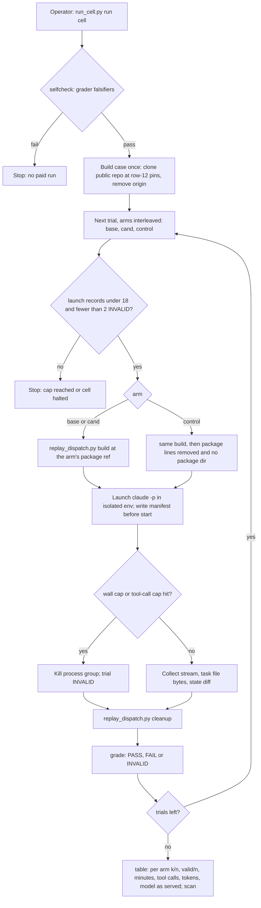

---
id:
title: One local command runs a real agent on a rebuilt stage dispatch at the released and the candidate package, for one cell, and reports what each arm did
status: validation
variant: kc-dev-flow-2
profile: pilot
merge: pr
worktree: .worktrees/spacedock-ensign-behaviour-baseline-first-cell
pr:
gates:
    version: 1
    records:
        - id: gate:behaviour-baseline-first-cell:backlog
          stage: backlog
          attempts:
            - id: gate-attempt:behaviour-baseline-first-cell-backlog-1
              briefing:
                id: briefing:behaviour-baseline-first-cell:backlog:attempt-1:revision-1
                digest: sha256:b5664e5209c5d2fac6204d5ca3778145ad19aafa70dfdaa2431d11c3afe2a0b8
                room-ref: ./behaviour-baseline-first-cell/review/backlog/briefing-1
              resolution:
                type: Resolution
                id: resolution:spacedock:behaviour-baseline-first-cell:backlog:1
                briefing: briefing:behaviour-baseline-first-cell:backlog:attempt-1:revision-1
                by: agent:first-officer
                at: "2026-11-14T04:42:39.866073Z"
                decision: approve
                reason: Inside scope 1 item C given by the reform session under the Captain's grant; profile pilot justified in the Scope; seed check exit 0; no excluded matter (public merge, outward action, outcome definition, suspected key) is involved in admission.
                conn:
                    quote: 改革工作階段（Paseo 代理 26215d96，就是開你出來的那一個）可以替我給你工作範圍。它給的範圍內，進場、設計、預算、結案這些關卡你不必停下來等我，記為「依艦長授權」，一路做到它指定的終點。
                    source: the Captain, chat with the second dev2 FO, 2026-11-14; scope 1 item C from the reform session, Paseo messages 6ee7ee5b-9ccc-4ef2-8cb6-35f25bfd4e1e and a8df76d7-63cb-4352-9c4b-f44b6004d7f5
              application:
                target-stage: ideation
                state: consumed
        - id: gate:behaviour-baseline-first-cell:ideation
          stage: ideation
          attempts:
            - id: gate-attempt:behaviour-baseline-first-cell-ideation-1
              briefing:
                id: briefing:behaviour-baseline-first-cell:ideation:attempt-1:revision-1
                digest: sha256:9a3e4f21c2dfbc53d2e78f9dd0496eb5da10265d776a02899bdf5cc7090ea12f
                room-ref: ./behaviour-baseline-first-cell/review/ideation/briefing-1
              resolution:
                type: Resolution
                id: resolution:spacedock:behaviour-baseline-first-cell:ideation:1
                briefing: briefing:behaviour-baseline-first-cell:ideation:attempt-1:revision-1
                by: agent:first-officer
                at: "2026-11-14T05:05:55.363147Z"
                decision: approve
                reason: 'Design check exit 0; the design reuses the package''s replay builder, keeps case and run content off the public branch, stays inside the 18-run cap and the admitted scope; FO verified by git grep that the rule under test is present at the candidate and absent at the release. D1 (credential) is not decided here: it is the Captain''s and no paid run starts before he answers.'
                conn:
                    quote: 改革工作階段（Paseo 代理 26215d96，就是開你出來的那一個）可以替我給你工作範圍。它給的範圍內，進場、設計、預算、結案這些關卡你不必停下來等我，記為「依艦長授權」，一路做到它指定的終點。
                    source: the Captain, chat with the second dev2 FO, 2026-11-14; scope 1 item C from the reform session, Paseo messages 6ee7ee5b-9ccc-4ef2-8cb6-35f25bfd4e1e and a8df76d7-63cb-4352-9c4b-f44b6004d7f5
              application:
                target-stage: implementation
                state: consumed
        - id: gate:behaviour-baseline-first-cell:validation
          stage: validation
          attempts:
            - id: gate-attempt:behaviour-baseline-first-cell-validation-1
              briefing:
                id: briefing:behaviour-baseline-first-cell:validation:attempt-1:revision-1
                digest: sha256:f456f7c3e6799a148423d68b74db607d256468a8b3a334b8ad21104fc8b865ee
                room-ref: ./behaviour-baseline-first-cell/review/validation/briefing-1
started: 2026-11-14T04:43:45Z
---

The package has no check that runs a model and looks at what its instructions cause. An earlier attempt (task validation-reads-pr-review-comments) had 7 valid runs of 12, two runs at the 1800-second cap, and a base that already passed 3 of 3, so it could show nothing (figures from `.context/dev2-reform/改革總計劃.md`, not re-measured here).

## Scope

- Source: the Captain 「同意重建核心：先做行為基準，再從空白頁逐條准入，做成同一個套件的新版本，狀態一開始就放私有。」 (chat with the reform session, Paseo 26215d96, 2026-11-14; relayed, not a ruling here). Admission is recorded by FO under the Captain's grant to the second dev2 FO (chat, 2026-11-14) and the reform session's scope 1 item C. Design input: `.context/dev2-reform/behaviour-ci-design.md` sections B, C and D, a research output with its own stated limits.
- Outcome: a person can run one local command that rebuilds a real stage dispatch at two package refs (the last released tag and a candidate), runs a real agent on each in an isolated home, and reports per cell: base k/n, candidate k/n, the no-skill control, valid/n, minutes, tool calls, tokens and the model id as served. This task delivers the thin runner and ONE cell.
- Where the work lands: the private working repository, not this repository. This task file and its records refer to it only as "the private working repository" and pin it by commit SHA. Run evidence, case bundles and the result table stay there or outside any repository; nothing from a run, a case or a private adopter is written to this state branch, and nothing from that repository is pushed anywhere public.
- Reuse: the package's `scripts/replay_dispatch.py` builds the dispatch; the procedure text in the maintain-flow skill; Spacedock's isolation approach for its live tests as the model for an empty home and config directory. New code is the runner only: launch, hard stop, manifest, grade, table.
- First cell: ideation flags a criterion whose proof the validator cannot produce. Prefer a frozen public archived task cut before the record that caught it; plant a case only if none fits. Cases come from public package tasks on an allowlist.
- Rules for the cell: 3 trials per arm; a wall-clock cap and a tool-call cap per run, set and recorded before the first run; two invalid trials halt the cell; graded on artifacts the model cannot author (workspace bytes, commits, structured stage-report fields), never on its own claim; the transcript shows no read of an installed copy of the skill or of the operator's personal configuration; the model id as served, effort, package refs and Spacedock version are recorded.
- Spend: the operator's own login on this machine; no credential goes into CI; minutes, tool calls and tokens of the first run are recorded and no dollar figure is estimated.
- Profile: pilot. It adds a check at the release boundary of one package; no production data, credential in CI, migration or unattended operation.
Non-goals: the other seven cells; cloud replay; a CI workflow; First Officer behaviour journeys; deleting any existing test; carrying or proving resumable state (Spacedock's capability); tuning the cell until it shows a difference.
Budget: 2 cycles per stage
Stop condition: 18 paid agent runs in total including reruns; two invalid trials in the cell; the cell cannot be made to fail on any arm within the cap (that is a result: report it); the workflow's scripts would force run or case content onto this public branch; a suspected key is found.

## Acceptance criteria

All three arms of the cell run on one host (Claude), one model and effort, with the caps in `### First cell`; "the runner" is `behaviour/run_cell.py` in the private working repository, pinned by commit SHA in the implementation report.

**AC-1**: The one command produces, for one cell, a table with base k/n, candidate k/n, no-skill control, valid/n, minutes, tool calls, tokens and the model id as served, from real agent runs.
Verified by: at the pinned commit, `python3 behaviour/run_cell.py table behaviour/cells/ideation-flags-unprovable-criterion` re-grades every stored run (`grade` is called inside `table`) and prints the table; the validator compares it with the committed `table.md` byte for byte, and counts the run manifests (`ls behaviour/results/ideation-flags-unprovable-criterion/*/manifest.json | wc -l`) against the table's n and the 18-run cap. The model id comes from the stored stream (`message.model` and the result event's `modelUsage` keys), not from the requested alias. Limit: one cell, one host, 3 trials per arm.

**AC-2**: The cell is shown failing on at least one arm, or the report states it could not be made to fail within the cap, with the runs spent.
Verified by: for one FAIL trial, the validator reads its stored `task-after.md` and names the criterion the grader found unflagged, and `python3 behaviour/run_cell.py grade <run dir>` prints that criterion id; or, with no FAIL trial, the table's verdict reads `NO-FAIL` and the manifest count is at most 18.

**AC-4**: Nothing from a run, a case or a private adopter is on this state branch or in any public repository.
Verified by: with the marker list (every run id and session id from the manifests, and the private working repository's name) held outside any repository, `git -C <fresh clone of the public repository> log -p --all --since=<first run start> | grep -c -F -f <markers>` prints 0, and `grep -r -c -F -f <markers>` over this task's file and folder at the pushed state head prints no non-zero count.

**AC-5**: The grader is shown to tell the two outcomes apart before any paid run.
Verified by: `python3 behaviour/run_cell.py selfcheck behaviour/cells/ideation-flags-unprovable-criterion` exits 0 and prints FAIL for the case's own approved design (the task file at the parent of its first superseding amendment, the state cut in row 12), PASS for the same file with the offending criterion moved under a `Not provable now` line, and PASS for a fixture whose criteria are all script-proved; `run` refuses to launch while `selfcheck` fails. Falsifier: deleting the model-run pattern from `answer.json` makes the first fixture grade PASS and `selfcheck` exit 1.

**AC-6**: The runner stops at the spend boundary before launching, not after.
Verified by: `python3 behaviour/run_cell.py run <cell> --dry-run` against two stored fixture result folders, one with 18 launch records and one with 2 INVALID trials, exits 1 with `cap reached` and `cell halted` respectively and starts no process; each stored manifest carries the wall-clock and tool-call caps written before its launch time.

## FO alignment

Alignment: not needed before ideation: outcome, caps and proof are stated in the scope the reform session gave under the Captain's grant; the design returns at the ideation gate.
Surfaces: none
Visible change: none
Release review: not needed: package tooling with no release on a journey map.
Reviewer: kc-dev-flow-2:engineering-reviewer gpt-6-astra 2026-11-14 — after the fix, can the agent outlive the runner or its caps on any exit path, and may a paid run be asked of the Captain again? (run and attack the six stub proofs; record dispatch/engineering-reviewer-1.md)
Reviewer: kc-dev-flow-2:engineering-reviewer gpt-6-astra 2026-11-14 — the same question, second call: the first stopped before any stub ran because its sandbox had no network for the pinned release download (record dispatch/engineering-reviewer-2.md)
Reviewer: kc-dev-flow-2:engineering-reviewer claude-opus-5-5 2026-11-14 — the same question, third call: the second stopped because its sandbox denies process listing; a Claude reviewer by the reform session's ruling under the Captain's grant, same-family exception recorded in the dispatch record (record dispatch/engineering-reviewer-3.md)
Reviewer: kc-dev-flow-2:chief-engineer not run: the step-back this trigger asks for was already made by the reform session under the Captain's grant (Paseo messages a63e845a and 734da3e8), which re-cut the task to nine ordinary agents; amendment 3 records it

## Design

### PRFAQ

Before a kc-dev-flow-2 release, the maintainer runs one command in the private working repository. It rebuilds one real ideation dispatch from a frozen public task, runs a fresh Claude worker on it three times at the last released package, three times at the candidate, and three times with no package at all, each in an empty home with nothing of the operator's set-up. It grades what each worker left in the task file, not what it said, and prints one row: base k/n, candidate k/n, control k/n, valid/n, minutes, tool calls, tokens and the model as served.

- Why this cell first? It aims at the largest measured problem (outcome 三: 50 of 155 approved designs later changed their criteria). Its case is a design that passed its gate with a criterion only a model run could prove, which validation later could not prove.
- Why might it show nothing? The candidate is expected to pass and the others to fail, so the cell would show nothing only if the release or the control also passes. The rule grep (evidence/ideation-1/rule-grep.txt, third check) finds the answer at main only: `references/sd/workflow.md` lines 188-189 ("Every criterion's evidence command runs once on it ... unrunnable: `Not provable now`", added by #864), absent at kc-dev-flow-2-v0.41.0 and at the case-time v0.35.0, and the historical worker on the case-time package did not flag the criterion. If no arm fails within the cap, the report says so and the cell is dropped (CE's rule: a cell must be seen to fail).
- What does it cost? At most 18 paid runs, counted by the runner; 9 scheduled. No dollar figure: minutes, tool calls and tokens of the first trials are recorded first.

### Flow

### Runner

One new file, `behaviour/run_cell.py`, with five subcommands; nothing else in it builds dispatches.
- `selfcheck <cell>`: grades the cell's three falsifier fixtures and exits 1 unless they read FAIL, PASS, PASS (AC-5). `run` calls it first.
- `run <cell> [--trials N] [--dry-run]`: builds the case directory once outside any repository. A full clone would hand the worker the case's later records, 170 tags and every later package (evidence/ideation-1/rule-grep.txt, second check), so the runner instead writes two new one-commit repositories, one from `git archive <state cut>` and one from `git archive <code commit>`, with no remote, tag or history; package refs are exported from a separate clone that no run directory names. `replay_dispatch.py` comes from `git show kc-dev-flow-2-v0.41.0:kc-dev-flow-2/scripts/replay_dispatch.py`; the Spacedock binary is the v0.27.2 release asset checked against its published sha256, and the Spacedock plugin is `git archive v0.27.2` of the public Spacedock repository, so binary and plugin are the same version and neither comes from an installed copy; for each missing trial, interleaved base, cand, control: refuse if the cell's results already hold 18 launch records or 2 INVALID trials (AC-6); call `replay_dispatch.py build --spacedock <run>/bin/spacedock` (the probe found the binary's home path in the dispatch otherwise); write the manifest with caps and pins; launch; enforce caps; collect; call `replay_dispatch.py cleanup`; grade. `--trials 1` runs the first trial of each arm only.
- Launch: `claude -p <bootstrap> --model claude-opus-5-5 --effort high --plugin-dir <run>/spacedock-plugin --setting-sources project,local --strict-mcp-config --output-format stream-json --verbose --permission-mode dontAsk --allowedTools Read,Write,Edit,Glob,Grep,Bash --disallowedTools WebFetch,WebSearch,Agent --add-dir <run> --no-session-persistence`, cwd `<run>/code`. The bootstrap is the line FO's dispatches use (`Skill spacedock:ensign; then Read <run>/dispatch.md`). Model and effort follow this workflow's ideation dispatch (Claude Opus high, FO's trial log).
- Hard stop: the runner reads the stream line by line; it counts `tool_use` blocks and kills the process group at the tool-call cap, and kills at the wall-clock cap. `--max-turns` is not in `claude --help` (evidence/ideation-1/cli-flags.txt), so the count is the runner's.
- `grade <run dir>`: reads only `task-after.md` (the task file bytes after the run) and the stream. It splits criteria by the `**AC-<id>**` grammar under the first `## Acceptance criteria` heading. A criterion is model-run-dependent when its evidence text matches the cell's `answer.json` patterns. PASS: every such criterion is flagged in its own block or in a decisions section naming its id (`Not provable now`, `Needs decision`, `Captain decision`); a design with none reads `PASS (no model-run criterion)`, counted as a pass and shown apart. FAIL: one is unflagged. INVALID: no criterion written, cap hit, process error, or a scan breach. The worker has no `claude`, `codex` or `gh` on PATH, so it cannot have run a model proof itself.
- `table <cell>`: re-grades every run, writes `table.md`, and prints per arm k/n, valid/n, median and total minutes, median tool calls, summed input, output and cache tokens, the model as served, refs with resolved SHAs, Spacedock and CLI versions; verdict PASS, REGRESSION (cand below base), CEILING (base n/n), NO-FAIL (no arm failed), or INVALID (fewer than 2 valid trials on an arm). `total_cost_usd` is shown only as "imputed, not billed".
- `scan <cell>`: AC-3's two checks on every stored run, plus a search of every stored file for an OAuth or API key prefix; a hit stops the run and is reported as a suspected key.

### Isolation

Shown by observation, not by the variables set (CE's lesson):
- Empty `HOME`, empty `CLAUDE_CONFIG_DIR`, `TMPDIR` inside the run, all per run. The probe showed such a run sees no login at all (evidence/ideation-1/auth-probe.txt), so nothing personal is inherited.
- The child environment is an allowlist, not a scrub: `PATH=<run>/bin:/usr/bin:/bin` (copies of the pinned `spacedock` and `python3` only), `HOME`, `CLAUDE_CONFIG_DIR`, `TMPDIR`, `LANG`, `GIT_CONFIG_GLOBAL=/dev/null`, `GIT_CONFIG_NOSYSTEM=1`, replay author and committer names, and the credential. No `GITHUB_*`, `RUNNER_*`, `CLAUDECODE`, Paseo or SSH variables reach it.
- Credential: one variable, `CLAUDE_CODE_OAUTH_TOKEN`, handed to the runner by the operator's secret wrapper and passed only to the child; never written to a file. `--bare` would need an API key (claude --help), so it is not used.
- No later history: the case repositories hold one commit each (`### Runner`), so `git log` or `git show` in a run reaches nothing after the cut.
- What every arm can still read: the case's own code tree, which for a package task is this repository at the code commit, including the case-time `kc-dev-flow-2/` (the code under design), `CLAUDE.md` and `AGENTS.md`. That is intrinsic to replaying the package's own tasks and is the same for all arms.
- Shown by: the stream's init event (plugins, skills, MCP servers) stored per run, and the transcript scan (AC-3), which also lists every read of a `kc-dev-flow-2/skills/` or `references/` path that is not the arm's own export. A control run that read the case-time skill in its code tree is labelled `control (read skill)` and shown apart, not counted as a no-skill trial and not INVALID. Managed policy settings, if the machine has any, still apply to every arm alike; the manifest records whether that file exists.

### First cell

- Name: `ideation-flags-unprovable-criterion`.
- Case: `replay-cases.tsv` line 12 (header is line 1): outcome 三, cause class proof-needs-evidence-validator-cannot-produce, set tuning, confidence high, scrub light. It is the only row in that class that is tuning, high confidence and light scrub; the two other light rows are held-out and stay unused. Its pins (state commit = the `ideation_dispatch_cut` column, code commit, slug) live only in the private working repository's `cell.json`.
- Arms: base = `kc-dev-flow-2-v0.41.0` (fa022a864, the last release); cand = origin/main `c2f035b66` today, re-read and pinned by SHA in the manifest of the first launch; control = the same dispatch with no package. Both refs build exit 0 (evidence/ideation-1/dispatch-build-probe.txt). `--readme-base-ref kc-dev-flow-2-v0.35.0`, the marker in the case's README.
- Pin choice (D2, decided by FO): base is the last release and candidate is main, as the outcome says; no case-time arm. The dispatch had asked to pin the package to the case's `package_version` (0.35.0) so an arm has not seen the case's answer; the base arm still has not (no such rule at v0.41.0, rule-grep.txt third check), while the candidate carries the answer on purpose, since it is the change under test.
- Control arm: the base dispatch with its `Package root:` line, harness line and fetch-commands block removed and one control line added ("write the design and acceptance criteria into the task file; write your stage report in the state checkout only; do not push"), no package directory in the run, and a workflow README cut to its frontmatter, so nothing tells the worker to hold for a missing skill. Same task, checklist and Spacedock ensign contract as the other arms.
- Checklist: the two items in the probe's `checklist.txt` (a design with criteria in the task file; a stage report naming each criterion with its current evidence). It names no rule under test (maintain-flow).
- Grading: on artifacts, as in `### Runner`; the answer key is the case's own record (the criterion its amendment later superseded needed a model run). The grader reads no claim the worker makes about itself.
- Caps per run, recorded before the first launch: wall clock 1500 s, 150 tool calls. Reason: the earlier attempt's Claude runs hit 1800 s twice, and that task's design note judged 1800 s too long. The first trial of each arm measures this; a change of caps is a new cell version, not an edit.
- Expected reading: base FAIL on most trials (v0.41.0, like the case-time package that let this design through, asks no Pilot design to run or flag each criterion's proof); candidate PASS on most trials (main's workflow.md, which the worker reads through the fetched stage definition, tells it to run each criterion's evidence command once and mark the unrunnable ones `Not provable now`; no `claude`, `codex` or `gh` is on its PATH, so a model-run proof cannot run and must be flagged or replaced); control FAIL (no rule). A candidate at or above 2 of 3 with base at or below 1 of 3 reads as the change working; base passing as often as the candidate reads as the rule not being the cause. The grader's flag word is the candidate's own phrase, so a candidate pass shows the rule was followed, not that the flag was judged well; the validator's read of each graded file (AC-2) is the check on that.

### Files added in the private working repository

- `behaviour/run_cell.py`: the runner (`selfcheck`, `run`, `grade`, `table`, `scan`).
- `behaviour/cells/ideation-flags-unprovable-criterion/cell.json`: case pins, refs, model, effort, caps, trials, launch cap 18.
- `behaviour/cells/ideation-flags-unprovable-criterion/checklist.txt`: the two-item checklist.
- `behaviour/cells/ideation-flags-unprovable-criterion/answer.json`: model-run patterns and flag words for the grader.
- `behaviour/cells/ideation-flags-unprovable-criterion/falsifiers/approved.md`, `flagged.md`, `provable.md`: AC-5 fixtures.
- `behaviour/cells/ideation-flags-unprovable-criterion/falsifiers/leaky-transcript.jsonl`: AC-3's falsifier.
- `behaviour/cells/ideation-flags-unprovable-criterion/falsifiers/capped/` and `halted/`: AC-6's two stored result folders.
- `behaviour/results/ideation-flags-unprovable-criterion/<run id>/`: `manifest.json`, `stream.jsonl`, `task-after.md`, `state.diff`, written by the runner and committed after the runs.
- `behaviour/results/ideation-flags-unprovable-criterion/table.md`: written by `table`.
Case directories, the marker list and the credential stay outside every repository.

### Run plan and spend

- First implementation step, no credential: start the isolated launch exactly as `### Runner` describes, with no `CLAUDE_CODE_OAUTH_TOKEN`, and read the stream's init event for the exported Spacedock plugin and its `ensign` skill. If no init event appears without a login, record that and continue; no paid run before the Captain answers D1.
- Before any paid run: `selfcheck` (AC-5), `run --dry-run` (AC-6), `scan` on the fixtures (AC-3 falsifier).
- Step 1, 3 runs: `run --trials 1`, one per arm; read minutes, tool calls and tokens; stop if any arm is INVALID for a harness reason.
- Step 2, 6 runs: `run --trials 3`.
- Reruns: an INVALID trial is replaced once; a second INVALID halts the cell. Scheduled 9, at most 10 in the cell, and the runner refuses the 19th launch counted over every record, including any made while building the runner.

### Before new work

Checked: the package's `replay_dispatch.py` (used as is) and the maintain-flow procedure (followed: release and change built from the same commits, a checklist naming no rule); the earlier attempt's replay folder on this state branch (`validation-reads-pr-review-comments/implementation/replay/`: `run.py` hard-codes one case, normal home, 1800 s, no tool cap and no table, so its launch pattern is reused and its code is not); Spacedock's live-lane isolation and CE's eval cell, through `.context/dev2-reform/behaviour-ci-design.md` sections A and C (not re-read at source); the v1 published-tag smoke (answers install and load, not behaviour; not merged with this). ADRs: none governs a behaviour runner (`git grep` of `docs/adr` for replay found only ADR 0037, workers return to FO early); ADR 0079 governs the evidence kept here. `Override:` lines: one past ruling chose not to measure behaviour for a PR (「照建議不量」, 2026-10-22); this task is the Captain's later choice to build the measurement, so it does not conflict. Inaccessible: the private working repository's layout (FO gives its path to implementation); paths above are relative to its root.

### Worth questions

- Runner. Serves 「先做行為基準」 and 「該測試的是 skill 是否真的造成想要的結果」. Without it the replay stays hand-built per change and the earlier attempt's failures repeat. Premise that would make it unneeded: an existing runner already does this; checked, none does (above).
- First cell. Serves outcome 三, 「設計階段提出的規劃要真的可行」. Without it the runner proves only that it launches. Premise that would make it unneeded: the release already passes; the rule grep says the release lacks the rule the candidate adds, and the first 3 runs test it.
- Control arm. Serves outcome 零, 「該怎麼知道用我的工作方法，確實比沒用較好？」. Without it a pass on both package arms cannot be told from a strong model passing alone.
- Isolation. Serves outcome 十五, 「隔離個人設定與技能組合影響」. Without it a result depends on whose machine ran it. Premise: the empty home inherits nothing; the auth probe shows it inherits not even the login.
- Caps and halt. Serve the Stop condition the reform session set (18 runs, two invalid). No Captain words of his own; kept because the Stop condition is part of the admitted scope.
- AC-4 scan. Serves 「私有的內容不離開本機」 (outcome 七). Without it nothing checks that run output stayed private.

### Not provable now

- AC-1, AC-2: need the paid runs; the build step they rest on ran now for both package refs (exit 0).
- AC-3: needs real transcripts; the empty-home probe ran now. Whether `--plugin-dir` loads the exported Spacedock copy under an empty config is shown only by the first run's init event.
- AC-4: the markers do not exist until runs happen.
- AC-5, AC-6: need the runner and fixtures, which implementation writes; each runs without a paid call.

### Needs decision

- D1 (Captain): the credential. Recommended: a subscription token he makes himself with `claude setup-token` (his browser login), kept in his secret store and handed to the runner by his wrapper, local only. Without it no isolated run can authenticate (auth probe). Worse under it: a long-lived token for his subscription exists until he revokes it. The alternative is a Console API key, which bills separately.
- D2 (FO): decided. Base is the last release, candidate is main, no fourth arm (FO follow-up, `dispatch/ideation-1-message-1.md`). The cell's expected reading under it is in `### First cell`.

### Batch overlap

- `design-check-reads-each-pilot-criterion-for-its-proof-record` (implementation): changes the package's ideation checks, so it may move the candidate ref; it shares no file with this task (this task's files are in the private working repository). It is the change this cell would measure.
- `state-branch-writes-carry-no-private-identifiers` (ideation): a push filter for this state branch; it shares no file, and this task file carries no private identifier, so a filter would pass it.
- `validation-reads-pr-review-comments` (implementation): the earlier attempt; read only, no shared file.
- Other live tasks: none share a file, check, table or numbered record with this one.
Recommended order: run this cell's paid runs after the proof-record task merges or is closed, so the candidate ref is the change it measures; implementation of the runner can start now.

## Captain amendments

### Amendment 1 — 2026-11-14, chat
Captain: 「行為基準實跑用訂閱權杖，我自己產生後放進密碼庫」 (chat with the second dev2 FO, 2026-11-14)
Asked: asks.jsonl ask 1 in this task's folder (the credential for isolated runs, decision D1 of the design)
Supersedes: none

### Amendment 2 — 2026-11-14, chat (standing grant; ruling given by the reform session)
Captain: 「改革工作階段（Paseo 代理 26215d96，就是開你出來的那一個）可以替我給你工作範圍。它給的範圍內，進場、設計、預算、結案這些關卡你不必停下來等我，記為「依艦長授權」，一路做到它指定的終點。」 (chat with the second dev2 FO, 2026-11-14)
Asked: not asked of the Captain. Under that grant the reform session (Paseo 26215d96, message a63e845a) ruled on FO's stop report: "continue, do not re-cut. Budget amended to 3 implementation cycles; this is the last one I grant"; the aborted launch "counts toward the 18 launches and is recorded as operator abort; it is not one of the two INVALID trials that halt the cell"; and five proofs with a stub agent command are owed before any further paid run, validated by a different worker running them.
Supersedes: none
Budget: 3 implementation cycles

### Amendment 3 — 2026-11-14, chat (standing grant; scope amendment given by the reform session)
Captain: 「改革工作階段（Paseo 代理 26215d96，就是開你出來的那一個）可以替我給你工作範圍。它給的範圍內，進場、設計、預算、結案這些關卡你不必停下來等我，記為「依艦長授權」，一路做到它指定的終點。」 (chat with the second dev2 FO, 2026-11-14)
Asked: not asked of the Captain by this FO. The reform session (Paseo 26215d96, message 734da3e8) relays his decision in its own conversation, 「先拿數字：用現成的回放工具加 Paseo 代理跑九次，限制事先寫明；啟動程式留在分支不合併，隔離環境留到第五階段。」 (relayed), and under the grant re-cuts this task: the endpoint is one result table for the one cell already designed, from nine ordinary Paseo agents (last released tag, candidate, no-skill control; three runs each), each given the stage dispatch rebuilt by the package's replay builder at that arm's package ref; no homemade launcher, no credential handed to anything, no isolated home; the limits and the reading are committed in the private working repository before the first run; a contaminated run is marked, not dropped; the table's first line says it is a first reading from a non-hermetic place and not release evidence; the launch-and-kill layer stays on its branch unmerged with the reviewer's hold findings beside it; one implementation cycle for glue and one independent check of the grading.
Supersedes: AC-3 (no replacement: isolation is not claimed by this reading; each transcript is scanned and contamination is reported as a limit)
Design: the `### Runner` launch and hard-stop paragraphs and `### Isolation`
Budget: 4 implementation and 2 validation cycles

Superseded text:
**AC-3**: Each run was isolated: no read of an installed copy of the skill or of personal configuration appears in its transcript.
Verified by: `python3 behaviour/run_cell.py scan behaviour/cells/ideation-flags-unprovable-criterion` exits 0 and prints one line per run: (a) the stream's init event lists no plugin but the run's own exported Spacedock copy, no skill outside it and no MCP server; (b) no tool input or tool result in the transcript names the operator's home directory, an installed plugin cache, a user-level `CLAUDE.md`, `MEMORY.md`, settings or skills directory; (c) it lists each read of a package `skills/` or `references/` path other than the arm's own export, and a control run with one is labelled `control (read skill)`. Falsifier: the same scan over a stored fixture transcript that reads an installed skill copy exits 1 naming that line.

### Amendment 4 — 2026-11-14, chat (standing grant; ruling given by the reform session)
Captain: 「改革工作階段（Paseo 代理 26215d96，就是開你出來的那一個）可以替我給你工作範圍。它給的範圍內，進場、設計、預算、結案這些關卡你不必停下來等我，記為「依艦長授權」，一路做到它指定的終點。」 (chat with the second dev2 FO, 2026-11-14)
Asked: not asked of the Captain. Under that grant the reform session (Paseo 26215d96, message 8691ee5c) ruled after the first reading: the committed reading stands and is reported as it is (cannot discriminate, first reading, non-hermetic); post-hoc analysis of the nine runs is allowed when labelled "post-hoc, exploratory, not a result"; a reading v2 is committed before any further launch, with the grader's patterns corrected (shown against the nine old outputs only as a fixture that includes the misfire case), contamination defined as a run reading or invoking the installed package instead of the ref it was given, and the arms reduced to two, the last released tag and the candidate, the no-method control arm deferred to the isolation environment with the table saying so and why; then six fresh launches, three per arm, same model and effort, the two remaining launches of the 18 as spares for invalid runs only; an independent worker checks the grading of the six; if v2 also reads cannot discriminate or no difference the cell closes, no v3; both readings are reported together.
Supersedes: none
Design: the `### First cell` arms and control-arm paragraphs
Budget: 5 implementation and 2 validation cycles

## Stage Report: ideation

- DONE: A design for the thin runner (launch, hard stop, manifest, grade, table) that reuses scripts/replay_dispatch.py and the maintain-flow procedure, names every file it adds in the private working repository, and states how isolation is achieved and shown (empty home and config directory; no read of an installed skill copy or personal configuration)
  `### Runner`, `### Isolation`, `### Files added in the private working repository`; replay_dispatch.py built the case at both package refs, exit 0 (evidence/ideation-1/dispatch-build-probe.txt); an empty home and config dir shows `loggedIn: false` (auth-probe.txt).
- DONE: The first cell chosen: which archived public package task and cut point it uses (named only by its row in the case inventory, never by content), the package refs for base and candidate, the no-skill control arm, the grading rule on artifacts the model cannot author, and the wall-clock and tool-call caps per run, with the reason the cell is expected to fail on some arm
  `### First cell`: replay-cases.tsv line 12 at its ideation_dispatch_cut; base kc-dev-flow-2-v0.41.0, cand origin/main c2f035b66 (pinned at first launch), control without package; caps 1500 s and 150 tool calls; expected failure rests on rule-grep.txt (no arm asks for a proof run or a flag).
- DONE: Each acceptance criterion with its proof run once now where it can be or listed under `Not provable now` with the reason; the run plan showing the count stays within 18 paid agent runs; the decisions only the Captain can make named; kc-dev-flow-2/scripts/design_surfaces.py check on the task exits 0
  Per criterion below; `### Run plan and spend` schedules 9 runs, at most 10 in the cell, runner refuses the 19th; `### Needs decision` D1 (credential); design_surfaces.py check exit 0, "design surfaces presentable" (design-surfaces-check.txt).
- DONE: AC-1 (table from real runs): not yet verified; needs paid runs. Run now: the dispatch build both package arms rest on, exit 0 twice.
- DONE: AC-2 (cell fails on some arm or NO-FAIL reported): not yet verified; needs paid runs. Run now: rule grep across the three refs, no proof-run rule in any arm.
- DONE: AC-3 (isolation): not yet verified; needs transcripts. Run now: empty-home auth probe; `--plugin-dir` loading under an empty config is shown only by the first init event.
- DONE: AC-4 (nothing private public): not yet verified; markers exist only after runs. This task folder holds no case pin, case content or run output (evidence files name row 12 only).
- DONE: AC-5 (grader falsifiers): not yet verified; the runner is implementation's. Premise checked now: the case's approved design (state cut of row 12) carries the model-run criterion with no flag in its criteria or its Captain decisions section, so the FAIL fixture exists.
- DONE: AC-6 (spend boundary before launch): not yet verified; implementation's, provable without a paid run.

### Summary

Designed the thin runner (`behaviour/run_cell.py`: selfcheck, run, grade, table, scan) on top of the package's replay_dispatch.py, the first cell on row 12 of the case inventory with base = last release, cand = main, a no-package control, artifact grading of unflagged model-run criteria, caps 1500 s / 150 tool calls and at most 10 of the 18 runs. Added AC-5 (grader falsifiers before any paid run) and AC-6 (runner refuses at the spend boundary) and named each criterion's evidence command. Two probes ran with no model call: both dispatch builds exit 0, and an empty home sees no login, so the Captain must supply a credential (D1). No paid run happened.

## Stage Report: ideation

- DONE: A design for the thin runner (launch, hard stop, manifest, grade, table) that reuses scripts/replay_dispatch.py and the maintain-flow procedure, names every file it adds in the private working repository, and states how isolation is achieved and shown (empty home and config directory; no read of an installed skill copy or personal configuration)
  `### Runner`, `### Isolation`, `### Files added in the private working repository`. Case repositories are now one-commit trees with no history or tags (a full clone reached the case's later amendment and 170 tags, rule-grep.txt second check); Spacedock binary and plugin both pinned to the public v0.27.2 release; replay_dispatch.py built the case at both refs, exit 0 (dispatch-build-probe.txt); empty home shows `loggedIn: false` (auth-probe.txt).
- DONE: The first cell chosen: which archived public package task and cut point it uses (named only by its row in the case inventory, never by content), the package refs for base and candidate, the no-skill control arm, the grading rule on artifacts the model cannot author, and the wall-clock and tool-call caps per run, with the reason the cell is expected to fail on some arm
  `### First cell`: replay-cases.tsv line 12 at its ideation_dispatch_cut; base kc-dev-flow-2-v0.41.0, cand origin/main c2f035b66 (pinned at first launch), control without package and with a frontmatter-only README; caps 1500 s and 150 tool calls; expected failure: no arm from 0.35.0 to main adds a rule to prove or flag criteria (rule-grep.txt, both checks). The departure from the case-time pin is named and put to FO as D2.
- DONE: Each acceptance criterion with its proof run once now where it can be or listed under `Not provable now` with the reason; the run plan showing the count stays within 18 paid agent runs; the decisions only the Captain can make named; kc-dev-flow-2/scripts/design_surfaces.py check on the task exits 0
  `### Run plan and spend`: 9 scheduled, at most 10 (13 with D2's fourth arm), runner refuses the 19th; Captain decision D1 (credential), FO decision D2 (base ref); design_surfaces.py check rerun on the final design, exit 0, "design surfaces presentable" (design-surfaces-check.txt).
- DONE: AC-1 (table from real runs): not yet verified; needs paid runs. Run now: the dispatch build both package arms rest on, exit 0 twice.
- DONE: AC-2 (cell fails on some arm or NO-FAIL reported): not yet verified; needs paid runs. Run now: rule grep and the 0.35.0-to-0.41.0 diff on every path an ideation worker reads; no proof-or-flag rule in any arm.
- DONE: AC-3 (isolation): not yet verified; needs transcripts. Run now: empty-home auth probe and the case-clone check that led to one-commit case repositories; `--plugin-dir` loading under an empty config is shown only by the first init event.
- DONE: AC-4 (nothing private public): not yet verified; markers exist only after runs. This task folder holds no case pin, case content or run output (grep for the case slug and its commit prefixes over the task file and folder printed nothing).
- DONE: AC-5 (grader falsifiers): not yet verified; the runner is implementation's. Premise checked now: the case's approved design carries the model-run criterion with no flag in its criteria or its Captain decisions section.
- DONE: AC-6 (spend boundary before launch): not yet verified; implementation's, provable without a paid run.

### Summary

Supersedes the earlier ideation report. The design now builds each case repository from the single pinned tree, because a full clone exposed the case's later amendment and every later package; it states what every arm can still read (the case-time package as the code under design) and has the scan label a control run that read it. It names the departure from the dispatch's case-time pin and puts it to FO as D2, with a fourth-arm alternative inside the 18-run cap; D1, the credential, stays the Captain's. No paid run happened.

Scratch close (`scratch.py close <task folder> ideation-1`, exit 0): `Scratch removed: <scratch root>/ideation-1 (84566127 bytes)`; `Evidence: evidence/ideation-1/ (5 files, 6.3 KiB)`.

## Stage Report: ideation

- DONE: A design for the thin runner (launch, hard stop, manifest, grade, table) that reuses scripts/replay_dispatch.py and the maintain-flow procedure, names every file it adds in the private working repository, and states how isolation is achieved and shown (empty home and config directory; no read of an installed skill copy or personal configuration)
  Unchanged from the previous report: `### Runner`, `### Isolation`, `### Files added in the private working repository`; one-commit case repositories; both refs build exit 0 (dispatch-build-probe.txt); empty home shows `loggedIn: false` (auth-probe.txt).
- DONE: The first cell chosen: which archived public package task and cut point it uses (named only by its row in the case inventory, never by content), the package refs for base and candidate, the no-skill control arm, the grading rule on artifacts the model cannot author, and the wall-clock and tool-call caps per run, with the reason the cell is expected to fail on some arm
  Corrected: the candidate (main c2f035b66) carries the answer in references/sd/workflow.md lines 188-189, absent at v0.41.0 and v0.35.0 (rule-grep-third-check.txt: 0, 0, 2 hits). Expected reading in `### First cell`: base FAIL, candidate PASS, control FAIL; D2 decided by FO: base last release, candidate main, no fourth arm.
- DONE: Each acceptance criterion with its proof run once now where it can be or listed under `Not provable now` with the reason; the run plan showing the count stays within 18 paid agent runs; the decisions only the Captain can make named; kc-dev-flow-2/scripts/design_surfaces.py check on the task exits 0
  Run plan: first step is a no-credential launch smoke reading the init event for the exported Spacedock plugin and its ensign skill; 9 runs scheduled, at most 10, runner refuses the 19th; D1 (credential) is the Captain's; design_surfaces.py check exit 0 on the corrected design (design-surfaces-check-message-1.txt).
- DONE: AC-1 (table from real runs): not yet verified; needs paid runs. Run now: the dispatch build both package arms rest on, exit 0 twice.
- DONE: AC-2 (cell fails on some arm or NO-FAIL reported): not yet verified; needs paid runs. Run now: the corrected grep, which predicts base and control fail and the candidate passes.
- DONE: AC-3 (isolation): not yet verified; needs transcripts. Run now: empty-home auth probe; the no-credential launch smoke (implementation's first step) checks the plugin and skill load before any paid run.
- DONE: AC-4 (nothing private public): not yet verified; markers exist only after runs. The task file and folder hold no case slug, pin or run output.
- DONE: AC-5 (grader falsifiers): not yet verified; the runner is implementation's. Premise checked: the case's approved design carries the model-run criterion unflagged.
- DONE: AC-6 (spend boundary before launch): not yet verified; implementation's, provable without a paid run.

### Summary

Supersedes the earlier ideation reports. FO's correction holds: the candidate's workflow.md asks for each criterion's evidence to run once and for unrunnable ones to be marked `Not provable now`, so the cell now expects the candidate to pass and the release and control to fail; my first grep had left that file out. D2 is recorded as FO's decision (no fourth arm), and a no-credential launch smoke is the first implementation step. Scratch close for ideation-1-message-1, exit 0: `Evidence: evidence/ideation-1/ (7 files, 7.9 KiB)`.

## Stage Report: implementation

- DONE: First, before anything else is built on it: a launch smoke with no credential in the isolated environment the design describes, reading the init event for the exported Spacedock plugin and its ensign skill; record what appears, and if no init event appears without a login, record that and continue
  An init event DOES appear without a login: exported Spacedock 0.27.2 (`spacedock@inline`, path inside the run's own export) with `spacedock:ensign` listed, 4 CLI-bundled `builtin` plugins, 18 bare bundled skills, no MCP server, `apiKeySource: none` (evidence/implementation-1/launch-smoke-init.txt). My first attempt (a hand-written launch line) was refused by the session's permission check and not retried; the second ran through the runner's own launch function (`run <cell> --smoke`). Not shown: whether a credentialed init adds skills or connectors, and whether the plugin's hooks fire (killed at init).
- DONE: The runner and the one cell as the approved design names them, in the private working repository on a branch you create from its main: the five subcommands, the cell files and the falsifier fixtures; AC-5 (grader falsifiers) and AC-6 (spend boundary refuses before launch) shown by commands that cost nothing, with exit codes
  Branch `behaviour-first-cell`, base `c1e6a401b345ba86db9cc696c5cefce2a930ee97`, candidate `758cdd90140c37e394ebc527137ee42842641ae5`: `behaviour/run_cell.py` (selfcheck, run, grade, table, scan), `behaviour/cells/ideation-flags-unprovable-criterion/` (cell.json, checklist.txt, answer.json, three grader fixtures, one leaky transcript, `capped/` with 18 manifests, `halted/` with 2). Local commit only; not pushed. roborev not run (different repository).
  AC-5: `selfcheck` exit 0 prints FAIL, PASS, PASS and the matched criterion ids per fixture (2 model-run criteria in the approved design, 0 in the script-proved one); the same command on a copy with the model-run patterns deleted exits 1 (both grade PASS). `run` calls it first. AC-6: `run <cell> --dry-run --results <fixture>` exits 1 with `cap reached` (18 records) and `cell halted` (2 INVALID); with `subprocess.Popen` and `run` patched to raise, both dry runs still return 1, so no process starts. `run` without the credential variable exits 1 before any record. AC-3 falsifier: `scan` on the leaky transcript exits 1 naming line 4. Evidence: evidence/implementation-1/unpaid-checks.txt.
  Also run at no cost: case build, dispatch build and cleanup for all three arms on one-commit case repositories, exit 0 each, no dispatch names the home directory (case-build-probe.txt); `table`, `grade` and `scan` on six hand-made runs in scratch (not stored).
- DONE: No paid agent run: the Captain has not yet answered decision D1 (the credential). Stop after the unpaid steps and report the exact command the operator runs for the first paid step, the branch, base and candidate SHA, and what remains for AC-1 to AC-4
  First paid step, 3 runs, one per arm: `<operator secret wrapper that exports CLAUDE_CODE_OAUTH_TOKEN> python3 behaviour/run_cell.py run behaviour/cells/ideation-flags-unprovable-criterion --trials 1` (evidence/implementation-1/first-paid-step.txt). Remaining: AC-1, AC-2 and AC-3 need those runs and their real streams; AC-4 needs the marker list and a fresh clone after runs exist. Open risks: the stream parser was checked against an earlier real stream and the no-login init, not a graded run; a credentialed init may add skills or connectors (the runner's init check before the first counted run refuses on that and costs no record; whether that launch makes any API call is not measured).

### Departures from the design, for FO to rule on

- Added `--smoke` and an init-only check inside `run` before any counted launch; added `--results DIR` on `run`, `table`, `scan` (AC-6 needs it to point at fixtures).
- scan (a): the 4 `builtin` plugins and the 18 bundled bare skills (now `bundled_skills` in cell.json) are allowed; any other plugin, namespaced skill or MCP server is a breach, as is a bare skill outside that list.
- scan (b): tool inputs are matched on `.claude/<plugins|skills|CLAUDE.md|settings|projects|agents|commands>` or the operator's home; tool results only on the operator's concrete home (outside the Python runtime prefix), because the case's own CLAUDE.md quotes `~/.claude/plugins` text.
- Both model-run criteria of the approved design match, so the flagged fixture flags both; the design says "the offending criterion" in the singular.
- Tool cap kills when the unique tool_use count exceeds 150; a control run that read a skill stays a valid trial, shown apart.

Scratch close (`scratch.py close <task folder> implementation-1`, exit 0): `Scratch removed: <scratch root>/implementation-1 (199069399 bytes)`; `Evidence: evidence/implementation-1/ (4 files, 8.8 KiB)`.

### Summary

Built the runner and the one cell in the private working repository (branch `behaviour-first-cell`, candidate `758cdd90140c37e394ebc527137ee42842641ae5`, base `c1e6a401b345ba86db9cc696c5cefce2a930ee97`, local only). The no-credential smoke shows an init event with the exported Spacedock plugin and its ensign skill; the grader falsifiers (AC-5) and the spend-boundary refusals (AC-6) pass at no cost. No paid run happened; the state branch carries no case, run or private-repository content, and the task file and evidence are not committed by me (FO commits).

## Stage Report: implementation

- DONE: First, before anything else is built on it: a launch smoke with no credential in the isolated environment the design describes, reading the init event for the exported Spacedock plugin and its ensign skill; record what appears, and if no init event appears without a login, record that and continue
  An init event DOES appear without a login: exported Spacedock 0.27.2 (`spacedock@inline`, path inside the run's own export) with `spacedock:ensign` listed, 4 CLI-bundled `builtin` plugins, 18 bundled bare skills, no MCP server, `apiKeySource: none` (evidence/implementation-1/launch-smoke-init.txt); rerun at the final candidate, same result. My first attempt (a hand-written launch line) was refused by the session's permission check and not retried; the second ran through the runner's own launch function (`run <cell> --smoke`). Not shown: whether a credentialed init adds skills or connectors, and whether the plugin's hooks fire (killed at init).
- DONE: The runner and the one cell as the approved design names them, in the private working repository on a branch you create from its main: the five subcommands, the cell files and the falsifier fixtures; AC-5 (grader falsifiers) and AC-6 (spend boundary refuses before launch) shown by commands that cost nothing, with exit codes
  Branch `behaviour-first-cell`, base `c1e6a401b345ba86db9cc696c5cefce2a930ee97`, candidate `ba8857895701fcab9f60d2dc8ddd85155330f2e4` (two commits; the first, `758cdd90140c37e394ebc527137ee42842641ae5`, is superseded by the second). Local only, not pushed. roborev not run (different repository). Files: `behaviour/run_cell.py`, and under `behaviour/cells/ideation-flags-unprovable-criterion/` cell.json, checklist.txt, answer.json, three grader fixtures, one leaky transcript, `capped/` (18 manifests), `halted/` (2).
  AC-5: `selfcheck` exit 0 prints FAIL, PASS, PASS with the matched criterion ids (2 model-run criteria in the approved design, 0 in the script-proved one); on a copy with the model-run patterns deleted it exits 1. `run` calls it first. AC-6: `run <cell> --dry-run --results <fixture>` exits 1 with `cap reached` (18 records) and `cell halted` (2 INVALID); with `subprocess.Popen` and `run` patched to raise both still return 1, so no process starts; without the credential variable `run` exits 1 before any record. AC-3 falsifier: `scan` on the leaky transcript exits 1 naming line 4. Evidence: evidence/implementation-1/unpaid-checks.txt, all rerun at the final candidate.
  Case build, dispatch build and cleanup for the three arms on one-commit case repositories: exit 0, no dispatch names the home directory (case-build-probe.txt). `table`, `grade`, `scan` ran on six hand-made runs in scratch (not stored).
- DONE: No paid agent run: the Captain has not yet answered decision D1 (the credential). Stop after the unpaid steps and report the exact command the operator runs for the first paid step, the branch, base and candidate SHA, and what remains for AC-1 to AC-4
  First paid step, 3 runs, one per arm: `<operator secret wrapper that exports CLAUDE_CODE_OAUTH_TOKEN> python3 behaviour/run_cell.py run behaviour/cells/ideation-flags-unprovable-criterion --trials 1` (first-paid-step.txt). Remaining: AC-1, AC-2, AC-3 need those runs and their real streams; AC-4 needs the marker list and a fresh clone after runs exist. Open risks: the stream parser was checked against an earlier real stream and the no-login init, not a graded run; a credentialed init may add skills or connectors (the runner's init-only check before the first counted run refuses on that and costs no record; whether that launch makes any API call is not measured).

### Security finding fixed in the second commit

An automated review of the first commit found that the runner ran `git diff` and `git status` inside the worker's state checkout after a run. The worker has an unrestricted shell and could have planted git config or hooks there (a `core.fsmonitor` command, a filter) that the operator's machine would then run. The finding applies. Fixed: every runner git call and every `replay_dispatch.py` call runs with `core.fsmonitor=false`, `core.hooksPath=/dev/null` and no global or system config; the state diff now comes from a file snapshot taken before and after the run, with no git in the worker's tree; a digest of the pinned tools, `replay_dispatch.py` and the three case repositories' config is checked before each launch and after each run, and a change records the run INVALID, deletes the work directory and stops. A probe shows plain git runs a planted fsmonitor command and hook while the runner's git runs neither, and the digest changes on one planted config line (unpaid-checks.txt). Residual, not fixed here: the worker still runs as the operator with an unrestricted shell, so nothing stops it from doing other things as that user; a sandbox around the launch is a separate decision for the Captain.

### Departures from the design, for FO to rule on

- Added `--smoke`, an init-only check inside `run` before any counted launch, and `--results DIR` on `run`, `table`, `scan` (AC-6 needs it to point at fixtures).
- scan (a): the 4 `builtin` plugins and the 18 bundled bare skills (`bundled_skills` in cell.json) are allowed; any other plugin, namespaced skill or MCP server is a breach, as is a bare skill outside that list.
- scan (b): tool inputs are matched on `.claude/<plugins|skills|CLAUDE.md|settings|projects|agents|commands>` or the operator's home; tool results only on the operator's concrete home (outside the Python runtime prefix), because the case's own CLAUDE.md quotes `~/.claude/plugins` text.
- Both model-run criteria of the approved design match, so the flagged fixture flags both; the design says "the offending criterion" in the singular.
- Tool cap kills when the unique tool_use count exceeds 150; a control run that read a skill stays a valid trial, shown apart.
- `state.diff` lists changed files and a unified diff of the task file, not a git diff.

Scratch close (`scratch.py close <task folder> implementation-1`, rerun after the evidence refresh, exit 0): `Scratch removed: <scratch root>/implementation-1 (absent)`; `Evidence: evidence/implementation-1/ (4 files, 9.5 KiB)`. First close: `(199069399 bytes)`.

### Summary

Supersedes the earlier implementation report. Same deliverable (runner and first cell in the private working repository, no paid run), now at candidate `ba8857895701fcab9f60d2dc8ddd85155330f2e4`, which also fixes the review finding that a worker could have planted git config for the runner to execute. The unpaid checks (AC-5, AC-6, the AC-3 falsifier) were rerun at that candidate and pass. The task file and evidence are not committed by me (FO commits).

## Stage Report: implementation

- DONE: Decide from evidence whether the skill named schedule is a skill the CLI itself ships that appears only with a login (not operator configuration), and say what the evidence is; if it is, add it to the cell's allowed bundled skills as a login-only entry, and keep every other unexpected skill, plugin or MCP server a breach.
  Yes. The binary itself registers it as a bundled skill and its prompt builder refuses without a claude.ai login ("API accounts are not supported"); the no-login init lacks it and the credentialed init has it; the isolated run's home is empty and the case tree has no project-level skills (evidence/implementation-1/schedule-skill-evidence.txt). Added as `login_only_skills: ["schedule"]` in cell.json; the scan still breaches on any other plugin, namespaced skill, MCP server or bare skill outside the bundled and login-only lists.
- DONE: Make sure a worker in a run cannot use that skill to act outside the run (it creates scheduled cloud agents): state how the launch prevents it, or prevent it.
  The launch now passes `--disallowedTools` with RemoteTrigger, CronCreate, CronDelete, CronList and `Skill(schedule)` beside WebFetch, WebSearch, Agent; and sets `CLAUDE_CODE_SUBPROCESS_ENV_SCRUB=1` so tool subprocesses do not inherit the token. Shown without a login: the init tool list drops CronCreate, CronDelete and CronList under the deny list (22 tools to 19). Backstop: scan breach (d) marks a run INVALID if the transcript calls any of those tools or the schedule skill (fixture transcript: exit 1, two (d) lines). Not verified without a credentialed run: that the `Skill(schedule)` rule blocks at run time, that RemoteTrigger leaves a logged-in tool list, and that the scrub hides the token from a Bash call. I could not tell from the binary which tool the skill acts through, so the launch denies by name.
- DONE: Captain amendment 1 (in the task file) settles decision D1: the credential is a subscription token the Captain makes and keeps himself; the runner still only reads it from the environment.
  Amendment 1 read in the task file. The runner reads `CLAUDE_CODE_OAUTH_TOKEN` from its environment only, checks presence before any record, passes it to the child process, and never writes it; scan searches every stored file for key prefixes and the literal value. I handled no credential.
- DONE: Re-run the unpaid checks (selfcheck, the two dry runs, the leaky-transcript scan) with exit codes; commit on the same branch in the private working repository; report the new candidate SHA. No paid run and no credential handling by you: the operator re-runs the first paid step.
  Branch `behaviour-first-cell`, base `c1e6a401b345ba86db9cc696c5cefce2a930ee97`, new candidate `6bea0102534dbef98a4be7b4f99a3647f6305c6d` (supersedes `ba8857895701fcab9f60d2dc8ddd85155330f2e4`, which superseded `758cdd90140c37e394ebc527137ee42842641ae5`); local only, not pushed; working tree clean. Exit codes at the candidate (unpaid-checks.txt): selfcheck 0 (FAIL, PASS, PASS plus both transcript fixtures breach); selfcheck on a copy with the model-run patterns deleted 1; dry run on the 18-record folder 1 `cap reached`; on the 2-INVALID folder 1 `cell halted`; neither starts a process (patched-subprocess run); leaky-transcript scan 1 naming line 4; schedule-transcript scan 1 naming lines 2 and 3; `run` without the credential 1 before any record. roborev not run (different repository). No paid run.
  The operator re-runs the first paid step unchanged: `<operator secret wrapper that exports CLAUDE_CODE_OAUTH_TOKEN> python3 behaviour/run_cell.py run behaviour/cells/ideation-flags-unprovable-criterion --trials 1`. If a credentialed init adds anything else, the init check names it before any record is counted.
- DONE: Append a complete new stage report that supersedes the earlier one.
  This report; it carries forward everything in the earlier one that still holds: no case, run or private-repository content is on this state branch (grep of the task file and evidence for the case slug, pin prefixes, any home-directory path and the private repository name: nothing).

### Carried from the earlier reports

- Smoke without a login: an init event appears; the exported Spacedock 0.27.2 with `spacedock:ensign`, 4 CLI-bundled `builtin` plugins, 18 bundled bare skills, no MCP server (launch-smoke-init.txt). Git hardening, the file-snapshot `state.diff`, and the tools-and-case integrity digest are in the runner (security finding from the first review, fixed at `ba8857895701fcab9f60d2dc8ddd85155330f2e4`; the worker still runs as the operator with an unrestricted shell, so a sandbox is the Captain's separate decision). Departures from the design were accepted by FO.
- Remaining for AC-1 to AC-3: the paid runs and their real streams; AC-4: marker list and a fresh clone after runs exist.

Scratch close (`scratch.py close <task folder> implementation-1`, rerun after the evidence refresh, exit 0): `Scratch removed: <scratch root>/implementation-1 (absent)`; `Evidence: evidence/implementation-1/ (5 files, 12.5 KiB)`.

### Summary

Supersedes the earlier implementation reports. The `schedule` skill is a CLI-bundled, login-only skill, so the cell allows it by name as login-only; the launch now denies the scheduling tools and the skill, scrubs the token from tool subprocesses, and the scan fails a run that uses scheduling. Candidate is `6bea0102534dbef98a4be7b4f99a3647f6305c6d`; the unpaid checks pass; no paid run happened; the task file and evidence are not committed by me (FO commits).

## Stage Report: implementation

- DONE: Captain amendment 2 (in the task file): third and last implementation cycle. Fix the launch path: the child's whole process group is killed on interrupt and on runner death; the wall-clock and tool-call caps still fire if the runner dies, so the child cannot outlive its cap under any exit path; one progress line while a run is in flight (arm, trial, elapsed, tool calls); "operator abort" is its own recorded status, counted toward the 18 launches and not as one of the two INVALID trials that halt the cell; the existing aborted launch record is read as that status.
  Cause confirmed in the code: the agent was started in its own session by the runner itself, so a Ctrl-C reached only the runner. Now the agent runs under a guard process that leads its own process group, enforces the wall and tool caps itself, and on interrupt, hangup, termination or runner death writes its result and then kills every descendant it can list and the whole group, itself last. The runner catches Ctrl-C, SIGTERM and SIGHUP, stops the guard, records `operator-abort` with an end time, runs the integrity check and the cleanup, and exits 130. Graded as ABORT: counted as a launch record, not INVALID, and the slot stays open so the trial runs again. The existing aborted record (no end record) now reads `ABORT`, and the dry run reports "1 operator abort, 0 INVALID" (evidence/implementation-1/aborted-record-read.txt). One progress line per interval (default 30 s, `BEHAVIOUR_PROGRESS_S`): `[progress] base t1 elapsed 02:57 tool calls 41/150`.
- DONE: Operator experience: before the first launch the command prints how many runs it will launch, the cap per run, the expected total minutes and how to stop it safely.
  `run` and `run --dry-run` print: runs to launch per arm; cap per run (1500 s, 150 tool calls); expected total minutes, from the median of earlier completed runs when there are any, otherwise "not measured yet" with the ceiling (9 runs x 25 min = 225 min); launch records so far; and how to stop (Ctrl-C once; it counts toward the cap, not toward INVALID; a killed runner is cleaned up by its guard). Shown in aborted-record-read.txt.
- DONE: Five proofs with a stub agent command in place of the real one (no credential, no spend), each a command with its exit code that another worker can run: Ctrl-C during a run leaves no process in the group; SIGKILL of the runner leaves no child past the cap; the wall cap fires on a stub that never exits; progress lines appear; the value of a dummy token set the same way is absent from every file the runner writes (manifest, stream, logs, run directory).
  Run from the private working repository: `python3 -B behaviour/prove_launch.py <name>`, name = ctrlc | sigkill | wallcap | progress | token (a sixth, signalled, covers the review point below). All exit 0 at the candidate: ctrlc (runner exit 130, agent, its background child and guard gone, recorded operator-abort, 1 launch and 0 INVALID); sigkill (guard, agent and background child gone 0.6 s after the runner was killed, against a 30 s cap; the record without an end reads ABORT); wallcap (a stub that never exits is killed at 8.7 s against an 8 s cap; a tool-call burst stops at the 5-call cap in 0.5 s; all processes gone); progress (6 lines for base t1, after the up-front summary); token (the stub saw the dummy token and the scrub switch; the value is in no process argument list and in no file under the results, the work directory or the runner output). Falsifier: the same sigkill proof against a copy whose guard has no runner-death check exits 1 ("still alive after 10s"). The sigkill proof also caught a real defect in my first guard (it crashed on a broken pipe before killing); fixed. The proofs signal only processes they started. Evidence: unpaid-checks.txt.
- DONE: Re-run the earlier unpaid checks; commit on the same branch in the private working repository; report the new candidate SHA; append a complete new stage report that supersedes the earlier ones. No paid run and no credential handling by you.
  Branch `behaviour-first-cell`, base `c1e6a401b345ba86db9cc696c5cefce2a930ee97`, new candidate `16af27c27b19a5ece4979454de46a229f2f928cb` (commits `fc4257b9c60fcdc5e2505203ec39df5e59148a33`, `16af27c27b19a5ece4979454de46a229f2f928cb`); local only, not pushed; the operator's results folder is left untouched and uncommitted. Exit codes (unpaid-checks.txt): selfcheck 0; on a copy with the model-run patterns deleted 1; dry run on the 18-record folder 1 `cap reached`; on the 2-INVALID folder 1 `cell halted`, no process started; leaky-transcript scan 1 (line 4); schedule-transcript scan 1 (lines 2 and 3); `run` without the credential 1 before any record. The scan also read the operator's real partial stream: init seen, no breach, 19 bare skills. roborev not run (different repository). No paid run, no credential handled, no process of the operator's touched.

### Review findings on the first commit, and what changed

An automated review of the first commit of this cycle raised three points; all three apply in principle because the agent runs as the operator.
- The guard's result file sat where the agent could write it. Now the guard reports on a pipe it alone holds and no result file exists; a missing or malformed report grades the run INVALID (`guard-failed`).
- A signal that reaches the guard was recorded as an operator abort, so an agent could signal its way out of being graded. Now it records `signalled` and grades INVALID; only the runner's own caught interrupt records an operator abort (proof `signalled`).
- The abort path skipped the integrity check. It now runs it, records `tampered` (INVALID) if it fails, and skips the cleanup that runs `replay_dispatch.py`.
- Residual, not fixable without a sandbox or another user: the agent runs as the operator and could kill the runner outright; the record then has no end and reads as an operator abort, which counts toward the 18 launches and leaves the trial to run again, so it is visible and bounded but not impossible to game. The earlier residual (a sandbox around the launch is the Captain's separate decision) stands. Also unproven: the guard against the real `claude` (only the stub ran), a descendant that has already detached and been re-parented escapes both the group kill and the descendant sweep, and the sweep uses `ps` (tested on macOS only).

### Carried from the earlier reports

- Departures from the design accepted by FO; the `schedule` skill allowed as login-only with the scheduling tools denied; git hardening and the tools-and-case integrity digest. Remaining for AC-1 to AC-3: the paid runs; AC-4: marker list and a fresh clone after runs exist.

Scratch close (`scratch.py close <task folder> implementation-1`, rerun after the evidence refresh, exit 0): `Scratch removed: <scratch root>/implementation-1 (absent)`; `Evidence: evidence/implementation-1/ (6 files, 15.5 KiB)`.

### Summary

Supersedes the earlier implementation reports. The agent can no longer outlive the runner or its caps on any path the proofs exercise: Ctrl-C, hangup, termination and a killed runner end the whole process group; an interrupt is recorded as an operator abort that counts toward the 18 launches and not as INVALID; the operator sees a progress line per interval and an up-front summary. Six stub-agent proofs pass at candidate `16af27c27b19a5ece4979454de46a229f2f928cb` and the earlier unpaid checks still pass. No paid run happened; the task file and evidence are not committed by me (FO commits).

## Stage Report: implementation

- DONE: Captain amendment 3 (in the task file) re-cuts the task: no homemade launcher, no credential, no isolated home; the launch-and-kill layer stays on its branch, unmerged, with the reviewer's hold findings written beside it as a file in the private working repository (FO gives you the findings in the starting message). Move criterion AC-3's block into the amendment entry as the amendment form requires.
  The launch layer stays on branch `behaviour-first-cell`, parked, tip `9bd323c2e0cbe3a8e7414a395258662601730125`: the reviewer's findings are committed there as `behaviour/LAUNCH-LAYER-HOLD.md` (a file on the parked branch, not on the new one). AC-3's block is moved verbatim from `## Acceptance criteria` into amendment 3's entry under a `Superseded text:` line, with its id absent from the live criteria; `design_surfaces.py check` on the task exits 0. Note for FO: AC-6's check names `run <cell> --dry-run`; on the new branch the same refusal is `prepare <cell> --dry-run`, and I did not edit the criterion text.
- DONE: Before any run, write and commit in the private working repository (on a new branch from its main that carries the cell definition, grader, fixtures and table code but not the launch-and-kill layer): the limits (the operator's personal configuration is present in every arm, and "it biases absolute behaviour and not the difference between arms" is an assumption; an installed package copy is readable; the control arm may be contaminated; one case and three trials show a gross difference only) and the reading (exactly which artifact fields make a run count as "flagged the unprovable criterion", and which pattern across arms counts as "the candidate's rule changes ideation behaviour", "no difference" and "cell cannot discriminate"). Report that commit's SHA before FO launches anything.
  Branch `behaviour-first-reading` from main `c1e6a401b345ba86db9cc696c5cefce2a930ee97`, commit `b5489642f9ce99392f43ed52029ffd0d333bd38d`: `behaviour/cells/ideation-flags-unprovable-criterion/READING.md` (eight limits, the flag rule on the task file bytes only, the reading rule), the cell definition, grader, fixtures and table code, no launcher. Local only, not pushed. The reading is computed over all valid runs and again without contaminated and unscanned runs; a disagreement reads "cannot discriminate (contamination changes the reading)". Checks at that commit (evidence/implementation-1/reading-checks.txt): `selfcheck` exit 0, exit 1 with the model-run patterns deleted; `prepare --dry-run` on the 18-record and 2-INVALID folders exit 1 (`cap reached`, `cell halted`); the leak scan on its two fixture transcripts exit 1; the reading rule gives the expected answer on nine arm-count cases; `table` on synthetic stores prints the non-hermetic first line. roborev not run (different repository).
- DONE: Prepare nine run folders outside every repository (three arms: last released tag, candidate, no-skill control; three trials each), each with its own one-commit case trees and its stage dispatch rebuilt by the package's replay builder at that arm's ref, and give FO a list: run id, arm, trial, the folder and the one-line prompt an ordinary agent is started with. FO starts the nine as ordinary Paseo agents on one model and effort and stops each at a 1500-second wall cap; you launch nothing.
  Nine folders prepared by `prepare` from commit `b5489642f9ce99392f43ed52029ffd0d333bd38d`; the list (run id, arm, trial, folder, prompt) goes to FO in the completion message and is stored in the private working repository's results folder, not on this branch, because the run ids are the AC-4 markers. Base 3, candidate 3, control 3, arms interleaved by trial; folder names are random ids that do not name the arm. Each folder has its own one-commit state and code trees (no remote), the dispatch rebuilt at the arm's ref (base `kc-dev-flow-2-v0.41.0`, candidate `origin/main` resolved to `c2f035b6612f5edb42220576b3414e993531ffd6`, control the release dispatch with no package), and the one-line prompt `Skill spacedock:ensign; then Read <folder>/dispatch.md and treat its content as your assignment.` Start each agent with working directory `<folder>/code`, on Claude Opus 5.5 at high effort. I launched nothing. A first build of the nine left `base.md` and `scope.txt` in each folder (the control's still named the package); fixed in the runner, the nine rebuilt, the first nine removed unstarted.
- DONE: Provide the grading step FO will ask you to run after the nine finish: grade each run from the task-file bytes it left, run the existing leak scan over each run's transcript and mark a contaminated run rather than dropping it, and write the table whose first line says it is a first reading from a non-hermetic place and not release evidence. The launch count stays capped at 18 and the aborted launch already counts as one.
  After the nine finish FO hands back, per run, `<run id>:<finished|wall|error>` (how that agent ended; the folder stays untouched until then). I run `run_cell.py collect <cell> <id>:<stop> ...` (copies the task file and the transcript found by searching the session folder for the run id, removes the folders), then `scan`, `table`. Grading reads `task-after.md` only; contamination (a tool input reaching personal configuration or an installed copy, or an installed `kc-dev-flow` skill invoked through the Skill tool) marks a run and keeps it in the table; a run with no transcript shows as unscanned. The table's first line reads "First reading from a non-hermetic place (the operator's own machine and configuration); not release evidence." The launch count: 1 aborted record + 9 prepared = 10 of 18; `prepare` refuses past 18 and halts at 2 INVALID.
- DONE: Append a complete new stage report that supersedes the earlier ones.
  This report. No case, run, run id, or private-repository path is on this branch (search of the task file and evidence for the case slug, pin prefixes, run ids, home and temp paths: nothing).

### Limits that remain

- The transcripts of ordinary agents were not read yet, so the collect path is checked against the format of this machine's own session files and synthetic stores, not against one of the nine. The grader and scan are the earlier ones, run on a real stream before.
- The parked launch layer is unmerged and unrepaired by design; its findings stand as written.

### Summary

Supersedes the earlier implementation reports. The task is re-cut as amendment 3 says: the launch layer is parked with the reviewer's findings beside it, AC-3 is moved under its amendment, and a new branch carries the cell, grader, fixtures, table code and `READING.md`, committed before any run at `b5489642f9ce99392f43ed52029ffd0d333bd38d`. Nine run folders are ready for FO to start as ordinary agents; I launched nothing. The task file and evidence are not committed by me (FO commits).

Scratch close (`scratch.py close <task folder> implementation-1`, rerun after the evidence refresh, exit 0): `Scratch removed: <scratch root>/implementation-1 (absent)`; `Evidence: evidence/implementation-1/ (7 files, 21.9 KiB)`.

## Stage Report: implementation

- DONE: Captain amendment 3 stands. All nine prepared runs ended by themselves; FO gives you one token per run in the starting message. Collect each run from the bytes it left, grade it with the grader as committed before the runs (change neither the grader nor the reading), run the leak scan over each transcript and mark a contaminated run rather than dropping it.
  All nine tokens collected with `behaviour/run_cell.py collect` (output stored as `behaviour/results/ideation-flags-unprovable-criterion/collect.out`): each run's task file, state diff and session transcript (one transcript file each, found by the run id) are stored under `behaviour/results/ideation-flags-unprovable-criterion/<run id>/`, and the folders were removed. Graded by the grader and scan as committed in `b5489642f9ce99392f43ed52029ffd0d333bd38d`, before any run; no run was dropped or marked INVALID, and every task file parsed. The scan's output is stored as `scan.out` in the same folder; it marked all nine contaminated, the control runs further for reading the installed package.
- DONE: Write the table whose first line says it is a first reading from a non-hermetic place and not release evidence: per arm k/n, valid/n, minutes, tool calls and tokens where the transcript gives them, the model as served and the effort, the package refs; then the reading's verdict by the rule committed before the runs, and every limit that applied, including that the agents were served as a sandboxed Claude in a permission-bypass mode FO did not ask for, alike in all arms.
  `behaviour/results/ideation-flags-unprovable-criterion/table.md`, written by `table`; it regenerates byte for byte from the stored runs (evidence/implementation-1/grading-checks.txt, exit 0). It carries the non-hermetic first line, the per-arm figures, the refs, both readings and the first reading by the committed rule, and the limits in `limits-applied.md` (served as "safehouse-claude" in bypassPermissions mode, alike across arms; the installed Spacedock skill read by every run; the control not a no-skill arm because its runs loaded the installed released package; most runs wrote no model-run criterion; batches; and a grader-coverage gap found on reading the task files, with a sensitivity check labelled as not the reading). The only code change after the runs is that `table` appends that limits file when present (commit `df7968a68e02ca09498d85439649d832f34b9c5c`); the grader, the scan and `behaviour/cells/ideation-flags-unprovable-criterion/READING.md` are unchanged. The counts and the verdict are in the private working repository's table and in my completion message to FO, not on this branch.
- DONE: Commit the stored runs, the table and the collect output on the reading branch in the private working repository; report the commit SHA and the table's counts to FO in your final reply; nothing from a run goes onto this state branch.
  Branch `behaviour-first-reading`, commit `c4f37b507347bf969cb9b76d7963aee5d4270df7` (after `df7968a68e02ca09498d85439649d832f34b9c5c`, on `b5489642f9ce99392f43ed52029ffd0d333bd38d`): the nine stored runs, the operator-abort record, `table.md`, `collect.out`, `scan.out`, `limits-applied.md`, `RUN-LIST.md`. Local only, not pushed; no key found by the stored-file search (exit 0, 0 suspected-key lines). Launch records: 10 of the cap of 18. The counts go to FO in the completion message. A search of this task file and its evidence for run ids, the case slug, pin prefixes, home and temp paths found nothing. roborev not run (different repository).
- DONE: Append a complete new stage report that supersedes the earlier ones, naming files by path relative to the private working repository's root and pinned by SHA only.
  This report.

### Limits that remain

- A reading of the stored task files by a person is still owed before the verdict is quoted (READING limit 5); the grader's pattern list is the weak part, as the table's limits say, and a re-grade of the stored runs would be a new commit and a new reading.
- AC-1 to AC-2 are shown on this one set of runs only; AC-4 needs the marker list and a fresh clone of the public repository, which I did not run.

### Summary

Supersedes the earlier implementation reports. The nine ordinary-agent runs are collected, graded by the grader committed before them, scanned and marked, and written into a table that regenerates byte for byte, committed at `c4f37b507347bf969cb9b76d7963aee5d4270df7` on `behaviour-first-reading`. By the committed rule the first reading is "cannot discriminate (contamination changes the reading)", and the limits explain why. Nothing from a run is on this branch; the task file and evidence are not committed by me (FO commits).

Scratch close (`scratch.py close <task folder> implementation-1`, rerun after the evidence refresh, exit 0): `Scratch removed: <scratch root>/implementation-1 (absent)`; `Evidence: evidence/implementation-1/ (8 files, 22.8 KiB)`.

## Stage Report: validation

- DONE: An independent check of the grading at candidate c4f37b507347bf969cb9b76d7963aee5d4270df7 of the private working repository: regenerate the table from the stored runs with the committed commands and compare it byte for byte; for each of the nine runs read the task file the run left and say whether you agree with its grade under the reading committed before the runs (the commit that holds READING.md precedes every stored run: confirm by commit order and times)
  Exported the exact candidate into owned scratch. `table`, each `grade`, and `scan` reproduced the committed table, collected grades and scan output; I read every collected task's criteria and decision text and agree with each grade under the frozen syntax. `b5489642f9ce99392f43ed52029ffd0d333bd38d` is an ancestor, precedes preparation and transcript start for every one of the nine, and retains identical cell, grading, scan and reading functions. The older operator-abort record predates that commit and is excluded from this chronology claim. Not archived (private): per-run comparisons; reproduce with `evidence/validation-1/acceptance.md`.
- DONE: Whether the reading's verdict "cannot discriminate" follows from the committed rule, and whether each stated limit is true on the stored evidence: every run marked contaminated and why; the control arm invoked an installed ideation skill; the grader's pattern list misses criteria phrased as observer or replay runs. Say what the stored runs do and do not show about the candidate's rule; do not re-grade with a new list as the reading
  `behaviour/results/ideation-flags-unprovable-criterion/table.md` and `limits-applied.md` at the candidate: the inclusive and contamination-excluded readings differ, so the frozen rule yields "cannot discriminate". Installed Spacedock reference reads explain each mark; the controls additionally invoke installed ideation and read its package, and one candidate transcript reads its session. The candidate task files explicitly flag model-dependent proof, but observer/replay wording escapes the detector. I agree with the frozen PASS/FAIL outcomes, not with interpreting "no model-run criterion" as actual absence. The stored set establishes neither a no-skill control nor a causal benefit of the candidate rule; no replacement reading was adopted.
- DONE: A minimal acceptance script FO can run, the limits of what you checked, and unverified obligations; scan this task's folder on the state branch for run ids, case content and private names and report hit counts only
  `evidence/validation-1/acceptance.py` and `acceptance.md`: five offline checks, executed successfully from an explicit local clone, task filename and owned scratch input. The current task file and folder scan returned run_ids=0, session_ids=0, case_slug=0, private_names=0, case_content_exact_lines=0. This is a current local snapshot and literal-marker scan, not a fresh public clone, pushed-head or all-history check; AC-4's wider obligation remains unverified.
- DONE: Run the required ADR lint and record its exit code
  `python3 <package>/scripts/adr_lint.py docs/adr --since c1e6a401b345ba86db9cc696c5cefce2a930ee97` at the candidate returned 2: `fatal: cannot change to 'docs/adr': No such file or directory`. No ADR is expected by this dispatch; this is a configuration result returned to FO, not a passing ADR check.
- DONE: Check the applicable existing falsifiers and workflow records
  Existing `selfcheck` returned 0; deleting the model-run patterns in an in-memory fixture check made it fail. `prepare --dry-run` refused both the capped and invalid fixture stores with exit 1 and the expected refusal reasons; no agent was started. `dispatch_records.py`, `doc_impact.py <base> <candidate>` and `comment_ratio.py <base> <candidate> --workflow-dir <workflow>` each returned 0; no affected-document entry or comment repair is owed. The role-trigger check returned 0. Not archived (private): candidate check outputs; reproduce from the pinned candidate and packaged scripts.
- SKIPPED: Launcher, isolated environment, external wall-cap enforcement and release acceptance
  Amendment 3 parks the launch layer and withdraws isolation. Stored finish flags and transcript spans are consistent with completion inside the cap, but do not prove controller enforcement or historical process cleanup. No credential, network or agent run was used. roborev was not run because the candidate is outside this repository's review daemon.

### Limits and interpretation

`READING.md` limits 1-4 and 8 remain environmental assumptions or sampling bounds; stored inputs demonstrate installed-content access, but cannot measure loaded-without-tool instructions, all readable paths, sandbox effects or causal bias. Limit 5's human-read obligation is now fulfilled; its literal phrase matcher is still incomplete. Limits 6-7 distinguish operator-reported termination from observable transcripts; model, effort, batching, completion-message failures and bypass permission mode are visible in those transcripts. The specific sandbox-agent type and the originally requested mode remain operator-reported, not independently established by the saved set.

The applied-limits statement about avoiding model-run criteria is true only as a detector count and is corrected by that same document's coverage-gap paragraph. The expanded-pattern sensitivity figures are collector analysis, not this validation's reading. All cited primary private evidence remains under `behaviour/` at `c4f37b507347bf969cb9b76d7963aee5d4270df7`; none is copied here. The only post-reading runner change appends the applied-limits document to the table.

### Summary

PASSED for amendment 3's independent grading check, with the committed indeterminate conclusion and the limits above; this is not release evidence or proof that the candidate rule improves behaviour. Candidate `c4f37b507347bf969cb9b76d7963aee5d4270df7`, base `c1e6a401b345ba86db9cc696c5cefce2a930ee97`; the assigned code branch `spacedock-ensign/behaviour-baseline-first-cell` and the private checkout are unchanged. FO still owns the acceptance replay, the ADR configuration disposition and the wider public-history privacy check; no product PR is prepared because validation changes no product bytes.

Scratch close (exit 0; the dispatch-owned absolute scratch prefix is omitted from this public record): `Scratch removed: <scratch root>/validation-1 (34644685 bytes)`; `Evidence: evidence/validation-1/ (2 files, 8.7 KiB)`.

## Stage Report: validation

- DONE: An independent check of the grading at candidate c4f37b507347bf969cb9b76d7963aee5d4270df7 of the private working repository: regenerate the table from the stored runs with the committed commands and compare it byte for byte; for each of the nine runs read the task file the run left and say whether you agree with its grade under the reading committed before the runs (the commit that holds READING.md precedes every stored run: confirm by commit order and times)
  Exported the exact candidate into owned scratch. `table`, each `grade`, and `scan` reproduced the committed table, collected grades and scan output; I read every collected task's criteria and decision text and agree with each grade under the frozen syntax. `b5489642f9ce99392f43ed52029ffd0d333bd38d` is an ancestor, precedes preparation and transcript start for every one of the nine, and retains identical cell, grading, scan and reading functions. The older operator-abort record predates that commit and is excluded from this chronology claim. Not archived (private): per-run comparisons; reproduce with `evidence/validation-1/acceptance.md`.
- DONE: Whether the reading's verdict "cannot discriminate" follows from the committed rule, and whether each stated limit is true on the stored evidence: every run marked contaminated and why; the control arm invoked an installed ideation skill; the grader's pattern list misses criteria phrased as observer or replay runs. Say what the stored runs do and do not show about the candidate's rule; do not re-grade with a new list as the reading
  `behaviour/results/ideation-flags-unprovable-criterion/table.md` and `limits-applied.md` at the candidate: the inclusive and contamination-excluded readings differ, so the frozen rule yields "cannot discriminate". Installed Spacedock reference reads explain each mark; the controls additionally invoke installed ideation and read its package, and one candidate transcript reads its session. The candidate task files explicitly flag model-dependent proof, but observer/replay wording escapes the detector. I agree with the frozen PASS/FAIL outcomes, not with interpreting "no model-run criterion" as actual absence. The stored set establishes neither a no-skill control nor a causal benefit of the candidate rule; no replacement reading was adopted.
- DONE: A minimal acceptance script FO can run, the limits of what you checked, and unverified obligations; scan this task's folder on the state branch for run ids, case content and private names and report hit counts only
  `evidence/validation-1/acceptance.py` and `acceptance.md`: five offline checks, executed successfully from an explicit local clone, task filename and owned scratch input. The current task file and folder scan returned run_ids=0, session_ids=0, case_slug=0, private_names=0, case_content_exact_lines=0. Counts are retained in `evidence/validation-1/privacy-hits.json`. This is a current local snapshot and literal-marker scan, not a fresh public clone, pushed-head or all-history check; AC-4's wider obligation remains unverified.
- DONE: Run the required ADR lint and record its exit code
  `python3 <package>/scripts/adr_lint.py docs/adr --since c1e6a401b345ba86db9cc696c5cefce2a930ee97` at the candidate returned 2: `fatal: cannot change to 'docs/adr': No such file or directory`. No ADR is expected by this dispatch; this is a configuration result returned to FO, not a passing ADR check.
- DONE: Check the applicable existing falsifiers and workflow records
  Existing `selfcheck` returned 0; deleting the model-run patterns in an in-memory fixture check made it fail. `prepare --dry-run` refused both the capped and invalid fixture stores with exit 1 and the expected refusal reasons; no agent was started. `dispatch_records.py`, `doc_impact.py <base> <candidate>` and `comment_ratio.py <base> <candidate> --workflow-dir <workflow>` each returned 0; no affected-document entry or comment repair is owed. The role-trigger check returned 0. Not archived (private): candidate check outputs; reproduce from the pinned candidate and packaged scripts.
- SKIPPED: Launcher, isolated environment, external wall-cap enforcement and release acceptance
  Amendment 3 parks the launch layer and withdraws isolation. Stored finish flags and transcript spans are consistent with completion inside the cap, but do not prove controller enforcement or historical process cleanup. No credential, network or agent run was used. roborev was not run because the candidate is outside this repository's review daemon.

- SKIPPED: Commit and sync the public state report
  Path-scoped `git -C "$STATE" add -- behaviour-baseline-first-cell.md behaviour-baseline-first-cell/evidence/validation-1/acceptance.py behaviour-baseline-first-cell/evidence/validation-1/acceptance.md behaviour-baseline-first-cell/evidence/validation-1/SHA256SUMS behaviour-baseline-first-cell/scratch-removed.txt` returned 128: Git could not create the shared metadata `index.lock` (`Operation not permitted`). The absolute metadata path is omitted from this public record. Per the dispatch's sandbox-refusal exception, no state helper or escalation was attempted; report commit, pushed state head and remote sync remain for FO.

### Limits and interpretation

`READING.md` limits 1-4 and 8 remain environmental assumptions or sampling bounds; stored inputs demonstrate installed-content access, but cannot measure loaded-without-tool instructions, all readable paths, sandbox effects or causal bias. Limit 5's human-read obligation is now fulfilled; its literal phrase matcher is still incomplete. Limits 6-7 distinguish operator-reported termination from observable transcripts; model, effort, batching, completion-message failures and bypass permission mode are visible in those transcripts. The specific sandbox-agent type and the originally requested mode remain operator-reported, not independently established by the saved set.

The applied-limits statement about avoiding model-run criteria is true only as a detector count and is corrected by that same document's coverage-gap paragraph. The expanded-pattern sensitivity figures are collector analysis, not this validation's reading. All cited primary private evidence remains under `behaviour/` at `c4f37b507347bf969cb9b76d7963aee5d4270df7`; none is copied here. The only post-reading runner change appends the applied-limits document to the table.

### Cleanup

The required scratch-close command returned 0: `Scratch removed: <scratch root>/validation-1 (34644685 bytes)`; `Evidence: evidence/validation-1/ (2 files, 8.7 KiB)`. The private export and generated outputs were removed. Only the acceptance procedure and privacy hit counts are retained here; a final close refreshes the evidence manifest after the count file is added.

### Summary

Supersedes the earlier validation report: PASSED for amendment 3's independent grading check, with the committed indeterminate conclusion and the stated limits; neither release acceptance nor causal improvement is established. Candidate `c4f37b507347bf969cb9b76d7963aee5d4270df7`, base `c1e6a401b345ba86db9cc696c5cefce2a930ee97`; the assigned code branch `spacedock-ensign/behaviour-baseline-first-cell` and private checkout remain unchanged, so there is no product PR text. FO owns the blocked state commit and sync, acceptance replay, ADR configuration disposition and wider public-history privacy check.

Final scratch-close refresh (exit 0): `Scratch removed: <scratch root>/validation-1 (absent)`; `Evidence: evidence/validation-1/ (3 files, 8.9 KiB)`.

## Stage Report: implementation

- DONE: Captain amendment 4 (in the task file). The first reading stays as committed and is not relabelled. Add, in a separate file beside it and labelled "post-hoc, exploratory, not a result": a per-run re-scan of the nine transcripts for whether the run read or invoked the INSTALLED package instead of the ref it was given (a read of the bootstrap's own Spacedock ensign skill is not that), and the widened-pattern sensitivity check with its one misfire shown.
  `behaviour/results/ideation-flags-unprovable-criterion/POST-HOC.md`, commit `fa640dd0f81147abcb823b17e94f8c196ed36ece`, written by `behaviour/posthoc_v1.py`; its first line reads "POST-HOC, EXPLORATORY, NOT A RESULT". It re-scans the nine transcripts (installed package reads and Skill-tool invocations counted apart from the bootstrap's Spacedock skill read), shows the widened-pattern check, and also the corrected patterns on the same nine for comparison. The check showed two misfires, not one (a base run's criterion and a control run's criterion, both proved by a script); both are shown. `table.md` and the first reading are unchanged and still regenerate byte for byte.
- DONE: Reading v2, committed in the private working repository before any further launch: the grader's patterns corrected, with the nine old outputs kept only as a fixture that includes the misfire case and is not evidence; contamination defined as above; two arms, the last released tag and the candidate; a sentence saying the no-method control arm is deferred to the isolation environment and why; and, stated in advance, which patterns of 3 against 3 count as a difference, no difference and cannot discriminate. Report that commit's SHA before FO launches anything.
  Branch `behaviour-reading-v2`, commit `edeaf1fcd589006a8aa623ca380391a4854368cf` (on `fa640dd0f81147abcb823b17e94f8c196ed36ece`, on the first reading's `c4f37b507347bf969cb9b76d7963aee5d4270df7`; main `c1e6a401b345ba86db9cc696c5cefce2a930ee97`): a new cell `behaviour/cells/ideation-flags-unprovable-criterion-v2/` with `READING.md` (what changed, the flag rule, the contamination rule, the decision table for three against three and the rate rule for other counts, both readings reported together, the cell closes if v2 reads "cannot discriminate" or "no difference"), `answer.json` (corrected patterns, a count of criteria no pattern judged), the nine old outputs as `falsifiers/old-nine/` with the hand-read model-run criteria they must give, four transcript fixtures for the narrower contamination rule, and `cell.json` with two arms. The first reading's cell, grader, scan and table are unchanged. Checks (evidence/implementation-1/reading-v2-checks.txt): `selfcheck` exit 0 on both cells; exit 1 on a copy with all but one pattern removed; `table` on the first cell still byte for byte; the code's decision table matches `READING.md` on all sixteen count pairs; `prepare --dry-run` refuses on the two fixture folders. Contamination v2 counts a tool input that reads an installed plugin copy, a Codex local copy or a checkout of the package under the operator's home, and a Skill-tool call of a `kc-dev-flow` skill; it does not count the bootstrap's Spacedock skill, the run's own folder or its own session file. The patterns were fitted to the nine old outputs and the reading says so. roborev not run (different repository).
- DONE: Prepare six run folders outside every repository (three per arm) with the dispatch rebuilt at each arm's ref and give FO the list as before (run id, arm, trial, folder, one-line prompt). FO starts and stops the six on the same model and effort as the nine; you launch nothing. The launch count goes to 16 of 18; the last two are spares for invalid runs only.
  Six folders prepared by `prepare` from the commit above: base 3 at `kc-dev-flow-2-v0.41.0` (`fa022a864fc3`), candidate 3 at `origin/main`, which resolved to `c9b2c2400782`, one commit after the first reading's candidate `c2f035b66` (the added commit is the public state-writes change #871); the rule under test is in that candidate and absent at the release. Each folder has its own one-commit case trees with no remote, no leftover build files, and the same one-line prompt as before. The list goes to FO in the completion message and is stored in the private working repository's results folder for this cell, not on this branch (the run ids are the AC-4 markers). I launched nothing. Launch records: 10 + 6 = 16 of 18. Two early `prepare` attempts failed while cloning the freshly built case; the cause was a background git maintenance pass, now disabled for the runner's git calls, and the case was rebuilt before the successful call.
- DONE: Append a complete new stage report that supersedes the earlier ones. The grading of the six is a later message.
  This report. Nothing from a run, a run id or a private path is on this branch.

### Limits that remain

- The v2 patterns and the contamination rule were written after seeing the nine; they are tested against those nine only. A new phrasing can still be missed; the table's count of unjudged criteria is the check by eye.
- The candidate is a different main than in the first reading, so the two readings do not compare the same candidate.
- Served-type and permission-mode of the agents are chosen by whoever starts them and are not controlled here.

### Summary

Supersedes the earlier implementation reports. The first reading stands untouched. A post-hoc file shows that the nine runs' installed-package use was in the three control runs only and that two criteria, not one, misfired under a widened pattern list. Reading v2 (corrected patterns with the nine old outputs as a fixture, the narrower contamination rule, two arms, the decision table in advance) is committed at `edeaf1fcd589006a8aa623ca380391a4854368cf` before any launch, and six run folders are ready. The task file and evidence are not committed by me (FO commits).

Scratch close (`scratch.py close <task folder> implementation-1`, rerun after the evidence refresh, exit 0): `Scratch removed: <scratch root>/implementation-1 (absent)`; `Evidence: evidence/implementation-1/ (9 files, 33.1 KiB)`.

## Stage Report: implementation

- DONE: Captain amendment 4 stands. All six prepared runs of reading v2 ended by themselves; FO gives you one token per run in the starting message. Collect, grade with the v2 grader and scan with the v2 contamination rule exactly as committed before the runs (change neither), marking a contaminated run rather than dropping it and counting criteria no pattern judged.
  All six tokens collected with `behaviour/run_cell.py collect` (output stored as `behaviour/results/ideation-flags-unprovable-criterion-v2/collect.out`): task file, state diff and session transcript (one file each) under `behaviour/results/ideation-flags-unprovable-criterion-v2/<run id>/`, folders removed. Graded by the v2 grader and scanned by the v2 contamination rule as committed in `edeaf1fcd589006a8aa623ca380391a4854368cf`, before the runs; every task file parsed, none INVALID, none dropped; scan output in `scan.out` in the same folder, 0 suspected keys. The criteria no pattern judged were counted in the table and each was read by me: all are proved by a script, none is a missed model-run criterion. I also read each model-run criterion and how it was flagged, as the reading requires.
- DONE: Write the v2 table: first line says it is a second, confirmatory reading from a non-hermetic place and not release evidence; per arm k/n, valid/n, contaminated, minutes, tool calls, tokens, model as served and effort, the package refs with resolved commits; the verdict by the decision patterns committed before the runs, also computed without contaminated runs; and every limit that applied, including that the candidate ref is one commit later than in the first reading, that the six ran concurrently where the nine ran three at a time, and that the agents were served as a sandboxed Claude in a permission-bypass mode FO did not ask for.
  `behaviour/results/ideation-flags-unprovable-criterion-v2/table.md`, written by `table` and regenerating byte for byte (evidence/implementation-1/reading-v2-grading-checks.txt, exit 0); the first reading's table is still byte for byte. Its first line says "Second, confirmatory reading (reading v2) ... not release evidence". It carries the columns asked for, both readings (all valid runs, and without contaminated and unscanned runs), the second reading by the committed decision patterns, the refs with resolved commits, and the limits in `limits-applied.md` (served type and mode, concurrency, the candidate one commit later, the scan seeing tool inputs only, the by-eye read of every model-run criterion and of the unjudged ones, how the base runs flagged and the one base run whose grade rests on the id-naming clause, both readings together, and that the cell closes by the rule written before the first launch). The only code change after the runs is the table's first-line wording for the v2 cell (commit `a72e34f` in the private repository, after `edeaf1fcd589006a8aa623ca380391a4854368cf`); the grader, contamination rule and decision patterns are unchanged. The counts and the reading are in the private repository's table and in my completion message to FO, not on this branch.
- DONE: Commit the stored runs, the table and the outputs on the v2 branch in the private working repository; report the commit SHA and the counts to FO; nothing from a run goes onto this state branch.
  Branch `behaviour-reading-v2`, commit `02fcf256d8ca2aa4f4d44edd64d7162e3c049b1d` (after `a72e34f` on `edeaf1fcd589006a8aa623ca380391a4854368cf`): the six stored runs, `table.md`, `collect.out`, `scan.out`, `limits-applied.md`, `RUN-LIST.md`. Local only, not pushed; launch records 16 of 18. The counts go to FO in the completion message. A search of this task file and its evidence for run ids, the case slug, pin prefixes, home and temp paths found nothing. roborev not run (different repository).
- DONE: Append a complete new stage report that supersedes the earlier ones, naming files by path relative to the private working repository's root and pinned by SHA only.
  This report.

### Limits that remain

- The grade of each run is the committed rule's; a person has read the model-run criteria and their flags, and an independent check of these six is a later step.
- Everything in `limits-applied.md` applies; the v2 patterns were fitted to the first nine, and this reading is not independent of them.

### Summary

Supersedes the earlier implementation reports. The six v2 runs are collected, graded by the v2 grader, scanned by the v2 contamination rule and written into a table that regenerates byte for byte, committed at `02fcf256d8ca2aa4f4d44edd64d7162e3c049b1d` on `behaviour-reading-v2`. By the decision patterns written before the runs the second reading is the same with and without contaminated runs; the counts and the reading are in my completion message. Nothing from a run is on this branch; the task file and evidence are not committed by me (FO commits).

Scratch close (`scratch.py close <task folder> implementation-1`, rerun after the evidence refresh, exit 0): `Scratch removed: <scratch root>/implementation-1 (absent)`; `Evidence: evidence/implementation-1/ (10 files, 34.0 KiB)`.

## Stage Report: validation

- DONE: An independent check of the second reading at candidate 02fcf256d8ca2aa4f4d44edd64d7162e3c049b1d of the private working repository: regenerate the v2 table from the six stored runs with the committed commands and compare it byte for byte; read the task file each of the six runs left and say whether you agree with its grade under the v2 reading committed before those runs (confirm by commit order and times that the v2 reading commit precedes every one of the six)
  Exported the pinned candidate into owned scratch. The committed `table` and `scan` commands reproduce their saved bytes, and every `grade` reproduces its collection entry. I read every task file and agree with each grade, including every model-dependent criterion and each watched-but-unjudged block. Commit `edeaf1fcd589006a8aa623ca380391a4854368cf` is an ancestor and its commit time precedes every preparation and first transcript event; all cell files and grading/scan/decision code remain unchanged after it. The only later runner edit changes the table's opening label. Not archived (private): comparisons and per-run notes; reproduce with `evidence/validation-2/acceptance.md` and read `behaviour/results/ideation-flags-unprovable-criterion-v2/` at the candidate.
- DONE: Whether the verdict "no difference" follows from the decision patterns committed in advance, with and without contaminated runs, and whether the worker's reading of the one base FAIL is right (it explains the unprovable criterion in a decisions section without naming the criterion's id, so the committed rule grades it FAIL); say what the two readings together do and do not show about the candidate's rule; adopt no new grading as the reading
  The decision-table entry in `behaviour/cells/ideation-flags-unprovable-criterion-v2/READING.md` yields NO DIFFERENCE both ways. I agree with the worker's substantive explanation of the base FAIL: it identifies the proof problem, but the frozen flag rule requires the missing criterion-id link; FAIL therefore does not mean it overlooked the problem. No alternative grade is adopted. The first reading's files and table are byte-identical to `c4f37b507347bf969cb9b76d7963aee5d4270df7` and still read CANNOT DISCRIMINATE. Together these show no demonstrated causal improvement or necessity of the candidate rule, and do not establish equivalence, a no-method control or release acceptance. Amendment 4's stop condition is met; no third reading is owed.
- DONE: A minimal acceptance script FO can run, the limits of what you checked, and unverified obligations; scan this task's folder on the state branch for run ids, case content and private names and report hit counts only
  `evidence/validation-2/acceptance.py` and `acceptance.md` provide five offline observations and were executed successfully against the pinned local source. `evidence/validation-2/privacy-hits.json` retains only current task-file/folder hit counts: run_ids=0, session_ids=0, case_slug=0, private_names=0, case_content_exact_lines=0. The scan includes both readings and the supplied source name/path/remote, with markers held in memory only. It does not certify public history, a pushed head, paraphrases or unknown aliases.
- DONE: Run the required ADR lint and record its exit code
  `python3 <package>/scripts/adr_lint.py docs/adr --since c4f37b507347bf969cb9b76d7963aee5d4270df7` at the candidate returned 2: `fatal: cannot change to 'docs/adr': No such file or directory`. No ADR is expected by this dispatch. This is the same configuration limitation previously returned to FO, not a passing ADR check or a new product defect.
- DONE: Check the existing falsifiers, applicable workflow records and added comments
  `selfcheck` passes the committed grading and contamination fixtures; `prepare --dry-run` refuses both cap/invalid fixture stores with exit 1 and the expected reason. `role_triggers.py`, `dispatch_records.py`, `doc_impact.py <base> <candidate>` and `comment_ratio.py <base> <candidate> --workflow-dir <workflow>` return 0; no affected-document entry or added-comment repair is owed. Restoring the old contamination rule or dropping the corrected model patterns breaks those existing fixtures. Not archived (private): candidate check outputs; reproduce from the candidate using the packaged commands and acceptance script.
- SKIPPED: New agents, credentials, launcher repair, isolation, external cap enforcement and release validation
  Amendments 3 and 4 limit this stage to stored evidence; no agent was launched, no credential was used and no product byte changed. roborev was not run because this candidate is outside this repository's review daemon. No product PR text is prepared for a read-only validation.
- SKIPPED: Fresh public-clone/all-history privacy certification and the closure gate
  The local task snapshot scan is complete; the wider AC-4 publication obligation remains unverified. FO owns that check, its acceptance replay, the ADR configuration disposition and the task's closure under amendment 4.

### Limits and interpretation

The observed criterion blocks support the worker's grading explanation: the candidate uses explicit in-block flags; the release also identifies unprovability through its decision sections. The watched-but-unjudged blocks specify deterministic checks rather than a new model reading; those case-specific commands were read, not independently re-executed here. The v2 patterns were fitted to the first reading, so this is confirmatory only under that recorded rule, not an independent test design.

The saved transcripts corroborate model/effort, permission-bypass mode and overlapping execution. Their package reads stay within the allowed copies under the frozen scan; invisible instruction loading and causal environmental effects remain unknown. The served sandbox-agent type and originally requested mode are operator-reported. The package candidate is one commit later than the first reading; the two samples must not be pooled as the same experiment. Historical timestamps and reported stop reasons are checked for consistency, not independently authenticated.

### Summary

Supersedes the earlier validation reports for the current candidate while preserving the first reading's conclusion: PASSED for amendment 4's independent stored-evidence check, with NO DIFFERENCE under the frozen second reading and the cell's stop condition met. Candidate `02fcf256d8ca2aa4f4d44edd64d7162e3c049b1d`, comparison base `c4f37b507347bf969cb9b76d7963aee5d4270df7`, preregistration `edeaf1fcd589006a8aa623ca380391a4854368cf`; the private source branch `behaviour-reading-v2` and assigned code branch `spacedock-ensign/behaviour-baseline-first-cell` are unchanged. This completes the amended diagnostic endpoint, not release evidence or proof that the candidate rule caused better behaviour; FO retains the outstanding acceptance, publication-privacy and closure obligations.

Scratch close (exit 0; dispatch-owned absolute prefix omitted from this public record): `Scratch removed: <scratch root>/validation-2 (28441748 bytes)`; `Evidence: evidence/validation-2/ (3 files, 11.2 KiB)`. The private export and generated check outputs were removed.
