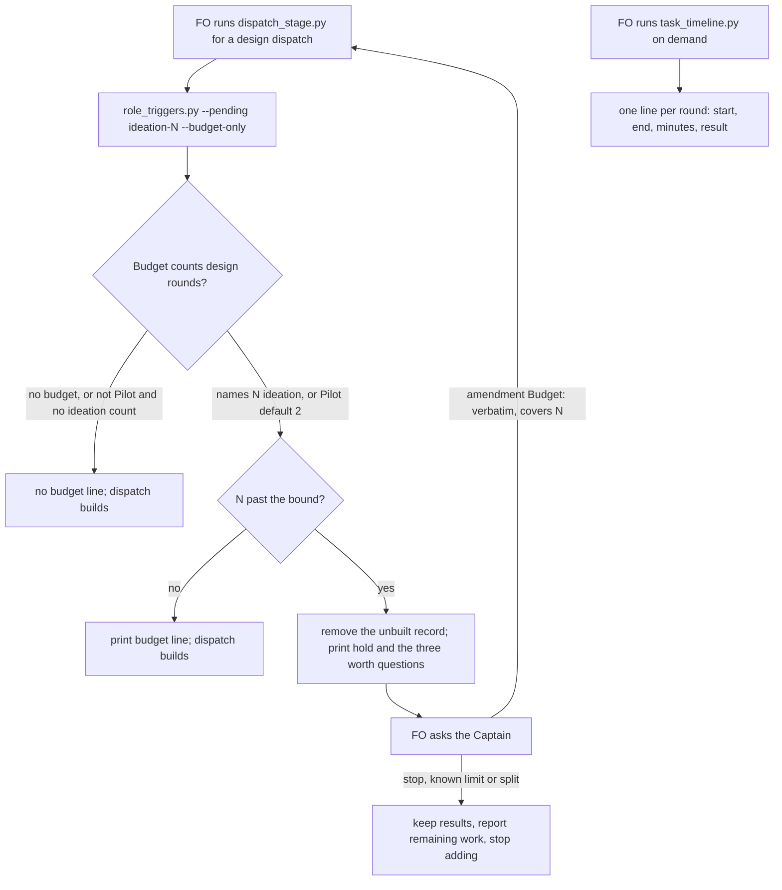

## Scope

- Source: the Captain 「分兩步（建議）」 (host question dialog, 2026-11-13), answering 「Pilot 試作的設計回來了，核准前要先定一件會改變範圍的事：試作輪數的預算要怎麼管？我建議分兩步。設計查到：現有的預算寫法（N implementation and M validation cycles）只會算實作和驗證，不會算設計階段的輪數；時間工具會算設計階段派了幾次、整個階段多久，但不會列出每一輪各自的起訖和結果。」; the chosen option read 「這張先用一句規則：試作一輪就是一次設計派工，第三次派工前我要停下來問你。另開一張小任務把預算寫法擴成「N ideation, N implementation and M validation cycles」由程式檢查，並讓時間工具列出每一輪。」 His earlier words (chat, 2026-11-13): 「可以，要同時加入預算與計時機制，我看目前你 X implementiation + Y valdiation cycle 方式還不錯」.
- What exists: the budget reader accepts three forms and counts implementation and validation records only; the timeline helper counts ideation dispatches and times a stage as a whole (ADR 0080); ADR 0077 names its own reopen condition for a bound the fixed forms cannot express. The design of pilot-ideation-runs-a-probe-before-the-design (decision D4) states the gap and holds the round cap in prose until this task lands.
- Outcome: a budget may bound ideation rounds in the same sentence as implementation and validation cycles, the script FO runs at each boundary holds the dispatch that would exceed it, and the timeline helper prints each round's start, end and result.
- Non-goals: counting minutes against a budget; changing the default when a budget is spent.

## Budget
1 implementation and 2 validation cycles, in one package PR.

## Stop condition
- A replayed task with three ideation dispatches is held at the third under a budget naming two, and the helper prints three rounds with their times. Return to the Captain if ADR 0077 or ADR 0080 must be superseded rather than extended.

## FO alignment

Alignment: not needed before ideation: his words choose the form; the grammar is ruled at the design gate.
Surfaces: none
Visible change: none
Release review: not needed: workflow maintenance, on no journey map.

## PRFAQ

**Proposition.** A Pilot budget can now say how many design rounds it allows, in the same sentence as the build and check cycles: `2 ideation, 1 implementation and 2 validation cycles`. The script FO already runs before every dispatch holds the design dispatch that would pass that number and asks the Captain the same three worth questions it asks at any overrun. A Pilot budget that names no design count allows two, so the "third design dispatch goes back to the Captain" rule from ADR 0084 is now enforced by the script instead of relying on FO to remember it. The timeline helper prints one line per round with its start, end, minutes and what closed it.

**FAQ.**
- *Does an existing budget change meaning?* No. `N cycles per stage`, `N implementation and M validation cycles` and the total-dispatch form still count what they counted (ADR 0077). Pilot output lines gain `ideation N of 2 by default`. Across all 247 tasks in this workflow, 23 outputs change in text, none in exit code, and no task is newly held (AC-6).
- *What does FO read more of?* At startup, 2 fewer words. At a Pilot design dispatch, 4 fewer words of stage definition and one 23-word budget line. At a build or check dispatch of a Pilot task, 6 more words. In the timeline, one line per round (see Words FO reads).
- *What does a round's "result" mean?* It means the gate outcomes closed inside that round (`approve`, `revise`, `withdrawn`, `hold`, several joined in order). If no gate closed, it is what came next: `redispatched`, `next <stage>`, `archived`, `gate open` or `running`. The stage report is not readable per round, so it is not used (D5).
- *Why not hold special-role calls at design dispatch too?* Today they are only checked at build and check dispatches. Turning the same check on at design dispatch would also start blocking design dispatches on an owed reviewer call. That is a separate change (D3).

## Design

### Worth questions

- **The form `N ideation, N implementation and M validation cycles`.** Captain words: 「另開一張小任務把預算寫法擴成「N ideation, N implementation and M validation cycles」由程式檢查」. Without it: the design round limit lives only in ADR 0084's prose; validation of PR 864 already showed prose-only rules being missed (the batch's bite). Premise that would make it unneeded: no task ever reaches a third design dispatch. Cheap test, run: 8 of 169 archived tasks have three or more design dispatch records (`timeline-*.txt`), so the premise is false.
- **The script hold at design dispatch.** Captain words: 「第三次派工前我要停下來問你」 and 「由程式檢查」. Without it: FO counts design rounds from memory. Premise: FO never misses the prose hold. Cheap test: none exists, because no round-capped task has reached a third round since 0.41.0. The premise is untested, and the Captain's words choose the script anyway.
- **One timeline line per round.** Captain words: 「並讓時間工具列出每一輪」. Without it: per-round times need hand reading of state commits (ADR 0084 consequence). Premise: the stage span is enough. Cheap test, run: in the 8 cases, rounds within one design stage range from 0 to 960.8 minutes, which a single span hides.
- **Pilot default of two (D2).** This serves 「試作一輪就是一次設計派工，第三次派工前我要停下來問你」 for tasks whose budget names no design count. Without it: the third-round hold stays prose for every existing Pilot budget. Premise: every new Pilot seed will name a design count. Cheap test, run: 0 of the live Pilot tasks' budgets name one today (only 1 backlog task's budget does, and it is a different shape), so the premise is false. The Captain keeps or cuts this part.

**Before new work (checked).** In Spacedock 0.27.3, ensign and first-officer references have only a context-size budget for reusing workers, with no cycle or round budget. kc-dev-flow-2 at origin/main 6a1eaf837 has the budget reader (`budget_bound`, `budget_status`, `budget_dispatches` in `role_triggers.py`; ADR 0077). It counts implementation and validation records only, and the total form already counts design records. `dispatch_stage.py` runs it only for implementation and validation. `task_timeline.py` (ADR 0080) times each stage as a whole and counts design dispatches; ADR 0084 D4 names both gaps. I found no sibling adopter mechanism and read none: the adopters consume this package's reader. In-force ADRs: 0077, 0080, 0084, 0026 (role events), 0020 (word budget). The change **extends** the existing reader, dispatch hook and helper. It replaces nothing and supersedes no ADR.

**Probe:** branch `poc/budget-form-counts-ideation-rounds-and-times-each-round` (local, never pushed), base `6a1eaf837` (origin/main with PR 864), last commit `de91166f0`. Portable copy: `evidence/ideation-1/probe.diff`. The worktree is removed and the branch kept.
- H1, riskiest: the new form can be added without changing any existing task's held/not-held result. **Held.** 247 tasks compared, base vs probe `role_triggers.py`: 0 exit-code changes, 23 text-only changes (`base-vs-probe.txt`).
- H2: the real dispatch path holds the design dispatch past the bound and builds nothing. **Held.** `test_dispatch_stage.py -k probe`, 4 passed (`probe-dispatch-tests.txt`).
- H3: a real three-design-dispatch task, replayed under a budget of two, is held at the third. **Held** (`replay-2.txt`, exit 1); bound three passes (`replay-3.txt`).
- H4: the timeline can give every round an end and a result from existing records. **Held, with a limit.** 191 design rounds over 169 archived tasks, 0 without end, round count equals dispatch count in all 146 design rows. 3 rounds in 2 tasks show 0.0 minutes because their records were committed late (`rounds-census.txt`).
- H5: turning on the check at design dispatch would also hold design dispatches on owed reviewer calls. **True.** The mutation without `--budget-only` fails the test with an engineering-reviewer hold (`mutation-no-budget-only.txt`), so design dispatch checks budget only (D3).
- H6: existing tests survive. **No, in text only.** The first probe printed a budget line at every design dispatch and broke 3 exact-stderr tests. The final probe prints at design dispatch only when the budget counts design rounds, which fixed those 3. Four tests remain whose expected text predates `ideation N of 2 by default` (2 in `test_role_triggers.py`, 2 in `test_dispatch_stage.py`). The design-check suite passes, 230 tests.

**Changes (from the probe, to rebuild with tests):**
- `role_triggers.py`: `budget_bound` accepts `N ideation, N implementation and M validation cycles` (digits or one to ten), giving `{ideation, implementation, validation}`. `budget_status(…, profile)` counts design records by highest plain record number like the other stages. A Pilot task whose countable bound names no design count gets `ideation: 2` (D2). `over` is computed per bound key, so a total cap and a design bound can both apply; the hold names the stage's newest record. New `--budget-only` flag: exit and output carry the budget alone.
- `dispatch_stage.py`: runs that check for `ideation` too, with `--budget-only`, and forwards the `budget:` line as it already does.
- `task_timeline.py`: each stage row gains `rounds` (round, start, end, minutes, result); the text view prints one line per round.
- `design_surfaces.py`: the seed Budget error message lists the new form (the acceptance itself already comes from `budget_bound`).
- `references/sd/workflow.md`: the forms list reads `` `[N ideation, ]N implementation and M validation cycles` `` (+2 words). The Pilot sentence "A probe round is one ideation dispatch; FO holds a third for the Captain." becomes "A probe round is one ideation dispatch, two by default." (−4 words).
- `lint-skills.py`: a −2 step (6099 → 6097). It is a cut, so it needs no Captain raise.
- Tests: the four probe tests become real tests. Four expected strings gain `ideation N of 2 by default`. New `test_task_timeline.py` cases cover round lines and joined outcomes, and new `test_role_triggers.py` cases cover the grammar (words, digits, rejection of `one ideation cycle per stage`).
- New ADR (no number; FO reserves it): "A budget may bound ideation rounds and the timeline prints each round". It extends 0077 with the form and design counting, makes 0084 D4's hold script-enforced (amending 0084's consequence "The round hold … are instructions, not script enforcement" for the hold only), and extends 0080 with per-round lines. Nothing is superseded, so the Stop condition's return clause does not fire.

**Deleted or shortened:** 7 workflow words ("FO holds a third for the Captain") are replaced by 3, with +2 for the form: −2 net. 4 words leave the Pilot design stage definition (402 → 398). The hand-written D4 round-count note that FO puts in Pilot design dispatches is no longer needed: the script prints the count.

**Words FO reads at each moment** (lint's word counter `normalized_words`, base origin/main vs probe; `words.py` in evidence):

| Moment | Base | Probe | Change |
| --- | --- | --- | --- |
| Startup and resume (workflow.md) | 6099 | 6097 | −2 |
| Pilot design dispatch: stage definition | 402 | 398 | −4 |
| Pilot design dispatch: script output | 0 | 23 (one `budget:` line; 0 when no budget) | +23 |
| Design dispatch held | 0 (prose rule) | the existing ADR 0077 hold text | same text as a build/check hold |
| Pilot build or check dispatch: budget line | n | n + 6 (`ideation N of 2 by default,`) | +6 |
| Timeline, on demand, 3-round task | 202 | 263 | +61 |
| Timeline, on demand, 13-round task | 178 | 303 | +125 |

Startup falls. Reading rises at the moments where this task adds a count the Captain asked to see. Under D2's alternative (no default), the Pilot build/check line stays at base and the dispatch line appears only for tasks that name a design count.

### Decisions for the Captain

- **D1. The form is his words exactly: `N ideation, N implementation and M validation cycles`.** `N cycles per stage` and the total form keep their meaning. Recommended: yes. *Worse:* a budget writer who wants "two of everything" must spell out three numbers. The one live backlog budget that already reads `One ideation, one implementation and one validation cycle` becomes counted, and that task is held at its second design dispatch.
- **D2. A Pilot budget that names no design count allows two, enforced by the script, and the prose hold sentence goes.** Recommended: yes. This is what makes 「第三次派工前我要停下來問你」 checked for every Pilot task, and it cuts 2 workflow words. *Worse:* an implicit bound not visible in the Budget line, though it is shown as `of 2 by default` in every Pilot budget line (+6 words per build/check dispatch). Prod and tasks with no countable budget get no design hold. The alternative keeps the prose sentence as the fallback (+2 words, a lint raise for you) and leaves old-form Pilot tasks unchecked.
- **D3. Design dispatch checks the budget only, not owed chief-engineer or engineering-reviewer calls.** Recommended: yes, because the probe showed the full check would newly block design dispatches on an owed reviewer call, which nobody asked for. *Worse:* an owed call raised by an amendment before implementation is still first surfaced at the implementation dispatch, as today.
- **D4. One new ADR extends 0077, 0080 and 0084 (amending only 0084's "instructions, not script enforcement" consequence for the hold).** Recommended: yes. It is an extension, not a supersede, so it does not need the Stop condition's return. *Worse:* four ADRs to read for budgets instead of one rewritten one.
- **D5. A round's result is the gate outcomes closed in it, else what came next.** The stage report is not used. Recommended: yes, because records supply this for all 191 archived design rounds. *Worse:* a round that a worker failed reads `redispatched`, the same as a deliberate repeat; late-committed records show 0.0 minutes (3 of 191).

## Acceptance criteria

Commands use `PKG` = the candidate's `kc-dev-flow-2/scripts`, `STATE` = this workflow's state checkout, `EV` = this task's `evidence/ideation-1`, and `SPACEDOCK_BIN` = a Spacedock 0.27.x binary. Each record names the probe run (branch `poc/budget-form-counts-ideation-rounds-and-times-each-round` @ `de91166f0`, base `6a1eaf837`, 2026-11-13).

**AC-1** `budget_bound` reads `N ideation, N implementation and M validation cycles` (digits or words, trailing prose allowed) as three bounds, and each existing form returns what it returned on origin/main. Evidence: `$EV/replay.sh $PKG <scratch> merge-ask-holds-missing-clauses "<budget>" <n>` for the six cases in `replay-1..6.txt` (the scratch is a fresh clone of the state checkout at `<scratch>/replay`), plus `test_role_triggers.py` grammar cases. Falsifier: removing the new pattern makes `replay-2.txt` exit 0. Record: command as stated; exits 0, 1, 0, 0, 1, 1; output `evidence/ideation-1/replay-1.txt` … `replay-6.txt`.

**AC-2** `dispatch_stage.py --stage ideation` holds the design dispatch past the bound: exit 1, "budget exceeded; hold for the Captain", the unbuilt record removed, Spacedock build not run. Below the bound it prints one `budget:` line and builds. Evidence: `SPACEDOCK_BIN=… python3 -B -m pytest -q $PKG/test_dispatch_stage.py -k probe` (renamed to final test names in implementation). Falsifier: dropping `ideation` from the stage tuple in `dispatch_stage.py` fails `test_probe_ideation_bound_holds_the_dispatch_past_it`. Record: exit 0, 4 passed; output `evidence/ideation-1/probe-dispatch-tests.txt`.

**AC-3** Stop condition: a real archived task with three design dispatches, replayed under `2 ideation, 1 implementation and 2 validation cycles`, is held at the third, and `task_timeline.py` prints three rounds with times for it. Evidence: `replay.sh … merge-ask-holds-missing-clauses "2 ideation, 1 implementation and 2 validation cycles" 3`, then `python3 -B $PKG/task_timeline.py $STATE merge-ask-holds-missing-clauses`. Falsifier: the same budget with `3 ideation` exits 0 (`replay-3.txt`). Record: exit 1, `evidence/ideation-1/replay-2.txt`; exit 0, `evidence/ideation-1/timeline-merge-ask-holds-missing-clauses.txt` (rounds 1–3: 43.6, 562.2, 97.0 min; withdrawn, revise, approve).

**AC-4** A Pilot task whose countable budget names no design count is held at its third design dispatch and not at its second; a Prod task is not held. Evidence: `replay-4.txt` and `replay-5.txt`, plus `test_probe_pilot_default_holds_the_third_ideation`. Falsifier: removing the Pilot default makes `replay-5.txt` exit 0. Record: exits 0 and 1, `evidence/ideation-1/replay-4.txt`, `replay-5.txt`; test in `probe-dispatch-tests.txt`, exit 0.

**AC-5** A design dispatch is not held by an owed special-role call. Evidence: `test_probe_ideation_ignores_owed_special_roles`. Falsifier: running the design check without `--budget-only` fails it with an engineering-reviewer hold. Record: test exit 0 in `probe-dispatch-tests.txt`; mutation exit 1, `evidence/ideation-1/mutation-no-budget-only.txt`.

**AC-6** No existing task's held/not-held result changes. Evidence: a loop over every task in `$STATE` running base and candidate `role_triggers.py` and comparing output and exit. Falsifier: any task whose exit differs. Record: exit 0; 247 compared, 23 differ in text only (`of 2 by default` or the newly counted form), 0 in exit; `evidence/ideation-1/base-vs-probe.txt`.

**AC-7** Every design round of every archived task has a start, an end and a result, and the round count equals the stage's dispatch count. Evidence: `python3 -B $EV/rounds_census.py $PKG $STATE`. Falsifier: any row with a round count different from its dispatch count, or a round without end. Record: exit 0; 191 design rounds, 0 mismatches, 0 without end, 3 zero-minute; `evidence/ideation-1/rounds-census.txt`; 8 per-task prints `evidence/ideation-1/timeline-<task>.txt`.

**AC-8** The workflow is 6097 words and lint passes with the −2 step. Evidence: `python3 -B kc-dev-flow-2/scripts/lint-skills.py`. Falsifier: restoring the prose hold sentence fails lint (6101 vs 6097). Record: exit 0, `evidence/ideation-1/lint.txt` ("6097 of 6097 words").

**AC-9** The four existing tests whose expected budget text lacks `ideation N of 2 by default` are updated, and the role, dispatch, timeline and design-check suites pass. Evidence: `SPACEDOCK_BIN=… python3 -B -m pytest -q $PKG/test_role_triggers.py $PKG/test_dispatch_stage.py $PKG/test_task_timeline.py $PKG/test_design_surfaces.py`. Falsifier: reverting the Pilot default turns `test_probe_pilot_default_holds_the_third_ideation` red. Record (probe, before updates): `test_role_triggers.py` exit 1, 2 failed / 61 passed, `evidence/ideation-1/suite-role-triggers.txt`; `test_dispatch_stage.py test_task_timeline.py` exit 1, 2 failed / 67 passed, `evidence/ideation-1/suite-dispatch-timeline.txt`; `test_design_surfaces.py` exit 0, 230 passed, `evidence/ideation-1/suite-design-surfaces.txt`.

**AC-10** The new ADR passes the ADR linter with its reserved number and names `role_triggers.py`, `dispatch_stage.py` and `task_timeline.py` under Protects. Evidence: `python3 -B kc-dev-flow-2/scripts/adr_lint.py <ADR file>`. Falsifier: a missing pointer comment in a protected file fails it.

### Not provable now

- AC-9 green: needs the four expected-text updates and the new timeline and grammar tests, which are implementation work.
- AC-10: no ADR is drafted in the probe and no number is reserved; owed to implementation.
- A live third design dispatch of a real Pilot task being held through a released package: owed after release. The probe proves the replay and the real `dispatch_stage.py` path in fixtures only.

### Batch overlap

Files this design would change: `kc-dev-flow-2/scripts/role_triggers.py`, `dispatch_stage.py`, `task_timeline.py`, `design_surfaces.py` (the Budget error message only), `lint-skills.py` (`WORKFLOW_BUDGET_STEPS`), `references/sd/workflow.md` (the forms list in New seeds and the Pilot ideation sentence), the tests `test_role_triggers.py`, `test_dispatch_stage.py`, `test_task_timeline.py`, and one new `docs/adr/` file.

- design-check-reads-each-pilot-criterion-for-its-proof-record (this batch, ideation): shares `design_surfaces.py` (a different function: criterion records vs the Budget message), `test_design_surfaces.py` fixtures, `lint-skills.py` budget steps, the Pilot paragraph of `workflow.md`, and the ADR number sequence.
- captain-question-outside-a-gate-is-an-open-record (backlog): `task_timeline.py`, since its scope extends the `asks.jsonl` path the helper reads.
- agent-messages-are-english (backlog): `workflow.md` and its word budget.
- merge-ask-is-produced-from-records, validator-commands-fit-the-delivery-check, ready-pr-gets-a-codex-code-review-without-fo-noticing, evidence-is-declared-public-before-state-publication (backlog): no shared file found in their task text.
- adr-required-statement (validation), comment-check-reaches-delivery-gate and adoption-asks-which-extensions (ideation), all other sessions: `workflow.md`, `lint-skills.py` budget steps, `design_surfaces.py`; adr-required-statement also shares the ADR list.
- adr-silent-undo-probe, journey-canvas-hosted-poc (ideation): mention `design_surfaces.py` only; no shared change found. ops-inbox-r1-setup-and-isolation, pr-review-lite-value-pilot (implementation): their own budgets only, no shared package file found. journey-server-host-pilot: no task file in this state checkout; not checked.

Recommended order: land this task after design-check-reads-each-pilot-criterion-for-its-proof-record. Both add a `WORKFLOW_BUDGET_STEPS` entry and edit the Pilot ideation paragraph, so the second rebases one lint step and one sentence. Merge them serially, not in parallel, as the Captain's backlog approval stated. Rebase after adr-required-statement if it merges first.

## Number guards

ADR: 0085

## Stage Report: ideation

- DONE: Run this ideation probe-first, as the text merged on origin/main by PR 864 (ADR 0084, not yet released) asks: before writing the design, build a throwaway probe of this task's outcome on the local branch poc/budget-form-counts-ideation-rounds-and-times-each-round from origin/main, run it on the real cases the task's Scope and Stop condition name, and save what it showed in the task folder; then write the design as what the probe showed and what it lacks. Under a Probe: line in the design record the branch, base and last commit and each hypothesis with its result; remove the probe worktree before reporting and keep the branch. Every criterion's evidence command runs once on it, recording command, exit and output path per criterion, provenance included; what cannot run goes under Not provable now with the criterion named. Design against origin/main, which already carries PR 864. State what the change deletes or shortens with word counts; if the workflow text must grow past its lint budget, name the raise for the Captain as an unresolved decision instead of assuming it
  Probe: branch kept at de91166f0 on base 6a1eaf837, worktree removed, `probe.diff` saved. Six hypotheses with results are in Design. AC-1 to AC-9 carry a command, exit and output path; AC-9's green run and AC-10 are under Not provable now. The workflow shrinks 6099 → 6097 (a −2 cut, so no raise is needed). The branch got upstream `origin/main` from `worktree add -b`; it was never pushed and has no remote branch.
- DONE: A `### Batch overlap` section naming each file the design would change and each other batch task (design-check-reads-each-pilot-criterion-for-its-proof-record, budget-form-counts-ideation-rounds-and-times-each-round (the two tasks of this batch); in backlog and not dispatched: merge-ask-is-produced-from-records, validator-commands-fit-the-delivery-check, ready-pr-gets-a-codex-code-review-without-fo-noticing, evidence-is-declared-public-before-state-publication, agent-messages-are-english, captain-question-outside-a-gate-is-an-open-record) and live task of other sessions (adoption-asks-which-extensions, adr-required-statement, adr-silent-undo-probe, comment-check-reaches-delivery-gate, journey-canvas-hosted-poc, journey-server-host-pilot, ops-inbox-r1-setup-and-isolation, pr-review-lite-value-pilot (driven by other sessions; read only)) that changes the same file or check, so FO can order implementation
  `### Batch overlap` lists 9 files plus the ADR list, and each named task. The real overlaps are the sibling (design_surfaces, lint step, Pilot paragraph), captain-question… (task_timeline.py) and three other sessions' tasks (workflow.md and lint). Recommended order: after the sibling, serially. journey-server-host-pilot has no task file here.
- DONE: The words FO reads at each lifecycle moment, before and after, per root learning.md "Measure the words FO reads at each moment, not one file's size"
  Table in Design, counted with lint's `normalized_words`: startup 6099→6097, Pilot design stage definition 402→398, design dispatch output 0→23, Pilot build/check budget line +6, timeline +61 (3 rounds) / +125 (13 rounds).
- DONE: Acceptance criteria with reproducible evidence clauses and falsifiers, and unresolved decisions for the Captain, each with a recommendation and what gets worse under it
  AC-1 to AC-10, each with a falsifier. AC-1: replay exits 0/1/0/0/1/1. AC-2: 4 probe tests pass. AC-3: the replay is held (exit 1) and the timeline prints 3 rounds. AC-4: the Pilot default holds at the third, not the second. AC-5: the mutation fails (exit 1). AC-6: 247 tasks, 0 exit changes. AC-7: 191 rounds, 0 mismatches. AC-8: lint exits 0. AC-9: 4 expected-text failures, owed to implementation. AC-10: owed. Decisions D1 to D5 each give a recommendation and what gets worse.

### Summary

The probe extended the existing budget reader instead of adding a mechanism. The Captain's form `N ideation, N implementation and M validation cycles` now counts design dispatches. `dispatch_stage.py` checks the budget alone at design dispatch, and a Pilot budget naming no design count allows two, which turns ADR 0084's prose hold into a script hold. `task_timeline.py` prints one line per round. A real three-design-dispatch task replayed under a budget of two is held at the third. Across 247 tasks, no held/not-held result changes. Nothing is superseded: one new ADR extends 0077, 0080 and 0084. `design_surfaces.py check` is presentable on the installed 0.41.0 package and on the probe. The scratch close removed 210656107 bytes and kept 27 evidence files (60.0 KiB). Redone after the session closed mid-run: the killed suite and all-task comparison were rerun; nothing else was lost.

## Stage Report: implementation

- DONE: Build the approved design and acceptance criteria, decisions D1 to D5, within the named files and Budget.
  Branch spacedock-ensign/budget-form-counts-ideation-rounds-and-times-each-round; fetched base bfc53d82510006b52baf41569c1e25176e99d87a; candidate 2661da44a77c2b2f93991a3968fb1515bb4e7132; 10 named files, no version bump. Exact hashes: evidence/implementation-1/provenance.json.
- DONE: Start from the local probe and delete its branch after committing the candidate.
  Probe de91166f055129f6a589594c25d70be68124551d was carried and strengthened; no probe worktree was registered. Local branch poc/budget-form-counts-ideation-rounds-and-times-each-round deleted after candidate commit; final-candidate-check.txt verifies absence and clean code tree.
- DONE: ADR 0085 records the ruling, quoting the task and ideation gate, extending 0077, 0080 and 0084.
  New docs/adr/0085-a-budget-may-bound-ideation-rounds-and-the-timeline-prints-each-round.md protects role_triggers.py, dispatch_stage.py and task_timeline.py; candidate-adr.txt exits 0; removing one pointer fails verified-mutation-ac10-no-pointer.txt.
- DONE: AC-1 — new grammar and unchanged existing forms.
  replay-1..6.txt exits 0/1/0/0/1/1; suite-role-final.txt passes 63 tests. Removing the new pattern fails the grammar test and permits the third replayed dispatch (replay-mutant-no-grammar.txt exit 0 instead of 1).
- DONE: AC-2 — design dispatch holds above its bound, removes the unbuilt record and never builds it; below-bound dispatch prints and builds.
  suite-dispatch.txt passes the real Spacedock path; verified-mutation-ac2-no-ideation-hook.txt fails when ideation is removed from the hook; mutation-harness-control.txt passes before mutations.
- DONE: AC-3 — real three-design-dispatch replay and per-round times/results.
  replay-2.txt exits 1 at bound two; replay-3.txt exits 0 at bound three. timeline-replay.txt prints 43.6/562.2/97.0 minutes and withdrawn/revise/approve; removing round printing fails verified-mutation-ac3-no-round-print.txt.
- DONE: AC-4 — Pilot default two holds third but not second; Prod has no implicit hold.
  replay-4/5.txt exits 0/1 and the real dispatch test passes for both profiles; removing the default fails verified-mutation-ac4-no-default.txt and wrongly permits the third replay (replay-mutant-no-default.txt).
- DONE: AC-5 — design dispatch checks budget alone.
  test_ideation_ignores_owed_special_roles passes in suite-dispatch.txt; omitting --budget-only fails with an owed engineering-reviewer call in verified-mutation-ac5-full-role-check.txt.
- DONE: AC-6 — no existing task's held/not-held result changes.
  Frozen state c1993d8dc30ec22aeac688a3d4a116a8402acabf: 249 tasks, 24 text changes, 0 exit changes (base-comparison.txt). A mutation that holds admitted budgets changes 15 exits and fails the comparator.
- DONE: AC-7 — every archived design round has times/result and matches its dispatch count.
  rounds-census-asserted.txt: 170 archived tasks, 192 ideation rounds, 0 count mismatches, 0 missing ends, 3 late-committed zero-minute rounds. Dropping rounds causes 144 mismatches and fails verified-mutation-ac7-no-rounds.txt.
- DONE: AC-8 — workflow cut and repository CI lint.
  candidate-lint.txt exits 0 at 6097/6097 words, a -2 step from 6099. Positive mutation-lint-control.txt passes; restoring the prose hold fails solely at 6101 vs 6097 (final-mutation-ac8-prose-hold.txt).
- DONE: AC-9 — four stale test methods updated and all four required suites pass.
  Role 63, dispatch 56, timeline 13, design 234 tests: 366 run, 4 existing optional historical-corpus skips; tests.json and suite-*.txt. FO replaced pytest convenience commands with CI's unittest form. Removing the default fails verified-mutation-ac9-no-default.txt.
- DONE: AC-10 and every named falsifier run cold with python3 -B and copied caches removed.
  acceptance.json records commands, exits and output paths per criterion; mutations.json records 10 accepted mutation failures. README.md preserves and explains invalid initial harness runs and their passing controls.
- DONE: Required number guards, comment maximum, affected documents and existing-code audit.
  number-guards-configured.txt exits 0 with workflow configuration and a permitted state fetch; comments.txt: 117 code/3 comment lines, 2.6% <= 5%. document-dispositions.json gives updated/unaffected reasons for all 18 doc_impact.py entries. Approved design's upstream audit reused; current base, sibling ownership and callers refreshed; existing mechanisms extended.
- DONE: Reading moments, sibling overlap and PR text prepared.
  word-counts-final.txt separates whitespace lint words (-2), normalized startup words (-2), design stage (-4), dispatch output (+23 design/+6 build/check) and on-demand timeline growth. Preserve the -2 step when merging sibling workflow edits; origin/main was still bfc53d825 on the final fetch. implementation/pr.md has the scoped Conventional Commit title and body.
- DONE: Public evidence retained and dispatch scratch closed.
  evidence/implementation-1/ contains reproducible scripts, exact candidate hashes, commands, controls and output; fixture-cleanup.json lists only owned synthetic leftovers removed. scratch close output is evidence/implementation-1/scratch-close.txt; scratch-removed.txt records removal.
- SKIPPED: Product push, Draft PR creation, RoboRev and hosted CI.
  FO owns these steps under the dispatch's explicit delivery override; no PR opened: no push grant. CI cost per PR not measured; CI files unchanged. Released live third-dispatch behavior remains Not provable now.

### Summary

Implemented the accepted five decisions on the current fetched main and committed only the ten approved product paths; the exact candidate is recorded in provenance.json and the PR text is ready for FO. All ten criteria have current command/exit/output evidence and falsifiers; publication, independent review, hosted CI and release behavior remain outside this worker's completed implementation. Profile: Pilot; no production obligation, version bump, product push or PR action.
