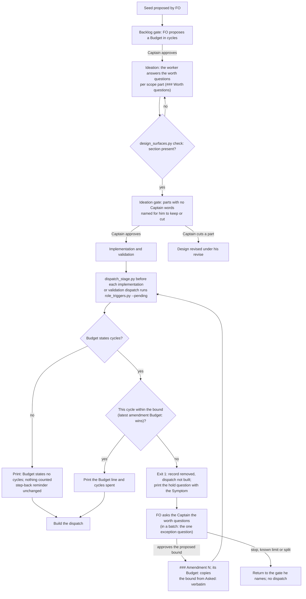

## Scope

- Source: a peer report from the subspace-relay dev2 FO (Paseo 1671c3a9, 2026-11-11), also filed by it as iamcxa/kc-claude-plugins issue #837 (open; `gh issue view 837`, FO run 2026-11-11). The report is data. It relays that the Captain wanted it sent to this FO; that relay is not a ruling here.
- Selected for batch 21: the Captain chose 「放 1 到 5（建議）」 (host question dialog, 2026-11-11), answering 「第 21 批要放哪幾張？我建議放清單的 1 到 5：故事做完回報切片進度、發版後鋪開到採用 repo 與法規檢查、超預算要停與重大發現先對照不做清單、狀態提交自動推送與派工單矛盾、拒絕一個指令不等於全停。選完後我只為被選中的建任務檔，再一次請你過待辦關卡；選進來不代表接受任何設計。」.
- Bite (the relay FO's report, not re-run here): relay task comment-sent-when-added-relay (PR #491), `Budget: one cycle per stage`, ran six implementation cycles from 2026-11-09 to 2026-11-11. Its Non-goals gave reload protection to a neighbouring Web task; validation 1 raised a Material finding about that; it was routed as a repair, which built a persistence and recovery mechanism, and each later cycle repaired a state the previous one made reachable. Against the fork point it reports 2032 lines added in 19 files, about 30 of them server product code. The first check that held was the four-repair-pass trigger.
- Package fact (the relay FO's reading of 0.38.0, to be confirmed in ideation): `references/sd/workflow.md` requires `Non-goals:`, `Budget:` and `Stop condition:` on a seed and no step reads `Budget:` again; `scripts/role_triggers.py` owes chief-engineer at four repair passes and prints step-back questions without a hold; a Material finding blocks in every round with no test of whether the task owns the behaviour.
- Suggested direction (relay FO, not a ruling): hold at the first overrun of `Budget:` until a Captain amendment with an `Override:` exists; before a Material finding starts a repair, test it against Scope and Non-goals, and if outside allow only a recorded known limit, a backlog task or a Captain scope amendment.
- Not established (relay FO): one task is the evidence; the noise of holding at every first overrun was not measured.
- Non-goals: changing relay's task; a budget unit other than what seeds already write.

## Budget
- One package PR to the workflow reference and the script that reads a task's cycles, with tests.

## Stop condition
- A replay of the relay task's recorded history holds at its second implementation dispatch and routes validation 1's finding to a scope decision, and a replay over archived tasks of this workflow shows how many would have held; or the design shows why not and says what was learned.

## FO alignment

Alignment: needed at ideation; when an overrun holds and who may rule a finding out of scope are the Captain's call.
Result: the Captain chose 「重寫，並把兩張原則任務拉進這批」 (host question dialog, 2026-11-11), answering 「預算這張任務要不要改題目？我建議改：把題目從「超過預算就停、範圍外的發現不修」改成「任務的預算是你願意花多少的一句話，用數得出來的單位寫、每次派工看得到已花多少、超過時把原本的問題帶回給你；重大發現先回答是不是這張任務要的結果」，讓設計從這個問法開始。這是修改你已核准的任務範圍，會記成一筆你的修正案。」. Before it he asked 「這個問題跟退一步想是不是有異曲同工之妙？疊在一起再想一次有沒有改變建議」, 「所以問題在於預算怎麼設計，對嗎？暫時不裁決，先看目前怎麼做的？」 and 「先針對預算是什麼想一下，因為它可能會改變怎麼解決問題，而這件事剛好對應到最近回饋產生的問題，對嗎？一開始的問題問錯了，後面的解法就不對，就會造成目標膨脹，進一步守不住關卡」 (chat with this FO, 2026-11-11).
Reviewer: kc-dev-flow-2:engineering-reviewer not run 2026-11-11: amendment 4 corrects AC-7 to the stage the approved decision D3 and the design text already name, and allows expected-text updates in two test files; it withdraws nothing the Captain approved.
Reviewer: kc-dev-flow-2:chief-engineer gpt-6-astra 2026-11-11 — what is the smallest next step, given the findings so far? Advice: review/chief-engineer-1.md (recommendation proceed: hand head 6da9a765e to a new independent validation).
Surfaces: none
Visible change: none
Release review: not needed: workflow maintenance, on no journey map.

## Captain amendments

### Amendment 1 — 2026-11-11, host question dialog
Captain: 「重寫，並把兩張原則任務拉進這批」 (host question dialog, 2026-11-11)
Asked: 「預算這張任務要不要改題目？我建議改：把題目從「超過預算就停、範圍外的發現不修」改成「任務的預算是你願意花多少的一句話，用數得出來的單位寫、每次派工看得到已花多少、超過時把原本的問題帶回給你；重大發現先回答是不是這張任務要的結果」，讓設計從這個問法開始。這是修改你已核准的任務範圍，會記成一筆你的修正案。」
Supersedes: none

### Amendment 2 — 2026-11-11, host question dialog
Captain: 「前兩張合併，查現成做法獨立（建議）」 (host question dialog, 2026-11-11)
Asked: 「預算、第一性原理、先查現成做法這三張任務要怎麼合併？我建議：預算和第一性原理合成一張（同一組「是不是你要的、值不值得」的問題，在任務進來、超預算、出現重大發現這幾個時機問），「先查現成做法」維持獨立。合併會記成預算那張的第二筆修正案，第一性原理那張留在待辦並註明已併入。」
Supersedes: none

### Amendment 3 — 2026-11-11, host question dialog
Captain: 「加總次數和停止句，分鐘另談（建議）」 (host question dialog, 2026-11-11); before it he asked 「現在預算會長得像這樣，對嗎？『240 累計代理分鐘、最多 5 次派工，含一輪修正。並行代理各自計入，人工與平台等待另記；任一上限到達，就保留成果、回報剩餘工作並停止加碼。』」 (host question dialog, 2026-11-11)
Asked: 「預算的寫法要不要照你的例子擴大？目前核准的設計只認「每階段幾輪」兩種寫法，實作工人已在做。我建議：這一張先加上「派工總次數上限」這種寫法，並把「到上限就保留成果、回報剩餘工作並停止加碼」當成停下來時的預設結果；「累計代理分鐘」因為現在沒有可靠的時間來源，另外記成一張要先查證的任務，不塞進這張。」
Supersedes: none

### Amendment 4 — 2026-11-11, host question dialog
Captain: 「兩處都同意（建議）」 (host question dialog, 2026-11-11)
Asked: 「「預算」這張任務的實作停在兩處等更正，要不要都同意？一、第七項驗收條件把三個值不值得的問題寫成放進「待辦關卡」，更正為你核准的「設計關卡」，待辦關卡只呈現預算。二、允許多改兩個設計沒列的測試檔（pr_watch 和 delivery_gate 的測試），只更新 4 處還在比對舊版退一步提醒文字的預期值，產品程式不動。我建議兩處都同意。」
Supersedes: AC-7
Superseded text:
**AC-7** workflow.md states the two countable forms, the hold, the amendment `Budget:` line and the worth answers in backlog Gate content. `lint-skills.py` exits 0 with one `WORKFLOW_BUDGET_STEPS` raise carrying the Captain's quoted ruling and its loaded moments. The words-per-moment table is recounted at the candidate by an independent copy of the count. Evidence: the lint output and the recount. Falsifier: a README count off the budget.

### Amendment 5 — 2026-11-11, host question dialog
Captain: 「只算修正的訊息（建議）」 (host question dialog, 2026-11-11)
Asked: 「預算的「派工總次數上限」裡，我在同一個階段追加給工人的訊息要怎麼算？我建議：只有要工人回去修東西的訊息（紀錄上有寫問題名稱的）算一次派工，回答工人提問或轉達你裁示的訊息不算。以「發版鋪開」為例，這樣是 7 次；每則都算是 11 次，都不算是 2 次。」
Supersedes: none

### Amendment 6 — 2026-11-11, host question dialog
Captain: 「給這條許可（建議）」 (host question dialog, 2026-11-11)
Asked: 「「預算」這張任務第三次碰到設計沒列的測試檔，要不要一次給一條許可？我建議給：這張任務的實作可以更新測試裡只因為這次核准的規則改變而過時的範例資料與預期文字，但所有反例和斷言都要保留、產品程式不因此多改，而且每動一個這樣的檔案都要在報告裡列出，由獨立驗證逐一檢查。」
Supersedes: none

### Feedback Cycles

- Cycle 1 (FO, 2026-11-11): validation-1 on #841 head 5bf7cf78 recommended REJECTED with two findings, both assessed Material and owned (value-ac[AC-9]: a design with no Worth questions section is refused; evidence budget-overrun-holds-and-findings-meet-non-goals/validation-1/findings.json, the validator's runs, not re-run by FO), to fix in one repair pass, then a fresh validation recheck.
  - F1: `status: ideation # comment` in frontmatter reads as stage unknown in design_surfaces.py, so the check exits 0 on a design with no Worth questions section, where Spacedock's own reader reports ideation.
  - F2: a `### Worth questions` heading inside an HTML comment satisfies the section check.

## Design

### PRFAQ

**A task's budget now says how many worker cycles the Captain will pay for. Each dispatch shows what is spent, and the first cycle past it comes back to him as his original question.** FO proposes the Budget in cycles at the backlog gate. Before every implementation or validation dispatch, the dispatch script prints the Budget beside the cycles spent. When the next cycle would pass the bound, the script holds, and FO asks the Captain three worth questions: which of his words the cycle serves, what breaks without it, and which premise would make the task unneeded. The ideation design answers the same three questions for each part of the scope.

- **Who uses this?** The Captain, who sets the bound and rules at a hold. FO, which proposes the bound and asks at a hold. The ideation worker, who answers the worth questions in the design.
- **What stops?** The dispatch past the bound, until an amendment records his new bound. If he chooses to stop, record a known limit or split the task, no dispatch follows.
- **What does not change?** Budgets written in another form are printed and never held. Tasks started before the release are never held. The Material-finding rule and every chief-engineer and engineering-reviewer event stay as they are.
- **What goes away?** The advisory step-back reminder, for tasks whose Budget counts cycles.

### What a budget is for, and what the record shows

A budget is the Captain's statement of how much the outcome is worth to him. It is useful only if it is counted in the unit that runs away, shown as it is spent, and sends the original question back to him when it is passed (amendment 1). Survey of the `Budget:` lines as they stand, with the first line under `## Budget` or a `Budget:` line read per task (`ideation-1/budget_lines.py`, `ideation-1/counts.txt`; state branches pinned: this workflow `e5efef4e`, qnow `d80c162d`, subspace-relay `13ef3567`, subspace-web `faf28a25`, all `origin/spacedock-state/dev2`, read 2026-11-11):

- This workflow: 109 tasks have a Budget; 98 say "One package PR" plus a word-budget clause. That is a bound on the shape of the delivery, and it is never passed: fo-lifecycle-mod was one PR and 16 implementation dispatches. None of the 60 tasks with stage dispatch records has a Budget that states a number of cycles.
- subspace-relay: "one cycle per stage" on 51 of 68 tasks. Six more say "half a day" and four "one day" of worker time, all marked FO-proposed. web and qnow write per-stage rounds or passes ("one ideation, one implementation, one validation round"; "one ideation pass and one implementation pass in one PR. This is FO's proposal").
- What ran away is cycles, meaning worker dispatches. Where a Budget states cycles, the dispatch records exceed it often: at the first implementation or validation overrun, qnow 7 of 7, relay 11 of 23 and web 5 of 20 (`ideation-1/overrun_holds.py`). Most of these Budget lines are a template for the happy path that FO proposed and the Captain approved in a batch. They do not state what the outcome is worth to him.
- Dispatch records `<task>/dispatch/<stage>-<n>.md` count cycles exactly (written by `dispatch_stage.py` since #812). Lines of code (relay: 2032 added, about 30 of them server product code, by the relay FO's count, not re-run here) and days are not recorded per dispatch.

Cheapest step that would have made the relay task's overrun visible: print the `Budget:` line next to the cycle number at each dispatch. Relay's implementation-2 record was committed at `42317d0c` (2026-11-10T14:45+08:00) against "One cycle per stage." The package's own checks fired later. `role_triggers.py` 0.38.1, replayed over the relay history with `--rev` at each commit (`ideation-1/relay-role-triggers-replay.txt`), owes a chief-engineer call first at `d85ce152` (22:07, 4 repair passes, after implementation-5) and prints the step-back reminder at `45902a30` (23:15, two validations with a Material finding). The Captain was first asked at implementation-6. So the budget line went unread for four cycles.

### Where the Material findings came from (relay replay)

The relay FO reported that the Material finding in validation-1 started a repair, and that the repair built persistence and recovery. The record shows that the recovery was built earlier:

- Relay-side reload recovery (the held-record "save before transport ... on reload an uncertain transport is shown unsent") entered the ideation design at `3f323f6c` (2026-11-09 18:32 +08:00).
- It is part of AC-3, AC-4 and AC-8, which the Captain approved at the ideation gate at 20:11 with 「准」. The question he answered was 「按「新增」就送出一則、成功才算送出、失敗或被拒時文字保留；上限維持…」, which does not mention restoring after a reload.
- `restoredSends` first appears in the implementation-1 report (`499cf740`), before validation-1.

All five Material findings name an accepted criterion or a worker-written contract as the protected boundary: v1 F1 (AC-8, AC-11), v1 F2 (AC-11), v1 F5 (AC-11), v2 F1 (`web-contract.md` H11), v2 F2 (AC-8, AC-11). So the existing rule, under which out-of-scope Material holds as Needs decision (workflow.md § FO steps: review findings), found every one of them owned. That reading was correct, because the criteria owned them.

Measured against the backlog Scope as the Captain approved it, three of the five (v1 F1, v2 F1, v2 F2) are about restoring after a reload, which the Scope does not name and which sits next to the Non-goal "The leave/reload guard: Web task". The other two are about the name question the Scope moves. What was learned: the outcome grew at ideation and was approved under a one-sentence gate question. A test of whether a finding is owned, run at finding time, compares the finding with the grown criteria and passes it. A separate finding rule would not have stopped this task. The budget question would have: it puts the Captain's original question at the first extra cycle, and the findings are then the reason for that cycle.

### One set of questions (amendment 2)

The step-back questions in `role_triggers.py` (`STEP_BACK`: outcome first asked for, testable now or waiting, what breaks if deleted) and the first-principles task's three questions (trace each part to the Captain's words, what breaks if deleted, the one premise that would make the task unneeded and a cheap test) ask nearly the same things. They become one set, here called the worth questions:

1. **Asked:** which of the Captain's words does each part, or this cycle, serve? A part that serves none is named for him to keep or cut.
2. **Without:** what breaks if this part, or this cycle, is not done?
3. **Premise:** which single assumption would make the task unneeded, and what cheap test checks it now?

| Moment | Who answers | Forced by | Recorded where |
| --- | --- | --- | --- |
| A task entering its design (ideation) | the ideation worker, per scope part; the Captain rules at the ideation gate | ideation principles, and a `design_surfaces.py check` refusal when the design has no `### Worth questions` section | that section of the task's design |
| A budget passed (the next implementation or validation dispatch over the bound) | FO, in a hold question; the Captain rules | `dispatch_stage.py` exit 1 through `role_triggers.py` | `### Amendment N` with `Budget:` (new bound), or his stop |
| A Material finding | no separate moment: a repair within budget follows the existing disposition; a repair past budget reaches him as the hold's reason (the dispatch's `Symptom:` header) | the budget hold | as above |
| Existing step-back events (2 validations with a Material or Needs decision finding, 2 replacing amendments, 2 same-symptom dispatches) | FO | printed advisory, as today | replaced for tasks with a countable Budget; unchanged for others |

**Removed or replaced.**
- For a task whose Budget states cycles, the advisory step-back reminder (51 words, printed at idle and at the merge check) is not printed. The budget hold asks the same questions and holds; the reminder only advised.
- The `STEP_BACK` wording becomes the three worth questions. The chief-engineer event for replacing amendments uses it, so it stays one constant.
- The held task step-back-answer-has-a-record-line (FO's self-answered record line) is answered by its own hold precedent: answers go to the Captain at a hold, and no self-answered line is added.
- No backlog-gate addition: the ideation worker has the research to trace each part, and FO at backlog does not.
- This design adds no new script and no new record kind. The Material-finding rule in workflow.md stays as written.

### Mechanism

- `role_triggers.py` gains one event, the budget. It reads the bound from the task's Budget line (`## Budget` first line or `Budget:`), overridden by the last `Budget:` line in a `### Amendment N` entry. It reads the spent cycles from the committed dispatch record names, with the `--pending` record counted. Exit 1 when the pending implementation or validation cycle exceeds that stage's bound. On exit 0 its stdout carries one `budget:` line (17 words), which `dispatch_stage.py` forwards. Today it reads `roles.stdout` only on a non-zero exit.
- Countable forms are fixed (D2): `N cycle(s) per stage` and `N implementation and M validation cycle(s)`, where N and M are digits or the English words one to ten, matched case-insensitively at the start of the Budget text. So relay's "One cycle per stage." matches. Any other Budget prints "states no cycles" and is never held.
- Where the new bound is written: the hold question FO asks names exactly one proposed bound in a fixed form, and says that approving accepts it. FO records the amendment as ADR 0005 and workflow.md § Captain amendments require: his words, and the question verbatim. It adds one `Budget:` line whose value must appear verbatim in that entry's `Asked:` or `Captain:` line. `role_triggers.py` honours an amendment `Budget:` only when that holds, so FO adds no words of its own. If he names a different bound (relay's actual answer was 「甲」 to a two-option question), FO asks again with his bound as the proposal. This reads a number from a fixed form, and the counts come from records, which follows ADR 0026's 「設計時不應該過度依賴關鍵字」. The ideation parser `ideation-1/budget_bound.py`, which also accepts today's free phrasings, is replay evidence and is not shipped.
- Transition: following the Schema precedent "Replay counts do not enforce these on existing tasks", `dispatch_stage.py` writes a `Budget:` header into each dispatch record it saves. The event holds only a task whose first stage record carries that header, so a task started before an adopter synced the release is never held, whatever day the adopter syncs. relay's live comment-sent-when-added-relay is therefore not held at its merge ask, which `delivery_gate.py` checks through `role_triggers.py`.
- Limits:
  - Ideation re-dispatches are not counted, because `dispatch_stage.py` checks only implementation and validation. Most ideation re-dispatches follow the Captain's own revise.
  - A Budget in days is not countable.
  - The hold counts dispatches and does not judge their value.
- The workflow.md changes:
  - § Schema: one sentence naming the two forms and the hold.
  - The Captain amendments template: an optional `Budget:` line.
  - § Stages, the sentence that dispatches a repair at once: "after the existing overlap check and the budget check".
  - `skills/ideation/principles.md`: the worth questions, answered per scope part in a `### Worth questions` section; `design_surfaces.py check` refuses a design without it.
  - A `Budget:` line in an amendment: a throwaway run of `design_surfaces.py check` on this task with a `Budget:` line added to amendment 2 printed the same result as without it (`ideation-1/amendment-budget-line.txt`). `role_triggers.py`'s engineering-reviewer `FIELD` reads only `Supersedes|Design`. Implementation keeps a test for each.

### Replays: how many questions return to the Captain

Counting rule: cycles are the highest `<stage>-<n>.md` dispatch record number, so only tasks with records count (`ideation-1/overrun_holds.py`, `ideation-1/archive_counts.py`). The two existing events are counted as `role_triggers.py` counts them: chief-engineer at report headings minus one of four or more, and step-back at two validations with a Material or Needs decision finding, or two replacing amendments. Questions are counted as one per task at its first overrun, with no raise modelled. That is a floor. If every hold is answered with +1, the ceiling is one question per extra cycle.

| Option | relay task | this workflow, archive (151 kc-dev-flow-2 tasks, 113 with implementation records) | adopters (countable Budget tasks) |
| --- | --- | --- | --- |
| Today (CE at 4 repair passes; step-back advisory) | 0 forced Captain questions (1 CE call, 1 advisory); FO chose to ask once, at implementation-6 | 0 forced; CE owed on 21, step-back reached on 17 | 0 forced |
| Visible only (print Budget and spent, no hold) | 0; the line is printed from implementation-2 | 0 | 0 |
| Hold at the first cycle past a countable bound (recommended, D1) | at least 1, at implementation-2; up to 8 if every answer is +1 (implementation 2–6, validation 2–4) | 0 under today's PR budgets; under D2 with "one cycle per stage", at least 55 (2nd implementation cycle) | qnow 7 of 7, relay 11 of 23, web 5 of 20 |
| Hold at the 3rd implementation cycle | 1, at implementation-3 | 44 if bound 2 | (not modelled per Budget) |
| A separate finding-ownership test against the backlog Scope | 3 (v1 F1, v2 F1, v2 F2), judgment only | not replayed | not replayed |
| Worth questions forced at ideation (D3) | 1 section at its ideation; reload recovery named as tracing to no Captain words | one section per design; no hold | (not replayed) |

**ops-inbox replay, three questions at its first ideation dispatch** (`ops-inbox-r1-setup-and-isolation/dispatch/ideation-1.md`, `c27e7659`, 2026-10-23), using only that task's recorded Scope and FO alignment:

- **Asked.** Contract v1 traces to the 2026-10-21 contract direction, and person-and-agent to the 2026-10-23 focus. Isolation traces to POC2 F2, a safety finding. The one-command setup and the second platform adapter trace to no recorded Captain words, and they are the two he later removed: AC-2 under amendment 1 and AC-5 under amendment 2, both 2026-10-23, after the first ideation attempt.
- **Without.** No r1 outcome breaks without setup automation or a second adapter.
- **Premise.** "The Captain wants an agent-prepared decision rather than the bare event." The cheap test is to send him the bare Slack notice of the next ceiling crossings and see whether he asks for more. The 2026-11-10 hand pass doubted exactly this premise, but that pass is the other session's report, not re-run here.
- **What is not shown.** That the question would have changed the ruling. The Budget there was "at most 3 days", which has no countable form.

**Control** (delivery-gate-pr-body-attribution-link):
- Asked: FO's D2 disposition, which the backlog gate puts to him.
- Without: the PR-body link workaround stays at every delivery gate.
- Premise: gate texts name `review/pr-body.md`, reproduced on 0.36.0.

The answers come to about 40 words. It had one implementation and one validation dispatch, so it is never held.

### Existing-code check and chain

- **Spacedock 0.27.3:**
  - `feedback-rejection-flow` escalates to the human on the third rejected-validation cycle only.
  - Relay's implementation cycles 2, 4 and 5 were not rejections (CI red, contract additions, a hosted job), so Spacedock never counted them.
  - No task-budget concept exists. The `budget` in the FO skill is the context budget.
- **kc-dev-flow-2 0.38.1 (`origin/main`):**
  - `Budget:` is required on a seed (`design_surfaces.py`) and is read by nothing else.
  - `dispatch_stage.py` already runs `role_triggers.py --pending` before implementation and validation and holds on exit 1, so this design reuses that call.
  - `lint-skills.py`'s word budget (ADR 0020) is the working precedent: a countable bound whose raise needs the Captain's quoted words.
- **Siblings:** relay recorded a Budget override in prose (`## Captain amendment after the second rejected validation`, `Override: Budget …`). qnow and web have none.
- **Past rulings read:**
  - ADR 0026 (counts from records, not phrases): followed, by fixed forms.
  - ADR 0020 (word raise needs his quote): followed, see below.
  - ADR 0011 (FO may decide for the Captain by a delegation ladder): this design keeps the raise of a bound with the Captain and does not put it on the ladder.
  - `git grep 'Override:'` in this state checkout (2026-11-11): no ruling in the budget area.
  - The step-back-answer hold (2026-11-05): no self-answered line; answers go to the Captain.

### Words FO reads at each moment (base 0.38.1 → candidate, counted with `wc -w` on the drafted text)

| Moment | Base | Candidate |
| --- | --- | --- |
| Startup and resume (README) | 5939 | about 5970 (+31: Schema 17, amendment `Budget:` line 10, repair sentence 4); needs a `WORKFLOW_BUDGET_STEPS` raise with his quote |
| Each implementation or validation dispatch within budget | 0 from this check | +17 (`budget:` line), or +10 for "states no cycles" |
| A dispatch past budget | 0 (FO composed its own question, if any) | +52 (hold line with the worth questions) |
| Idle and merge check on a countable-budget task after 2 Material validations | 51 (step-back reminder) | 0 |
| Ideation dispatch (worker reads ideation principles) | ideation principles | + about 30 words (the three questions and the section name); the design gains a section, about 40 words for a small task |
| Ideation gate check with the section missing | design_surfaces.py output | + one refusal line, about 20 words |

The idle and merge moment falls. The README, dispatch and ideation moments rise.

### ADR (implementation writes it; FO reserves the number)

Ruling: a task's budget is the Captain's statement of worth in cycles. Each implementation and validation dispatch shows it beside the cycles spent. The first cycle past it holds until he answers the worth questions and an amendment records his new bound. It amends ADR 0026 for the step-back reminder on countable-budget tasks. Short title: `a-task-budget-counts-cycles-and-past-it-the-question-returns-to-the-captain`.

### Batch overlap

Files this design changes:
- `kc-dev-flow-2/references/sd/workflow.md`: § Schema, § Stages repair sentence, § Captain amendments template.
- `skills/ideation/principles.md`, and `scripts/design_surfaces.py` with its tests (the `### Worth questions` refusal).
- `scripts/role_triggers.py` and `scripts/test_role_triggers.py`.
- `scripts/dispatch_stage.py` and `scripts/test_dispatch_stage.py`.
- `scripts/lint-skills.py` (`WORKFLOW_BUDGET_STEPS`).
- One new ADR and an amendment line on ADR 0026.

How each batch and live task meets those files, read 2026-11-11 at `e5efef4e`:
- **story-done-reports-release-remaining:** workflow.md, `lint-skills.py`. A README count and `WORKFLOW_BUDGET_STEPS` append conflict; different sections.
- **release-rollout-reaches-adopters-and-laws-pin:** workflow.md, `lint-skills.py`. Same conflict class.
- **worker-push-words-match-state-commit:** workflow.md § Dispatch facts, and `WORKFLOW_BUDGET_STEPS` only under its rejected Dispatch-facts option. No section overlap.
- **denied-command-denies-only-that-command:** workflow.md and a `WORKFLOW_BUDGET_STEPS` raise (delta 33). It already names this task as sharing `role_triggers.py`; its design does not edit it.
- **ideation-checks-external-prior-art:** `skills/ideation/principles.md`, which this design now also edits. The edits are textual neighbours (prior art and worth questions are both ideation duties), so whichever lands second rebases. It stays a separate task (amendment 2).
- **first-principles-check-in-dev2-principles:** folded here; not dispatched.
- **step-back-answer-has-a-record-line** (held at ideation): `role_triggers.py` `STEP_BACK` and its reminder. This is a direct conflict: this design replaces the reminder it would add a record line to. Recommend closing it as answered by this design if this design is approved.
- **gate-summary-names-each-decline:** none (it lists `role_triggers.py` only as "no shared function").
- **adr-required-statement** (validation): workflow.md, `lint-skills.py`, `design_surfaces.py`. README count, a `design_surfaces.py` check function, plus the ADR index.
- **dispatch-carries-reserved-adr-number:** `dispatch_records.py`, `pr_watch.py`, `design_surfaces.py` (named three times), and possibly the dispatch build path. Implementation checks for a shared `dispatch_stage.py` or `design_surfaces.py` edit before it starts.
- **merge-guard-stops-unasked-merges** (validation): workflow.md, `lint-skills.py`, `delivery_gate.py` (which runs `role_triggers.py`; its code is unchanged here).
- **journey-server-host-pilot, ops-inbox-r1-setup-and-isolation, pr-review-lite-value-pilot:** none. ops-inbox is read only, as the replay case.

Recommended order: the two validation-stage tasks that edit the README land first (merge-guard-stops-unasked-merges, adr-required-statement). The smaller README edits of batch 21 follow (denied-command, worker-push, release-rollout, story-done). ideation-checks-external-prior-art lands before this task if both are approved. This task lands last of the README editors: it rebases `role_triggers.py`, `design_surfaces.py` and the ideation principles, and appends its `WORKFLOW_BUDGET_STEPS` entry after theirs.

## Acceptance criteria

**AC-1** Each implementation or validation dispatch that `dispatch_stage.py` builds prints the task's `Budget:` line verbatim and the cycles spent per stage, including the one being built. A Budget with no countable form prints that it states no cycles. Evidence: `test_dispatch_stage.py` cases on a countable and an uncountable fixture assert the printed line. Falsifier: dropping the forward of `role_triggers.py` stdout on exit 0 fails both.

**AC-2** With a countable Budget, the dispatch whose cycle number exceeds its stage's bound exits 1. The record is removed and nothing is built. It builds once a later `### Amendment N` carries a `Budget:` line whose bound covers it. Evidence: `test_role_triggers.py` and `test_dispatch_stage.py` fixtures at bound, bound+1, and bound+1 with a covering amendment. Falsifiers: an off-by-one comparison; reading the seed's bound instead of the latest amendment.

**AC-3** The relay replay holds at its second implementation dispatch. With the candidate `role_triggers.py` run over subspace-relay `origin/spacedock-state/dev2` history to `13ef3567`, with a countable "One cycle per stage." treated as admitted after the release and each dispatch record passed as `--pending` at its commit, the first hold is the implementation-2 record (`42317d0c`), ahead of today's chief-engineer event at `d85ce152`. The hold text names that record's `Symptom:`. Evidence: the replay script and output saved in the validation folder. Falsifier: the base script shows no hold before `d85ce152`.

**AC-4** The archived replay is reported for all four pinned state branches: the count of tasks held at the first overrun under the candidate's fixed forms, beside the ideation counts (qnow 7/7, relay 11/23, web 5/20, this workflow 0/60). Each difference is explained by the narrower fixed forms. Evidence: a script run in validation over the pinned SHAs. Falsifier: an unexplained difference.

**AC-5** For a task with a countable Budget, `role_triggers.py` no longer prints the two-event step-back reminder. For a task without one it still does. Every chief-engineer and engineering-reviewer event is unchanged. Evidence: the existing step-back tests pass on uncountable fixtures; a new countable fixture with two Material validations prints no reminder; `delivery_gate.py`'s and `pr_watch.py`'s existing suites pass. Falsifier: a reminder printed, or one lost on an uncountable fixture.

**AC-6** A task whose first stage dispatch record has no `Budget:` header (started before the release) is never held by the budget event: not at dispatch and not at the merge ask (`delivery_gate.py`). A record saved by the candidate `dispatch_stage.py` carries the header. Evidence: a fixture whose old records lack the header and overrun exits 0 with its `budget:` line; a fixture with the header holds. Falsifier: ignoring the header holds the old fixture.

**AC-9** The ideation principles ask the three worth questions per scope part in a `### Worth questions` section. `design_surfaces.py check` refuses an ideation design without that section and passes one with it. An amendment `Budget:` line counts only when its value appears verbatim in the same entry's `Asked:` or `Captain:` line. Evidence: `test_design_surfaces.py` cases for a missing and a present section; `test_role_triggers.py` cases for a matching and a non-matching amendment `Budget:`. Falsifier: a design with no section passes, or an FO-invented bound clears the hold.

**AC-10** — Amended by Captain, amendment 4. workflow.md states the two countable forms, the hold, the amendment `Budget:` line and the worth answers in 設計關卡，待辦關卡只呈現預算. `lint-skills.py` exits 0 with one `WORKFLOW_BUDGET_STEPS` raise carrying the Captain's quoted ruling and its loaded moments. The words-per-moment table is recounted at the candidate by an independent copy of the count. Evidence: the lint output and the recount. Falsifier: a README count off the budget.

**AC-8** The ADR above is written at its reserved number, with an amendment line on ADR 0026, and `adr_lint.py` passes. Evidence: `adr_lint.py docs/adr --since <base> --require <number>`.

**AC-11** — Amended by Captain, amendment 3. A total-dispatch Budget accepts `at most N dispatches total` (singular `dispatch` too) or `最多 N 次派工` at the start of the countable part; English N is digits or one to ten, Chinese N is digits. An explicit numeric agent-minutes clause can precede it, separated by comma or semicolon including Chinese punctuation. It counts the saved ideation, implementation and validation dispatch records, with follow-up messages governed by AC-13 and special-role records excluded, including the pending dispatch once. It allows the cap and holds the next dispatch beyond it. Mixed minutes remain verbatim in output, with `minutes not counted`. Evidence: total-cap role, seed and real-dispatch fixtures, including mixed minutes, at the cap and one beyond. Falsifiers: reject the total form, ignore the cap, count the pending record twice, or omit the minutes notice.

**AC-12** — Amended by Captain, amendment 3. A budget hold states its default: keep the results, report the remaining work and stop adding, unless the Captain replaces this outcome. Existing results remain intact when the pending dispatch is removed. Evidence: the role hold fixture checks the stated default and replacement authority, and the real dispatch fixture keeps an existing results file unchanged while holding before build. Falsifier: removing the default or the Captain replacement clause fails the fixture.

**AC-13** — Amended by Captain, amendment 5. A follow-up message record counts as one dispatch toward the total cap when its out-of-fence `Symptom:` header names a symptom. `Symptom: none` (case/space normalized), an empty header and no Symptom header do not count: none names a symptom. A body line or fenced example is not a header. Ordinary stage records still count once; special-role records do not. Evidence: fixtures for a named repair message, an answer message, no header and header impostors; the committed-state replay reports candidate counts on archived amendment-checked-when-written and live release-rollout-reaches-adopters-and-laws-pin. Falsifier: counting all messages, counting no messages or reading a body/fenced symptom fails the fixture.

## Needs decision

- **D1. When the budget holds.** Recommend at the first implementation or validation cycle past a countable bound. The alternatives were visible only (0 questions), which the relay record shows went unread for four cycles, and holding at the third cycle. What gets worse: on today's Budget lines, which are happy-path templates, the Captain gets one more question on about half of relay's countable tasks and all of qnow's (relay 11/23, qnow 7/7, web 5/20) until budgets are written as worth. The relay task alone could have asked up to eight times if each answer had been +1.
- **D2. The countable unit, and this workflow's budgets.** This decides the tension between the Non-goal (no unit other than what seeds already write) and amendment 1 (a countable unit). Recommend cycles, the unit three adopters already write, in two fixed forms (`N cycles per stage`, `N implementation and M validation cycles`). New seeds would need one (the `design_surfaces.py` seed check). "One package PR" would stay as a line under Scope, not as the Budget. What gets worse: every backlog proposal carries a number FO must propose from history, and this workflow, whose budgets were never passed, now gets questions (at least 55 of the 113 archived tasks with implementation records would have held at "one cycle per stage"). The alternative of parsing free Budget prose would go against ADR 0026.
- **D3. Where the worth questions are forced.** The folded task carries his words 「我覺得應該把第一性原理確實加入到 dev2 心態原則中…沒有任何階段會強制問」, and its stop condition asks that a named stage be made to answer. Recommend forcing them at two moments: in the ideation design (ideation principles plus a `design_surfaces.py check` refusal), and at every budget hold. Remove the step-back reminder for countable-budget tasks, add no Material-finding moment and add no self-answered record line. A hold alone would not serve: on the ops-inbox case (Budget "at most 3 days", not countable) a hold never fires, and only the ideation section would have named the setup command and the second adapter. In relay it would have named the reload recovery before the ideation gate. The alternative, stating the questions at backlog without forcing, costs fewer words but leaves no stage made to answer. What gets worse: every ideation design gains a section (about 40 words for a small task), and the check tests that it is there, not that it is true. Within budget, a Material finding in behaviour the design added is still repaired without asking him (3 of relay's 5).

## Number guards

ADR: 0077

## Stage Report: ideation

- DONE: Captain amendment 1 replaces the title's question: design from 'a task's budget is the Captain's statement of how much the outcome is worth, written in a countable unit, visible as spent at each dispatch, and when exceeded the original question returns to him; a Material finding first answers whether it is part of the outcome this task was asked for', and read his three earlier questions quoted in the Result line. Start from what a budget is for before any mechanism: survey how Budget lines are written and exceeded across this workflow and the qnow, subspace-relay and subspace-web state branches (read-only), say which unit tracks what actually ran away, and show the cheapest step that would have made the relay task's overrun visible. Lay the existing step-back questions in kc-dev-flow-2/scripts/role_triggers.py beside this and say whether one mechanism serves both; replay the relay task and this workflow's archived tasks to count how often each option would return a question to the Captain
  § What a budget is for (four branches pinned; cycles are the unit that ran away; printing Budget beside the cycle at implementation-2 `42317d0c` is the cheapest step), § One set of questions (one mechanism: the budget hold carries the worth questions; the step-back reminder is replaced for countable budgets), § Replays (questions per option; relay 1–8, archive 0, or at least 55 under D2); scripts and outputs in `budget-overrun-holds-and-findings-meet-non-goals/ideation-1/`.
- DONE: Captain amendment 2 folds the backlog task first-principles-check-in-dev2-principles into this one: read that task file's Scope (the three questions, its case ops-inbox-r1-setup-and-isolation, and what it leaves open) and design one set of questions about whether the work is what the Captain asked for and worth its cost, with the moments it is asked (a task entering, a budget exceeded, a Material finding, and the existing step-back events in kc-dev-flow-2/scripts/role_triggers.py), where the answer is recorded, and what the design removes or replaces so the flow does not only grow
  § One set of questions: three worth questions; moments table (ideation forced by a check, budget hold forced by the script, Material finding through the hold, step-back replaced on countable budgets); removed list; D3.
- DONE: Keep everything the first dispatch asked for; add a replay on the ops-inbox case's backlog or ideation dispatch beside the relay replay, and a control task where the questions stay short
  § Replays: ops-inbox at `ideation-1.md` (`c27e7659`): the two parts with no Captain words were the two later superseded; control delivery-gate-pr-body-attribution-link, about 40 words, never held.
- DONE: The task ideation-checks-external-prior-art stays a separate task and is not part of this design
  Not designed here; listed in § Batch overlap as sharing `skills/ideation/principles.md`, with an order.
- DONE: A `### Batch overlap` section naming each file the design would change and each other batch task (story-done-reports-release-remaining, release-rollout-reaches-adopters-and-laws-pin, budget-overrun-holds-and-findings-meet-non-goals, worker-push-words-match-state-commit, denied-command-denies-only-that-command, ideation-checks-external-prior-art, first-principles-check-in-dev2-principles) and live task of other sessions (adr-required-statement, dispatch-carries-reserved-adr-number, journey-server-host-pilot, merge-guard-stops-unasked-merges, ops-inbox-r1-setup-and-isolation, pr-review-lite-value-pilot (driven by other sessions or held; read only)) that changes the same file or check, so FO can order implementation
  § Batch overlap lists the files, every named task, step-back-answer-has-a-record-line (direct `role_triggers.py` conflict) and gate-summary-names-each-decline, and a Recommended order line.
- DONE: The words FO reads at each lifecycle moment, before and after, per root learning.md "Measure the words FO reads at each moment, not one file's size"
  § Words FO reads at each moment: README 5939 → about 5970 (raise needed), dispatch +17/+10, hold +52, ideation +about 30, idle/merge step-back 51 → 0 on countable budgets; drafted text counted with `wc -w`, to be recounted independently (AC-7).
- DONE: Acceptance criteria with reproducible evidence clauses and falsifiers, and unresolved decisions for the Captain, each with a recommendation and what gets worse under it
  AC-1 to AC-9 and D1 to D3 in the task file; `design_surfaces.py check`: "design surfaces presentable", exit 0, with its bound-question reminder for FO.
- DONE: AC-1 (budget line printed at each dispatch) — not yet verified; future test in `test_dispatch_stage.py`.
- DONE: AC-2 (hold past the bound, cleared by an amendment `Budget:`) — not yet verified; ideation evidence is only that `dispatch_stage.py` already holds on `role_triggers.py` exit 1 (origin/main source read).
- DONE: AC-3 (relay holds at implementation-2) — not yet verified on a candidate; base replay recorded: no hold before `d85ce152` (`ideation-1/relay-role-triggers-replay.txt`).
- DONE: AC-4 (archived replay counts) — ideation counts measured (`ideation-1/counts.txt`); candidate counts not yet run.
- DONE: AC-5 (step-back reminder replaced on countable budgets) — not yet verified.
- DONE: AC-6 (no hold for tasks whose first record has no `Budget:` header) — not yet verified.
- DONE: AC-7 (README, raise, recount) — not yet verified; drafted counts only.
- DONE: AC-8 (ADR at reserved number) — not yet verified; draft ruling and short title in § ADR.
- DONE: AC-9 (worth questions forced at ideation; amendment `Budget:` must be verbatim) — not yet verified; ideation evidence only that today's amendment check accepts a `Budget:` line (`ideation-1/amendment-budget-line.txt`).

### Summary

The record shows that a budget here is usually a happy-path template ("One package PR" in this workflow, "one cycle per stage" in relay), so it never measured worth. Cycles, as counted exactly by dispatch records, are the unit that ran away. The design makes the existing `dispatch_stage.py` → `role_triggers.py` hold carry one budget event: print the Budget line and cycles spent at each implementation and validation dispatch, and hold at the first cycle past a countable bound with the three worth questions (asked, without, premise). That event replaces the advisory step-back reminder for such tasks and adds no separate Material-finding rule. The same three questions are forced in each ideation design, which the ops-inbox case needs because its Budget, in days, never holds. The relay replay corrects the bite: the reload recovery entered at ideation and was approved under a one-sentence gate question, so all five Material findings were owned by accepted criteria. Three decisions go to the Captain: when to hold (D1), whether new seeds must state cycles in a fixed form (D2, which decides the Non-goal versus amendment 1 tension), and where the worth questions are forced (D3).

## Stage Report: implementation

- SKIPPED: One Draft PR (Conventional Commit title scoped to the plugin) from a branch off origin/main (e8664a72b0f904e5dda3c391d52ab3abaca876b4) implementing the approved design and acceptance criteria in the task file; D1, D2 and D3 as recommended and approved at the ideation gate, with Captain amendments 1 and 2 already carried by the design; denied-command-denies-only-that-command is implemented in parallel and also changes kc-dev-flow-2/references/sd/workflow.md and the word budget steps, so keep your changes to the sections the design names and expect FO to ask for a merge of main later; story-done-reports-release-remaining has a local candidate that also changes kc-dev-flow-2/scripts/design_surfaces.py seed rules, in a different function; only the files the design names
  Local partial candidate 0243d34829634a218c3ba3302f3f6def7ea87b62 on the assigned branch/base; no PR opened: no push grant; FO owns publication, and scope/AC-7 clarification is pending. Prepared title/body: /tmp/impl-budget-overrun-holds-and-findings-meet-non-goals-pr.md and implementation-1/prepared-pr.md.
- DONE: ADR 0077 records the ruling the design names, quoting the Captain's words from the task file and its gate records
  Added 0077 and appended its amendment pointer to 0026; installed 0.38.1 adr_lint.py docs/adr --since e8664a72b0f904e5dda3c391d52ab3abaca876b4 --require 0077 exits 0 (implementation-1/adr-at-commit.log).
- FAILED: Every acceptance criterion green with the evidence each names; each falsifier shown failing by a mutation you run (python3 -B, caches cleared)
  AC-5 consumer suites retain four intentional-behavior fixture failures in two files outside the design; stopped product edits and asked FO. AC-7's backlog Gate content conflicts with the approved no-backlog addition; asked FO before dependent edits. Eleven actual mutation falsifiers caught; fresh directories, -B and bytecode disabled (implementation-1/mutations.json).
- DONE: kc-dev-flow-2/scripts/lint-skills.py (the repository copy CI runs), /Users/kent/.claude/plugins/cache/kc-claude-plugins/kc-dev-flow-2/0.38.1/scripts/adr_lint.py docs/adr --since <base> --require 0077 exit 0; /Users/kent/.claude/plugins/cache/kc-claude-plugins/kc-dev-flow-2/0.38.1/scripts/number_guards.py check exit 0; /Users/kent/.claude/plugins/cache/kc-claude-plugins/kc-dev-flow-2/0.38.1/scripts/comment_ratio.py within its maximum; commit locally, no push; PR text written for FO; FO pushes, opens the Draft PR, runs RoboRev and reads CI; CI cost measured or stated as not measured
  All four local checks exit 0; README 5973/5973, comments 11/289 (3.8%, maximum 5%), fresh-state number check at candidate. No product push/version edits; CI cost not measured, workflows/triggers unchanged; FO-owned actions remain not run (implementation-1/{lint-at-commit,adr-at-commit,number-guards,comment-ratio}.log).
- DONE: AC-1 — each implementation/validation dispatch shows the Budget verbatim and spent cycles, including the pending cycle
  Countable/uncountable real-Spacedock dispatch tests pass; dropping successful budget stdout forwarding fails both (implementation-1/budget-dispatch-fixed.log, mutation-forward-budget.log).
- DONE: AC-2 — first cycle past the bound holds, removes the new record and skips building, then a covering amendment allows it
  Real dispatch and committed/pending role fixtures pass; >= instead of > and ignoring the amendment each fail their acceptance test (budget-dispatch-fixed.log, budget-final.log, mutation-{off-by-one,ignore-amendment}.log).
- DONE: AC-3 — relay first holds at implementation-2 at 42317d0c, naming its Symptom, before d85ce152
  Candidate read over pinned relay history with synthetic post-release headers and pending overlays holds at 42317d0c14d24228ddf08b6dd51f6575fc139bf4; saved base exits 0 there (implementation-1/relay-replay.json, replay.py).
- DONE: AC-4 — report fixed-form first-overrun counts beside the four pinned ideation counts and explain differences
  Fixed: qnow 0/0 versus broad 7/7; relay 10/21 versus 11/23; web 0/0 versus 5/20; dev2 0 with 58 actual budget-bearing record tasks versus survey 0/60, whose extra two are a fenced placeholder and a stage-report sentence. All task differences named (implementation-1/archive-replay.json, README.md).
- FAILED: AC-5 — countable tasks lose advisory step-back, uncountable tasks retain it, role events stay, delivery_gate/pr_watch suites pass
  Role fixtures pass and mutation catches either wrong reminder behavior; consumer suites fail only four old fixture expectations (delivery_gate 1/208, pr_watch 3/135). Updating test_delivery_gate.py/test_pr_watch.py needs FO's scope authorization; those files remain unchanged.
- DONE: AC-6 — old first-record headers do not acquire a budget hold, while new records carry Budget
  Eight final focused BudgetTest cases pass, including an old first stage before a later new ideation header and pending replacement order; ignoring first-header admission fails (budget-final.log, mutation-ignore-first-header.log). Full merge-ask acceptance remains limited by AC-5's failing suite.
- DONE: AC-9 — design worth section and same-entry verbatim amendment Budget authority
  Two Worth tests pass; missing-section and invented-bound mutants fail their named assertions; principles carry all three per-part questions. Final seed form check also refuses an amendment borrowed for a non-countable seed (implementation-1/{worth-unit,mutation-optional-worth,mutation-invent-amendment-bound,mutation-optional-seed-bound}.log).
- FAILED: AC-7 — workflow forms, hold, amendment line, gate-content location, quoted raise and independent lifecycle recount
  Forms/hold/amendment and one quoted +34 step implemented; lint/recount pass. Gate-content location remains untouched pending FO's resolution of backlog versus ideation. Independent costs: startup 5939→5973; countable/uncountable dispatch +11/+14; sampled hold +71; idle/merge reminder 51→0; ideation principles 643→687 (implementation-1/word-count.json).
- DONE: AC-8 — reserved ADR and amendment line pass the required linter
  ADR 0077 and 0026 pass --since <base> --require 0077 (implementation-1/adr-at-commit.log).
- DONE: Affected documents, capability boundary and compatibility evidence
  All twelve doc-impact rows carry updated/unaffected verdicts in implementation-1/doc-impact-verdicts.jsonl; the design's existing-code audit was reused. Four pinned corpora in both checker modes add only intended Worth/fixed-Budget diagnostics, losing no previous diagnostics (corpus-check.json).
- SKIPPED: RoboRev, product push/Draft PR and hosted CI
  Delegated explicitly to FO; not run, never treated as clean. Full exact-candidate regression rerun is owed after scope/gate resolution; prior full run and final eight targeted cases are distinguished in implementation-1/README.md.

### Summary

Saved the bounded Pilot candidate at 0243d34829634a218c3ba3302f3f6def7ea87b62, off e8664a72b0f904e5dda3c391d52ab3abaca876b4, without product publication; eleven falsifiers and the pinned relay replay demonstrate the budget boundary, not complete delivery. Implementation remains held: two unlisted consumer test files need permission for four expected fixture updates, and AC-7 contradicts the approved gate location; FO was told before expanding either surface, while reports, checks and prepared PR text were preserved in this task's implementation-1 folder.

## Stage Report: implementation

- SKIPPED: One Draft PR (Conventional Commit title scoped to the plugin) from a branch off origin/main (e8664a72b0f904e5dda3c391d52ab3abaca876b4) implementing the approved design and acceptance criteria in the task file; D1, D2 and D3 as recommended and approved at the ideation gate, with Captain amendments 1 and 2 already carried by the design; denied-command-denies-only-that-command is implemented in parallel and also changes kc-dev-flow-2/references/sd/workflow.md and the word budget steps, so keep your changes to the sections the design names and expect FO to ask for a merge of main later; story-done-reports-release-remaining has a local candidate that also changes kc-dev-flow-2/scripts/design_surfaces.py seed rules, in a different function; only the files the design names
  Local partial candidate 0243d34829634a218c3ba3302f3f6def7ea87b62 on the assigned branch/base; no PR opened: no push grant; FO owns publication, and scope/AC-7 clarification is pending. Prepared title/body: /tmp/impl-budget-overrun-holds-and-findings-meet-non-goals-pr.md and implementation-1/prepared-pr.md.
- DONE: ADR 0077 records the ruling the design names, quoting the Captain's words from the task file and its gate records
  Added 0077 and appended its amendment pointer to 0026; installed 0.38.1 adr_lint.py docs/adr --since e8664a72b0f904e5dda3c391d52ab3abaca876b4 --require 0077 exits 0 (implementation-1/adr-at-commit.log).
- SKIPPED: Every acceptance criterion green with the evidence each names; each falsifier shown failing by a mutation you run (python3 -B, caches cleared)
  AC-5 consumer suites retain four intentional-behavior fixture failures in two files outside the design; stopped product edits and asked FO. AC-7's backlog Gate content conflicts with the approved no-backlog addition; asked FO before dependent edits. Eleven actual mutation falsifiers caught; fresh directories, -B and bytecode disabled (implementation-1/mutations.json).
- DONE: kc-dev-flow-2/scripts/lint-skills.py (the repository copy CI runs), /Users/kent/.claude/plugins/cache/kc-claude-plugins/kc-dev-flow-2/0.38.1/scripts/adr_lint.py docs/adr --since <base> --require 0077 exit 0; /Users/kent/.claude/plugins/cache/kc-claude-plugins/kc-dev-flow-2/0.38.1/scripts/number_guards.py check exit 0; /Users/kent/.claude/plugins/cache/kc-claude-plugins/kc-dev-flow-2/0.38.1/scripts/comment_ratio.py within its maximum; commit locally, no push; PR text written for FO; FO pushes, opens the Draft PR, runs RoboRev and reads CI; CI cost measured or stated as not measured
  All four local checks exit 0; README 5973/5973, comments 11/289 (3.8%, maximum 5%), fresh-state number check at candidate. No product push/version edits; CI cost not measured, workflows/triggers unchanged; FO-owned actions remain not run (implementation-1/{lint-at-commit,adr-at-commit,number-guards,comment-ratio}.log).
- DONE: AC-1 — each implementation/validation dispatch shows the Budget verbatim and spent cycles, including the pending cycle
  Countable/uncountable real-Spacedock dispatch tests pass; dropping successful budget stdout forwarding fails both (implementation-1/budget-dispatch-fixed.log, mutation-forward-budget.log).
- DONE: AC-2 — first cycle past the bound holds, removes the new record and skips building, then a covering amendment allows it
  Real dispatch and committed/pending role fixtures pass; >= instead of > and ignoring the amendment each fail their acceptance test (budget-dispatch-fixed.log, budget-final.log, mutation-{off-by-one,ignore-amendment}.log).
- DONE: AC-3 — relay first holds at implementation-2 at 42317d0c, naming its Symptom, before d85ce152
  Candidate read over pinned relay history with synthetic post-release headers and pending overlays holds at 42317d0c14d24228ddf08b6dd51f6575fc139bf4; saved base exits 0 there (implementation-1/relay-replay.json, replay.py).
- DONE: AC-4 — report fixed-form first-overrun counts beside the four pinned ideation counts and explain differences
  Fixed: qnow 0/0 versus broad 7/7; relay 10/21 versus 11/23; web 0/0 versus 5/20; dev2 0 with 58 actual budget-bearing record tasks versus survey 0/60, whose extra two are a fenced placeholder and a stage-report sentence. All task differences named (implementation-1/archive-replay.json, README.md).
- SKIPPED: AC-5 — countable tasks lose advisory step-back, uncountable tasks retain it, role events stay, delivery_gate/pr_watch suites pass
  Role fixtures pass and mutation catches either wrong reminder behavior; consumer suites fail only four old fixture expectations (delivery_gate 1/208, pr_watch 3/135). Updating test_delivery_gate.py/test_pr_watch.py needs FO's scope authorization; those files remain unchanged.
- DONE: AC-6 — old first-record headers do not acquire a budget hold, while new records carry Budget
  Eight final focused BudgetTest cases pass, including an old first stage before a later new ideation header and pending replacement order; ignoring first-header admission fails (budget-final.log, mutation-ignore-first-header.log). Full merge-ask acceptance remains limited by AC-5's failing suite.
- DONE: AC-9 — design worth section and same-entry verbatim amendment Budget authority
  Two Worth tests pass; missing-section and invented-bound mutants fail their named assertions; principles carry all three per-part questions. Final seed form check also refuses an amendment borrowed for a non-countable seed (implementation-1/{worth-unit,mutation-optional-worth,mutation-invent-amendment-bound,mutation-optional-seed-bound}.log).
- SKIPPED: AC-7 — workflow forms, hold, amendment line, gate-content location, quoted raise and independent lifecycle recount
  Forms/hold/amendment and one quoted +34 step implemented; lint/recount pass. Gate-content location remains untouched pending FO's resolution of backlog versus ideation. Independent costs: startup 5939→5973; countable/uncountable dispatch +11/+14; sampled hold +71; idle/merge reminder 51→0; ideation principles 643→687 (implementation-1/word-count.json).
- DONE: AC-8 — reserved ADR and amendment line pass the required linter
  ADR 0077 and 0026 pass --since <base> --require 0077 (implementation-1/adr-at-commit.log).
- DONE: Affected documents, capability boundary and compatibility evidence
  All twelve doc-impact rows carry updated/unaffected verdicts in implementation-1/doc-impact-verdicts.jsonl; the design's existing-code audit was reused. Four pinned corpora in both checker modes add only intended Worth/fixed-Budget diagnostics, losing no previous diagnostics (corpus-check.json).
- SKIPPED: RoboRev, product push/Draft PR and hosted CI
  Delegated explicitly to FO; not run, never treated as clean. Full exact-candidate regression rerun is owed after scope/gate resolution; prior full run and final eight targeted cases are distinguished in implementation-1/README.md.

- SKIPPED: Captain amendment 3 — total dispatch count and default stopping result
  Observed after candidate/report preservation, in state HEAD c8368ebc5 via parent 22fe0bc88: 「加總次數和停止句，分鐘另談（建議）」. Candidate 0243d3482 implements the prior two cycle forms, not this new total-count direction. Product edits remain stopped for unlisted-file and gate-location authority; FO must route the amended scope/checklist before continuation.

### Summary

This complete report supersedes the earlier implementation report for the handback: candidate 0243d34829634a218c3ba3302f3f6def7ea87b62 and the saved evidence establish only the prior fixed-cycle implementation, with no product push, PR or delivery claim. Scope-held consumer fixture updates, AC-7's gate-location conflict, and newly recorded Captain amendment 3 remain unfinished; the new amendment adds total dispatch limits and the default preserve/report/stop result, leaving agent minutes separate, and has not been implemented.

## Stage Report: implementation

- SKIPPED: One Draft PR (Conventional Commit title scoped to the plugin) from a branch off origin/main (e8664a72b0f904e5dda3c391d52ab3abaca876b4) implementing the approved design and acceptance criteria in the task file; D1, D2 and D3 as recommended and approved at the ideation gate, with Captain amendments 1 and 2 already carried by the design; denied-command-denies-only-that-command is implemented in parallel and also changes kc-dev-flow-2/references/sd/workflow.md and the word budget steps, so keep your changes to the sections the design names and expect FO to ask for a merge of main later; story-done-reports-release-remaining has a local candidate that also changes kc-dev-flow-2/scripts/design_surfaces.py seed rules, in a different function; only the files the design names
  Local implementation complete at 5bf7cf78866a2f0f6376c15b59fc400519c5ffeb, base e8664a72b0f904e5dda3c391d52ab3abaca876b4, assigned branch; product push/Draft PR delegated to FO. Prepared title/body: /tmp/impl-budget-overrun-holds-and-findings-meet-non-goals-pr.md and implementation-2/prepared-pr.md.
- DONE: ADR 0077 records the ruling the design names, quoting the Captain's words from the task file and its gate records
  ADR 0077 quotes the gate and amendments 3–5; ADR 0026 links the amendment. Installed 0.38.1 adr_lint.py --since <base> --require 0077 exits 0, 68 records (implementation-2/adr-at-commit.log).
- DONE: Every acceptance criterion green with the evidence each names; each falsifier shown failing by a mutation you run (python3 -B, caches cleared)
  All 28 local CI Python commands exit 0 on the identical committed patch; documented skips retained. Twenty-four actual assertion-failing mutants caught with -B/bytecode disabled, no mutant errors counted (implementation-2/final/, mutations.json and mutation-*.log).
- DONE: kc-dev-flow-2/scripts/lint-skills.py (the repository copy CI runs), /Users/kent/.claude/plugins/cache/kc-claude-plugins/kc-dev-flow-2/0.38.1/scripts/adr_lint.py docs/adr --since <base> --require 0077 exit 0; /Users/kent/.claude/plugins/cache/kc-claude-plugins/kc-dev-flow-2/0.38.1/scripts/number_guards.py check exit 0; /Users/kent/.claude/plugins/cache/kc-claude-plugins/kc-dev-flow-2/0.38.1/scripts/comment_ratio.py within its maximum; commit locally, no push; PR text written for FO; FO pushes, opens the Draft PR, runs RoboRev and reads CI; CI cost measured or stated as not measured
  Required four checks exit 0: workflow 6008/6008; comments 12/422=2.8%, max 5%; final number guard has a fresh state fetch, no stale-ref warning. Committed locally, no product push; CI cost not measured, workflow/triggers unchanged (implementation-2/required-checks.json, identity-at-commit.json).
- DONE: Continue from 0243d3482 in the same worktree and branch; apply Captain amendments 3–6
  Candidate 5bf7cf788 is a child of 0243d3482; root/branch verified before edits and commit; no version, remote/config or unrelated-path edits. The new report and prepared PR text supersede the held round.
- DONE: AC-1 and AC-2 — visible Budget, spent cycles, first-overrun removal-before-build, covering amendment recovery
  Real dispatch fixtures cover countable/uncountable Budget output and retained record headers; forwarding, inclusive-bound, ignored-amendment and invented-amendment mutants fail their named assertions (final/test_dispatch_stage log; mutations.json).
- DONE: AC-3 — relay first hold at implementation-2, naming its Symptom before d85ce152
  Pinned history replay with synthetic admission headers and pending overlay holds at 42317d0c14d24228ddf08b6dd51f6575fc139bf4; base exits 0 there (implementation-2/relay-replay.json, replay.py).
- DONE: AC-4 — four archived replays recounted after the new Budget forms, all differences explained
  Fixed held/countable qnow 0/0 vs broad 7/7, relay 10/21 vs 11/23, web 0/0 vs 5/20; this workflow zero/58 real Budget tasks vs survey zero/60 (two false Budget matches). Every excluded task/form is named (implementation-2/archive-replay.json, README.md).
- DONE: AC-5 — countable reminder removed, uncountable reminder and role events retained; consumers green
  Full role, pr_watch and delivery_gate suites pass; countable-reminder and lost-uncountable-reminder mutants fail. Consumer product modules are unchanged (implementation-2/final/ and mutation-{keep-countable-reminder,lose-uncountable-reminder}.log).
- DONE: AC-6 — legacy first-record admission at dispatch and merge ask
  Real delivery_gate provider-stub probe passes the same overrun at merge ask with an old first header, and holds without writing an ask with a new header. Ignoring first-header admission fails the fixture (implementation-2/merge-transition-probe.json, mutation-ignore-first-header.log).
- DONE: AC-9 — required ideation Worth section, three per-part questions and same-entry verbatim Budget authority
  Missing/fenced Worth, uncountable seed and invented amendment bounds are refused; mutants removing these checks fail (implementation-2/final/, mutation-{optional-worth,optional-seed-bound,invent-amendment-bound}.log).
- DONE: AC-10 — amendment 4 replaces AC-7 at the ideation gate; backlog presents Budget
  AC-7 moved verbatim under amendment 4 Superseded text; fresh AC-10 changes only the Captain/Asked-authorized words. One +69 workflow raise quotes the rulings/load moments; independent wc and token counts agree, off-by-one counts fail (implementation-2/word-count.json, mutation workflow-count entries).
- DONE: AC-8 — reserved ADR 0077 and amendment line pass the required linter
  ADR and number checks pass at committed candidate; no migration change (implementation-2/{adr-at-commit,number-guards}.log).
- DONE: AC-11 — fresh amendment-3 criterion, exact English/Chinese total cap, mixed minutes, cap and cap+1
  Ordinary records count once and pending replacement keeps its slot. Total-form, inclusive-bound, duplicate-pending, highest-cycle-as-total, omitted-ideation and minutes/notice mutants fail (implementation-2/mutations.json); real CLI fixture keeps results when holding before build.
- DONE: AC-12 — fresh amendment-3 default preserve/report/stop outcome with Captain replacement
  Hold output states the default and replacement authority; actual dispatch leaves an existing results file intact while deleting only pending record. Removing either clause fails its fixture (implementation-2/final/test_dispatch_stage log, mutation-{default-outcome-lost,captain-override-lost}.log).
- DONE: AC-13 — fresh amendment-5 named-symptom message criterion, fixtures, falsifier and both requested counts
  Missing/empty/none/body/fenced headers do not name symptoms; a named repair counts. At 40cfa1ae archived count is 5 (two special roles excluded), live count 7; at ba7d022e live count 8 after validation-1. FO informed of its earlier 7-vs-5 discrepancy; all/no/body/prefix message-count mutants fail (implementation-2/message-counts-*.json, mutations.json).
- DONE: Amendments 4 and 6 — permitted synthetic data/expected-text updates, retain every assertion and negative case, list each file and lines
  README.md lists exact lines/reasons in test_pr_watch.py, test_delivery_gate.py, test_sd_dispatch.py and the three already-owned test files; test-fixture-audit.json preserves original assertion counts/kinds and every diff hunk. No assertions weakened/removed, no negative case dropped.
- DONE: Amendment 6 — import deferral inside design_surfaces.py; laws suite green and unchanged
  The new imports load only inside the checks that use them; test_laws_check.py has zero diff and its full 84-test suite exits 0 with its existing one skip (implementation-2/final/kc-dev-flow-2__scripts__test_laws_check.py.log).
- DONE: Affected retained documents and fresh compatibility evidence
  All fourteen doc-impact rows have updated/unaffected reasons; four pinned corpora lose no prior checker diagnostics, adding only approved Worth/fixed-Budget diagnostics (implementation-2/doc-impact-verdicts.jsonl, corpus-check.json).
- SKIPPED: RoboRev, product branch push, Draft PR creation, hosted CI, merge and release
  FO-owned and not run. Local binary is 0.27.2 with plugin-root 0.27.3; CI pins both to 0.27.2. Local pass is not hosted CI, external provider execution or adopter delivery evidence.

### Summary

This complete report supersedes both earlier implementation reports: candidate 5bf7cf78866a2f0f6376c15b59fc400519c5ffeb completes the approved implementation and Captain amendments 3–6 locally, with all 28 local command exits green and the tested patch identical to the commit. Total-cap, message-count, hold-default and gate-location acceptance evidence is preserved in implementation-2; product publication, independent validation, RoboRev and hosted CI remain with FO.

## Stage Report: implementation

- SKIPPED: One Draft PR (Conventional Commit title scoped to the plugin) from a branch off origin/main (e8664a72b0f904e5dda3c391d52ab3abaca876b4) implementing the approved design and acceptance criteria in the task file; D1, D2 and D3 as recommended and approved at the ideation gate, with Captain amendments 1 and 2 already carried by the design; denied-command-denies-only-that-command is implemented in parallel and also changes kc-dev-flow-2/references/sd/workflow.md and the word budget steps, so keep your changes to the sections the design names and expect FO to ask for a merge of main later; story-done-reports-release-remaining has a local candidate that also changes kc-dev-flow-2/scripts/design_surfaces.py seed rules, in a different function; only the files the design names
  Local implementation complete at 5bf7cf78866a2f0f6376c15b59fc400519c5ffeb, base e8664a72b0f904e5dda3c391d52ab3abaca876b4, assigned branch; product push/Draft PR delegated to FO. Prepared title/body: /tmp/impl-budget-overrun-holds-and-findings-meet-non-goals-pr.md and implementation-2/prepared-pr.md.
- DONE: ADR 0077 records the ruling the design names, quoting the Captain's words from the task file and its gate records
  ADR 0077 quotes the gate and amendments 3–5; ADR 0026 links the amendment. Installed 0.38.1 adr_lint.py --since <base> --require 0077 exits 0, 68 records (implementation-2/adr-at-commit.log).
- DONE: Every acceptance criterion green with the evidence each names; each falsifier shown failing by a mutation you run (python3 -B, caches cleared)
  All 28 local CI Python commands exit 0 on the identical committed patch; documented skips retained. Twenty-four actual assertion-failing mutants caught with -B/bytecode disabled, no mutant errors counted (implementation-2/final/, mutations.json and mutation-*.log).
- DONE: kc-dev-flow-2/scripts/lint-skills.py (the repository copy CI runs), /Users/kent/.claude/plugins/cache/kc-claude-plugins/kc-dev-flow-2/0.38.1/scripts/adr_lint.py docs/adr --since <base> --require 0077 exit 0; /Users/kent/.claude/plugins/cache/kc-claude-plugins/kc-dev-flow-2/0.38.1/scripts/number_guards.py check exit 0; /Users/kent/.claude/plugins/cache/kc-claude-plugins/kc-dev-flow-2/0.38.1/scripts/comment_ratio.py within its maximum; commit locally, no push; PR text written for FO; FO pushes, opens the Draft PR, runs RoboRev and reads CI; CI cost measured or stated as not measured
  Required four checks exit 0: workflow 6008/6008; comments 12/422=2.8%, max 5%; final number guard has a fresh state fetch, no stale-ref warning. Committed locally, no product push; CI cost not measured, workflow/triggers unchanged (implementation-2/required-checks.json, identity-at-commit.json).
- DONE: Continue from 0243d3482 in the same worktree and branch; apply Captain amendments 3–6
  Candidate 5bf7cf788 is a child of 0243d3482; root/branch verified before edits and commit; no version, remote/config or unrelated-path edits. The new report and prepared PR text supersede the held round.
- DONE: AC-1 and AC-2 — visible Budget, spent cycles, first-overrun removal-before-build, covering amendment recovery
  Real dispatch fixtures cover countable/uncountable Budget output and retained record headers; forwarding, inclusive-bound, ignored-amendment and invented-amendment mutants fail their named assertions (final/test_dispatch_stage log; mutations.json).
- DONE: AC-3 — relay first hold at implementation-2, naming its Symptom before d85ce152
  Pinned history replay with synthetic admission headers and pending overlay holds at 42317d0c14d24228ddf08b6dd51f6575fc139bf4; base exits 0 there (implementation-2/relay-replay.json, replay.py).
- DONE: AC-4 — four archived replays recounted after the new Budget forms, all differences explained
  Fixed held/countable qnow 0/0 vs broad 7/7, relay 10/21 vs 11/23, web 0/0 vs 5/20; this workflow zero/58 real Budget tasks vs survey zero/60 (two false Budget matches). Every excluded task/form is named (implementation-2/archive-replay.json, README.md).
- DONE: AC-5 — countable reminder removed, uncountable reminder and role events retained; consumers green
  Full role, pr_watch and delivery_gate suites pass; countable-reminder and lost-uncountable-reminder mutants fail. Consumer product modules are unchanged (implementation-2/final/ and mutation-{keep-countable-reminder,lose-uncountable-reminder}.log).
- DONE: AC-6 — legacy first-record admission at dispatch and merge ask
  Real delivery_gate provider-stub probe passes the same overrun at merge ask with an old first header, and holds without writing an ask with a new header. Ignoring first-header admission fails the fixture (implementation-2/merge-transition-probe.json, mutation-ignore-first-header.log).
- DONE: AC-9 — required ideation Worth section, three per-part questions and same-entry verbatim Budget authority
  Missing/fenced Worth, uncountable seed and invented amendment bounds are refused; mutants removing these checks fail (implementation-2/final/, mutation-{optional-worth,optional-seed-bound,invent-amendment-bound}.log).
- DONE: AC-10 — amendment 4 replaces AC-7 at the ideation gate; backlog presents Budget
  AC-7 moved verbatim under amendment 4 Superseded text; fresh AC-10 changes only the Captain/Asked-authorized words. One +69 workflow raise quotes the rulings/load moments; independent wc and token counts agree, off-by-one counts fail (implementation-2/word-count.json, mutation workflow-count entries).
- DONE: AC-8 — reserved ADR 0077 and amendment line pass the required linter
  ADR and number checks pass at committed candidate; no migration change (implementation-2/{adr-at-commit,number-guards}.log).
- DONE: AC-11 — fresh amendment-3 criterion, exact English/Chinese total cap, mixed minutes, cap and cap+1
  Ordinary records count once and pending replacement keeps its slot. Total-form, inclusive-bound, duplicate-pending, highest-cycle-as-total, omitted-ideation and minutes/notice mutants fail (implementation-2/mutations.json); real CLI fixture keeps results when holding before build.
- DONE: AC-12 — fresh amendment-3 default preserve/report/stop outcome with Captain replacement
  Hold output states the default and replacement authority; actual dispatch leaves an existing results file intact while deleting only pending record. Removing either clause fails its fixture (implementation-2/final/test_dispatch_stage log, mutation-{default-outcome-lost,captain-override-lost}.log).
- DONE: AC-13 — fresh amendment-5 named-symptom message criterion, fixtures, falsifier and both requested counts
  Missing/empty/none/body/fenced headers do not name symptoms; a named repair counts. At 40cfa1ae archived count is 5 (two special roles excluded), live count 7; at ba7d022e live count 8 after validation-1. FO informed of its earlier 7-vs-5 discrepancy; all/no/body/prefix message-count mutants fail (implementation-2/message-counts-*.json, mutations.json).
- DONE: Amendments 4 and 6 — permitted synthetic data/expected-text updates, retain every assertion and negative case, list each file and lines
  README.md lists exact lines/reasons in test_pr_watch.py, test_delivery_gate.py, test_sd_dispatch.py and the three already-owned test files; test-fixture-audit.json preserves original assertion counts/kinds and every diff hunk. No assertions weakened/removed, no negative case dropped.
- DONE: Amendment 6 — import deferral inside design_surfaces.py; laws suite green and unchanged
  The new imports load only inside the checks that use them; test_laws_check.py has zero diff and its full 84-test suite exits 0 with its existing one skip (implementation-2/final/kc-dev-flow-2__scripts__test_laws_check.py.log).
- DONE: Affected retained documents and fresh compatibility evidence
  All fourteen doc-impact rows have updated/unaffected reasons; four pinned corpora lose no prior checker diagnostics, adding only approved Worth/fixed-Budget diagnostics. Installed checker passes this task; candidate refuses its historical missing Worth heading, an observed compatibility limit, not a pass (implementation-2/{doc-impact-verdicts.jsonl,corpus-check.json,task-check-candidate.log}).
- SKIPPED: RoboRev, product branch push, Draft PR creation, hosted CI, merge and release
  FO-owned and not run. Local binary is 0.27.2 with plugin-root 0.27.3; CI pins both to 0.27.2. Local pass is not hosted CI, external provider execution or adopter delivery evidence.

### Summary

This complete report supersedes all earlier implementation reports: candidate 5bf7cf78866a2f0f6376c15b59fc400519c5ffeb completes the approved implementation and Captain amendments 3–6 locally, with all 28 local command exits green and the tested patch identical to the commit. Total-cap, message-count, hold-default and gate-location acceptance evidence is preserved in implementation-2; product publication, independent validation, RoboRev and hosted CI remain with FO. The candidate design checker refuses this pre-change task's missing Worth heading; no historical design backfill was assigned, and this observed limit is reported rather than counted as a pass.

## Stage Report: validation

- DONE: Independent verdict on PR #841 head 5bf7cf78 against every acceptance criterion in the task file, re-running each evidence command and at least one falsifier per criterion yourself, and judging each limit the implementation report states
  REJECTED at 5bf7cf78866a2f0f6376c15b59fc400519c5ffeb; base e8664a72b0f904e5dda3c391d52ab3abaca876b4. All evidence below is under budget-overrun-holds-and-findings-meet-non-goals/validation-1/; README.md maps every criterion, limit and falsifier; export-integrity.json verifies unchanged candidate bytes.
- DONE: This task carries six Captain amendments; check that they do not contradict each other or the approved decisions, that each replacement criterion follows the amendment rules, and that amendment 6's permission was used only for synthetic data and expected text (list every test file changed, with the lines, and say for each whether any assertion or negative case was removed or weakened); replay the relay task and the archive counts yourself; judge the implementation report's stated compatibility limit for older designs that lack the new section; placement: the Captain approved dispatching workers from the First Officer's workspace until the task-workspace sandbox is repaired (host question dialog, 2026-11-11)
  README.md records each ruling and each of the six test files/lines; no old assertion or negative case weakened/removed (test-audit.json). history-audit.json verifies AC-7's verbatim move and fresh AC-10/11/12/13 ids. Replays and compatibility judgment are below; no product worktree created or changed.
- DONE: A minimal acceptance script the Captain can run (three to six steps, exact commands, expected output), run by you exactly as written in a fresh bash shell, with its observed output; /Users/kent/.claude/plugins/cache/kc-claude-plugins/kc-dev-flow-2/0.38.1/scripts/adr_lint.py docs/adr --since <base> with its exit code; your verdict naming the head, with findings classified by the workflow's Review-finding disposition
  README.md gives the exact fresh-shell command for acceptance.sh's five steps; acceptance.log and acceptance-result.json record exit 1: steps 1-4 pass, both step-5 missing-section variants wrongly pass. adr.log exits 0 with --since e8664a72b0f904e5dda3c391d52ab3abaca876b4 --require 0077; findings F1/F2 are Material.
- DONE: AC-1 — Budget and pending cycles are visible
  Real-dispatch suite and mutation-forward-budget.log prove both countable and uncountable output; dropping forwarding fails both checks.
- DONE: AC-2 — first overrun holds before build and covering amendment resumes
  Real-dispatch suite exercises record removal/build spy/recovery; mutation-off-by-one.log and mutation-ignore-amendment.log fail at the bound and covering amendment.
- DONE: AC-3 — relay holds at its second implementation dispatch
  relay-replay.json/history-audit.json: first hold 42317d0c14d24228ddf08b6dd51f6575fc139bf4 names the actual Symptom; the base exits 0 there and has no hold before d85ce1527cbaa44d285e89e0c4f99a211e4ba964.
- DONE: AC-4 — four pinned archive surveys and all differences explained
  broad-replay.log/archive-replay.json: held/countable QNow 7/7→0/0, Relay 11/23→10/21, Web 5/20→0/0; this workflow stays zero held, 60 broad Budget matches→58 real records. budget-line-impostors.json identifies both exclusions; README.md explains every narrower-form difference.
- DONE: AC-5 — countable reminder removed; uncountable reminder and role events retained
  Full role/delivery/pr-watch suites pass; keep-countable-reminder and lose-uncountable-reminder mutants fail (mutations.json).
- DONE: AC-6 — legacy first-record exemption at dispatch and merge ask
  merge-transition-probe.json exercises the real role check with existing provider stubs: old first header passes, new admitted overrun blocks; mutation-ignore-first-header.log fails the legacy control.
- DONE: AC-8 — reserved ADR and prior decision amendment
  adr.log checks 68 ADR files with exit 0; adr-falsifier.log runs the base export with --require 0077 and exits 1 because that record is absent. ADR 0026 links the new decision.
- FAILED: AC-9 — missing Worth section refusal; same-entry amendment authority
  Existing positive/fenced controls and optional-worth mutant pass, but worth-counterexamples.json proves F1/F2 allow absent sections. The authority half passes, including mismatched/cross-entry/fenced bound controls and mutation-invent-amendment-bound.log.
- DONE: AC-10 — corrected gate content and independently recounted words
  word-count.json and lint log: workflow 5939→6008, ideation principles 643→687; one quoted +69 step names loaded moments. mutations.json catches both off-by-one word totals; backlog/ideation wording follows amendment 4.
- DONE: AC-11 — total caps, mixed minutes, record count and pending overlay
  Budget suite and real-dispatch cases pass cap/cap+1; total-form, total-off-by-one, highest-cycle, omitted-ideation, duplicate-pending and lost-minutes mutants fail (mutations.json).
- DONE: AC-12 — keep results, report remaining work, stop adding; Captain may replace
  acceptance.log step 3 preserves an existing result while holding before build; missing-default and missing-override mutants fail (mutations.json).
- DONE: AC-13 — only named repair-message headers count
  Header controls and all/no/body/none-prefix mutants pass/fail as intended. message-counts-40cfa1ae.json confirms archived=5 and rollout=7; message-counts-ba7d022e.json confirms rollout=8 after validation-1; the implementation's correction of FO's archived 7 is valid.
- DONE: Existing suites, document impact, comments, records and reserved numbers
  full-summary.json records all 28 unchanged CI commands exiting 0, with all skips retained; mutations.json catches 24 injected faults. All 14 doc-impact rows have checked dispositions; comment-ratio.log is 12/422 (2.8%, max 5%); dispatch-records.log checks 8 records; number-guards-network.log passes after the sandboxed fetch warning was resolved.
- DONE: Compatibility and minimal-necessity assessment
  design-installed.log exits 0 but design-candidate.log rejects this historical task's absent heading. corpus-check.json loses no prior diagnostics and adds only approved Worth/fixed-Budget refusals. Only Budget holds were grandfathered; this is the expected AC-9 compatibility cost, not permission to backfill old designs. Other retained changes map to criteria; goal sufficiency fails F1/F2.
- SKIPPED: Product repair, local model review, publication, merge, release and adopter delivery
  Not authorized to the validator. pr-final.json observes this exact head OPEN/draft and hosted unit tests SUCCESS, with docs deploy SKIPPED; that does not override F1/F2. Local binary/plugin are 0.27.2/0.27.3; CI cost was not measured and no CI change was made.
- F1 Material: A valid YAML status comment bypasses the Worth requirement (design_surfaces.py:1104).
  User/workflow: pilot FO preparing a PRFAQ design; harm: absent questions reach a presentable result; value-ac[AC-9] missing ideation section must refuse; trigger: native Spacedock reads ideation for `status: ideation # ready for review`, candidate exits 0 instead of the plain-status control's 1 (worth-counterexamples.json, commented-status).
- F2 Material: An HTML-commented heading satisfies the Worth requirement (design_surfaces.py:1102).
  User/workflow: ideation author leaves a commented scaffold; harm: rendered design has no section but check passes; value-ac[AC-9] missing section must refuse; trigger: inserting only `<!--\n### Worth questions\n-->` changes exit 1 to 0 (worth-counterexamples.json, hidden-heading; acceptance.log step 5).

### Summary

REJECTED: candidate 5bf7cf78866a2f0f6376c15b59fc400519c5ffeb fails AC-9 despite green existing suites and reproduced budget behavior. The six amendments and fixture-only permissions are satisfied; the historical-design refusal is a real, declared compatibility consequence, distinct from the two new false-pass findings. FO must disposition F1/F2 through the supported feedback route before any product repair or delivery; the validator changed only this task's report and evidence.

## Stage Report: implementation

- SKIPPED: One Draft PR (Conventional Commit title scoped to the plugin) from a branch off origin/main (e8664a72b0f904e5dda3c391d52ab3abaca876b4) implementing the approved design and acceptance criteria in the task file; D1, D2 and D3 as recommended and approved at the ideation gate, with Captain amendments 1 and 2 already carried by the design; denied-command-denies-only-that-command is implemented in parallel and also changes kc-dev-flow-2/references/sd/workflow.md and the word budget steps, so keep your changes to the sections the design names and expect FO to ask for a merge of main later; story-done-reports-release-remaining has a local candidate that also changes kc-dev-flow-2/scripts/design_surfaces.py seed rules, in a different function; only the files the design names
  Local repair 6da9a765ee04e1e2c7836517ba01f75b0ea91d73 on the assigned branch, parent 5bf7cf788, task base e8664a72b; existing Draft #841 is FO-bound. Product push/PR update remains FO-owned; no version or unrelated product changes. Prepared PR text at /tmp/impl-budget-overrun-holds-and-findings-meet-non-goals-pr.md and implementation-3/prepared-pr.md.
- DONE: ADR 0077 records the ruling the design names, quoting the Captain's words from the task file and its gate records
  ADR 0077 and its 0026 pointer remain as previously implemented; this round restores the existing missing-section requirement, adding no ruling. Installed 0.38.1 ADR lint at this candidate exits 0, 68 records (implementation-3/adr-at-commit.log).
- DONE: Every acceptance criterion green with the evidence each names; each falsifier shown failing by a mutation you run (python3 -B, caches cleared)
  All 28 local command final results pass: 27 first-run passes plus one same-version-root setup retry; original cache-path failure preserved. Twenty-four prior mutants and four repair mutants are caught as assertion failures, zero errors; exact tested bytes match commit (implementation-3/full-summary.json, mutations.json, repair-proof.json, identity-at-commit.json).
- DONE: kc-dev-flow-2/scripts/lint-skills.py (the repository copy CI runs), /Users/kent/.claude/plugins/cache/kc-claude-plugins/kc-dev-flow-2/0.38.1/scripts/adr_lint.py docs/adr --since <base> --require 0077 exit 0; /Users/kent/.claude/plugins/cache/kc-claude-plugins/kc-dev-flow-2/0.38.1/scripts/number_guards.py check exit 0; /Users/kent/.claude/plugins/cache/kc-claude-plugins/kc-dev-flow-2/0.38.1/scripts/comment_ratio.py within its maximum; commit locally, no push; PR text written for FO; FO pushes, opens the Draft PR, runs RoboRev and reads CI; CI cost measured or stated as not measured
  Four post-commit checks exit 0: workflow 6008/6008; comments 12/517=2.3%, max 5%; fresh state number fetch has no findings. Local commit only, CI cost not measured, CI definitions/triggers unchanged (implementation-3/required-checks.json and named logs).
- DONE: Read validation-1 REJECTED on #841 head 5bf7cf78 and the FO-owned F1/F2 disposition
  The task Feedback Cycles and validation-1/findings.json bind both failures to AC-9; dispatch/implementation-1-message-5.md authorized this repair only. The prior validation report and approved design remain unchanged.
- DONE: F1 — status comments and quotes cannot skip the Worth requirement
  Actual Spacedock --read identifies ideation for plain/commented/quoted values in flat and folder-form split-root tasks; missing Worth refuses and visible Worth passes without input mutation. The final test fails against exact 5bf7cf788, and restoring the raw stage read fails it (implementation-3/f1-red.log, focused-green.log, f1-base-export.log, restore-raw-stage.log).
- DONE: F2 — HTML comments cannot supply the required Worth heading
  The local Worth scan ignores closed/unclosed comments, distinguishes code-fence literals and ignores fences inside comments. Hidden headings refuse; real headings pass. Parent and HTML-blind reverse mutant fail the same test (implementation-3/f2-red.log, focused-green.log, f2-base-export.log, restore-comment-blind.log).
- DONE: Repair both in the files the design names, each with a test that fails at 5bf7cf78 and passes after
  Only design_surfaces.py, test_design_surfaces.py and test_dispatch_stage.py changed. Added two native-boundary tests and one HTML-comment test; every older test method/assertion remains unchanged. Missing/malformed/mismatched native reads refuse; suppressing those checks fails (implementation-3/scope-proof.json, repair-proof.json).
- DONE: Before changing code, list every sibling stage read and required-section presence site, assessing the same hole
  Pinned 18-site inventory was written before code edits, including legacy stage branches, FO/AC/amendment/Scope/report selectors, bounds and related labels; each has hole/control/limit and disposition (implementation-3/sibling-sites.json and sibling-sites.md, source 5bf7cf788).
- DONE: Repair only sibling sites this task's new check uses and report the rest as findings for FO
  Worth alone uses the native parsed status and local visible-line scan. All other functions and legacy status branches/main are unchanged; nine sibling probe results match before/after. Fifteen remaining entries distinguish exercised failures from source-only risks for FO (implementation-3/scope-proof.json, sibling-probes-after.json, sibling-findings.json).
- DONE: Retained Budget criteria, amendments 3–6 and AC-9 acceptance proof
  Budget/dispatch/seed functions are unchanged from validated 5bf7cf788; current full role/dispatch/consumer suites and 24 prior falsifiers pass. AC-9 now also covers both independent counterexamples; no new budget-history replay or old-design backfill is claimed. Prior AC-3/4/13 pinned replays remain in validation-1 and implementation-2.
- DONE: Affected retained documents and historical compatibility evidence
  All fourteen doc-impact entries have updated/unaffected reasons; four pinned corpora in both checker modes lose no earlier diagnostics, adding only approved Worth/fixed-Budget refusals. This task's pre-change missing heading remains a declared historical refusal (implementation-3/doc-impact-verdicts.jsonl, corpus-check.json).
- DONE: Commit, update the PR text file and append a complete superseding implementation report
  Committed 6da9a765ee04e1e2c7836517ba01f75b0ea91d73; PR title/body and all evidence saved under implementation-3/. This is the complete replacement implementation report; no product push or external PR write occurred.
- SKIPPED: FO pushes, re-runs RoboRev and dispatches an independent validation recheck
  FO-owned, not run by this worker; prior validation-1 remains REJECTED until a new independent result. Local binary/plugin test root 0.27.2/0.27.3 differs from CI's paired 0.27.2 pin, and the retry used the surviving Claude cache after the old Codex cache path disappeared.
- SKIPPED: Repair legacy sibling findings outside this task's new check
  Per dispatch scope: commented-stage security/design/built-screen checks, scope/reminder reads and other HTML-comment-blind selectors remain for FO disposition; their presence is reported, not silently repaired.

### Summary

This complete report supersedes all earlier implementation reports: candidate 6da9a765ee04e1e2c7836517ba01f75b0ea91d73 repairs the two owned AC-9 false passes with failing-then-passing tests and independent reverse mutations, while keeping sibling readers unchanged. The final 28 local command outcomes pass after the recorded setup-only retry; product push, RoboRev and independent validation recheck remain FO-owned, and the remaining sibling findings are explicitly returned for disposition.

## Stage Report: validation

- DONE: Independent verdict on PR #841 head 6da9a765 against every acceptance criterion in the task file, re-running each evidence command and at least one falsifier per criterion yourself, and judging each limit the implementation report states
  PASSED at 6da9a765ee04e1e2c7836517ba01f75b0ea91d73; all 12 current criteria are mapped to fresh runs and counterexamples in validation-2/README.md and acceptance.json; superseded AC-7 stays withdrawn.
- DONE: Recheck after Feedback Cycle 1: reproduce validation-1 findings F1 and F2 at this head with a normal control; judge the refusal when the native reader fails, the kept Budget behaviour, Captain amendment 6's limits on test edits file by file, and the chief-engineer's stated risk (review/chief-engineer-1.md) that a design written before this release with no Worth questions section is refused after upgrade
  validation-2/worth-probe.json shows both rejected-head false passes becoming refusals and visible-section controls passing; native failure/timeout refuses; legacy-design.json confirms old-design refusal; test-scope-audit.json and README assess all six test files with no deleted negative case.
- DONE: A minimal acceptance script the Captain can run (three to six steps, exact commands, expected output), run by you exactly as written in a fresh bash shell, with its observed output; /Users/kent/.claude/plugins/cache/kc-claude-plugins/kc-dev-flow-2/0.38.1/scripts/adr_lint.py docs/adr --since <base> with its exit code; your verdict naming the head, with findings classified by the workflow's Review-finding disposition
  validation-2/captain.sh ran unchanged in env -i and bash --noprofile --norc: five steps, exit 0, captain.log; package ADR lint --since e8664a72b0f904e5dda3c391d52ab3abaca876b4 --require 0077 exits 0, 68 records (adr.log); finding disposition below.
- DONE: Complete candidate checks and decisive counterexamples
  validation-2/tests.json and full/*.log: 28 commands passed; mutations.json catches 24 Budget/Worth falsifiers; repair-proof.json catches three rejected-head regressions and four reverse mutants as assertion failures, not errors; removing ADR 0077 exits 1 (adr-falsifier.json).
- DONE: Pinned histories and current consumer boundaries
  validation-2/relay-replay.json holds at 42317d0c before d85ce152 while base does not; archive-replay.json/count-differences.json explain every fixed-form difference; message-counts-40cfa1ae.json and message-counts-497b9f32.json distinguish 7 then 8 dispatches as one added stage record; merge-transition-probe.json proves old-header exemption.
- DONE: Governance checks, retained documents, and artifact identity
  validation-2/required-checks.json records role/design/dispatch/ADR checks; number-fresh.log exits 0 after fresh fetch, comments.log is 12/517=2.3% under 5%; all 14 doc-impact paths carry verdicts; export-identity.json binds tested blobs to the candidate, and pr.json confirms the remote draft head.
- DONE: Goal sufficiency and minimum necessary scope
  validation-2/README.md ties retained changes to the accepted criteria, amendment 3 total cap, amendment 5 repair-message rule, and required ADR/word-budget boundaries; repair-scope-audit.json shows Budget and consumer logic unchanged in the repair; no new finding rule, minute meter or old-design backfill.
- SKIPPED: Repair or decline the implementation's 15 sibling findings outside the new Worth check
  Dispatch explicitly returns these to FO; validation-2/sibling-compare.json independently reproduces nine representative observations unchanged, with source-only risks still unproven; implementation-3/sibling-findings.json remains open and is not silently cleared.
- SKIPPED: Product publication, review disposition, gate approval, merge, release and adopter rollout
  FO/Captain-owned. Local native binary 0.27.2 with plugin test root 0.27.3 differs from CI's paired 0.27.2; hosted reported successes are recorded separately in pr.json; CI configuration unchanged and per-PR cost not measured.

### Summary

Fresh validation recommends PASSED for candidate 6da9a765ee04e1e2c7836517ba01f75b0ea91d73 against the accepted Pilot scope. Prior validation-1 F1/F2 are independently repaired; existing sibling findings and the old-design compatibility consequence remain explicit, with no product or unrelated state edits. Evidence is in budget-overrun-holds-and-findings-meet-non-goals/validation-2/; the validator removes its entire /tmp scratch root after evidence commit and records cleanup.json.

- F1 Deferred risk: upgrading and re-presenting an old design without Worth questions now refuses (validation-2/legacy-design.json: base 0, candidate 1, same bytes). Protected field: none: AC-9 promises no legacy Worth exemption; budget exemption alone is accepted. A later requirement to preserve old presentation or backfill designs needs a Captain compatibility decision, outside this repair.

Captain steps: budget-overrun-holds-and-findings-meet-non-goals/validation-2/captain.sh; exact fresh-shell command and expected observations are in validation-2/README.md, observed output in validation-2/captain.log (exit 0).
