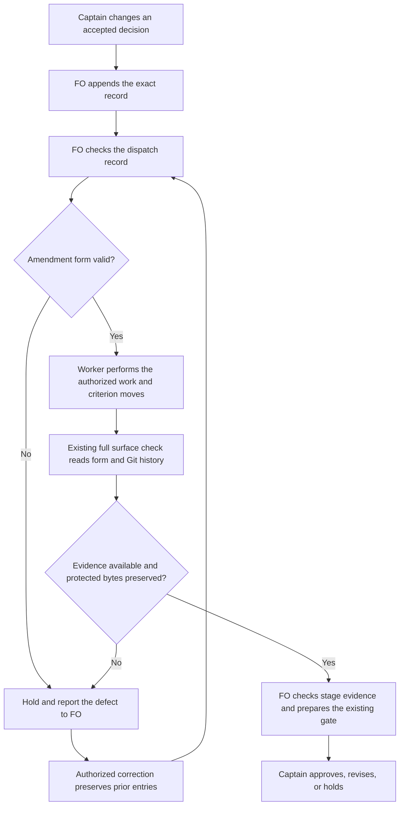

## Scope

- Source: the Captain 「全准」 (chat, 2026-10-28), answering FO's batch-8 closing sitting, item 二 (open two package tasks so a check refuses what FO kept getting wrong).
- Bite: batch-8 observer reports (2026-10-28): amendment 2 written under ## Number guards (seed-check-requires-schema-fields) and a Feedback Cycles block parsed as an amendment (idle-hook-names-merged-tasks-without-learn); FO rewrote amendment 1's Supersedes line (read-adr-honors-adr-folder); FO's Supersedes summary dropped the accepted no-repeat words (idle-hook-names-merged-tasks-without-learn, which caused its AC-8 conflict); an accepted limit recorded as an amendment only after the observer flagged it (read-adr-honors-adr-folder). learn evaluations: each is an existing README rule FO did not follow.
- Upstream first: README ## Captain amendments, `scripts/design_surfaces.py` (`check_amendments`), `scripts/dispatch_records.py`.

- Added 2026-10-29, batch-9 bites: FO edited appended amendment 1 entries after writing them (reused-worker-dispatch-leaves-a-record and fo-interviews-extension observer reports, 2026-10-28/29); FO's Design: quotes, copied up to the next blank line, swept in neighbouring bullets the Captain kept (reused-worker: the --coverage bullets; fo-interviews: four bullets) and dropped an opening fence (batch-reaches-each-gate-together); engineering-reviewer found criteria still carrying withdrawn content not listed under Supersedes (batch-reaches AC-5 to AC-7, reused-worker AC-7).
## Non-goals

- Checking prose quality or whether a summary is faithful; only the structure the README already states.

## Budget

- One package PR; no new script.

## Stop condition

- The check refuses each bite in the replay and passes every current task file that follows the README.

## FO alignment

Alignment: needed before ideation; where the check runs is a package design choice.
Result: aligned at backlog: the Captain 「同意這些內容」 (chat, 2026-10-29) to FO's batch-10 backlog sitting, which asked 「決定：六張全照建議（五張進設計，被取代條件那張先留在待辦）？要改哪張直接說。」, approved the outcome and bounds in this file. Where the check runs is a package design choice ideation proposes and the ideation gate rules.
Surfaces: none
Visible change: none
Release review: not needed: workflow maintenance, on no journey map.
Reviewer: kc-dev-flow-2:chief-engineer opus 2026-10-29 — batch-10 review before the joint ideation sitting: approve, revise or cut each task, the Captain's decisions, overlap and order

## Design

### Proposal and boundary

FO will get a refusal from the existing package checks when an amendment is outside its section, contains prose instead of criterion ids in `Supersedes:`, or changes an already recorded amendment. The next worker can still append the superseded criterion blocks without rewriting the Captain's record. This is a Pilot design for one package PR, no new script, no adopter writes and no runtime hook.

**Needs decision — the replay requirement exceeds the accepted Non-goals.** Recommend keeping this task structural: require refusals for the observable form/history failures below; retain missing rulings, omitted criterion ids inferred from prose, and quote-selection fidelity as observer/worker findings. What gets worse: those semantic mistakes can still pass a machine check. Requiring every named bite to be refused would need a separately approved representation of the exact accepted decision and its mapping to criteria; a new model judgement or substring heuristic would not prove that mapping. This proposal does not silently narrow Scope or mark its existing stop condition met. FO should obtain this one ruling before implementation; otherwise return the incompatible requirement for revision.

### Sources and existing-code check

- Upstream first: read Spacedock 0.27.3's own ensign shared core, Codex runtime, `skills/first-officer/references/fo-dispatch-core.md`, and `skills/fo-gate-lifecycle/SKILL.md`. Its gate lifecycle checks semantic completeness, committed artifacts and binding identity. Its worker protocol requires path-scoped state commits. These are not an amendment-body parser or a pre-write hook; no upstream change is proposed. The fetched local ideation stage explicitly delegates `design_surfaces.py check` before gate preparation. No hosted enforcement was exercised.
- Package next: `git fetch origin` succeeded after a sandbox escalation. Source pin `5725d495bb83a17ec13616bb5421bf5ffdc71f70`, released manifest version 0.33.0. Loaded Codex package: `/Users/kent/.codex/plugins/cache/kc-claude-plugins/kc-dev-flow-2/0.33.0`. Read source `design_surfaces.py`, `dispatch_records.py`, `laws_check.py`, workflow Captain amendments, and the package mod. `amendment_entries` reads only the first matching section and splits every level-three heading into an entry; `check_amendments` extracts any AC-shaped substrings from `Supersedes:` and never compares prior bytes. `dispatch_records.amendment_numbers` independently repeats that heading split. Repair these existing seams, rather than add a checker.
- Sibling adopters last, read only: relay's dhaka README and beirut-dev2 state `7fbde2c526769e0968d05fac858fc63b31c6274c`; web's dev2-fo README/state `2c3a6dcbfb3a8e178d65151237a0c234351612c0`; qnow-adopt-dev2 README/state `934789a124e50dd45f37af59bb337573462739ea`. All use `Captain amendments` and the package surface check. The relay README is older; do not substitute an adopter's wording for upstream contracts. No adoption, config, migration or state repair was performed.
- Decisions read at the source pin: ADR 0005 (FO records, worker moves), ADR 0016 (unnamed moves and unmarked replacements), ADR 0017 (history laws judge this push), ADR 0027 (check structured writes at existing calls). No new ADR is proposed: the design enforces their existing append-only/form rules. It adds no history law or permanent-red promise. Relevant gate `Override:` records were read: `fo-write-checks-parse-top-level` was closed by the Captain because its constructed parser cases changed no real verdicts. This design is justified by the actual batch-8/9 states below; it does not revive that task. ADR 0027's rejected phrase check is also a reason to keep semantic inference out.
- GitHub limitation: `gh pr list --repo iamcxa/kc-claude-plugins --state open --json number,title,headRefName` failed with `error connecting to api.github.com`. Local task states and Git history were inspected; current hosted PR ownership and merge state are unverified.

### Proposed behavior

1. **One bounded parser.** In `design_surfaces.py`, return amendment records with raw source spans, owning level-two section, number, metadata prefix and optional `Superseded text:` payload. Recognize actual `### Amendment N — <date>` headers, not every `###` header. Scan outside fenced examples; preserve raw bytes for history comparison. A non-amendment level-three heading ends an entry, so `### Feedback Cycles` is not an amendment. A true amendment header outside the case/whitespace-compatible `## Captain amendments` section is a refusal. Duplicate sections/numbers, malformed amendment headers and unbalanced fences in the amendment region are refused with a location; quoted examples and moved criterion text do not become new live entries. Support backtick and tilde fences with matching delimiter/length, and retain fenced content in raw spans instead of deleting it before comparing bytes.
2. **Whole-value grammar.** Require one nonempty `Captain:` and exactly one `Supersedes:` in the metadata prefix. Accept `none` or explicit `AC-<alphanumeric>` ids separated by commas/whitespace and an optional final `and`; allow a final sentence period. Permit only the existing optional `(no replacement: <nonempty reason>)` suffix. Refuse free prose, possessive/partial clauses, ranges and duplicate ids; a bare occurrence of an AC id inside a sentence is not a valid list. Keep the existing escaped-JSON quote, moved-id, replacement marker and dispatched-amendment timing rules. Do not inspect `Captain:`/`Asked:` words for truth or decide whether their question was complete.
3. **Append-only comparison at the full check.** `design_surfaces.py check <task>` compares each current amendment's protected metadata prefix with its first committed introduction on this task's reachable first-parent history. Resolve flat and `index.md` tasks and archive/rename history using Git path history, not cwd or a title search. Include deleted historical entries so removing or renumbering one cannot evade the comparison. Use the working copy as the final candidate, and include a newly introduced uncommitted entry without pretending it has an earlier baseline. Preserve entry ordering. A worker may append `Superseded text:` and verbatim moved criterion blocks; existing metadata and already recorded moved bytes may not be rewritten. Report the introduction commit and changed field/span, without asserting which actor made the edit. New appended corrections are allowed, but do not erase the original record.
4. **History bounds.** Inputs are the current task bytes, exact reachable state commits and paths, amendment spans at each introduction, and existing dispatch checklist bytes for the existing move timing check. Missing/shallow/ambiguous history for an amendment produces a nonzero unavailable-history diagnostic, never a green claim. A genuinely new task without amendments needs no history. Compare current protected bytes, not a permanent ledger of past infractions: restoring the original bytes removes a current mismatch; archive movement does not. No claim is made about uncommitted edits reverted before inspection, rewritten Git history, truthful attribution, or whether a missing amendment should exist. First-parent treatment does not certify side-branch event history.
5. **Existing entry points, limited responsibilities.** Full `check` owns structure plus history; `check --seed` keeps its current seed admission contract and does not demand artifacts or an amendment-history check. `dispatch_records.py --names` reuses the same structure parser and form errors, including before a new record is sent, without doing a second history walk. Replace its independent `amendment_numbers` split. Do not run the full surface check before worker dispatch: that would incorrectly require the worker's pending moves/artifacts. FO already runs the full check at ideation/validation gates, and implementation/validation already run it. A committed rewrite can therefore be caught at that existing full check even if its structural form passed the dispatch check. This timing is stated, not sold as a pre-write lock.
6. **Consumers and repair.** New `--names` diagnostics retain `<dispatch-file>:<line>:` attribution and receive explicit classification in `laws_check.py`, whose current L2 parser otherwise turns unfamiliar text into an unjudgeable run. That runner uses temporary file snapshots without Git: structure is checked there, history is not implicitly judged against today's state tip. The existing push-range law and exit meanings remain. No script edits the task or repairs a bad amendment. FO restores the original entry or seeks an authorized new amendment; it does not have authority to rewrite the Captain's words. Before a gate proceeds, both the full check and the normal gate evidence must pass.

### PRFAQ

**Who benefits?** FO gets the structural mistake while preparing work or a gate, rather than learning of it from the archive observer. Workers keep the existing criterion-move duty.

**Does this prevent every bad amendment?** No. It proves form and the bounded comparison to committed bytes. A correctly formed but incomplete quotation, a missing ruling, or an omitted affected criterion remains a human judgement. The Scope conflict above is therefore an actual Captain decision.

**Will old tasks all become green?** No. Tasks already violating the README can newly fail. Implementation must explain every changed verdict across active and archived tasks; it must not rewrite adopters or whitelist a slug. A task following the README must retain its verdict, including valid fenced examples and worker appends.

**Does a green check approve or advance the task?** No. FO still owns orchestration and the Captain owns the ruling. The package has no new hook that prevents skipping its commands.



Actors, order, stop branches and authority match the prose. Rendered with the existing cached Mermaid CLI and visually checked `/tmp/captain-amendment-diagram-y_ytknah/flow.png`; exit 0 after the sandbox initially blocked Chromium startup. The temporary picture is disposable, not a retained dependency: reproduce with Mermaid CLI on the inline source. Surface remains `none`; no UI or database artifact is owed.

### Historical replay and limits

Executed the installed 0.33.0 `check_criteria` and `check_amendments` over exact historical task bytes fetched with `git show`; this isolates amendment behavior from unrelated surface/Scope failures. It is a baseline replay, not a candidate refusal test. The two rows with existing errors below used the default no-dispatch argument; final CLI testing must materialize the event's dispatch directory as well, because waiting for the worker changes the existing move verdict.

| Named bite and source | Observed baseline | Proposed structural result / limit |
| --- | --- | --- |
| seed-check-requires-schema-fields `169e815d299e737722aa4ce3e9780620d7c27c8b`, amendment 2 under Number guards | 0 amendment errors; both Supersedes values also contain prose | Refuse wrong section and whole-value grammar |
| idle-hook-names-merged-tasks-without-learn `a76431954dadf2a92092264ba6fabd1184393216`, amendment 1 | 0 amendment errors on `none (adds a criterion: ...)` | Refuse the extra prose; cannot prove that the replacement restores the omitted no-repeat requirement |
| idle-hook-names-merged-tasks-without-learn `e9bac6a6d`, Feedback Cycles appended inside the section | Current parser treats any level-three block as an entry | End the preceding entry; do not invent an amendment or missing-Captain error for Feedback Cycles |
| read-adr-honors-adr-folder `95fe8ce1bd7ff58798634b733abb4115fecfe23d` versus its parent | 0 amendment errors; `AC-1 to AC-3` was changed to `AC-1, AC-2 and AC-3` inside the existing prose | Refuse rewritten metadata and prose grammar; moving criterion blocks remains allowed |
| read-adr-honors-adr-folder `d6b77cbfdd93d9b8d5cc933c1adaf52c69eea0e8`, then `95c1ecc8b` | Former task snapshot has only amendment 1; later commit adds the accepted host limit as amendment 2 | Cannot infer that an unrecorded ruling is missing; the late entry's `AC-8's falsifier...` is structurally refused once present |
| reused-worker-dispatch-leaves-a-record `16129ea4c1a238dd885e9f08513ce3a52ad27f2d` versus parent | 0 amendment errors; four Design paragraphs including coverage were removed | Refuse the changed protected Design bytes; cannot infer the correct initial selection from Captain intent |
| fo-interviews-extension `34c820b5db98d5da119a1b021ce6af45d616acdc` versus parent | Three existing move/replacement errors, none describes the deletion of four kept bullets and fence | Refuse protected-byte change independently of pending-worker timing |
| batch-reaches-each-gate-together `a9fca23f41f9063dbd090d9c8b2962f1a44d14c9` | Three existing move/replacement errors; raw Design has a closing fence without its opening fence | Refuse malformed fence structure; does not determine which of AC-5/6/7 should have been named |
| batch-reaches AC-5/6/7 and reused-worker AC-7 retain withdrawn meaning outside Supersedes | Scope names the engineering-reviewer finding; no independent semantic verifier was run | Not mechanically proved or refused by this design; part of Needs decision |

The Feedback Cycles bite is a false positive to remove, not a legitimate amendment to refuse. Calling every historical case a candidate refusal would therefore be incorrect even apart from semantic limits.

### Current task corpus

Read tracked Markdown files whose frontmatter declares `variant: kc-dev-flow-2`; ran the installed `check_task(path)` in both seed and full modes. This measures parser/artifact results; it deliberately excludes CLI `scope_hold`, which needs its own event-bound briefing replay. It does not certify that every baseline pass follows the README.

| State snapshot | Tasks | Seed passes | Full check_task passes | Tasks with parsed amendments |
| --- | ---: | ---: | ---: | ---: |
| package `731a165dfdf02549a9d13b0624174351e8a6d7be` | 174 | 19 | 86 | 39 |
| relay `7fbde2c526769e0968d05fac858fc63b31c6274c` | 97 | 9 | 67 | 25 |
| web `2c3a6dcbfb3a8e178d65151237a0c234351612c0` | 42 | 6 | 11 | 9 |
| qnow `934789a124e50dd45f37af59bb337573462739ea` | 135 | 0 | 47 | 13 |

These are working-file reads against recorded checkout tips, not authenticated immutable corpus exports. Implementation must export the pinned tracked bytes and dependencies and compare base/candidate CLI exit/message per file. Examples of old passing forms include relay `AC-27.` (allow terminal punctuation), web `none; composer-keeps-its-selection keeps its own scope...` (newly refused prose), and qnow `AC-13 (whole block; ...)` (newly refused prose). This is why a total pass count cannot stand in for a compatibility verdict.

### Words FO reads at each moment

No workflow, mod, stage skill, extension or adoption wording is proposed to change. Recounted the current instruction corpus with Python whitespace splitting and real `test_pr_watch.TasksTests` output using its provider stubs; this is not a live GitHub or native FO run. Candidate values below are the design's unchanged-output target, not an executed candidate measurement.

| Lifecycle moment | Before | Proposed after | Measured stdout words |
| --- | ---: | ---: | ---: |
| startup, feedback extension unlisted | 6959 | 6959 | 29 |
| idle, open PR | 862 | 862 | 29 |
| idle, merged PR | 833 | 833 | 0 |
| after archive | 333 | 333 | 5 |
| merge ask, four waiting tasks | 2408 | 2408 | 90 |
| feedback extension listed at startup | 7558 | 7558 | same 29; adds existing 599-word extension |
| successful amendment form/history check | existing output unchanged | existing output unchanged | no new success line |

Reading manifest: startup = full workflow + dev skill + package mod + upstream pr-merge startup; each idle = package mod + upstream pr-merge idle + workflow Delivery authority + Extensions; after archive = package mod + learn extension; merge ask = Delivery authority + Extensions + upstream gate-lifecycle and present-gate skills. Select headings by exact newline-delimited heading, not the earlier frontmatter occurrence. Append actual stdout from the corresponding TasksTests fixture: one open/pending task, one merged task, one archived learn task, or `watch.sittings` with four validation gates. Count the same bytes once per arm. Common host/runtime reads and variable task/review data are outside this bounded comparison, not asserted zero.

New refusal examples, counted separately from that normal path: outside-section diagnostic 16 words, invalid Supersedes 17, changed committed record 17, history unavailable 12. Example: `task.md: amendment 1 differs from its first committed record; hold and restore it before appending a correction.` Actual paths, ids and commit evidence can add words; implementation must retain and recount actual emitted messages, including output consumed by pr_watch/laws. No overall reading reduction or CI cost saving is claimed. CI files do not change; CI cost per PR was not measured.

### Reproduction recipe

Use Python 3, Git, the recorded source/state revisions and the selected package. The following is a baseline probe, not a proposed new repository script. `STATE` and `PKG` are absolute paths supplied by the operator; the paths/pins above name this session's sources.

```python
import importlib.util, subprocess, sys
from pathlib import Path
state, pkg, revision, relative_task = map(str, sys.argv[1:5])
sys.dont_write_bytecode = True
sys.path.insert(0, str(Path(pkg) / 'scripts'))
import design_surfaces as check
text = subprocess.check_output(
    ['git', '-C', state, 'show', revision + ':' + relative_task], text=True)
lines = text.splitlines()
errors = []
ids = check.check_criteria(relative_task, lines, errors)
check.check_amendments(relative_task, lines, ids, errors)
print('\n'.join(errors) if errors else 'no amendment errors')
print('parsed entries:', [e.splitlines()[0]
      for e in check.amendment_entries(lines) or []])
```

For each history-edit row also run `git -C "$STATE" diff <revision>^ <revision> -- <relative-task>`; for initial additions use the named introduction revision, not a later fixed archive. The source references in the table use flat `<slug>.md` paths at those events. For Feedback Cycles, the probe must display it as a parsed entry on base; the candidate must omit it. For CLI acceptance, reconstruct the event's task folder, dispatch files and relevant briefing artifacts in an isolated full-history state clone, keeping the history context available to the new comparison. A text-only temporary file does not exercise append-only history.

### Batch overlap

Proposed changed files (all under `kc-dev-flow-2/`): `scripts/design_surfaces.py` (shared form parser and full-check history comparison), `scripts/test_design_surfaces.py` (form/history/replay/corpus regressions), `scripts/dispatch_records.py` (shared parsing and structural refusal), `scripts/test_dispatch_records.py` (pre-dispatch behavior and old legitimate records), `scripts/laws_check.py` and `scripts/test_laws_check.py` (new --names diagnostics classified on event snapshots), `VALIDATION.md` (behavioral evidence and limits). No README, mod, new script, CI file, ADR, numbered record or shared ADR index change is proposed. If implementation discovers a missing lifecycle call requiring new instructions, return that delta to FO instead of silently adding another check.

| Other task | Same file/check or none | Coordination |
| --- | --- | --- |
| seed-check-requires-alignment-result | design_surfaces.py and its tests, seed early return | Land its small seed change first; this task leaves seed semantics intact |
| captain-amendment-form-checked | this task owns the seven files above | No peer writes authorized |
| adr-reserved-when-design-names-one | dispatch_records.py check_task_facts and tests; likely laws diagnostic consumer | Rebase after this parser integration or combine FO's ordered review |
| validation-rerun-waits-for-captain-ruling | dispatch_records.py check_task_facts and tests; possible same L2 diagnostic classification | Order after the shared parser, then rerun combined refusal cases |
| gate-requires-recorded-reviews | Current Scope names delivery_gate.py/role_triggers.py and workflow, not these edits; same pre-gate lifecycle | No confirmed file collision yet; check its eventual design before dispatch |
| adoption-asks-which-extensions | dispatch_records.py, test_dispatch_records.py, test_laws_check.py | Prefer land its historical-extension context first; preserve event-time README behavior |
| adr-required-statement | Workflow/adr_lint/poc_readme design; none of these seven implementation files established | No file order required; same gate proof is not shared ownership |
| adr-silent-undo-probe | Existing scenario harness only; none | No order |
| comment-check-reaches-delivery-gate | delivery_gate.py, its tests, validation principles; none | No order |
| journey-canvas-hosted-poc | Journey hosting slice; none | No order |
| journey-server-host-pilot | Journey server adapters, task at index.md; none | No order |
| ops-inbox-r1-setup-and-isolation | kc-ops-inbox, two ADRs and its CI; none | No shared ADR reservation here |
| pr-review-lite-value-pilot | Review experiment package/artifacts; none found in its current task | No order |

Also checked the live `fo-write-checks-parse-top-level` record: Captain closed its proposal; do not absorb it. All task reads are snapshots of other sessions' work, not claims of hosted PR status. `VALIDATION.md` is a potential package-wide evidence-file collision even when a sibling seed does not yet name it; FO should merge that file sequentially.

Recommended order: resolve the one Scope/Non-goals decision; land adoption-asks-which-extensions if ready, then seed-check-requires-alignment-result, then this task, then the two dispatch-record additions. Re-read completed sibling designs before implementation. Do not wait for unrelated journey/ops/review work.

## Acceptance criteria

These are proposed criteria pending the single decision above. No candidate implementation or candidate pass is claimed.

**AC-1 — The real wrong-section and prose entries are refused.** In an isolated full-history state clone, replay the seed task at `169e815d`, the idle task at `a7643195`, and the read-adr task at `95fe8ce1b`; run candidate full check and structural dispatch `--names` with event-matching records. Retain exit, diagnostic, file/line and source revision; require the specific form failure, not an unrelated missing-artifact error. Controls: move only the header to the right section or replace only Supersedes with explicit ids/none and the corresponding diagnostic disappears. Mutations that restore first-section-only scanning or AC substring extraction must fail these cases. Current evidence: baseline misses reproduced; candidate unverified.

**AC-2 — Real rewrites fail while authorized worker appends pass.** Replay parent-to-child `95fe8ce1b`, `16129ea4c`, `34c820b5d` in full history, including checks after the edit is committed and at an uncommitted working-copy edit. Require a protected-byte diagnostic even when surface fields, markers and dispatch timing otherwise pass. In positive fixtures append a new amendment, append verbatim moved AC blocks under Superseded text, and archive/rename the task without changing protected bytes; each keeps a clean amendment verdict. Delete/renumber an older entry, alter its Design or an already moved byte, truncate history, and check flat/index.md layouts. Replacing first-introduction comparison with HEAD-only, ignoring deleted entries, or allowing all Superseded text rewrites must fail a control. Current evidence: real edit diffs inspected; candidate/history policy unverified.

**AC-3 — The parser fixes the observed false entry and fence defect without treating quotations as records.** Replay idle task `e9bac6a6d`: Feedback Cycles must not become an amendment or demand a Captain line. Replay batch task `a9fca23f4`: the malformed Design fence receives a structural defect. Positive fixtures contain balanced backtick/tilde examples, embedded headings, valid metadata plus worker payload, CRLF/case/whitespace-compatible section headings and terminal punctuation after an id. Restore split-on-every-level-three-heading or delete fence tracking and the real-case/positive-pair tests must fail. Current evidence: base split and raw malformed Design observed; candidate unverified.

**AC-4 — Existing callers preserve their authority and error semantics.** Exercise full check, seed check, dispatch `--names` and event-bound `laws_check.py` with valid and invalid amendment fixtures. Seed must not demand unbuilt artifacts/history; `--names` must not demand pending worker moves; the law must classify new structural diagnostics as violations and not use today's task history for a past dispatch. Capture stdout and exits. Falsifiers: invoke full check at dispatch, omit the laws parser update, or silently green an unavailable history run. No command may repair state, approve a gate, dispatch a worker or mutate an adopter. Current evidence: callers and L2 output parser read; behavior unverified.

**AC-5 — Every changed corpus verdict is accounted for.** Export committed tasks and referenced artifacts from the four recorded state pins; run base and candidate CLI in both modes per task and retain exit/message pairs. Read every difference, classifying real README violations separately from valid-current-task regressions. Newly refusing Supersedes prose is expected; valid punctuation, Feedback Cycles and permitted worker appends must not regress. No skipped file, slug allowlist, baseline pass count or synthetic-only suite satisfies this criterion. Removing a valid fixture or claiming a snapshot without its referenced files must fail the replay audit. Current evidence: 448 working task files measured with check_task, not a frozen candidate CLI comparison.

**AC-6 — Reading and delivery claims stay bounded.** Recount the declared per-moment corpus and actual fixture stdout on the implementation head; normal-path totals stay at their measured base and actual refusal messages are reported separately. Update VALIDATION.md with source pins, scope, history limits and the unresolved semantic boundary as finally ruled. Run existing package tests for the touched files, lint and the ordinary validation contract; retain a plain statement that CI cost was not measured unless it is actually measured. Falsifiers: hide new instructions in another loaded document, omit diagnostic output, or claim native/hosted enforcement from provider stubs. Current evidence: normal-path baseline measurements executed and Mermaid rendered/visually checked; candidate unverified.

## Stage Report: ideation

- FAILED: A design for refusing a Captain amendment entry that sits outside ## Captain amendments, edits an earlier appended entry, or carries FO prose on its Supersedes line, in the existing check FO runs; the batch-8 and batch-9 bites named in Scope replayed as refused (state history of the named tasks), and current tasks that follow the README passing
  Structural design and baseline history replay are recorded; all-bites refusal cannot be claimed because missing rulings/quote fidelity/omitted semantic AC mappings exceed Non-goals, and Feedback Cycles needs removal of a false refusal. One Captain ruling is needed; no candidate was implemented.
- DONE: A `### Batch overlap` section naming each file the design would change and each other batch task (seed-check-requires-alignment-result, captain-amendment-form-checked, adr-reserved-when-design-names-one, validation-rerun-waits-for-captain-ruling, gate-requires-recorded-reviews) and live task of other sessions (adoption-asks-which-extensions, adr-required-statement, adr-silent-undo-probe, comment-check-reaches-delivery-gate, journey-canvas-hosted-poc, journey-server-host-pilot, ops-inbox-r1-setup-and-isolation, pr-review-lite-value-pilot (driven by other sessions; read only)) that changes the same file or check, so FO can order implementation
  Seven proposed files and all named tasks are mapped; parser/dispatch/L2 output collisions have an order. Hosted open PRs remain unverified because gh could not connect to api.github.com.
- DONE: The words FO reads at each lifecycle moment, before and after, per root learning.md "Measure the words FO reads at each moment, not one file's size"
  Executed bounded instruction-plus-provider-stub-output counts: 6959/862/833/333/2408, unchanged as the proposed normal-path target; actual candidate counts remain future proof and refusal output is counted separately.
- DONE: Acceptance criteria with reproducible evidence clauses and falsifiers, and unresolved decisions for the Captain, each with a recommendation and what gets worse under it
  Six explicit criteria, pinned replay recipe and one scope decision are recorded; recommend structural scope, leaving semantic omissions to human review.
- DONE: AC-1 — current evidence and falsifier recorded
  Baseline wrong-section/prose misses reproduced at named revisions; candidate refusal unverified. Removing section ownership or whole-value parsing must break acceptance.
- DONE: AC-2 — current evidence and falsifier recorded
  Three actual history edits inspected; candidate immutability and positive worker appends unverified. HEAD-only comparison or ignoring deleted entries must fail controls.
- DONE: AC-3 — current evidence and falsifier recorded
  Actual Feedback Cycles false entry and malformed fence identified; candidate parser unverified. Restore generic level-three splitting or remove fence tracking to falsify.
- DONE: AC-4 — current evidence and falsifier recorded
  Shared callers and event-snapshot L2 consumer inspected; candidate integration unverified. Calling full surface checks before dispatch or omitting the L2 diagnostic classification must fail.
- DONE: AC-5 — current evidence and falsifier recorded
  448 tracked working-file tasks measured across package/relay/web/qnow; not a frozen candidate CLI comparison. Skipping per-file differences or accepting a valid-task regression falsifies acceptance.
- DONE: AC-6 — current evidence and falsifier recorded
  Installed design_surfaces.py check prints "design surfaces presentable" (exit 0); Mermaid rendered and visually checked; diff whitespace passes. Hidden instruction loads or omitted stdout falsify the reading claim; candidate/native/provider enforcement unverified.

### Summary

The design repairs the existing amendment parser and introduces a bounded committed-byte comparison, with historical baseline evidence, four-adopter corpus counts, lifecycle reading measurements and implementation overlap. The first checklist item remains unmet: its all-bites requirement conflicts with structural-only Non-goals, so FO should route the one recorded recommendation to the Captain before implementation; the green surface check does not settle that decision or make the report complete.
