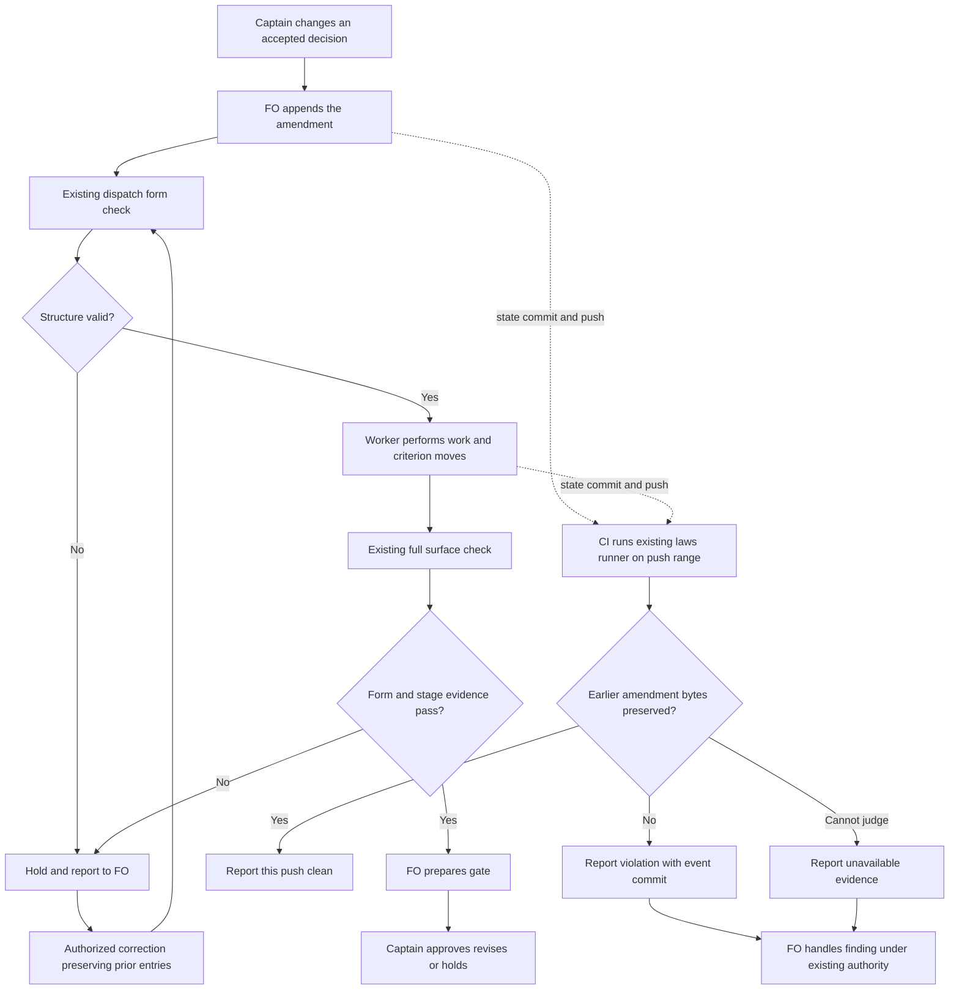

## Scope

- Source: the Captain 「全准」 (chat, 2026-10-28), answering FO's batch-8 closing sitting, item 二 (open two package tasks so a check refuses what FO kept getting wrong).
- Bite: batch-8 observer reports (2026-10-28): amendment 2 written under ## Number guards (seed-check-requires-schema-fields) and a Feedback Cycles block parsed as an amendment (idle-hook-names-merged-tasks-without-learn); FO rewrote amendment 1's Supersedes line (read-adr-honors-adr-folder); FO's Supersedes summary dropped the accepted no-repeat words (idle-hook-names-merged-tasks-without-learn, which caused its AC-8 conflict); an accepted limit recorded as an amendment only after the observer flagged it (read-adr-honors-adr-folder). learn evaluations: each is an existing README rule FO did not follow.
- Upstream first: README ## Captain amendments, `scripts/design_surfaces.py` (`check_amendments`), `scripts/dispatch_records.py`.

- Added 2026-10-29, batch-9 bites: FO edited appended amendment 1 entries after writing them (reused-worker-dispatch-leaves-a-record and fo-interviews-extension observer reports, 2026-10-28/29); FO's Design: quotes, copied up to the next blank line, swept in neighbouring bullets the Captain kept (reused-worker: the --coverage bullets; fo-interviews: four bullets) and dropped an opening fence (batch-reaches-each-gate-together); engineering-reviewer found criteria still carrying withdrawn content not listed under Supersedes (batch-reaches AC-5 to AC-7, reused-worker AC-7).
## Non-goals

- Checking prose quality or whether a summary is faithful; only the structure the README already states.

## Budget

- One package PR; no new script.

## Stop condition

- The existing form checks refuse the structurally observable placement/grammar/fence bites and remove the Feedback Cycles false entry; the existing laws runner reports the named committed rewrites in their push ranges. Valid task forms and permitted worker appends retain their verdicts. Missing rulings, initial quotation fidelity and semantically omitted criterion ids remain observer-owned under the Captain's 2026-10-29 batch ruling A. Package acceptance requires the reproducible criteria below, not a new gate-time history hold; hosted enforcement is claimed only after an actually published package pin is adopted and its state-push run is observed.

## FO alignment

Alignment: needed before ideation; where the check runs is a package design choice.
Result: aligned at backlog: the Captain 「同意這些內容」 (chat, 2026-10-29) to FO's batch-10 backlog sitting, which asked 「決定：六張全照建議（五張進設計，被取代條件那張先留在待辦）？要改哪張直接說。」, approved the outcome and bounds in this file. Where the check runs is a package design choice ideation proposes and the ideation gate rules.
Surfaces: none
Visible change: none
Release review: not needed: workflow maintenance, on no journey map.
Reviewer: kc-dev-flow-2:chief-engineer opus 2026-10-29 — batch-10 review before the joint ideation sitting: approve, revise or cut each task, the Captain's decisions, overlap and order

## Design

### Proposal and boundary

The existing form checks will refuse misplaced amendments and malformed `Supersedes:` lists; the existing history-law runner will report edits to earlier amendments in the push that commits them. No amendment-history walker is added to `design_surfaces.py`. This is one Pilot package change, with no new script, runtime hook, adopter write or new gate.

**Captain ruling applied.** The 2026-10-29 ideation resolution records 「照建議」 against `captain-amendment-form-checked/review/ideation/briefing-1/index.json`: retain section ownership, whole-value grammar, the Feedback Cycles fix and fences; put append-only in `laws_check.py`; accepted batch ruling A limits machine coverage to observable structure. The earlier all-bites conflict is resolved, and the stop condition/criteria below implement that ruling. Missing rulings, initially inaccurate quotes and omitted criterion ids inferred from meaning remain observer findings. The old report is retained as historical evidence, not the current proposal.

### Sources and existing-code check

- Spacedock first: read its own 0.27.3 ensign core/runtime, dispatch core and gate-lifecycle skill. Spacedock owns dispatch, state commits and gate bindings; it supplies no amendment-body pre-write hook. The adopted ideation stage already requires the full surface check before gate preparation. No Spacedock change or new pre-write guarantee is proposed.
- Package next: `git fetch origin` succeeded; source `5725d495bb83a17ec13616bb5421bf5ffdc71f70`, released manifest 0.33.0. Loaded Codex package `/Users/kent/.codex/plugins/cache/kc-claude-plugins/kc-dev-flow-2/0.33.0`. Read the existing amendment parser, dispatch consumer, complete `laws_check.py`, its tests, `references/sd/laws.md`, and `references/sd/state-laws.workflow.yml`. `amendment_entries` selects only the first section and splits every level-three heading; `Supersedes:` extracts AC substrings; dispatch repeats the split. Repair that shared structural seam. `walk()` already enumerates range commits and rename-aware changes, and every law reads event-time committed bytes: extend this runner instead of introducing a duplicate.
- Architecture decision records (ADRs) read: 0005 (FO records, worker moves), 0016 (unnamed moves and replacement markers), 0017 (judge this push only), 0027 (checks at existing writes). The new law enforces an existing append-only rule within ADR 0017; no new ADR or reservation is proposed. The prior Captain closure of `fo-write-checks-parse-top-level` rejects speculative parser work without real changed verdicts; the named historical bites below supply that evidence here. ADR 0027's rejection of phrase-based intent checking supports the accepted observer boundary.
- Sibling adopters last, read only: relay dhaka/beirut-dev2, web dev2-fo and qnow-adopt-dev2 READMEs all place amendments in the same section and call the existing surface check. Fresh state tips: relay `5660b17eacec0e608b40d816674d8329872b072c`, web `2c3a6dcbfb3a8e178d65151237a0c234351612c0`, qnow `8d09186345940d7b92369157d8e05007541a2825`. Older corpus pins below remain the reproducible baseline. No adopter files, remotes or configuration were changed.
- Actual state CI (continuous integration): `.github/workflows/dev2-laws.yml` runs on `spacedock-state/dev2` pushes, fetches full state history and invokes `laws_check.py --before "$BEFORE" --after "$AFTER" --readme ...`. Its package ref is currently `22219a3e4bc48a69a893bd757923e8c034d1ba6e`, not this future candidate. The package change adds the law to the existing registry; a normal later adoption must update that pin to an actually published release before hosted enforcement can be claimed. No CI trigger/config change is included in this design, and no predicted release pin is proposed. CI cost per PR was not measured; the existing state-push trigger remains the narrow applicable trigger.
- `gh pr list --repo iamcxa/kc-claude-plugins --state open --json number,title,headRefName` failed with `error connecting to api.github.com`. Local Git/state ownership was inspected; hosted open-PR ownership and CI execution remain unverified.

### Proposed behavior

1. **Shared structural parser.** In `design_surfaces.py`, expose amendment records with raw spans, owning level-two section, number, metadata prefix and optional `Superseded text:` payload. Recognize `### Amendment N — <date>` entries outside fenced examples; a non-amendment level-three heading terminates the entry. `### Feedback Cycles` is therefore not an amendment. Refuse real amendment headings outside the case/whitespace-compatible `## Captain amendments` section, duplicate sections/numbers, malformed amendment headings and unmatched amendment-region fences. Track backtick/tilde type and matching length; preserve raw fenced content for comparisons. Fenced examples and moved criterion text are not live metadata. Do not globally rewrite unrelated section parsers.
2. **Whole-value grammar.** Require one nonempty `Captain:` and one `Supersedes:` in the metadata prefix. The latter accepts `none`, or explicit `AC-<alphanumeric>` ids separated by comma/whitespace with optional final `and` and optional sentence period, plus the existing optional `(no replacement: <nonempty reason>)` suffix. Refuse ranges, duplicate ids, possessives and prose containing AC-shaped substrings. Preserve escaped-JSON, moved-id, replacement-marker and dispatch-timing rules. Do not infer whether `Asked:` is semantically necessary or whether the words are true.
3. **Existing callers.** Full `design_surfaces.py check` performs the structural and existing move/artifact checks; no new amendment-history lookup is added there (its existing Scope history check is untouched). `check --seed` retains its current seed-only contract. `dispatch_records.py --names` shares structural parsing and emits location-bearing form errors without demanding pending worker moves or artifacts. Update the existing L2 dispatch-record law's output classification in `laws_check.py` in the same change; retain `<dispatch-file>:<line>:` attribution and identify the task location in the diagnostic. Unrecognized subprocess output remains exit 2, not a green run.
4. **L3 — amendment append-only law.** Register one law in the existing `LAWS` registry and document it in `references/sd/laws.md`; it consumes `ctx.commits` from the one existing `walk()`. For each changed task in the push range, read its first-parent and event-commit blobs, including task deletion. A task added with amendments establishes the initial bytes, not a historical-truth claim. For existing entries, compare amendment number/order, header and complete raw metadata (including multi-line `Design:` and fences), and every already-recorded payload byte. Existing entries must survive unchanged, apart from terminal blank separator lines outside the protected span. New entries may be appended after existing entries; a worker may append `Superseded text:` and moved blocks to an existing entry while preserving its prior metadata and existing payload as a byte prefix. No arbitrary metadata extension is allowed. New payload must have the documented structural shape; its truth/verbatim origin remains the worker/observer's duty, not a new semantic classifier. Editing, removing, reordering or renumbering an existing entry, deleting a task that contains one, or changing a previously moved block reports a violation with old/new path, amendment number, event commit and changed field/span. It does not attribute an actor.
5. **Paths and event bounds.** Handle flat `<slug>.md`, `<slug>/index.md` and their `_archive/` forms. Use the existing Git rename records and deterministic same-slug layout/archive correspondence for a delete/add pair; an unchanged archive/layout move is no edit violation. Do not infer identity from titles. A dropped entry cannot disappear from consideration just because the task is absent at the range tip. Ambiguous correspondence, unreadable parent/blob or ambiguous protected spans yields a law-specific `cannot judge`, exit 2, with other law results still printed. Structural-invalid metadata such as prose Supersedes must remain extractable as raw bytes when its entry boundary is known, so it cannot hide the three real rewrite events. No first-introduction search, all-history rescan or new anchor ledger is needed.
6. **What the law does and does not promise.** Inputs are the runner/parser version, exact `before`/`after`, the existing walk's non-merge event commits/change lists, each event's first-parent and current task blobs, and Git rename detection; L3 does not depend on the runtime README, current disk task or today's task enumeration. Other laws retain their own README inputs. A violation repaired or deleted later in the SAME range is still reported at its event; a later push with no new violation does not re-report it. Missing/truncated parents exit 2. Merge commits themselves remain excluded by the existing walker (side commits are judged); uncommitted edits, rewrites wholly inside an omitted merge commit, prior pushes outside the range, rewritten Git history and never-recorded rulings are outside the proof. Re-running a fixed range with the same package/objects keeps its L3 event result despite later task edits/deletion/archive/README changes; no permanent-red promise is made.
7. **Timing and correction.** Form failures hold the existing dispatch/gate command when it runs. L3 reports after commit/push through dev2-laws CI once its published package pin is adopted; it does not block push, dispatch, gate preparation or merge guard. FO handles the reported finding under existing authority; no automatic revert or amendment rewrite is introduced. A correction may append a new record but does not erase the reported event. Do not add another pre-gate history call to regain the intentionally accepted timing tradeoff.

### PRFAQ

**Who benefits?** FO sees malformed records at the existing dispatch/gate checks, while the state-push check independently reports committed amendment rewrites. Workers retain the existing duty to move withdrawn criteria.

**Why no second history walker?** The existing runner already owns event-time history, range selection, rename changes and failure semantics. Reusing it avoids a second baseline policy and follows the Captain's selected cost: reporting occurs after the push.

**Does green mean the Captain's decision was faithfully recorded?** No. Machine checks cover the observable structure and committed transitions. The observer retains missing rulings, quote selection, omitted semantically affected ids and attribution.

**Is there an unresolved Captain decision?** None in this revision. The earlier structural-only recommendation and after-push tradeoff were accepted by the cited revise ruling. Do not ask them again. If implementation needs a merge-event policy change, new lifecycle call, adopter migration or semantic representation, return that concrete scope expansion to FO before implementing it.

The dotted push lane is asynchronous reporting, with no edge granting a gate approval or holding the gate. Rendered with Mermaid CLI (exit 0 after Chromium needed sandbox escalation) and visually checked at `/tmp/captain-amendment-cycle2/flow.png`; actors, branches and stops match the prose. The inline source is authoritative and can be rendered by any Mermaid CLI installation; the local PNG is disposable. `Surfaces: none` owes no UI/database artifact.

### Historical replay and limits

Cycle 1 executed the installed 0.33.0 `check_criteria` and `check_amendments` over exact historical task bytes fetched with `git show`; this isolates amendment behavior from unrelated surface/Scope failures. It is a baseline replay, not a candidate refusal test. The two rows with existing errors below used the default no-dispatch argument; final CLI testing must materialize the event's dispatch directory as well, because waiting for the worker changes the existing move verdict.

| Named bite and source | Observed baseline | Proposed structural result / limit |
| --- | --- | --- |
| seed-check-requires-schema-fields `169e815d299e737722aa4ce3e9780620d7c27c8b`, amendment 2 under Number guards | 0 amendment errors; both Supersedes values also contain prose | Refuse wrong section and whole-value grammar |
| idle-hook-names-merged-tasks-without-learn `a76431954dadf2a92092264ba6fabd1184393216`, amendment 1 | 0 amendment errors on `none (adds a criterion: ...)` | Refuse the extra prose; cannot prove that the replacement restores the omitted no-repeat requirement |
| idle-hook-names-merged-tasks-without-learn `e9bac6a6d`, Feedback Cycles appended inside the section | Current parser treats any level-three block as an entry | End the preceding entry; do not invent an amendment or missing-Captain error for Feedback Cycles |
| read-adr-honors-adr-folder `95fe8ce1bd7ff58798634b733abb4115fecfe23d` versus its parent | 0 amendment errors; `AC-1 to AC-3` was changed to `AC-1, AC-2 and AC-3` inside the existing prose | L3 reports rewritten metadata at the edit commit; form check refuses prose grammar; moving criterion blocks remains allowed |
| read-adr-honors-adr-folder `d6b77cbfdd93d9b8d5cc933c1adaf52c69eea0e8`, then `95c1ecc8b` | Former task snapshot has only amendment 1; later commit adds the accepted host limit as amendment 2 | Cannot infer that an unrecorded ruling is missing; the late entry's `AC-8's falsifier...` is structurally refused once present |
| reused-worker-dispatch-leaves-a-record `16129ea4c1a238dd885e9f08513ce3a52ad27f2d` versus parent | 0 amendment errors; four Design paragraphs including coverage were removed | L3 reports the changed protected Design bytes; cannot infer the correct initial selection from Captain intent |
| fo-interviews-extension `34c820b5db98d5da119a1b021ce6af45d616acdc` versus parent | Three existing move/replacement errors, none describes the deletion of four kept bullets and fence | L3 reports protected-byte change independently of pending-worker timing |
| batch-reaches-each-gate-together `a9fca23f41f9063dbd090d9c8b2962f1a44d14c9` | Three existing move/replacement errors; raw Design has a closing fence without its opening fence | Refuse malformed fence structure; does not determine which of AC-5/6/7 should have been named |
| batch-reaches AC-5/6/7 and reused-worker AC-7 retain withdrawn meaning outside Supersedes | Scope names the engineering-reviewer finding; no independent semantic verifier was run | Not mechanically proved or refused by this design; observer-owned under the accepted batch ruling A |

The Feedback Cycles bite is a false positive to remove, not a legitimate amendment to refuse. Calling every historical case a candidate refusal would therefore be incorrect even apart from semantic limits.

Cycle 2 reran the seven available parser snapshots above (excluding the late-record and semantic rows), reproducing the same baseline outcomes. It also ran the installed laws CLI for each of `95fe8ce1b^..95fe8ce1b`, `16129ea4c^..16129ea4c`, and `34c820b5d^..34c820b5d` with the adopted README: each exits 0 and judges 0 L1 and 0 L2 events. This exercises the actual missing-law seam; L3 candidate refusals are still future implementation proof.

### Current task corpus

Cycle 1 read tracked Markdown files whose frontmatter declares `variant: kc-dev-flow-2`; ran the installed `check_task(path)` in both seed and full modes. This measures parser/artifact results; it deliberately excludes CLI `scope_hold`, which needs its own event-bound briefing replay. It does not certify that every baseline pass follows the README.

| State snapshot | Tasks | Seed passes | Full check_task passes | Tasks with parsed amendments |
| --- | ---: | ---: | ---: | ---: |
| package `731a165dfdf02549a9d13b0624174351e8a6d7be` | 174 | 19 | 86 | 39 |
| relay `7fbde2c526769e0968d05fac858fc63b31c6274c` | 97 | 9 | 67 | 25 |
| web `2c3a6dcbfb3a8e178d65151237a0c234351612c0` | 42 | 6 | 11 | 9 |
| qnow `934789a124e50dd45f37af59bb337573462739ea` | 135 | 0 | 47 | 13 |

These are working-file reads against recorded checkout tips, not authenticated immutable corpus exports. These earlier measurements are retained evidence, not a fresh cycle-2 census. Implementation must export the pinned tracked bytes and dependencies and compare base/candidate CLI exit/message per file. Examples of old passing forms include relay `AC-27.` (allow terminal punctuation), web `none; composer-keeps-its-selection keeps its own scope...` (newly refused prose), and qnow `AC-13 (whole block; ...)` (newly refused prose). This is why a total pass count cannot stand in for a compatibility verdict.

### Words FO reads at each moment

Recounted in cycle 2 using Python whitespace splitting plus executed `test_pr_watch.TasksTests` fixture output, with its GitHub/Spacedock provider stubs. The source pin and unchanged instruction manifest reproduce the earlier totals. Proposed-after numbers are targets until implementation, not executed candidate measurements.

| Lifecycle moment | Before | Proposed after | Executed stdout words included |
| --- | ---: | ---: | ---: |
| startup, feedback unlisted | 6959 | 6959 | 29 |
| idle, open PR | 862 | 862 | 29 |
| idle, merged PR, no learn line | 833 | 833 | 0 |
| after archive, learn notice | 333 | 333 | 5 |
| merge ask, four waiting tasks | 2408 | 2408 | 90 |
| startup, feedback listed | 7558 | 7558 | 29; existing extension adds 599 |
| successful full form check | existing output | unchanged output | no new success line |
| reading state-push law summary with zero events | 18 | 27 target | two current 9-word law summaries; one planned 9-word L3 summary |

Reading manifest: startup = full workflow + dev skill + package mod + upstream pr-merge startup; idle = package mod + upstream pr-merge idle + workflow Delivery authority + Extensions; archive = package mod + learn extension; merge ask = Delivery authority + Extensions + upstream gate-lifecycle/present-gate skills. Select actual newline-delimited headings, not their frontmatter mentions. Corresponding fixture setup: `TasksTests.readme('roborev')`, one task with `pr=o/r#7` and `view()`/`view('MERGED')`; archive uses `readme('learn')` plus `archive('some-task')`; merge uses four `validation/awaiting-captain` rows. Instruction-only counts are 6930/833/328/2318, respectively; add the table's executed stdout once. Host/runtime reads and variable task/review payloads are outside this bounded comparison, not asserted zero.

The L3 summary is planned as `L3 amendment-append-only: 0 events judged in BEFORE..AFTER, 0 violated` (9 words), counted only when FO reads that CI result, not injected at every lifecycle moment. Form failures and per-event violation/unavailable-evidence messages add variable path/id/commit text. Implementation must retain and count actual emitted output separately, including --names output consumed by L2; do not reuse cycle 1's abandoned first-introduction/unavailable-history diagnostic estimates. `laws.md` is a maintenance reference, not added to normal FO startup. No overall reading reduction or CI cost saving is claimed; CI cost per PR was not measured.

### Reproduction recipe

Requirements: Python 3, Git, the selected package, complete state objects for the named revisions, and the adopted README for existing L1/L2. No session-only helper is required. For each rewrite row run `python3 <package>/scripts/laws_check.py <state> --before <event>^ --after <event> --readme <workflow>/README.md`; base exits 0 with L1/L2 judging no events, while the candidate must report the amendment-specific L3 violation. Inspect the precise edit with `git -C <state> diff <event>^ <event> -- <slug>.md`. Use the full named revisions from the replay table in retained results.

For structural baseline isolation, load `design_surfaces` from `<package>/scripts`, read `git -C <state> show <revision>:<slug>.md`, call `check_criteria(name, lines, errors)` then `check_amendments(name, lines, ids, errors)`, and print errors plus `amendment_entries(lines)` headings. For candidate CLI proof, export the event's task, dispatch directory and briefing artifacts into a disposable state clone and run both full check and `dispatch_records.py --names <event records>`. Assert the amendment diagnostic, not any incidental artifact refusal. History proof must invoke the existing laws CLI with explicit committed endpoints; a working-copy-only edit is deliberately no L3 event.

For acceptance, export all tracked task/artifact bytes at each corpus pin and retain a per-file base/candidate verdict table for full/seed modes and affected dispatch checks. Run the exact existing runner invocation with candidate scripts on an isolated full-history state clone; do not modify an adopter or the live CI pin. Report hosted activation as pending until a published-pin adoption and actual run exist.

### Batch overlap

Proposed changed files under `kc-dev-flow-2/`: `scripts/design_surfaces.py` (shared structure only), `scripts/test_design_surfaces.py` (real parser replays/controls/corpus), `scripts/dispatch_records.py` (reuse parser), `scripts/test_dispatch_records.py` (pre-dispatch form behavior), `scripts/laws_check.py` (L2 diagnostics and new L3 in the existing walk), `scripts/test_laws_check.py` (event transitions and bounds), `references/sd/laws.md` (L2 form behavior, L3 rule/event/bounds), `VALIDATION.md` (evidence and activation limits). The `LAWS` registry and laws.md numbered headings are one shared index; L3 is provisional until implementation rechecks that nobody claimed it. No workflow/mod/stage-skill/CI file, new script, ADR or ADR index edit is proposed. The later published CI pin adoption is separate delivery work, not an ideation edit.

| Task (purpose) | Shared file/check or none | Coordination |
| --- | --- | --- |
| seed-check-requires-alignment-result (reject missing alignment result) | design_surfaces.py and its tests, adjacent seed early return | Land its small seed change first; retain seed-only semantics |
| captain-amendment-form-checked (this amendment revision) | Owns the eight proposed files and new law registry row above | This dispatch writes only its entity body/report |
| adr-reserved-when-design-names-one (reserve before dispatch) | dispatch_records.py/tests, laws_check.py/tests, potential laws.md wording | Rebase onto shared parser/output contract and integrate serially |
| validation-rerun-waits-for-captain-ruling (hold unruled reruns) | dispatch_records.py/tests, laws_check.py/tests, laws.md | Share event context and output classification; rerun combined law tests |
| gate-requires-recorded-reviews (review records before gate) | VALIDATION.md only; its revised design uses delivery_gate.py and workflow preflight | Serialize evidence document; no history-law dependency |
| adoption-asks-which-extensions (event-time extension list) | dispatch_records.py/tests, test_laws_check.py, laws.md | Prefer integrate its historical context first; preserve event-time README handling |
| adr-required-statement (old ruling ledger proposal) | Explicitly closed 2026-10-20 despite stale validation status; no live overlap | Do not revive its ledger or branch |
| adr-silent-undo-probe (ADR reversal experiment) | Moved to the POC workflow; no shared runtime file | No dependency on this inactive copy |
| comment-check-reaches-delivery-gate (comment proof at delivery) | Explicitly closed 2026-10-20; historical delivery checker files only | No live dependency |
| journey-canvas-hosted-poc (hosted canvas experiment) | kc-journey-map hosting scope; none | No order |
| journey-server-host-pilot (private hosted journey server) | kc-journey-map server/docs; none | Its folder task is a useful path-layout control, not shared ownership |
| ops-inbox-r1-setup-and-isolation (operations intake isolation) | kc-ops-inbox/own CI/ADRs; none | No ADR reservation in this change |
| pr-review-lite-value-pilot (bounded review comparison) | kc-pr-flow/artifacts; none found | No order |

These are current local task reads, not hosted PR-state claims. `VALIDATION.md` can also collide with other package evidence updates; FO should serialize it. Re-read completed sibling designs at implementation dispatch because other revision workers are active.

Recommended order: adoption's historical context if ready, seed admission, this shared amendment parser/law, then the reservation and validation-rerun additions in FO's serial order. Coordinate laws.md/LAWS and VALIDATION.md explicitly; do not wait for closed or unrelated journey/ops/review tasks.

## Acceptance criteria

Current-stage proof is the revised design, exercised baseline and rendered diagram. All candidate behavior below remains unverified until implementation/validation; no implementation or hosted enforcement is claimed.

**AC-1 — Observable wrong-section and prose entries are refused.** Replay seed `169e815d299e737722aa4ce3e9780620d7c27c8b`, idle `a7643195`, read-adr `95fe8ce1bd7ff58798634b733abb4115fecfe23d` with event-matching task/dispatch/artifacts. Candidate full check and dispatch `--names` must exit 1 with the precise amendment location/form diagnostic. Moving only the header into its section or replacing only Supersedes with valid ids removes that form diagnostic. Restoring first-section-only scanning or substring AC extraction must break these controls. Current evidence: installed parser baseline misses reproduced; candidate unverified.

**AC-2 — The existing laws runner reports committed rewrites in their push range.** Run its CLI on the three parent-to-child events `95fe8ce1b`, `16129ea4c`, `34c820b5d`; require an L3 protected-byte violation independently of pending worker timing. Positive committed fixtures append an entry, append verbatim moved blocks, and archive/rename/convert flat-to-index without changing protected bytes. Negative fixtures edit metadata/fenced Design/prior payload, delete/renumber/reorder entries, or delete the task; test flat/index/archive paths, ambiguous identity and truncated parents (exit 2). A working-copy-only edit creates no L3 event. Check repaired/deleted later-in-range events remain reported; the next clean push does not re-report prior events. Fix range/version/objects, then change tip task/archive/README and require unchanged L3 event output. Tip-only reading, ignoring deleted old blobs, skipping index tasks, or replacing raw comparison with fence-stripped text must fail controls. Current evidence: real baseline laws CLI exits 0 for all three misses; candidate unverified.

**AC-3 — Feedback Cycles and fences parse without false entries.** Replay idle `e9bac6a6d`: Feedback Cycles is not an amendment and needs no Captain line. Replay batch `a9fca23f41f9063dbd090d9c8b2962f1a44d14c9`: the unmatched Design fence gets a structural diagnostic. Positive fixtures retain balanced backtick/tilde examples, quoted headings, valid worker payload, case/whitespace-compatible sections, CRLF and final punctuation. Restore generic level-three splitting or delete fence tracking and a real/positive paired case must fail. Current evidence: both raw defects and the baseline false entry reproduced; candidate unverified.

**AC-4 — Callers, law documentation and CI boundaries agree.** Exercise full/seed/--names and the existing laws CLI on valid, malformed and pending-worker cases. Seed asks for no future artifacts; dispatch asks for no pending move; L2 classifies each new diagnostic as violation rather than cannot-judge, while unknown output and missing evidence retain exit 2. laws.md and LAWS agree on the new law; no second amendment walker or new lifecycle invocation exists. Execute the state-workflow's runner command locally using candidate scripts and explicit endpoints; record the deployed CI pin separately, without calling the old pin activated. Falsifiers: omit L2 classification, add a first-introduction walker to full check, silently treat missing parent as green, or claim hosted coverage before published-pin adoption. Current evidence: actual runner/template/deployed pin inspected; hosted API unavailable and candidate unverified.

**AC-5 — Every changed corpus verdict is explained within structural scope.** Export tasks AND referenced artifacts from the four recorded corpus pins; compare base/candidate full and seed CLI exit/message per file, and event-bound dispatch outcomes where affected. Account for every difference as an existing structural violation or repair the regression. Valid punctuation, Feedback Cycles, quoted examples and worker appends must retain legitimate outcomes; new Supersedes-prose refusals are intentional. Keep missing rulings, initial quote fidelity and semantically omitted ids explicitly observer-owned under batch ruling A; no semantic refusal is promised. Falsifiers: skipped files, slug allowlists, totals without per-file differences, or substituting synthetic-only evidence. Current evidence: prior cycle's 448 working-file results retained with their limits; frozen candidate comparison unverified.

**AC-6 — Reading, release and evidence claims remain bounded.** Recount the declared instruction corpus and actual fixture stdout at implementation head; lifecycle totals remain the measured base, with actual L3 summary/refusal output counted separately when read. Update VALIDATION.md and laws.md with source/event pins, merge/range limits, observer responsibilities and the published-pin activation dependency. Run touched existing test suites, registry parity, lint and ordinary validation checks. Hidden instruction additions, omitted diagnostics, or claims that stubs/local execution prove hosted enforcement falsify this criterion. CI cost per PR remains explicitly unmeasured unless measured. Current evidence: cycle-2 per-moment counts reproduced and Mermaid rendered/visually checked; candidate/release/hosted proof unverified.

## Stage Report: ideation

- FAILED: A design for refusing a Captain amendment entry that sits outside ## Captain amendments, edits an earlier appended entry, or carries FO prose on its Supersedes line, in the existing check FO runs; the batch-8 and batch-9 bites named in Scope replayed as refused (state history of the named tasks), and current tasks that follow the README passing
  Structural design and baseline history replay are recorded; all-bites refusal cannot be claimed because missing rulings/quote fidelity/omitted semantic AC mappings exceed Non-goals, and Feedback Cycles needs removal of a false refusal. One Captain ruling is needed; no candidate was implemented.
- DONE: A `### Batch overlap` section naming each file the design would change and each other batch task (seed-check-requires-alignment-result, captain-amendment-form-checked, adr-reserved-when-design-names-one, validation-rerun-waits-for-captain-ruling, gate-requires-recorded-reviews) and live task of other sessions (adoption-asks-which-extensions, adr-required-statement, adr-silent-undo-probe, comment-check-reaches-delivery-gate, journey-canvas-hosted-poc, journey-server-host-pilot, ops-inbox-r1-setup-and-isolation, pr-review-lite-value-pilot (driven by other sessions; read only)) that changes the same file or check, so FO can order implementation
  Seven proposed files and all named tasks are mapped; parser/dispatch/L2 output collisions have an order. Hosted open PRs remain unverified because gh could not connect to api.github.com.
- DONE: The words FO reads at each lifecycle moment, before and after, per root learning.md "Measure the words FO reads at each moment, not one file's size"
  Executed bounded instruction-plus-provider-stub-output counts: 6959/862/833/333/2408, unchanged as the proposed normal-path target; actual candidate counts remain future proof and refusal output is counted separately.
- DONE: Acceptance criteria with reproducible evidence clauses and falsifiers, and unresolved decisions for the Captain, each with a recommendation and what gets worse under it
  Six explicit criteria, pinned replay recipe and one scope decision are recorded; recommend structural scope, leaving semantic omissions to human review.
- DONE: AC-1 — current evidence and falsifier recorded
  Baseline wrong-section/prose misses reproduced at named revisions; candidate refusal unverified. Removing section ownership or whole-value parsing must break acceptance.
- DONE: AC-2 — current evidence and falsifier recorded
  Three actual history edits inspected; candidate immutability and positive worker appends unverified. HEAD-only comparison or ignoring deleted entries must fail controls.
- DONE: AC-3 — current evidence and falsifier recorded
  Actual Feedback Cycles false entry and malformed fence identified; candidate parser unverified. Restore generic level-three splitting or remove fence tracking to falsify.
- DONE: AC-4 — current evidence and falsifier recorded
  Shared callers and event-snapshot L2 consumer inspected; candidate integration unverified. Calling full surface checks before dispatch or omitting the L2 diagnostic classification must fail.
- DONE: AC-5 — current evidence and falsifier recorded
  448 tracked working-file tasks measured across package/relay/web/qnow; not a frozen candidate CLI comparison. Skipping per-file differences or accepting a valid-task regression falsifies acceptance.
- DONE: AC-6 — current evidence and falsifier recorded
  Installed design_surfaces.py check prints "design surfaces presentable" (exit 0); Mermaid rendered and visually checked; diff whitespace passes. Hidden instruction loads or omitted stdout falsify the reading claim; candidate/native/provider enforcement unverified.

### Summary

The design repairs the existing amendment parser and introduces a bounded committed-byte comparison, with historical baseline evidence, four-adopter corpus counts, lifecycle reading measurements and implementation overlap. The first checklist item remains unmet: its all-bites requirement conflicts with structural-only Non-goals, so FO should route the one recorded recommendation to the Captain before implementation; the green surface check does not settle that decision or make the report complete.

## Stage Report: ideation (cycle 2)

- DONE: Revise the design under the Captain's ideation-gate revise of 2026-10-29 (「照建議」; the asks are in the gate question of review/ideation, newest briefing): keep the structural checks (section ownership, Supersedes grammar, the Feedback Cycles false entry, fences); drop the new history walker in kc-dev-flow-2/scripts/design_surfaces.py and make append-only a law in the existing kc-dev-flow-2/scripts/laws_check.py that dev2-laws CI runs, or show why a duplicate is needed; batch ruling A: cover the bites observable from structure and leave the rest to the observer; update criteria and the stop condition to match
  Captain revise applied: structure stays in the existing callers; new L3 amendment-append-only law reuses laws_check.py walk; stop condition follows accepted structural scope. Seven baseline parser snapshots and three actual rewrite ranges exercised; no candidate pass claimed.
- DONE: A `### Batch overlap` section naming each file the design would change and each other batch task (seed-check-requires-alignment-result, captain-amendment-form-checked, adr-reserved-when-design-names-one, validation-rerun-waits-for-captain-ruling, gate-requires-recorded-reviews) and live task of other sessions (adoption-asks-which-extensions, adr-required-statement, adr-silent-undo-probe, comment-check-reaches-delivery-gate, journey-canvas-hosted-poc, journey-server-host-pilot, ops-inbox-r1-setup-and-isolation, pr-review-lite-value-pilot (driven by other sessions; read only)) that changes the same file or check, so FO can order implementation
  Eight proposed files, the shared LAWS/laws.md registry and every named task mapped; closed/moved tasks distinguished from live dependencies. Hosted PR lookup failed at api.github.com; local state/source inspection used.
- DONE: The words FO reads at each lifecycle moment, before and after, per root learning.md "Measure the words FO reads at each moment, not one file's size"
  Re-executed instruction/fixture counts: 6959/862/833/333/2408 and 7558 with feedback; normal-path after targets unchanged, CI summary 18 to 27 planned words separated from variable diagnostics. CI cost per PR unmeasured.
- DONE: Acceptance criteria with reproducible evidence clauses and falsifiers, and unresolved decisions for the Captain, each with a recommendation and what gets worse under it
  Six criteria each carry reproduction, current evidence, limits and falsifiers. The previous decision is settled by the Captain; no new unresolved choice. After-push timing, merge-event bounds and published CI-pin adoption remain explicit.
- DONE: AC-1 — current evidence and falsifier recorded
  Seven historical parser snapshots reproduce wrong-section/prose misses and the false entry; candidate CLI refusal unverified. Restoring section-first scanning or AC substring extraction must fail the controls.
- DONE: AC-2 — current evidence and falsifier recorded
  Installed laws CLI exits 0 on all three real rewrite ranges, proving the missing event law; candidate L3 unverified. Tip-only reads, deleted-entry omission or stripped-fence comparison must fail replay controls.
- DONE: AC-3 — current evidence and falsifier recorded
  Feedback Cycles is actually parsed as an entry on base; the malformed Design fence is retained in the replay. Candidate unverified; generic heading splitting/fence-blind parsing must fail the paired cases.
- DONE: AC-4 — current evidence and falsifier recorded
  Read actual runner/registry/template and deployed old package pin; six installed source files matched origin/main byte-for-byte. Candidate integration and hosted activation unverified; unknown output must not become green.
- DONE: AC-5 — current evidence and falsifier recorded
  Prior 448-task working-file measurements preserved with their limits; new frozen candidate verdict comparison unverified. Totals alone, skipped files or semantic-refusal claims cannot satisfy acceptance.
- DONE: AC-6 — current evidence and falsifier recorded
  Current design_surfaces.py check exits 0: design surfaces presentable; new Mermaid rendered and visually checked, per-moment outputs rerun. Hidden reads or claiming stubs prove hosted behavior falsifies acceptance.

### Summary

The revision keeps the structural parser fixes and assigns append-only enforcement to the existing push-range laws runner, with no duplicate history walk. The Captain's structural-only ruling resolves the prior failed design checklist item; all revision deliverables are complete, while implementation, candidate proof and published-pin CI activation remain future work. The previous report and YAML frontmatter are preserved.
