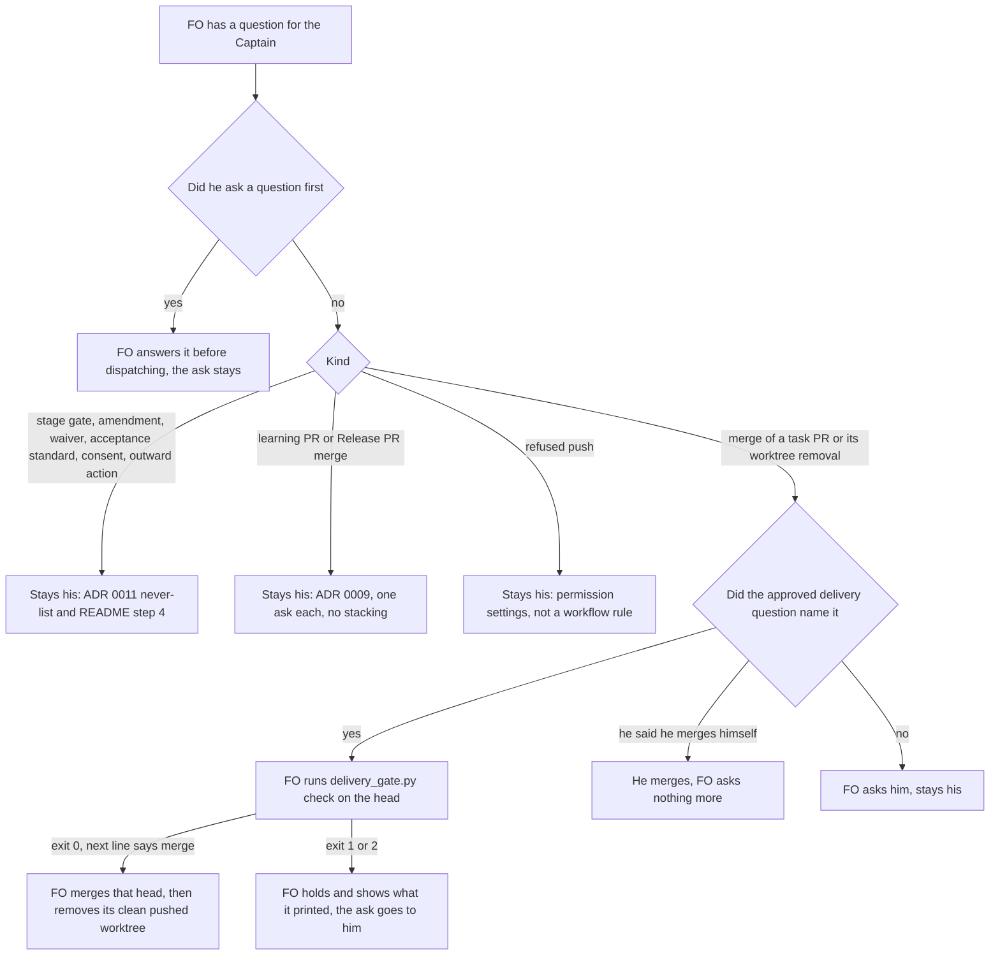

Filed for batch 3 on the Captain's 「先走批次三規劃」 (chat, 2026-10-19), after FO reported that most of his turns in batch 2 were answering FO's questions rather than reviewing PRs. His goal for batching (chat, 2026-10-16): 「這樣我才可以從一直在追每個 FO 過程中解放出來」.

## Scope

- Measure first, from the batch-2 decision ledger rows and the gate briefings of this workflow (2026-10-17 to 10-19): every Captain decision per task, split into stage gates, Needs decisions, amendments, merge asks, and procedural asks (a push the permission check refused, a throwaway repository, a PR-body edit, a waiver), and how many he answered with a plain approval of FO's recommendation.
- Then find which kinds a written standing rule could settle without him (for example a delivery gate that carries the merge grant by default, or a repair inside an approved design), and which must stay his (ADR 0011: authority, approval, merge, outward-facing actions, irreversible changes and money).
- Existing pieces: batch sittings (memory note fo-batch-sittings-interim), pre-authorized merges at delivery gates, the qnow R11 batching numbers the qnow FO owes.
- Non-goals: to be set at ideation.

## FO alignment

Alignment: not needed before ideation; the Captain approved planning batch 3.
Release review: not needed: workflow maintenance, on no journey map.
Surfaces: none
Visible change: none
Reviewer: chief-engineer opus 2026-10-19 — what is the smallest next step, given the findings so far? Asked by the Captain (「對」, chat) after Cycle 2: three review rounds on the merge wording each found a new gap (Codex round 1 P1 hold, round 2 P1 head binding and P2 second record, roborev:875/878 High), and AC-4 leaves delivery_gate.py only the ASK line.

## Design

Ruling in one paragraph. Of the 22 answers the Captain gave FO in batch 2, a written rule can settle at most 2 (one removal, one conditional); the other 20 stay his under ADR 0011, README step 4, ADR 0009, his own ruling or the permission check, or are too rare to justify a rule. 20 of the 22 accepted FO's recommendation as stated, but 8 came with a question or comment of his before or inside the message, so the acceptance rate is not evidence for delegating. The change is one README sentence at net zero words plus the text of one script line: a delivery gate question may carry the merge of the validated head and the removal of the task's clean worktree, so he says it once, in words the question printed, and `delivery_gate.py` stops telling FO to ask when the question already covered it. FO's 12:31Z statement on 2026-10-18 holds on the count (about 20) but not on the kind ("many of them procedural"): procedural answers are 4 of 22.

### Chain check (Spacedock, kc-dev-flow-2, adopters)

- **Spacedock 0.27.2** (`spacedock gate --help`): `gate record --actor agent:first-officer` already takes `--conn-quote` and `--conn-source`, so a decision under a quoted grant is recorded as FO's. There is no multi-gate batch, no count of asks and no merge grant primitive. Nothing to reuse beyond the quote flags the README's Delivery authority already cites.
- **kc-dev-flow-2 0.25.0** (read at `origin/main` c60e89e1): `decision_ledger.py` reads gate rows only (its docstring: "one JSON line per gate resolution or withdrawal"). README step "A Needs decision put to the Captain at a gate" already makes a plain approval accept a recommendation when the question says so (L1 of ADR 0011). ADR 0015 is the precedent for a grant carried by the gate question ("this approval is that grant for this task") and its rejected option names the cost: "one more message and approval from him per task". ADR 0009 keeps learning-PR merges his. ADR 0020 forbids a README rise without his quoted ruling. `delivery_gate.py check` already holds the merge on head, CI, draft, base and file list and prints `next: hold the ask until the required CI has finished green on this head.`
- **Adopters**: relay's `docs/dev2/README.md` carries the same "is not permission to push, create or merge" sentence (`git grep` on its HEAD, 2026-10-19). The qnow R11 batching numbers the qnow FO owes are not in `docs/dev2` of `origin/next` (`git grep` for `R11|batching`) nor in its four `spacedock-state/*` branches (`git grep` for `batching|decisions per|questions per|asks per`, 2026-10-19), so no sibling number exists to reuse. I ran `git fetch` once in the qnow clone (a ref update, no file change).
- **Past rulings**: `git -C <state> grep -n 'Override:'` hits only prose in archived designs and observer reports, none on a delivery or merge question; the ledger shows 0 `override` rows. So no past ruling went against a similar recommendation. The merge-gatekeeper amendment 1 (「同意」, 2026-10-18) removed FO's merging from `delivery_gate.py`; this design adds no merge logic: the one script change is the text of the `next:` line that check prints.

### Measured

Window 2026-10-17T05:56Z (「開始批次2規劃」) to 2026-10-18T16:24Z; the six batch-2 tasks (the six named in the batch-2 backlog question) plus what they spawned. Sources and how to reproduce:

1. `python3 -B -I <package>/scripts/decision_ledger.py <state>` printed 134 rows, 119 by the Captain over 2026-09-16 to 10-18: 113 approve, 5 revise, 1 hold. In the window it holds 18 rows for the six tasks (6 backlog, 6 ideation, 6 validation), all approve, 0 `override`. Backlog gates over the whole record: 43 of 43 approved.
2. The 18 rows were answered in 7 messages: backlog 1, ideation 1, delivery 5 (#658, #659, #661, #663 with #664, #666). Group by `task` and `at` in the output.
3. Everything else is chat. The FO session transcript (`~/.claude/projects/-Users-kent-conductor-workspaces-kc-claude-plugins-colombo/5c030106-8d82-4542-855e-1498b2563c69.jsonl`, machine-local) lists 33 Captain messages in the window with the script below; 11 are his own (3 session-limit nudges 「繼續」, 5 questions or comments, 2 format corrections 「中文簡報」 and 「中文討論，一題題來」, 1 command), 22 answer an FO ask. I classified the 22 by reading the FO message before each.

```
python3 -I - "$SESSION_JSONL" <<'PY'
import json, sys
for line in open(sys.argv[1]):
    try: d = json.loads(line)
    except ValueError: continue
    if d.get("type") != "user" or d.get("isSidechain"): continue
    c = d["message"]["content"]
    t = c if isinstance(c, str) else " ".join(x.get("text", "") for x in c if x.get("type") == "text")
    if t.strip() and not t.lstrip().startswith("<") and "Another Claude session" not in t:
        print(d["timestamp"][:16], t.replace("\n", " ")[:100])
PY
```

Blind spot: 15 of the 22 answers (68%) leave no gate row, so `decision_ledger.py` cannot see them; this is the gap `chat-only-evidence-observer-blind` is scoped on. Not measured: minutes per answer.

| Kind | Answers | Share | Plain approval of FO's recommendation |
|---|---|---|---|
| Stage gates (alone or with a merge grant) | 7 | 32% | 6 |
| Needs decision or amendment outside a gate | 6 | 27% | 6 |
| Merge asks outside a gate message | 5 | 23% | 5 |
| Procedural (throwaway repository ×2, refused push, worktree cleanup) | 4 | 18% | 3 |
| **Total** | **22** | | **20** |

The two that were not plain: 13:48 (accepted #658 but added "先走poc證明真的比較好再繼續", narrowing FO's index-first task into a POC) and 04:55 (FO recommended `gh auth refresh -s delete_repo`; he chose to delete the repository himself). 8 of the 22 came with a question or comment of his before or inside the message (06:42, 06:44, 07:30, 12:35, 13:48, 14:34, 16:06, 16:21), and four of those changed the outcome: 13:27 and 13:39 produced the README-index POC, 06:42 made FO withdraw its waiver recommendation for a compromise, 12:30 produced the narrowing of #666.

Asks per task, counting each decision FO put to him (63 in all; 17 ideation decisions D1.. and 6 "decline into followups" items were accepted inside a gate by the question's "Approving accepts" sentence):

| Task (PR) | Gates | In-gate items | Merge | Needs or amendment | Procedural | Asks |
|---|---|---|---|---|---|---|
| workflow-budget-ratchet (#658) | 3 | 6 (D1-D4, decline, PR-body replace) | 1 in gate | 0 | 0 | 10 |
| special-role-triggers (#664) | 3 | 4 | 1 in gate | 1 (AC-2 amendment) | 0 | 9 |
| worker-loads-declared-package (#661) | 3 | 2 | 1 in gate | 0 | 0 | 6 |
| prod-security-validation-gate (#659) | 3 | 5 | 1 alone | 0 | 0 | 9 |
| ui-design-review-in-ideation (#663) | 3 | 4 | 1 in gate | 0 | 0 | 8 |
| merge-gatekeeper (#666) | 3 | 3 | 1 in gate | 2 (waiver, narrowing amendment) | 3 (repository create, deletion handoff, push) | 12 |
| Not one task: learning PRs #662 #665 #667 and the Release PR; README-index POC open, standard and close; laws-check enable; worktree cleanup | 0 | 0 | 4 alone | 4 (POC ×3, laws-check) | 1 (worktree cleanup) | 9 |

The rows sum to 63 (54 on the six tasks, 9 not on one). One task, merge-gatekeeper, drew 7 of the 22 answer messages (01:53, 04:55, 06:42, 06:44, 08:30, 12:35, 16:06) beside its 2 shared gate messages, through four validation rounds before he narrowed it. The chief-engineer call owed at a third Feedback Cycle (special-role-triggers D1, released in 0.25.0) is the existing lever on that tail; this task adds none.

### PRFAQ

**Press release.** From batch 3, a delivery gate question says what his one approval covers: the later review rounds it already covered, the merge of the validated head after `delivery_gate.py check` exits 0, and removing the task's clean, pushed worktree. He says he merges himself to keep the merge. Every other ask stays where ADR 0011 puts it.

**FAQ**
- *Does FO now merge for him?* Only when he approved a question that said so, for the head the check passed; 5 of the 6 batch-2 delivery approvals already carried his typed 「授權合併」, and the batch-2 accident count for "FO merged without his merge word" is 0 (merge-gatekeeper `### The bite, counted`). The two merged-head accidents of 2026-10-13 led to `delivery_gate.py`, which this keeps in the path.
- *Why so little removed?* Gates, merges, waivers, amendments, acceptance standards and consents are on the never-delegated list or README step 4. Delegating backlog gates would save one message per batch (43 of 43 approved, but 8 of 22 answers came with a question or comment of his), so no ADR 0011 change is proposed.
- *Why not let learning-PR merges ride along with the next message?* Those merges stay his (ADR 0009) and he ruled against stacking asks (「一題題來」, 14:31); bundling removes no decision and no answer.
- *Why no rule for the throwaway repository, the POC close or the AC-2 repair?* Each occurred once in the archive (the other throwaway repositories in task files were local `/tmp` ones, which asked nothing), and the without-it test needs a bite.
- *What stays outside this task?* The refused push is the session's permission check, not a workflow rule; its lever is his permission settings, not designed here (effect unmeasured). The 3 session-limit nudges and the 2 language corrections are not asks.

### Flow



### Replay of every batch-2 answer after the rule

UTC, 2026-10-17 unless dated. "Stays" names the clause that keeps it his.

| # | Time | Answer | Kind | After the rule |
|---|---|---|---|---|
| 1 | 06:09 | 「准」 six backlog gates | gate | stays: gate approval, ADR 0011 |
| 2 | 07:30 | 「那就照建議」 six ideation gates, 17 decisions | gate | stays |
| 3 | 13:48 | #658 gate, merge, open POC task | gate, merge | stays; merge words now printed in the question |
| 4 | 13:57 | POC standard | needs | stays: his acceptance standard |
| 5 | 14:06 | #659 delivery gate | gate | stays |
| 6 | 14:09 | #659 「我合併了」 | merge | removed only if he does not opt out; he merged it himself, so counted as not removed |
| 7 | 14:31 | #661 gate, 「預先授權你合併」 | gate, merge | stays; words printed in the question |
| 8 | 14:34 | POC close | needs | stays: one occurrence, poc.md returns the outcome for the next planning decision |
| 9 | 14:38 | #662 learning PR merge | merge | stays: ADR 0009 |
| 10 | 14:43 | #664 AC-2 amendment | amendment | stays: README step 4 |
| 11 | 16:10 | #665 learning PR merge | merge | stays: ADR 0009 |
| 12 | 10-18 01:53 | throwaway repository | procedural | stays: outward action, one occurrence |
| 13 | 03:03 | #663 and #664 gates, merge | gate, merge | stays; words printed |
| 14 | 04:55 | repository deletion himself | procedural | stays: his token |
| 15 | 06:42 | #667 merge, waiver question | merge, needs | stays |
| 16 | 06:44 | gatekeeper compromise check | needs | stays: README step 4, risk acceptance |
| 17 | 08:30 | 「推」 refused push | procedural | stays: permission settings |
| 18 | 12:35 | #666 narrowing | amendment | stays: README step 4, authority |
| 19 | 16:06 | #666 gate, merge, special-agent question | gate, merge | stays |
| 20 | 16:09 | Release PR 0.25.0 | merge | stays: merge and publication |
| 21 | 16:21 | clean up 10 worker worktrees | procedural | **removed**: the five delivery questions would have named it |
| 22 | 16:24 | enable the laws check here | consent | stays: package consent rule |

Expected after, same batch: 21 answers (3.5 per task, from 3.7), or 20 (3.3) if he never opts out. It is arithmetic on batch 2, not a forecast of batch 3: batch 3 has four Pilot tasks and a POC, and one task drove 7 of 22 here.

### Mechanism: the sentence and the line the implementation lands

Two edits. (1) In `kc-dev-flow-2/references/sd/workflow.md` `## Delivery authority`: after "FO's delivery gate question says that approval also covers later external-review rounds on the same PR" add ", merging the head `delivery_gate.py check` passes unless he says he merges, and removing its clean, pushed worktree afterwards"; change "A rejected repair, a Needs decision, a scope change and the merge still go to him." to "A rejected repair, a Needs decision and a scope change go to him."; cut "Required CI is green only when its test jobs have finished on the PR head." Drafted and counted on a `/tmp` copy of `origin/main` c60e89e1: README 5429 to 5429, `## Delivery authority` 447 to 447. The cut sentence defines "green" for "request ready only after the required CI is green"; `pr_watch.py` `checks()` returns `green` only when no check is failing, pending, queued or in progress, and `tasks` prints "mark <PR> ready" only then, and at the merge ask `delivery_gate.py` prints `next: hold the ask until the required CI has finished green on this head.` The pinned sentence "Do not invoke local fallback, push the trunk, merge, or clean up an owned worktree unless the specific action is authorized" (pins `readme-keeps-delivery-rules` and `worker-opens-draft-pr`, and the implementation and validation principles) is untouched; the approved question is the authorization it names.

(2) In `kc-dev-flow-2/scripts/delivery_gate.py` the constant `ASK` ("next: ask for merge with this text.", 7 words) becomes "next: merge this head if the approved question named the merge and he did not say he merges, else ask for merge with this text." (25 words), with the docstring clause "one last `next:` line, which is always the ask line" reworded and the three literals of `test_delivery_gate.py` that spell the old line updated. Without it the script prints "ask" at the exact moment the README says FO acts, which is the prose-against-script split this workflow keeps paying for. The line is text only: the script reads no question and decides nothing, so the one-bit grant ("the approved question said so") stays with FO and the README, and none of the class-grant logic that merge-gatekeeper's narrowing removed returns. Its existing test that the output holds exactly one `next:` line, last, and never `--auto` or `--admin` still applies.

Existing-code check: `delivery_gate.py` stays the only merge gate and gains no merge command. A checker for "merged without the sentence in the question" is not proposed: it is `fo-write-checks` territory and would need a second feature to pay for itself.

### Words FO reads at each lifecycle moment

Counting rule `len(text.split())`, base `origin/main` c60e89e1 against the drafted candidate, README spans as FO reads them; the mod (48 words) and script outputs are unchanged.

| Moment | Base | Candidate | Note |
|---|---|---|---|
| Startup and resume (README read whole, plus the 48-word mod) | 5477 | 5477 | net 0 by the cut above |
| Dispatch build (Stages paragraph) | 368 | 368 | untouched |
| Ideation gate prepare (`ideation` section) | 329 | 329 | untouched |
| Merge ask (`## Delivery authority`) | 447 | 447 | +18 added, −15 CI sentence, −3 ("and the merge still") |
| Merge ask, last `next:` line of `delivery_gate.py` | 7 | 25 | +18 words at the moment the line is acted on |
| Idle on an open PR, idle on a merged PR, after the archive | unchanged | unchanged | `pr_watch.py`, `observer_check.py` unchanged |

learning.md's "each moment required to fall below its base" is the threshold for a change whose goal is cutting what FO reads (its Applicability clause); this goal is cutting Captain asks, so the README threshold here is "no moment above its base" (AC-2). The script line rises by 18 words at one moment; that is the price of the line and is stated, not offset.

### ADR draft (no number; FO reserves it at implementation)

Short title: `a-delivery-gate-question-may-carry-the-merge-of-the-validated-head`. Ruling: his approval of a delivery gate question that names the merge of the validated head and the removal of the task's clean, pushed worktree is his answer to those asks; ADR 0011's never-delegated list is unchanged because he is still asked. Its Words line quotes his answer at this gate.

### Batch overlap

Files this design would change: `kc-dev-flow-2/references/sd/workflow.md` (`## Delivery authority`, three small hunks); `kc-dev-flow-2/scripts/test_sd_dispatch.py` (one pin, `delivery-question-carries-merge`); `kc-dev-flow-2/scripts/delivery_gate.py` (the `ASK` constant and one docstring clause); `kc-dev-flow-2/scripts/test_delivery_gate.py` (three literals); `docs/adr/<reserved>.md`; the adopters' `docs/dev2/README.md` copies by refit. Not changed: `lint-skills.py` (the README count equals its budget before and after, so no step is added), the logic of `delivery_gate.py`, `pr_watch.py`, `observer_check.py`, `decision_ledger.py`, ADR 0011.

| Other batch-3 task | Same file or check | Effect on order |
|---|---|---|
| number-guards-readme-shrink (design written) | `workflow.md` Number guards section and one `lint-skills.py` budget step (cut of 55 words, README to 5374) | different hunk of `workflow.md`; I add no budget step, so either order works and my AC-2 numbers become 5374 and 447 if it lands first |
| chat-only-evidence-observer-blind (backlog text only) | `workflow.md` validation and Delivery authority, the sentence "present the exact candidate and PR body before authorized push/create"; observer checks | same paragraph as my hunk; whichever lands second rebases the paragraph; it owns any record or check that the merge grant leaves in state |
| fo-write-checks (backlog text only) | `delivery_gate.py`, `laws_check.py`, `dispatch_records.py`; `workflow.md` Reserve and observer lines; budget step list | `delivery_gate.py` is shared but my hunk is the `ASK` constant and one docstring clause, its checks are elsewhere in the file, so the later PR rebases; if it adds a check that the merged PR's approved question named the merge, it needs this sentence to land first |
| merge-grant-need-poc (named at the batch-3 approval; not in state on 2026-10-19) | the README sentence and `delivery_gate.py` merge ask | this fold is the "pre-authorized merge already covers it" usage that POC was to measure; land mine first so it measures the real wording |

Recommended order: number-guards-readme-shrink, then this task, then chat-only-evidence-observer-blind.

### Limits

- The 22-answer count comes from a machine-local transcript and my reading of the FO message before each answer; the ledger confirms only the 18 gate rows. The next batch's count uses the same script and the same reading.
- Counting answers is not counting effort: a one-word 「合併」 and a 「再簡報一次」 each count 1. Minutes per answer were not measured.
- One batch of six tasks; one task drove 7 of 22. No claim is made that batch 3 will show 21.
- The effect of an allow rule for worker pushes on the refused-push class is unmeasured.
- If FO forgets the sentence in a delivery question the rule fails safe: he is asked again, as today. A check that the merged PR's approved question named the merge would live in `fo-write-checks`, not here.

### Unresolved decisions for the Captain

- **D1: land the sentence (merge of the validated head and worktree removal named in the delivery question) at net zero README words, together with the new text of `delivery_gate.py`'s last `next:` line?** Recommend yes, both together; the sentence alone leaves the script telling FO to ask at the moment FO should merge. It removes one answer certainly and a second unless he merges himself, at the price of one small change and 18 more words in one script line. Worse under yes: a quick approval is no longer followed by a pause before FO merges; the head check, CI check and base check still run, but a Material change he would have caught at the second ask has one fewer chance. Worse under no: 22 stays 22 and the worktrees keep asking. If the implementation cannot reach net zero it does not land and returns to FO; no raise step is requested (ADR 0020).
- **D2: keep asking for each learning PR and the Release PR on its own (no stacking)?** Recommend yes. It follows his 「一題題來」 and ADR 0009 and leaves 4 answers a batch that a class grant could remove later; the route is the `merge-grant-need-poc` and ADR 0009's per-class unlock, not this task. Worse under yes: those 4 stay 4.

## Acceptance criteria

**AC-1** The batch-2 count reproduces: the ledger command prints 18 batch-2 gate rows, all approve and 0 `override`; the transcript script prints 33 Captain messages in the window; the classification table sums to 22 answers, 63 asks and the 7/6/5/4 split by kind.
Verified by: run both commands and recount the two tables. Falsifier: a different row or message count from the same commands, or a table that does not sum. Current evidence: run 2026-10-19; ledger 18 rows and 0 override, script 33 messages, tables sum to 22 and 63. Limit: the transcript is machine-local and the 22-way classification is a reading of FO's prior message.

**AC-2** After the change the README is not longer than 5429 words and `## Delivery authority` not longer than 447, `python3 <package>/scripts/lint-skills.py` passes with no raise step, and each pinned sentence of `readme-keeps-delivery-rules` and `worker-opens-draft-pr` still passes.
Verified by: `len(text.split())` on the candidate; `lint-skills.py`; `test_sd_dispatch.py`. Falsifier: add the 18 words and keep the CI sentence: the count is 5444 and `lint-skills.py` exits 1 naming the budget. Current evidence: drafted on a `/tmp` copy, 5429 to 5429 and 447 to 447; the lint and pins not yet run on it.

**AC-3** The merge stays conditional on the check and on the question: the README says FO merges only the head `delivery_gate.py check` passes, unless he says he merges, keeps "Preserve manual merge authority" and the pinned worktree sentence; the last `next:` line of `delivery_gate.py` on a passing run reads "next: merge this head if the approved question named the merge and he did not say he merges, else ask for merge with this text."; ADR 0011 is unchanged.
Verified by: a pin `delivery-question-carries-merge` in `FIXES` whose `need` strings are "merging the head `delivery_gate.py check` passes unless he says he merges" and "removing its clean, pushed worktree afterwards"; `python3 -B <package>/scripts/test_delivery_gate.py` with the three literals updated; `git diff <base> -- docs/adr/0011-*` empty. Falsifier: the swap deleting the first phrase turns the pin red; reverting `ASK` to the old line fails the updated literals; a diff on ADR 0011 fails the criterion. Current evidence: not yet verified.

**AC-4** The change adds no new script and no new check: the diff names only `workflow.md`, `test_sd_dispatch.py`, `delivery_gate.py`, `test_delivery_gate.py`, the reserved ADR and adopter README copies, and the `delivery_gate.py` hunk is the `ASK` assignment and one docstring clause.
Verified by: `git diff --name-only <base>..<head>` and `git diff -U0 <base>..<head> -- kc-dev-flow-2/scripts/delivery_gate.py`, whose changed lines are those two; the existing tests that the output holds exactly one `next:` line, last, and never `--auto` or `--admin` still pass. Falsifier: a changed line in `delivery_gate.py` other than those two, or a path under `kc-dev-flow-2/scripts/` other than the two test files and `delivery_gate.py`. Current evidence: not yet verified.

**AC-5** Batch 3 reports its Captain answers per task with the same script and the same classification as AC-1, and the rule is judged by the two removable kinds: no standalone merge ask for a delivery PR whose approved question carried the sentence, and no worktree-cleanup ask.
Verified by: FO runs the transcript script over the batch window at batch close and records answers and asks per task by kind in the batch note, beside the batch-2 figures (22 answers, 3.7 per task, 63 asks); each delivery gate question is read from `<task>/review/validation/briefing-N/index.json`. The per-task number is reported without a threshold (one task drove 7 of 22 in batch 2; batch 3 differs in size and profile). Falsifier: one answer of either removable kind, or a batch note without the per-task figures. Current evidence: not yet verified; batch 2 had 1 certain and 1 conditional.

## Captain amendments

### Amendment 1 — 2026-10-19, chat
Captain: 「授權修改 Delivery authority 合併措辭，照 D1 設計。但我要你明確跟我說，當我同意/核准驗證關卡時，等於授權你也合併 PR，除非我有顧慮暫時不合併。但這裡必須要硬前提，ＰＲ 必須是 ready 狀態，合理嗎？」 (chat, this FO session)
Asked: FO's chat question after the implementation worker's edit of the Delivery authority merge wording was refused by the permission check: 「你明確再授權一次（建議）：給我一句可以引用的話，例如「授權修改 Delivery authority 合併措辭，照 D1 設計」……放棄 D1：合併照舊每次單獨問你。」
Supersedes: none

### Amendment 2 — 2026-10-19, chat
Captain: 「同意，但我想知道為何你沒有自動找 CE 來問？此外改下你自己的 paseo 內的名字」 (chat, this FO session)
Asked: FO's chat question after the chief-engineer's advice: 「同意把 P2 和 roborev 的 High 豁免、延後到 `fo-write-checks-followups` 嗎？」, covering Codex round-2 P2 (review:5569986438, the merge-time recheck writes a second merge/ask-N.json) and roborev:875/878 (and later roborev runs with the same finding at the ASK line), with ADR 0023's reopen condition.
Supersedes: none

## Number guards

ADR: 0023

### Feedback Cycles

- Cycle 1 (FO, 2026-10-19): Codex review on #675 16d8d456 (review:5569526052) left one P1, to fix (rounds 1 and 2 fix every finding; a P1 blocks in every round); investigation first, then FO fix authorization, then a fresh validation recheck.
  - P1 (kc-dev-flow-2/scripts/delivery_gate.py ASK and the Delivery authority sentence): 'unless he says he merges' does not cover an approval that says wait or do not merge yet, while Captain amendment 1 reserves exactly that (「除非我有顧慮暫時不合併」); an explicit hold or merge objection must be an opt-out too.
- Cycle 2 (FO, 2026-10-19): Codex review on #675 1704ec80 (review:5569986438) left one P1 and one P2, to fix (rounds 1 and 2 fix every finding; a P1 blocks in every round); investigation first, then FO fix authorization, then a fresh validation recheck.
  - P1 (Delivery authority sentence): a carried merge is not bound to the checked head; a push after the last check could land an unvalidated head; gh pr merge --match-head-commit <full checked SHA> binds it. P2 (kc-dev-flow-2/scripts/delivery_gate.py write_record): the merge-time recheck 'Before merging or asking' writes a second merge/ask-N.json for an ask that never happened.

## Stage Report: ideation

- DONE: A design (PRFAQ and Mermaid) for the measured count of every Captain decision per batch-2 task by kind (stage gates, Needs decisions, amendments, merge asks, procedural asks such as a refused push, a throwaway repository, a PR-body edit), from the decision ledger, gate briefings and task files of this workflow (2026-10-17 to 10-19); which kinds a written standing rule could settle without him and the rule text; which stay his under ADR 0011; the expected asks per task after the change
  `## Design`: 22 answers and 63 asks by kind and per task, 22-row replay, one README sentence (net 0 words), expected 21 answers (20 if he never opts out) from 22, via one README sentence (net 0 words) and the text of one `delivery_gate.py` line; chat-only kinds were read from the FO session transcript, outside the named sources, and are marked machine-local.
- DONE: A `### Batch overlap` section naming each file the design would change and each other batch-3 task (fo-write-checks, chat-only-evidence-observer-blind, captain-question-load, number-guards-readme-shrink) that changes the same file or check, so FO can order implementation
  `### Batch overlap` names `workflow.md`, `test_sd_dispatch.py`, `delivery_gate.py`, `test_delivery_gate.py`, the ADR and adopter copies; number-guards-readme-shrink read as written, the other two from Scope text only; merge-grant-need-poc is not in state.
- DONE: The words FO reads at each lifecycle moment, before and after, per root learning.md "Measure the words FO reads at each moment, not one file's size"
  `### Words FO reads at each lifecycle moment`: startup 5477 to 5477, merge ask 447 to 447, the `delivery_gate.py` next line 7 to 25 words, others untouched; counted with `len(text.split())` on a `/tmp` copy of origin/main c60e89e1.
- DONE: Acceptance criteria with reproducible evidence clauses and falsifiers, and unresolved decisions for the Captain, each with a recommendation and what gets worse under it
  Five `**AC-n**` declarations and D1, D2 under `### Unresolved decisions for the Captain`; `design_surfaces.py check` from the 0.25.0 package root printed `captain-question-load.md: design surfaces presentable`, exit 0.
- DONE: AC-1 the batch-2 count reproduces
  Run 2026-10-19: ledger 18 batch-2 gate rows, all approve, 0 override; transcript script 33 Captain messages; tables sum to 22 answers and 63 asks.
- SKIPPED: AC-2 README and Delivery authority not longer than 5429 and 447 words, lint and pins pass
  Not yet verified: drafted at 5429 and 447 on a `/tmp` copy; `lint-skills.py` and `test_sd_dispatch.py` not run on it, they belong to implementation.
- SKIPPED: AC-3 the merge stays conditional on the check and on the question
  Not yet verified: the pin `delivery-question-carries-merge`, the updated `ASK` literals and the ADR 0011 diff check are implementation work.
- SKIPPED: AC-4 no new script and no new check in the diff
  Not yet verified: `git diff --name-only` and the `delivery_gate.py` hunk exist only once there is a candidate.
- SKIPPED: AC-5 batch 3 per-task recount and no removable answer
  Not yet verified: needs the batch-3 transcript and its delivery questions.

### Summary

Measured 22 answers, 63 asks and 33 Captain messages in the window; 20 of the 22 stay his by ADR 0011, README step 4, ADR 0009, his own ruling or the permission check, or are too rare for a rule, so the design is one net-zero README sentence, the text of one `delivery_gate.py` line and one ADR, removing 1 answer and conditionally 1. Two things FO should know: the transcript is outside the named sources, and I ran one `git fetch` in the qnow clone (ref update only). D1 is the real decision: land a small change or close the task on the measurement.

## Stage Report: implementation

- DONE: One Draft PR (feat(kc-dev-flow-2): ...) from a branch off origin/main (18dbf490) implementing D1 and D2 as recommended: the two edits of "Mechanism: the sentence and the line the implementation lands", the pin delivery-question-carries-merge in test_sd_dispatch.py, and the ADR at docs/adr/0023-...; every acceptance criterion in the task file green, each falsifier shown failing by a mutation
  PR #675 (Draft), head 16d8d456, one commit off 18dbf490, under Captain amendment 1 (the three workflow.md hunks were applied by the Captain's bypass, then rewrapped to width 90). AC-3 falsifiers run with python3 -B and caches cleared: deleting the first phrase turns the pin red (names `delivery-question-carries-merge`), reverting `ASK` fails `test_each_exit_ends_with_the_next_line_for_the_ask`; ADR 0011 diff empty. AC-5 is FO's.
- DONE: AC-2 and AC-4 re-baselined on origin/main 18dbf490: README and Delivery authority word counts at base and candidate, no moment above its base, no raise step; AC-4 diff check allows the #671 test literals
  README 5374 to 5374, Delivery authority 447 to 447 (`len(text.split())`); AC-2 falsifier (keep the CI sentence) gives 5389 of 5374 and lint-skills exits 1 naming the budget. `git diff -U0` of delivery_gate.py changes only the `ASK` line and one docstring clause; changed paths are the five the design lists (workflow.md, delivery_gate.py, test_delivery_gate.py, test_sd_dispatch.py, ADR 0023).
- DONE: lint-skills.py exits 0; adr_lint.py docs/adr --since <base> --require 23 exits 0; roborev evidence= line; push without force; CI green on the PR head; CI cost measured or stated as not measured
  lint-skills exit 0 (after naming `<package>/scripts/delivery_gate.py` in the sentence, which does not change the word count); adr_lint exit 0 (24 files); test_delivery_gate.py 56 OK (it failed on the pilot-output bound `<= 37` words, now 42; set to 55); test_sd_dispatch.py OK against local plugin root spacedock 0.27.0 (harness reports 0.27.2); `repair-push-grant` pin followed the reworded sentence. Push was plain (`-u`, which wrote the branch's upstream into the shared git config; no force, no set-url). `evidence=roborev:875`, exit 1, one High finding: the gate prints "merge" without reading the question; not fixed, it is the design's stated limit (text-only line; a missing sentence fails safe; the check belongs to fo-write-checks), and a fix breaks AC-4. CI on 16d8d456: unit tests 1m31s, version parity 57s, route gate 5s, GitGuardian 1s, all pass; per-PR CI wallclock about 2m34s summed across jobs, billed minutes not measured.

### Summary

D1 and D2 landed in PR #675 at net zero README words, with the merge-or-ask `next:` line, the new pin and ADR 0023 whose Words line quotes 「照建議」 and amendment 1 as recorded. Two things for FO: the pilot-output word bound in test_delivery_gate.py moved 37 to 55 (a literal the design did not list, flagged under without-it unanswered in the PR body), and the roborev High finding stands for FO to disposition. docs/dev2/README.md and docs/dev2-poc/README.md still carry the old sentences until refit.

## Stage Report: validation

- DONE: Independent verdict on PR #675 head 16d8d456 against every acceptance criterion in the task file, re-running each evidence command and at least one falsifier per criterion yourself, and judging each limit the implementation report states
  PASSED at 16d8d456 (base 18dbf490, detached throwaway checkout, removed). AC-1: ledger gives 18 batch-2 rows, all approve, 0 override (140 rows total now); transcript script gives 33 messages in the window; the 22-answer replay table sums 7/6/5/4 and 63 asks. AC-2: README 5374 to 5374, Delivery authority 447 to 447, lint-skills exit 0; falsifier (re-add the CI sentence) gives 5389 of 5374 and exit 1. AC-3: pin `delivery-question-carries-merge` green; deleting the first phrase turns only that pin red; reverting `ASK` fails 3 tests (the ask-line test and both ProdSecurityReviewTests pilot/prod outputs); ADR 0011 diff is 0 lines. AC-4: `git diff --name-only` lists the five designed paths; `-U0` on delivery_gate.py changes only the `ASK` line and one docstring clause; 56 delivery_gate tests OK. AC-5: not verified, it is FO's at batch close.
- DONE: Judge the roborev:875 High finding (kc-dev-flow-2/scripts/delivery_gate.py prints the merge line without reading the question) against the design's stated limit and AC-4, and say whether the check can know of an approval that is recorded only after it runs; judge the unlisted pilot-output word bound change (37 to 55) in kc-dev-flow-2/scripts/test_delivery_gate.py against AC-4; Captain amendment 1 is in the task file
  roborev:875 is Deferred risk: the design's Limits and Mechanism state the line is text only and AC-4 forbids a hunk that reads the question. The check cannot know of a later approval: README runs it "Before the merge ask" with the question text as input, and the script reads no gate record, so the one-bit grant stays with FO. The line itself is conditional ("if the approved question named the merge ... else ask"). Word bound: the pilot output grew 24 to 42 words (the stated +18), the bound moved by the same 18 and keeps its 13-word headroom; the file is listed in AC-4 and no AC-4 falsifier fires, so Polish. Amendment 1: "ready" is held by the check (see step 4 below, a draft PR exits 1); the README does not name it.
- DONE: A minimal acceptance script the Captain can run (three to six steps, exact commands, expected output), run by you exactly as written in a fresh bash shell, with its observed output; adr_lint.py docs/adr --since <base> with its exit code; your verdict naming the head, with findings classified by the workflow's Review-finding disposition
  Script and observed output below; adr_lint exit 0 (24 ADR files, 0 legacy; also exit 0 with `--require 23`); verdict PASSED at 16d8d456, findings F1-F5 below, none Material.

### Verdict and checks run

Verdict: PASSED for head 16d8d456fd968e8d17e4b08dc1858f74c771aed7 (PR #675, Draft). Also run at the candidate: `comment_ratio.py` exit 0 (15 code lines, 0 comment lines, 5% maximum not enforced under 20 lines); `number_guards.py check` exit 0 (PASS, no migrations-path); `design_surfaces.py check` exit 0; `dispatch_records.py` exit 0 (5 records complete); `doc_impact.py` exit 0 listing README.md, references/sd/adoption.md and learning.md; `test_sd_dispatch.py --sd-plugin-root <spacedock 0.27.0>` exit 0 clean (7 PASS lines, run twice, 39 s); `test_delivery_gate.py` 56 OK (116 s).

### Minimal acceptance script (each step run in a fresh `env -i bash --noprofile --norc -c`)

Needs: this machine, network for `gh`, PR #675 still a Draft. Covers the wording, the budget and the draft hold; it does not cover a real merge, AC-5, or the adopters' README copies (unchanged until refit).

1. `cd /Users/kent/conductor/workspaces/kc-claude-plugins/colombo && git fetch -q origin pull/675/head && git worktree add --detach /tmp/cql-675-accept 16d8d456fd968e8d17e4b08dc1858f74c771aed7 >/dev/null 2>&1 && git -C /tmp/cql-675-accept rev-parse --short=8 HEAD`
   Expect `16d8d456`. Observed: `16d8d456`, exit 0.
2. `cd /tmp/cql-675-accept && python3 -B kc-dev-flow-2/scripts/lint-skills.py`
   Expect `PASS` and `workflow.md: 5374 of 5374 words`. Observed: both, exit 0.
3. `cd /tmp/cql-675-accept && grep -n -A3 "rounds on the same PR, merging" kc-dev-flow-2/references/sd/workflow.md && grep -n "^ASK = " kc-dev-flow-2/scripts/delivery_gate.py`
   Expect the sentence "merging the head `<package>/scripts/delivery_gate.py check` passes unless he says he merges, and removing its clean, pushed worktree afterwards" and the `ASK` line "next: merge this head if the approved question named the merge and he did not say he merges, else ask for merge with this text." Observed: both at workflow.md:504-505 and delivery_gate.py:65.
4. `cd /tmp/cql-675-accept && printf 'Approve delivering this change; approval also covers merging the validated head.\n' > /tmp/cql-675-question.txt && python3 -B -I kc-dev-flow-2/scripts/delivery_gate.py check /Users/kent/conductor/workspaces/kc-claude-plugins/colombo/.context/dev2-adoption/worktree/docs/dev2/.spacedock-state/captain-question-load.md --pr iamcxa/kc-claude-plugins#675 --text-file /tmp/cql-675-question.txt --workflow-dir /Users/kent/conductor/workspaces/kc-claude-plugins/colombo/.context/dev2-adoption/worktree/docs/dev2; echo "exit $?"`
   Expect, while the PR is a Draft: `the PR is a draft`, a `next: hold the ask; mark the PR ready ...` line and no merge line, exit 1. Observed exactly that, exit 1 (the Captain's hard precondition: a draft PR never reaches the merge line).
5. `cd /tmp/cql-675-accept/kc-dev-flow-2/scripts && python3 -B -m unittest test_delivery_gate.DeliveryGateTests.test_each_exit_ends_with_the_next_line_for_the_ask test_delivery_gate.ProdSecurityReviewTests 2>&1 | tail -3; python3 -B test_sd_dispatch.py --sd-plugin-root /Users/kent/.claude/plugins/cache/spacedock/spacedock/0.27.0 2>&1 | tail -1`
   Expect `Ran 8 tests` and `OK`, then `Not run: skill discovery/reading, worker execution, human gates, delivery hook body or remote merge`. Observed both (run as two commands in separate fresh shells, 8 tests OK in 10 s; sd-dispatch exit 0).
6. `git -C /Users/kent/conductor/workspaces/kc-claude-plugins/colombo worktree remove --force /tmp/cql-675-accept && rm -f /tmp/cql-675-question.txt && ls /tmp/cql-675-accept 2>&1 | head -1`
   Expect `No such file or directory`. Observed that, exit 0.

### Findings (Review-finding disposition)

- F1 roborev:875 High, the merge line is printed without reading the question: Deferred risk. Not Material because no trigger is observed and the line is conditional text; becomes Material if a task PR merges on an approval whose question did not name the merge (ADR 0023's reopen condition). A fix that reads the question changes more than the `ASK` hunk and fails AC-4; it belongs to `fo-write-checks`.
- F2 No README step re-runs `check` after the approval or after a repair pushed under the same grant: the only trigger is "Before the merge ask", and the merge ask may now be skipped. Deferred risk (no observed case); becomes Material if FO merges a head the check did not pass. Not designed in this task's text; Captain or FO may want one clause.
- F3 Amendment 1 mapping: his "unless I have concerns, hold the merge" is carried as "unless he says he merges"; "ready" is enforced by the check's draft hold (step 4) and GitHub's own refusal to merge a draft (not exercised, no merge allowed), not named in the README. Deferred risk; FO must say the approval-is-merge-authorization sentence explicitly in each delivery question (his 「明確跟我說」), which only AC-5's recount can show.
- F4 The pilot-output bound 37 to 55 and four updated literals in `test_delivery_gate.py` (the design said three): Polish; the file is allowed by AC-4 and the headroom is unchanged.
- F5 AC-3's need string omits `<package>/scripts/`, and the implementation report records no `updated`/`unaffected` line for the three `doc_impact.py` documents: Polish. I checked all three: each mentions only the `test_sd_dispatch.py` invocation, so `unaffected: names only the test command`.

### Summary

Unverified: AC-5 (FO's batch-close recount); the 22-way classification is a reading of FO's earlier messages, of which I reproduced the 33 messages, the table sums and the kinds from each message's text, not FO's prior asks per task (63); no real merge was run. PASSED at 16d8d456 with no Material finding; F2 is the one clause FO or the Captain may want before batch 3 relies on the rule.

## Stage Report: implementation (cycle 2)

- DONE: Under Captain amendment 1, apply the phase-1 fix for the Codex round-1 P1 (review:5569526052): the Delivery authority sentence, the ASK line and ADR 0023 carry the hold, README stays 5374 and Delivery authority 447
  Commit 1704ec80 (one commit off 16d8d456): workflow.md reads "says approval also covers ... passes unless he says he merges or holds, and removing its clean, pushed worktree."; ASK ends "he did not say he merges or holds, else ask for merge with this text." (27 words, pilot output 42 to 44, bound 55 kept); ADR 0023 D1 option and one Consequences sentence quoting 「除非我有顧慮暫時不合併」. lint-skills: workflow.md 5374 of 5374, Delivery authority 447 (len(text.split())); the cut words are "that" and "afterwards".
- DONE: Close validation F2 in the same commit: "Before the merge ask, FO runs" becomes "Before merging or asking, FO runs", four words for four
  Pinned by `readme-keeps-delivery-rules` (need string now starts "Before merging or asking, FO runs `python3 ...delivery_gate.py check"); the existing hold on a head other than the latest `Candidate:` now sits before the merge, so a head repaired under the grant cannot merge unrevalidated.
- DONE: Update test_sd_dispatch.py (need strings and swaps of delivery-question-carries-merge and readme-keeps-delivery-rules, and the repair-push-grant replacement text) and the four literals in test_delivery_gate.py; each change shown red before and green after; lint-skills exits 0; adr_lint exits 0
  Red before (scratch copy at 16d8d456 with tests only): the two pins named above fail and test_delivery_gate fails `test_each_exit_ends_with_the_next_line_for_the_ask` and both ProdSecurityReviewTests pilot/prod output tests (assert the ASK line reads "...merges or holds, else..."); a repair-push-grant swap that left the old text failed the full run with an assertion naming that pin. Green after: all 20 package test files exit 0 in the task worktree (test_sd_dispatch.py run with --sd-plugin-root spacedock 0.27.0, test_delivery_gate.py 56 tests); `adr_lint.py docs/adr --since 18dbf490 --require 23` exit 0.
- DONE: All package test files pass; push with an explicit remote and branch, no -u; CI green on the new head; commit the stage report
  Pushed `origin spacedock-ensign/captain-question-load` at 1704ec80, no -u and no config write; CI on that head: unit tests 1m40s, version parity 58s, route gate 6s, GitGuardian 13s, all pass; PR #675 still a Draft, no comment, review request or ready mark.
- DONE: roborev_gate.py evidence= line
  `findings on 1704ec800; evidence=roborev:878`, one High: delivery_gate.py:65 prints the merge line without reading the question or a hold. Same finding as roborev:875, the design's stated limit (text only, AC-4); not fixed, for FO to carry to the Captain.

### Summary

The hold is now an opt-out in the README sentence, the `next:` line and ADR 0023, and the check runs before the merge as well as before the ask, at net zero README words. Open for FO: roborev:878 High (the same text-only limit), and the hold is judged by FO, not enforced by the script. Scratch worktree /tmp/cql-p1 removed.

## Stage Report: validation (cycle 2)

- DONE: Independent verdict on PR #675 head 1704ec80 against every acceptance criterion in the task file, re-running each evidence command and at least one falsifier per criterion yourself, and judging each limit the implementation report states
  PASSED at 1704ec800ac2f852b24b0c79f1483f8e65588825 (base 18dbf490; detached throwaway checkout, removed). AC-1 unchanged by cycle 2 (cycle 1 reproduced 18 rows, 33 messages, 22/63). AC-2: README 5374 to 5374, Delivery authority 447 to 447 (`len(text.split())`, heading included), lint-skills exit 0 with no raise step. AC-3: ADR 0011 diff unchanged since cycle 1; hold wording below. AC-4: `git diff --stat 18dbf490..HEAD` lists the same five paths, `delivery_gate.py` changes 1 line (`ASK`, 27 words). AC-5 not verified, it is FO's at batch close. Limits judged: draft hold and text-only line hold as in cycle 1; "holds" is FO's reading, not script-enforced (F3).
- DONE: Recheck Cycle 1: the Codex round-1 P1 (review:5569526052, an approval that says wait or do not merge yet must hold the merge) fixed at 1704ec80 with 'merges or holds' in the README sentence, the ASK line and ADR 0023, plus the F2 clause 'Before merging or asking, FO runs'; confirm each change's pin or test fails when reverted, the word counts (README 5374, Delivery authority 447), and that the roborev:878 High is the same finding as roborev:875; rerun the acceptance script
  P1 fixed in all three places (diff 16d8d456..1704ec80 read). Reverted alone, python3 -B, caches cleared: README "or holds" removed turns only pin `delivery-question-carries-merge` red (gap = the need string); "Before merging or asking" reverted turns only `readme-keeps-delivery-rules` red; `ASK` reverted fails 6 tests (`test_each_exit_ends_with_the_next_line_for_the_ask`, both ProdSecurityReviewTests pilot/prod output tests, 3 CodexP1Tests prod subcases). Unmutated: test_sd_dispatch.py exit 0, test_delivery_gate.py 56 OK (140 s). ADR 0023 hold paragraph is not pinned by any test (read only, Polish F6). roborev:878 and :875 are the same finding: both codex, High, `delivery_gate.py:65`, "prints the merge line without verifying the question named the merge or the Captain did not hold".
- DONE: A minimal acceptance script the Captain can run (three to six steps, exact commands, expected output), run by you exactly as written in a fresh bash shell, with its observed output; /Users/kent/.claude/plugins/cache/kc-claude-plugins/kc-dev-flow-2/0.25.0/scripts/adr_lint.py docs/adr --since <base> with its exit code; your verdict naming the head, with findings classified by the workflow's Review-finding disposition
  Script below, each step in a fresh `env -i bash --noprofile --norc -c`; `adr_lint.py docs/adr --since 18dbf490b399ecaa8ec288188bd1cf25e5c9d3ab` exit 0 (24 ADR files, 0 legacy), also exit 0 with `--require 23`. Also exit 0 at the candidate: `comment_ratio.py` (17 code lines, 0 comment lines), `number_guards.py check`, `design_surfaces.py check`, `dispatch_records.py` (8 records complete). `doc_impact.py` lists kc-dev-flow-2/README.md, references/sd/adoption.md, learning.md; none carries an `updated`/`unaffected` line in the implementation reports (F5, Polish; each mentions only the test command, so `unaffected`).

### Minimal acceptance script

Needs this machine, network for `gh`, PR #675 still a Draft. Covers the wording, the budget, the draft hold and the pinned tests; not a real merge, AC-5, or the adopters' README copies (until refit).

1. `cd /Users/kent/conductor/workspaces/kc-claude-plugins/colombo && git fetch -q origin pull/675/head && git worktree add --detach /tmp/cql-675-accept 1704ec800ac2f852b24b0c79f1483f8e65588825 >/dev/null 2>&1 && git -C /tmp/cql-675-accept rev-parse --short=8 HEAD`
   Expect `1704ec80`. Observed `1704ec80`.
2. `cd /tmp/cql-675-accept && python3 -B kc-dev-flow-2/scripts/lint-skills.py`
   Expect `PASS` and `workflow.md: 5374 of 5374 words`. Observed both, exit 0.
3. `cd /tmp/cql-675-accept && grep -n -A3 "rounds on the same PR, merging" kc-dev-flow-2/references/sd/workflow.md && grep -n "^ASK = " kc-dev-flow-2/scripts/delivery_gate.py`
   Expect "... passes unless he says he merges or holds, and removing its clean, pushed worktree." and the `ASK` line ending "he did not say he merges or holds, else ask for merge with this text." Observed both (workflow.md:504-505, delivery_gate.py:65).
4. `cd /tmp/cql-675-accept && printf "Approve delivering this change; approval also covers merging the validated head.\n" > /tmp/cql-675-question.txt && python3 -B -I kc-dev-flow-2/scripts/delivery_gate.py check /Users/kent/conductor/workspaces/kc-claude-plugins/colombo/.context/dev2-adoption/worktree/docs/dev2/.spacedock-state/captain-question-load.md --pr iamcxa/kc-claude-plugins#675 --text-file /tmp/cql-675-question.txt --workflow-dir /Users/kent/conductor/workspaces/kc-claude-plugins/colombo/.context/dev2-adoption/worktree/docs/dev2; echo "exit $?"`
   Expect while the PR is a Draft: `the PR is a draft`, `next: hold the ask; mark the PR ready under the Captain's authority and let its CI finish.`, `exit 1`, no merge line. Observed exactly that.
5. `cd /tmp/cql-675-accept/kc-dev-flow-2/scripts && python3 -B -m unittest test_delivery_gate.DeliveryGateTests.test_each_exit_ends_with_the_next_line_for_the_ask test_delivery_gate.ProdSecurityReviewTests 2>&1 | tail -3` then, as a second command, `cd /tmp/cql-675-accept/kc-dev-flow-2/scripts && python3 -B test_sd_dispatch.py --sd-plugin-root /Users/kent/.claude/plugins/cache/spacedock/spacedock/0.27.0 2>&1 | tail -1`
   Expect `Ran 8 tests` and `OK`, then `Not run: skill discovery/reading, worker execution, human gates, delivery hook body or remote merge`. Observed both.
6. `git -C /Users/kent/conductor/workspaces/kc-claude-plugins/colombo worktree remove --force /tmp/cql-675-accept && rm -f /tmp/cql-675-question.txt && ls /tmp/cql-675-accept 2>&1 | head -1`
   Expect `No such file or directory`. Observed that.

### Verdict and findings (Review-finding disposition)

Verdict: PASSED for head 1704ec800ac2f852b24b0c79f1483f8e65588825 (PR #675, Draft). No Material finding.

- Codex P1 review:5569526052: closed at this head (README, ASK, ADR carry "holds"; pins red when reverted).
- F1 roborev:875 = roborev:878 High (merge line printed without reading the question or a hold): Deferred risk, unchanged from cycle 1; becomes Material if a PR merges on an approval whose question did not name the merge or after he said to hold. A fix that reads the question breaks AC-4; it belongs to `fo-write-checks`.
- F2 (cycle 1, no re-check before an unasked merge): closed by "Before merging or asking, FO runs", pinned; the hold on a head other than the latest `Candidate:` now sits before the merge.
- F3 the hold is FO's reading of the approval text, not script-enforced; Deferred risk, only AC-5's recount can show it.
- F4 pilot-output bound 37 to 55 stays (output now 44 words): Polish.
- F5 no `updated`/`unaffected` records for the three `doc_impact.py` documents: Polish.
- F6 ADR 0023's hold paragraph has no test pin: Polish.

### Summary

Cycle 2 repairs the Codex P1 and the F2 gap with no word-count change; every changed line fails its own pin or test when reverted, and the acceptance script reproduces. Unverified: AC-5 (FO's batch recount) and a real merge. roborev:878 is the roborev:875 finding again, already a Deferred risk.
