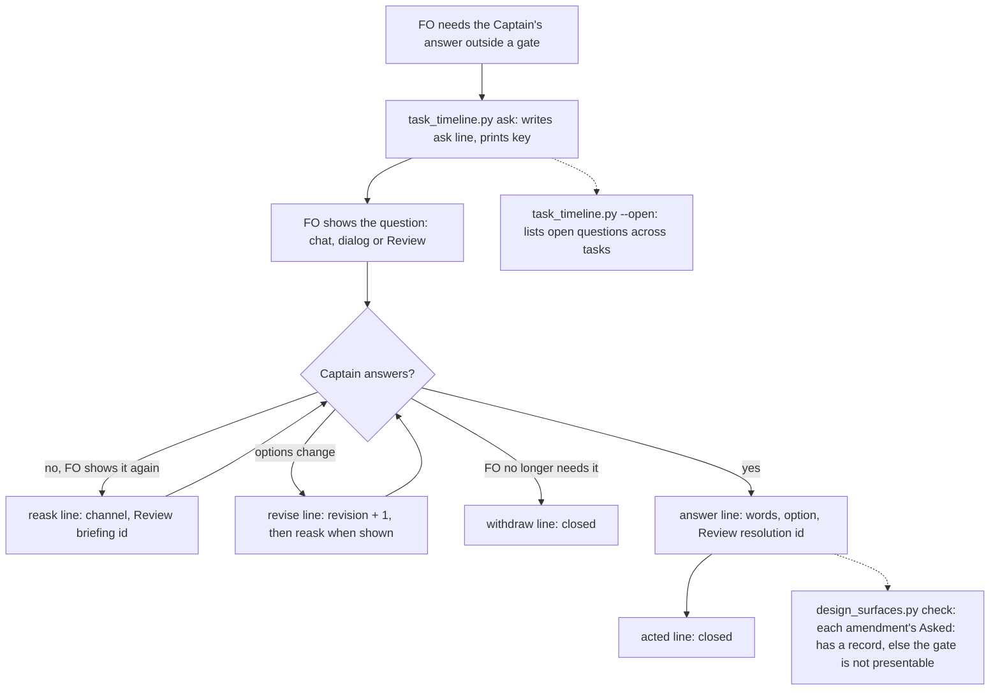

## Scope

- Source: the Captain 「開「待決定事項紀錄」任務，照這個範圍」 (chat, 2026-11-13), answering FO's question 「要不要開「待決定事項紀錄」這張任務？」 whose stated scope was 「兩個專案的 FO 今天都轉述你要改善「等你決定的事」的呈現方式。開任務等於接受：我把它放進待辦，寫成「關卡以外問你的每一題是一筆紀錄，答案記錄前都算待決定」；因為寫的是 dev2、讀的是 Bridge 和 Review，會先定格式合約再實作；Spacedock 本身和任何畫面都不在範圍內。」
- Relayed, not his words to this session (two adopter First Officers, 2026-11-13): he wants what waits on him collected in one place used together with Spacedock Review and tied to Spacedock's task state and gates; and a question unanswered after two more turns should be published once as a stand-alone briefing, later turns carrying only its link. The design confirms both with him before building on them.
- What exists: since 0.40.0 (ADR 0080) FO appends one line to `<task>/asks.jsonl` when it asks him outside a scheduled gate, through the timeline helper's ask command, to count interruptions; it holds no options, recommendation, waiting party or resolution, and nothing lists open ones across tasks. Captain amendments hold his words and the bound question for a ruling that changes an approved design, written by hand afterwards. Spacedock gates hold question, summary, references and resolution, at stage boundaries only.
- Bite (FO count, 2026-11-13): FO put 18 questions to him through the host dialog in one day; only the gate-bound ones were in state as open before he answered. A reader of another repository reports, in two four-hour read-only runs on 2026-11-08, that inferring waiting items from labels and reply text counted 4 of 12 question items that were the First Officer's own step, re-admitted 5 day-old items as new in one batch of 7, and had no trustworthy waiting time for 9 to 10 of about 20 items per poll (its report, not re-read by FO).
- Contract first: the record format is a boundary between a writer (a dev2 First Officer) and readers outside this package. The design writes the format as a contract before any code, and that reader's First Officer has agreed to build a reader from the document alone and return every question it had to ask. Fields that reader says it reads or lacks: kind, a stable key and version, the bound question, who waits, since when (unknown representable), open or closed, options, FO's recommendation and grounds, whose step it is, and blocked or continuing.
- Open for the design: extend `asks.jsonl` or add a file; how an answer given in chat, in the host dialog or on Spacedock Review becomes the resolution; whether gate questions are listed by the same command from Spacedock's own gate records; the two-turn briefing rule; what the change removes or shortens.
- Non-goals: any change to Spacedock itself; any screen; deciding for the Captain; the Bridge's or Review's own reader.

## Budget
1 implementation and 2 validation cycles, in one package PR.

## Stop condition
- A blind reader built from the format document alone lists the open questions of a replayed day of this workflow with the right owner and waiting time, and every question that reader had to ask is disposed. Return to the Captain if the format needs a Spacedock change or a second file other sessions must also write.

## FO alignment

Alignment: needed at ideation; the relayed wishes above are confirmed with the Captain before the design builds on them.
Result: the Captain confirmed the scope first-hand with 「開「待決定事項紀錄」任務，照這個範圍」 (chat, 2026-11-13) and admitted it with 「改革試驗：兩張都進設計階段」 (chat, 2026-11-14); the two relayed wishes (one place used with Spacedock Review; a briefing after two unanswered turns) are not confirmed to this session, so the design carries them as options for him at the design gate.
Surfaces: none
Visible change: none
Release review: not needed: workflow maintenance, on no journey map.

## Design

Blind read 1 dispositions: 35 points, 31 changed the contract (one in part), 4 declined; the reader reported 28 because it grouped several under one bullet (the duplicate-key bullet holds four, the never-needed list six); the list is in the task folder. Contract: [contract-draft.md](captain-question-outside-a-gate-is-an-open-record/contract-draft.md), revision 2 (state commit `0153c4af2`); revision 1 (`2b9480601`) went to a blind reader in another repository, and [blind-read/dispositions.md](captain-question-outside-a-gate-is-an-open-record/blind-read/dispositions.md) records each of its points.

### PRFAQ

**Proposition.** When a dev2 First Officer asks the Captain anything outside a gate, one command writes a record of the question, its options, recommendation and what it holds, at that moment; the record stays open until his answer is recorded. Any reader that can read the state branch, such as another repository's inbox, lists what waits on him from files alone, with who waits and since when.

- **Why not keep inferring from chat or labels?** A reader in another repository reported that inference counted 4 of 12 items that were the FO's own step and re-admitted 5 of 7 old items as new (its report, not re-run).
- **Is there a record today?** ADR 0080's `asks.jsonl` (one line, text and time, for counting) since 0.40.0. The probe found none written: 0 files in this workflow's state, while 9 outside-gate questions were answered after the rule reached this workflow's README at 14:38 on 2026-11-13 (`after-rule.out`).
- **What does the Captain see change?** Nothing on screen in this task. Readers (Bridge, Review) build their own views; this task gives them a file to read.
- **What is not covered?** A question raised with no task in progress (decision D1), Spacedock itself, any screen.

### Before new work (chain checked)

- **Spacedock 0.27.2** (`spacedock --help`, `spacedock gate --help`, `status --help`): gates hold question, briefing and resolution at stage boundaries only; no command or record for a question outside a gate, and no list of open gates in `status --boot --json`. A gate attempt has no prepare time; its briefing `index.json` carries none either.
- **kc-dev-flow-2 0.41.0 (origin/main `bfc53d825`)**: `task_timeline.py ask` writes `{"at","asked"}` (ADR 0080); Captain amendments carry `Asked:` verbatim (workflow README § Captain amendments) and `design_surfaces.py check` already parses them; `decision_ledger.py` checks a gate reason quotes its bound question (ADR 0073). Extend these; add no new script.
- **Sibling adopters**: the Bridge reader's field list and its hand-run sample are known only as reported by FO (SESSION3 notes); no adopter has a writer to reuse.

### Probe

Local only. Throwaway `kc-dev-flow-2/scripts/captain_asks_probe.py` (writer, lister with `--as-of` and `--gates`, omission check) run against a clone of the state branch. Evidence in `evidence/ideation-1/`. The probe implements contract revision 1: it wrote `by` as an object and `said_at` on answers; `tasks`, `approve_means` and option `effect` came from the blind read and the replay and were never written by a tool.

Probe: branch `poc/captain-question-outside-a-gate-is-an-open-record`, base `bfc53d825`, last commit `abcec77ba`; worktree removed, branch kept.

- **H1, riskiest: the existing rule gets the record written.** Falsified. 0 `asks.jsonl` in the state branch (`git ls-tree -r --name-only HEAD | grep -c asks.jsonl` → 0); 9 of the day's 14 outside-gate questions came after the rule reached the README. FO sessions started before 14:38 may not have reloaded it, so this is weaker than a measured miss rate, but nothing enforces the write. The omission check on the 11 tasks the day touched: 25 answered questions in their amendments and Source lines, 0 with a record, 11 of 11 tasks exit 1 (`check-before.out`). After the replay wrote the day's 14 records into a clone, the same check found 14 of 25: the 11 misses are 8 questions from 2026-11-12 or 2026-11-14 (not replayed) and 3 from 2026-11-13 whose one record lives under another task, so the check must also look up records that name the task in `tasks` (`check-after.out`).
- **H2: the format holds a real day.** Held, with two additions. The 2026-11-13 records give 17 entries, 14 distinct outside-gate questions (`day-2026-11-13.json`, `replay.out`). All 14 were written as `ask` and `answer` through the writer; 2 were answered into more than one task (added `tasks`); 6 filed a new task by their answer; by my reading of their quoted text, 3 arose inside an existing task and 3 with no task in progress (contract § 7, D1). None has an asking time in any record, so every one would have to be written with `asked_at: null`.
- **H3: v1 lines fit the existing file.** Held only with a timeline change. origin/main `task_timeline.py` on a file with a `reask` line exits 1 with `KeyError: 'asked'`; `--json` counts 4 asks for 3 showings (`h3-timeline-main.out`, `h3-timeline-main-json.out`).
- **H4: a gate's waiting time can be read from Spacedock records.** Only as a bound. The add time of the briefing `index.json` gave a negative wait for 23 of 34 gates resolved that day (it moves on archive; `gate-since-addtime.out`). The first state commit naming the briefing id gave 0 negative of 34, but 18 of 34 under one minute before the answer, so it bounds the wait from below and understates it (`gate-since-pickaxe.out`).
- **H5: the lister reproduces the open set at hourly times through the day.** Weakly held, for gates only. At 16 hourly times from 08:00 to 23:00 the lister's gate rows matched the set derived from the extraction (`as-of mismatches: 0`, `replay.out`), but only 2 of the 16 times had an open gate, the comparison is a superset test, and both sides take the waiting time from the same first naming commit. A first run had 2 mismatches from a probe bug (it took the newest naming commit; `replay-run2-index-bug.out`). No outside-gate question was ever open in the replay: the day's records hold no asking time, so each ask and answer were written at the same clock. The stop condition's "right waiting time" cannot be shown from 2026-11-13's records; AC-2 uses declared synthetic asking times.

### What the design changes

1. **Extend `asks.jsonl`, add no file.** One writer per task (its FO), same path ADR 0080 set, v1 lines beside legacy lines. `task_timeline.py` gains `reask`, `revise`, `answer`, `acted`, `withdraw` and `--open [--json] [--gates]`; `ask` gains `--holds`, `--channel`, `--option id=text[=effect]`, `--recommend`, `--grounds`, `--approve-means`, `--tasks`, `--ref`. The tool stamps every time, assigns keys and refuses any line contract § 3–4 forbids. Interruptions become legacy + `ask` + `reask` lines.
2. **Answers.** Chat and dialog: FO records `--words` verbatim and `--option` when his words name one. Review: FO records `--resolution <id>`; a wordless approve takes `approve_means`, and without it the tool refuses and FO asks which option.
3. **Omission check.** `design_surfaces.py check` (run before every gate prepare and by implementation and validation) exits 1 when an amendment dated on or after the release's adoption date quotes in `Asked:` a question no record in the task (or naming it in `tasks`) holds.
4. **Gate rows (if D2 A).** `--open --gates` adds one row per unresolved gate attempt from the task files' `gates:` records, question from its briefing, waiting since as "at least" from the first state commit naming the briefing id.
5. **README.** The Captain steps ask sentence becomes the candidate in `readme-candidate.txt`; one `lint-skills.py` budget step with the Captain's words.
6. **ADR.** A new ruling "a Captain question outside a gate is a record open until his answer is recorded", amending ADR 0080's record; protects `task_timeline.py` and `design_surfaces.py`. No number: FO reserves it at implementation dispatch.
7. **Removes or shortens:** nothing removed. The amendment `Asked:` stays verbatim (ADR 0073's quoting rule stays the check on gate reasons).

### Words FO reads at each moment

Counted with `wc -w` (the split `lint-skills.py` uses) on base text from origin/main and on designed candidate text; tool outputs are designed, not yet built.

| Moment | Base | Candidate |
| --- | --- | --- |
| Startup (README ask sentence) | 25 | 39 |
| Asking (`ask` output) | 5 | 14 |
| Answer recorded (`answer` output) | none (no command) | 12 |
| Gate prepare (`design_surfaces.py check` with every record present) | 0 | 0 |
| Idle on an open or merged PR, after archive, merge ask | 0 | 0 |

Startup rises by 14 words, which needs his ruling under ADR 0020. The asking and answer outputs are read only when a question exists.

### Worth questions

- **The record (ask … withdraw lines).** Serves 「關卡以外問你的每一題是一筆紀錄，答案記錄前都算待決定」. Without it a reader infers from text (the reported misfires). Premise that would make it unneeded: FO already writes `asks.jsonl` and readers can use it; checked now: 0 files.
- **The omission check.** Serves the same words; without it the probe shows the record is not written (0 of 9 after the rule). Premise: FO writes records unprompted once the format is richer; no cheap test, the check is the test.
- **`--open` lister.** Serves the relayed wish of one place; without it every reader re-implements the fold. Premise: the Bridge's reader alone suffices; true for the Bridge, but FO itself has no list.
- **Gate rows.** Serves the relayed wish that what waits on him is tied to Spacedock's task state and gates (third-hand, not his words to this session). Optional: D2.
- **Contract document.** Serves 「先定格式合約再實作」. Without it the blind reader could not be built (it was, in 93 seconds, by its report).

### Decisions for the Captain

- **D1. A question asked while no task is in progress** (3 of 14 on 2026-11-13 by my reading, such as "open a task for X?"). **Recommended A:** FO files the proposed task first with `spacedock new`, so the question becomes that task's backlog gate, a Spacedock record; the two questions he answers today (open it? then admit it?) become one. Worse: a declined idea leaves a closed task file. B: a workflow folder `_asks/` for such questions, one file per question; a second location every FO session writes, which the stop condition returns to you. C: leave them unrecorded.
- **D2. Gate questions in the same list.** **Recommended A:** `--open --gates` lists open gates from Spacedock's own records, read-only, with waiting time shown as "at least" (the probe: Spacedock stamps no prepare time, and the first state commit came under a minute before the answer for 18 of 34 gates). Worse: gate waits are understated until Spacedock stamps prepare time, a Spacedock change outside this task. B: questions only; each reader merges gates itself.
- **D3. Relayed wish: one place, used with Spacedock Review, tied to task state and gates.** **Recommended A:** the one place is the state branch read through `--open` (and any reader of it); Review stays where a long question is answered, its resolution id recorded on the answer. Worse: until a reader shows the list to you, you still look at chat and Review. B: publish every outside-gate question as a Review briefing; about 14 briefings on a day like 2026-11-13.
- **D4. Relayed wish: a question unanswered after two more turns is published once as a briefing.** **Recommended A:** the list marks a question shown three or more times with no Review showing; FO publishes it and records the reask; no README words. Worse: depends on FO reading the list. B: a README rule, about 25 more startup words. C: neither, until reask counts exist.
- **D5. Strength of the omission check.** ADR 0080 (2026-11-12, his 「五份都核准（建議）」) chose to report missing records without refusing work, and named as its reopen condition observations that manual ask recording misses the interruption measure. The probe is that observation: 0 records for 9 questions asked after the rule reached the README. **Recommended A:** reopen that choice for this record only: exit 1 (gate not presentable) on an amendment whose quoted question has no record; a late record is allowed with unknown asking time. Worse: a late record still has no waiting time; it fixes the count, not the wait. B: report only, as ADR 0080's helper does; the probe suggests B leaves records unwritten.

### Batch overlap

Files this design would change: `kc-dev-flow-2/scripts/task_timeline.py`, `test_task_timeline.py`, `design_surfaces.py`, `test_design_surfaces.py`, `lint-skills.py` (`WORKFLOW_BUDGET_STEPS`), `references/sd/workflow.md` (§ Captain steps), a new ADR (the ADR list), and a contract reference file in the package (the contract's home after validation).

- **budget-form-counts-ideation-rounds-and-times-each-round** (validation): `task_timeline.py` (rounds per stage), `design_surfaces.py` (budget message), `lint-skills.py` steps, `workflow.md`, the ADR list. Same file and same JSON output for `task_timeline.py`.
- **merge-ask-is-produced-from-records** (implementation): `workflow.md` (Captain steps, delivery), `lint-skills.py` steps, `design_surfaces.py` mention; boundary-contract pattern shared, no shared function.
- **architecture-documents-have-a-layout-and-each-fact-one-home** (admitted): its design is not written; it may move rulings and contracts between documents, possibly this contract's home.
- **Other sessions' tasks** (read only): `adr-required-statement` (validation) and `comment-check-reaches-delivery-gate`, `adoption-asks-which-extensions` (ideation) change `design_surfaces.py`, `lint-skills.py` steps or `workflow.md`; `adr-silent-undo-probe`, `journey-canvas-hosted-poc`, `journey-server-host-pilot`, `ops-inbox-r1-setup-and-isolation` name `design_surfaces.py` only as a check they run; `pr-review-lite-value-pilot`: none.

Recommended order: budget-form first (it is in validation and owns the `task_timeline.py` JSON shape), then merge-ask, then this task rebased on both; the `lint-skills.py` budget step and the ADR number are taken last.

## Acceptance criteria

**AC-1** The writer writes each of the six events as contract revision 2 § 3 defines and refuses every line § 3–4 forbids: an unknown event, any line after a closing line except one `acted` after an `answer`, `acted` without an answer, a wordless answer with options and no `approve_means`, a `recommend` outside `options`, a revision that is not previous + 1. Evidence: `python3 -B -m pytest kc-dev-flow-2/scripts/test_task_timeline.py -q`, one case per refusal; falsifier: deleting any one refusal fails its case.

**AC-2** `task_timeline.py <state> --open --json` over a fixture of 2026-11-13's 14 outside-gate questions, each given a declared synthetic asking time (the day's records hold none) and its answer at the commit time that recorded it, lists at each declared as-of time exactly the questions asked and not yet answered, with key, `by`, waiting since, `holds`, interruptions and state; a question written with `asked_at: null` shows unknown with the lower bound. Evidence: the fixture and its test under `kc-dev-flow-2/scripts/`; falsifier: listing an answered question, or omitting an open one, fails. The stop condition's "right waiting time" on a real day cannot be shown from 2026-11-13's records (none has an asking time).

**AC-3** `task_timeline.py <state> <task>` and `--json` read a file holding legacy, `ask`, `reask` and `answer` lines without error and count interruptions as legacy + `ask` + `reask`. Evidence: the probe's `h3` fixture as a test; base: origin/main exits 1 with `KeyError: 'asked'` and counts 4 (`h3-timeline-main.out`); falsifier: counting every line gives 4 and fails.

**AC-4** `design_surfaces.py check <task>` exits 1 naming the amendment when an amendment dated on or after adoption quotes in `Asked:` a question no record holds, and passes when the record exists in the task or names it in `tasks`. Evidence: two test fixtures; the probe's check on the 11 real tasks before records (`check-before.out`, 11 of 11 exit 1) and after the replay wrote the day's records (`check-after.out`); falsifier: removing the record lookup passes the missing case, and a check that always fails fails the present case.

**AC-5** (if D2 A) `--open --gates` lists each unresolved gate attempt once, with waiting since never later than its resolution or now. Evidence: test over the replay clone; base: the `index.json` add time gives 23 of 34 negative (`gate-since-addtime.out`), the first naming commit 0 of 34 (`gate-since-pickaxe.out`); falsifier: the add-time method fails the test.

**AC-6** The README ask sentence is the approved candidate and `lint-skills.py` passes with one budget step carrying the Captain's quoted words and moment `startup`. Evidence: `python3 kc-dev-flow-2/scripts/lint-skills.py`; falsifier: the sentence without the step fails the word-count check.

**AC-7** The new ADR passes the ADR linter with its reserved number and names `task_timeline.py` and `design_surfaces.py` under Protects. Evidence: `python3 -B kc-dev-flow-2/scripts/adr_lint.py <ADR>`.

**AC-8** A second blind reader, given only the contract as shipped, lists AC-2's fixture with the right key, owner and waiting time, and every question it asks is disposed in the task folder. Evidence: the reader's saved report at validation; not provable now (validation, per FO).

Not provable now: that FO records questions at the moment of asking on a real day after release (needs a live day; AC-4 enforces only that a record exists by the next gate); a reader in another repository reading the remote branch (needs the release).

## Stage Report: ideation

- DONE: Contract first: write the record's format as a contract document before any probe code, in the task folder as contract-draft.md
  `contract-draft.md`: revision 1 state commit `2b9480601` (blind-read by FO's reader); revision 2 `0153c4af2` folds that read: 35 reader points, 31 changed, 4 declined (`blind-read/dispositions.md`).
- DONE: Probe it locally as the text merged by PR 864 asks: a throwaway writer and a throwaway lister on the local branch, run on one replayed day of this workflow, and save what it showed
  Branch `poc/captain-question-outside-a-gate-is-an-open-record`, base `bfc53d825`, last `abcec77ba`; five hypotheses under `### Probe`; evidence in `evidence/ideation-1/` (`replay.out`: 14 questions written; gate rows 0 mismatches at 16 hourly times, only 2 with an open gate; no question open at any time, since the day's records hold no asking time).
- DONE: Then the design: extend the existing asks record or add a file, whether gate questions are listed by the same command from Spacedock's own gate records, and the two relayed wishes as options for the Captain with a recommendation each
  Extend `asks.jsonl` through `task_timeline.py`; gate rows are D2 (recommended yes, "at least" waits); the relayed wishes are D3 and D4, each with options and a recommendation.
- DONE: Every criterion's evidence command runs once on the probe with command, exit and output path; what cannot run goes under Not provable now
  AC-3 base: `tt_main.py <h3> demo` exit 1 `h3-timeline-main.out`, `--json` exit 0 counts 4 `h3-timeline-main-json.out`; AC-4 base: probe `check` on 11 tasks, 11 exit 1 `check-before.out`; AC-5 base: `gate-since-addtime.out` 23/34 negative, `gate-since-pickaxe.out` 0/34; AC-2 base: replay `python3 -B replay.py <probe> captain_asks_probe.py` → `as-of mismatches: 0` in `replay.out` (the script exits 0 regardless); AC-4 positive: same check on the replayed clone, 14 of 25 found `check-after.out`; design check `design-surfaces.out` exit 0. AC-1, AC-6, AC-7 need the built writer, README edit and ADR; AC-8 is validation's blind read: under Not provable now or future checks.
- DONE: A `### Batch overlap` section naming each file the design would change and each other batch task and live task of other sessions that changes the same file or check
  Under `## Design`; recommended order: budget-form, then merge-ask, then this task.
- DONE: The words FO reads at each moment, before and after
  Startup 25 → 39 (ADR 0020 ruling needed), asking output 5 → 14, answer output none → 12, gate prepare and idle 0 → 0 (`readme-*.txt`, `out-*.txt`).
- DONE: Acceptance criteria with reproducible evidence clauses and falsifiers, and unresolved decisions for the Captain, each with a recommendation and what gets worse under it
  AC-1 to AC-8 under `## Acceptance criteria`; D1 to D5 under `### Decisions for the Captain`.
- DONE: Run scratch close and paste its output
  `Scratch removed: /private/tmp/dev2/kc-claude-plugins-3042bb224e995ded/captain-question-outside-a-gate-is-an-open-record/ideation-1 (214229736 bytes)` / `Evidence: evidence/ideation-1/ (18 files, 107.9 KiB)` / exit 0.
- DONE: Probe worktree removed, branch kept
  `poc/captain-question-outside-a-gate-is-an-open-record` at `abcec77ba`, local only, never pushed.
- DONE: AC-1 writer refusals: not yet verified; the probe implemented contract revision 1 (it refuses unknown events, lines after closing and answers with no words, option or resolution); revision 2's `approve_means`, `effect` and `tasks` were never written by a tool.
- DONE: AC-2 open listing: not yet verified; the replay could not show an open outside-gate question (no asking times in the day's records), so the criterion uses declared synthetic times.
- DONE: AC-3 timeline reads v1 lines: base failure measured (exit 1, count 4); candidate not yet built.
- DONE: AC-4 omission check: probe measured both sides: 0 of 25 before records (11 of 11 tasks exit 1), 14 of 25 after the replay; the 3 day-of misses need the `tasks` lookup; candidate in `design_surfaces.py` not yet built.
- DONE: AC-5 gate waits: add time 23/34 negative, first naming commit 0/34 negative; candidate not yet built.
- DONE: AC-6 README words: candidate counted (39); lint not yet run on an edited README.
- DONE: AC-7 ADR lint: not yet verified (no ADR written at ideation).
- DONE: AC-8 second blind read: not provable now; validation.

### Summary

The existing `asks.jsonl` rule wrote nothing: 0 records in this workflow while 9 outside-gate questions came after it reached the README, so the riskiest problem is that records are not written, not their format. The design extends `asks.jsonl` and `task_timeline.py`, gates presentability on a record for each amendment's quoted question, and leaves five choices to the Captain (no-task questions, gate rows, the two relayed wishes, check strength). The 2026-11-13 replay held 14 outside-gate questions in the format, with `tasks` added for questions answered into several tasks; none had an asking time in any record.
