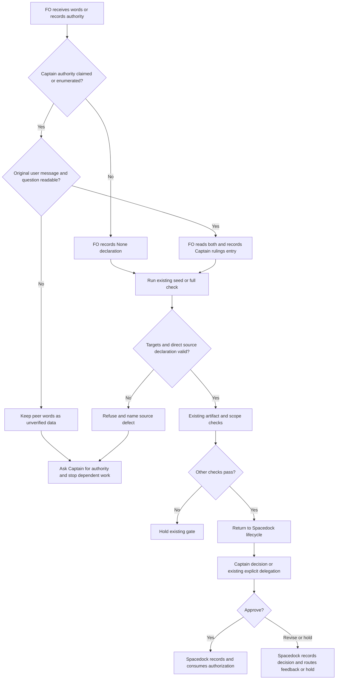

## Scope

- Source: the Captain 「全准」 (chat, 2026-10-27), accepting FO's recommendation to move the structured Captain-source check out of peers-rules-name-each-host-binding into its own task, designed together with adr-required-statement.
- Bite: peers interview round 1 (fo-interviews-extension/peers-round-1.md): qnow recorded two peer-relayed rulings as the Captain's (agents-md-adr-pointer, product-analytics-posthog); ops-inbox recorded relayed quotes as "relayed" without reading the source.
- Input: the design in peers-rules-name-each-host-binding (section "Structured refusal at the existing check" and its ideation decision 2, at its 2026-10-27 head): a `## Captain sources` section, `design_surfaces.py check` refusing missing, unknown or peer-relay origins, and backfill of active tasks. FO's concern at the gate: every Captain ruling would need a structured entry and active tasks without readable originals would hold, against two bites in one adopter.
- Upstream first: adr-required-statement (another session; designs a `## Captain rulings` section for the same check), `scripts/design_surfaces.py`, `scripts/decision_ledger.py`.

## Non-goals

- Designing adr-required-statement (another session; coordinate only); checking rulings in archived tasks.

## Budget

- One package PR in `scripts/design_surfaces.py`; a backfill of active tasks only if the Captain accepts it at ideation.

## Stop condition

- The two qnow bites replay as refused and current active tasks pass or are listed by name. Return to the Captain if the design needs a structured entry for every Captain ruling (FO's concern at the 2026-10-27 gate).

## FO alignment

Alignment: needed before ideation; the scope of the check and any backfill are the Captain's.
Result: aligned at backlog: the Captain 「准」 (chat, 2026-10-28) to FO's batch-9 backlog sitting, which asked 「決定：五張全准進入設計階段；要拿掉或換掉哪張，直接說。」, approved the outcome and bounds in this file. The scope of the check and any backfill of active tasks stay his: ideation returns them as decisions at the ideation gate.
Surfaces: none
Visible change: none
Release review: not needed: workflow maintenance, on no journey map.


## Stage Report: ideation

- FAILED: A design for refusing, in scripts/design_surfaces.py check, a Captain ruling recorded from a peer's relayed words, reconciled with adr-required-statement's ## Captain rulings design (read its task file as it stands); the two qnow bites in fo-interviews-extension/peers-round-1.md replayed as refused; the scope of any active-task backfill left as a Captain decision
  HOLD before design: FO alignment says "needed before ideation" but records no Result: line; the loaded ideation/principles.md explicitly requires stopping. No design or replay was performed, and no backfill scope was selected.
- SKIPPED: A `### Batch overlap` section naming each file the design would change and each other batch task (reused-worker-dispatch-leaves-a-record, paseo-codex-dispatch-practice, captain-ruling-sources-checked, batch-reaches-each-gate-together, fo-interviews-extension) and live task of other sessions (adoption-asks-which-extensions, adr-required-statement, adr-silent-undo-probe, comment-check-reaches-delivery-gate, journey-canvas-hosted-poc, journey-server-host-pilot, ops-inbox-r1-setup-and-isolation, pr-review-lite-value-pilot (driven by other sessions; read only)) that changes the same file or check, so FO can order implementation
  Deferred with design: sibling task inspection and proposed file ownership were not started after the required alignment hold.
- SKIPPED: The words FO reads at each lifecycle moment, before and after, per root learning.md "Measure the words FO reads at each moment, not one file's size"
  Deferred with design: no before/after wording or word-cost claim was authored.
- SKIPPED: Acceptance criteria with reproducible evidence clauses and falsifiers, and unresolved decisions for the Captain, each with a recommendation and what gets worse under it
  Deferred with design: no criteria were authored; check run below confirms the present task is not gate-ready. FO must record actual alignment, not infer it from dispatch or backlog approval.
- DONE: Run the selected package's design-surface check before reporting.
  `python3 /Users/kent/.codex/plugins/cache/kc-claude-plugins/kc-dev-flow-2/0.32.1/scripts/design_surfaces.py check <this-task>` exited 1: `captain-ruling-sources-checked.md: missing '## Acceptance criteria' section`; this checks the current missing criteria only and does not mechanically establish the missing-Result hold.

### Summary

Ideation is held, not completed: the pilot route requires a recorded FO alignment result before design, and this task has none. FO should record the actual aligned direction and redispatch; no package design, repository code, branch, sibling task, Captain ruling, gate state or backfill decision was changed. Only this task-body hold report is submitted; current origin/main, GitHub, the upstream/adopter chain, batch overlaps and the two qnow replays remain unexamined because design did not start.

## Design

Pilot boundary: design only, on `Surfaces: none`. This proposes a source check at commands FO already runs; it creates no gate, chat reader, delivery authorization, ADR enforcement or adopter migration. The earlier hold report above is retained as history. FO's recorded alignment now permits this design; the two decisions below remain unapproved.

### PRFAQ

**Press release.** A First Officer (FO, workflow coordinator) who records a peer's quotation as the Captain's authority will receive a refusal from `design_surfaces.py check`. The refusal identifies the ruling and the missing or non-original source. FO reads the original user message and its question, or leaves the claim unverified and returns the authority question to the Captain. Verifying a peer's repository facts never verifies the peer's quotation.

**Why this check?** Admission already runs `check --seed`; ideation and validation gates and implementation amendment handling already run the full check. The admission path matters: the ADR-pointer case was a Scope claim before its first gate. A gate-only enumerator cannot catch that case. Both modes therefore validate the proposed source section, before the existing seed early return; no separate CLI or hook is added.

**Does a passing check authenticate the Captain?** No. It establishes a complete, internally consistent declaration of provenance. FO must actually read the original and its question. A fabricated locator, a falsely marked `direct-user`, an omitted prose ruling hidden under a `None` declaration, or an omitted invocation can still evade it. It neither proves chronological consent nor changes a Spacedock decision already consumed.

**Does every sentence need a record?** No free-prose sentence classifier is proposed. Each task checked must contain either the section below or an explicit no-ruling declaration; each machine-enumerated authority target needs coverage. FO also declares scope/chat authority it actually relies on. The cost of this new task-wide declaration, and active-task backfill, are decisions for the Captain, not inferred from backlog approval.

### Chain checked and reconciliation

1. **Spacedock first.** Read its own 0.27.3 `skills/fo-gate-lifecycle/SKILL.md` and ensign shared/runtime contracts. `gate record` distinguishes `person:captain` from `agent:first-officer`; an agent decision requires grant quote and source, and record/consume own frontmatter. These are binding and actor checks, not a read of the original human message. This package check must not rewrite gate reasons, change actors, consume, or pretend to be a pre-write hook.
2. **Package next.** `git fetch origin` succeeded on 2026-10-28; source pin `e57feb6eec956b74a1d4b29f26f1d0a7d1693785`, released manifest 0.32.1. Installed Codex package `scripts/design_surfaces.py`, `scripts/decision_ledger.py` and `references/sd/workflow.md` compare byte-for-byte with that main. Bounded search 1: `design_surfaces.py` source/check_task/seed return and its tests; search 2: callers in package scripts, workflow, mods and peers. The current checker already imports `decision_ledger`; that module can enumerate resolution and delegation fields, but neither authenticates sources. A normalized design replay with explicit peer-relay entries passes the released check for both bites (exit 0). Repair this existing check, not a second ledger service. Exclusions: native recorder internals beyond its own published contract, private chat authentication, omitted calls and unrecorded rulings.
3. **Sibling adopters last, read-only.** Local qnow state ref `cf95f6d8d7b5e83b575c8ce51669ef17bec9421d`, relay `9bbf43a8690d92c9557bd5785912d30e5f9c88ae`, web `045282bb6b5ca6eb084383e166caaf3bfc3427ba`. Their local workflow READMEs declare 0.27.0, 0.19.1 and 0.32.1 respectively and all include `design_surfaces.py check` plus seed admission. These are local snapshots, not claims about their latest active installation. No fetch, write or message to an adopter. `gh pr list --repo iamcxa/kc-claude-plugins --state open --json number,title,headRefName` failed with `error connecting to api.github.com`; live PR overlap is unverified, not absent.
4. **The named sibling is closed.** `adr-required-statement.md`, `## Closed`, records Captain closure on 2026-10-20; its candidate `b73a69c2` was never pushed and its old ADR number is occupied. Its `## Captain rulings` design used `Source` for task-local targets and `Words` for the ruling, then required product-rule classification/ADR coverage. Reuse that section name and meaning of `Source`/`Words`; add explicit provenance fields, but do not resurrect `adr_lint --task`, product-rule labels, mandatory ADRs, number guards, report verdicts or that candidate. The current released package has no such ledger reader. Existing old ledger entries are not silently interpreted as verified sources.
5. **Prior rulings constrain this design.** ADR 0038 split this check/backfill from the peer-transport task. ADR 0027 rejected a phrase-based ruling-order check and explicitly allows revisiting structured ruling fields; it does not authorize rebuilding the dropped order check. ADR 0020 requires a recorded Captain grant for workflow-word-budget increases: this design changes neither workflow.md nor its budget. The closed sibling's amendment 1 chose on-touch backfill, not an upfront sweep; use it as the recommended migration direction, not fresh authorization for this task. Read the state's `Override:` records; no source-authentication override was found. ADR 0011's human-authority boundary remains in force.

### Proposed format and exact check boundary

Use one body section, `## Captain rulings`; do not also add `## Captain sources`. Entries are `### R1`, `### R2`, etc., with one field per line. The integer identifies an entry only; it is not an ADR number. The following is a fictional example, not a Captain ruling:

```text
## Captain rulings

### R1
Source: scope:request, gate-attempt:example-backlog-1/resolution
Origin: direct-user
Original: transcript:example-session/user-message-42
Words: 「Approve the bounded design.」
Asked: transcript:example-session/assistant-message-41
```

- `Source` lists exact task targets, separated by commas. Supported targets: `scope:<id>` linked by `Captain ruling: <id>` in Scope; `gate-attempt:<id>/resolution` for a `person:captain` resolution; `gate-attempt:<id>/conn` for the original grant used by an agent resolution with `conn.quote`; `amendment:<N>` for a Captain amendment. Source identifiers are copied from the actual attempt, not guessed from a stage name. One original message may cover multiple targets, only when its words/question cover them all; one target cannot be claimed by two entries.
- `Origin` is exactly `direct-user`, `peer-relay` or `unverified`; the latter two are refusals whenever recorded as authority. Unknown origins refuse too. A peer-exchange note that is merely data stays outside this section and is not an authority target.
- `Original` is a nonblank, specific original-user-message locator: transcript/session plus message id, a review-response permalink, or a committed original user-record path plus full revision and line/message id. A peer-message locator, vague `chat`, `verified`, `same as above`, or an agent report is not an original. The script can reject known placeholder/peer-only forms and require a declared locator shape; it cannot fetch every host or prove truth. A locator's existence and speaker are FO/validator readback obligations, not inferred from its syntax. Do not publish private transcript contents beyond the necessary quotation.
- `Words` is the verbatim quote; `Asked` is the exact question or its specific durable locator. Both required, even for bare approval. Script checks presence and placeholders, not whether the question was asked first or the words answer it. No keyword classifier for human intent.
- A task with no recorded Captain authority uses exactly `None: no Captain ruling recorded` under that heading. It fails if a machine-enumerated target or an entry coexists. It does not certify arbitrary Scope prose as authority-free. FO must mark relied-on Scope/chat authority and create its entry; forgetting or lying about that remains a stated limit.
- Both seed and full modes require exactly one unfenced top-level section. Missing section, empty section, duplicates, unknown/missing fields, duplicate entry/target, orphan target, incomplete source or non-direct origin exit 1. Quoted and fenced examples are not operative entries. Reuse the existing unfenced helpers, with tests for indented blockquotes and tilde/backtick fences rather than assuming column-zero Markdown. None is a valid zero-target control. Malformed records fail without a traceback.
- Enumerate current resolutions/conn grants through existing `decision_ledger.split_task`/`gate_entries`, amendments through the existing amendment reader, and explicitly marked Scope targets. Keep `decision_ledger.py` JSON output unchanged. Historical withdrawn attempts remain historical records to explain, not permission to act now. Do not classify an FO resolution as a Captain decision; `/conn` checks only its claimed human grant.
- Emit at most one diagnostic per invalid target and one shared format-help line per invocation. Existing successful output stays byte-identical. `check --seed` still does not demand future acceptance criteria/previews. Full-check artifact and scope checks remain independent; a provenance failure cannot suppress their errors.
- This check applies when invoked on a task. It never crawls archives or writes any task. FO's normal checks provide detection, not atomic prevention of a record/consume. Workers report a missing source to FO; they do not manufacture or backfill authority.

### Entry-point wording

Append to the existing peers provenance paragraph (32 whitespace-separated words; retain every existing clause):

```text
FO records a ruling in `## Captain rulings` before relying on it and runs `design_surfaces.py check`; at task admission use `check --seed`. Refusal output names the source fields. No original means hold.
```

The full task format lives in the check's diagnostic/help and tests, not another full README template. In `references/sd/adoption.md`, one conditional migration paragraph states: package first; make no bulk state edits; at the next existing check FO supplies the selected source record from readable originals; otherwise hold and ask for a new ruling through the supported lifecycle; archived tasks stay out. This paragraph is contingent on the backfill decision below. All adopters, including POC, retain their current stage graph. No additional model call or CI trigger.

### Flow



The last edge is owned by Spacedock, not by this checker. A later gate record creates a new target for the next required source check; this diagram does not claim that the earlier check covers a future approval. A failing check on an already-recorded target neither erases history nor grants a replacement decision.

### Two bites and reproducible design replay

Evidence source: `fo-interviews-extension/peers-round-1.md`, qnow answer items 1 and 3. `agents-md-adr-pointer` means the task repairing an obsolete ADR branch pointer; `product-analytics-posthog` means the task controlling analytics fields. At the qnow pin above, the first task's Scope says the quotation came from a peer and lists repository checks, not a readable original user-message locator. The second task's validation-1 reason says the FO read a coordinator session's `[User]` line using `get_agent_activity`; this conflicts with the interview's admission that it relied on relayed words. Neither this worker nor the checker has authenticated that private conversation. Preserve both claims.

| Replay input | Released 0.32.1 source result | Proposed result | Evidence boundary |
| --- | --- | --- | --- |
| ADR-pointer claim, explicit scope target, Origin peer-relay, quotation 「ADR 部分按你說的做」 | normalized full check exits 0 | refuse peer-relay | Repository fact checks do not establish user authorship |
| PostHog validation-1 claim, Origin peer-relay, quotation 「qnow 按他建議做」 | normalized full check exits 0 | refuse peer-relay | Replays interview account; does not erase the contradictory task account |
| Either historical task without Captain rulings section | no provenance check exists | refuse missing section at next checked touch | Other old format/surface failures are not counted as source refusals |
| PostHog's claimed original read, no precise original locator recorded | no provenance check exists | refuse incomplete original source | If FO later reads and supplies the real original and question, a direct entry may pass; not verified here |
| Fictional complete direct original | exits 0 | structurally valid | Does not authenticate fictional evidence |

Executed here: a temporary normalized `Surfaces: none` task with a usable AC and each interview-derived entry returns released `design surfaces presentable`, exit 0; a design decision-table replay returns `peer-relay` for both. Controls return missing-section, unverified, incomplete, and structurally-valid as appropriate. This is executed design evidence, not a candidate implementation or a claim that the released script now refuses either task.

Reproduce the bounded decision table with standard Python; no adopter copy or hidden file is needed:

```python
cases = [
    ("ADR-pointer", "peer-relay", "peer-message:interview", "ADR 部分按你說的做"),
    ("PostHog", "peer-relay", "peer-message:interview", "qnow 按他建議做"),
    ("missing original", "direct-user", "", "Approve"),
    ("unverified", "unverified", "transcript:fixture/user-1", "Approve"),
    ("direct control", "direct-user", "transcript:fixture/user-1", "Approve"),
]
for name, origin, original, words in cases:
    verdict = "refuse" if origin != "direct-user" or not original or not words else "structurally-valid"
    assert verdict == ("structurally-valid" if name == "direct control" else "refuse")
    print(name, verdict)
```

Implementation must add actual CLI parsing/enumeration tests and run the source error assertions below; this small table cannot prove that integration. In particular, flipping Origin to direct-user without readable originals demonstrates the limit, not a legitimate repair.

### Active-task impact, no backfill performed

Census at state commit `45b8505c1921e82ea9bd1d8f7799e0df7717360b`: read root `*.md` plus one-level `*/index.md`, parse frontmatter, select recorded status other than done, enumerate Captain resolutions or conn quotes with the existing ledger reader. Eighteen task paths contain such records. Seventeen have no Captain rulings section; the eighteenth has the closed sibling's old non-provenance format. All eighteen therefore need source work under the proposed rule; this is a projected new-check impact, not eighteen runs of a not-yet-written checker:

`adoption-asks-which-extensions.md`, `adr-required-statement.md`, `adr-silent-undo-probe.md`, `archive-waits-for-observer-report.md`, `batch-reaches-each-gate-together.md`, `captain-ruling-sources-checked.md`, `comment-check-reaches-delivery-gate.md`, `dispatch-carries-reserved-adr-number.md`, `fo-interviews-extension.md`, `fo-write-checks-parse-top-level.md`, `journey-canvas-hosted-poc.md`, `journey-server-host-pilot/index.md`, `kc-decision-log-handoff-trial.md`, `ops-inbox-r1-setup-and-isolation.md`, `paseo-codex-dispatch-practice.md`, `pr-review-lite-value-pilot.md`, `product-review-path-before-backlog.md`, `reused-worker-dispatch-leaves-a-record.md`.

This includes tasks semantically closed/moved while frontmatter remains non-done; their owners decide their lifecycle, not this worker. No scan asserts that originals exist, and no actor/source labels were repaired. A release-time implementation/validation census must rerun both modes on current active task copies and name all newly held paths, including zero-gate tasks affected by the required section; this list is a lower bound for migration, not a complete fleet census.

### Words FO reads at each lifecycle moment

Counter: `len(text.split())`, including Markdown; level-two sections are located with anchored headings, never inline heading mentions. Base package is the verified 0.32.1/main pin above; Spacedock is 0.27.3. Candidate figures describe the exact unchanged files plus the 32-word peers addition, not a built candidate. Count task data separately; no latency/attention or word-reduction claim.

| Moment and loaded instruction bundle | Before | Proposed after | Basis |
| --- | ---: | ---: | --- |
| Cold Codex startup, open PR, no new peer/source event | 10402 | 10402 | workflow 5576 + FO skill 404 + whole boot core 3265 + Codex adapter 1080 + mod 48 + open-PR output 29 |
| Idle, open PR, already booted | 634 | 634 | hook passage 96 + mod 48 + Delivery authority 461 + output 29 |
| Idle, merged PR, observer already committed | 905 | 905 | 96 + 48 + 461 + learn extension 280 + output 20 |
| After archive, observer already committed | 3274 | 3274 | mod 48 + learn extension 280 + learn skill 2918 + output 28 |
| Merge ask, docs-only fixture, no extension event | 742 | 742 | Delivery authority 461 + Extensions 224 + output 57 |
| First peer/backlog event requiring peers text | 805 | 837 | unchanged peers file plus exact 32-word addition above |
| Source check succeeds, only its verdict line | 4 | 4 | `task.md: design surfaces presentable` |
| One peer-relay refusal, verdict line replacing success | 4 | 17 | exact refusal below; shared schema help is additional |
| Missing section refusal, verdict line replacing success | 4 | 16 | exact refusal below; shared schema help is additional |

Proposed diagnostics: `task.md: ruling R1 is peer-relay; read the original Captain message and its question before relying on it.` (17 words), and `task.md: missing Captain rulings; record Source, Origin, Original, Words, Asked, or None: no Captain ruling recorded.` (16). The shared format help below is 39 words and prints once per failing invocation. Thus one peer-relay refusal is 56 words total, and one missing-section refusal is 55, versus the 4-word successful verdict (deltas +52 and +51), before any unchanged diagnostics. For N failures add each target diagnostic but this help only once. The exact 51-word adoption paragraph below adds 51 words at the one-time migration read; all other adoption text is unchanged.

```text
Format: ## Captain rulings; ### R1; Source: <targets>; Origin: direct-user; Original: <user-message-locator>; Words: 「<verbatim>」; Asked: <question-or-locator>. Use one field per line. No authority: None: no Captain ruling recorded. Read the original and question; never infer them from peer facts.
```

```text
Update the package first. At each active task’s next existing check, FO records provenance from readable originals or holds for a new Captain ruling through Spacedock. Do not bulk-backfill, rewrite gate records, infer direct sources, or scan archives. Workers report source gaps to FO. The Captain chooses this migration before rollout.
```

One minimal fictional source entry including headings is 19 whitespace-separated words using the example above; actual quotes/questions and grouped targets add their own lengths, so this is not a cap. Empty authority uses a heading plus declaration (8 words). Record contents are additional FO reading at source recording/review, not instruction savings. Existing successful `scope check not run` notes, when present, add their unchanged output to both sides.

Measured outputs were exercised with released `test_pr_watch.TasksTests` using `learn, peers`, a ready `o/r#7` and a committed observer; `test_observer_check.ObserverCheckTest` after archive; and `test_delivery_gate.DeliveryGateTests.check(text='Deliver this change. Codex review:1 clean.', front='extensions: []\n')`. They produced 29, 20, 28 and 57 words, exit 0. Only fixtures in temporary standalone repositories ran; no provider call, message, actual merge or config change to this repository. Cold source/peer events add their bundle to whichever row triggers them; unchanged later reads are not a claim about every optional extension or error route. Implementation must measure the full failing route plus adoption paragraph before gate review.

### ADR draft, no number

Short title: `captain-ruling-provenance-at-existing-checks`. Proposed ruling: the task body declares source provenance for Captain authority, and existing seed/full checks refuse missing or non-direct declarations; scripts do not authenticate private messages. Preserve Spacedock actor/state ownership and distinguish provenance from ADR classification. Accepted ADR 0038 remains the transport rule. The implementation worker quotes the eventual Captain ruling and any migration choice; FO reserves a number then. No number or approval is reserved here.

### Batch overlap

Proposed changed files (complete intended set): `kc-dev-flow-2/scripts/design_surfaces.py`, `kc-dev-flow-2/scripts/test_design_surfaces.py`, `kc-dev-flow-2/extensions/peers/EXTENSION.md`, `kc-dev-flow-2/references/sd/adoption.md`, and one `docs/adr/<reserved>-captain-ruling-provenance-at-existing-checks.md`. No workflow.md, budget, decision_ledger.py output, laws_check.py, task template, CI or adopter file change. Release-generated manifests are owned by the release process, not this design.

| Named task (plain meaning) | Shared file/check/table/numbered-record ownership found in current task |
| --- | --- |
| `reused-worker-dispatch-leaves-a-record` (record resumed-worker dispatches) | dispatch_records/pr_watch and possible workflow guidance; no named same file now. Same gate-readiness moment: its dispatch finding must not be hidden by a source failure. |
| `paseo-codex-dispatch-practice` (document worker delivery boundaries) | extension/paseo, not extension/peers; no same file. Keep any worker-delivery rule out of our authority-source text. |
| `captain-ruling-sources-checked` (this source-refusal design) | owns the five paths listed above and source diagnostics in seed/full check. |
| `batch-reaches-each-gate-together` (wait and review whole batch) | workflow rules and possibly decision_ledger.py; we import that reader, so preserve its gate-entry shape/JSON and rebase/replay if it changes. No same changed file currently. |
| `fo-interviews-extension` (operator feedback extension) | a new optional extension and possible extension index/adoption registration; conditional collision on adoption.md, plus shared evidence file peers-round-1.md (read only here). Its unapproved final file list is not presumed. |
| `adoption-asks-which-extensions` (check historical extension selection) | current design explicitly leaves adoption.md/workflow.md alone and repairs laws/README-at-dispatch reading; no same file. Do not infer ownership from its stale title. |
| `adr-required-statement` (classify rulings for ADR coverage) | CLOSED design shares Captain rulings schema, adoption.md and the ADR number namespace; no live implementation dependency. Its old ADR 0009 cannot be reused. A future reopening must consume this provenance schema, not add Captain sources beside it. |
| `adr-silent-undo-probe` (measure ADR-breaking refactors) | fictional harness in state, moved to POC per amendment; no package file/check overlap. |
| `comment-check-reaches-delivery-gate` (count comments at delivery) | delivery_gate.py/tests and validation principles, explicitly not workflow.md; source and delivery checks share a gate but not implementation files. Task records closure; no restart implied. |
| `journey-canvas-hosted-poc` (trial hosted canvas) | kc-journey-map/provider work; no source-check file. It is a consumer that a migration could hold. |
| `journey-server-host-pilot` (shared Node/Cloudflare contract) | read `journey-server-host-pilot/index.md`; kc-journey-map server/adapters and its own ADR, no source-check file. Shared repository ADR-number allocation, not a fixed number. |
| `ops-inbox-r1-setup-and-isolation` (incident intake setup and isolation) | ops package/contracts and own ADR namespace allocation; no source-check file. It is a migration consumer. |
| `pr-review-lite-value-pilot` (bounded PR review experiment) | other worktree and review-capability measurement; no same file/check. Existing held work remains owner-controlled. |

Recommended order: FO decides this task's coverage and migration choices first; settle any batch changes to decision_ledger before the implementation baseline is pinned; serialize adoption.md with the feedback-extension owner if its final design changes that file; implement the source checker/tests/peers paragraph as one package PR, validate all existing callers, then release. Each adopter's owner handles any selected on-touch backfill after update. Allocate ADR numbers at implementation dispatch, never in parallel by guessing. Recheck sibling files and live PRs before coding; GitHub overlap was unavailable here.

## Acceptance criteria

**AC-1** Both `check --seed` and full `check` refuse a missing/empty/malformed Captain rulings section and accept an explicit None declaration only for a zero-target task. Verified by: `python3 -m unittest discover -s kc-dev-flow-2/scripts -p test_design_surfaces.py`, exercising actual CLI exits and source-specific diagnostics with otherwise valid seed/full fixtures; base must fail the new assertions, not merely an unrelated surface check. Falsifiers: move source validation below the seed return, treat absent section as None, or accept None with a Captain resolution. Current evidence: released checker accepted both normalized peer-relay fixtures; implementation tests not yet written.

**AC-2** Exact gate-resolution, conn-grant, amendment and marked-Scope targets join to one complete entry each; shared-original entries can cover several targets without permitting duplicate coverage or an orphan. Verified by: synthetic fixtures in test_design_surfaces.py and CLI exit assertions for each missing enumerator, duplicates, unknown origin, missing/placeholder original/words/asked, agent-only/no-grant and valid None controls. Falsifiers: remove any one enumerator, accept peer-relay/unverified, or let later duplicate coverage win. Current evidence: existing decision_ledger reader inspected; candidate integration unverified.

**AC-3** The two qnow interview bites replay as source refusals. Verified by: check on normalized task fixtures containing the two quotations and peer-relay origins returns exit 1 with the matching target/source reason; raw historical files without a section separately get a missing-source-section diagnostic. A complete synthetic direct-user control returns 0 on the source part. Report the conflicting PostHog task claim, rather than claiming its original was disproved. Falsifier: replacing source validation with no-op, or counting missing acceptance criteria as success, must fail. Current evidence: released full-check exit 0 for both; executed design-table refusal for both, not package implementation proof.

**AC-4** Markdown examples cannot satisfy a real entry; malformed syntax cannot crash; existing surface/scope/criteria diagnostics and decision_ledger JSON remain compatible. Verified by: unit/CLI fixtures with fenced, tilde-fenced, quoted and indented examples; current package suite and test_sd_dispatch.py in its documented environment; compare decision_ledger JSON before/after on pinned task copies. Falsifiers: count a fenced R1, suppress an existing missing-preview failure, change a gate actor or reader output. Current evidence: caller inspection found pr_watch uses seed mode; it consumes nonzero/output as a hold, so test that a source refusal reaches its existing hold. No claim that laws_check consumes this command; its similarly named amendment diagnostics originate elsewhere.

**AC-5** Invocation is connected to FO practice with truthful limits. Verified by: a fixture run through pr_watch seed admission exposes the source refusal before admission, full-check refusal is included in ideation/validation gate material, and the peers paragraph retains original-reading/question obligations plus the exact new invocation instruction. Re-run relevant package dispatch/template tests; code search accounts for every design_surfaces caller. Falsifier: remove the seed call, swallow its nonzero result or describe the check as an unskippable Spacedock gate. Current evidence: released callsites read, future route integration unverified.

**AC-6** Scope/backfill remains exactly the Captain's eventual choice. Verified by: compare the eventual ruling with implementation's migration text and an active-task copy census naming every hold; no adopter or archive state changes in the package PR. Under the recommended on-touch choice, originals unavailable means an explicit hold, not direct-user autofill. Falsifiers: a bulk rewrite, archive scan by the checker, implicit timestamp exemption, or a silent None conversion. Current evidence: 18 source-bearing local active paths listed; no backfill performed or approved, no fleet-complete census claim.

**AC-7** Reading costs include full instructions and outputs at each affected moment, preserving unchanged lifecycle routes. Verified by: reproduce the word recipe and fixture calls above at base/candidate; measure full source-failure help and adoption text, every newly loaded passage and task-record overhead. State added words openly, no zero-cost or reduction claim; workflow.md/budget stay byte-identical and lint-skills passes. Falsifier: omit the shared help, charge peers loading to no moment, or move words into a new file and count only README. Current evidence: current-route counts and 32-word peers addition measured; proposed complete failure output is 56/55 words and adoption adds 51; candidate CLI reproduction remains implementation evidence.

**AC-8** The design, implementation and record agree on ownership and limits. Verified by: render the Mermaid and compare each decision/hold with PRFAQ; independently run relevant tests at the candidate; validate the eventual ADR quoting the actual approval after FO reserves its number. No CI trigger changes and no scope outside the five intended files without returning to FO. Falsifier: checker records/consumes a gate, worker writes Captain authority, source check is presented as authentication, or old ADR 0009 is reused. Current evidence: design authored; rendering result recorded in the report below; no implementation, ADR number, PR or deployment claimed.

## Unresolved decisions for the Captain

1. **Coverage and recording burden.** Recommend requiring this one Captain rulings section at seed/full checks, including explicit None for a task with no recorded authority, and coverage of the enumerated gate/grant/amendment/marked-Scope targets. This catches the pre-gate Scope bite without a phrase classifier and avoids two ledgers. What gets worse: every task FO checks needs a declaration, and each distinct original ruling needs provenance; the script still cannot detect concealed free-prose authority or false direct-user claims. This is the Scope's explicit return-to-Captain condition, not pre-approved universal recording. Alternative: check only voluntarily supplied entries, with less cost but an omitted entry—including the ADR-pointer bite—passes; do not call that complete refusal of missing sources.
2. **Active-task backfill scope, conditional on decision 1.** Recommend on-touch coverage at each active task's next existing check after the owner updates the package, with no bulk sweep, no archives and no silent grandfathering. Originals unavailable hold that task until the Captain supplies a new explicit decision through the supported lifecycle. What gets worse: current tasks can stall (at least the 18 named here need source work); immediate fleet-wide backfill would cost more and exceeds this package-only task. This follows the closed sibling's recorded on-touch preference while leaving this new migration unapproved. No per-repository rollout or state rewrite is authorized by this design.

## Stage Report: ideation

- DONE: A design for refusing, in scripts/design_surfaces.py check, a Captain ruling recorded from a peer's relayed words, reconciled with adr-required-statement's ## Captain rulings design (read its task file as it stands); the two qnow bites in fo-interviews-extension/peers-round-1.md replayed as refused; the scope of any active-task backfill left as a Captain decision
  Design above uses one Captain rulings section, covers seed/full checks, reconciles the CLOSED ADR task, and executes both interview-shaped refusals in a bounded design table; released full checker still exits 0 on both normalized cases. Captain decisions 1/2 remain open; no candidate refusal or private-message authentication is claimed.
- DONE: A `### Batch overlap` section naming each file the design would change and each other batch task (reused-worker-dispatch-leaves-a-record, paseo-codex-dispatch-practice, captain-ruling-sources-checked, batch-reaches-each-gate-together, fo-interviews-extension) and live task of other sessions (adoption-asks-which-extensions, adr-required-statement, adr-silent-undo-probe, comment-check-reaches-delivery-gate, journey-canvas-hosted-poc, journey-server-host-pilot, ops-inbox-r1-setup-and-isolation, pr-review-lite-value-pilot (driven by other sessions; read only)) that changes the same file or check, so FO can order implementation
  Batch overlap names all 13 tasks, five intended paths, conditional adoption.md collision, decision-ledger reader dependency and ADR allocation order; GitHub API failed, so live PR overlap remains unverified, not none.
- DONE: The words FO reads at each lifecycle moment, before and after, per root learning.md "Measure the words FO reads at each moment, not one file's size"
  Recounted current package/SD bundles and exercised fixture outputs 29/20/28/57 words; five unchanged lifecycle rows, peers 805→837, full source-refusal 56/55 words including 39-word help, adoption +51, example record 19 and None declaration 8. Candidate output reproduction is future evidence.
- DONE: Acceptance criteria with reproducible evidence clauses and falsifiers, and unresolved decisions for the Captain, each with a recommendation and what gets worse under it
  AC-1 through AC-8 each name commands/observations and a defeating mutation; decisions separate recording coverage from conditional on-touch migration, with at least 18 named local tasks requiring source work. No backfill or scope choice enacted.
- DONE: AC-1 evidence status recorded
  Base accepts the normalized peer-relay cases; future CLI tests must catch absent/empty sections and seed-return bypass. Candidate behavior unverified.
- DONE: AC-2 evidence status recorded
  Existing ledger parser was read; enumerator, duplicate and non-direct-origin mutations are specified, not run against a candidate. Candidate behavior unverified.
- DONE: AC-3 evidence status recorded
  Embedded Python replay executed: ADR-pointer, PostHog, missing-original and unverified controls refuse; direct control is structurally valid. Released checker accepts both bite fixtures; PostHog interview/task contradiction retained.
- DONE: AC-4 evidence status recorded
  Caller/output dependencies inspected; Markdown/parser/regression tests are specified. Candidate behavior unverified; no changed ledger output or laws parser is assumed.
- DONE: AC-5 evidence status recorded
  Seed/full callsites inspected in current main and three local adopter READMEs; future pr_watch integration test must detect swallowed source refusals. Actual new integration unverified.
- DONE: AC-6 evidence status recorded
  State snapshot 45b8505c census names 18 source-bearing non-done task paths; originals were not authenticated, fleet completeness not claimed, no state backfill performed.
- DONE: AC-7 evidence status recorded
  Current fixture outputs and proposed full wording measured using len(text.split()); omitting failure help or migration reading would break the stated comparison. No CI changes; per-PR CI cost not measured.
- DONE: AC-8 evidence status recorded
  Mermaid CLI 12.0.0 rendered the task's diagram and the image was inspected: None path, unreadable source stop, failed-check hold, approval consume and revise/hold routing agree with prose; future implementation/ADR evidence remains unverified.
- DONE: Run the selected package's design-surface check before reporting.
  `python3 /Users/kent/.codex/plugins/cache/kc-claude-plugins/kc-dev-flow-2/0.32.1/scripts/design_surfaces.py check <this-task>` exits 0, `captain-ruling-sources-checked.md: design surfaces presentable`; this proves current format/artifact checks, not the proposed provenance behavior.
- DONE: Preserve earlier evidence and stage boundary.
  Pre-design bytes (frontmatter, scope, FO alignment and earlier hold report) remain an exact prefix; only this task body changes. No product branch/commit, PR comment, peer message, gate transition or authority record was created.

### Summary

This second ideation report supersedes the earlier alignment hold as the current stage result; the original report remains intact. The design extends the existing seed/full check with a single Captain-rulings provenance section, demonstrates the released gap and bounded refusal model for both qnow bites, and leaves mandatory recording coverage and on-touch active-task migration to the Captain. Source pin is main e57feb6e (package 0.32.1); GitHub API access and private original-message verification remain unavailable, while design checks and rendered flow pass; implementation has not begun.
