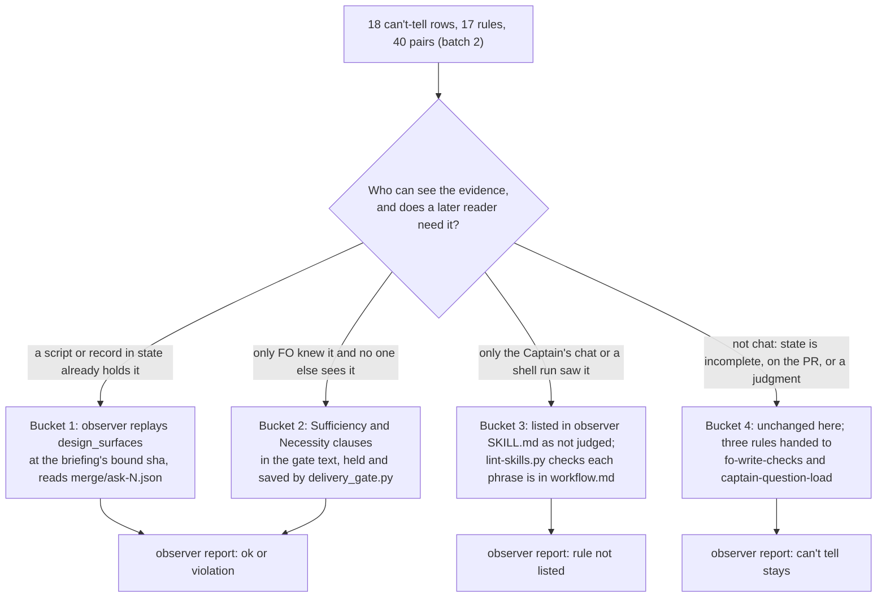

Filed from a learn package-issue candidate the Captain approved on 2026-10-13 (「按建議1,3」). The observer reports on tasks `fo-record-checks` (PR #640) and `learn-delivery-follow-through` (PR #639) both marked the same FO rules `can't tell`, because the rules require FO to do something in front of the Captain but not to leave a record in state.

## Scope

- Rules read as `can't tell` in both reports: the validation step "presents every step in full beside its observed output"; "Before recommending delivery, FO confirms both goal sufficiency and minimal necessity"; Delivery authority "present the exact candidate and PR body before authorized push/create". In one report each: the head read before the merge ask, the backlog `design_surfaces.py check --seed` run, `pr_watch.py add`, and whether a gate ruling needs an ADR.
- Learn judged it no-change: the rules exist and attribution to an outcome is unknown. The package question is whether each rule should name the record FO leaves (for example a line in the committed gate summary), or be accepted as chat-only and dropped from the observer's checks.
- Non-goals: to be set at ideation.

## Design

Not repository files: this section is the design; implementation lands it. Sources read 2026-10-19: kc-dev-flow-2 0.25.0 at origin/main c60e89e1 (`skills/observer/SKILL.md`, `references/sd/workflow.md`, `references/sd/laws.md`, `scripts/{delivery_gate,design_surfaces,dispatch_records,laws_check,observer_check,package_version,workflow_checkout,lint-skills,pr_watch}.py`), Spacedock 0.27.2 (`spacedock --help`, `gate prepare --help`, `dispatch build --help`, and the 0.27.0 plugin's `internal/gates/prepare.go` and `skills/present-gate/SKILL.md`), ADRs 0014, 0017 and 0020, the six batch-2 observer reports under `_archive/<slug>/observer.md`, the other three batch-3 task files as they stand (seeds only, no design yet), and the qnow and subspace-relay READMEs (read-only `git grep` on origin/main). Measurement files are under `chat-only-evidence-observer-blind/measure/` (`tally.py`, `replay.sh`, `replay-output.txt`, `words.py`, `delivery_gate-proto.diff`, `observer-additions.md`).

### Chain check

- **Spacedock 0.27.2:** no hook runs before `dispatch build` or `gate prepare` and nothing records a script run (`spacedock --help`, `dispatch build --help`, 2026-10-19). `gate prepare --reference FILE` is the one slot it offers: a reference is a further markdown source bound into the briefing and its digest (`internal/gates/prepare.go`, read, not run on a throwaway). All 145 briefings in this state branch carry exactly one artifact, the task file at a sha, and use no reference. The artifact `uri` names a state-branch sha, and the briefing's `rev` equals the sha256 of the task file at that sha (checked on `worker-loads-declared-package` ideation, 2026-10-19), so the task file at that sha is the file the digest covers.
- **kc-dev-flow-2 0.25.0:** a record for one of the seventeen rules below already exists: `delivery_gate.py check` writes `<task>/merge/ask-<N>.json` (`pr`, `head`, `class`, `verdict`, `points`, `time`) on exit 0 since #666, and nothing in `skills/observer/SKILL.md` reads it. `laws_check.py` L1 and L2 judge only a dispatch record or a sentinel, never a gate. ADR 0014 already accepts that `workflow_checkout.py` is "prose-enforced"; its reopen condition (a Spacedock pre-dispatch hook) has not occurred (checked above).
- **Siblings:** qnow's `docs/dev2-poc/README.md` carries the same sufficiency-and-necessity sentence and subspace-relay's `docs/dev2/README.md` mentions the observer, both as synced copies of this package's text; neither adds a record or a check for these rules (`git grep` on origin/main, 2026-10-19). Scripts and skills reach them at plugin update, README words only at the next sync.

### Measurement: the can't-tell rows by rule

`python3 -B chat-only-evidence-observer-blind/measure/tally.py` (run in the state checkout, 2026-10-19) reads the six batch-2 observer reports (workflow-budget-ratchet, prod-security-validation-gate, worker-loads-declared-package, special-role-triggers, ui-design-review-in-ideation, merge-gatekeeper): **18 can't-tell rows naming 17 rules, 40 rule-report pairs**; no row is left unmatched. Each row is judged by one question: who or what can see the evidence, and does anyone need it later?

| Bucket | Rule (observer wording) | Pairs | Disposition |
| --- | --- | --- | --- |
| 1 replay or read | FO runs `design_surfaces.py check` and `--seed` before each gate | 5 | observer replays the check at the task-file sha the briefing binds |
| 1 replay or read | FO runs `delivery_gate.py check` before the merge ask | 5 | observer reads `merge/ask-<N>.json` (exists since 0.25.0) |
| 2 one record | FO confirms goal sufficiency and minimal necessity | 4 | `Sufficiency:` and `Necessity:` clauses in the gate text; `delivery_gate.py` holds without them and saves them in `ask-<N>.json` |
| 3 chat or shell only | acceptance script "presents every step in full beside its observed output" | 5 | listed as not judged (D3 asks whether to record it instead) |
| 3 chat or shell only | FO runs `package_version.py` and `workflow_checkout.py` before dispatch | 5 | listed as not judged |
| 3 chat or shell only | FO answers a question the Captain asks at a gate before dispatching on it | 4 | listed as not judged |
| 3 chat or shell only | FO runs `dispatch_records.py --names` before `dispatch build` | 1 | listed as not judged; L2 still judges the record |
| 3 chat or shell only | FO assesses the four evidence fields of a finding | 1 | listed as not judged; its outcome is the decline or fix line |
| 4 not this class | `Reviewer:` line for a call dated before the task existed; Spacedock `### Feedback Cycles` heading named by a dispatch but absent | 2 | evidence is in state but incomplete; no change here |
| 4 not this class | a ruling that may need an ADR (judgment); "marks the PR ready"; Codex round 2 and Copilot handling (both on the PR) | 4 | not chat; no change here |
| 4 not this class | follow-up message to a resumed worker; Captain's chat words reaching a dispatch as a grant or scope ruling (two rules); gate reason claiming "the stated order" | 4 | handed on: the first three to fo-write-checks (a checklist-versus-report and a quoted-words check), the last to captain-question-load (batch gate text) |
| | **Total** | **40** | buckets 1 to 3 close 30 pairs for new tasks; bucket 4 leaves 10 |

Why two replays were not built as laws: `design_surfaces.py check` re-run at each briefing's bound sha exits 0 on 12 of 12 batch-2 backlog and ideation gates (`replay.sh`, `replay-output.txt`); re-run at the commits that added each task's briefings (47 tasks, 82 runs, today's script), 11 runs exit 1, each naming a section or line that task's gate did not have (`## FO alignment`, `Surfaces:`, `Design review:`), which is ADR 0017's reason a law over history is red by age. No current failure exists for a law to catch. `package_version.py` could be replayed from the dispatch record's `Package root:` version, but that needs the README as it stood at dispatch, which is not an observer input; measured on 260 dispatch records (README from the repository's own history) 219 pass, 4 are older than the README then (one task), 14 have no version in the path, 21 predate the `Package root:` line, 2 predate any README marker.

### PRFAQ

**Press release (future).** The observer's report on a finished task stops listing FO rules it was never able to see. For tasks finished after this lands, ten of the forty rule-report pairs that read "can't tell" in batch 2 read ok or violation from records already in state; four more are recorded by one labelled clause in the gate text that `delivery_gate.py` already reads; sixteen are named once, in the observer skill, as things only the Captain's chat or a shell run witnesses, and are not reported. What is left as can't tell is what really is outside state.

**FAQ.**
- *Why not record everything FO says?* A record has a reader or it is waste. The Captain reads the acceptance steps in chat himself (his 2026-09-21 request, `cc9ab70f`), so the observer adds nothing there. A record is added only for the sufficiency and necessity confirmation, which no one but FO sees and whose purpose, in the rule's own words, is that delivery is not recommended for a change that does not meet the goal or is more than the goal needs.
- *Is "not judged" hiding a violation?* Only for rules whose witness is the Captain or a script's own exit. For two of them state still shows the outcome (L2 on the dispatch record, the decline or fix line). A reopen condition is in the ADR below.
- *Does FO read more?* No README word is added (the Captain's 2026-10-17 words in ADR 0020: the document should not keep growing). FO reads 50 more words once, on the first merge ask that lacks the clauses, from the script's own hold lines.
- *What do adopters see?* After a plugin update their first merge ask holds once until the gate text carries both clauses (the 0.23.0 `Candidate:` line did the same to relay); the hold line says what to add.

### Mermaid



```mermaid
sequenceDiagram
    participant V as validation worker
    participant FO as First Officer
    participant S as delivery_gate.py
    participant ST as state checkout
    participant C as Captain
    participant O as observer
    V->>FO: report with the acceptance script
    FO->>FO: run the script, present every step to the Captain (chat only)
    FO->>S: check task, PR, gate text
    alt a clause missing or another hold
        S-->>FO: hold lines, exit 1 (+50 words once)
        FO->>FO: add the clause, run again
    end
    S->>ST: write merge/ask-N.json (head, time, sufficiency, necessity), exit 0
    FO->>ST: gate prepare, briefing carries the same text
    FO->>C: ask for merge
    C-->>FO: ruling
    O->>ST: read briefing, ask-N.json, replay design_surfaces at the bound sha
    O-->>FO: ok or violation; skips the listed chat-only rules
```

### What changes

1. **`kc-dev-flow-2/skills/observer/SKILL.md`** gains three passages, about 240 words, drafted in `measure/observer-additions.md` (read by the observer, not by FO; 658 words today): (a) the replay recipe for `design_surfaces.py check [--seed]` at each backlog and ideation briefing's bound sha, `ok` on exit 0, `violation` quoting the first line on exit 1; (b) the `merge/ask-<N>.json` read: `ok` for the `delivery_gate.py` rule when `time` is before the merge ask's briefing commit and `head` starts with the head the question names, `can't tell` when no file exists (the task may predate 0.25.0), and for the confirmation rule `ok` when the file has `sufficiency` and `necessity` values, `can't tell` when it has neither key (it predates the check); (c) a marked list of rule phrases not to report:

   ```
   <!-- chat-only-rules -->
   - presents every step in full beside its observed output
   - FO answers a question the Captain asks at a gate before dispatching on it
   - scripts/package_version.py
   - scripts/workflow_checkout.py
   - dispatch_records.py --names
   - assess the four evidence fields above
   <!-- /chat-only-rules -->
   ```
   A rule outside the list that the observer cannot judge stays `can't tell`.
2. **`kc-dev-flow-2/scripts/delivery_gate.py`** (about 12 lines): `unstated_confirmations(text)` returns each of `Sufficiency` and `Necessity` with no `<Label>:` followed by a non-space character; each is a problem line (`the gate text has no 'Sufficiency:' clause: add 'Sufficiency: <the acceptance criteria this candidate met, from its validation report>'`, likewise `Necessity: <who uses this change and what breaks without it>`) and one `next: hold the ask; add the missing clause to the question or summary.`, exit 1, no record. The saved record gains `sufficiency` and `necessity`, each the clause text cut at 200 characters through `clean`. The prototype is `measure/delivery_gate-proto.diff` (a copy of 0.25.0 in `/tmp`, nothing in the repository). It checks presence only: `Necessity: yes` passes, and the Captain and observer judge the content.
3. **`kc-dev-flow-2/scripts/test_delivery_gate.py`**: the helper default `text=""` becomes a text carrying both clauses. Measured on the prototype: with the check and no fixture change, 161 subtests fail in 36 of the 47 tests; with the two defaults changed, 25 fail in 12 tests that pass their own `text=` or compare the saved record, which each need the clauses or the two new keys. New cases: each label missing, both missing, an empty label, the saved fields, and a mutation case (dropping the `unstated_confirmations` call turns exactly the missing-clause cases red).
4. **`kc-dev-flow-2/scripts/lint-skills.py`** (and `test_lint_skills.py`): every bullet between the `chat-only-rules` markers must occur in `references/sd/workflow.md` as a character substring once both are put through `normalized_words` and joined with single spaces (a token match would fail `scripts/package_version.py`, which the README spells `<package>/scripts/package_version.py`); a missing phrase is a lint error naming it. This stops a reworded rule from silently leaving the list.
5. **ADR draft (no number; FO reserves it at implementation dispatch):** ruling "an FO rule whose only witness is the Captain's chat or a shell run that leaves no record is listed in the observer skill as not judged and gets a record only when a later reader needs one"; short title `chat-only-fo-rules-are-listed-not-judged`. Reopen if an observer report or the Captain finds a listed rule broken with nothing in state or chat to show it, if a gate is found presented where `design_surfaces.py check` exits 1 at its bound sha, or if Spacedock gains a pre-dispatch hook (ADR 0014).

### Words FO reads at each moment

Counted with `str.split()` over the passages and script output that instruct a step due at that moment (`measure/words.py` on origin/main 0.25.0). The goal here is not to cut FO's reading, so the criterion is "no moment rises on its normal path", not "each falls".

| Moment | Base | Candidate |
| --- | --- | --- |
| startup, idle on an open PR, idle on a merged PR, after the archive (`_mods/kc-dev-flow-2.md`, 48 words, and `pr_watch.py` output) | unchanged | unchanged: no file FO reads at these moments is in the diff |
| dispatch (`package_version.py`, `workflow_checkout.py`, `dispatch_records.py` passages and output) | unchanged | unchanged |
| ideation gate (`design_surfaces.py` passages and output) | unchanged | unchanged |
| merge ask, pass path: validation Gate content 153 + Delivery authority 215 + `delivery_gate` sentence 39 + pass output 24 | 431 | 431 (no README word; the pass output prints the same four lines) |
| merge ask, first run that lacks both clauses | 431 | 481 (+50 from the two problem lines and the `next:` line, once) |
| observer (reads the skill at each archive; not FO) | 658 | about 900 |

`WORKFLOW_BUDGET_START` plus its steps is unchanged because `references/sd/workflow.md` is not edited (ADR 0020 needs a Captain quote only for a raise).

### Non-goals

No Spacedock change; no capture of chat transcripts; no new law and no change to `laws_check.py`; no retroactive re-observation of archived tasks unless the Captain asks; no README sentence; no replay of `package_version.py` or `workflow_checkout.py`; no observer read of PR-resident evidence (`gh`), which is a separate input change; no check that a `Sufficiency:` or `Necessity:` clause is true, only that it is there.

### Needs decision

- **D1: the table as a whole: which rules the observer stops judging (bucket 3: acceptance steps in full, package and workflow-checkout runs, answering a Captain question, `--names`, the four-field assessment) while buckets 1 and 2 are replayed, read or recorded.** Recommend yes. It removes 16 of 40 can't-tell pairs without a record whose reader is the Captain himself, and it reads the outcome where state holds it for 10 more. Worse under yes: a FO that shortens the acceptance steps or skips `workflow_checkout.py` leaves nothing for the observer, so only the Captain's attention and the script's own hold catch it (ADR 0014 already accepts this for `workflow_checkout.py`). Past rulings read: ADR 0014, 0017, 0020; `git grep -n 'Override:'` and the ledger (`decision_ledger.py`, 2026-10-19) show no gate override in this area.
- **D2: the confirmation record: `Sufficiency:` and `Necessity:` clauses held by `delivery_gate.py` (recommended), or no record and the rule listed as not judged.** Recommend the hold. It is the only rule of the four in bucket 2 whose miss no one but FO can see, it needs no README word, and the 51 validation briefings in this state branch show the clause is almost never written unprompted (2 mention both words, 0 carry a label; `python3` count over `review/validation/briefing-*/index.json`). Worse under yes: every task's first merge ask holds once (+50 words) and an adopter's first ask after plugin update holds once; the check cannot tell a real clause from `Necessity: yes`; and `test_delivery_gate.py` needs 12 tests edited.
- **D3: the acceptance steps in full: accept as chat-only (recommended), or have FO save the observed output as a markdown file and pass it to `gate prepare --reference`, so the Captain's digest covers what he was shown.** Recommend chat-only. The Captain reads the steps in the chat that asked for them, and the reference route needs a README sentence telling FO to save the file (a budget raise under ADR 0020) because no script prints a next line at that moment. Worse under chat-only: the digest he approves covers FO's one-line claim "every step matched", not the output; no later reader can check what was shown.

### Batch overlap

Files this design would change, and the other batch-3 tasks that change the same file or check (from their task files as they stand: seeds only, no design yet, so each entry is what the seed's own Scope names):

- `kc-dev-flow-2/scripts/delivery_gate.py` and `kc-dev-flow-2/scripts/test_delivery_gate.py`: **fo-write-checks** (its seed names `delivery_gate.py` and the "delivery gate presented while `adr_lint --require` exits 1" class, which would add a hold in `check`); **captain-question-load** (a delivery gate that carries the merge grant by default would change the same `check` output and the question text it reads). The test fixture default `text=` changes here, so whichever task lands second rebases its tests.
- `kc-dev-flow-2/skills/observer/SKILL.md`: **fo-write-checks** (its seed names `observer_check.py` and asks which rules a check can absorb, so the observer's list of what it reads may change); **captain-question-load** only if its standing-rule outcome adds a ruling kind the observer checks.
- `kc-dev-flow-2/scripts/lint-skills.py` and `kc-dev-flow-2/scripts/test_lint_skills.py`: **number-guards-readme-shrink** (appends a cut step to `WORKFLOW_BUDGET_STEPS`, a different region of the same file).
- `docs/adr/` one new file named at implementation: no batch-3 task shares the number, because FO reserves a number per task at dispatch (Number guards).
- `kc-dev-flow-2/references/sd/workflow.md`: not edited by this design, but the new lint reads six of its phrases; **captain-question-load** and **number-guards-readme-shrink** both edit it, and either could reword "FO answers a question the Captain asks at a gate before dispatching on it" or the validation Gate content passage.
- Not changed: `laws_check.py`, `references/sd/laws.md`, `dispatch_records.py`, `design_surfaces.py`, `observer_check.py`, `package_version.py`, `workflow_checkout.py`, `pr_watch.py`.

Designed together with fo-write-checks: this task decides, per rule, whether state holds a record; a check that reads the records it adds (`Sufficiency:` and `Necessity:` in the gate text and in `ask-<N>.json`) belongs to fo-write-checks and can be added there without touching this design. Three bucket-4 rules (follow-up message to a resumed worker, Captain's chat words reaching a dispatch as a grant, a scope ruling resting on his chat words) are handed to it as candidates, and the "stated order" claim to captain-question-load.

Suggested order for FO: number-guards-readme-shrink and captain-question-load first (they settle the README text this task's lint phrases must match), then this task and fo-write-checks together, one of them rebasing the other's `delivery_gate.py` and `test_delivery_gate.py` edits.

## Acceptance criteria

Evidence is what the validator runs; "done now" marks what ideation already measured.

**AC-1** The observer skill lists the rule phrases it does not report, and `lint-skills.py` fails when a listed phrase is not in `references/sd/workflow.md`.
- Evidence: `python3 -B <package>/scripts/lint-skills.py` exits 0 on the candidate; on a copy whose workflow.md rewords "presents every step in full beside its observed output" it exits 1 naming that phrase; `test_lint_skills.py` has a case for it. Not yet verified (implementation). Done now: with `normalized_words` on both sides and a character-substring test on the joined words, all six phrases match 0.25.0's workflow.md; a whole-token match would fail three of them (the script names), which is why the lint uses the substring test.
- Falsifier: lint exits 0 while a listed phrase is absent; or deleting the new check leaves `test_lint_skills.py` green.

**AC-2** The observer skill gives the replay of `design_surfaces.py check [--seed]` at the sha each backlog and ideation briefing binds, and the replay reports a gate whose task file fails the check.
- Evidence: done now: `bash measure/replay.sh <package root> <the six batch-2 slugs>` prints 12 lines, all `exit=0` (`measure/replay-output.txt`, 2026-10-19), and the same check on `prod-security-validation-gate.md` at its bound sha with the `Surfaces:` line deleted exits 1 with "needs a non-empty 'Surfaces:' line". At validation: the skill text names those steps, and the candidate observer run in AC-7 reports this rule `ok`.
- Falsifier: the recipe exits 0 on the task file with `Surfaces:` removed, or the skill's recipe differs from `replay.sh` in which sha it extracts.

**AC-3** The observer skill reads `<task>/merge/ask-<N>.json`: `ok` for the `delivery_gate.py` rule when `time` precedes the ask's briefing commit and `head` starts with the head the question names, `can't tell` when no file exists.
- Evidence: not yet verified; no `ask-*.json` exists in this state branch yet (`find` on 2026-10-19). Verifiable at validation: this task's own merge ask writes `chat-only-evidence-observer-blind/merge/ask-1.json`, and the observer run on this task quotes its `time` and `head`; on an archived batch-2 task it reports `can't tell`.
- Falsifier: `ok` with no file present, `violation` for a task with no file, or an `ok` whose `head` is not the PR head the question names.

**AC-4** `delivery_gate.py check` holds a merge ask whose text lacks a `Sufficiency:` or `Necessity:` clause, and the record it saves holds both clauses.
- Evidence: in `test_delivery_gate.py`: both missing exits 1 with the two problem lines and one `next:` line and writes no `ask-<N>.json`; one missing prints one problem line; an empty label (`Necessity:` then spaces) holds; both present exits 0 and the saved record has `sufficiency` and `necessity` cut at 200 characters; deleting the `unstated_confirmations` loop turns exactly the missing-clause cases red while the other 47 tests stay green. Done now on the prototype (`measure/delivery_gate-proto.diff`): both missing exit 1 with those three lines, both present exit 0 with a record; 12 of 47 tests need an edit (25 failing subtests) after the two fixture defaults change.
- Falsifier: exit 0 for text with no `Necessity:`, or exit 1 for text with both; or the mutation leaves the new cases green.

**AC-5** The change adds no word to `references/sd/workflow.md` and raises no moment FO reads on its pass path.
- Evidence: `git diff origin/main -- kc-dev-flow-2/references/sd/workflow.md` is empty and `lint-skills.py` prints the same `<count> of <count>` words (5429 of 5429 on 0.25.0); `python3 -B measure/words.py <workflow.md> <observer SKILL.md>` rerun on the candidate prints 431 for the merge ask pass path and at most 481 on a first hold; the diff's file list contains none of `references/sd/mods/kc-dev-flow-2.md`, `pr_watch.py`, `package_version.py`, `workflow_checkout.py`, `dispatch_records.py`, `design_surfaces.py`. Done now for the base: 431 and 481 from the prototype's hold lines.
- Falsifier: any of those files in the diff, a pass-path count above 431, or a different budget count.

**AC-6** An ADR with the short title `chat-only-fo-rules-are-listed-not-judged` lands in the same change, with the reserved number FO names at implementation dispatch.
- Evidence: `python3 <package>/scripts/adr_lint.py docs/adr --since <base>` and `--require <reserved number>` exit 0 at validation; its Words line quotes the Captain's gate reply to D1.
- Falsifier: the file is absent or has no Words line, so `--require` exits 1.

**AC-7** The candidate observer, run on an archived batch-2 task, no longer reports the listed or replayed rules as `can't tell`.
- Evidence: not yet verified. At validation, dispatch `kc-dev-flow-2:observer` with the candidate skill on archived `worker-loads-declared-package` (baseline 6 can't-tell rows, `tally.py` map): expect no row naming `design_surfaces`, `package_version`, `workflow_checkout`, `--names` or "presents every step in full", and four rows left at most, naming the sufficiency rule and the delivery gate rule (both `can't tell`, no `ask-<N>.json` before 0.25.0), the ADR judgment and the Codex round. One run of a model is one sample, so a pass shows the skill can be followed, not that every run follows it.
- Falsifier: any row naming a listed or replayed rule remains, or the observer reports a listed rule as `violation` without a state quote.

### Open points

Three decisions for the Captain are listed under `### Needs decision` in the Design: D1 (which rules the observer stops judging), D2 (the clause hold), D3 (acceptance steps in chat or as a gate reference). Each carries a recommendation and what gets worse; AC-1 to AC-3 and AC-7 follow D1, AC-4 follows D2, and D3 recommended as chat-only adds no criterion.

## FO alignment

Alignment: not needed before ideation; the Captain approved filing it.
Release review: not needed: workflow maintenance, on no journey map.
Surfaces: none
Visible change: none

## Number guards

ADR: 0024

## Stage Report: ideation

- DONE: A design (PRFAQ and Mermaid) for per FO rule whose evidence lives only in chat (count the can't-tell rows of the batch-2 observer reports by rule): either a record FO leaves in state (and where), or the rule accepted as chat-only and the observer told not to judge it; designed together with fo-write-checks, which may check the records this task adds
  `## Design`: `measure/tally.py` counts 18 rows, 17 rules, 40 rule-report pairs; buckets: 10 replayed or read from state (`design_surfaces` replay, `merge/ask-<N>.json`), 4 recorded (`Sufficiency:`/`Necessity:` clauses held by `delivery_gate.py`), 16 listed as not judged, 10 not this class (three handed to fo-write-checks, one to captain-question-load). Chain checked: Spacedock 0.27.2, kc-dev-flow-2 0.25.0, qnow and relay READMEs. Two Mermaid blocks match the prose.
- DONE: A `### Batch overlap` section naming each file the design would change and each other batch-3 task (fo-write-checks, chat-only-evidence-observer-blind, captain-question-load, number-guards-readme-shrink) that changes the same file or check, so FO can order implementation
  Five files named with the overlapping task for each (`delivery_gate.py` and its test with fo-write-checks and captain-question-load; observer SKILL.md; `lint-skills.py` with number-guards-readme-shrink; the ADR; `workflow.md` read, not edited); suggested order given. The other three task files hold seeds only, so overlaps come from their stated Scope.
- DONE: The words FO reads at each lifecycle moment, before and after, per root learning.md "Measure the words FO reads at each moment, not one file's size"
  `### Words FO reads at each moment`: merge ask pass path 431 base, 431 candidate; first hold 481 (+50 once); startup, idle, after-archive, dispatch and ideation-gate moments unchanged (no file FO reads there is in the diff); no README word. `measure/words.py` run 2026-10-19.
- DONE: Acceptance criteria with reproducible evidence clauses and falsifiers, and unresolved decisions for the Captain, each with a recommendation and what gets worse under it
  AC-1 to AC-7 each with Evidence and Falsifier; D1 (what the observer stops judging), D2 (the clause hold), D3 (acceptance steps in chat or as a gate reference) each with a recommendation and what gets worse.
- DONE: AC-1 current evidence: all six listed phrases match 0.25.0's workflow.md as substrings of its `normalized_words` text (a whole-token match fails three); the lint check itself is not yet written.
- DONE: AC-2 current evidence: `measure/replay.sh` over the six batch-2 slugs prints 12 of 12 `exit=0` at the bound shas; the same check with `Surfaces:` removed exits 1; the skill text and the observer run are not yet verified.
- DONE: AC-3 current evidence: none, not yet verified; no `merge/ask-<N>.json` exists in this state branch yet, so this task's own merge ask is the first real read.
- DONE: AC-4 current evidence: prototype `measure/delivery_gate-proto.diff` on a `/tmp` copy of 0.25.0: both clauses missing exit 1 with three lines, both present exit 0 with a record; 25 failing subtests in 12 of 47 tests until fixtures change; the repository tests and mutation case are not yet written.
- DONE: AC-5 current evidence: base 431 and 481 counted; `workflow.md` not edited in the design; the candidate recount is not yet verified.
- DONE: AC-6 current evidence: none, not yet verified; the ADR is written at implementation under the number FO reserves.
- DONE: AC-7 current evidence: baseline 6 can't-tell rows on `worker-loads-declared-package`; the candidate observer run is not yet verified.
- DONE: `design_surfaces.py check` run
  `python3 /Users/kent/.claude/plugins/cache/kc-claude-plugins/kc-dev-flow-2/0.25.0/scripts/design_surfaces.py check chat-only-evidence-observer-blind.md`: "design surfaces presentable", exit 0.

### Summary

Of the 40 rule-report pairs that read can't tell in batch 2, 30 are closed for new tasks without a new FO word: 10 by reading what state already holds, 4 by one labelled clause in the gate text, 16 by naming the rules the observer cannot see. The Captain decides D1 to D3; D2 is the only one that adds a hold FO and adopters will meet once. Ten pairs are not chat-only and stay as they are or move to fo-write-checks and captain-question-load.
