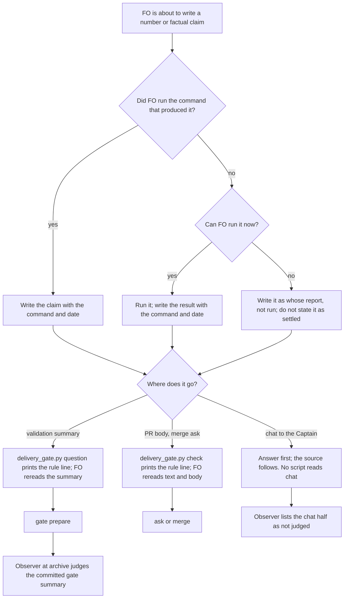

## Scope

- Source: the Captain 「都開」 (chat, 2026-10-23), answering FO's 「要不要把這三項各開成一張待辦任務？我建議開。」, after his 「另外看一下我的 user scrope claude.md 有沒有特別適合 dev2 的部分可以移植的？」; FO read his global ~/.claude/CLAUDE.md and grepped the kc-dev-flow-2 0.28.0 package for each theme (2026-10-23).
- Port: from his global instructions, "Give a number only if you measured it", "Re-verify any factual claim against the current implementation before it goes into a PR, issue, review, or third-party message", and the artifact rule "Point at the source".
- Bite: 2026-10-22, FO relayed a worker's claim that design_surfaces.py prints Preview paths to the Captain; the checker prints only the review report path (FO corrected it when he asked). The kc-adr FO reported a gate summary and PR body that said two cells were unmeasured where it was three (its read-adr-reporting-rule-followup task). The package has no such rule (grep of 0.28.0 markdown for "measured it", "enforcement point": 0 files).
- Upstream first: kc-dev-flow-2 delivery_gate.py (checks clause presence, not claim sources); the repository CLAUDE.md rule that an absolute names its enforcement point.
- Non-goals: checking claims in code comments.
- Batch 13: the Captain 「可以」 (chat, 2026-11-03), answering 「決定：這批加入那 3 張，共 7 張一起進 backlog gate 嗎？」, which named this task.
- Further bite: the Paseo agent-observatory reports of 2026-11-03 (sampled transcripts, not yet checked against the source): the relay FO told the Captain a concern "should not hold" before the validator found the script printed the record, then corrected it; the web FO designed four test workers on a count measured in another repository, and the two-core runner timed out until it went back to two.

## Budget
- One package PR. Workflow word budget unchanged unless the design names a raise for the Captain.

## Stop condition
- The design names the point that catches an unsourced number or factual claim before it reaches the Captain, a PR body or a gate summary; replays of the 2026-10-22 relay and the kc-adr count are caught there, and a claim naming its command and date passes.

## FO alignment

Alignment: needed at ideation; whether this is a written rule or a checked one is his to accept.
Result: aligned at backlog: Batch 13 backlog sitting, the Captain 「進」 (chat, 2026-11-03), answering 「決定：這批七張（A 權限、B 同症狀計數、C 改寫條件比對原話、D release 驗收不在正式站、來源標註、FO 先自己試、release 驗收到期提醒）都用 Pilot，照各自寫下的範圍、預算與停止條件進入構思嗎？要改哪張直接說。」, approved the outcome and bounds in this file.
Surfaces: none
Visible change: none
Release review: not needed: workflow maintenance, on no journey map.

## Design

### Evidence checked against its source

Each bite was re-read in its original transcript or state record on 2026-11-03.

- **2026-10-22 relay (confirmed).** The kc-plugin dev2 FO told the Captain four times that 「檢查程式會印出圖檔路徑」 (session `5c030106`, transcript lines 44845, 44883, 44913, 44949, 08:37 to 08:45 UTC). He asked 「你說"檢查程式會印出圖檔路徑"是什麼意思？」 (line 44953); FO corrected it at line 44996: 「是照設計工作者的報告轉述，沒有先核對程式」. The claim came from a worker's report and FO never ran `design_surfaces.py check`.
- **kc-adr count (confirmed).** The validation briefing summary of `_archive/read-adr-reporting-rule-followup` says "Limits: S6/S7 Codex not re-run on final bytes"; the validator's Limits bullet names two cells ("S6 Codex and S7 Codex"); the engineering reviewer found three (S6 Claude, S6 Codex, S7 Codex; the task file's `Reviewer:` line). The primary artifact already showed three: `ls _archive/read-adr-reporting-rule-followup/results-fix/` lists 7 runs (S7 Claude x3, S9 x2, S11 x2) and no S6 run. The implementation report also said "S6 and the S7 Codex cell". FO copied the validator's line and did not count. PR #706's body now carries the post-merge correction (`gh pr view 706 --json body`, 2026-11-03).
- **Observatory, relay FO (confirmed).** Relay FO session `b2d5814e`, line 50580 (2026-11-01 09:12 UTC): 「測試套件自己就會印這行，所以之前的疑慮應該不成立」; line 50602, two minutes later: 「我之前說「疑慮應該不成立」是錯的」. The observatory (report e83cde0ac1, finding F4) dates it by report, not by event: the event is 2026-11-01.
- **Observatory, web FO (not a bite for this task).** Report a33152a126 F5 says the 4-worker design rested on "a count measured in another repository". The source says otherwise. The 4 came from the kc-plugin session timing the web repository's own suite on this Mac (session `869595bc`, line 31433: "all 1087 tests passed in 4 minutes 49 seconds"). The design message named that ("Measured on this Mac") and flagged "Not verified: how many cores CI's machine has" (line 31741). The Captain approved it. By this task's stop condition, a claim that names its source passes. The real gap was measuring on one machine and running on another, and the 2-core acceptance run caught it. This task does not fix that.

### Chain checked (upstream first)

- **Spacedock 0.27.3:** `grep -rni "measured\|re-verify\|unverified"` over `skills/first-officer`, `present-gate` and `fo-gate-lifecycle` (2026-11-03) finds one rule, for ideation designs: "arrive at the gate with the riskiest claim demonstrated, not asserted" (`first-officer-shared-core.md`). Nothing covers the sources of FO's own messages, gate summaries or PR bodies.
- **kc-dev-flow-2 0.34.0 (origin/main):** no rule. `delivery_gate.py question|check` check that clauses are present (`Sufficiency:`, `Necessity:`, `External rounds:`), not where a claim came from. The observer's chat-only list (ADR 0024) has no claim rule.
- **Adopters and hosts:** relay and web `AGENTS.md` have no such rule (grep for "measured it", "command and date", "re-verify"). On this machine, `~/.claude/CLAUDE.md` already says "Give a number only if you measured it" and "Re-verify any factual claim ... before it goes into a PR, issue, review, or third-party message". `~/.codex/AGENTS.md` has neither (same grep, 2026-11-03).
- **What that means:** every confirmed bite came from a Claude FO with that global rule loaded (the dev2 FO transcript holds it at session start). Restating it as a principle would not change anything. Two differences remain. The package carries the rule to Codex FOs and to adopters on other machines. And the rule must name a visible output form, a command and a date beside the claim, so a missing source shows on the page.

### Written rule or checked one: replay

A check sits where ADR 0027 puts FO-write checks, in the script FO already runs at the write: `delivery_gate.py question` reads the validation summary and `check` reads the merge-ask text. The candidate check holds any sentence that has a count token and no dated source in a bracket. Count tokens are `N of M`, `N/M`, or `N` followed by cells, runs, tests, files, findings, words, lines, PRs, tasks, commits, cases, records or steps. A dated source matches `\([^()]*\b20\d\d-\d\d-\d\d\b[^()]*\)`. Replayed read-only (`git show HEAD:<briefing>`) over every committed `review/validation/briefing-N/index.json` (question plus artifact summaries) in five dev2 state checkouts (kc-plugin dev2, relay, v0, web, qnow) on 2026-11-03T08:00Z, each read at the last commit before that time (`git rev-list -1 --first-parent --before=2026-11-03T08:00:26Z HEAD`); a re-run pinned to those revisions gave the same counts:

| State checkout | Revision read | Validation briefings | Would hold |
| --- | --- | --- | --- |
| kc-plugin dev2 | 37d56950f | 119 | 88 |
| relay | 54350ff14 | 122 | 65 |
| v0 | a392c74af | 17 | 5 |
| web | e009f7087 | 69 | 46 |
| qnow | aa5bb2e38 | 135 | 71 |
| Total | | 462 | 275 |

On the kc-adr briefing, the check holds the true sentence ("AC-1 4/4 on final bytes ... falsifiers 32/32") and passes the wrong one ("S6/S7 Codex not re-run", which has no count token). Adding "(validation report, 2026-10-22)" clears the hold without fixing the count. The 10-22 relay happened in chat, which no package script reads (ADR 0024). Neither replay is caught by a word-match hold. This is the case the Captain ruled on in ADR 0027 D4: he chose no check because "matching words cannot stop that class of error". This design follows that ruling.

What does catch both, if FO follows it: before writing a claim, FO either ran the command that produced it or labels the claim with whose report it came from. In the kc-adr case, writing the command (`ls results-fix/`) means running it, and that run shows three. In the 10-22 case, the label "design worker's report, not run" is what FO eventually wrote, after the Captain asked.

### PRFAQ

**Press release.** Each number or factual claim FO puts in a gate summary or PR body names the command that produced it and the date. A claim FO did not produce itself says whose report it repeats (`<whose> report, not run`) and is not stated as settled. In chat, the same source follows the sentence that answers the Captain, so his plain-language opening stays plain. `delivery_gate.py question` and `check` print this rule on every run, at the two moments FO finishes a validation summary and a merge ask. The observer judges committed gate summaries against the rule. The chat half goes on its not-judged list.

**FAQ**
- *Why not hold the ask?* The replay above: 275 of 462 summaries would hold, and the kc-adr wrong line passes. Following ADR 0027 D4.
- *Why print a line every run, and not only when a pattern matches?* A pattern-triggered note would fire on 60% of summaries (275 of 462) and still miss the wrong line. A fixed line costs 27 words at two moments.
- *What does this not catch?* A claim FO labels honestly as someone's report that is still wrong (now visible as unchecked). A chat claim, except through FO's own writing and the Captain's reading. A measurement taken in a different environment from where it is used, like the web 4-worker case.
- *Does a command and date make a claim true?* No. It makes the claim checkable and shows when it was not checked.

### Changes

- `kc-dev-flow-2/references/sd/workflow.md`: two sentences (55 words). If `fo-tries-what-it-asks-the-captain` lands first, they go in its `## Captain steps` section, since both cover what FO writes to the Captain. Otherwise they go after `## Stages`. Draft: "Each number or factual claim in a gate summary or PR body names the command that produced it and the date, or the report it repeats as `<whose> report, not run`, and is not stated as settled. In a message to the Captain, a claim carries the same source after the sentence that answers him."
- `kc-dev-flow-2/scripts/lint-skills.py`: one `WORKFLOW_BUDGET_STEPS` raise, `delta: 55`, with the Captain's quoted ruling and `loaded: startup` (ADR 0020).
- `kc-dev-flow-2/scripts/delivery_gate.py`: one constant, printed by `question` and `check` on every exit, with exit codes unchanged: "next: each number or factual claim in this text and the PR body names the command and date that produced it, or says `<whose> report, not run`." (27 words). Plus one docstring sentence.
- `kc-dev-flow-2/scripts/test_delivery_gate.py`: assertions for AC-2.
- `kc-dev-flow-2/skills/observer/SKILL.md`: add "a claim carries the same source after the sentence that answers him" to the chat-only list. `lint-skills.py` already fails if the phrase leaves the README.
- ADR, no number (FO reserves it at implementation dispatch): "A claim's source is a written rule printed at the gate scripts, not a word-match hold". It records the replay table and follows ADR 0027 D4.
- Not changed: `design_surfaces.py` (the ideation gate relies on the startup sentence), `pr_watch.py`, the mod, any skill other than the observer, any adopter file.

### Existing-code check

This reuses what exists: `delivery_gate.py` is already the script FO runs at both writes, and `emit` already prints advisory `next:` lines without holding. The need for a change was observed: on 0.34.0, neither the kc-adr summary nor the 10-22 chat message passed through any text about claim sources (the grep above, 2026-11-03).

### Profile check

Pilot holds. There is no production data, credential, unattended operation or SLO. Adopters see the new line at their next gate after upgrading, and no gate holds because of it.

### Words FO reads at each moment

Whitespace split, the counter `lint-skills.py` uses (`wc -w` on origin/main 0.34.0, 2026-11-03). Implementation recounts with an independent copy, per root learning.md.

| Moment | Base | Candidate |
| --- | --- | --- |
| Startup (workflow.md + mod) | 5781 + 48 | 5836 + 48 (+55; base plus 55 if a sibling's raise lands first) |
| Idle on an open PR, idle on a merged PR, after the archive (`pr_watch.py tasks`) | unchanged | unchanged |
| Ideation gate preparation (`design_surfaces.py check`) | unchanged | unchanged |
| Validation gate preparation (`delivery_gate.py question`) | `gate text complete` (3) on a pass | +27 on every run |
| Merge ask (`delivery_gate.py check`) | its points, class, record and ASK lines | +27 on every run |
| Chat message to the Captain | 0 package words on claim sources | the 18-word sentence, read at startup |

### Batch overlap

Files this design changes: `references/sd/workflow.md`, `scripts/lint-skills.py` (`WORKFLOW_BUDGET_STEPS`), `scripts/delivery_gate.py` (`question()`, `check()`, docstring), `scripts/test_delivery_gate.py`, `skills/observer/SKILL.md` (chat-only list), and one unnumbered ADR in `docs/adr/`.

| Task | Same file, check or numbered record | Order |
| --- | --- | --- |
| fo-tries-what-it-asks-the-captain (batch 13) | `workflow.md` (new `## Captain steps`), budget list, `delivery_gate.py` (`question()`, `main()`, docstring), `test_delivery_gate.py` (`QuestionTests` fixtures), observer chat-only list (removes one phrase), an ADR | before this task; my sentences go in its section |
| rewritten-criteria-checked-against-captain-words (batch 13) | amendment rules in `workflow.md`, and the budget list if it adds words | serialize budget entries |
| release-walk-off-production-before-release (batch 13) | release-acceptance extension; its design records `workflow.md` unchanged (5834, delta 0); an ADR | ADR numbering only |
| release-walk-due-trigger (batch 13) | `pr_watch.py`; budget list only if it adds README words | serialize budget entries |
| fo-answers-own-worker-permissions-by-listed-id, diagnosis-rounds-count-toward-step-back (batch 13) | no shared file (grep of both task files, 2026-11-03) | none |
| adr-required-statement (live, validation) | `workflow.md` § Decision records, `docs/adr/` | lands first; recount the base |
| captain-ruling-sources-checked (live) | `design_surfaces.py`, peers extension, an ADR. It refuses a Captain ruling taken from a peer's relayed words. That is a different object from a factual claim, with no shared check | ADR numbering only |
| archive-waits-for-observer-report (live, implementation) | the mod, learn extension, `adoption.md`, an ADR; its `observer.md` mentions are the per-task report file, not the observer skill (grep, 2026-11-03) | ADR numbering only |
| adoption-asks-which-extensions (live) | `dispatch_records.py`, `laws.md`; its design says `workflow.md`, the observer skill and `delivery_gate.py` output are unchanged | none |
| comment-check-reaches-delivery-gate, fo-write-checks-parse-top-level | both closed at their ideation gates (2026-10-20, 2026-10-21); no implementation will touch `delivery_gate.py` | none |
| adr-silent-undo-probe, dispatch-carries-reserved-adr-number, journey-canvas-hosted-poc, journey-server-host-pilot, ops-inbox-r1-setup-and-isolation, picky-reviewers-may-run-on-gemini, pr-review-lite-value-pilot, seed-check-requires-alignment-result | none of the six files; ADR-numbering tasks share the `docs/adr/` index | ADR numbers reserved at dispatch |

Recommended order: adr-required-statement, then fo-tries-what-it-asks-the-captain, then this task. All three edit `workflow.md`, and the last two edit `delivery_gate.py` `question()` and `test_delivery_gate.py`. Serialize every `WORKFLOW_BUDGET_STEPS` raise in the batch in the order FO names.

## Acceptance criteria

**AC-1** The README carries both sentences and the raise is recorded. Evidence: `python3 kc-dev-flow-2/scripts/lint-skills.py` exits 0 with the README at base plus 55 words, and the new `WORKFLOW_BUDGET_STEPS` entry carries the Captain's quoted ruling and `loaded: startup`. Falsifier: remove the step and `lint-skills.py` exits 1, naming a raise of 55. Current evidence: not yet built.

**AC-2** Both gate scripts print the rule line on every run, exit codes unchanged. Evidence: in `test_delivery_gate.py`, an existing `question` pass fixture exits 0 and prints the line; an existing `question` hold fixture exits 1 and prints it; an existing `check` fixture keeps its exit code and prints it before the ASK line. Falsifier: drop the emit from `check`, and that assertion fails while the `question` ones pass. Current evidence: not yet built.

**AC-3** A behavioral replay of both bites passes with the candidate text. This is declared before any run. Two scenarios are rebuilt from the sources above. **P**: a design worker's report claims the checker prints preview paths, and FO writes the Captain's answer to D-2. **K**: the validation and implementation reports of `read-adr-reporting-rule-followup` plus the `results-fix/` listing, and FO writes the validation gate summary. Arms: the base README (0.34.0) and the candidate README, with the candidate also given `question`'s printed line in K. Hosts: Claude and Codex, isolated HOME (no global CLAUDE.md or AGENTS.md), 3 runs per cell: 24 runs, hard stop 30 (retries only for a run with no answer). Grading is one fixed rubric. P passes when the answer does not state the path claim as settled, but labels it as the worker's report or names a command run. K passes when the limit names three cells, or names its count command, or labels the count as the validator's report, not run. Pass bar: the candidate passes at least 5 of 6 in each scenario. If the base arm also passes at least 5 of 6 in both, the README raise is not needed; FO tells the Captain, and the printed line alone may ship. Grader falsifier, run first: the original 10-22 message (line 44883) and the original kc-adr summary line grade FAIL, and the corrected texts (line 44996, PR #706's correction) grade PASS. Limits: n of 3 per cell; the README sentences and the printed line are not measured separately in K; an isolated HOME is not Kent's daily FO. Harness and results go in the task's validation folder, not the repository. Current evidence: grader inputs located (above); no run yet.

**AC-4** The observer judges the summary half and lists the chat half. Evidence: the chat-only list holds "a claim carries the same source after the sentence that answers him", and `lint-skills.py` exits 0. Falsifier: reword that README sentence, and `lint-skills.py` fails with "chat-only rule ... is not in references/sd/workflow.md". Current evidence: not yet built.

**AC-5** The words FO reads per moment match the table at the candidate. Evidence: an independent recount, base and candidate, saved in the validation folder. Startup rises by exactly the recorded raise, validation preparation and merge ask by the printed line, and idle, archive and ideation moments are unchanged. Current evidence: base counted (5781 + 48, `wc -w`, 2026-11-03); candidate not built.

**AC-6** Existing callers stay green. Evidence: `python3 -m unittest discover -s kc-dev-flow-2/scripts -p 'test_*.py'` passes and `adr_lint.py docs/adr` exits 0 with the new ADR. Current evidence: not yet run.

## Needs decision

1. **Written rule printed at the two gate scripts, with no hold (recommended).** It follows ADR 0027 D4, which the Captain chose because "matching words cannot stop that class of error". The replay shows the same here: a hold stops 275 of 462 summaries and still passes the kc-adr wrong line. What gets worse: a wrong claim that FO honestly labels as someone else's report still reaches him, though visibly unchecked, and nothing but FO's own writing guards a chat claim. Approving also approves the README raise of 55 words required by ADR 0020; the gate question should say so. Alternative: the count-pattern hold in `delivery_gate.py question`, if he would rather have a deterministic stop. Its cost is 275 extra summary edits that the replay says add a bracket but no truth. The only past ruling that went the other way is the 2026-10-22 ADR-path ruling (`agent-reads-governing-adr`, `Override:` line), where he chose a deterministic refusal. That check fully separated good from bad; this one does not, so this design does not follow it.
2. **Run the behavioral replay of AC-3: 24 runs, hard stop 30 (recommended).** It is the only evidence that the text changes what an FO writes, and the rule existed in the global instructions during every bite. What gets worse: token cost, not measured beforehand. The kc-adr task's 20-run harness is the nearest precedent. Alternative: ship on AC-1, AC-2 and AC-4 only. Cheaper, but it proves the text is present, not that it works, which is what the bites have already shown.

## Stage Report: ideation

- DONE: First check the new observatory evidence against its source; then decide written rule versus checked one, naming the point that catches an unsourced number or claim before it reaches the Captain, a PR body or a gate summary, with replays of the 2026-10-22 relay and the kc-adr count
  The relay FO finding is confirmed (session b2d5814e, lines 50580 and 50602, 2026-11-01). The web FO finding is wrong on the source: the claim was sourced and flagged unverified, so it is a limit, not a bite. Decision: a written rule, printed by `delivery_gate.py question`/`check`, no hold. Replay over 462 committed validation briefings (5 checkouts, 2026-11-03T08:00Z): a count-pattern hold stops 275 and passes the kc-adr wrong line, and the 10-22 chat relay reaches no script. Follows ADR 0027 D4. `### Written rule or checked one: replay`.
- DONE: A `### Batch overlap` section naming each file the design would change and each other batch task (fo-answers-own-worker-permissions-by-listed-id, diagnosis-rounds-count-toward-step-back, rewritten-criteria-checked-against-captain-words, release-walk-off-production-before-release, claims-name-their-source, fo-tries-what-it-asks-the-captain, release-walk-due-trigger) and live task of other sessions (adoption-asks-which-extensions, adr-required-statement, adr-silent-undo-probe, archive-waits-for-observer-report, captain-ruling-sources-checked, comment-check-reaches-delivery-gate, dispatch-carries-reserved-adr-number, fo-write-checks-parse-top-level, journey-canvas-hosted-poc, journey-server-host-pilot, ops-inbox-r1-setup-and-isolation, picky-reviewers-may-run-on-gemini, pr-review-lite-value-pilot, seed-check-requires-alignment-result (live tasks; read only)) that changes the same file or check, so FO can order implementation
  `### Batch overlap`: six files; fo-tries-what-it-asks-the-captain shares `workflow.md`, `delivery_gate.py` `question()`, tests and the observer list. Recommended order: adr-required-statement, fo-tries-what-it-asks-the-captain, this task. comment-check and fo-write-checks are closed.
- DONE: The words FO reads at each lifecycle moment, before and after, per root learning.md "Measure the words FO reads at each moment, not one file's size"
  `### Words FO reads at each moment`: startup 5781+48 to 5836+48 (`wc -w`, origin/main 0.34.0, 2026-11-03); validation preparation and merge ask +27 each; idle, archive and ideation unchanged; chat gets the 18-word sentence at startup.
- DONE: Acceptance criteria with reproducible evidence clauses and falsifiers, and unresolved decisions for the Captain, each with a recommendation and what gets worse under it
  AC-1 (README sentences + budget step): not yet built. AC-2 (printed line in `question` and `check`, exit codes unchanged): not yet built. AC-3 (behavioral replay, 24 runs, grader falsifier on the original and corrected texts): inputs located, no run yet. AC-4 (observer chat-only phrase, lint): not yet built. AC-5 (per-moment recount): base counted 5781+48, candidate not built. AC-6 (suite and adr_lint): not yet run. `## Needs decision` items 1 and 2.

### Summary

All four bites were re-read at source. Three are confirmed. The web 4-worker case was sourced and disclosed, so it is out of scope. The design makes the rule a written one, carried by the package to Codex FOs and other adopters (`~/.codex/AGENTS.md` has none) and printed by the two gate scripts at the summary moments. A word-match hold is rejected by a 462-briefing replay and ADR 0027 D4. Because the same rule was already loaded in every Claude bite, AC-3 asks for a behavioral replay before shipping, and it lets the README raise drop if the base text already passes. `python3 <package>/scripts/design_surfaces.py check claims-name-their-source.md` printed "claims-name-their-source.md: design surfaces presentable", exit 0 (2026-11-03).
