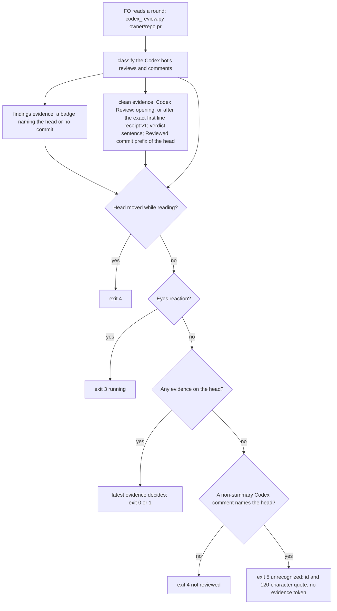
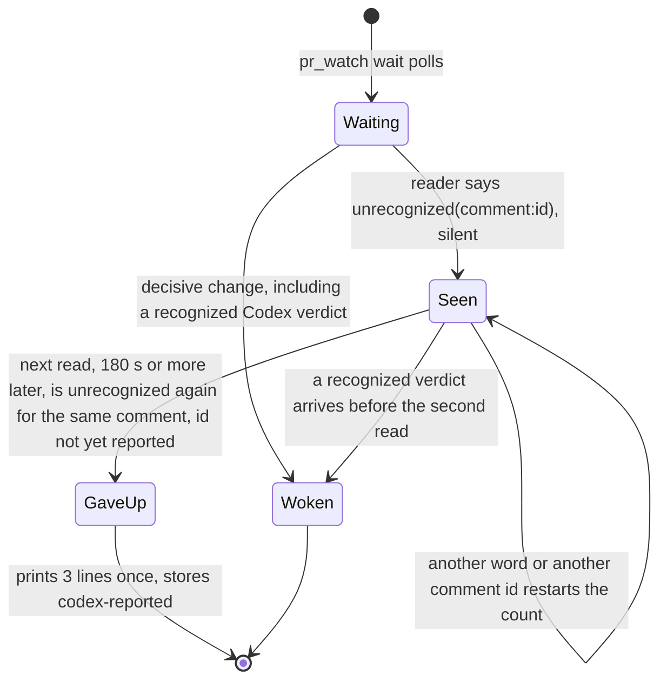

## Scope

- Source: intake from the kc-paseo-plugins dev2 FO (Paseo agent 8b2c2fc, 2026-10-21), relaying the Captain's 「dev2 問題開給維護它的 FO」 (relayed, not a ruling in this session).
- Bite: on iamcxa/kc-paseo-plugins#8 (comment 6296013066) `extensions/codex/codex_review.py` returned exit 4 "not reviewed" for a head Codex had reviewed clean, and `pr_watch.py wait` timed out. Verified 2026-10-21: that comment's body opens with `<!-- codex-review-receipt:v1 -->` before "Codex Review: Didn't find any major issues…", and kc-dev-flow-2 0.27.0 `codex_review.py` matches a clean comment only when `c["body"].startswith("Codex Review:")`. The summary-comment path still reads clean (the adopter's #10 and #11; this repository's #685, #686, #689 in batch 4).
- Shape asked for: the reader accepts the receipt-marked clean comment, still never reading an unrecognized shape as clean (the extension's stated limit).
- Upstream first: `extensions/codex/codex_review.py` and its tests.

## FO alignment

Reviewer: kc-dev-flow-2:engineering-reviewer opus 2026-10-22 — do these amendments withdraw what the Captain approved, and what changes in the build? Owed by role_triggers.py for the task's Captain amendments.

Alignment: not needed before ideation; the fix is named.
Surfaces: none
Visible change: none
Release review: not needed: workflow maintenance, on no journey map.

## Captain amendments

### Amendment 1 — 2026-10-21, chat
Captain: 「如果改成連續兩次或三次讀不懂結果就放棄呢？讀不懂跟讀不到不一樣對吧」 then 「可以」 (chat, 2026-10-21, batch-5 sitting)
Asked: 「改成「連續 2 次讀不懂、間隔 3 分鐘，就放棄並提示」，可以嗎？」
Supersedes: none
Design: the give-up is by count, not by a 900-second window: on the first read that finds an unrecognized Codex comment on the head, wait records it silently; if the next read 3 minutes later still finds no recognized verdict on the head, wait gives up once for that comment id and prints the lines. A head with no Codex comment yet is unchanged (it waits as today).

### Amendment 2 — 2026-10-21, chat
Captain: 「應該寫成，按照peers ext做，如果沒啟用或是沒有可用的peers就發issue。或是做一個paseo ext讓fo知道怎麼用paseo cli。合理嗎？因為不是每個人都用paseo 作為harness」 then 「對，就照這樣。任務也要開」 (chat, 2026-10-21, batch-5 sitting)
Asked: 「提示訊息會寫成：「這是 kc-dev-flow-2 的問題，要回報上游：有啟用 `peers`、也找得到維護 FO，就照 `peers` 傳給它；沒有的話，擬好 issue 內容，問 Captain 要不要開。」」
Supersedes: none
Design: the upstream line names no harness: with `peers` listed and a kc-dev-flow-2 maintainer peer reachable, FO reports through `peers`; otherwise FO drafts the issue and asks the Captain whether to file it. A Paseo host binding for `peers` is its own task.

### Amendment 3 — 2026-10-21, chat
Captain: 「加回來」 (chat, 2026-10-21, batch-5 sitting)
Asked: 「Codex 新格式那張，要不要把「在這個 repo，FO 直接開一張待辦任務」那一句加回來？」
Supersedes: AC-8, AC-11
Design: the upstream line gains a first branch: in the repository that holds kc-dev-flow-2 itself, FO files a backlog task with the comment id and raw text; elsewhere, report through `peers` if listed and a maintainer FO is reachable, otherwise draft the issue and ask the Captain (Amendment 2).
Superseded text: **AC-8** (rewritten) FO's reading changes only where the table says. Evidence: a recount with `len(text.split())` of `extensions/codex/EXTENSION.md` is at most 227 (base 185) and of the three give-up lines at most 77; `git diff origin/main...HEAD -- kc-dev-flow-2/references kc-dev-flow-2/skills kc-dev-flow-2/README.md` is empty; the idle `next:` wait line is byte-identical (the existing test `test_an_open_pr_prints_its_facts_and_the_kept_step_then_keeps_one_wait_running` passes unchanged). Falsifier: a larger count, any change in those three paths, or an edited wait line. Status: cycle-3 prototype 227 and 77; the test passes unchanged.
Superseded text: **AC-11** (rewritten for Amendment 2, the merge-ask and upstream path) The text that instructs the merge ask and the upstream report exists and is complete. Evidence: `extensions/codex/EXTENSION.md` Read bullet contains the exit 5 sentence; the give-up output contains "merge ask", "Codex unread", "raw text", "never clean" and the `gh api ... --jq .body` command; and its last `next:` line contains "kc-dev-flow-2 problem, report it upstream", "if `peers` is listed and a kc-dev-flow-2 maintainer FO is reachable, send it through `peers`" and "otherwise draft the issue and ask the Captain whether to file it", and not "backlog" (all asserted in `test_wait_gives_up_on_two_unrecognized_reads_three_minutes_apart_once_and_names_the_comment`); `python3 scripts/test_sd_dispatch.py --sd-plugin-root <root>` still passes the `codex-round` case. Falsifier: any of those phrases missing, N8 (the draft-the-issue fallback removed) 1 red, N9 (the `peers` branch removed) 1 red, or the case red. Status: phrases present and asserted in the prototype; EXTENSION.md is byte-identical between cycle 2 and cycle 3 (`cmp`) and its four `codex-round` phrases were checked present with the test's own whitespace flattening in cycle 2; the dispatch test needs an SD plugin root and was not run. Limits, stated: no script and no observer rule reads the merge ask for the raw text or the upstream report for having been sent or asked, so FO's compliance is unmeasured (the follow-up that would enforce the merge-ask half is a clause in `delivery_gate.py`, owned by merge-ask-holds-missing-clauses); the `peers` extension names asking for information in its Joins and not a defect report, and this design leaves `peers` unedited; a GitHub issue is never filed by the script or by FO without the Captain's word (Spacedock `## Issue Filing`).
Override: recommended two upstream branches, no backlog task (design D6); Captain chose a backlog task in the package repository; area: Codex upstream report

## Design

Cycle 3, revised 2026-10-21 for Captain Amendments 1 and 2 (above). Cycle 2 carried the D2 ruling (the ideation gate's resolution reason: revise); D1, the reader's exit 5 and everything not named below are as in cycle 2. Amendment 1 replaces the 900-second window by a count of two reads; Amendment 2 replaces the upstream line. The cycle-1 and cycle-2 stage reports below are kept as history.

Rulings in force (from that reason): D1 the exact `v1` marker only, "if Codex changes we follow in the extension"; D2 option C plus two additions, recorded as "on a wait timeout with an unrecognized Codex comment, the timeout line names it, the merge ask quotes the raw comment for the Captain to decide (never read as clean), and FO reports upstream (a backlog task here, the kc-dev-flow-2 maintainer FO elsewhere)"; D3 a separate batch-5 task, which exists as `codex-reader-counts-code-review-only`. Amendment 1 now rules how the wait gives up (cycle-2 D4), and Amendment 2 how an adopter's FO reports upstream (cycle-2 D5); the recorded D2 sentence's "a backlog task here, the kc-dev-flow-2 maintainer FO elsewhere" is replaced by Amendment 2's line.

### Upstream check (read 2026-10-21)

- Spacedock 0.27.0 cache: `grep -rIl "codex-review-receipt\|chatgpt-codex-connector\|Reviewed commit"` finds nothing; it has no Codex review reader. Spacedock 0.27.3 (the installed cache) `skills/fo-status-viewer/SKILL.md` `## Issue Filing` says "Do not file GitHub issues without explicit human approval", so an upstream report as a GitHub issue needs the Captain, which is Amendment 2's fallback. kc-dev-flow-2 0.27.0 has the `peers` extension (`extensions/peers/EXTENSION.md`, read 2026-10-21 at origin/main c27e7659): FO messages a live peer session of its own harness, finds the peer by a recorded `Peer:` line or one read-only probe, and "does not wait on a peer"; its Joins sentence covers asking for information and its Message rules name "if this is not you, say so" and read-only versus action, so a defect report to a maintainer peer is within its Message form but not named in its Joins (named limit; this design does not edit `peers`).
- Codex's own docs (https://learn.chatgpt.com/docs/third-party/github): the marker, the summary comment and "Reviewed commit" are not documented; only the visible "Codex Review: ..." opening is. The reader stays a compatibility adapter and the real comment bodies are the specification.
- kc-dev-flow-2 at origin/main c27e7659 (0.27.0): `extensions/codex/codex_review.py` matches a clean comment with `c["body"].startswith("Codex Review:")`; that is the whole D1 defect. For D2 the in-package precedent is `extensions/copilot/copilot_review.py` exit 5 ("not a review"): it prints a 120-character quote and an `answer=` token and no `evidence=` token, so it is no round and never clean, and the Copilot EXTENSION.md has the merge ask name Copilot as not read with that quote. D2 copies that shape for Codex.
- Premise check on the ruling's wording: `pr_watch.py wait [SECONDS]` takes the poll interval, and the loop in `main` ends only on a decisive change or an empty watch list. `git grep -n -i "timeout\|timed out" origin/main -- kc-dev-flow-2/scripts/pr_watch.py` finds nothing. So the "wait timeout line" does not exist today; the "timed out" seen on kc-paseo-plugins#8 was, by inference (the intake does not say who ended it), the host's background-command limit ending a wait that prints nothing. Amendment 1 rules what this design builds in its place.
- Sibling adopters, read-only: `git grep` for `codex-review-receipt`, `chatgpt-codex-connector`, `codex_review` on qnow, subspace-relay and recce-team finds nothing (read 2026-10-21); none has its own Codex reader to borrow. Read-only note: before grepping I ran `git fetch -q origin` in those three local clones (cycle 1), which updates remote-tracking refs and is not a read-only command; no file or branch changed.
- ADR 0013 (Copilot answer without a review): "Later work must keep the reader's rule positive ... not a list of refusal wordings" decides the reader's shape. No `Override:` line bears on it (`git -C <state> grep -n 'Override:'`, read 2026-10-21: hits are prose in archived tasks).

### What the real bodies show (all read 2026-10-21)

PRs #685 to #689 carry no receipt-marked comment (summary comments only). The 15 receipt-marked comments on this repository are #649 to #682 (first 2026-10-16T04:31:49Z) plus one on iamcxa/kc-paseo-plugins#8. Across 22 PRs of this repository (593, 640, 647, 649 to 689 sampled) the Codex bot left 40 issue comments; every one is S1, S2 or S3 below, none is an unrecognized shape.

| Shape | Real example | Base reader (0.27.0) | Candidate |
| --- | --- | --- | --- |
| S1 plain clean comment: `Codex Review: Didn't find any major issues.` then `**Reviewed commit:** <sha>` | #593 to #647 | exit 0 when it names the head | unchanged |
| S2 receipt-led clean comment: the same two lines after `<!-- codex-review-receipt:v1 -->` and a blank line | comment 6296013066 on kc-paseo-plugins#8; 15 here | exit 4 "no Codex evidence covers 5ff307de6" | exit 0 on the head it names (D1) |
| S3 summary comment (`codex-pull-request-review-summary` with `codex-review-state:v1` and `codex-security-review:v1` markers) | #685, #686, #689, #10, #11 | exit 0 via `summary:` | unchanged |
| S4 line findings and reviews with `![P1 Badge]` | #687, #652 | exit 1 | unchanged |
| S5 a comment that names the head in a shape the reader does not read, with no other evidence on the head | none observed in the 40 comments; stand-in: the live S2 body of kc-paseo-plugins#8 with the recognized marker string changed to `v9`, run from `/tmp` | exit 4 | exit 5 with `unrecognized=comment:6296013066` (D2) |

Why S2 stayed invisible here: on 13 of 14 sampled receipt PRs the summary's security marker already named the head, so exit 0 came from `summary:`. The receipt decides only when the security marker lags the head, observed once (kc-paseo-plugins#8). The same masking would hide an S5 comment whenever a summary reads clean first; D2 covers the case the incident had (no other evidence) and not that one (Limits).

### Design (D1 and D2)

D1 (unchanged): one constant `RECEIPT = "<!-- codex-review-receipt:v1 -->\n"` and a four-line `says_review(body)` that drops that exact first line and following newlines, then tests `startswith("Codex Review:")`; the clean branch of `state()` calls it.

D2 has three parts, each reusing something that exists:

1. Reader, `codex_review.py`: when `state()` would return exit 4 "no Codex evidence covers the head" (no evidence of any kind, no eyes reaction, head did not move), it first looks for Codex issue comments that are not summary comments and name the head in a `**Reviewed commit:**` line (the existing `names_head`). If one exists it returns exit 5 and the line `not recognized on <head9>: "<first 120 characters>"; unrecognized=comment:<id> at <time>`. The line has no `evidence=` token (so `pr_watch.py` counts no round) and a quoted `evidence=` is rewritten to `evidence:`, both copied from `copilot_review.py`. The latest such comment names itself. Exit 0, 1, 3 and every other 4 are untouched.
2. Watcher, `pr_watch.py`: `reader()` maps exit 5 to the verdict `unrecognized(comment:<id>)` with evidence `-`. The id rides in the verdict because any `-evidence` value is a decisive outcome (`outcome()`), and the Captain's wording is a give-up, not an immediate wake. The verdict is not in `OUTCOMES["codex"]`, so wait records it silently; the idle `fact:` line shows `codex=unrecognized(comment:<id>)` at once. New constant `RECHECK_SECONDS = 180` (Amendment 1's "3 minutes apart") and one function `unread_lines` (21 lines) in place of cycle 2's `GRACE_SECONDS = 900` and `grace_lines`. On the first read of an `unrecognized(...)` word wait keeps `(word, time)` for that PR on its own clock and prints nothing. On a later read, if the PR still reads the same word and at least `RECHECK_SECONDS` have passed, wait stops once, prints three lines (77 words), exits 0, and stores `codex-reported` in the watch state so a later wait skips that id. Any other word on the PR (a recognized verdict, `running`, `not-reviewed`, another comment id) drops the kept pair, so the two reads are consecutive and of one comment. A recognized verdict before the second read wakes wait as today and prints nothing extra. With the default 60-second poll the second read is 180 seconds after the first (the fourth look); with a longer poll it is the next look. The pair is kept in the wait process, so a wait the host ends before the second read starts over (named limit).
3. Instruction, `extensions/codex/EXTENSION.md`: one sentence in the Read bullet: exit 5 is a Codex comment on the head that the reader does not recognize, no round and never clean; FO keeps waiting as for exit 4 until `pr_watch.py wait` gives up on it, then does the `next:` lines it prints. Those lines carry the actions: quote the comment's raw text, fetched by id, in the merge ask as Codex unread, never clean, and the Captain decides; and report it upstream as Amendment 2 words it.

The three printed lines for the live stand-in (cycle-3 prototype, fake clock, 77 words):
```
iamcxa/kc-paseo-plugins#8 codex=unrecognized(comment:6296013066): not recognized on two reads 180s apart
next: quote that comment's raw text, from `gh api repos/iamcxa/kc-paseo-plugins/issues/comments/6296013066 --jq .body`, in the merge ask as Codex unread, never clean; the Captain decides.
next: this is a kc-dev-flow-2 problem, report it upstream with the comment id and its raw text: if `peers` is listed and a kc-dev-flow-2 maintainer FO is reachable, send it through `peers`; otherwise draft the issue and ask the Captain whether to file it.
```

The reader's exit-5 line quotes the first 120 characters with whitespace collapsed, for FO's own reading (copied from Copilot's exit 5). The merge ask quotes the raw body, which the give-up `next:` line has FO fetch by the comment id (the kc-paseo-plugins#8 body is 86 words). The 120-character cut cannot hide a finding badge: a Codex comment with a badge that names the head or names no commit is already evidence (exit 1) under the existing rule, so exit 5 never covers one.

### Existing-code check (bounded)

Use and repair what exists, add nothing new in kind. Reused: `copilot_review.py` exit 5 (shape and wording of the no-`evidence=` quote), `reader()` and its exit-code table, `outcome()`/`OUTCOMES` (a verdict outside the set is silent), `update(keep_flags=True)` (stores `codex-reported`), `facts()` (already prints the verdict), the injected `clock` and `sleep` of `main()` (tests need no real wait). New: one exit code, one constant, one function (21 lines), one EXTENSION.md sentence. Not built: a `--limit` flag, a new script, a new state file, a delivery-gate check. Observation: on live kc-paseo-plugins#8 the base reader exits 4; the D1 candidate exits 0; the same candidate with the marker string changed to `v9` (a stand-in for Codex changing the receipt) exits 5 and prints `unrecognized=comment:6296013066` (read 2026-10-21, `python3 -B -I`). On the other 21 sampled PRs (kc-paseo-plugins#10, #11; this repository #649, #651, #652, #658, #659, #661, #663, #664, #668, #670, #675, #679, #680, #682, #685 to #689) base and candidate print the same line (compared with the trailing timestamp cut).

### PRFAQ

**Press release.** When Codex answers a review request with a comment FO's reader does not know, FO now hears about it instead of waiting until the host ends the wait. A Codex comment that opens with its receipt marker and says "Didn't find any major issues" on the head still reads as a clean round with its id as evidence (D1). A Codex comment that names the head in any other unread shape reads as exit 5: no round, never clean. The idle line shows it at once; if the wait's next read, at least 3 minutes after it first showed, still finds that comment unrecognized, the wait stops once, names the comment, and tells FO to put its raw text in the merge ask as Codex unread for the Captain to decide and to report it upstream through `peers` or, without a reachable maintainer FO, as a drafted issue the Captain approves.

**FAQ**
- *What is recognized as clean?* The plain `Codex Review:` opening and, as one extra opening, the exact first line `<!-- codex-review-receipt:v1 -->` followed only by newlines; everything after goes through the unchanged checks (bot author, verdict sentence, no badge, a `**Reviewed commit:**` that is a prefix of the head). A `v2`, a payload, a marker anywhere but the first line is not recognized (ADR 0013).
- *What counts as unrecognized?* A comment by the Codex bot, not a summary comment, that names the head in a `**Reviewed commit:**` line, when nothing else is evidence for the head, no eyes reaction is on the PR and the head did not move. A Codex comment that names no commit is not reported (no way to tie it to the head); any comment is ignored while other evidence covers the head.
- *Why a new exit code and not a suffix on exit 4?* Exit 4 stays "nothing from Codex yet" with FO's rule for it untouched, and exit 5 matches Copilot's. The price is two existing assertions in `test_codex_review.py` that expected 4 for a bot comment naming the head in an unread opening and now expect 5.
- *Does a first sight wake FO?* No. It is silent in wait and visible in the idle `fact:` line; only the give-up after the second unrecognized read prints, once per comment id.
- *Could the give-up repeat?* No. After it prints, `codex-reported` holds the word and later waits skip it; a different comment id starts a new count.
- *What does the merge ask say?* Codex as unread with the comment's raw text, and the Captain decides; nothing is counted as a round and exit 5 is never exit 0. No script or observer check reads the ask's wording today (named limit, the same as Copilot's quote).
- *Could one Codex round be counted twice?* Possibly by one extra round when a receipt and the updated summary are read between two writes (2 seconds apart on kc-paseo-plugins#8); ADR 0004 caps rounds by rule.

### Mermaid





Actors and order match the prose: the reader classifies, the watcher only counts seconds and prints, FO does the `next:` lines, the Captain decides the merge. Review, reaction and summary evidence are read as today and are not drawn.

### Surfaces

`Surfaces: none`: no UI and no schema; PRFAQ and Mermaid only.

### Delivery shape (for implementation, not decided here)

Files the change touches, and no others: `kc-dev-flow-2/extensions/codex/codex_review.py`, `kc-dev-flow-2/extensions/codex/test_codex_review.py`, `kc-dev-flow-2/extensions/codex/EXTENSION.md`, `kc-dev-flow-2/scripts/pr_watch.py`, `kc-dev-flow-2/scripts/test_pr_watch.py`. Prototype size against origin/main c27e7659: codex_review.py +15 -1, test_codex_review.py +75 -2 (the two edited assertions above), EXTENSION.md +3 -1, pr_watch.py +36 -2, test_pr_watch.py +82 -0; added comment lines 0 (cycle-3 prototype, `/tmp/ideation-d3`).

Commit type `feat(kc-dev-flow-2): ...` (a new reader exit code and a new wait stop), so release-please proposes a minor bump; D1 alone would have been a `fix`. `delivery_gate.py` puts `extensions/` paths in class `never`, so the merge ask is always an ask. CI already runs both test files (`.github/workflows/kc-dev-flow-2-tests.yml`, steps `extensions/codex/test_codex_review.py` and `test_pr_watch.py`); no new job. The reader and watcher code is not documentation-only, so `test_sd_dispatch.py` case `codex-round` (four EXTENSION.md phrases) still holds: checked offline with the test's own whitespace flattening, base and candidate all four present (the test itself needs `--sd-plugin-root` and was not run).

Prototype and mutation record, in `/tmp/ideation-d2` (cycle 2) and `/tmp/ideation-d3` (cycle 3), not repository files; `python3 -B -I`: candidate 18 codex tests and 91 watcher tests pass (base: 87 watcher tests, all unchanged and still passing; cycle 3 replaced cycle 2's three give-up tests and keeps the reader test, 4 new in all). The reader and its tests are byte-identical between cycle 2 and cycle 3 (`cmp`), so the reader mutants stand as run in cycle 2: D1 M1 to M6 (any `codex-` marker stripped: 7 subtests red; marker stripped anywhere: 1; `names_head` dropped: 2; `lstrip()` of all whitespace: 1; verdict test dropped: 2; bare `startswith` restored: 2) and D2 reader M7 (`evidence=` token printed on exit 5: 1 red), M8 (any bot comment counts as unrecognized: 5 red), M13 (summary comments counted: 1 red). Cycle-3 watcher mutants, each run against `test_pr_watch.py`: N1 second read needs no gap (give up at first sight): 2 red; N2 window back to 900 s: 2 (1 failure, 1 error); N3 a different word does not drop the kept pair: 1; N4 one count per PR instead of per comment id: 1; N5 `codex-reported` not stored: 1; N6 id placed in the evidence slot: 1; N7 exit 5 left as `error`: 1; N8 the draft-the-issue fallback removed from the upstream line: 1; N9 the `peers` branch removed: 1. N8 was first written with a quoting slip that made the file a syntax error (red for the wrong reason) and was rewritten before it was counted.

### Batch overlap

Files the design would change: `kc-dev-flow-2/extensions/codex/codex_review.py`, `kc-dev-flow-2/extensions/codex/test_codex_review.py`, `kc-dev-flow-2/extensions/codex/EXTENSION.md`, `kc-dev-flow-2/scripts/pr_watch.py`, `kc-dev-flow-2/scripts/test_pr_watch.py`. Read, not changed: `kc-dev-flow-2/extensions/copilot/copilot_review.py` (the exit-5 precedent), `kc-dev-flow-2/scripts/test_sd_dispatch.py` (case `codex-round`, phrases stay), `kc-dev-flow-2/scripts/delivery_gate.py` (class `never` for `extensions/`; nothing in it reads a Codex reviewer, only `Second reviewer:`), `.github/workflows/kc-dev-flow-2-tests.yml` (already runs both tests). No ADR number, shared index, table or numbered record is touched. Read 2026-10-21 from the task files in the state checkout (`grep -rl "pr_watch\|codex_review\|extensions/codex"`, then the named sections) and `gh pr list --state open --json number,files`.

| Other task | Files or checks it changes that this design also changes | Note |
| --- | --- | --- |
| codex-reader-counts-code-review-only (batch 5, ideation) | `codex_review.py` and `test_codex_review.py`: its subject is the summary loop in `state()`, which this design does not edit; both add tests to the same file | its Scope says this task lands first; hunks are disjoint, tests append at the same end of the file |
| idle-names-failing-seeds (batch 5, ideation) | `pr_watch.py` and `test_pr_watch.py`: it splits `sittings()`, adds a function and a `tasks()` call site; this design edits `reader()`, `main()` wait branch, adds `unread_lines` and `RECHECK_SECONDS`, and the docstring paragraph on unrecognized comments | different functions; both edit the module docstring and append tests, so a textual conflict is possible there |
| new-work-starts-from-a-story-map (batch 5, ideation) | `pr_watch.py` and `test_pr_watch.py`: its Amendment 1 adds lines beside `sittings()` | different functions, same docstring and test-file end |
| pr-watch-tasks-foreign-worktree (backlog, not in the lists given) | `pr_watch.py` `tasks()` and `test_pr_watch.py`: turns record-PR `next:` lines into fact lines | different function; this design does not touch `tasks()` |
| special-role-calls-fire-when-needed-followups, fo-asks-to-raise-concurrency (backlog, not in the lists given; read 2026-10-21 in the state checkout) | `pr_watch.py` and `test_pr_watch.py`: the first plans a test for the `--paginate --slurp` flags of `review_rounds` (its Polish F1); the second may read `pr_watch.py tasks` and the idle step | different functions; both would append tests at the end of the file |
| merge-ask-holds-missing-clauses (batch 5, ideation) | `delivery_gate.py`, `role_triggers.py` and their tests; it names `pr_watch.py` as untouched | none. If it later adds a clause for a Codex reviewer read, that check would be the missing enforcement for this design's merge-ask sentence |
| fo-write-checks-parse-top-level, agent-reads-governing-adr (batch 5, ideation) | none | `delivery_gate.py`/`design_surfaces.py`; hooks and instruction files |
| kc-decision-log-p1, kc-decision-log-cli, kc-decision-log-handoff-trial, pr-review-lite-value-pilot, release-acceptance, journey-canvas-hosted-poc, journey-server-host-pilot (other sessions, read only) | none | `grep -l` of `pr_watch`, `codex_review`, `extensions/codex` over each task file and folder finds nothing. release-acceptance edits `references/sd/workflow.md` and `test_sd_dispatch.py`; this design edits neither |
| open PR #674 (Codex model and effort policy) | none | `scripts/codex_model_policy.py`, `references/codex-*`, `skills/dev/SKILL.md`, README, `kc-dev-flow-2-tests.yml`; Codex workers, not the review reader |

Shared only by release: every kc-dev-flow-2 task rides one release-please component, so this minor and any other bump merge into the same Release PR; no ordering constraint is added. Recommended order: this task before codex-reader-counts-code-review-only (its own Scope); relative to the `pr_watch.py` tasks above any order, with the later merge rebasing over the docstring and the end of `test_pr_watch.py`.

## The words FO reads at each lifecycle moment

Rule: root `learning.md` "Measure the words FO reads at each moment, not one file's size". Its Applicability is a change whose goal is to cut what FO reads; this is not one, so the count is a disclosure of what grows, not an acceptance of "each moment below base". Counted as `len(text.split())` on the same file, unchanged base (origin/main c27e7659) against the cycle-3 prototype (`/tmp/ideation-d3`).

| Moment | What FO reads about this reader | Base | Candidate |
| --- | --- | --- | --- |
| Startup and idle on an open PR | the `fact:` column `codex=<verdict>` (and `<evidence id>`) from `pr_watch.py tasks`; an unrecognized comment shows as one word `codex=unrecognized(comment:<id>)` where base showed `codex=not-reviewed`; the `next:` wait line is unchanged (180 s is a constant, not a flag) | 1 to 2 | 1 to 2 |
| Wait gives up on an unrecognized comment | base: nothing printed, the host ends the wait; candidate: three lines, once per comment id (cycle 2 printed 66 words; Amendment 2's upstream line is longer) | 0 | 77 |
| Idle on a merged PR | none: the reader runs only for an OPEN PR (`read = with_codex and d["state"] == "OPEN"`) | 0 | 0 |
| After the archive | none | 0 | 0 |
| A review round and the merge ask | `extensions/codex/EXTENSION.md` | 185 | 227 |
| The printed reader line, same head | kc-paseo-plugins#8: base `not reviewed: no Codex evidence covers 5ff307de6`; D1 candidate the existing clean line; the `v9` stand-in the exit 5 line | 7 | 15 (exit 0) or 22 (exit 5) |
| The merge ask when exit 5 stands | adds "Codex unread" and the comment's raw text | 0 | the body's own length, 86 words for the kc-paseo-plugins#8 comment, only in that case |

Grown: EXTENSION.md by 42 words, read at every review round and not only when exit 5 occurs; the give-up moment from 0 to 77, once per id. No offset is proposed: the passage that could give words back is the Limits sentence, which this design leaves true ("a shape it does not recognize reads as findings or as no verdict, never as clean"). The `--help` text of `codex_review.py` grows 151 to 187 words and the `pr_watch.py` module docstring 446 to 491; both print only on bad arguments or `-h`.

## Unresolved decisions for the Captain

Ruled and not reopened: D1 (exact `v1` marker), D2 (option C with its two additions, built above), D3 (separate task, `codex-reader-counts-code-review-only`), D4 (what ends the wait: Amendment 1, two consecutive unrecognized reads 3 minutes apart), D5 (how an adopter reports upstream: Amendment 2, `peers` else a drafted issue the Captain approves). Cycle 2's recommendations for D4 (a 900-second window) and D5 (the Captain relays) are replaced by those rulings.

One decision remains.

- **D6: does the maintainer's own repository keep a "backlog task" branch?** The recorded D2 sentence said FO reports upstream through "a backlog task here" in this repository. Amendment 2's line has two branches only (`peers`, else a drafted issue the Captain approves) and Supersedes: none, so I built exactly those two and the printed line names no repository. Recommend that, because the Captain asked for a line that does not depend on the harness or the repository. Worse under it: in this repository, with no reachable maintainer FO, FO drafts an issue and asks the Captain instead of adding a backlog task on its own, one more Captain answer per report; the one incident so far is kc-paseo-plugins#8, and none of the 40 Codex comments read on this repository's PRs needed a report. The alternative is a third branch, "in a repository that has `kc-dev-flow-2/`, add a backlog task", which makes the printed line longer and repository-specific.

## Acceptance criteria

Evidence commands run from `<package>/extensions/codex/` or `<package>/scripts/` of the implementation candidate, with `python3 -B -I`; "base" is origin/main c27e7659 (0.27.0). `gh` must be authenticated read-only for iamcxa/kc-paseo-plugins and iamcxa/kc-claude-plugins. Statuses are from the cycle-2 prototype in `/tmp/ideation-d2`; none is verified in the repository yet.

**AC-1** The candidate reads the receipt-led clean comment on kc-paseo-plugins#8 as clean on its head. Evidence: `python3 -B -I codex_review.py iamcxa/kc-paseo-plugins 8` exits 0 and prints `evidence=comment:6296013066`; base exits 4. Falsifier: exit 4 or 5, or exit 0 with a `summary:` evidence id. Status: prototype printed `clean on 5ff307de6: ... evidence=comment:6296013066`. Depends on the live comment staying; AC-2 is the durable form.

**AC-2** A unit test builds the receipt-led shape from the real body of comment 6296013066 (head replaced by the test head) and asserts code 0 with `evidence=comment:<id>`, plus three negatives on the same body, another sha, a non-bot author and the `**Reviewed commit:**` line removed, each code 4. Falsifier: M6 (clean branch back to bare `startswith`) and M3 (no head test) turn it red. Status: passes; M6 2 red, M3 2 red.

**AC-3** The reader never reads these as clean, one subtest each, all code 5 with `unrecognized=comment:<id>` (each names the head): the marker as `v2`, with a JSON payload, a different `codex-*` marker, after other text, with no newline before the opening, followed by other text before `Codex Review:`, followed by a space-only line, with CRLF line ends. Falsifier: M1 (any `codex-` marker stripped) 7 subtests red, M2 (marker stripped anywhere) 1, M4 (`lstrip()` of all whitespace) 1. Status: passes; mutants red as listed.

**AC-4** A receipt-led comment keeps the badge and verdict rules: a badge naming the head is code 1; a badge naming no commit is code 1; a badge only is code 1; `Codex Review: here is a note.` naming the head is code 5. Falsifier: M5 (verdict test dropped) turns the last and one more red. Status: passes; M5 2 red.

**AC-5** The latest evidence on one head decides across shapes: a findings review at T1 and a receipt at T2 gives 0; a findings review at T2 and a receipt at T1 gives 1; a head that moves while reading gives 4. Falsifier: a candidate that prefers the receipt regardless of time turns the second red. Status: passes.

**AC-6** Nothing the base recognized changes. Evidence: in `test_codex_review.py` exactly two existing assertion lines change, from 4 to 5 (`lead="Quoting an old note:"` and `lead="Codex Review: here is a note."`, each a bot comment naming the head in an unread opening), and the other existing tests pass with no line edited; in `test_pr_watch.py` no existing line changes and all 87 base tests pass; the 22 live PRs of "Existing-code check" print the same line as base for 21, the differing one being kc-paseo-plugins#8. `git diff origin/main...HEAD -- extensions/codex/test_codex_review.py scripts/test_pr_watch.py` shows two removed lines in the first and none in the second. Falsifier: a third removed line, a second differing PR, or a base test failing. Status: prototype matches (2 removed lines, 87 pass, 21 same and 1 differing); repository run not yet done.

**AC-7** (rewritten) The change touches only the five files and adds no comment line. Evidence: `git diff --name-only origin/main...HEAD` lists exactly `kc-dev-flow-2/extensions/codex/codex_review.py`, `.../test_codex_review.py`, `.../EXTENSION.md`, `kc-dev-flow-2/scripts/pr_watch.py` and `.../test_pr_watch.py`; `comment_ratio.py` over the diff reports 0 added comment lines. Falsifier: any other path (`references/sd/workflow.md`, the README, a mod, `delivery_gate.py`, a workflow file) or an added comment line. Status: prototype touches those five; 0 `#` lines added; not yet verified on the candidate.


**AC-9** (new, reader exit 5) A unit test gives a bot comment naming the head in the `v2` shape and asserts code 5, `unrecognized=comment:<id>` in the line, no `evidence=` in the line, a quote of at most 120 characters, a quoted `evidence=review:9` rewritten, and the later of two ids named; and these stay as before: a person's comment 4, a comment naming another head 4, one with no commit line 4, a summary-led comment that names the head 4, the same comment plus a clean comment on the head 0, plus an eyes reaction 3, plus a moved head 4. Live: the stand-in run from `/tmp` exits 5 on kc-paseo-plugins#8 and prints `unrecognized=comment:6296013066`. Falsifier: M7 (evidence token printed) red, M8 (any bot comment counts) 5 red, M13 (summary comments counted) red. Status: passes; mutants red as listed; live stand-in exit 5 observed 2026-10-21.

**AC-10** (rewritten for Amendment 1, the give-up path) With the injected clock and sleep, `pr_watch.py` (a) maps a reader exit 5 to the verdict `unrecognized(comment:31)` with evidence `-` and `outcome("codex", ..., that verdict)` is false; (b) with that verdict on every look and a 60-second step, wait sleeps three times and on the fourth look (the second counted read, 180 s after the first) exits 0 printing `o/r#1 codex=unrecognized(comment:31): not recognized on two reads 180s apart` and the command `gh api repos/o/r/issues/comments/31 --jq .body`; with a 300-second step it ends after one sleep, on the second look; (c) a second wait on the same word does not print it again; (d) reads of comment 31, then 32, then 32 end the wait after two sleeps naming only 32; (e) a recognized verdict before the second read wakes wait and prints no report; (f) reads of 31, `running`, 31, then a conflict never give up (three sleeps, woken by the conflict); (g) 30 looks of `not-reviewed` never end a wait. Evidence: `python3 -B -I scripts/test_pr_watch.py` runs 91 tests green (87 base, 4 new). Falsifier: N1 (no gap between the reads) 2 red, N2 (window back to 900 s) 2, N3 (a different word does not restart the count) 1, N4 (one count per PR, not per comment id) 1, N5 (`codex-reported` not stored) 1, N6 (id in the evidence slot, which wakes wait at first sight) 1, N7 (exit 5 as `error`) 1. Status: passes; mutants red as listed (cycle-3 prototype). Limit, stated: the kept first read lives in the wait process, so a wait the host ends before the second read starts the count again; a Codex that stays silent (no comment) still never ends a wait.


**AC-12** (Amended by Captain, amendment 3; replaces AC-8) FO's reading changes only where the table says: `extensions/codex/EXTENSION.md` recounts to at most 227 words with `len(text.split())`, the give-up output to at most 89 words, and the references, skills and README diff is empty. Falsifier: one more word in either count, or any line in that diff.

**AC-13** (Amended by Captain, amendment 3; replaces AC-11) The give-up's upstream line holds three branches in order (a backlog task in the repository that holds kc-dev-flow-2 itself; else `peers` when listed and a maintainer FO is reachable; else a drafted issue the Captain decides on), and the merge-ask line contains "in the merge ask as Codex unread" and "the Captain decides", each asserted in `test_pr_watch.py`. Falsifier: dropping a branch, swapping their order, or deleting either merge-ask phrase turns a test red.

## Number guards

ADR: none. The design lands no ADR; ADR 0013's closing sentence already states the positive-rule principle it follows.

### Feedback Cycles

- Cycle 1 (FO, 2026-10-22): engineering-reviewer-1 (reviews/) must-change 1, to fix: the merge-ask half of the D2 ruling has no test; deleting "in the merge ask as Codex unread" or "the Captain decides" from the give-up lines leaves all 92 test_pr_watch tests green. FO fix authorization, then a fresh validation recheck (AC-13).
- Cycle 2 (FO, 2026-10-22): Codex code review round 1 on #693 de5104be (review:5603366440; the first real code review, after FO requested `@codex review`, since ready-for-review had run only the security review) left 1 P1 and 1 P2, to fix (a P1 blocks every round; round 1 fixes every finding).
  - P1, codex_review.py: when the head already has recognized evidence and a later Codex comment on the head is unread, the unread-comment check is skipped and `max(evidence)` returns the older verdict, so an older clean plus a newer unread shape reads clean; compare the newest head-naming unread comment against the recognized evidence.
  - P2, pr_watch.py: after one unrecognized read, a later `look` failure leaves the stale snapshot, which the loop rereads as a second unrecognized read, so 180 s of API failures yields a false give-up and upstream report; count only successful rereads.
  - FO note: on this head the reader printed `not reviewed: no Codex evidence covers de5104be0` although a Codex code review with findings exists; the repair also states why.

## Stage Report: ideation

- DONE: Design the reader change against the real comment bodies: iamcxa/kc-paseo-plugins#8 comment 6296013066 and the clean receipts on this repository's batch-4 PRs #685 to #689, keeping the extension's limit that an unrecognized shape never reads as clean, with a test per shape
  `## Design`: the bodies were read; #685 to #689 hold no receipt (summary comments only), the 15 receipts are on #649 to #682 and one on paseo #8, so the design uses those and keeps #685 to #689 as summary-path regression checks. One exact leading line recognized (ADR 0013 positive rule); AC-2 to AC-5 are the per-shape tests, mutants M1 to M6 recorded. `design_surfaces.py check` printed "design surfaces presentable" (0.27.0 and 0.26.0).
- DONE: A `### Batch overlap` section naming each file the design would change and each other batch task and live task of other sessions that changes the same file or check, so FO can order implementation
  `### Batch overlap` closes `## Design`: two files changed; none of the five batch tasks, the seven other-session tasks or open PR #674 changes either; `Recommended order: any`.
- DONE: The words FO reads at each lifecycle moment, before and after, per root learning.md "Measure the words FO reads at each moment, not one file's size"
  `## The words FO reads at each lifecycle moment`: six rows counted by `len(split())` on origin/main c27e7659 and the prototype; no instruction word changes (EXTENSION.md 185 to 185); the one printed verdict line rises 7 to 15 words for the head it turns from no verdict to clean.
- DONE: Acceptance criteria with reproducible evidence clauses and falsifiers, and unresolved decisions for the Captain, each with a recommendation and what gets worse under it
  AC-1 to AC-8 each carry a command and a falsifier; D1 (exact marker only), D2 (no unrecognized-comment hint now), D3 (separate task for the security-only summary read as clean) in `## Unresolved decisions for the Captain`.

### Per-criterion evidence

- AC-1: prototype in /tmp exits 0 with `evidence=comment:6296013066` on live paseo #8; base exits 4 (2026-10-21). Not yet verified in the repository.
- AC-2: prototype tests pass; M3 and M6 red. Not yet verified in the repository.
- AC-3: prototype passes the eight subtests; M1 (6), M2 (1), M4 (1) red. Not yet verified in the repository.
- AC-4: prototype passes; M5 red. Not yet verified in the repository.
- AC-5: prototype passes. Not yet verified in the repository.
- AC-6: prototype vs base on 22 live PRs: 21 same, 1 differing (paseo #8). Repository run not yet done.
- AC-7, AC-8: designed, not yet verified (they check the implementation diff).

### Summary

The defect is one header line: the reader's clean branch needs the comment to start with `Codex Review:`, and since 2026-10-16 Codex puts `<!-- codex-review-receipt:v1 -->` first. Here the summary path hid it for five days; it bit on paseo #8 because that summary's security marker lagged the head. The design adds the exact marker line as a second accepted opening and nothing else; three decisions go to the Captain, D3 being a finding outside this task (the summary path reads a security-only review as a clean round).

### Deviations and disclosures

- The ideation skill loaded from the orphaned 0.26.0 cache while the dispatch names 0.27.0; I used 0.27.0's principles (it adds the Batch overlap rule) and ran `design_surfaces.py check` from both, same result.
- Read-only rule: before grepping adopter clones I ran `git fetch -q origin` in qnow, subspace-relay and recce-team local clones, which updates remote-tracking refs and is not read-only. No file, branch or config changed.
- Prototype and mutant files are in /tmp/ideation-crm, outside every repository.

## Stage Report: ideation (cycle 2)

- DONE: Redesign D2 per the Captain's ruling recorded in the ideation gate resolution reason (revise, 2026-10-21): option C, so the wait timeout line in kc-dev-flow-2/scripts/pr_watch.py names an unrecognized Codex comment by id when one exists on the head, the merge ask quotes that comment's raw text for the Captain to decide and never reads it as clean, and the timeout line tells FO to report upstream (a backlog task in this repository, the kc-dev-flow-2 maintainer FO elsewhere); keep D1 as ruled; rewrite AC-7 and AC-8 and add criteria for the timeout and merge-ask paths, with the words FO reads per moment recounted
  `## Design` "Design (D1 and D2)": reader exit 5 (Copilot's exit-5 shape), watcher verdict `unrecognized(comment:<id>)` with a 900-second give-up once per id, one EXTENSION.md sentence; D1 unchanged; AC-7, AC-8 rewritten, AC-9 to AC-11 added; AC-3, AC-4, AC-6 amended because their code-4 expectations become 5. One deviation is disclosed below: no "wait timeout line" existed.
- DONE: A `### Batch overlap` section naming each file the design would change and each other batch task (new-work-starts-from-a-story-map, codex-reader-reads-receipt-marker, merge-ask-holds-missing-clauses, fo-write-checks-parse-top-level, idle-names-failing-seeds, agent-reads-governing-adr) and live task of other sessions (kc-decision-log-p1, kc-decision-log-cli, kc-decision-log-handoff-trial, pr-review-lite-value-pilot, release-acceptance, journey-canvas-hosted-poc, journey-server-host-pilot (driven by other sessions; read only)) that changes the same file or check, so FO can order implementation
  `### Batch overlap`: five files; same-file overlap with idle-names-failing-seeds, new-work-starts-from-a-story-map and pr-watch-tasks-foreign-worktree (`pr_watch.py`, disjoint functions, shared docstring and test-file end) and with codex-reader-counts-code-review-only (`codex_review.py`, lands after this task); none with the other tasks or PR #674; `Recommended order:` given.
- DONE: The words FO reads at each lifecycle moment, before and after, per root learning.md "Measure the words FO reads at each moment, not one file's size"
  `## The words FO reads at each lifecycle moment`: seven rows, same `len(split())` on origin/main c27e7659 and the prototype; EXTENSION.md 185 to 227, give-up moment 0 to 66, idle `next:` wait line unchanged; the rule's cut-goal applicability does not hold, so growth is disclosed, not offset.
- DONE: Acceptance criteria with reproducible evidence clauses and falsifiers, and unresolved decisions for the Captain, each with a recommendation and what gets worse under it
  AC-1 to AC-11 each carry a command and a falsifier; D4 (what ends the wait) and D5 (how an adopter reports upstream) in `## Unresolved decisions for the Captain`; D1 to D3 recorded as ruled. `design_surfaces.py check` (0.27.0) printed "design surfaces presentable".

### Per-criterion evidence

- AC-1 to AC-5: cycle-2 prototype in `/tmp/ideation-d2` passes (18 codex tests); mutants M1 to M6 red as listed; live kc-paseo-plugins#8 exits 0 on the candidate and 4 on base. Not yet verified in the repository.
- AC-6: 2 removed assertion lines in the codex tests, 0 in the watcher tests, 87 base watcher tests pass, 21 of 22 live PRs print the same line. Repository run not yet done.
- AC-7, AC-8: prototype touches the five files, 0 added `#` lines, EXTENSION.md 227 words, give-up lines 66 words. Not yet verified on the candidate.
- AC-9: passes; M7, M8, M13 red; stand-in exit 5 on live data observed. AC-10: passes (91 watcher tests); M9 (3 red), M10, M11, M12, M14 (1 each). AC-11: phrases present; `test_sd_dispatch.py` not run (needs an SD plugin root).

### Summary

The Captain's option C is built as a reader exit 5 plus a watcher give-up, reusing Copilot's exit-5 shape; D1 is untouched. The ruling's "wait timeout line" does not exist in `pr_watch.py` (wait has no bound), so the design adds a 900-second window that opens only when an unrecognized comment is first seen; that bound and the upstream-report channel for adopters go to the Captain as D4 and D5. The merge ask quotes the raw body, fetched by id; no check reads the merge ask for it.

### Deviations and disclosures

- Premise gap in the ruling: no timeout line exists in `pr_watch.py` (`git grep -n -i -E "timeout|timed out|time out" origin/main -- kc-dev-flow-2/scripts/pr_watch.py` finds nothing). I built the narrowest equivalent and put its shape to the Captain as D4 instead of adding a general bound.
- Two existing assertions in `test_codex_review.py` change from 4 to 5, so the cycle-1 claim "no existing line edited" no longer holds; AC-6 says so.
- Commit type moves from `fix` to `feat` (new exit code and wait stop).
- Read-only handling: this cycle ran `git fetch origin` in this repository as the dispatch instructed, and read kc-paseo-plugins and this repository through `gh api` GET calls only; no adopter clone was touched. Prototype, mutant and measurement files are in `/tmp/ideation-d2`, outside every repository.
- Not measured: Codex latency for runs that end in findings, and any FO's compliance with the merge-ask sentence.

## Stage Report: ideation (cycle 3)

- DONE: Carry Captain Amendments 1 and 2 into the design and criteria: replace the 900-second window by two consecutive unrecognized reads 3 minutes apart (rewrite AC-10, recount the words FO reads) and write the upstream line per Amendment 2 (peers first, otherwise a drafted issue the Captain approves; rewrite AC-11); change nothing else; list any remaining decision
  `## Design` part 2 (`RECHECK_SECONDS = 180`, `unread_lines`, count of two consecutive reads of one comment), the printed lines block (77 words, run on the live ref), AC-10 and AC-11 rewritten; D1, the reader, EXTENSION.md, AC-1 to AC-9 untouched (reader and EXTENSION.md `cmp` identical to cycle 2). One decision remains: D6, whether the maintainer repository keeps a "backlog task" branch.
- DONE: A `### Batch overlap` section naming each file the design would change and each other batch task and live task of other sessions that changes the same file or check, so FO can order implementation
  `### Batch overlap`: same five files; one row added for two backlog tasks found this cycle (special-role-calls-fire-when-needed-followups, fo-asks-to-raise-concurrency) that may touch `pr_watch.py` tests; recommended order unchanged.
- DONE: The words FO reads at each lifecycle moment, before and after, per root learning.md "Measure the words FO reads at each moment, not one file's size"
  `## The words FO reads at each lifecycle moment`: give-up moment 0 to 77 (cycle 2: 66); EXTENSION.md 185 to 227 unchanged; `pr_watch.py` docstring 446 to 491; idle `next:` wait line unchanged.
- DONE: Acceptance criteria with reproducible evidence clauses and falsifiers, and unresolved decisions for the Captain, each with a recommendation and what gets worse under it
  AC-10 and AC-11 rewritten, AC-8 recounted (77); watcher mutants N1 to N9 each red (1 to 2 tests); D4 and D5 recorded as ruled by Amendments 1 and 2; D6 open with its recommendation and cost. `design_surfaces.py check` (0.27.0): "design surfaces presentable".

### Per-criterion evidence

- AC-10: cycle-3 prototype `/tmp/ideation-d3`, `python3 -B -I scripts/test_pr_watch.py` 91 tests OK (87 base unchanged, 4 new); step 60 gives 3 sleeps, step 300 gives 1. AC-11: phrases asserted in the same test; `test_sd_dispatch.py` not run (needs an SD plugin root). AC-8: 227 and 77 counted. AC-1 to AC-7, AC-9: unchanged from cycle 2, not re-run in the repository.

### Summary

The 900-second window is now two consecutive unrecognized reads of one comment at least 180 seconds apart, and the upstream line is Amendment 2's two branches (`peers`, else a drafted issue the Captain approves). Everything else is as in cycle 2. One decision is left for the Captain (D6), and two named limits: the first read is kept in the wait process, and `peers` names information requests, not defect reports.

### Deviations and disclosures

- Interpretation, not a decision: Amendment 1 says "still finds no recognized verdict"; I built "reads the same comment as unrecognized again", so a `running` or `not-reviewed` read between restarts the count (the Captain's words: 「連續 2 次讀不懂」). Tested by AC-10 (f).
- Amendment 2's text has no "backlog task" branch and says Supersedes: none; I built its two branches only and put the dropped branch to the Captain as D6.
- Mutant N8 was first written with a quoting slip (syntax error, red for the wrong reason); rewritten before counting.
- Read-only handling: this cycle ran `git fetch -q origin` in this repository (origin/main still c27e7659) and `gh pr list` read-only; no adopter clone touched. Prototype, mutant and measurement files are in `/tmp/ideation-d3` and `/tmp/ideation-d2`, outside every repository.

## Stage Report: implementation

- DONE: One Draft PR (feat(kc-dev-flow-2): ...) from a branch off origin/main (c27e76590c1d2dc910e7fa2d332242a7534df0b0) implementing the cycle-3 design and Captain Amendments 1 to 3: kc-dev-flow-2/extensions/codex/codex_review.py and its tests (v1 receipt marker read as clean; exit 5 with unrecognized=comment:<id> for an unread Codex comment naming the head), kc-dev-flow-2/scripts/pr_watch.py and kc-dev-flow-2/scripts/test_pr_watch.py (give up after two consecutive unrecognized reads at least 180 s apart, three lines, the upstream line with its three branches per Amendments 2 and 3), and the one EXTENSION.md sentence; every file the design names and no other
  Draft PR https://github.com/iamcxa/kc-claude-plugins/pull/693, head a3ce3c8b on spacedock-ensign/codex-reader-reads-receipt-marker, commits 6939ffb7 and a3ce3c8b; `git diff --name-only origin/main...HEAD` lists exactly the five files; `comment_ratio.py` 0 comment lines added; `doc_impact.py` lists 0 documents.
- DONE: Every acceptance criterion green with the evidence each names, each falsifier shown failing by a mutation you run (python3 -B, caches cleared), including AC-1's live read of iamcxa/kc-paseo-plugins#8 and the 22-PR base-versus-candidate replay; the upstream line's third branch (package repository files a backlog task) carries its own test
  AC-1 live exit 0 `evidence=comment:6296013066`, base exit 4. AC-6 replay: 21 same, 1 differing (paseo #8), 2 removed assertion lines in test_codex_review.py (4 to 5), 0 in test_pr_watch.py. AC-9 stand-in (marker constant `v9`) exit 5 `unrecognized=comment:6296013066`. Reader tests 18 and watcher tests 92 (87 base, 5 new) pass. Deviations: AC-8 and AC-11, below.
- DONE: kc-dev-flow-2/scripts/lint-skills.py exits 0; roborev evidence= line; push without force and without -u; CI green on the PR head; CI cost measured or stated as not measured
  lint-skills exit 0 (it first failed: EXTENSION.md named `pr_watch.py` without `<package>/scripts/`; fixed, word count unchanged at 227). `evidence=roborev:986` (clean on a3ce3c8b1, one run). Plain `git push origin <branch>`. CI on head a3ce3c8b: unit tests 1m24s, version parity 57s, multi-profile route gate 7s, all pass; those are measured job durations of this run, billed minutes not measured; no new job.

### Per-criterion evidence

Mutants run on copies with `python3 -B -I`, caches excluded, each red in the test named for it (runner in /tmp/impl-crm, outside the repository):
- AC-2/AC-3/AC-4 (reader): M1 any `codex-` marker stripped, 4 red (2 tests); M2 marker stripped anywhere, red only after I added a body with a blank line before the marker (it survived the cycle-3 tests, 1 red now); M3 no head test, 2; M4 `lstrip()` of all whitespace, 1; M5 verdict test dropped, 2; M6 bare `startswith`, 2.
- AC-5: M15 receipt preferred regardless of time, 2 red.
- AC-9: M7 `evidence=` printed on exit 5, 1; M8 any bot comment counts, 5; M13 summary comments counted, 1; M16 quoted `evidence=` not rewritten, 1; M17 quote not capped at 120, 1; M18 earliest id named, 1.
- AC-10 (watcher): N1 no gap between reads 2; N2 900 s window 2 (1 failure, 1 error: the fake look list runs out); N3 other word keeps the pair 1; N4 one count per PR 1; N5 `codex-reported` not stored 1; N6 id in the evidence slot 1 (reader-side test); N7 exit 5 left as error 1.
- AC-11: N8 draft-the-issue fallback removed 2; N9 `peers` branch removed 1; N10 backlog branch removed 1 (its own test, `test_the_upstream_line_has_the_package_repository_file_a_backlog_task_and_the_others_use_peers_or_an_issue`, asserts the three branches in order).
- `test_sd_dispatch.py --sd-plugin-root <spacedock 0.27.3 cache>` passes, including the `codex-round` case (not run at ideation).

### Summary

The ideation prototype was adopted as written and Amendment 3 added: the upstream line now opens with "in the repository that holds kc-dev-flow-2 itself, file a backlog task; elsewhere, if `peers` ...; otherwise draft the issue and ask the Captain". One survivor was found and killed (M2). The PR is Draft; I did not mark it ready.

### Deviations and disclosures

- AC-8 says the give-up lines are at most 77 words; with Amendment 3's first branch they are 89 (counted with `len(split())` on the live-ref output). AC-8 is not superseded by the amendment (Supersedes: none), so this is for FO or the Captain to rule: raise the bound or shorten the line.
- AC-11 asserts the upstream line does not contain "backlog"; Amendment 3's Design withdraws that line, so the code and the test now say the opposite. I changed the test, not the criterion text, and recorded no move of AC-11 (Supersedes: none); FO should move AC-11 under the amendment protocol.
- D6 in `## Unresolved decisions` is answered by Amendment 3 (the branch is back); I did not edit that section.
- The ideation prototype's `/tmp/ideation-d3` files were the starting point; their base files were `cmp`-identical to origin/main c27e7659 before I copied the five files.
- Not measured: billed CI minutes; FO's compliance with the merge-ask and upstream lines (no check reads them).
- No `git config` or remote write other than the branch push; no review requested, no comment on any PR.

## Stage Report: validation

- DONE: Independent verdict on PR #693 head a3ce3c8b against every acceptance criterion in the task file, re-running each evidence command and at least one falsifier per criterion yourself, and judging each limit the implementation report states
  Head a3ce3c8b1747 checked out detached in a throwaway worktree (removed). AC-1 live: candidate exit 0 `evidence=comment:6296013066`, base exit 4. AC-2 to AC-5 and AC-9: 18 reader tests pass; 13 mutants I ran, each red (D1 bare startswith 2, any `codex-` marker 3, `lstrip()` 1, verdict test dropped 2, head test dropped 2, marker stripped anywhere 1, clean preferred over later findings 3, `evidence=` token on exit 5 1, any comment counts 5, summary counted 1, quoted `evidence=` kept 1, 120 cap lifted 1, earliest id 1). AC-6: 21 of 22 live PRs print the same line, the one difference is kc-paseo-plugins#8; 2 removed lines in `test_codex_review.py`, 0 in `test_pr_watch.py`; base 87 watcher tests pass. AC-7: 5 files, 0 `#` lines (`comment_ratio.py` 0 of 201). AC-9 live stand-in (marker `v9`, run from /tmp): exit 5, `unrecognized=comment:6296013066`; real subprocess seam `pr_watch.codex()` returns `unrecognized(comment:6296013066)`. AC-10: 92 watcher tests pass; 9 mutants red (no gap 2, window 900 s 1+1 error, other word keeps pair 1, `codex-reported` not stored 1, exit 5 unmapped 1, id in evidence slot 1, per-comment compare dropped 1, plus the two below). AC-11: draft-issue fallback removed 2, `peers` branch removed 2, backlog branch removed 1. Limits judged: kept first read lives in the wait process (host-ended wait restarts the count): accepted, a named limit that fails safe (never clean, FO still has the merge-ask rule); `peers` Joins names information requests only: accepted, `peers` unedited and the fallback is the drafted issue; no check reads the merge ask or the upstream report: accepted as a named limit, see F2.
- DONE: Judge AC-8 and AC-11 against Captain Amendment 3 (FO recorded 'Supersedes: none' although it changes both): say whether the implementation matches the amendment and whether any other criterion is affected
  The implementation matches Amendment 3: the third `next:` line reads "in the repository that holds kc-dev-flow-2 itself, file a backlog task; elsewhere, if `peers` is listed and a kc-dev-flow-2 maintainer FO is reachable, send it through `peers`; otherwise draft the issue and ask the Captain whether to file it", the branch order the Amendment's Design gives, with its own test. Give-up output measured by `len(split())` on the live ref: 89 words, so AC-8's "at most 77" fails as written; AC-11's "not 'backlog'" is reversed as written. Both literal failures follow from the Captain's 「加回來」, so the code is right and the criteria are stale (F1). Also stale and affected: AC-10's "91 tests" (now 92: 87 base + 5 new), the Design's printed-lines block and "77 words", the words table row 77, the PRFAQ's upstream sentence, and D6 (answered by the Amendment). AC-1 to AC-7 and AC-9 are not affected. AC-8's other clauses hold: EXTENSION.md 227 words (base 185), `git diff c27e7659 a3ce3c8b -- references skills README.md` empty, the idle `next:` wait test passes unchanged.
- DONE: A minimal acceptance script the Captain can run (three to six steps, exact commands, expected output), run by you exactly as written in a fresh bash shell, with its observed output; adr_lint.py docs/adr --since <base> with its exit code; your verdict naming the head, with findings classified by the workflow's Review-finding disposition
  Script below, run as `bash --noprofile --norc` (first run failed at Step 5 on an import path under `-I`; fixed in the script and rerun whole, passed, 1 m 10 s). `adr_lint.py docs/adr --since c27e7659` exit 0 "28 ADR file(s) checked, 0 legacy", from both the 0.26.0 path in the dispatch and the 0.27.0 package. Verdict: PASSED on head a3ce3c8b1747b8737fd01b275a4e1f3fb7a1d58d, no Material finding; F1 is a record repair by FO before the gate.

### Findings

- F1 Polish: AC-8 (77-word bound) and AC-11 (no "backlog") contradict the candidate, and Amendment 3 moved neither nor wrote replacements; the Design printed-lines block, PRFAQ sentence, AC-10's "91 tests" and D6 are stale. Why not Material: the code does what the Captain ruled; no user loses anything. Action: FO moves AC-8 and AC-11 under Amendment 3 (supersede, new ids "Amended by Captain, amendment 3") and refreshes the stale figures. Only if the Captain wants the 89-word line cut is it a Needs decision.
- F2 Deferred risk: nothing guards the `EXTENSION.md` exit-5 sentence (42 words) or FO following the printed `next:` lines. I deleted the sentence in a scratch copy: `lint-skills.py`, `test_sd_dispatch.py` and both suites stayed green. It becomes Material if an FO reads exit 5 as clean or skips the merge-ask quote on a real Codex shape change; the merge-ask-holds-missing-clauses task is the named owner.
- F3 Polish: the exit-5 line's 120-character quote can cut mid-sha (`5ff307de` on the live body). No harm; the id carries the lookup.
- F4 Deferred risk: the first unrecognized read is kept inside the wait process; a host that ends the wait early restarts the count, so a Codex shape change can print nothing until a wait lasts 180 s. Material only if FO waits are routinely shorter than that.

### Evidence checks run

- `comment_ratio.py c27e7659 a3ce3c8b`: 0 comment lines of 201 code lines, exit 0. `doc_impact.py`: 0 documents. `design_surfaces.py check`: presentable. `dispatch_records.py`: 5 records complete. `lint-skills.py` exit 0. `test_sd_dispatch.py --sd-plugin-root <spacedock 0.27.3>` exit 0 (the `codex-round` case passes, as on base). No `## Number guards` check owed (no db, ADR: none).
- PR #693 checks read, not rerun: GitGuardian, multi-profile route gate, unit tests, version parity all pass on a3ce3c8b; still Draft.

### Captain's acceptance script (run as written in a fresh bash, output observed)

Needs `git`, `python3`, and `gh` logged in with read access to iamcxa/kc-paseo-plugins. Five minutes or less (observed 1 m 10 s).

```
# Step 1: fetch the PR head (expect: a3ce3c8b)
D=$(mktemp -d) && cd "$D" && git init -q c && cd c && git remote add origin https://github.com/iamcxa/kc-claude-plugins.git && git fetch -q --depth 1 origin refs/pull/693/head && git checkout -q --detach FETCH_HEAD && git rev-parse --short=8 HEAD

# Step 2: the real incident, new reader (expect: "clean on 5ff307de6: ... evidence=comment:6296013066" and exit=0)
python3 -B -I kc-dev-flow-2/extensions/codex/codex_review.py iamcxa/kc-paseo-plugins 8; echo "exit=$?"

# Step 3: the same comment, old reader from before the change (expect: "not reviewed: no Codex evidence covers 5ff307de6" and exit=4)
git fetch -q --depth 1 origin c27e76590c1d2dc910e7fa2d332242a7534df0b0 && git show FETCH_HEAD:kc-dev-flow-2/extensions/codex/codex_review.py > "$D/old_review.py" && python3 -B -I "$D/old_review.py" iamcxa/kc-paseo-plugins 8; echo "exit=$?"

# Step 4: pretend Codex changed its marker to v9 (expect: "not recognized on 5ff307de6: ..." with unrecognized=comment:6296013066, no evidence= token, and exit=5)
sed 's/codex-review-receipt:v1 -->\\n/codex-review-receipt:v9 -->\\n/' kc-dev-flow-2/extensions/codex/codex_review.py > "$D/v9_review.py" && python3 -B -I "$D/v9_review.py" iamcxa/kc-paseo-plugins 8; echo "exit=$?"

# Step 5: the wait gives up after two unread reads 180 s apart (expect: 3 lines starting "iamcxa/kc-paseo-plugins#8 codex=unrecognized(comment:6296013066): not recognized on two reads 180s apart", then two "next:" lines, then "exit 0 elapsed 180")
(cd kc-dev-flow-2/scripts && python3 -B -I - <<'PY'
import io, contextlib, sys, tempfile
sys.path.insert(0, ".")
from pathlib import Path
import pr_watch as w, test_pr_watch as t
REF = "iamcxa/kc-paseo-plugins#8"
odd = t.snap(codex="unrecognized(comment:6296013066)", **{"watch-codex": True})
tc = t.PrWatchTests("test_the_codex_reader_is_found_in_its_extension")
with tempfile.TemporaryDirectory() as d:
    st, now, seq = Path(d, "w.json"), [0], iter([odd] * 20)
    with contextlib.redirect_stdout(io.StringIO()):
        tc.run_main(["add", REF], [t.snap(codex="not-reviewed")], st)
    def sleep(s): now[0] += s
    code = w.main(["--state", str(st), "wait", "60"], look=lambda ref, **kw: next(seq), sleep=sleep, clock=lambda: now[0])
    print("exit", code, "elapsed", now[0])
PY
)

# Step 6: both test suites (expect: "Ran 18 tests ... OK" and "Ran 92 tests ... OK", about 40 s)
python3 -B -I kc-dev-flow-2/extensions/codex/test_codex_review.py 2>&1 | tail -3; python3 -B -I kc-dev-flow-2/scripts/test_pr_watch.py 2>&1 | tail -3
```

Observed: Step 1 `a3ce3c8b`; Step 2 `clean on 5ff307de6: Codex Review comment says no issues on the head; evidence=comment:6296013066 at 2026-10-20T16:38:29Z`, exit=0; Step 3 `not reviewed: no Codex evidence covers 5ff307de6`, exit=4; Step 4 `not recognized on 5ff307de6: "<!-- codex-review-receipt:v1 --> Codex Review: Didn't find any major issues. Chef's kiss. **Reviewed commit:** `5ff307de"; unrecognized=comment:6296013066 at 2026-10-20T16:38:29Z`, exit=5; Step 5 the three lines as expected (89 words) then `exit 0 elapsed 180`; Step 6 `Ran 18 tests ... OK`, `Ran 92 tests in 42.205s ... OK`.

Does not cover: a real Codex posting a new shape on an open PR (kc-paseo-plugins#8 is merged, so Steps 4 and 5 use a changed marker string and a fake clock, not a live wait); FO obeying the `next:` lines; the Captain's merge-ask wording; CI.

### Summary

PASSED on head a3ce3c8b1747b8737fd01b275a4e1f3fb7a1d58d: every criterion's evidence reproduces and every falsifier I ran goes red. The code matches Amendment 3; AC-8 and AC-11 read wrong only because FO recorded 'Supersedes: none', which F1 asks FO to correct before the gate.

### Deviations and disclosures

- `git fetch -q origin` in the implementation worktree to read origin/main (c27e7659 unchanged) updated remote-tracking refs only; no file, branch or config changed. Two throwaway detached worktrees (candidate and base) were added with `git worktree add` and removed.
- The dispatch's 0.26.0 adr_lint path and the loaded 0.27.0 package gave the same result; the skill loaded from 0.27.0.
- I did not edit the acceptance criteria, product bytes or the PR; no push, comment, review request or ready.
- Not measured: billed CI minutes; FO's compliance with the merge-ask and upstream lines. Scratch files are in /tmp/val-crm, outside every repository.

## Stage Report: implementation (cycle 2)

- DONE: In kc-dev-flow-2/scripts/test_pr_watch.py, test_wait_gives_up_on_two_unrecognized_reads_three_minutes_apart_once_and_names_the_comment asserts that the give-up output contains "in the merge ask as Codex unread" and "the Captain decides"; show each new assertion red by deleting its phrase from kc-dev-flow-2/scripts/pr_watch.py in a scratch copy (python3 -B), and change no product line
  Commit de5104be adds two `assertIn` lines to that test and touches no product file. Scratch copy in /tmp/crm-ac13.*: deleting "in the merge ask as Codex unread" from pr_watch.py gives 1 FAIL in that test; deleting "the Captain decides" gives 1 FAIL in that test; unmutated 92 OK.
- DONE: All package test files pass; push with an explicit remote and branch, no -u; CI green on the new head; commit the stage report
  All 23 `test_*.py` files and `lint-skills.py` exit 0 (`test_sd_dispatch.py` with the spacedock 0.27.3 cache root; `test_observer_recovery.py` with `SPACEDOCK_BIN`). `git push origin spacedock-ensign/codex-reader-reads-receipt-marker`, head de5104be. CI on that head: unit tests, version parity, multi-profile route gate, GitGuardian all SUCCESS. `comment_ratio.py` 0 comment lines of 203; diff still the same five files. roborev gate (base a3ce3c8b, the previous head): `clean on de5104be0; evidence=roborev:997`, exit 0, one run.

### Summary

The merge-ask half of the D2 ruling is now pinned: both phrases are asserted and each deletion turns that one test red. No product line changed; PR #693 stays Draft and F1 (AC-8 and AC-11 under Amendment 3) is still FO's to move.

## Stage Report: validation (cycle 2)

- DONE: Independent verdict on PR #693 head de5104be against every acceptance criterion in the task file, re-running each evidence command and at least one falsifier per criterion yourself, and judging each limit the implementation report states
  Head de5104be005d checked out detached in a throwaway worktree (removed). `git diff a3ce3c8b de5104be` is 2 added `assertIn` lines in `kc-dev-flow-2/scripts/test_pr_watch.py` and nothing else; the PR's five files are unchanged in list. Product bytes (`codex_review.py`, `pr_watch.py`, `EXTENSION.md`) are byte-identical to a3ce3c8b, so my cycle-1 evidence for AC-1 to AC-7, AC-9 and AC-10 carries over and was re-confirmed by the Step 2 to Step 6 reruns below; the cycle-1 falsifier results stand. Limits (wait-process-local first read; `peers` Joins; no reader of the merge ask) unchanged: accepted as before.
- DONE: Recheck after the Cycle 1 repair: the diff from a3ce3c8b adds only the two merge-ask assertions to kc-dev-flow-2/scripts/test_pr_watch.py; confirm AC-12 and AC-13 (amended criteria) at this head, each new assertion red when its phrase is deleted, the full package suite, and CI on this head
  Diff confirmed as stated. AC-12: EXTENSION.md `len(split())` 227 (base 185), give-up output 89 words (counted from the live run), `git diff c27e7659 de5104be -- references skills README.md` empty. AC-13: the three branches are in order (backlog task, `peers`, drafted issue; asserted by `test_the_upstream_line_has_the_package_repository_file_a_backlog_task_and_the_others_use_peers_or_an_issue`) and both merge-ask phrases print in the live output. Mutants on a scratch copy (python3 -B, `cmp` shows pr_watch.py restored identical): deleting "in the merge ask as Codex unread, " gives 1 FAIL (`'in the merge ask as Codex unread' not found`), deleting "; the Captain decides" gives 1 FAIL (`'the Captain decides' not found`), both in `test_wait_gives_up_on_two_unrecognized_reads_three_minutes_apart_once_and_names_the_comment`; unmutated 92 OK. Full suite: `lint-skills.py` exit 0 and all 24 `test_*.py` files the CI workflow lists exit 0 (`test_sd_dispatch.py` with the Spacedock 0.27.3 cache root, `test_observer_recovery.py` with `SPACEDOCK_BIN`). CI on de5104be read: GitGuardian, route gate, unit tests (2m1s), version parity all pass.
- DONE: A minimal acceptance script the Captain can run (three to six steps, exact commands, expected output), run by you exactly as written in a fresh bash shell, with its observed output; adr_lint.py docs/adr --since <base> with its exit code; your verdict naming the head, with findings classified by the workflow's Review-finding disposition
  Script below run as written under `env -i ... bash --noprofile --norc`, passed first time. `adr_lint.py docs/adr --since c27e7659` exit 0 "28 ADR file(s) checked, 0 legacy" (0.27.0 and 0.26.0 packages alike). `comment_ratio.py c27e7659 de5104be` 0 comment lines of 203, exit 0; `doc_impact.py` 0 documents, exit 0. Verdict: PASSED on head de5104be005df145062b834e69223342e8fdd664, no Material finding.

### Findings

- F1 (cycle 1, Polish, unchanged, FO's record move): AC-8 and AC-11 sit as the stale text in the task's Acceptance criteria; Amendment 3 now carries them under `Superseded text:` and AC-12 and AC-13 replace them, so the contradiction is resolved. Remaining stale figures to refresh: AC-10 says "91 tests" (now 92), Design printed-lines block and words table say 77 words (89), PRFAQ upstream sentence, D6 answered by Amendment 3.
- F2 (Deferred risk, narrowed): the merge-ask half of the printed lines is now pinned by test. Still unguarded: the `EXTENSION.md` exit-5 sentence and FO following the `next:` lines; Material only if an FO reads exit 5 as clean on a real Codex shape change; owner merge-ask-holds-missing-clauses.
- F3 (Polish): the 120-character quote can cut mid-sha; the id carries the lookup.
- F4 (Deferred risk): the first unrecognized read is kept in the wait process; a wait ended by the host before 180 s restarts the count. Material only if FO waits are routinely shorter than 180 s.
- F5 (Polish, record): PR #693 is not Draft on GitHub (`ready_for_review` by iamcxa 2026-10-21T15:30:03Z, `isDraft: false`), while both implementation reports say "Draft". Nothing was marked ready by this stage; FO should state the PR's real state at the gate.

### Captain's acceptance script (run as written in a fresh bash, output observed)

Needs `git`, `python3`, and `gh` logged in with read access to iamcxa/kc-paseo-plugins. About a minute (observed under 1 m 10 s).

```
# Step 1: fetch the PR head (expect: de5104be)
D=$(mktemp -d) && cd "$D" && git init -q c && cd c && git remote add origin https://github.com/iamcxa/kc-claude-plugins.git && git fetch -q --depth 1 origin refs/pull/693/head && git checkout -q --detach FETCH_HEAD && git rev-parse --short=8 HEAD

# Step 2: the real incident, new reader (expect: "clean on 5ff307de6: ... evidence=comment:6296013066" and exit=0)
python3 -B -I kc-dev-flow-2/extensions/codex/codex_review.py iamcxa/kc-paseo-plugins 8; echo "exit=$?"

# Step 3: the same comment, old reader from before the change (expect: "not reviewed: no Codex evidence covers 5ff307de6" and exit=4)
git fetch -q --depth 1 origin c27e76590c1d2dc910e7fa2d332242a7534df0b0 && git show FETCH_HEAD:kc-dev-flow-2/extensions/codex/codex_review.py > "$D/old_review.py" && python3 -B -I "$D/old_review.py" iamcxa/kc-paseo-plugins 8; echo "exit=$?"

# Step 4: pretend Codex changed its marker to v9 (expect: "not recognized on 5ff307de6: ..." with unrecognized=comment:6296013066, no evidence= token, and exit=5)
sed 's/codex-review-receipt:v1 -->\\n/codex-review-receipt:v9 -->\\n/' kc-dev-flow-2/extensions/codex/codex_review.py > "$D/v9_review.py" && python3 -B -I "$D/v9_review.py" iamcxa/kc-paseo-plugins 8; echo "exit=$?"

# Step 5: the wait gives up after two unread reads 180 s apart (expect: 3 lines starting "iamcxa/kc-paseo-plugins#8 codex=unrecognized(comment:6296013066): not recognized on two reads 180s apart", the first "next:" line containing "in the merge ask as Codex unread" and "the Captain decides", the second "next:" line naming the backlog task, `peers` and the drafted issue in that order, then "exit 0 elapsed 180")
(cd kc-dev-flow-2/scripts && python3 -B -I - <<'PY'
import io, contextlib, sys, tempfile
sys.path.insert(0, ".")
from pathlib import Path
import pr_watch as w, test_pr_watch as t
REF = "iamcxa/kc-paseo-plugins#8"
odd = t.snap(codex="unrecognized(comment:6296013066)", **{"watch-codex": True})
tc = t.PrWatchTests("test_the_codex_reader_is_found_in_its_extension")
with tempfile.TemporaryDirectory() as d:
    st, now, seq = Path(d, "w.json"), [0], iter([odd] * 20)
    with contextlib.redirect_stdout(io.StringIO()):
        tc.run_main(["add", REF], [t.snap(codex="not-reviewed")], st)
    def sleep(s): now[0] += s
    code = w.main(["--state", str(st), "wait", "60"], look=lambda ref, **kw: next(seq), sleep=sleep, clock=lambda: now[0])
    print("exit", code, "elapsed", now[0])
PY
)

# Step 6: both test suites (expect: "Ran 18 tests ... OK" and "Ran 92 tests ... OK", about 40 s)
python3 -B -I kc-dev-flow-2/extensions/codex/test_codex_review.py 2>&1 | tail -3; python3 -B -I kc-dev-flow-2/scripts/test_pr_watch.py 2>&1 | tail -3
```

Observed: Step 1 `de5104be`; Step 2 `clean on 5ff307de6: ... evidence=comment:6296013066 at 2026-10-20T16:38:29Z`, exit=0; Step 3 `not reviewed: no Codex evidence covers 5ff307de6`, exit=4; Step 4 `not recognized on 5ff307de6: "<!-- codex-review-receipt:v1 --> Codex Review: ..."; unrecognized=comment:6296013066`, exit=5; Step 5 the three lines (first `next:` ends "in the merge ask as Codex unread, never clean; the Captain decides.", second names the backlog task, then `peers`, then the drafted issue) then `exit 0 elapsed 180`; Step 6 `Ran 18 tests ... OK`, `Ran 92 tests in 36.226s ... OK`.

Does not cover: a real Codex posting a new shape on an open PR (kc-paseo-plugins#8 is merged; Steps 4 and 5 use a changed marker string and a fake clock); FO obeying the `next:` lines; the Captain's merge-ask wording; billed CI minutes (not measured).

### Summary

PASSED on head de5104be005df145062b834e69223342e8fdd664: the repair adds exactly the two merge-ask assertions, each goes red when its phrase is deleted, AC-12 and AC-13 hold, the full package suite and CI are green. No Material finding; F1 and F5 are FO record items.

### Deviations and disclosures

- Two throwaway items only: a detached worktree of the candidate (removed) and scratch mutants in /tmp/val-crm2, outside every repository. No push, comment, review request or ready by me; no product byte or criterion edited.
- The full-suite run used my own loop over the CI workflow's list rather than CI itself; CI's own result was read, not rerun.

## Stage Report: implementation (cycle 3)

- DONE: P1 in kc-dev-flow-2/extensions/codex/codex_review.py: a newer unread Codex comment naming the head is compared against recognized evidence, so an older clean followed by a newer unread shape never reads clean; a test first shows the older-clean-then-newer-v2 case reading clean at de5104be, then not clean after the fix
  `test_a_newer_unread_comment_on_the_head_after_a_clean_one_is_never_clean` failed `0 != 5` on de5104be code (test added first), passes at 199d8141. Fix: the unread-comment check now runs when the newest evidence is clean and an unrecognized head-naming comment has a later `created_at` (exit 5, no `evidence=`). Falsified by: dropping the clean-only or newer-than test makes the equal-time, newer-clean-after, other-head and non-bot assertions (which keep reading 0) or the findings assertion (keeps reading 1) fail. Older findings plus a newer unread comment still reads findings (exit 1): fail-closed either way and the findings stay visible.
- DONE: P2 in kc-dev-flow-2/scripts/pr_watch.py: only a successful reread counts toward the give-up; a test first shows a look failure after one unrecognized read producing a give-up at de5104be, then waiting after the fix
  `test_a_look_that_fails_is_not_a_second_unrecognized_read` failed `3 != 4` (gave up after 3 sleeps on 3 failed looks) before the fix; now 3 failed looks wait on (a CONFLICTING read ends it, no "report it upstream") and a successful odd reread after them still gives up. `sweep` collects the refs it read, `unread_lines` skips the rest.
- DONE: Explain why the reader printed "not reviewed: no Codex evidence covers de5104be0" on PR #693 although Codex left a code review with findings (review:5603366440) on that head, and fix it in this PR only if it is inside these two files; otherwise report it for FO
  The premise is off by one commit; no reader defect. `gh api pulls/693/reviews`: review 5603366440 has `commit_id` a3ce3c8b (submitted 2026-10-21T17:07Z); de5104be was committed 18:09Z, so at that moment nothing from Codex covered it and exit 4 was correct. Its two line comments show `commit_id` de5104be only because GitHub rebases displayed positions; `original_commit_id` is a3ce3c8b, which the reader rightly uses. Codex's first and only result on de5104be is the receipt comment 6323232368 at 18:15:53Z ("Didn't find any major issues", `Reviewed commit: de5104be00`); the reader reads it clean today (`evidence=comment:6323232368`, exit 0). The P1 and P2 findings are on a3ce3c8b, and the summary comment's `has_unresolved_findings: true` for de5104be is Codex's own flag, not read by the reader. For FO: a clean receipt on de5104be coexists with unresolved findings from a3ce3c8b, and the reader does not carry findings across heads by design; those findings are fixed by this commit.
- DONE: All package test files pass; push with an explicit remote and branch, no -u; CI green on the new head; commit the stage report
  All `kc-dev-flow-2/**/test_*.py` pass (test_codex_review 19, test_pr_watch 93, test_delivery_gate 80, others OK; test_sd_dispatch run with `--sd-plugin-root` spacedock 0.27.3, exit 0). Pushed `git push origin spacedock-ensign/codex-reader-reads-receipt-marker` (de5104be..199d8141). `gh pr view 693`: head 199d8141, 4 checks COMPLETED SUCCESS (unit tests, version parity, multi-profile route gate, GitGuardian).
- DONE: roborev gate before reporting
  `evidence=roborev:1000` ("clean on 199d8141c"), one run, no findings.

### Summary

Code commit 199d8141: the Codex reader no longer reads clean when a newer head-naming comment it cannot read follows a clean result (exit 5), and `pr_watch wait` counts only successful rereads toward its Codex-unread give-up. The "not reviewed" line on PR #693 was correct: review 5603366440 covered a3ce3c8b, not de5104be. EXTENSION.md (exit 5 wording) was left unchanged since it stays accurate.
