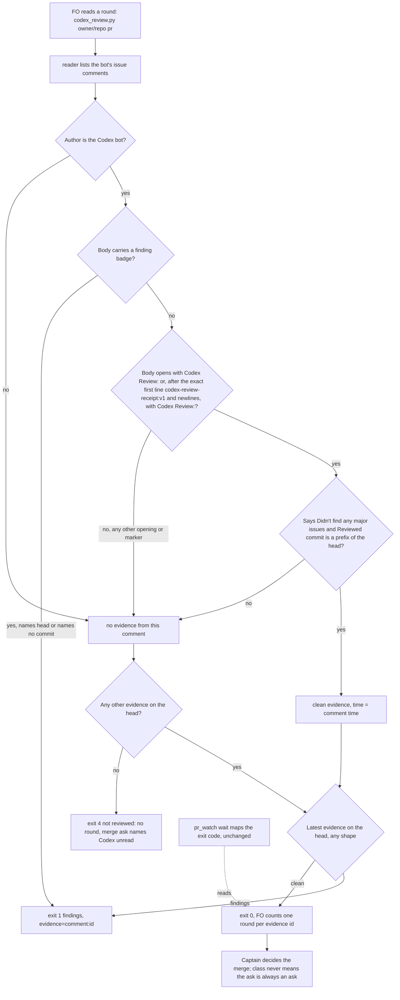

## Scope

- Source: intake from the kc-paseo-plugins dev2 FO (Paseo agent 8b2c2fc, 2026-10-21), relaying the Captain's 「dev2 問題開給維護它的 FO」 (relayed, not a ruling in this session).
- Bite: on iamcxa/kc-paseo-plugins#8 (comment 6296013066) `extensions/codex/codex_review.py` returned exit 4 "not reviewed" for a head Codex had reviewed clean, and `pr_watch.py wait` timed out. Verified 2026-10-21: that comment's body opens with `<!-- codex-review-receipt:v1 -->` before "Codex Review: Didn't find any major issues…", and kc-dev-flow-2 0.27.0 `codex_review.py` matches a clean comment only when `c["body"].startswith("Codex Review:")`. The summary-comment path still reads clean (the adopter's #10 and #11; this repository's #685, #686, #689 in batch 4).
- Shape asked for: the reader accepts the receipt-marked clean comment, still never reading an unrecognized shape as clean (the extension's stated limit).
- Upstream first: `extensions/codex/codex_review.py` and its tests.

## FO alignment

Alignment: not needed before ideation; the fix is named.
Surfaces: none
Visible change: none
Release review: not needed: workflow maintenance, on no journey map.

## Design

### Upstream check (read 2026-10-21)

- Spacedock 0.27.0 cache: `grep -rIl "codex-review-receipt\|chatgpt-codex-connector\|Reviewed commit"` finds nothing; it has no Codex review reader.
- Codex's own docs (https://learn.chatgpt.com/docs/third-party/github, redirected from developers.openai.com/codex/integrations/github): the marker, the summary comment and "Reviewed commit" are not documented; only the visible "Codex Review: ..." opening is. So the reader stays what EXTENSION.md already calls it, a compatibility adapter, and the real comment bodies are the specification.
- kc-dev-flow-2 at origin/main c27e7659 (0.27.0): `extensions/codex/codex_review.py` matches a clean comment with `c["body"].startswith("Codex Review:")`. This is the whole defect.
- Sibling adopters, read-only: `git grep` for `codex-review-receipt`, `chatgpt-codex-connector`, `codex_review` on qnow, subspace-relay and recce-team finds nothing (read 2026-10-21); none has its own Codex reader to borrow. Read-only note: before grepping I ran `git fetch -q origin` in those three local clones, which updates their remote-tracking refs and is not a read-only command; no file or branch was changed.
- ADR 0013 (Copilot answer without a review): the closing sentence "Later work must keep the reader's rule positive ... not a list of refusal wordings" decides the shape of this design. No `Override:` line bears on it (`git -C <state> grep -n 'Override:'`, read 2026-10-21: hits are prose in archived tasks, none on a Codex reader).

### What the real bodies show (all read 2026-10-21)

Correction to the checklist's premise: PRs #685 to #689 carry no receipt-marked comment; each carries only the bot's summary comment. The receipt-marked comments are 15 on this repository, #649 to #682 (first 2026-10-16T04:31:49Z, the last plain `Codex Review:`-led comment is on #647 at 2026-10-15T08:21:26Z), and one on iamcxa/kc-paseo-plugins#8. #685, #686, #688, #689 and the adopter's #10 and #11 serve here as summary-path regression checks.

| Shape | Real example | Base reader (0.27.0) | Candidate |
| --- | --- | --- | --- |
| S1 plain clean comment: `Codex Review: Didn't find any major issues.` then `**Reviewed commit:** <sha>` | #593 to #647 (15 comments since 2026-10-01) | exit 0 when it names the head | unchanged |
| S2 receipt-led clean comment: the same two lines after the line `<!-- codex-review-receipt:v1 -->` and a blank line | comment 6296013066 on kc-paseo-plugins#8; 15 here | not recognized: exit 4 "no Codex evidence covers 5ff307de6" | exit 0 on the head it names |
| S3 summary comment (`codex-pull-request-review-summary`, a `codex-security-review:v1` marker with `headSha`/`status`) | #685, #686, #689, #10, #11 | exit 0 via `summary:` | unchanged |
| S4 line findings and reviews with `![P1 Badge]` | #687, #652 | exit 1 | unchanged |

The failure at kc-paseo-plugins#8 reproduces today: base `codex_review.py iamcxa/kc-paseo-plugins 8` exits 4 although the bot's receipt names the head `5ff307de6d` and the summary's `code_review` row reads `completed` on `5ff307d`. The summary path does not rescue it because it reads only the `codex-security-review:v1` marker, whose `headSha` is the older `2defea5`.

Why it was invisible here: on 13 of the 14 sampled PRs with a receipt for the final head, the summary's security marker already named the head, so exit 0 came from `summary:` and never from the receipt. The receipt decides only when the security marker lags the head: a push after the security run, then `@codex review` (the repair step in EXTENSION.md) gives a code-review receipt and a stale security marker. Observed once (kc-paseo-plugins#8) in 15 receipt PRs (14 here, 1 there); a repair round after a push has this shape.

### Existing-code check (bounded)

Use and repair what exists: one branch of `state()` in `codex_review.py` is wrong for one header line. No new script, no new exit code, no new shape read beyond that line. Observation: base exits 4 on live kc-paseo-plugins#8; a disposable prototype in `/tmp` (outside the repository) exits 0 with `evidence=comment:6296013066`, and the prototype and base print the same exit code and the same line on the other 21 sampled PRs (kc-paseo-plugins#10, #11; this repository #649, #651, #652, #658, #659, #661, #663, #664, #668, #670, #675, #679, #680, #682, #685 to #689).

### PRFAQ

**Press release.** FO's Codex round now sees the clean verdict Codex posts today. When Codex answers a review request with a comment that opens with its receipt marker and says "Didn't find any major issues" on the head, `codex_review.py` reads it as a clean round with that comment's id as the evidence, so `pr_watch.py wait` returns and the merge ask can name a clean Codex round. A receipt that carries a finding badge still blocks; a receipt for an older head, from a person, without the verdict sentence, without a named commit, or with a marker the reader does not know reads as no verdict, never as clean.

**FAQ**
- *What is recognized?* One extra opening: the exact first line `<!-- codex-review-receipt:v1 -->` followed only by newlines, then the unchanged `Codex Review:` opening. Everything after that line goes through the same checks as the plain shape: bot author, the verdict sentence, no badge, a `**Reviewed commit:**` that is a prefix of the head.
- *Why that exact string and not any `codex-...` marker?* ADR 0013: the rule stays positive. A `v2`, a marker with a payload or a marker anywhere but the first line is a shape nobody has read; it falls to exit 4 as today.
- *Does the plain `Codex Review:` shape stay?* Yes. Its last sighting is 2026-10-15 but nothing asks to remove it, and removing a recognized shape is the Captain's call.
- *What if Codex changes the receipt again?* The reader goes back to exit 4 for that shape, as it did on 2026-10-16 (masked here by the summary path for five days, caught at kc-paseo-plugins#8). Nothing in this design detects the drift; see Needs decision D2.
- *Does the printed line or any FO instruction change?* No. The clean line for this shape is the existing line "Codex Review comment says no issues on the head". EXTENSION.md, its Limits sentence, README, mods and `pr_watch.py` are untouched.
- *Could one Codex round be counted twice?* Possibly by one extra round: a receipt and the summary row Codex updates for the same round can be read between two of its writes (2 seconds apart on kc-paseo-plugins#8, 16:38:29 and 16:38:31), and the printed `evidence=` id is the latest of them. Known limit; ADR 0004 already caps rounds by rule.

### Mermaid

Actors and order match the prose: the reader is the only classifier; FO acts on the exit code; the Captain owns the merge. Review, reaction and summary evidence are read as today and are not drawn.

### Surfaces

`Surfaces: none`: no UI and no schema; PRFAQ and Mermaid only.

### Delivery shape (for implementation, not decided here)

Files the change touches, and no others:
- `kc-dev-flow-2/extensions/codex/codex_review.py`: one constant, `RECEIPT = "<!-- codex-review-receipt:v1 -->\n"`, a four-line helper `says_review(body)` that drops that first line and following newlines, then tests `startswith("Codex Review:")`, and the clean branch of `state()` calling it in place of the bare `startswith`. The `__doc__` already says "a comment naming the head", so it is unchanged.
- `kc-dev-flow-2/extensions/codex/test_codex_review.py`: added tests only (prototype: 4 test methods, 50 added lines, the 12 existing tests untouched).

Commit type `fix(kc-dev-flow-2): ...`, patch release by release-please. `delivery_gate.py` classes `extensions/codex/codex_review.py` as `never`, so the merge ask is always an ask, not an automatic merge. CI already runs the file (`.github/workflows/kc-dev-flow-2-tests.yml` step `extensions/codex/test_codex_review.py`); no new job. Added comment lines: 0.

Prototype and mutation record, in `/tmp` only (not repository files): 16 tests pass on the prototype. On the base reader the two receipt-positive tests fail and the fail-closed ones pass (they guard over-acceptance). Six mutants of the prototype, each run with `python3 -B -I`: (M1) strip any `<!-- codex-...-->` marker: 6 subtests red; (M2) strip the marker anywhere in the body: 1 red; (M3) drop the `names_head` test: 2 red; (M4) `lstrip()` of all whitespace: 1 red after adding the space case; (M5) drop the verdict-sentence test: 2 red; (M6) revert to the bare `startswith`: 2 red.

### Batch overlap

Files the design would change: `kc-dev-flow-2/extensions/codex/codex_review.py`, `kc-dev-flow-2/extensions/codex/test_codex_review.py`. It reads but does not change `kc-dev-flow-2/scripts/pr_watch.py` (it parses `evidence=` and the exit code, both unchanged), `kc-dev-flow-2/extensions/codex/EXTENSION.md` and `kc-dev-flow-2/scripts/test_sd_dispatch.py` (case `codex-round` asserts four EXTENSION.md phrases; they stay), `kc-dev-flow-2/scripts/test_delivery_gate.py` (ClassTests lists `codex_review.py` as class `never`; unchanged), and the workflow `.github/workflows/kc-dev-flow-2-tests.yml` (already runs the test). No ADR number, no shared index, no table or numbered record is touched. Read 2026-10-21 from the task files in the state checkout and `gh pr list --state open`.

| Other task | Files or checks it changes that this design also changes | Note |
| --- | --- | --- |
| new-work-starts-from-a-story-map | none | held at ideation; names the `dev` entry, journey-map and README touchpoints, not these files |
| merge-ask-holds-missing-clauses | none | `delivery_gate.py`, `role_triggers.py` and their tests |
| fo-write-checks-parse-top-level | none | `delivery_gate.py`, `design_surfaces.py` and their tests |
| idle-names-failing-seeds | none | `pr_watch.py tasks`; same consumer of the reader but the reader's contract is unchanged |
| agent-reads-governing-adr | none | hooks, dispatch, instruction files |
| kc-decision-log-p1, kc-decision-log-cli, kc-decision-log-handoff-trial | none | a new plugin directory; the CLI task may add its own test step to `kc-dev-flow-2-tests.yml` or a new workflow (adjacent lines, not these) |
| pr-review-lite-value-pilot | none | `kc-pr-flow/scripts/review-capability.*` |
| release-acceptance, journey-canvas-hosted-poc, journey-server-host-pilot | none | journey and kc-dev-flow-2 acceptance work, no mention of the codex files |
| open PR #674 (Codex model and effort policy) | none | `scripts/codex_model_policy.py`, `references/codex-*`, `skills/dev/SKILL.md`, README and `kc-dev-flow-2-tests.yml`; concerns Codex workers, not the review reader |

Shared only by release: every kc-dev-flow-2 task rides one release-please component, so a patch from this fix and any minor from another task merge into the same Release PR and CHANGELOG; this design adds no ordering constraint. Recommended order: any; implementation can start as soon as the Captain rules D1, because no other task shares a file or check with it.

## The words FO reads at each lifecycle moment

Rule: root `learning.md` "Measure the words FO reads at each moment, not one file's size". The goal here is not to cut words; the criterion is that no moment reads more instruction words than its base, with the one printed verdict line counted separately. Counted as `len(text.split())`, same method for base (origin/main c27e7659) and candidate.

| Moment | What FO reads about this reader | Base | Candidate |
| --- | --- | --- | --- |
| Startup | nothing from the reader (not run); README and mods unchanged | 0 | 0 |
| Idle on an open PR | `pr_watch.py` columns `codex=<verdict> codex-evidence=<id>`; same two fields | 2 | 2 |
| Idle on a merged PR | none: the reader runs only for an OPEN PR (`read = with_codex and d["state"] == "OPEN"`) | 0 | 0 |
| After the archive | none | 0 | 0 |
| A review round and the merge ask | `extensions/codex/EXTENSION.md` | 185 | 185 |
| The same, printed verdict line for the S2 head of kc-paseo-plugins#8 | `not reviewed: no Codex evidence covers 5ff307de6` becomes the existing clean line | 7 | 15 |

The last row rises by 8 words because the head changes from "no verdict" to a clean verdict; the line is character-for-character the existing S1 clean line (15 words), and it adds no instruction. The `--help` text (151 words, printed only on bad arguments) is unchanged.

## Unresolved decisions for the Captain

- **D1: recognize only the exact first line `<!-- codex-review-receipt:v1 -->`, or also the broader forms?** Recommend the exact line only, with the plain `Codex Review:` shape kept. It follows ADR 0013 and the extension's limit. Worse under it: when Codex ships `v2` or changes the wording, the reader returns to exit 4 for that shape until someone edits one constant, as happened on 2026-10-16. The broader options (any `codex-*` marker; also reading the summary's `codex-review-state:v1` `code_review` row) read shapes nobody has verified and the second is a separate design.
- **D2: should an unrecognized Codex comment that names the head make the exit-4 line say so?** Recommend no, not in this task: one incident, found by the adopter's FO within a day, and a hint is new reader output with its own tests. Worse under it: the next format change can again read "not reviewed" with nothing pointing at the unrecognized comment, and on this repository the summary path can mask it for days (it did, 2026-10-16 to 2026-10-21). A one-line `; N Codex comment(s) not recognized` suffix would be the follow-up if the Captain wants it.
- **D3: the summary path reads a completed security review as a clean round. Open a separate task?** Recommend yes, a separate backlog task, and no change to this one. Fact, read 2026-10-21: #685, #686 and #689 read exit 0 through `summary:<id>` while the same comment's `codex-review-state:v1` shows `"code_review":{...,"status":null}`, so only the security review had run; the reader reports that as a clean round, which the merge ask passes on as Codex clean. It predates this task and no criterion here depends on it. Worse under the recommendation: until that task lands FO can still report "Codex clean" on a head whose code review never ran; widening this task instead would add a second recognized shape and an exit-code meaning the Captain has not seen.

## Acceptance criteria

Evidence commands run from `<package>/extensions/codex/` of the implementation candidate, with `python3 -B -I`; "base" is origin/main c27e7659 (0.27.0). `gh` must be authenticated read-only for iamcxa/kc-paseo-plugins and iamcxa/kc-claude-plugins.

**AC-1** The candidate reader reads the receipt-led clean comment on kc-paseo-plugins#8 as clean on its head. Evidence: `python3 -B -I codex_review.py iamcxa/kc-paseo-plugins 8` exits 0 and prints `evidence=comment:6296013066`; the same command on base exits 4 (observed 2026-10-21 with the exit 4 line above). Falsifier: exit 4, or exit 0 with a `summary:` evidence id. Status: not yet verified; the prototype printed `clean on 5ff307de6: Codex Review comment says no issues on the head; evidence=comment:6296013066`. This criterion depends on the live comment staying in place; AC-2 is the durable form.

**AC-2** A unit test builds the receipt-led shape from the real body of comment 6296013066 (the head sha replaced by the test head) and asserts code 0 with `evidence=comment:<id>` in the line, plus three negatives on the same body: another sha, a non-bot author, and the `**Reviewed commit:**` line removed, each code 4. Evidence: `python3 -B -I test_codex_review.py`. Falsifier: mutant M6 (the clean branch back to the bare `startswith("Codex Review:")`) turns it red; mutant M3 (no head test) turns the old-sha negative red. Status: not yet verified in the repository; the prototype tests pass and M3, M6 are red.

**AC-3** The reader never reads these as clean, one subtest each, all code 4: the marker as `v2`, the marker with a JSON payload, a different `codex-*` marker, the marker after other text, the marker with no newline before the opening, the marker followed by other text before `Codex Review:`, the marker followed by a space-only line, the marker with CRLF line ends. Evidence: one test, eight subtests. Falsifier: M1 (any `codex-...` marker stripped) goes red on six of them, M2 (marker stripped anywhere) on one, M4 (`lstrip()` of all whitespace) on the space-only one. Status: not yet verified in the repository; prototype passes, M1, M2, M4 red.

**AC-4** A receipt-led comment keeps the badge and verdict rules: with a finding badge and naming the head it is code 1; with a badge and no named commit it is code 1; with a badge only, no opening, code 1; `Codex Review: here is a note.` naming the head is code 4. Falsifier: M5 (drop the verdict-sentence test) turns the last red. Status: not yet verified in the repository; prototype passes, M5 red.

**AC-5** The latest evidence on one head decides across the new and old shapes: a findings review at T1 and a receipt at T2 gives code 0; a findings review at T2 and a receipt at T1 gives code 1; a receipt and a head that moves while reading gives code 4. Evidence: one test, three assertions. Falsifier: a candidate that prefers the receipt regardless of time turns the second red. Status: not yet verified in the repository; prototype passes.

**AC-6** Nothing the base recognized changes: all 12 existing tests pass with no existing line edited, and on the 22 sampled live PRs the candidate prints the same exit code and the same line as base for 21 of them; the one difference is kc-paseo-plugins#8. Evidence: `git diff --stat origin/main...HEAD -- extensions/codex/test_codex_review.py` shows only added lines; a loop running base and candidate on kc-paseo-plugins#8, #10, #11 and this repository's #649, #651, #652, #658, #659, #661, #663, #664, #668, #670, #675, #679, #680, #682, #685, #686, #687, #688, #689 (read-only `gh`, timestamps compared as printed). Falsifier: a second differing PR, or a removed or edited existing test line. Status: prototype result recorded (21 same, 1 differing: kc-paseo-plugins#8, on 2026-10-21); repository run not yet done.

**AC-7** The change touches only the two files and adds no comment line. Evidence: `git diff --name-only origin/main...HEAD` lists exactly `kc-dev-flow-2/extensions/codex/codex_review.py` and `kc-dev-flow-2/extensions/codex/test_codex_review.py`; `comment_ratio.py` over the diff reports 0 added comment lines. Falsifier: any other path (EXTENSION.md, `pr_watch.py`, README, a workflow file) or an added comment line. Status: not yet verified.

**AC-8** FO's reading does not grow. Evidence: `git diff origin/main...HEAD -- kc-dev-flow-2/extensions/codex/EXTENSION.md kc-dev-flow-2/README.md kc-dev-flow-2/references` is empty, so the table in "The words FO reads" holds (185 words of EXTENSION.md and the two-field watch columns unchanged). Falsifier: any added word in those paths. Status: not yet verified.

## Number guards

ADR: none. The design lands no ADR; ADR 0013's closing sentence already states the positive-rule principle it follows.

## Stage Report: ideation

- DONE: Design the reader change against the real comment bodies: iamcxa/kc-paseo-plugins#8 comment 6296013066 and the clean receipts on this repository's batch-4 PRs #685 to #689, keeping the extension's limit that an unrecognized shape never reads as clean, with a test per shape
  `## Design`: the bodies were read; #685 to #689 hold no receipt (summary comments only), the 15 receipts are on #649 to #682 and one on paseo #8, so the design uses those and keeps #685 to #689 as summary-path regression checks. One exact leading line recognized (ADR 0013 positive rule); AC-2 to AC-5 are the per-shape tests, mutants M1 to M6 recorded. `design_surfaces.py check` printed "design surfaces presentable" (0.27.0 and 0.26.0).
- DONE: A `### Batch overlap` section naming each file the design would change and each other batch task and live task of other sessions that changes the same file or check, so FO can order implementation
  `### Batch overlap` closes `## Design`: two files changed; none of the five batch tasks, the seven other-session tasks or open PR #674 changes either; `Recommended order: any`.
- DONE: The words FO reads at each lifecycle moment, before and after, per root learning.md "Measure the words FO reads at each moment, not one file's size"
  `## The words FO reads at each lifecycle moment`: six rows counted by `len(split())` on origin/main c27e7659 and the prototype; no instruction word changes (EXTENSION.md 185 to 185); the one printed verdict line rises 7 to 15 words for the head it turns from no verdict to clean.
- DONE: Acceptance criteria with reproducible evidence clauses and falsifiers, and unresolved decisions for the Captain, each with a recommendation and what gets worse under it
  AC-1 to AC-8 each carry a command and a falsifier; D1 (exact marker only), D2 (no unrecognized-comment hint now), D3 (separate task for the security-only summary read as clean) in `## Unresolved decisions for the Captain`.

### Per-criterion evidence

- AC-1: prototype in /tmp exits 0 with `evidence=comment:6296013066` on live paseo #8; base exits 4 (2026-10-21). Not yet verified in the repository.
- AC-2: prototype tests pass; M3 and M6 red. Not yet verified in the repository.
- AC-3: prototype passes the eight subtests; M1 (6), M2 (1), M4 (1) red. Not yet verified in the repository.
- AC-4: prototype passes; M5 red. Not yet verified in the repository.
- AC-5: prototype passes. Not yet verified in the repository.
- AC-6: prototype vs base on 22 live PRs: 21 same, 1 differing (paseo #8). Repository run not yet done.
- AC-7, AC-8: designed, not yet verified (they check the implementation diff).

### Summary

The defect is one header line: the reader's clean branch needs the comment to start with `Codex Review:`, and since 2026-10-16 Codex puts `<!-- codex-review-receipt:v1 -->` first. Here the summary path hid it for five days; it bit on paseo #8 because that summary's security marker lagged the head. The design adds the exact marker line as a second accepted opening and nothing else; three decisions go to the Captain, D3 being a finding outside this task (the summary path reads a security-only review as a clean round).

### Deviations and disclosures

- The ideation skill loaded from the orphaned 0.26.0 cache while the dispatch names 0.27.0; I used 0.27.0's principles (it adds the Batch overlap rule) and ran `design_surfaces.py check` from both, same result.
- Read-only rule: before grepping adopter clones I ran `git fetch -q origin` in qnow, subspace-relay and recce-team local clones, which updates remote-tracking refs and is not read-only. No file, branch or config changed.
- Prototype and mutant files are in /tmp/ideation-crm, outside every repository.
