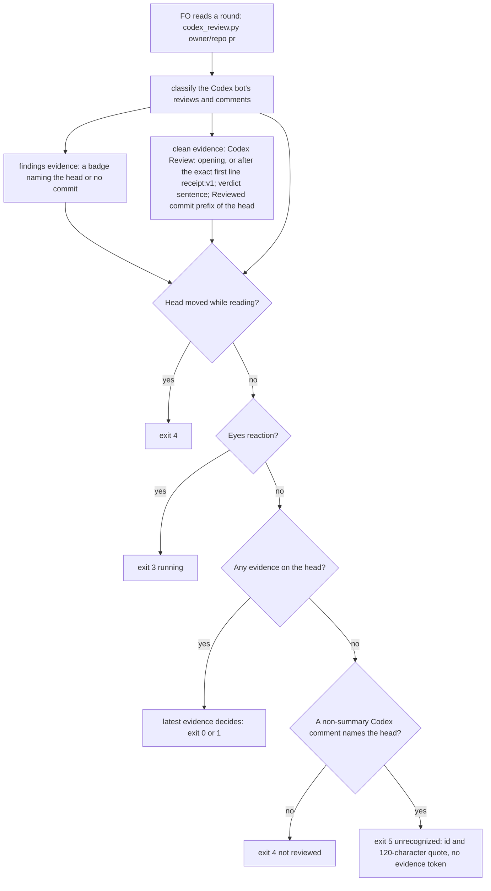
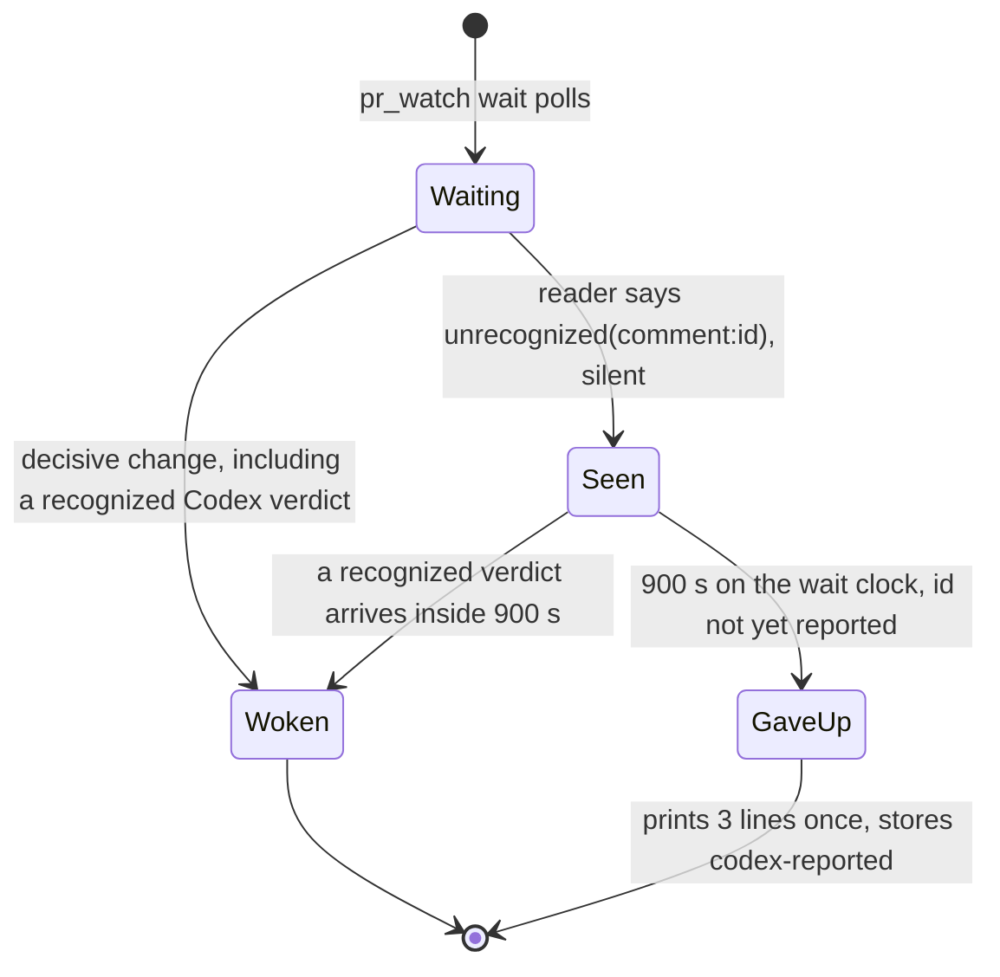

## Scope

- Source: intake from the kc-paseo-plugins dev2 FO (Paseo agent 8b2c2fc, 2026-10-21), relaying the Captain's 「dev2 問題開給維護它的 FO」 (relayed, not a ruling in this session).
- Bite: on iamcxa/kc-paseo-plugins#8 (comment 6296013066) `extensions/codex/codex_review.py` returned exit 4 "not reviewed" for a head Codex had reviewed clean, and `pr_watch.py wait` timed out. Verified 2026-10-21: that comment's body opens with `<!-- codex-review-receipt:v1 -->` before "Codex Review: Didn't find any major issues…", and kc-dev-flow-2 0.27.0 `codex_review.py` matches a clean comment only when `c["body"].startswith("Codex Review:")`. The summary-comment path still reads clean (the adopter's #10 and #11; this repository's #685, #686, #689 in batch 4).
- Shape asked for: the reader accepts the receipt-marked clean comment, still never reading an unrecognized shape as clean (the extension's stated limit).
- Upstream first: `extensions/codex/codex_review.py` and its tests.

## FO alignment

Alignment: not needed before ideation; the fix is named.
Surfaces: none
Visible change: none
Release review: not needed: workflow maintenance, on no journey map.

## Design

Cycle 2, revised 2026-10-21 for the Captain's D2 ruling (the ideation gate's resolution reason: revise). D1 is as ruled and unchanged. This block replaces the cycle-1 Design, words table, decisions and criteria; the cycle-1 stage report below is kept as history.

Rulings in force (from that reason): D1 the exact `v1` marker only, "if Codex changes we follow in the extension"; D2 option C plus two additions, recorded as "on a wait timeout with an unrecognized Codex comment, the timeout line names it, the merge ask quotes the raw comment for the Captain to decide (never read as clean), and FO reports upstream (a backlog task here, the kc-dev-flow-2 maintainer FO elsewhere)"; D3 a separate batch-5 task, which exists as `codex-reader-counts-code-review-only`.

### Upstream check (read 2026-10-21)

- Spacedock 0.27.0 cache: `grep -rIl "codex-review-receipt\|chatgpt-codex-connector\|Reviewed commit"` finds nothing; it has no Codex review reader. Spacedock 0.27.3 (the installed cache) `skills/fo-status-viewer/SKILL.md` `## Issue Filing` says "Do not file GitHub issues without explicit human approval", so an upstream report as a GitHub issue needs the Captain; a backlog task in this workflow does not.
- Codex's own docs (https://learn.chatgpt.com/docs/third-party/github): the marker, the summary comment and "Reviewed commit" are not documented; only the visible "Codex Review: ..." opening is. The reader stays a compatibility adapter and the real comment bodies are the specification.
- kc-dev-flow-2 at origin/main c27e7659 (0.27.0): `extensions/codex/codex_review.py` matches a clean comment with `c["body"].startswith("Codex Review:")`; that is the whole D1 defect. For D2 the in-package precedent is `extensions/copilot/copilot_review.py` exit 5 ("not a review"): it prints a 120-character quote and an `answer=` token and no `evidence=` token, so it is no round and never clean, and the Copilot EXTENSION.md has the merge ask name Copilot as not read with that quote. D2 copies that shape for Codex.
- Premise check on the ruling's wording: `pr_watch.py wait [SECONDS]` takes the poll interval, and the loop in `main` ends only on a decisive change or an empty watch list. `git grep -n -i "timeout\|timed out" origin/main -- kc-dev-flow-2/scripts/pr_watch.py` finds nothing. So the "wait timeout line" does not exist today; the "timed out" seen on kc-paseo-plugins#8 was, by inference (the intake does not say who ended it), the host's background-command limit ending a wait that prints nothing. D4 says what this design builds in its place.
- Sibling adopters, read-only: `git grep` for `codex-review-receipt`, `chatgpt-codex-connector`, `codex_review` on qnow, subspace-relay and recce-team finds nothing (read 2026-10-21); none has its own Codex reader to borrow. Read-only note: before grepping I ran `git fetch -q origin` in those three local clones (cycle 1), which updates remote-tracking refs and is not a read-only command; no file or branch changed.
- ADR 0013 (Copilot answer without a review): "Later work must keep the reader's rule positive ... not a list of refusal wordings" decides the reader's shape. No `Override:` line bears on it (`git -C <state> grep -n 'Override:'`, read 2026-10-21: hits are prose in archived tasks).

### What the real bodies show (all read 2026-10-21)

PRs #685 to #689 carry no receipt-marked comment (summary comments only). The 15 receipt-marked comments on this repository are #649 to #682 (first 2026-10-16T04:31:49Z) plus one on iamcxa/kc-paseo-plugins#8. Across 22 PRs of this repository (593, 640, 647, 649 to 689 sampled) the Codex bot left 40 issue comments; every one is S1, S2 or S3 below, none is an unrecognized shape.

| Shape | Real example | Base reader (0.27.0) | Candidate |
| --- | --- | --- | --- |
| S1 plain clean comment: `Codex Review: Didn't find any major issues.` then `**Reviewed commit:** <sha>` | #593 to #647 | exit 0 when it names the head | unchanged |
| S2 receipt-led clean comment: the same two lines after `<!-- codex-review-receipt:v1 -->` and a blank line | comment 6296013066 on kc-paseo-plugins#8; 15 here | exit 4 "no Codex evidence covers 5ff307de6" | exit 0 on the head it names (D1) |
| S3 summary comment (`codex-pull-request-review-summary` with `codex-review-state:v1` and `codex-security-review:v1` markers) | #685, #686, #689, #10, #11 | exit 0 via `summary:` | unchanged |
| S4 line findings and reviews with `![P1 Badge]` | #687, #652 | exit 1 | unchanged |
| S5 a comment that names the head in a shape the reader does not read, with no other evidence on the head | none observed in the 40 comments; stand-in: the live S2 body of kc-paseo-plugins#8 with the recognized marker string changed to `v9`, run from `/tmp` | exit 4 | exit 5 with `unrecognized=comment:6296013066` (D2) |

Why S2 stayed invisible here: on 13 of 14 sampled receipt PRs the summary's security marker already named the head, so exit 0 came from `summary:`. The receipt decides only when the security marker lags the head, observed once (kc-paseo-plugins#8). The same masking would hide an S5 comment whenever a summary reads clean first; D2 covers the case the incident had (no other evidence) and not that one (Limits).

### Design (D1 and D2)

D1 (unchanged): one constant `RECEIPT = "<!-- codex-review-receipt:v1 -->\n"` and a four-line `says_review(body)` that drops that exact first line and following newlines, then tests `startswith("Codex Review:")`; the clean branch of `state()` calls it.

D2 has three parts, each reusing something that exists:

1. Reader, `codex_review.py`: when `state()` would return exit 4 "no Codex evidence covers the head" (no evidence of any kind, no eyes reaction, head did not move), it first looks for Codex issue comments that are not summary comments and name the head in a `**Reviewed commit:**` line (the existing `names_head`). If one exists it returns exit 5 and the line `not recognized on <head9>: "<first 120 characters>"; unrecognized=comment:<id> at <time>`. The line has no `evidence=` token (so `pr_watch.py` counts no round) and a quoted `evidence=` is rewritten to `evidence:`, both copied from `copilot_review.py`. The latest such comment names itself. Exit 0, 1, 3 and every other 4 are untouched.
2. Watcher, `pr_watch.py`: `reader()` maps exit 5 to the verdict `unrecognized(comment:<id>)` with evidence `-`. The id rides in the verdict because any `-evidence` value is a decisive outcome (`outcome()`), and the Captain's wording is a timeout, not an immediate wake. The verdict is not in `OUTCOMES["codex"]`, so wait records it silently; the idle `fact:` line shows `codex=unrecognized(comment:<id>)` at once. New constant `GRACE_SECONDS = 900` (the same bound-not-proof convention as `SETTLE_SECONDS`) and one function `grace_lines`: once wait has seen the same `unrecognized(...)` word for `GRACE_SECONDS` of its own clock with no recognized verdict, it stops once, prints three lines (66 words), exits 0, and stores `codex-reported` in the watch state so a later wait skips that id. A new id starts its own window. A recognized verdict inside the window wakes wait as today and prints nothing extra.
3. Instruction, `extensions/codex/EXTENSION.md`: one sentence in the Read bullet: exit 5 is a Codex comment on the head that the reader does not recognize, no round and never clean; FO keeps waiting as for exit 4 until `pr_watch.py wait` gives up on it, then does the `next:` lines it prints. Those lines carry the actions: quote the comment's raw text, fetched by id, in the merge ask as Codex unread, never clean, and the Captain decides; and report it upstream (D5).

The three printed lines for the live stand-in (cycle-2 prototype, fake clock):
```
iamcxa/kc-paseo-plugins#8 codex=unrecognized(comment:6296013066): no recognized Codex verdict 900s after it first showed
next: quote that comment's raw text, from `gh api repos/iamcxa/kc-paseo-plugins/issues/comments/6296013066 --jq .body`, in the merge ask as Codex unread, never clean; the Captain decides.
next: report it upstream: a backlog task here if this repository has kc-dev-flow-2/, else the Captain passes it to the kc-dev-flow-2 maintainer FO; give the comment id and its raw text.
```

The reader's exit-5 line quotes the first 120 characters with whitespace collapsed, for FO's own reading (copied from Copilot's exit 5). The merge ask quotes the raw body, which the give-up `next:` line has FO fetch by the comment id (the kc-paseo-plugins#8 body is 86 words). The 120-character cut cannot hide a finding badge: a Codex comment with a badge that names the head or names no commit is already evidence (exit 1) under the existing rule, so exit 5 never covers one.

### Existing-code check (bounded)

Use and repair what exists, add nothing new in kind. Reused: `copilot_review.py` exit 5 (shape and wording of the no-`evidence=` quote), `reader()` and its exit-code table, `outcome()`/`OUTCOMES` (a verdict outside the set is silent), `update(keep_flags=True)` (stores `codex-reported`), `facts()` (already prints the verdict), the injected `clock` and `sleep` of `main()` (tests need no real wait). New: one exit code, one constant, one function (15 lines), one EXTENSION.md sentence. Not built: a `--limit` flag, a new script, a new state file, a delivery-gate check. Observation: on live kc-paseo-plugins#8 the base reader exits 4; the D1 candidate exits 0; the same candidate with the marker string changed to `v9` (a stand-in for Codex changing the receipt) exits 5 and prints `unrecognized=comment:6296013066` (read 2026-10-21, `python3 -B -I`). On the other 21 sampled PRs (kc-paseo-plugins#10, #11; this repository #649, #651, #652, #658, #659, #661, #663, #664, #668, #670, #675, #679, #680, #682, #685 to #689) base and candidate print the same line (compared with the trailing timestamp cut).

### PRFAQ

**Press release.** When Codex answers a review request with a comment FO's reader does not know, FO now hears about it instead of waiting until the host ends the wait. A Codex comment that opens with its receipt marker and says "Didn't find any major issues" on the head still reads as a clean round with its id as evidence (D1). A Codex comment that names the head in any other unread shape reads as exit 5: no round, never clean. The idle line shows it at once; if no recognized verdict follows within 900 seconds of the wait seeing it, the wait stops once, names the comment, and tells FO to put its raw text in the merge ask as Codex unread for the Captain to decide and to report it upstream.

**FAQ**
- *What is recognized as clean?* The plain `Codex Review:` opening and, as one extra opening, the exact first line `<!-- codex-review-receipt:v1 -->` followed only by newlines; everything after goes through the unchanged checks (bot author, verdict sentence, no badge, a `**Reviewed commit:**` that is a prefix of the head). A `v2`, a payload, a marker anywhere but the first line is not recognized (ADR 0013).
- *What counts as unrecognized?* A comment by the Codex bot, not a summary comment, that names the head in a `**Reviewed commit:**` line, when nothing else is evidence for the head, no eyes reaction is on the PR and the head did not move. A Codex comment that names no commit is not reported (no way to tie it to the head); any comment is ignored while other evidence covers the head.
- *Why a new exit code and not a suffix on exit 4?* Exit 4 stays "nothing from Codex yet" with FO's rule for it untouched, and exit 5 matches Copilot's. The price is two existing assertions in `test_codex_review.py` that expected 4 for a bot comment naming the head in an unread opening and now expect 5.
- *Does a first sight wake FO?* No. It is silent in wait and visible in the idle `fact:` line; only the 900-second give-up prints, once per comment id.
- *Could the give-up repeat?* No. After it prints, `codex-reported` holds the word and later waits skip it; a different comment id starts a new window.
- *What does the merge ask say?* Codex as unread with the comment's raw text, and the Captain decides; nothing is counted as a round and exit 5 is never exit 0. No script or observer check reads the ask's wording today (named limit, the same as Copilot's quote).
- *Could one Codex round be counted twice?* Possibly by one extra round when a receipt and the updated summary are read between two writes (2 seconds apart on kc-paseo-plugins#8); ADR 0004 caps rounds by rule.

### Mermaid





Actors and order match the prose: the reader classifies, the watcher only counts seconds and prints, FO does the `next:` lines, the Captain decides the merge. Review, reaction and summary evidence are read as today and are not drawn.

### Surfaces

`Surfaces: none`: no UI and no schema; PRFAQ and Mermaid only.

### Delivery shape (for implementation, not decided here)

Files the change touches, and no others: `kc-dev-flow-2/extensions/codex/codex_review.py`, `kc-dev-flow-2/extensions/codex/test_codex_review.py`, `kc-dev-flow-2/extensions/codex/EXTENSION.md`, `kc-dev-flow-2/scripts/pr_watch.py`, `kc-dev-flow-2/scripts/test_pr_watch.py`. Prototype size against origin/main c27e7659: codex_review.py +15 -1, test_codex_review.py +75 -2 (the two edited assertions above), EXTENSION.md +3 -1, pr_watch.py +31 -2, test_pr_watch.py +65 -0; added comment lines 0.

Commit type `feat(kc-dev-flow-2): ...` (a new reader exit code and a new wait stop), so release-please proposes a minor bump; D1 alone would have been a `fix`. `delivery_gate.py` puts `extensions/` paths in class `never`, so the merge ask is always an ask. CI already runs both test files (`.github/workflows/kc-dev-flow-2-tests.yml`, steps `extensions/codex/test_codex_review.py` and `test_pr_watch.py`); no new job. The reader and watcher code is not documentation-only, so `test_sd_dispatch.py` case `codex-round` (four EXTENSION.md phrases) still holds: checked offline with the test's own whitespace flattening, base and candidate all four present (the test itself needs `--sd-plugin-root` and was not run).

Prototype and mutation record, in `/tmp/ideation-d2` only (not repository files; `python3 -B -I`): candidate 18 codex tests and 91 watcher tests pass (base: 87 watcher tests, all unchanged and still passing). D1 mutants M1 to M6 as cycle 1 (any `codex-` marker stripped: 7 subtests red; marker stripped anywhere: 1; `names_head` dropped: 2; `lstrip()` of all whitespace: 1; verdict test dropped: 2; bare `startswith` restored: 2). D2 mutants: M7 `evidence=` token printed on exit 5: 1 red; M8 any bot comment counts as unrecognized: 5 red; M13 summary comments counted: 1 red; M12 exit 5 left as `error`: 1 red; M9 grace removed (give up at first sight): 3 red; M10 `codex-reported` not stored: 1 red; M11 id placed in the evidence slot: 1 red; M14 one window per PR instead of per id: 1 red. M11 first written as adding the bare word to `OUTCOMES` was equivalent (nothing red); it was replaced by the evidence-slot form, which is the real hazard.

### Batch overlap

Files the design would change: `kc-dev-flow-2/extensions/codex/codex_review.py`, `kc-dev-flow-2/extensions/codex/test_codex_review.py`, `kc-dev-flow-2/extensions/codex/EXTENSION.md`, `kc-dev-flow-2/scripts/pr_watch.py`, `kc-dev-flow-2/scripts/test_pr_watch.py`. Read, not changed: `kc-dev-flow-2/extensions/copilot/copilot_review.py` (the exit-5 precedent), `kc-dev-flow-2/scripts/test_sd_dispatch.py` (case `codex-round`, phrases stay), `kc-dev-flow-2/scripts/delivery_gate.py` (class `never` for `extensions/`; nothing in it reads a Codex reviewer, only `Second reviewer:`), `.github/workflows/kc-dev-flow-2-tests.yml` (already runs both tests). No ADR number, shared index, table or numbered record is touched. Read 2026-10-21 from the task files in the state checkout (`grep -rl "pr_watch\|codex_review\|extensions/codex"`, then the named sections) and `gh pr list --state open --json number,files`.

| Other task | Files or checks it changes that this design also changes | Note |
| --- | --- | --- |
| codex-reader-counts-code-review-only (batch 5, ideation) | `codex_review.py` and `test_codex_review.py`: its subject is the summary loop in `state()`, which this design does not edit; both add tests to the same file | its Scope says this task lands first; hunks are disjoint, tests append at the same end of the file |
| idle-names-failing-seeds (batch 5, ideation) | `pr_watch.py` and `test_pr_watch.py`: it splits `sittings()`, adds a function and a `tasks()` call site; this design edits `reader()`, `main()` wait branch, adds `grace_lines` and `GRACE_SECONDS` | different functions; both edit the module docstring and append tests, so a textual conflict is possible there |
| new-work-starts-from-a-story-map (batch 5, ideation) | `pr_watch.py` and `test_pr_watch.py`: its Amendment 1 adds lines beside `sittings()` | different functions, same docstring and test-file end |
| pr-watch-tasks-foreign-worktree (backlog, not in the lists given) | `pr_watch.py` `tasks()` and `test_pr_watch.py`: turns record-PR `next:` lines into fact lines | different function; this design does not touch `tasks()` |
| merge-ask-holds-missing-clauses (batch 5, ideation) | `delivery_gate.py`, `role_triggers.py` and their tests; it names `pr_watch.py` as untouched | none. If it later adds a clause for a Codex reviewer read, that check would be the missing enforcement for this design's merge-ask sentence |
| fo-write-checks-parse-top-level, agent-reads-governing-adr (batch 5, ideation) | none | `delivery_gate.py`/`design_surfaces.py`; hooks and instruction files |
| kc-decision-log-p1, kc-decision-log-cli, kc-decision-log-handoff-trial, pr-review-lite-value-pilot, release-acceptance, journey-canvas-hosted-poc, journey-server-host-pilot (other sessions, read only) | none | `grep -l` of `pr_watch`, `codex_review`, `extensions/codex` over each task file and folder finds nothing. release-acceptance edits `references/sd/workflow.md` and `test_sd_dispatch.py`; this design edits neither |
| open PR #674 (Codex model and effort policy) | none | `scripts/codex_model_policy.py`, `references/codex-*`, `skills/dev/SKILL.md`, README, `kc-dev-flow-2-tests.yml`; Codex workers, not the review reader |

Shared only by release: every kc-dev-flow-2 task rides one release-please component, so this minor and any other bump merge into the same Release PR; no ordering constraint is added. Recommended order: this task before codex-reader-counts-code-review-only (its own Scope); relative to the three `pr_watch.py` tasks any order, with the later merge rebasing over the docstring and the end of `test_pr_watch.py`.

## The words FO reads at each lifecycle moment

Rule: root `learning.md` "Measure the words FO reads at each moment, not one file's size". Its Applicability is a change whose goal is to cut what FO reads; this is not one, so the count is a disclosure of what grows, not an acceptance of "each moment below base". Counted as `len(text.split())` on the same file, unchanged base (origin/main c27e7659) against the cycle-2 prototype.

| Moment | What FO reads about this reader | Base | Candidate |
| --- | --- | --- | --- |
| Startup and idle on an open PR | the `fact:` column `codex=<verdict>` (and `<evidence id>`) from `pr_watch.py tasks`; an unrecognized comment shows as one word `codex=unrecognized(comment:<id>)` where base showed `codex=not-reviewed`; the `next:` wait line is unchanged (900 s is a constant, not a flag) | 1 to 2 | 1 to 2 |
| Wait gives up on an unrecognized comment | base: nothing printed, the host ends the wait; candidate: three lines, once per comment id | 0 | 66 |
| Idle on a merged PR | none: the reader runs only for an OPEN PR (`read = with_codex and d["state"] == "OPEN"`) | 0 | 0 |
| After the archive | none | 0 | 0 |
| A review round and the merge ask | `extensions/codex/EXTENSION.md` | 185 | 227 |
| The printed reader line, same head | kc-paseo-plugins#8: base `not reviewed: no Codex evidence covers 5ff307de6`; D1 candidate the existing clean line; the `v9` stand-in the exit 5 line | 7 | 15 (exit 0) or 22 (exit 5) |
| The merge ask when exit 5 stands | adds "Codex unread" and the comment's raw text | 0 | the body's own length, 86 words for the kc-paseo-plugins#8 comment, only in that case |

Grown: EXTENSION.md by 42 words, read at every review round and not only when exit 5 occurs; the give-up moment from 0 to 66, once per id. No offset is proposed: the passage that could give words back is the Limits sentence, which this design leaves true ("a shape it does not recognize reads as findings or as no verdict, never as clean"). The `--help` text of `codex_review.py` grows 151 to 187 words and the `pr_watch.py` module docstring 446 to 493; both print only on bad arguments or `-h`.

## Unresolved decisions for the Captain

Ruled and not reopened: D1 (exact `v1` marker), D2 (option C with its two additions, built above), D3 (separate task, `codex-reader-counts-code-review-only`).

- **D4: what ends the wait?** The ruling says "wait timeout"; no such line exists (Upstream check). Recommend what is built: a 900-second window that starts only when wait first sees an unrecognized Codex comment, once per comment id, no flag. Basis for 900, measured 2026-10-21 on this repository: in 18 pairs on 17 PRs where a Codex issue comment answered an `@codex review` comment, the answer came 114 to 290 seconds after the trigger (`gh api` timestamps, 593 and 640 to 689; triggers answered by a review, as findings are, were not measured). 900 is about three times the slowest of them. Worse under it: a Codex that stays silent (no comment at all) still waits until the host ends the wait, and a window longer than a slow review is a guess about review latency I did not measure for findings. The alternative is a general `wait --limit` carried in the idle `next:` line: it would also catch silence, but it adds words to every idle, wakes FO every limit while a long CI runs, and changes an existing test line.
- **D5: how does an adopter's FO report upstream?** The printed line says the Captain passes it to the kc-dev-flow-2 maintainer FO. Recommend that, because no FO-to-FO channel is documented in this package, sending to another session is not something it grants, and the 2026-10-21 report itself reached this workflow through the Captain. Worse under it: an adopter's report waits for the Captain to relay it. The alternative is "the FO messages the maintainer FO directly", which needs a stated way to name that session and, for a GitHub issue, the Captain's approval (Spacedock `## Issue Filing`).

## Acceptance criteria

Evidence commands run from `<package>/extensions/codex/` or `<package>/scripts/` of the implementation candidate, with `python3 -B -I`; "base" is origin/main c27e7659 (0.27.0). `gh` must be authenticated read-only for iamcxa/kc-paseo-plugins and iamcxa/kc-claude-plugins. Statuses are from the cycle-2 prototype in `/tmp/ideation-d2`; none is verified in the repository yet.

**AC-1** The candidate reads the receipt-led clean comment on kc-paseo-plugins#8 as clean on its head. Evidence: `python3 -B -I codex_review.py iamcxa/kc-paseo-plugins 8` exits 0 and prints `evidence=comment:6296013066`; base exits 4. Falsifier: exit 4 or 5, or exit 0 with a `summary:` evidence id. Status: prototype printed `clean on 5ff307de6: ... evidence=comment:6296013066`. Depends on the live comment staying; AC-2 is the durable form.

**AC-2** A unit test builds the receipt-led shape from the real body of comment 6296013066 (head replaced by the test head) and asserts code 0 with `evidence=comment:<id>`, plus three negatives on the same body, another sha, a non-bot author and the `**Reviewed commit:**` line removed, each code 4. Falsifier: M6 (clean branch back to bare `startswith`) and M3 (no head test) turn it red. Status: passes; M6 2 red, M3 2 red.

**AC-3** The reader never reads these as clean, one subtest each, all code 5 with `unrecognized=comment:<id>` (each names the head): the marker as `v2`, with a JSON payload, a different `codex-*` marker, after other text, with no newline before the opening, followed by other text before `Codex Review:`, followed by a space-only line, with CRLF line ends. Falsifier: M1 (any `codex-` marker stripped) 7 subtests red, M2 (marker stripped anywhere) 1, M4 (`lstrip()` of all whitespace) 1. Status: passes; mutants red as listed.

**AC-4** A receipt-led comment keeps the badge and verdict rules: a badge naming the head is code 1; a badge naming no commit is code 1; a badge only is code 1; `Codex Review: here is a note.` naming the head is code 5. Falsifier: M5 (verdict test dropped) turns the last and one more red. Status: passes; M5 2 red.

**AC-5** The latest evidence on one head decides across shapes: a findings review at T1 and a receipt at T2 gives 0; a findings review at T2 and a receipt at T1 gives 1; a head that moves while reading gives 4. Falsifier: a candidate that prefers the receipt regardless of time turns the second red. Status: passes.

**AC-6** Nothing the base recognized changes. Evidence: in `test_codex_review.py` exactly two existing assertion lines change, from 4 to 5 (`lead="Quoting an old note:"` and `lead="Codex Review: here is a note."`, each a bot comment naming the head in an unread opening), and the other existing tests pass with no line edited; in `test_pr_watch.py` no existing line changes and all 87 base tests pass; the 22 live PRs of "Existing-code check" print the same line as base for 21, the differing one being kc-paseo-plugins#8. `git diff origin/main...HEAD -- extensions/codex/test_codex_review.py scripts/test_pr_watch.py` shows two removed lines in the first and none in the second. Falsifier: a third removed line, a second differing PR, or a base test failing. Status: prototype matches (2 removed lines, 87 pass, 21 same and 1 differing); repository run not yet done.

**AC-7** (rewritten) The change touches only the five files and adds no comment line. Evidence: `git diff --name-only origin/main...HEAD` lists exactly `kc-dev-flow-2/extensions/codex/codex_review.py`, `.../test_codex_review.py`, `.../EXTENSION.md`, `kc-dev-flow-2/scripts/pr_watch.py` and `.../test_pr_watch.py`; `comment_ratio.py` over the diff reports 0 added comment lines. Falsifier: any other path (`references/sd/workflow.md`, the README, a mod, `delivery_gate.py`, a workflow file) or an added comment line. Status: prototype touches those five; 0 `#` lines added; not yet verified on the candidate.

**AC-8** (rewritten) FO's reading changes only where the table says. Evidence: a recount with `len(text.split())` of `extensions/codex/EXTENSION.md` is at most 227 (base 185) and of the three give-up lines at most 66; `git diff origin/main...HEAD -- kc-dev-flow-2/references kc-dev-flow-2/skills kc-dev-flow-2/README.md` is empty; the idle `next:` wait line is byte-identical (the existing test `test_an_open_pr_prints_its_facts_and_the_kept_step_then_keeps_one_wait_running` passes unchanged). Falsifier: a larger count, any change in those three paths, or an edited wait line. Status: prototype 227 and 66; the test passes unchanged.

**AC-9** (new, reader exit 5) A unit test gives a bot comment naming the head in the `v2` shape and asserts code 5, `unrecognized=comment:<id>` in the line, no `evidence=` in the line, a quote of at most 120 characters, a quoted `evidence=review:9` rewritten, and the later of two ids named; and these stay as before: a person's comment 4, a comment naming another head 4, one with no commit line 4, a summary-led comment that names the head 4, the same comment plus a clean comment on the head 0, plus an eyes reaction 3, plus a moved head 4. Live: the stand-in run from `/tmp` exits 5 on kc-paseo-plugins#8 and prints `unrecognized=comment:6296013066`. Falsifier: M7 (evidence token printed) red, M8 (any bot comment counts) 5 red, M13 (summary comments counted) red. Status: passes; mutants red as listed; live stand-in exit 5 observed 2026-10-21.

**AC-10** (new, the timeout path) With the injected clock and sleep, `pr_watch.py` (a) maps a reader exit 5 to the verdict `unrecognized(comment:31)` with evidence `-` and `outcome("codex", ..., that verdict)` is false; (b) with that verdict on every look and a 300-second step, wait polls three times and on the fourth look (900 s after first sight) exits 0 printing `o/r#1 codex=unrecognized(comment:31): no recognized Codex verdict 900s after it first showed`, the command `gh api repos/o/r/issues/comments/31 --jq .body`, "raw text", "never clean" and "report it upstream"; (c) a second wait on the same word does not print it again; (d) a new id restarts the window; (e) a recognized verdict inside the window wakes wait and prints no report; (f) 30 looks of `not-reviewed` never end a wait. Falsifier: M9 (no window) 3 red, M10 (not stored) 1, M11 (id in the evidence slot, which wakes wait at first sight) 1, M12 (exit 5 as `error`) 1, M14 (one window per PR) 1. Status: passes; mutants red as listed.

**AC-11** (new, the merge-ask path) The text that instructs the merge ask exists and is complete. Evidence: `extensions/codex/EXTENSION.md` Read bullet contains the exit 5 sentence; the give-up `next:` line contains "merge ask", "Codex unread", "raw text" and "never clean" and the `gh api ... --jq .body` command that prints the raw text; `python3 scripts/test_sd_dispatch.py --sd-plugin-root <root>` still passes the `codex-round` case. Falsifier: any of those phrases missing, or the case red. Status: phrases present in the prototype; the dispatch test needs an SD plugin root and was not run (flattened-phrase check done). Limit, stated: no script and no observer rule reads the merge ask for the raw text, so FO's compliance is unmeasured; the follow-up that would enforce it is a clause in `delivery_gate.py`, which merge-ask-holds-missing-clauses owns.

## Number guards

ADR: none. The design lands no ADR; ADR 0013's closing sentence already states the positive-rule principle it follows.

## Stage Report: ideation

- DONE: Design the reader change against the real comment bodies: iamcxa/kc-paseo-plugins#8 comment 6296013066 and the clean receipts on this repository's batch-4 PRs #685 to #689, keeping the extension's limit that an unrecognized shape never reads as clean, with a test per shape
  `## Design`: the bodies were read; #685 to #689 hold no receipt (summary comments only), the 15 receipts are on #649 to #682 and one on paseo #8, so the design uses those and keeps #685 to #689 as summary-path regression checks. One exact leading line recognized (ADR 0013 positive rule); AC-2 to AC-5 are the per-shape tests, mutants M1 to M6 recorded. `design_surfaces.py check` printed "design surfaces presentable" (0.27.0 and 0.26.0).
- DONE: A `### Batch overlap` section naming each file the design would change and each other batch task and live task of other sessions that changes the same file or check, so FO can order implementation
  `### Batch overlap` closes `## Design`: two files changed; none of the five batch tasks, the seven other-session tasks or open PR #674 changes either; `Recommended order: any`.
- DONE: The words FO reads at each lifecycle moment, before and after, per root learning.md "Measure the words FO reads at each moment, not one file's size"
  `## The words FO reads at each lifecycle moment`: six rows counted by `len(split())` on origin/main c27e7659 and the prototype; no instruction word changes (EXTENSION.md 185 to 185); the one printed verdict line rises 7 to 15 words for the head it turns from no verdict to clean.
- DONE: Acceptance criteria with reproducible evidence clauses and falsifiers, and unresolved decisions for the Captain, each with a recommendation and what gets worse under it
  AC-1 to AC-8 each carry a command and a falsifier; D1 (exact marker only), D2 (no unrecognized-comment hint now), D3 (separate task for the security-only summary read as clean) in `## Unresolved decisions for the Captain`.

### Per-criterion evidence

- AC-1: prototype in /tmp exits 0 with `evidence=comment:6296013066` on live paseo #8; base exits 4 (2026-10-21). Not yet verified in the repository.
- AC-2: prototype tests pass; M3 and M6 red. Not yet verified in the repository.
- AC-3: prototype passes the eight subtests; M1 (6), M2 (1), M4 (1) red. Not yet verified in the repository.
- AC-4: prototype passes; M5 red. Not yet verified in the repository.
- AC-5: prototype passes. Not yet verified in the repository.
- AC-6: prototype vs base on 22 live PRs: 21 same, 1 differing (paseo #8). Repository run not yet done.
- AC-7, AC-8: designed, not yet verified (they check the implementation diff).

### Summary

The defect is one header line: the reader's clean branch needs the comment to start with `Codex Review:`, and since 2026-10-16 Codex puts `<!-- codex-review-receipt:v1 -->` first. Here the summary path hid it for five days; it bit on paseo #8 because that summary's security marker lagged the head. The design adds the exact marker line as a second accepted opening and nothing else; three decisions go to the Captain, D3 being a finding outside this task (the summary path reads a security-only review as a clean round).

### Deviations and disclosures

- The ideation skill loaded from the orphaned 0.26.0 cache while the dispatch names 0.27.0; I used 0.27.0's principles (it adds the Batch overlap rule) and ran `design_surfaces.py check` from both, same result.
- Read-only rule: before grepping adopter clones I ran `git fetch -q origin` in qnow, subspace-relay and recce-team local clones, which updates remote-tracking refs and is not read-only. No file, branch or config changed.
- Prototype and mutant files are in /tmp/ideation-crm, outside every repository.

## Stage Report: ideation (cycle 2)

- DONE: Redesign D2 per the Captain's ruling recorded in the ideation gate resolution reason (revise, 2026-10-21): option C, so the wait timeout line in kc-dev-flow-2/scripts/pr_watch.py names an unrecognized Codex comment by id when one exists on the head, the merge ask quotes that comment's raw text for the Captain to decide and never reads it as clean, and the timeout line tells FO to report upstream (a backlog task in this repository, the kc-dev-flow-2 maintainer FO elsewhere); keep D1 as ruled; rewrite AC-7 and AC-8 and add criteria for the timeout and merge-ask paths, with the words FO reads per moment recounted
  `## Design` "Design (D1 and D2)": reader exit 5 (Copilot's exit-5 shape), watcher verdict `unrecognized(comment:<id>)` with a 900-second give-up once per id, one EXTENSION.md sentence; D1 unchanged; AC-7, AC-8 rewritten, AC-9 to AC-11 added; AC-3, AC-4, AC-6 amended because their code-4 expectations become 5. One deviation is disclosed below: no "wait timeout line" existed.
- DONE: A `### Batch overlap` section naming each file the design would change and each other batch task (new-work-starts-from-a-story-map, codex-reader-reads-receipt-marker, merge-ask-holds-missing-clauses, fo-write-checks-parse-top-level, idle-names-failing-seeds, agent-reads-governing-adr) and live task of other sessions (kc-decision-log-p1, kc-decision-log-cli, kc-decision-log-handoff-trial, pr-review-lite-value-pilot, release-acceptance, journey-canvas-hosted-poc, journey-server-host-pilot (driven by other sessions; read only)) that changes the same file or check, so FO can order implementation
  `### Batch overlap`: five files; same-file overlap with idle-names-failing-seeds, new-work-starts-from-a-story-map and pr-watch-tasks-foreign-worktree (`pr_watch.py`, disjoint functions, shared docstring and test-file end) and with codex-reader-counts-code-review-only (`codex_review.py`, lands after this task); none with the other tasks or PR #674; `Recommended order:` given.
- DONE: The words FO reads at each lifecycle moment, before and after, per root learning.md "Measure the words FO reads at each moment, not one file's size"
  `## The words FO reads at each lifecycle moment`: seven rows, same `len(split())` on origin/main c27e7659 and the prototype; EXTENSION.md 185 to 227, give-up moment 0 to 66, idle `next:` wait line unchanged; the rule's cut-goal applicability does not hold, so growth is disclosed, not offset.
- DONE: Acceptance criteria with reproducible evidence clauses and falsifiers, and unresolved decisions for the Captain, each with a recommendation and what gets worse under it
  AC-1 to AC-11 each carry a command and a falsifier; D4 (what ends the wait) and D5 (how an adopter reports upstream) in `## Unresolved decisions for the Captain`; D1 to D3 recorded as ruled. `design_surfaces.py check` (0.27.0) printed "design surfaces presentable".

### Per-criterion evidence

- AC-1 to AC-5: cycle-2 prototype in `/tmp/ideation-d2` passes (18 codex tests); mutants M1 to M6 red as listed; live kc-paseo-plugins#8 exits 0 on the candidate and 4 on base. Not yet verified in the repository.
- AC-6: 2 removed assertion lines in the codex tests, 0 in the watcher tests, 87 base watcher tests pass, 21 of 22 live PRs print the same line. Repository run not yet done.
- AC-7, AC-8: prototype touches the five files, 0 added `#` lines, EXTENSION.md 227 words, give-up lines 66 words. Not yet verified on the candidate.
- AC-9: passes; M7, M8, M13 red; stand-in exit 5 on live data observed. AC-10: passes (91 watcher tests); M9 (3 red), M10, M11, M12, M14 (1 each). AC-11: phrases present; `test_sd_dispatch.py` not run (needs an SD plugin root).

### Summary

The Captain's option C is built as a reader exit 5 plus a watcher give-up, reusing Copilot's exit-5 shape; D1 is untouched. The ruling's "wait timeout line" does not exist in `pr_watch.py` (wait has no bound), so the design adds a 900-second window that opens only when an unrecognized comment is first seen; that bound and the upstream-report channel for adopters go to the Captain as D4 and D5. The merge ask quotes the raw body, fetched by id; no check reads the merge ask for it.

### Deviations and disclosures

- Premise gap in the ruling: no timeout line exists in `pr_watch.py` (`git grep -n -i -E "timeout|timed out|time out" origin/main -- kc-dev-flow-2/scripts/pr_watch.py` finds nothing). I built the narrowest equivalent and put its shape to the Captain as D4 instead of adding a general bound.
- Two existing assertions in `test_codex_review.py` change from 4 to 5, so the cycle-1 claim "no existing line edited" no longer holds; AC-6 says so.
- Commit type moves from `fix` to `feat` (new exit code and wait stop).
- Read-only handling: this cycle ran `git fetch origin` in this repository as the dispatch instructed, and read kc-paseo-plugins and this repository through `gh api` GET calls only; no adopter clone was touched. Prototype, mutant and measurement files are in `/tmp/ideation-d2`, outside every repository.
- Not measured: Codex latency for runs that end in findings, and any FO's compliance with the merge-ask sentence.
