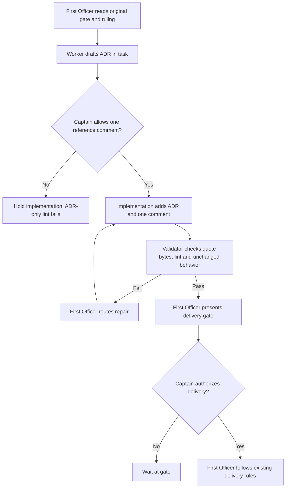

## Scope

- Source: the Captain 「補」 (chat, 2026-10-27), answering 「需要你決定：要不要開一張小任務，補一份 ADR 記下 D1？我建議補。」.
- Bite: observer report on codex-reader-same-head-unresolved (_archive/codex-reader-same-head-unresolved/observer.md, 2026-10-27): its ideation D1 is an enduring ruling, and the README's FO steps: decision records require it landed as an ADR before the next gate; none was reserved or landed before #728 merged (d8e9204b).
- The ruling: the Captain 「全准」 (chat, 2026-10-27) accepted D1 as recommended in the ideation gate question of codex-reader-same-head-unresolved: a person's resolved mark on a GitHub thread does not clear a Codex finding on an unchanged head; the finding holds until the head moves or FO declines it in the gate summary.
- Outcome: one ADR file under docs/adr quoting his words from that gate record, and nothing else; no code change.
- Upstream first: docs/adr (ADR 0004 and ADR 0013 on reading Codex), `extensions/codex/EXTENSION.md`, `scripts/adr_lint.py`.

## FO alignment

Alignment: not needed: the ruling and its words are recorded in the archived task's gate records.
Surfaces: none
Visible change: none
Release review: not needed: workflow maintenance, on no journey map.

## Number guards

ADR: 0039

## PRFAQ

**Proposition.** Future maintainers can find the Captain's existing rule in one architecture decision record (ADR): resolving a GitHub thread does not clear a Codex finding on an unchanged pull request head. First Officer (FO) can cite the original dated approval instead of reconstructing it from a closed task.

**Why now?** The archived observer identified the missing enduring record after the behavior had landed. This task repairs the record, not the reader.

**Does it change review behavior?** No. A permitted FO decline is a delivery disposition, not a new clean verdict from the reader; existing Material/P1 and round-three rules remain in force.

**Can implementation follow the original one-file scope?** Not with the required protection declaration and current linter. A scratch replay fails without a reverse pointer in the protected code. The single unresolved scope choice below proposes one comment; only the Captain can approve that expansion.

## Design

Profile: pilot; Surfaces remains none. No product implementation, branch, PR, external comment or sibling-task mutation is authorized here. This draft uses 0039 because the assignment explicitly requests its exact text and FO has already reserved `ADR: 0039`; this is not a worker reservation. The template's usual unnumbered ideation draft rule is superseded by that explicit assignment only.

### Evidence chain and existing decisions

Read in order on 2026-10-27:

1. **Spacedock 0.27.3:** its own ensign shared core/Codex runtime and `skills/fo-gate-lifecycle/SKILL.md` put stage reports in the supplied state checkout and gate preparation/recording/consumption in the CLI. Gate approval is a recorded authorization; no GitHub thread-resolved flag is a Captain ruling. We use those existing records; no Spacedock change is proposed.
2. **kc-dev-flow-2:** `git fetch origin` succeeded; `origin/main` pinned to `d8e9204bfae64ab4a76ec1a2ef0357a2b8fc7b44` (the #728 merge), manifest version 0.31.0. Read `extensions/codex/EXTENSION.md`, `codex_review.py`, its tests, the ADR template/linter and `skills/read-adr/writing.md`. `state()` lines 126–127 prioritize held findings; the code makes no thread-resolution request. ADR 0004's review limits, 0010's round-three backlog rule, 0013's positive review-evidence rule and 0025's reservation/decline requirements are Accepted and respected. The state Override search found a Codex unrecognized-comment ruling in `_archive/codex-reader-reads-receipt-marker.md`; that addresses timeout handling, not thread resolution, and this draft preserves it. The exact resolved-thread choice comes from the archived task's ideation D1 and its accepting gate, not from inference about ADR 0013.
3. **Sibling adopters, read only:** `git grep -l -E 'codex_review.py|codex-review-state' HEAD` found no tracked reader/reference in qnow-adopt-dev2 (`278f79ca3eb03a8c1286817f542c4ec4b744bfed`), subspace-relay (`a378b62f423d3510ecda60a80c2fdb132f78cf6e`), or subspace-web (`1f8c4b25268dc05ac77be5cdf33148bd6806dba9`). This bounded search establishes no vendored alternative in these committed trees; it does not establish the package each live session loaded. No adopter sync is needed for an ADR-only ruling plus a proposed source comment.

Original source is state commit `3e25da97432fb22a1a6a7da973730e7c829f3619`, `_archive/codex-reader-same-head-unresolved.md`, SHA-256 `d451d987c66ac89cb2d7ea550df780377a71edecf24f350f2a7a7d724276085e`. The recorded UTC time and the Captain's Taiwan chat date refer to the same day locally. No API read was needed; no provider evidence is claimed. This design adds no capability, so no replacement mechanism is proposed.

### Exact ADR text

Target: `docs/adr/0039-a-resolved-thread-does-not-clear-a-codex-finding-on-the-same-head.md`. The Accepted status records the already accepted ruling; it does not claim that this draft has landed or that the one-comment scope expansion was approved.

```markdown
# 0039. A resolved thread does not clear a Codex finding on the same head

Date: 2026-10-27

## Status

Accepted

## Context

The Codex reader previously let a later no-issues result clear a finding on the
same pull request head. The correction landed in iamcxa/kc-claude-plugins pull
request #728, merge d8e9204bfae64ab4a76ec1a2ef0357a2b8fc7b44. Its ideation
also settled whether a person's resolved mark on a GitHub review thread clears
that finding. The archive observer found this enduring ruling had no ADR.
This record preserves that ruling; it does not introduce a new review policy.

## Decision

**Words:** 「全准」 — Captain, chat, 2026-10-27 (Asia/Taipei).

Verbatim gate resolution reason:

> Captain 「全准」 (chat, 2026-10-27) answering 「需要你決定：第 7 批三張任務的設計（其中兩張已經照第 2 輪訪談修過），要不要一起批准進入實作？我建議全部批准，每一題都照我的建議。」; accepts FO's recommendations

Source: `spacedock-state/dev2:_archive/codex-reader-same-head-unresolved.md`
at state commit `3e25da97432fb22a1a6a7da973730e7c829f3619`,
ideation attempt `gate-attempt:codex-reader-same-head-unresolved-ideation-1`,
resolution `resolution:spacedock:codex-reader-same-head-unresolved:ideation:1`,
recorded at `2026-10-26T17:05:57.33005Z` (2026-10-27 in Asia/Taipei).
The accepted recommendation is D1 under that task's
`## Unresolved decisions for the Captain`; the following rule is a description
of the accepted recommendation, not additional words attributed to the Captain.

**Options considered:**
- A person's resolved mark does not clear a finding on an unchanged head; the
  finding holds until the head moves or the First Officer records its disposition
  in the gate summary (chosen).
- Read GitHub review-thread resolution and let it clear the same-head finding;
  not chosen. The archived design observed no such consumer and this required
  another GraphQL call, pagination and an additional failure path.

**Recommended:** the first option, as D1 recommended and the ideation gate accepted.

**Protects:**
- `kc-dev-flow-2/extensions/codex/codex_review.py` — `state()`, selecting held findings before later no-issues evidence.

A person's resolved mark on a GitHub thread does not clear a Codex finding on an
unchanged head. A later no-issues receipt on that same head does not clear it
either. The reader continues to report the finding and its evidence id.
A new head is read afresh. The First Officer may decline a finding in the gate
summary only under the existing review-disposition rules; that disposition does
not change the reader's verdict. Material findings still require repair or a
Captain waiver, and reviewer P1 findings still require repair and revalidation
or the Captain's recorded waiver, as ADR 0004 requires. ADR 0010 governs
nonblocking findings from round three. Resolving a thread alone grants no waiver.

## Consequences

A finding someone marks resolved on GitHub can still read as findings on the
same head, so the First Officer must record the permitted decline in the gate
summary or move through the existing repair or Captain-waiver route. The reader
adds no thread-resolution request, and a repeated clean receipt does not create
a new round when the deciding evidence id is unchanged. This record does not
prove a code repair, provider behavior or future agent compliance. Revisit only
through a new Captain ruling if an actual use case needs thread-resolution state
to change the reader's verdict.
```

### Required scope choice and implementation route

The current `skills/read-adr/writing.md` step 4 requires a pointer comment for protected code; step 6 says to report a failing linter, not work around it. In a temporary export of the pinned base, the exact ADR above with no other change produces exit 1: `codex_review.py has no pointer`. Adding only the following comment immediately above `held = [e for e in evidence if e[2] == 1]` makes the same installed linter exit 0 (`37 ADR file(s) checked, 0 legacy`):

```python
    # see docs/adr/0039-a-resolved-thread-does-not-clear-a-codex-finding-on-the-same-head.md
```

This comment is a proposal, not approved scope. Do not evade the failure by deleting Protects, writing `none`, leaving the ruling Proposed, or changing the linter. Until the Captain approves the additional comment, implementation remains held. If approved, implementation writes these two files only; validation checks bytes and semantics; FO follows the existing delivery gates. No new tests, package version change, README edit, ADR index file, provider request or CI change is proposed.



Mermaid 12.0.0 (`@mermaid-js/mermaid-cli`) rendered this exact graph to `/tmp/codex-reader-adr-ideation/diagram.png`; visually checked actors, order, both Captain stops and the repair loop against the prose. The initial sandboxed browser launch failed; the approved local renderer run succeeded. PNG is disposable, not a new repository artifact; reproduce by extracting this Mermaid block to a temporary file and running `mmdc -i <file> -o <png>` with version 12.0.0 installed. No online diagram resource was created.

### Words FO reads at each lifecycle moment

Method: whitespace tokens (`len(text.split())`), unchanged base `d8e9204b` versus the proposed ADR plus pointer in a temporary export. This is a record-repair task, not a word-reduction task; no saving is claimed. All runtime instruction passages and script outputs are unchanged. The table enumerates the touched reader path at each moment rather than counting only the new file. Other Spacedock/workflow/extension readings contribute the same base amount to both sides; this is not a fresh total of every FO instruction in every possible branch.

| Lifecycle moment | Relevant reading or output | Before | After |
| --- | --- | ---: | ---: |
| Startup | Codex EXTENSION.md, if listed | 310 | 310 |
| Idle on an open PR | `codex=findings(review:5641501111)` status token | 1 | 1 |
| Review round / merge ask | Reader line for the existing #716-shaped fixture | 21 | 21 |
| Idle on a merged PR | Added instruction/output from this change | 0 | 0 |
| After archive | Added instruction/output from this change | 0 | 0 |
| Any moment requiring this ruling | New ADR full text (conditional, not an automatic startup load) | 0 | 470 |
| Code-site inspection | New pointer comment (conditional) | 0 | 3 |

The 21-word line was exercised locally: exit 1, `evidence=review:5641501111`, `not cleared by the later no-issues comment:6393874798`; no live #716 call. All 35 existing reader tests pass with the proposed comment, and Python AST equality verifies the comment adds no executable statement. The full ADR is additional reading when the ruling is relevant; no instruction forces it into startup, idle, archive or every merge ask. Implementation must remeasure any actual extra file or output change rather than claim these deltas survive an expanded scope.

### Batch overlap

Only proposed product paths: `docs/adr/0039-a-resolved-thread-does-not-clear-a-codex-finding-on-the-same-head.md`; conditionally, one comment in `kc-dev-flow-2/extensions/codex/codex_review.py`. Only current stage write: this task file. `docs/adr/` is a shared numbering namespace, not a proposed new index file. `adr_lint.py` is a shared check, unchanged here.

| Named task | Observed overlap and disposition |
| --- | --- |
| `peers-rules-name-each-host-binding` (peer host-binding rules) | Reserved 0038; shares ADR allocation/lint. Its extension, adoption and design-check paths do not overlap either proposed path. |
| `worker-knows-the-team-and-asks-early` (worker team context) | Shares ADR allocation/lint; Dispatch facts, workflow derivation and lint changes are separate. Recheck its reservation at implementation. |
| `codex-reader-same-head-unresolved` (same-head finding priority) | Direct reader-file overlap and semantic predecessor; already archived and landed in base #728. Rebase on that result, preserve its tests/behavior; do not reopen its resolved-thread decision. |
| `adr-required-statement` (require recorded rulings) | Closed 2026-10-20 despite validation frontmatter; its abandoned linter/ledger proposal is not the current contract. Do not depend on its unlanded `--task` mode or reuse its occupied 0009. |
| `journey-server-host-pilot` (private journey server) | Read `journey-server-host-pilot/index.md`; journey code is disjoint, but ADR namespace/lint shared. Its historical reservation 0015 is occupied on current main; FO resolves that task separately. |
| `ops-inbox-r1-setup-and-isolation` (operations inbox) | Code/CI disjoint; shares ADR namespace/lint. Its report's historical 0031 conflicts with a different current-main record; no renumbering or repair here. |
| `pr-review-lite-value-pilot` (lightweight review trial) | Current review-capability code and tests are separate; no same file or task-specific check. Common repository checks only. |
| `adr-silent-undo-probe` (decision-preservation experiment) | Held copy; Captain amendment moved it to `dev2-poc` as `adr-silent-undo-poc`. State-harness experiment, no authorized product pointer change here; no same file/check. |
| `comment-check-reaches-delivery-gate` (comment-evidence gate) | Closed 2026-10-20; historical delivery-gate and validation-principle edits are not a live predecessor. The proposed pointer must still pass the current comment check if accepted. |
| `journey-canvas-hosted-poc` (hosted canvas trial) | Journey host/client work, no same file or reader/ADR-linter edit in its recorded scope; no dependency. |

Recommended order: retain the already-landed reader fix; FO obtains the one scope ruling below before implementation; serialize ADR number checks with sibling ADR authors and recheck 0039 against the final base; run current lint and reader regression after any intervening merge. No need to wait for closed or unrelated tasks. No CI trigger/cost change; cost per PR was not measured.

## Acceptance criteria

**AC-1** Exact enduring record and quote. Implementation creates only the named ADR and, only if separately approved, the one pointer comment. The draft's quoted resolution reason and `「全准」` are UTF-8 byte-equal to the specified committed gate source; date, source commit, attempt and resolution identify the original ruling. Verified by: extract the original ideation reason from `git -C <state> show 3e25da97432fb22a1a6a7da973730e7c829f3619:_archive/codex-reader-same-head-unresolved.md`, remove its YAML `reason: ` prefix only, compare `.encode('utf-8')` with the ADR's sole blockquote after removing `> `; independently compare the Words quotation with the Captain quotation in that reason. Falsifier: replace 全准 with 准 in either quoted location; byte comparison must fail. Current evidence: full reason equality passed; altered reason detected. Final product file not written.

**AC-2** Valid ADR and truthful protection. Run `python3 <package>/scripts/adr_lint.py <candidate>/docs/adr --root <candidate> --require 0039` using the dispatch's package root. It must exit 0 and the protection entry must point to `state()` in the Codex reader; no legacy/proposed/none workaround. Falsifiers: remove the pointer comment (exit 1, missing pointer), remove `**Words:**` (exit 1), or demand an absent ADR number (exit 1). Current evidence: exact one-file design fails as described; proposed one-comment expansion passes over all 37 records; missing Words and missing pointer controls fail. Final acceptance is blocked until the Captain settles scope.

**AC-3** Existing finding and authority behavior preserved. Run `python3 -B <candidate>/kc-dev-flow-2/extensions/codex/test_codex_review.py`; require all existing 35 tests to pass, in particular `test_the_recorded_716_shape_is_not_cleared_by_the_later_receipt`. Compare base/candidate Python `ast.dump(ast.parse(...))` equal; inspect `git diff --name-only <base> <head>` against the approved two-path allowance and confirm the reader diff is exactly the pointer. ADR prose must distinguish permitted FO disposition from a clean reader verdict, and preserve Captain-only waiver authority. Falsifiers: restore latest-result-wins selection (reader test fails); change any executable statement (AST check fails); add an unrelated file (scope check fails). Current evidence: 35 tests passed, AST equal on scratch comment candidate; authoritative existing rules read. Candidate-head and remote checks not yet run.

**AC-4** Readable design, source-backed lifecycle cost and no hidden delivery claim. Run `python3 <package>/scripts/design_surfaces.py check <task>` and require exit 0; render this exact Mermaid with version 12.0.0 and compare the two approval stops, repair loop and actor roles to the prose. Recount the listed lifecycle passages/fixture line with whitespace splitting and the exact proposed draft; baseline and candidate runtime bytes/output stay equal, conditional ADR and pointer costs are reported separately. Falsifiers: delete the Mermaid block (an explicit exactly-one-block extraction assertion must fail; the design checker alone accepts this removal), or delete bold AC declarations (design checker refuses); add a runtime instruction/output change without recounting (cost claim fails); draw implementation before the scope decision (semantic review fails). Current evidence: Mermaid rendered and visually reviewed; counts measured; diagram-removal control exposed the checker's limit and the explicit extraction assertion caught it; missing-AC control exits 1; final design checker result is in the Stage Report. Hosted delivery and actual future agent adherence remain unverified.

### Reproduction boundary

Only standard Python/git plus the package named by the dispatch are needed for the ADR/quote/behavior checks. Reconstruct the scratch tree with `git archive d8e9204bfae64ab4a76ec1a2ef0357a2b8fc7b44 docs/adr kc-dev-flow-2/extensions/codex` into a temporary directory, extract the exact fenced ADR above into its named path, and run AC-2 before/after the one comment. Do not edit any shared checkout to run a negative control. The local probes `/tmp/codex-reader-adr-ideation/{probe.py,fixture,diagram.mmd,diagram.png}` are disposable conveniences, not required hidden dependencies or shipped implementation. No git configuration write, GitHub API call, live peer communication or adopter mutation occurred.

## Unresolved decisions for the Captain

**One scope decision: permit the single reverse-reference comment?** Recommend yes: add the exact comment above in `codex_review.py` alongside the one ADR. It satisfies the existing writing/lint contract and keeps executable behavior unchanged. What gets worse: delivery touches a second file, outside the accepted one-file scope, and adds three words when reading that code site. If declined, keep implementation held and return the unmet lint/protection requirement to FO; do not invent a waiver or reopen the already-settled same-head policy. No new profile obligation is introduced.

## Stage Report: ideation

- DONE: The exact text of ADR 0039 (docs/adr/0039-<title>.md, in the repository's ADR format as kc-dev-flow-2/scripts/adr_lint.py checks it), quoting the Captain's words from the gate records of _archive/codex-reader-same-head-unresolved.md verbatim with their date and source, and naming what it protects (kc-dev-flow-2/extensions/codex/codex_review.py); written into the task file's ## Design, with acceptance criteria that adr_lint passes and the quote matches the gate record byte for byte
  Exact numbered draft in Design; byte-equal dated gate reason at state 3e25da97. Scratch ADR-only lint exits 1 (missing reverse pointer); proposed one-comment expansion exits 0 across 37 ADRs. Implementation is held for the Captain's one scope decision.
- DONE: A `### Batch overlap` section naming each file the design would change and each other batch task (peers-rules-name-each-host-binding, worker-knows-the-team-and-asks-early, codex-reader-same-head-unresolved) and live task of other sessions (adr-required-statement, journey-server-host-pilot, ops-inbox-r1-setup-and-isolation, pr-review-lite-value-pilot, adr-silent-undo-probe, comment-check-reaches-delivery-gate, journey-canvas-hosted-poc (driven by other sessions; read only)) that changes the same file or check, so FO can order implementation
  Batch overlap names both proposed files, all ten named tasks, shared ADR allocation/lint and ordering; closure/move records distinguish historical proposals from live work. No sibling task edited.
- DONE: The words FO reads at each lifecycle moment, before and after, per root learning.md "Measure the words FO reads at each moment, not one file's size"
  Lifecycle table reports affected runtime reads as 310/310, 1/1, 21/21 and 0/0, with unchanged other runtime passages and conditional ADR +470 / pointer +3; not a complete FO transcript total, and no reduction is claimed.
- DONE: Acceptance criteria with reproducible evidence clauses and falsifiers, and unresolved decisions for the Captain, each with a recommendation and what gets worse under it
  AC-1, AC-2, AC-3 and AC-4 each specify evidence and falsifiers; one Captain scope question recommends one source reference comment and names its extra file/read cost. The accepted resolved-thread policy is not reopened.
- DONE: AC-1 — exact record and quote evidence
  Full gate reason matches UTF-8 bytes; changing 全准 to 准 is detected. Original committed source digest recorded; final product ADR not yet written.
- DONE: AC-2 — ADR/protection evidence and falsifiers
  Installed linter equals pinned main; scratch ADR plus proposed pointer passes; removing pointer/Words or requiring absent 0040 each exits 1. One-file acceptance remains blocked on the scope choice.
- DONE: AC-3 — current behavior evidence and falsifiers
  Scratch pointer candidate: 35 reader tests pass and AST equals base; restoring latest-result-wins causes 22 test failures. Final candidate diff/validation and provider evidence remain unverified.
- DONE: AC-4 — design evidence and falsifiers
  design_surfaces.py check: exit 0, design surfaces presentable; missing bold criteria exits 1. Mermaid CLI 12.0.0 rendered graph visually checked; removal is caught by explicit extraction, not by this design checker.
- SKIPPED: Product implementation and external delivery
  Ideation writes only this state task; no product commit, PR, provider call, adoption or peer message. Approval of the one-comment expansion is still required.

### Summary

The exact ADR draft preserves the Captain's accepted same-head ruling, its verbatim gate reason and original source, with batch overlap, lifecycle reading costs and reproducible acceptance clauses. Current lint proves the one-file scope cannot meet the required Protects contract: recommend one reverse-reference comment, with implementation held until the Captain authorizes that sole scope expansion. Design checks and scratch positive/negative probes pass within their stated limits; these are design evidence, not delivered implementation or new approval.


## Stage Report: implementation

- SKIPPED: One Draft PR (Conventional Commit title scoped to the plugin) from a branch off origin/main (d8e9204bfae64ab4a76ec1a2ef0357a2b8fc7b44) implementing the approved design and acceptance criteria in the task file; docs/adr/0039-a-resolved-thread-does-not-clear-a-codex-finding-on-the-same-head.md with the exact text in the task's Design, and the one pointer comment above the held-findings line in kc-dev-flow-2/extensions/codex/codex_review.py; no other file; only the files the design names
  Candidate 24663871a8863e15097fcfd2c41b9584f1c5a48f implements exactly those two paths, committed on spacedock-ensign/codex-reader-resolved-mark-adr after fetch + fast-forward to the named base and pushed without force or -u; dispatch delegates Draft PR creation to FO because this worker cannot reach the GitHub API.
- DONE: ADR 0039 records the ruling the design names, quoting the Captain's words from the task file and its gate records
  Exact Design draft extracted unchanged; source state 3e25da97432fb22a1a6a7da973730e7c829f3619 digest d451d987c66ac89cb2d7ea550df780377a71edecf24f350f2a7a7d724276085e verified; full gate reason and Words UTF-8 byte comparisons pass. This task's ideation approval 「准」 authorizes the one comment.
- DONE: Every acceptance criterion green with the evidence each names; each falsifier shown failing by a mutation you run (python3 -B, caches cleared)
  AC-1–AC-4 candidate checks and throwaway mutations pass as detailed below; every Python probe used -B, scratch __pycache__ directories cleared before the runtime mutation; no negative control changed candidate/state bytes.
- SKIPPED: kc-dev-flow-2/scripts/lint-skills.py (the repository copy CI runs), /Users/kent/.claude/plugins/cache/kc-claude-plugins/kc-dev-flow-2/0.31.0/scripts/adr_lint.py docs/adr --since <base> --require 0039 exit 0; /Users/kent/.claude/plugins/cache/kc-claude-plugins/kc-dev-flow-2/0.31.0/scripts/number_guards.py check exit 0; /Users/kent/.claude/plugins/cache/kc-claude-plugins/kc-dev-flow-2/0.31.0/scripts/comment_ratio.py within its maximum; roborev evidence= line; push without force and without -u; PR body written for FO; FO reads CI on the PR head; CI cost measured or stated as not measured
  Repository lint and Codex-installed 0.31.0 ADR/number/comment/design checks exit 0; push and PR body done. RoboRev and FO's PR/CI observation are deferred by explicit dispatch; no evidence= fabricated. Comment check exemption, not a ratio below 5%, is recorded below. CI cost per PR not measured; no CI change.
- DONE: AC-1 — exact approved record and falsifiers
  verify.py checks draft equality, committed source digest, full gate reason and sole Words quote; changing 全准 to 准 separately in the gate quote and Words trips the byte assertions.
- DONE: AC-2 — truthful ADR protection and falsifiers
  adr_lint.py docs/adr --since d8e9204bfae64ab4a76ec1a2ef0357a2b8fc7b44 --require 0039 exits 0 (37 records, 0 legacy); scratch lints removing pointer/Words or requiring absent 9999 each exit 1. Protects names state() and its actual held-findings selection.
- DONE: AC-3 — existing behavior and falsifiers
  Existing test_codex_review.py: 35 tests pass; recorded finding/later-clean fixture returns exit 1 with evidence=review:5641501111 and the later-receipt note, identical to base. Latest-result-wins mutation causes 22 failures including that regression; executable-statement and unrelated-file controls fail AST/scope assertions. Exact diff adds one pointer only; FO disposition/reader verdict and Captain waiver prose checked separately.
- DONE: AC-4 — design, lifecycle measurement and falsifiers
  design_surfaces.py check exits 0; exact Mermaid extracted, rendered with @mermaid-js/mermaid-cli 12.0.0 and visually checked for both Captain stops, actors and repair loop. Missing bold AC exits 1; missing graph fails exactly-one extraction; implementation-before-approval fails order assertions; runtime instruction/output changes fail equality/cost checks.
- DONE: Lifecycle costs measured on this candidate
  Whitespace words before/after: startup EXTENSION.md 310/310, open-PR idle token 1/1, recorded review/merge fixture 21/21, merged idle/archive added reads 0/0; conditional ADR 0/470 and code-site pointer 0/3. Runtime instructions, reader AST and fixture output equal base; no reading reduction or future compliance claimed.
- DONE: Required package checks and affected-document verdict
  Repository lint: PASS, workflow 5421/5421 words; number_guards.py check: PASS no findings (no migration path); comment_ratio.py: 1 added code line, 1 comment, 100%, exit 0 because the 5% maximum is not enforced below 20 lines. doc_impact.py lists only ADR 0039: updated. git diff --check clean.
- DONE: Reviewable delivery handoff
  /tmp/impl-codex-reader-resolved-mark-adr-pr.md contains the Conventional Commit title, exact candidate/base, behavior, validation and limits; /tmp/codex-reader-adr-implementation/verify.py, *.log and diagram.{mmd,png} are disposable reproduction evidence, not shipped dependencies. Package scripts use the explicitly supplied Codex cache root /Users/kent/.codex/plugins/cache/kc-claude-plugins/kc-dev-flow-2/0.31.0.
- SKIPPED: RoboRev local review, Draft PR creation and hosted CI evidence
  RoboRev not run: worker sandbox cannot reach the daemon; FO runs it. No gh command run; FO opens the prepared Draft PR and checks its head/CI. No provider behavior, merge, release, version bump or task-state transition is claimed.

### Summary

Committed and pushed the approved ADR 0039 and its single code reference at 24663871a8863e15097fcfd2c41b9584f1c5a48f, preserving executable behavior and the Captain's original words. Candidate checks, all 35 reader tests and the specified falsifiers passed; the diagram was rendered and visually verified. FO must run RoboRev, open the prepared Draft PR and read CI before delivery continues; cost per PR was not measured.


## Validation acceptance script

No user-visible screen changes. Run the following four numbered steps together in a fresh `bash --noprofile --norc` shell; they need this repository's local objects, Python 3, Git and the explicitly named Codex package 0.31.0 installation. The temporary checkout is owned by this script. Expected: step 1 checks out 24663871a; step 2 prints PASS; step 3 runs 35 passing tests, checks 37 ADRs with exit 0, then demonstrates missing-pointer exit 1 and restores the candidate; step 4 prints cleanup PASS. This bounded acceptance does not reproduce the separate diagram render, all mutations, hosted checks, merge or future agent behavior.

```bash
# Step 1: create an isolated checkout at the reviewed revision.
set -euo pipefail
export AC_REPO=/Users/kent/conductor/workspaces/kc-claude-plugins/colombo/.context/dev2-adoption/worktree/.worktrees/spacedock-ensign-codex-reader-resolved-mark-adr
export AC_STATE=/Users/kent/conductor/workspaces/kc-claude-plugins/colombo/.context/dev2-adoption/worktree/docs/dev2/.spacedock-state
export AC_PACKAGE=/Users/kent/.codex/plugins/cache/kc-claude-plugins/kc-dev-flow-2/0.31.0
export AC_BASE=d8e9204bfae64ab4a76ec1a2ef0357a2b8fc7b44
export AC_HEAD=24663871a8863e15097fcfd2c41b9584f1c5a48f
export AC_TMP=$(mktemp -d /tmp/codex-adr-acceptance.XXXXXX)
git -C "$AC_REPO" worktree add --detach "$AC_TMP/tree" "$AC_HEAD"
cd "$AC_TMP/tree"
# Step 2: check the original quote, approved draft, exact scope and executable syntax.
python3 -B - <<'CHECK'
import ast, os, pathlib, re, subprocess
E=os.environ
W=pathlib.Path.cwd()
def git(root,*args): return subprocess.check_output(['git','-C',str(root),*args],text=True)
a='docs/adr/0039-a-resolved-thread-does-not-clear-a-codex-finding-on-the-same-head.md'
c='kc-dev-flow-2/extensions/codex/codex_review.py'
assert git(W,'rev-parse','HEAD').strip()==E['AC_HEAD']
s=git(E['AC_STATE'],'show','3e25da97432fb22a1a6a7da973730e7c829f3619:_archive/codex-reader-same-head-unresolved.md')
r=s.split('stage: ideation\n',1)[1].split('reason: ',1)[1].splitlines()[0]
t=(W/a).read_text(); q=re.findall(r'^> (.*)$',t,re.M)
assert len(q)==1 and q[0].encode('utf-8')==r.encode('utf-8')
assert re.search(r'^\*\*Words:\*\* (「.*?」)',t,re.M)[1]==re.search(r'Captain (「.*?」)',r)[1]
d=(pathlib.Path(E['AC_STATE'])/'codex-reader-resolved-mark-adr.md').read_text()
assert t==re.search(r'### Exact ADR text.*?```markdown\n(.*?)\n```',d,re.S)[1]+'\n'
b=git(W,'show',E['AC_BASE']+':'+c); n=(W/c).read_text()
assert n==b.replace('    held =','    # see '+a+'\n    held =',1)
assert ast.dump(ast.parse(b))==ast.dump(ast.parse(n))
assert set(git(W,'diff','--name-only',E['AC_BASE'],E['AC_HEAD']).splitlines())=={a,c}
print('PASS: exact quotes, approved draft, two paths, one comment, identical executable syntax')
CHECK
# Step 3: run existing behavior tests and demonstrate that protection needs the pointer.
python3 -B kc-dev-flow-2/extensions/codex/test_codex_review.py
python3 -B "$AC_PACKAGE/scripts/adr_lint.py" docs/adr --since "$AC_BASE" --require 0039
python3 -B - <<'MUTATE'
from pathlib import Path
p=Path('kc-dev-flow-2/extensions/codex/codex_review.py')
p.write_text(''.join(x for x in p.read_text().splitlines(keepends=True) if '# see docs/adr/0039-' not in x))
MUTATE
set +e
python3 -B "$AC_PACKAGE/scripts/adr_lint.py" docs/adr --since "$AC_BASE" --require 0039
AC_RC=$?
set -e
git -C "$AC_TMP/tree" restore -- kc-dev-flow-2/extensions/codex/codex_review.py
test "$AC_RC" -eq 1
printf 'PASS: missing-pointer control exited %s; candidate restored\n' "$AC_RC"
# Step 4: verify cleanliness and remove only this acceptance checkout.
test -z "$(git -C "$AC_TMP/tree" status --porcelain)"
cd "$AC_REPO"
git -C "$AC_REPO" worktree remove "$AC_TMP/tree"
rmdir "$AC_TMP"
printf 'PASS: acceptance checkout removed\n'
```

Executed exactly as written with `bash --noprofile --norc /tmp/codex-reader-adr-validation-evidence/acceptance.sh`, exit 0; observed output:

```text
Preparing worktree (detached HEAD 24663871a)
HEAD is now at 24663871a docs(kc-dev-flow-2): record the same-head Codex finding ruling
PASS: exact quotes, approved draft, two paths, one comment, identical executable syntax
...................................
----------------------------------------------------------------------
Ran 35 tests in 0.005s

OK
37 ADR file(s) checked, 0 legacy
0039-a-resolved-thread-does-not-clear-a-codex-finding-on-the-same-head.md: kc-dev-flow-2/extensions/codex/codex_review.py has no pointer; add a comment line 'see docs/adr/0039-a-resolved-thread-does-not-clear-a-codex-finding-on-the-same-head.md'
PASS: missing-pointer control exited 1; candidate restored
PASS: acceptance checkout removed
```

The first sandboxed attempt stopped before creating its Git worktree because Git metadata was outside the writable roots; the successful fresh-shell run received tool approval for that local operation. No script change was made between attempts.


## Stage Report: validation

- DONE: Independent verdict on PR #732 head 24663871 against every acceptance criterion in the task file, re-running each evidence command and at least one falsifier per criterion yourself, and judging each limit the implementation report states
  PASSED at 24663871a8863e15097fcfd2c41b9584f1c5a48f against base d8e9204bfae64ab4a76ec1a2ef0357a2b8fc7b44, in a fresh detached checkout; AC-1–AC-4 and all stated mutations rerun. No product repair; one nonblocking Polish finding below.
- DONE: Check the ADR's quoted gate resolution byte for byte against _archive/codex-reader-same-head-unresolved.md at state commit 3e25da97, that the only code change is the one pointer comment, and that adr_lint fails without the comment and passes with it; RoboRev (FO, 2026-10-27): clean on 24663871a, evidence=roborev:1234; CI on this head read by FO: 5 of 5 pass
  Original source SHA-256 d451d987c66ac89cb2d7ea550df780377a71edecf24f350f2a7a7d724276085e, full reason and Words match UTF-8 bytes; exactly ADR plus one comment. Pointer removal exits 1, original exits 0. RoboRev/CI are FO-supplied same-head evidence, not independently queried here.
- DONE: A minimal acceptance script the Captain can run (three to six steps, exact commands, expected output), run by you exactly as written in a fresh bash shell, with its observed output; /Users/kent/.claude/plugins/cache/kc-claude-plugins/kc-dev-flow-2/0.31.0/scripts/adr_lint.py docs/adr --since <base> with its exit code; your verdict naming the head, with findings classified by the workflow's Review-finding disposition
  Four-step script and full observed output immediately above; fresh bash exits 0. Per Dispatch facts and the supplied Codex root, used python3 -B /Users/kent/.codex/plugins/cache/kc-claude-plugins/kc-dev-flow-2/0.31.0/scripts/adr_lint.py docs/adr --since d8e9204bfae64ab4a76ec1a2ef0357a2b8fc7b44 --require 0039: exit 0, 37 records, 0 legacy.
- DONE: AC-1 — approved record, exact source and quote falsifiers
  Reviewed and reran implementation's probe in the detached checkout, redirecting only checkout/output paths; draft equality, dated attempt/resolution/source and both quotations pass. Replacing 全准 with 准 separately in the blockquote and Words fails each assertion; current task's distinct 「准」 approval explicitly permits the pointer.
- DONE: AC-2 — truthful protection and minimal necessity
  Protects names the actual state() held-finding selection; complete ADR lint passes. Independently removing the pointer, removing **Words:** or requiring absent 9999 produces exit 1; omitting the ADR would leave its reserved ruling unrecorded. Both retained files are necessary for the approved record plus protection contract.
- DONE: AC-3 — existing reader behavior and executable/scope falsifiers
  python3 -B kc-dev-flow-2/extensions/codex/test_codex_review.py: 35 passed; recorded finding/later-receipt fixture returns 1 and the same 21-word line as base. Latest-result-wins mutation causes 22 failures including that fixture; executable-statement and unrelated-path controls fail AST/scope assertions. AST equality and exact one-comment diff preserve behavior; prose preserves FO disposition versus reader verdict and Captain-only waiver authority.
- DONE: AC-4 — design, rendered route and measured reading costs
  design_surfaces.py check exits 0; missing bold AC exits 1, graph removal fails exactly-one extraction, and implementation-before-scope-approval fails order assertions. Mermaid CLI 12.0.0 freshly rendered diagram.png and visual review confirms both Captain stops, actors and repair loop; sandbox launch needed approved local execution. Runtime instruction/output mutations fail equality checks.
- DONE: Lifecycle measurement and required checks
  Recounted startup 310/310, open-PR idle 1/1, review/merge fixture 21/21, merged idle/archive added reads 0/0; conditional ADR 0/470, pointer 0/3. Repository lint exits 0 (5421/5421 words); number_guards.py check exits 0, no findings; dispatch_records.py exits 0, three complete records; git diff --check clean. Package root is the Codex 0.31.0 path above.
- DONE: Comment and affected-document review
  comment_ratio.py <base> <head> --workflow-dir <workflow> exits 0: 1 code line, 1 comment, 100%, maximum 5% not enforced below 20 added lines. The pointer supplies the enforced reverse reference and is justified. doc_impact.py <base> <head> lists only ADR 0039: updated, with exact accepted text; no other affected document listed.
- DONE: Implementation limits judged against this candidate
  Agreed: local/mocked reader proof establishes no provider behavior or future agent adherence; lifecycle counts are touched passages, not a complete FO transcript; no reading saving is claimed. FO now supplies PR #732, clean roborev:1234 and 5/5 CI, resolving the implementation worker's deferred evidence by attribution only. CI cost per PR was not measured; no CI change. Temporary probes are disposable and the full acceptance script is embedded above, not a hidden dependency.
- SKIPPED: Independent provider review and delivery actions
  No GitHub query, review request, PR mutation, code push, merge, release, adopter sync or task/gate transition; the supplied FO evidence and existing gate remain the authority. Local state-report commit is the required completion artifact.

### Findings

- F1 Polish: `codex-reader-resolved-mark-adr/dispatch/implementation-1.md` Scope notes attribute this task's ideation approval to Captain 「全准」 and batch 7; its committed gate records Captain 「准」 answering the ADR-plus-comment scope question. User/workflow: FO dispatching this task; observable harm: inaccurate historical attribution, no loss of approved behavior; boundary: contract[docs/dev2/README.md#captain-amendments], preserve the Captain's actual ruling; trigger: compare that scope sentence with this task's ideation resolution. The candidate quotes the predecessor's actual 「全准」 correctly, and the current gate independently authorizes both files; this does not establish Material. FO should correct its dispatch attribution, not change the candidate.

### Summary

Recommend PASSED for PR #732 head 24663871a8863e15097fcfd2c41b9584f1c5a48f: all four criteria, existing 35-test suite, decisive mutations and the fresh-shell acceptance script passed; the two retained files are sufficient and minimally necessary. One nonblocking dispatch-attribution Polish finding returns to FO; hosted evidence remains attributed to FO, and Captain delivery approval is still pending. Pilot boundary remains a record plus inert reference comment, with no new runtime or production obligation.
