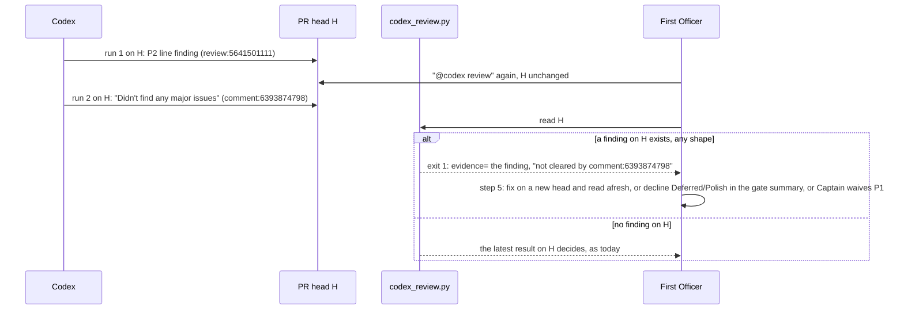

## Scope

- Source: the Captain 「開」 (chat, 2026-10-26), answering FO's ask to file this and the journey-probe task after learn backfill job caa9b488 (extension-defaults-and-install-choice) found #716 merged with an unaddressed Codex P2.
- Bite (verified 2026-10-26): on iamcxa/kc-claude-plugins#716 head 8340c3ba, Codex posted a P2 line comment at 2026-10-25T04:30:35Z and its summary state `has_unresolved_findings: true`; a second Codex run on the same head posted "Didn't find any major issues" at 05:22:39Z. `python3 <package 0.31.0>/extensions/codex/codex_review.py iamcxa/kc-claude-plugins 716` prints `clean on 8340c3baa ... evidence=comment:6393874798` and exits 0. FO relayed "#716 clean" to the Captain and the P2 shipped.
- Shape asked for: a later no-issues receipt on a head does not clear an earlier unresolved finding on the same head; the reader reports that finding instead of clean.
- Upstream first: `extensions/codex/codex_review.py` (the #722 reader: summary state decides over eyes), `extensions/codex/EXTENSION.md`.

## FO alignment

Alignment: not needed: the bite and the shape are recorded facts; the reader's verdict rule is the package's.
Surfaces: none
Visible change: none
Release review: not needed: workflow maintenance, on no journey map.

## PRFAQ

**Press release.** First Officer (FO) no longer tells the Captain "clean" for a pull request head on which Codex left a finding. When Codex reviewed head H, left a finding, and then a second `@codex review` on the same H returned "Didn't find any major issues", `codex_review.py` now exits 1, prints the finding's own `evidence=` id and says `not cleared by <the later receipt>`. FO then does what workflow step 5 already says for a finding: fix it on a new head, decline a Deferred or Polish one in the gate summary, or ask the Captain to waive a P1.

**FAQ.**
- *Why did the reader say clean?* It has said "the latest Codex result on the head decides" since #603 (`49c670cb`). The summary path in the same file also refuses clean after an earlier finding; the comment and review paths never did. The three tests that pin the old rule are `test_the_latest_result_on_one_head_decides_and_names_itself`, `test_the_latest_of_a_receipt_and_a_review_on_one_head_decides` and the last assertion of `test_a_completed_summary_after_findings_is_not_clean`.
- *How is a same-head finding ever cleared?* By moving the head (a repair is read afresh; a finding made on an older head is not counted, as today), or by FO's step-5 disposition in the gate summary. Not by a second Codex run on the same head, because that run does not say what became of the first finding.
- *Is a second run on the same head a new round?* No. The printed `evidence=` id is the finding's, already counted.
- *Does it cost a call?* No. It reads the same four `gh api` lists as today.

## Design

**Chain checked (2026-10-26).** Spacedock: its plugin cache has no Codex review reader (`grep -rIl "codex-review-state" ~/.claude/plugins/cache/spacedock` finds nothing). kc-dev-flow-2 at `origin/main` 0.31.0: one reader, `extensions/codex/codex_review.py`; consumers are `scripts/pr_watch.py` (`CODEX`, `reader()`), `extensions/codex/EXTENSION.md`, the `codex-round` pins in `scripts/test_sd_dispatch.py`, and the fakes in `scripts/test_pr_watch.py`. Sibling adopters (qnow, subspace-relay, subspace-web, subspace-v0 checkouts in `~/conductor/repos`): `git grep "codex_review\|codex-review-state"` finds no vendored copy, so one fix reaches all. Codex's own comment shapes are read from recorded PR data, not from an adopter's workaround.

**Existing-code check.** This repairs a named broken seam (the reader's verdict rule), so the capability check is skipped by its own rule. Two bounded searches for other readers of the verdict: the `git grep` above and the pr_watch run below. Unknowns: FO reading the printed line by eye on other machines.

**Mechanism (scratch candidate, not a repository file; run against recorded data).** In `state()`: (1) delete the `found_before` guard on the summary path (every clean now yields to a finding, so it is redundant); (2) `held = [e for e in evidence if e[2] == 1]` and `top = max(held or evidence)`; (3) use `top` in the exit-5 test (a finding then a clean then an unread newer comment is exit 1, not 5) and in the final return; (4) when `top` is a finding and a no-issues entry is later, append `; not cleared by the later no-issues <id>`. No new `gh` call; the docstring's top line and exit-0 clause say "a finding on the head decides over a later no-issues result; otherwise the latest result decides". `EXTENSION.md` stays as is: it never states "latest decides", so it already reads true and adds no words.

**Replay of the reader over recent kc-claude-plugins PRs.** Method: for PRs #600 to #726 (121 PRs; 6 numbers are not PRs), fetch with `gh api --paginate --slurp` the `issues/N/reactions`, `pulls/N/comments`, `pulls/N/reviews`, `issues/N/comments`, `pulls/N/commits`; for every commit sha of the PR call `state(repo, N, call=<returns that sha>, pages=<returns the recorded list for the path suffix>, now=<committer date of the next commit, or mergedAt>)` with the base reader and the scratch candidate, and diff the exit code and the evidence id. Core of it:

    def run(mod, d, head, end):
        def pages(path):
            if "/issues/comments/" in path: return []
            if path.endswith("/reactions"): return d["reactions"]
            if path.endswith("/reviews"): return d["reviews"]
            return d["comments"] if "/issues/" in path else d["inline"]
        return mod.state(REPO, str(N), call=lambda *a: {"headRefOid": head}, pages=pages, now=end)

| Window | Heads replayed | PRs with Codex evidence | Base exits | Candidate exits |
| --- | --- | --- | --- | --- |
| #700 to #726 (asked) | 65 | 15 | 4: 37, 1: 19, 0: 9 | 4: 37, 1: 20, 0: 8 |
| #600 to #726 | 375 | 54 | 4: 218, 1: 119, 0: 38 | 4: 218, 1: 120, 0: 37 |

Heads whose verdict changes, over both windows: exactly one.

| PR, head | Base | Candidate | Reason |
| --- | --- | --- | --- |
| #716, `8340c3baa` (the merged head) | exit 0, `evidence=comment:6393874798` | exit 1, `evidence=review:5641501111 at 2026-10-25T04:30:35Z; not cleared by the later no-issues comment:6393874798` | P2 line finding at 04:30:35Z, no-issues receipt on the same head at 05:22:39Z, thread still `isResolved: false` at merge (GraphQL, 2026-10-26) |

No other head changes exit code or evidence id. In the #700 to #726 window the 7 final heads of #702, #703, #704, #705, #708, #713 and #714 read exit 1 under both rules; this design does not change them, and whether each was dispositioned is not read here. Limits: the summary is one comment edited in place, so a summary-only clean on an older head is not replayable, and that path already refused clean after a finding; eyes reactions and the summary marker are read as they are now, not as they were; `now` is the next commit's committer date, not its push time. A head Codex reviewed and a force-push removed would be missing from the commits list; the script lists every Codex-reviewed head absent from it, and printed none.

**Marker and thread facts (the "unresolved" word).** The summary marker's `code_review.has_unresolved_findings` equals `has_any_findings` in 17 of 17 completed summaries with a finding (#600 to #726) and never differs, so it is not a resolution signal. Review threads (GraphQL `reviewThreads.isResolved`): 207 threads on 42 PRs, 28 resolved, all 28 on heads that later moved on (#616, #620, #668, #709); none on a head that also holds a later no-issues receipt.

**Words FO reads at each lifecycle moment** (`wc -w` on the exact text; base `origin/main` 0.31.0 against the candidate).

| Moment | What FO reads that this touches | Base | Candidate |
| --- | --- | --- | --- |
| Startup | `extensions/codex/EXTENSION.md` | 310 | 310 (unchanged) |
| Idle on an open PR | `pr_watch.py` codex column (`codex=findings(...)` or `clean`) | same words | same words, different verdict only on the #716 shape |
| The review round and the merge ask | the reader's printed line | 15 (the #716 clean line) | 21 (the #716 findings line, +6 only when a finding is held); every other line identical |
| Idle on a merged PR, after the archive | none | 0 | 0 |

`pr_watch.reader()` run against the candidate on live #716 returns `('findings', 'review:5641501111')`; against the base it returns `('clean', 'comment:6393874798')` (2026-10-26).

### Batch overlap

Files this design changes: `kc-dev-flow-2/extensions/codex/codex_review.py`, `kc-dev-flow-2/extensions/codex/test_codex_review.py`. Not changed: `extensions/codex/EXTENSION.md`, `scripts/pr_watch.py`, `scripts/test_sd_dispatch.py`, `references/sd/workflow.md`, `README.md`.

- peers-rules-name-each-host-binding: would change `extensions/peers/EXTENSION.md`, a new `extensions/paseo/`, the README extension table; no shared file or check. Overlap: none.
- worker-knows-the-team-and-asks-early: would change the README Dispatch facts section and `extensions/peers/EXTENSION.md`; no shared file. Overlap: none.
- codex-reader-same-head-unresolved: this task.
- adr-required-statement (validation): `references/sd/workflow.md`, `adr_lint.py`, `test_adr_doc_checks.py`, `adoption.md`, the task template; it runs `test_sd_dispatch.py` but this design does not edit it. Overlap: none.
- comment-check-reaches-delivery-gate: `scripts/delivery_gate.py`, `scripts/test_delivery_gate.py`, `skills/validation/principles.md`. `test_delivery_gate.py` lists `codex_review.py` only as a path class (`ClassTests.NEVER`), which an edit to the reader leaves as is. Overlap: none.
- adr-silent-undo-probe, journey-server-host-pilot, ops-inbox-r1-setup-and-isolation, pr-review-lite-value-pilot, journey-canvas-hosted-poc: no mention of `extensions/codex`, `codex_review` or `pr_watch` in their task files (`grep` 2026-10-26). Overlap: none.

The CI step `.github/workflows/kc-dev-flow-2-tests.yml` runs `extensions/codex/test_codex_review.py`; no other task edits it.

Recommended order: any; this task shares no file or check with the others, so FO may implement it first or last.

## Acceptance criteria

**AC-1**: On the recorded #716 pages (head `8340c3baa`, review finding then a no-issues receipt), the reader exits 1, its line holds `evidence=review:5641501111` once and `not cleared by comment:6393874798`, and holds no `evidence=comment:6393874798`. Evidence: a fixture test in `test_codex_review.py`, plus `python3 <package>/extensions/codex/codex_review.py iamcxa/kc-claude-plugins 716` (live, read-only, the data is persistent) printing that line with exit 1. Falsifier: restore the old `max(evidence)` and both go red (base prints `clean`, exit 0).

**AC-2**: A finding of each shape on head H holds over a later no-issues result of each shape on H: shapes of finding = review with line comment, line comment with no review, review body badge, issue-comment badge naming H; shapes of clean = receipt comment, `Codex Review:` comment, badge-free review, completed summary. All 16 pairs exit 1. Evidence: one table-driven test. Scratch run 2026-10-26: base 0 for some pairs, candidate 1 for all 16. Falsifier: limit `held` to line comments and the body-badge and comment-badge rows go red.

**AC-3**: Verdicts outside the rule do not move: a finding on an older head with a no-issues result on H is exit 0; a no-issues result then a later finding is exit 1; no finding means the latest result decides; two findings on H name the later one. Evidence: the 26 existing tests that do not state the old rule pass unchanged, and the three that do are changed only at the three named assertions (diff review). Scratch run: 26 pass, 3 fail at exactly those assertions. Falsifier: any other assertion needing a change.

**AC-4**: A finding, a later no-issues result, then a newer Codex comment on H in a shape the reader does not read is exit 1, not exit 5. Evidence: a test; scratch run base 5, candidate 1. Falsifier: use `max(evidence)` in the exit-5 test and it reads 5.

**AC-5**: The line prints exactly one `evidence=` token, the held finding's, and `pr_watch.reader()` run on the candidate returns `('findings', <that id>)`. Evidence: `line.count("evidence=") == 1` in the test, and the `pr_watch.reader` run on #716 (scratch: `('findings', 'review:5641501111')`). Falsifier: print both ids and `pr_watch` reads the later one, the receipt's.

**AC-6**: Replayed over #600 to #726 with the method above, the candidate changes the exit code or evidence id of exactly one head, #716 `8340c3baa`. Evidence: the implementation worker re-runs the replay at its candidate SHA and lists the changed heads; scratch result 375 heads, 1 change. Falsifier: a second changed head, or none.

**AC-7**: The change adds no `gh` or `pages(` call. Evidence: `git diff <base>..<candidate> -- kc-dev-flow-2/extensions/codex/codex_review.py | grep -c '^+.*\(gh(\|pages(\)'` prints 0 (the existing calls are only moved or untouched). Falsifier: a GraphQL or extra REST call.

**AC-8**: `python3 <package>/extensions/codex/codex_review.py` with no arguments prints the rule (a finding on the head decides over a later no-issues result; otherwise the latest result decides) and no line saying the latest result decides without it. Evidence: run it and grep. Falsifier: the old top line is left.

## Unresolved decisions for the Captain

**D1. Does a person's "resolved" mark in GitHub clear a same-head finding?** Recommendation: no. A same-head finding holds until the head moves or FO dispositions it in step 5 (gate summary). Why: in 375 heads the question never arose (all 28 resolved threads sit on heads that moved on), marker `has_unresolved_findings` is not a resolution signal (17 of 17 equal `has_any_findings`), and honoring the thread needs a new GraphQL call with pagination and a new exit-2 failure path. What gets worse: a finding someone resolved in the GitHub page on an unchanged head still reads `findings`, so FO must write the decline in the gate summary instead, and `pr_watch wait` will not wake on a same-head re-run because verdict and evidence are unchanged (the line still names the later receipt in `check`).
