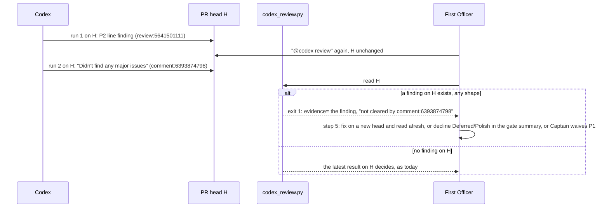

## Scope

- Source: the Captain 「開」 (chat, 2026-10-26), answering FO's ask to file this and the journey-probe task after learn backfill job caa9b488 (extension-defaults-and-install-choice) found #716 merged with an unaddressed Codex P2.
- Bite (verified 2026-10-26): on iamcxa/kc-claude-plugins#716 head 8340c3ba, Codex posted a P2 line comment at 2026-10-25T04:30:35Z and its summary state `has_unresolved_findings: true`; a second Codex run on the same head posted "Didn't find any major issues" at 05:22:39Z. `python3 <package 0.31.0>/extensions/codex/codex_review.py iamcxa/kc-claude-plugins 716` prints `clean on 8340c3baa ... evidence=comment:6393874798` and exits 0. FO relayed "#716 clean" to the Captain and the P2 shipped.
- Shape asked for: a later no-issues receipt on a head does not clear an earlier unresolved finding on the same head; the reader reports that finding instead of clean.
- Upstream first: `extensions/codex/codex_review.py` (the #722 reader: summary state decides over eyes), `extensions/codex/EXTENSION.md`.

## FO alignment

Alignment: not needed: the bite and the shape are recorded facts; the reader's verdict rule is the package's.
Surfaces: none
Visible change: none
Release review: not needed: workflow maintenance, on no journey map.

## PRFAQ

**Press release.** First Officer (FO) no longer tells the Captain "clean" for a pull request head on which Codex left a finding. When Codex reviewed head H, left a finding, and then a second `@codex review` on the same H returned "Didn't find any major issues", `codex_review.py` now exits 1, prints the finding's own `evidence=` id and says `not cleared by <the later receipt>`. FO then does what workflow step 5 already says for a finding: fix it on a new head, decline a Deferred or Polish one in the gate summary, or ask the Captain to waive a P1.

**FAQ.**
- *Why did the reader say clean?* It has said "the latest Codex result on the head decides" since #603 (`49c670cb`). The summary path in the same file also refuses clean after an earlier finding; the comment and review paths never did. The three tests that pin the old rule are `test_the_latest_result_on_one_head_decides_and_names_itself`, `test_the_latest_of_a_receipt_and_a_review_on_one_head_decides` and the last assertion of `test_a_completed_summary_after_findings_is_not_clean`.
- *How is a same-head finding ever cleared?* By moving the head (a repair is read afresh; a finding made on an older head is not counted, as today), or by FO's step-5 disposition in the gate summary. Not by a second Codex run on the same head, because that run does not say what became of the first finding.
- *Is a second run on the same head a new round?* No. The printed `evidence=` id is the finding's, already counted.
- *How does FO learn the second run finished?* Only by running the reader again: with verdict and evidence unchanged, `pr_watch wait` fires no outcome for a same-head re-run, and `check` shows the later receipt id in the line. That is acceptable because a same-head re-ask is the step this design makes unable to clear a finding.
- *Does it cost a call?* No. It reads the same four `gh api` lists as today.

## Design

**Chain checked (2026-10-26).** Spacedock: its plugin cache has no Codex review reader (`grep -rIl "codex-review-state" ~/.claude/plugins/cache/spacedock` finds nothing). kc-dev-flow-2 at `origin/main` 0.31.0: one reader, `extensions/codex/codex_review.py`; consumers are `scripts/pr_watch.py` (`CODEX`, `reader()`), `extensions/codex/EXTENSION.md`, the `codex-round` pins in `scripts/test_sd_dispatch.py`, and the fakes in `scripts/test_pr_watch.py`. Sibling adopters (qnow, subspace-relay, subspace-web, subspace-v0 checkouts in `~/conductor/repos`): `git grep "codex_review\|codex-review-state"` finds no vendored copy, so one fix reaches all. Codex's own comment shapes are read from recorded PR data, not from an adopter's workaround.

**Existing-code check.** This repairs a named broken seam (the reader's verdict rule), so the capability check is skipped by its own rule. Two bounded searches for other readers of the verdict: the `git grep` above and the pr_watch run below. `role_triggers.py` counts review ids with inline comments from `pulls/N/comments` itself (`review_facts`), not the reader's verdict, so the cycle-3 trigger is unchanged. Unknowns: FO reading the printed line by eye on other machines.

**Mechanism (scratch candidate, not a repository file; run against recorded data).** In `state()`: (1) delete the `found_before` guard on the summary path (every clean now yields to a finding, so it is redundant); (2) `held = [e for e in evidence if e[2] == 1]` and `top = max(held or evidence)`; (3) use `top` in the exit-5 test (a finding then a clean then an unread newer comment is exit 1, not 5) and in the final return; (4) when `top` is a finding and a no-issues entry is later, append `; not cleared by the later no-issues <id>`. No new `gh` call; the docstring's top line and exit-0 clause say "a finding on the head decides over a later no-issues result; otherwise the latest result decides". `EXTENSION.md` stays as is: it never states "latest decides", so it already reads true and adds no words.

**Replay of the reader over recent kc-claude-plugins PRs.** Method: for PRs #600 to #726 (121 PRs; 6 numbers are not PRs), fetch with `gh api --paginate --slurp` the `issues/N/reactions`, `pulls/N/comments`, `pulls/N/reviews`, `issues/N/comments`, `pulls/N/commits`; for every commit sha of the PR call `state(repo, N, call=<returns that sha>, pages=<returns the recorded list for the path suffix>, now=<committer date of the next commit, or mergedAt>)` with the base reader and the scratch candidate, and diff the exit code and the evidence id. Core of it:

    def run(mod, d, head, end):
        def pages(path):
            if "/issues/comments/" in path: return []
            if path.endswith("/reactions"): return d["reactions"]
            if path.endswith("/reviews"): return d["reviews"]
            return d["comments"] if "/issues/" in path else d["inline"]
        return mod.state(REPO, str(N), call=lambda *a: {"headRefOid": head}, pages=pages, now=end)

| Window | Heads replayed | PRs with Codex evidence | Base exits | Candidate exits |
| --- | --- | --- | --- | --- |
| #700 to #726 (asked) | 65 | 15 | 4: 37, 1: 19, 0: 9 | 4: 37, 1: 20, 0: 8 |
| #600 to #726 | 375 | 54 | 4: 218, 1: 119, 0: 38 | 4: 218, 1: 120, 0: 37 |

Heads whose verdict changes, over both windows: exactly one.

| PR, head | Base | Candidate | Reason |
| --- | --- | --- | --- |
| #716, `8340c3baa` (the merged head) | exit 0, `evidence=comment:6393874798` | exit 1, `evidence=review:5641501111 at 2026-10-25T04:30:35Z; not cleared by the later no-issues comment:6393874798` | P2 line finding at 04:30:35Z, no-issues receipt on the same head at 05:22:39Z, thread still `isResolved: false` at merge (GraphQL, 2026-10-26) |

No other head changes exit code or evidence id. In the #700 to #726 window the 7 final heads of #702, #703, #704, #705, #708, #713 and #714 read exit 1 under both rules; this design does not change them, and whether each was dispositioned is not read here. Limits: the summary is one comment edited in place, so a summary-only clean on an older head is not replayable, and that path already refused clean after a finding; eyes reactions and the summary marker are read as they are now, not as they were; `now` is the next commit's committer date, not its push time. A head Codex reviewed and a force-push removed would be missing from the commits list; the script lists every Codex-reviewed head absent from it, and printed none.

**Marker and thread facts (the "unresolved" word).** The summary marker's `code_review.has_unresolved_findings` equals `has_any_findings` in 17 of 17 completed summaries with a finding (#600 to #726) and never differs, so it is not a resolution signal. Review threads (GraphQL `reviewThreads.isResolved`): 207 threads on 42 PRs, 28 resolved, all 28 on heads that later moved on (#616, #620, #668, #709); none on a head that also holds a later no-issues receipt.

**Words FO reads at each lifecycle moment** (`wc -w` on the exact text; base `origin/main` 0.31.0 against the candidate).

| Moment | What FO reads that this touches | Base | Candidate |
| --- | --- | --- | --- |
| Startup | `extensions/codex/EXTENSION.md` | 310 | 310 (unchanged) |
| Idle on an open PR | `pr_watch.py` codex column (`codex=findings(...)` or `clean`) | same words | same words, different verdict only on the #716 shape |
| The review round and the merge ask | the reader's printed line | 15 (the #716 clean line) | 21 (the #716 findings line, +6 only when a finding is held); every other line identical |
| Idle on a merged PR, after the archive | none | 0 | 0 |

`pr_watch.reader()` run against the candidate on live #716 returns `('findings', 'review:5641501111')`; against the base it returns `('clean', 'comment:6393874798')` (2026-10-26).

### Batch overlap

Files this design changes: `kc-dev-flow-2/extensions/codex/codex_review.py`, `kc-dev-flow-2/extensions/codex/test_codex_review.py`. Not changed: `extensions/codex/EXTENSION.md`, `scripts/pr_watch.py`, `scripts/test_sd_dispatch.py`, `references/sd/workflow.md`, `README.md`.

- peers-rules-name-each-host-binding: would change `extensions/peers/EXTENSION.md`, a new `extensions/paseo/`, the README extension table; no shared file or check. Overlap: none.
- worker-knows-the-team-and-asks-early: would change the README Dispatch facts section and `extensions/peers/EXTENSION.md`; no shared file. Overlap: none.
- codex-reader-same-head-unresolved: this task.
- adr-required-statement (validation): `references/sd/workflow.md`, `adr_lint.py`, `test_adr_doc_checks.py`, `adoption.md`, the task template; it runs `test_sd_dispatch.py` but this design does not edit it. Overlap: none.
- comment-check-reaches-delivery-gate: `scripts/delivery_gate.py`, `scripts/test_delivery_gate.py`, `skills/validation/principles.md`. `test_delivery_gate.py` lists `codex_review.py` only as a path class (`ClassTests.NEVER`), which an edit to the reader leaves as is. Overlap: none.
- adr-silent-undo-probe, journey-server-host-pilot, ops-inbox-r1-setup-and-isolation, pr-review-lite-value-pilot, journey-canvas-hosted-poc: no mention of `extensions/codex`, `codex_review` or `pr_watch` in their task files (`grep` 2026-10-26). Overlap: none.

The CI step `.github/workflows/kc-dev-flow-2-tests.yml` runs `extensions/codex/test_codex_review.py`; no other task edits it.

Recommended order: any; this task shares no file or check with the others, so FO may implement it first or last.

## Acceptance criteria

**AC-1**: On the recorded #716 pages (head `8340c3baa`, review finding then a no-issues receipt), the reader exits 1, its line holds `evidence=review:5641501111` once and `not cleared by comment:6393874798`, and holds no `evidence=comment:6393874798`. Evidence: a fixture test in `test_codex_review.py`, plus `python3 <package>/extensions/codex/codex_review.py iamcxa/kc-claude-plugins 716` (live, read-only, the data is persistent) printing that line with exit 1. Falsifier: restore the old `max(evidence)` and both go red (base prints `clean`, exit 0).

**AC-2**: A finding of each shape on head H holds over a later no-issues result of each shape on H: shapes of finding = review with line comment, line comment with no review, review body badge, issue-comment badge naming H; shapes of clean = receipt comment, `Codex Review:` comment, badge-free review, completed summary. All 16 pairs exit 1. Evidence: one table-driven test. Scratch run 2026-10-26: base 0 for some pairs, candidate 1 for all 16. Falsifier: limit `held` to line comments and the body-badge and comment-badge rows go red.

**AC-3**: Verdicts outside the rule do not move: a finding on an older head with a no-issues result on H is exit 0; a no-issues result then a later finding is exit 1; no finding means the latest result decides; two findings on H name the later one. Evidence: the 26 existing tests that do not state the old rule pass unchanged, and the three that do are changed only at the three named assertions (diff review). Scratch run: 26 pass, 3 fail at exactly those assertions. Falsifier: any other assertion needing a change.

**AC-4**: A finding, a later no-issues result, then a newer Codex comment on H in a shape the reader does not read is exit 1, not exit 5. Evidence: a test; scratch run base 5, candidate 1. Falsifier: use `max(evidence)` in the exit-5 test and it reads 5.

**AC-5**: The line prints exactly one `evidence=` token, the held finding's, and `pr_watch.reader()` run on the candidate returns `('findings', <that id>)`. Evidence: `line.count("evidence=") == 1` in the test, and the `pr_watch.reader` run on #716 (scratch: `('findings', 'review:5641501111')`). Falsifier: print both ids and `pr_watch` reads the later one, the receipt's.

**AC-6**: Replayed over #600 to #726 with the method above, the candidate differs from the base on exactly one head, #716 `8340c3baa`, comparing the exit code and the `evidence=` token (an id differs only where the exit code does under this mechanism, because the held finding replaces a clean, never the reverse). Evidence: the implementation worker re-runs the replay at its candidate SHA and lists the changed heads; scratch result 375 heads, 1 change. Falsifier: a second changed head, or none.

**AC-7**: The change adds no `gh` or `pages(` call. Evidence: `git diff <base>..<candidate> -- kc-dev-flow-2/extensions/codex/codex_review.py | grep -c '^+.*\(gh(\|pages(\)'` prints 0 (the existing calls are only moved or untouched). Falsifier: a GraphQL or extra REST call.

**AC-8**: `python3 <package>/extensions/codex/codex_review.py` with no arguments prints the rule (a finding on the head decides over a later no-issues result; otherwise the latest result decides) and no line saying the latest result decides without it. Evidence: run it and grep. Falsifier: the old top line is left.

## Unresolved decisions for the Captain

**D1. Does a person's "resolved" mark in GitHub clear a same-head finding?** Past rulings read first (`git -C <state> grep -n 'Override:'` and `docs/adr/` at `origin/main`, 2026-10-26): no `Override:` line concerns how the Codex reader weighs a finding; ADR 0004 (rounds counted by rule, a finding follows steps 1 to 4 in rounds 1 and 2) and ADR 0013 ("keep the reader's rule positive": clean needs a positive result) both agree with this design, which only withholds clean and adds no refusal wording. Recommendation: no. A same-head finding holds until the head moves or FO dispositions it in step 5 (gate summary). Why: in 375 heads the question never arose (all 28 resolved threads sit on heads that moved on), marker `has_unresolved_findings` is not a resolution signal (17 of 17 equal `has_any_findings`), and honoring the thread needs a new GraphQL call with pagination and a new exit-2 failure path. What gets worse: a finding someone resolved in the GitHub page on an unchanged head still reads `findings`, so FO must write the decline in the gate summary instead.

## Stage Report: ideation

- DONE: A design for the Codex reader's verdict when one head has an unresolved Codex finding and a later no-issues receipt, with a replay of the reader over recent kc-claude-plugins PRs (at least #700 to #726) listing every head whose verdict changes, and the reason for each
  `## Design`: a finding on the head decides over a later no-issues result; replay of #600 to #726 (375 heads, #700 to #726 inside it: 65) changes exactly one head, #716 `8340c3baa` exit 0 to 1, reason in the table.
- DONE: A `### Batch overlap` section naming each file the design would change and each other batch task (peers-rules-name-each-host-binding, worker-knows-the-team-and-asks-early, codex-reader-same-head-unresolved) and live task of other sessions (adr-required-statement, journey-server-host-pilot, ops-inbox-r1-setup-and-isolation, pr-review-lite-value-pilot, adr-silent-undo-probe, comment-check-reaches-delivery-gate, journey-canvas-hosted-poc (driven by other sessions; read only)) that changes the same file or check, so FO can order implementation
  Changes `codex_review.py` and `test_codex_review.py` only; all ten other tasks read as they stand, none shares a file or check; `Recommended order:` any.
- DONE: The words FO reads at each lifecycle moment, before and after, per root learning.md "Measure the words FO reads at each moment, not one file's size"
  Table in `## Design`: startup 310 to 310, idle on an open PR same words, review round and merge ask 15 to 21 only for a held finding, merged and archive 0 to 0 (`wc -w`).
- DONE: Acceptance criteria with reproducible evidence clauses and falsifiers, and unresolved decisions for the Captain, each with a recommendation and what gets worse under it
  `## Acceptance criteria` AC-1 to AC-8 each carry evidence and a falsifier; one decision, D1, with recommendation, past rulings read (no `Override:` on the Codex reader; ADR 0004, 0013 agree) and what gets worse.
- DONE: AC-1 on #716 the reader exits 1 and names the finding
  Scratch candidate against live #716 (2026-10-26): exit 1, `evidence=review:5641501111 ...; not cleared by the later no-issues comment:6393874798`; base exit 0. Fixture test not yet written.
- DONE: AC-2 every finding shape holds over every clean shape
  Scratch run of the 4 by 4 matrix: base mixed 0 and 1, candidate 1 on all 16. Repository test not yet written.
- DONE: AC-3 verdicts outside the rule do not move
  Scratch candidate against the existing suite: 26 of 29 pass, 3 fail at exactly the three assertions named in the PRFAQ; older-head finding with a clean on H is 0 and clean then finding is 1, both as base.
- DONE: AC-4 an unread newer comment cannot turn a held finding into exit 5
  Scratch run: finding, clean, newer `receipt:v2` comment: base 5, candidate 1. Repository test not yet written.
- DONE: AC-5 one `evidence=` token and `pr_watch` reads it
  Scratch: `line.count("evidence=") == 1`; `pr_watch.reader()` on the candidate and live #716 returns `('findings', 'review:5641501111')`, base `('clean', 'comment:6393874798')`. Repository assertion not yet written.
- DONE: AC-6 the replay differs on exactly one head
  Replay of #600 to #726 with base and scratch candidate: 375 heads, one differing head, #716 `8340c3baa`; the implementation worker re-runs it at its candidate SHA.
- SKIPPED: AC-7 the change adds no `gh` or `pages(` call
  Not yet verified: the check is a diff of the implementation candidate and no repository diff exists at ideation; the scratch mechanism adds none by reading.
- SKIPPED: AC-8 the no-argument usage text states the rule
  Not yet verified: the scratch candidate did not rewrite the docstring; checked by running the script at the implementation candidate.
- DONE: `design_surfaces.py check` on this task
  Output, exit 0: `codex-reader-same-head-unresolved.md: design surfaces presentable`.

### Summary

The Codex reader reads a head as clean from its latest result, so a no-issues receipt after a finding on the same head cleared it (#716 shipped a P2 that way); the design makes any finding on the head decide over a later no-issues result and prints the finding's own id with `not cleared by <receipt>`. A 375-head replay changes only #716; the thread-resolved variant has no observed consumer and needs a new GraphQL call, so D1 recommends against it. The installed 0.29.0 skill differs from the dispatch's 0.31.0 package root; scripts ran from the skill's root per Dispatch facts and the design reads `origin/main` 0.31.0 as the dispatch asked.

## Stage Report: implementation

- DONE: One Draft PR (Conventional Commit title scoped to the plugin) from a branch off origin/main (c70f1b22cb1e4a66fd15c617647c778d54c59ec9) implementing the approved design and acceptance criteria in the task file; the kc-dev-flow-2/extensions/codex/codex_review.py change and tests the design names, with the design's replay over #600 to #726 repeated on the candidate; only the files the design names
  Branch `spacedock-ensign/codex-reader-same-head-unresolved` pushed (no force, no -u) at c2f3e313, one commit on c70f1b22, two files (`codex_review.py`, `test_codex_review.py`). No gh run (sandbox rule): title and body are in /tmp/impl-codex-reader-same-head-unresolved-pr.md; FO opens the Draft PR. Replay at c2f3e313 (script in /tmp/replay-5c03/scripts, data in /tmp/replay-5c03/data): 121 PRs, 375 heads, 54 PRs with evidence (#700-#726: 65 heads, 15 PRs); exactly one head differs, #716 `8340c3baa` exit 0 to 1; base exits 0/1/4 = 38/119/218, candidate 37/120/218; no Codex-reviewed head missing from commits.
- DONE: Every acceptance criterion green with the evidence each names; each falsifier shown failing by a mutation you run (python3 -B, caches cleared)
  AC-1 live #716 exit 1, `evidence=review:5641501111 ...; not cleared by the later no-issues comment:6393874798`, plus `test_the_recorded_716_shape_...`; AC-2 16-pair table test; AC-3 29 old tests, 3 assertions changed (exactly the three the design names; two test names that stated the old rule renamed); AC-4 test, mutation to `max(evidence)` in the exit-5 test fails it; AC-5 `line.count("evidence=") == 1`, `pr_watch.reader()` returns `('findings', 'review:5641501111')` (base `clean`); AC-6 replay above; AC-7 `grep -c` prints 0; AC-8 no-argument run prints the new rule and not the old top line, pinned by `test_the_usage_text_states_the_rule`.
  Mutations, each failing only the tests that claim it: `top = max(evidence)` 22 failures (AC-1/2/5); held limited to line findings 8 pair failures + body-badge assertion (AC-2); old exit-5 test 1 failure, `..._is_findings_not_unrecognized` (AC-4); receipt id printed as `evidence=` 17 failures (AC-5); old usage line 1 failure (AC-8); summary-path guard restored 4 summary-pair failures. Note: my first exit-5 test used a comment time earlier than the receipt, so mutation M3 survived; fixed the time and re-ran, it then failed as shown.
- DONE: kc-dev-flow-2/scripts/lint-skills.py, adr_lint.py docs/adr --since <base>, number_guards.py check exit 0; comment_ratio.py within its maximum
  lint-skills 0; adr_lint 0 (36 ADR files, `--since c70f1b22`); number_guards `PASS: no findings` (0); comment_ratio `code lines 74, comment lines 0, 0.0%`, max 5%; doc_impact.py lists 0 documents; design_surfaces.py check 0.
- DONE: roborev evidence= line
  `clean on c2f3e313f; evidence=roborev:1227`
- DONE: push without force and without -u; PR body written for FO; FO reads CI on the PR head; CI cost measured or stated as not measured
  Pushed as above; PR body written; CI cost: no new CI step, the existing `kc-dev-flow-2-tests.yml` step runs 6 more tests; run time not measured. CI on the PR head is for FO to read after opening the Draft PR.
- SKIPPED: Version bump and ADR
  No version edit (release-please owns it); the task's `## Number guards` reserves none and the change records no new decision (D1 was settled at the gate), so adr_lint had nothing to require.

### Summary

The Codex reader now lets any finding on a head decide over a later no-issues result on that head: exit 1, the finding's single `evidence=` id, and `not cleared by the later no-issues <id>`. Live #716 flips from clean to findings and the 375-head replay changes exactly that one head. One note for FO: the dispatch's package root is 0.31.0, the loaded skill is 0.29.0; the checks ran from 0.31.0 scripts and the 0.29.0 stage references, which agree on everything this task used.

## Stage Report: validation

- DONE: Independent verdict on PR #728 head c2f3e313 against every acceptance criterion in the task file, re-running each evidence command and at least one falsifier per criterion yourself, and judging each limit the implementation report states
  Verdict PASSED on c2f3e313f4c04c243f5a49b4f72b876ff35b4d9b (PR head confirmed by `gh pr view 728`, base c70f1b22 = origin/main), checked in throwaway detached worktrees, removed. 35 tests pass on the candidate, 29 on the base; the base test file run against the candidate code fails exactly 3 tests with `1 != 0` (the three old assertions). Falsifiers I ran on a scratch copy (python3 -B): AC-1/2/5 `top = max(evidence)` 22 failures; AC-2 `held` limited to line findings 5 failures (4 issue-comment-badge pairs plus the shape test); AC-4 exit-5 test on `max(evidence)` 1 failure; AC-5 receipt id printed as `evidence=` 17 failures; AC-6 below; AC-8 old usage top line 1 failure; summary-path `found_before` guard restored 4 summary pairs fail. Live #716, base: exit 0 `clean ... evidence=comment:6393874798`; candidate: exit 1 `evidence=review:5641501111 ...; not cleared by the later no-issues comment:6393874798` (AC-1); `pr_watch.reader()` base `('clean','comment:6393874798')`, candidate `('findings','review:5641501111')` (AC-5); `git diff c70f1b22..c2f3e313 -- codex_review.py | grep -c '^+.*\(gh(\|pages(\)'` prints 0 (AC-7); no-argument run prints the new rule (AC-8). Also ran `scripts/test_pr_watch.py` on the candidate: 113 OK. Limits judged: summary-only older-head clean not replayable, acceptable, that path already refused clean after a finding; `pr_watch wait` not firing on a same-head re-run, acceptable, verdict and evidence are unchanged by design (F2); thread-resolved marks not read, Captain-settled D1 (F3).
- DONE: Repeat the implementation's replay over #600 to #726 yourself on the candidate and the base: exactly one head (#716 8340c3baa) may change, and say why any other would
  Own fetch (`gh api --paginate --slurp`, 121 PRs, 6 non-PRs 617/621/622/677/678/684) and own replay script, not the implementation's: 375 heads, 54 PRs with a non-4 verdict; base exits 0/1/4 = 38/119/218, candidate 37/120/218; exactly one head changes, #716 `8340c3baa` exit 0 to 1, evidence `comment:6393874798` to `review:5641501111`; #700 to #726: 65 heads, 15 PRs, same single change; no Codex-reviewed head missing from the commits lists. No other head changes because the mechanism only replaces a clean with a held finding on the same head, and no other head holds a finding followed by a later no-issues result.
- DONE: A minimal acceptance script the Captain can run (three to six steps, exact commands, expected output), run by you exactly as written in a fresh bash shell, with its observed output; /Users/kent/.claude/plugins/cache/kc-claude-plugins/kc-dev-flow-2/0.31.0/scripts/adr_lint.py docs/adr --since <base> with its exit code; your verdict naming the head, with findings classified by the workflow's Review-finding disposition
  Script below, run as `env -i HOME PATH bash --noprofile --norc` on 2026-10-27, output as shown. `python3 -B <0.31.0>/scripts/adr_lint.py docs/adr --since c70f1b22cb1e4a66fd15c617647c778d54c59ec9` at the candidate: `36 ADR file(s) checked, 0 legacy`, exit 0 (0.29.0 copy also exit 0). Also at the candidate: comment_ratio 0 of 74 lines exit 0; number_guards `PASS: no findings` exit 0; doc_impact 0 documents; design_surfaces exit 0; dispatch_records 3 records complete; lint-skills PASS (run from the candidate checkout). CI on the PR head (read only): multi-profile route gate, unit tests, version parity, GitGuardian all SUCCESS. Verdict PASSED on c2f3e313; no Material finding.

### Findings

- F1 Polish: the `not cleared by the later no-issues <id>` text names `max(later)`; a mutation to `min(later)` passes all 35 tests, so which receipt is named when two later no-issues results exist is unpinned. No exit code or evidence id depends on it. Would become Material only if a round counter read that text, and `pr_watch.reader()` reads only the `evidence=` token.
- F2 Deferred risk: `pr_watch wait` fires no outcome for a same-head re-run because verdict and evidence are unchanged (stated in the PRFAQ); FO learns the re-run finished only by running the reader. Would become Material if a supported workflow relied on `wait` to detect a same-head re-ask result.
- F3 Deferred risk: a person's "resolved" mark on the GitHub thread does not clear a same-head finding (D1). Settled by the Captain at the ideation gate (recommendation accepted); not reopened. Would become Material if a head with a resolved thread and a later no-issues receipt occurs; none of 28 resolved threads in #600 to #726 is on such a head.

### Minimal acceptance script

Run in one bash shell on the Captain's machine; needs `git`, `python3`, and `gh` signed in (the live #716 read is read-only).

    R=/Users/kent/conductor/workspaces/kc-claude-plugins/colombo
    git -C $R worktree add --detach /tmp/pr728-cand c2f3e313f4c04c243f5a49b4f72b876ff35b4d9b >/dev/null 2>&1 && git -C $R worktree add --detach /tmp/pr728-base c70f1b22cb1e4a66fd15c617647c778d54c59ec9 >/dev/null 2>&1; git -C /tmp/pr728-cand rev-parse HEAD
    python3 -B /tmp/pr728-cand/kc-dev-flow-2/extensions/codex/test_codex_review.py 2>&1 | tail -3
    python3 -B /tmp/pr728-base/kc-dev-flow-2/extensions/codex/codex_review.py iamcxa/kc-claude-plugins 716; echo "exit $?"
    python3 -B /tmp/pr728-cand/kc-dev-flow-2/extensions/codex/codex_review.py iamcxa/kc-claude-plugins 716; echo "exit $?"
    python3 -B /tmp/pr728-cand/kc-dev-flow-2/extensions/codex/codex_review.py | sed -n 4,5p
    git -C $R worktree remove --force /tmp/pr728-cand; git -C $R worktree remove --force /tmp/pr728-base; ls -d /tmp/pr728-* 2>&1

Observed output:

    c2f3e313f4c04c243f5a49b4f72b876ff35b4d9b
    Ran 35 tests in 0.003s
    
    OK
    clean on 8340c3baa: Codex Review comment says no issues on the head; evidence=comment:6393874798 at 2026-10-25T05:22:39Z
    exit 0
    findings on 8340c3baa: 1 line finding(s), 1 badge(s), 0 at P0/P1; evidence=review:5641501111 at 2026-10-25T04:30:35Z; not cleared by the later no-issues comment:6393874798
    exit 1
    A finding on the head decides over a later no-issues result; otherwise the latest result
    decides. The deciding evidence id is printed so a round is counted once per id.
    ls: /tmp/pr728-*: No such file or directory

Expected: the first line is the head above; 35 tests OK; the base reads `clean`, exit 0 (the bug); the candidate reads `findings`, exit 1, naming `review:5641501111` and `not cleared by the later no-issues comment:6393874798`; the usage shows the new rule; the last line says the checkouts are gone. Does not cover: the 16-pair shape table (the unit test does), the 375-head replay (this stage reran it), a GitHub "resolved" mark (D1), or `pr_watch` end to end beyond `reader()`. The live #716 read depends on #716's recorded comments staying as they are.

### Summary

PASSED on c2f3e313. All eight criteria hold on my own runs and mutations, my independent 375-head replay changes only #716 `8340c3baa`, and every package check exits 0. Three findings, none Material (one Polish, two Deferred risk); the Captain's script ran as written and its observed output is above.
