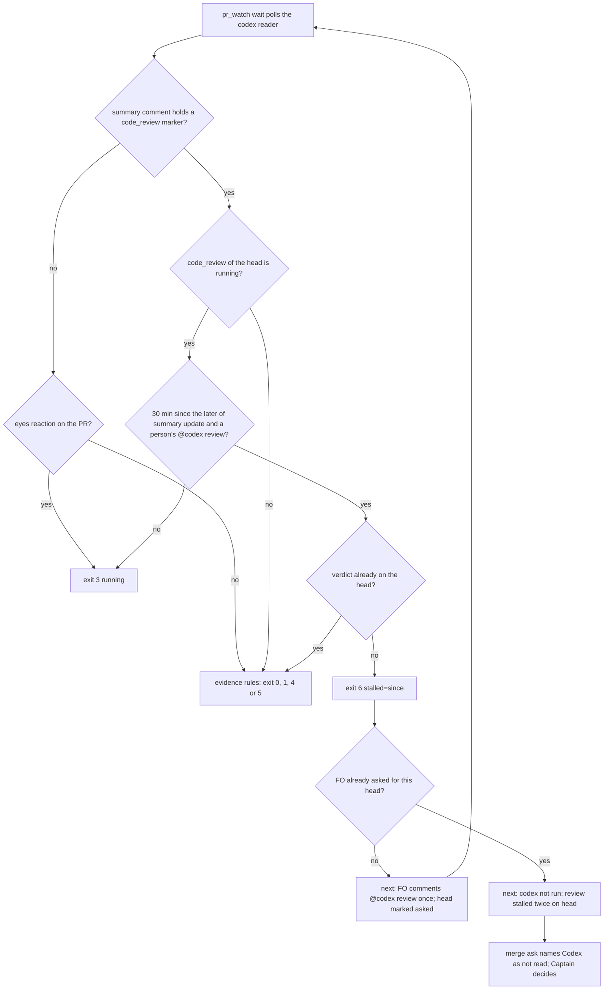

## Scope

- Source: batch 6 (2026-10-25): the Captain 「可以」 (chat), answering 「需要你決定：這份第 6 批的清單可以嗎？」 about FO's batch-6 list, item 4 「Codex 審查卡住會自動偵測（新票）」.
- Bite (FO, 2026-10-23 to 2026-10-25): the Codex code review stayed `running` with no update to its summary comment on iamcxa/kc-claude-plugins #709 (07:37Z to 12:57Z), #713 (12:38Z, then again after a 13:38Z re-request through 15:16Z), #714 (twice), #716 (04:28Z, then again after a 05:18Z re-request through 06:01Z). A single `@codex review` re-request cleared it within minutes three times; #713 and #716 never answered. Each was found by FO by hand from the summary comment's `Running since` time.
- Facts: `extensions/codex/codex_review.py` exits 3 (`running`) for all of these with no age; the summary comment carries `codex-review-state:v1` JSON and a `Running since <time>` field (read 2026-10-25).
- Outcome: the codex reader or `pr_watch.py wait` reports a running review older than a stated limit as stalled, FO re-requests once, and a second stall makes the merge ask name Codex as not read (the README rule already covers the naming).
- Upstream first: `extensions/codex/EXTENSION.md` Read rules, `codex_review.py`, `pr_watch.py`.
- Non-goals: changing Codex itself; counting a stalled review as a round.

## FO alignment

Alignment: not needed: an observed failure in one reader; the limit is a design value to state at ideation.
Surfaces: none
Visible change: none
Release review: not needed: workflow maintenance, on no journey map.

## Design

**Chain checked (2026-10-25).** Spacedock: `spacedock --help` lists no reviewer reader or stall concept (its `codex` command starts Codex as first officer). kc-dev-flow-2 at `origin/main` d496ac3d: `codex_review.py` has no age rule; `pr_watch.py` already gives up on an unrecognized Codex comment after two reads 180 s apart (`unread_lines`, `RECHECK_SECONDS`), which this design copies in shape. Sibling adopters: `git grep` of qnow, subspace-relay and subspace-web finds no Codex stall handling. Codex itself (`learn.chatgpt.com/docs/third-party/github`, fetched 2026-10-25): the 👀 reaction and `@codex review` are documented; a summary comment, a timeout and a stall are not, so the summary shape is an observed compatibility shape, not a contract.

**Press release (future).** A Codex review that stops answering no longer sits as `running` for hours. Thirty minutes after the last sign of life, `pr_watch.py wait` says the review stalled and tells FO to comment `@codex review` once. If it stalls again, the next line tells FO to write `codex not run: review stalled twice on <head>` and the merge ask names Codex as not read; the Captain decides. A stalled review is never a round and never clean, and a stalled re-request on a head that already has a verdict is not reported: the verdict stands. A Codex review that has already answered is no longer reported as running because the security review is still going.

**FAQ.**
- Why 30 minutes? The measured gap below: slowest normal answer 17 min, shortest stall 53 min.
- Does FO wait 30 minutes before it can act? Yes; today FO found a stall by hand after 5 h 20 min (#709).
- Who comments `@codex review`? FO, as it already does after a repair (`EXTENSION.md` "After a repair"). `pr_watch.py` stays read-only.
- What if the session changes mid-stall? The "asked once" mark lives in the per-session `pr_watch` state file, so a new session asks once more; bounded to one extra comment.



### Measured facts (read-only `gh`, 2026-10-25)

Method: for each person-authored `@codex review` comment on a PR, the time to the next Codex review, receipt comment or +1 reaction on that PR. Census script was not kept in the repository; the numbers are a dated sample, not a contract.

| Corpus | PRs read | Requests | No later Codex output | Answer time (s) | Above 1800 s |
| --- | --- | --- | --- | --- | --- |
| iamcxa/kc-claude-plugins | 120 latest | 169 | 1 (#713, re-request at 13:38:27Z) | p50 201, p95 407; 872 the slowest below 1800 | 4: 3188 (#714), 6662 (#675), 10237 (#702), 19448 (#709) |
| iamcxa/qnow (second corpus) | 100 latest | 56 | 0 | p50 377, p95 843, max 1033 | 0 |

- Limit: `STALL_SECONDS = 1800`. Slowest normal answer 1033 s (1.7x margin); shortest stall 3188 s.
- Recovery: after the FO re-request, the first Codex output came in 234 s (#675), 134 s (#702), 207 s (#709) and 212 s (#714). In #709 that output reviewed an earlier commit; the head's own verdict took a second re-request, 135 s later. #713's re-request was acknowledged (summary updated 14 s later) and never answered before the merge about 11.5 h later; the head already had that PR's findings verdict, which the reader will now report instead. So one re-request cleared 3 of 5 stalls, a second was needed in 1, and 1 never recovered; this is why the second stall ends in "not read".
- The reader's `running` has a second, different cause. The PR-level 👀 belongs to the automatic security review. In 7 of 117 closed kc-claude-plugins PRs (#696, #706, #708, #713, #715, #716, #717) it was still on at merge, and in all 7 the summary's Security row was still `Running`; qnow kept the 👀 on 3 of 94 closed PRs: #1298 is the same masking (code row `Completed`), while #1296 and #1303 had the code row itself stuck `Running` (stalls). Of the 7, #708 and #716 had answered code reviews on the head that the reader hid behind exit 3.

**Differs from the Scope.** Scope names #716 as never answered. Current data: Codex reviewed the head 148 s after the first request (review 5641501111, 04:30:35Z) and answered the 05:18:16Z re-request with a clean receipt in 263 s (comment 6393874798, 05:22:39Z); the reader still prints exit 3 for it today because of the stuck PR-level 👀. #713's first request was also answered (findings review 5628338608 at 12:41:08Z, 170 s); only its 13:38:27Z re-request is a real stall. The `Running since` time is in the summary's table row, not in the `codex-review-state:v1` marker; the marker holds status and commit only.

### Existing-code check

Repair, not replacement. `state()` in `codex_review.py` already parses the summary marker and the trigger comments; the new work is one branch before the eyes test and exit 6. `pr_watch.py` already maps reader exit codes to words and already has a once-per-comment give-up (`unread_lines`); the new `stall_lines` follows it. Replayed on a patched copy in /tmp against the live PRs (reader only, read-only `gh`): qnow #1296 and #1303 give exit 6; #713 gives 1 (its 12:41:08Z findings review, review:5628338608, wins over the stalled re-request); #716 gives 0, #708 gives 1, #715 gives 4, qnow #1298 gives 1; #709 and #714 are unchanged (0 and 1). The 22 base tests run against that copy: 20 pass, 2 fail (see AC-3).

### Mechanism and files

1. `kc-dev-flow-2/extensions/codex/codex_review.py`: take the code-review entry of the newest summary comment's marker. If its `commit_sha` is the head and `status` is `running`: a fresh running row reads exit 3 as today; past `STALL_SECONDS` since the later of the summary's `updated_at` and the newest person-authored `@codex review` comment (bot comments quote that phrase in their footer and must not reset the clock) it is a stall, and only when the evidence rules find no verdict on the head does it read exit 6; a verdict (exit 0 or 1) or an unrecognized comment (exit 5) wins over a stalled re-request, because the latest result on the head decides and a stall is not a result. If a summary marker exists and does not say running for the head, an eyes reaction no longer decides. With no summary marker, eyes still mean exit 3 as today. Exit 6 prints `stalled=<since>` and never `evidence=`. `state()` gains a `now` argument for tests; the module docstring lists exit 6.
2. `kc-dev-flow-2/extensions/codex/test_codex_review.py`: tests for AC-1 to AC-3 and AC-6.
3. `kc-dev-flow-2/extensions/codex/EXTENSION.md`: the Read bullet gains exit 6 and its two steps (draft: "Exit 6 is a code review of the head that Codex's summary shows running with no update for 30 minutes and no verdict on the head yet (`stalled=<time>`): no round and never clean. `<package>/scripts/pr_watch.py wait` then prints the `next:` line: comment `@codex review` once; if it stalls again, report `codex not run: review stalled twice on <head>` and name Codex as not read in the merge ask."); the Limits bullet gains one sentence that the summary decides and eyes count only without one.
4. `kc-dev-flow-2/scripts/pr_watch.py`: `reader()` maps exit 6 to `stalled(<since>)` (the `unrecognized=` pattern extended to `stalled=`); `stall_lines()` prints the one re-request line, then the unread line; `wait` prints its output with `unread_lines`; the module docstring gains one paragraph. `stalled(...)` is not an `OUTCOMES` word, so it never wakes `wait` as a verdict.
5. `kc-dev-flow-2/scripts/test_pr_watch.py`: tests for AC-4 and AC-5.

No change to `docs/dev2/README.md` (the adopted workflow), `references/sd/workflow.md`, `delivery_gate.py`, `role_triggers.py` or any ADR: the README Extensions rule already says a listed extension that cannot run is reported as `<name> not run: <reason>` and a merge ask names each reviewer not read. Profile: stays Pilot; no production data, credentials, migration or recurring unattended duty is added.

Known limits (not tested, stated): (a) after a same-head re-request on an already-completed summary, the reader reads the old verdict until Codex updates the summary, 14 s in #713; (b) the summary's `updated_at` also moves when the security row changes, so detection can come later by the time between the code review starting and the security row's last change (qnow #1296: 10 min), never earlier; parsing the code row's own `Running since` would remove that delay but reads an HTML table shape, so it is not taken; (c) the "asked once" mark is per `pr_watch` session file.

### Words FO reads at each moment

Counted with `wc -w` on the drafted text, base at `origin/main` d496ac3d. No moment falls: this task adds a rule. The additions are capped and sit only where the new case is.

| Moment | Base | Candidate |
| --- | --- | --- |
| startup | 0 changed | 0 |
| idle on an open PR, no stall | `pr_watch` prints no stall text | 0 |
| idle on an open PR, first stall | 0 (FO prints `codex=running` and no step) | 26 words in two lines |
| idle on an open PR, second stall | 0 | 37 words in two lines |
| review findings step (FO reads codex `EXTENSION.md`) | 227 words | 330 (67 in Read, 36 in Limits); cap 335 |
| idle on a merged PR, after the archive | 0 changed | 0 |
| merge ask | README unchanged; FO invents the wording | the same README; FO writes `codex not run: review stalled twice on <head>` (8 words) only after a second stall |

### Batch overlap

State read 2026-10-25 from `spacedock-state/dev2` (fetched). This design changes `kc-dev-flow-2/extensions/codex/codex_review.py`, `test_codex_review.py`, `EXTENSION.md`, `kc-dev-flow-2/scripts/pr_watch.py` and `test_pr_watch.py`.
- role-triggers-owe-ce-on-review-drift (batch 6, ideation, live): shares `pr_watch.py` and `test_pr_watch.py`; it edits `review_rounds`, the `tasks` call site and one docstring clause, this design edits `reader`, `wait`'s loop in `main`, a new `stall_lines` and one docstring paragraph. Different functions; the module docstring is the one place both land.
- release-walk-due-trigger and pr-watch-tasks-foreign-worktree (backlog, not started): will edit `pr_watch.py tasks`; disjoint functions.
- codex-reader-reads-receipt-marker (done, #693) and idle-names-failing-seeds (done, #694): already in the base; this design touches neither the `RECEIPT` code nor `seeds`.
- new-work-starts-from-a-story-map (done, #705), merge-ask-holds-missing-clauses (done, #703), agent-reads-governing-adr (done, #698): none of the five files.
- fo-write-checks-parse-top-level (batch 6, ideation, live): its own table records `pr_watch.py` output as not touched; none.
- adoption-asks-which-extensions (ideation, live): names no `extensions/codex` file in its design; none.
- kc-decision-log-p1, kc-decision-log-handoff-trial (backlog), kc-decision-log-cli and release-acceptance (done, #695, #709), pr-review-lite-value-pilot (implementation), journey-canvas-hosted-poc (ideation), journey-server-host-pilot (validation): none of the five files named (grep of each task file, 2026-10-25).

Recommended order: independent of every task above; if it lands after role-triggers-owe-ce-on-review-drift, only the `pr_watch.py` module docstring needs a merge.

## Acceptance criteria

**AC-1**: `codex_review.py` has `STALL_SECONDS = 1800`, and a code review the summary shows running reads exit 3 at 29 minutes after its last update and exit 6 at 31.
Verified by: tests using `state(..., now=)` with a `marker(HEAD, "running", at=T)` summary at both ages. Falsifier: setting the limit to 180 s or 14400 s fails one of the two. The number's evidence is the Measured facts table (225 requests on two repositories, one dated sample).

**AC-2**: Exit 6 is returned only when the summary marker's `code_review` is `running` on the head and the evidence rules find no verdict on it, and its line carries `stalled=<since>` with `since` the later of the summary `updated_at` and the newest person-authored `@codex review` comment, and no `evidence=` token.
Verified by: tests for (a) a running security row beside a completed code row, which is not 6; (b) a running row on another commit, which does not read as 6 and falls to the evidence rules; (c) a bot comment quoting `@codex review` after the summary, which does not move `since`; (d) a person's `@codex review` newer than the summary, which does; (e) `evidence=` absent from the line; (f) a findings review on the head with a stale running row reads exit 1, not 6. Falsifier: reading the bot's quote as a trigger fails (c); checking the stall before the evidence fails (f).

**AC-3**: With a summary marker present, an eyes reaction does not decide: a summary showing the code review completed (or no code row for the head) with a PR-level eyes reaction reads from the evidence (clean, findings, or exit 4), and with no summary marker eyes still read as exit 3.
Verified by: new tests for both branches; the existing `test_eyes_means_running` and `test_eyes_on_the_latest_codex_review_comment_means_running` stay unchanged and pass. Two existing assertions change: `test_clean_needs_evidence_that_names_the_head` (`marker(HEAD, "running")` alone) and `test_only_a_bot_comment_that_names_the_head_and_has_no_other_evidence_is_unrecognized` (a running summary alone) expect exit 4 today and read exit 3 when `now` is near the fixture time (6 when it is not); both keep their point, no verdict and never clean, and are edited to pass `now`. Live replay at the implementation SHA, `python3 -B kc-dev-flow-2/extensions/codex/codex_review.py <repo> <n>`: kc-claude-plugins #716 exit 0 (`evidence=comment:6393874798`), #708 exit 1, #715 exit 4, qnow #1298 exit 1. Falsifier: restoring the unconditional eyes test makes #716 exit 3 and the new test fail.

**AC-4**: `pr_watch.py` reads reader exit 6 as `stalled(<since>)`, shows it in the `codex=` column and the `fact:` line, keeps `codex-evidence` at `-`, and does not treat it as a wake-up verdict.
Verified by: `test_pr_watch.py` with a fake reader script exiting 6, in the style of the existing `unrecognized` reader test; `watch.outcome("codex", "running", "stalled(t)")` is false. Falsifier: adding `stalled` to `OUTCOMES["codex"]` fails it.

**AC-5**: On the first `stalled(S)` for a head, `wait` exits 0 printing one line naming the review and `next: comment @codex review on <ref> once`; the same `S` again prints nothing; a different `stalled(S2)` for the same head prints the unread line `next: ... codex not run: review stalled twice on <head> ...` and no second re-request line; a different head starts again at the first step.
Verified by: four tests with a scripted `look` sequence and a temp state file. Falsifiers: dropping the head key fails the fourth, dropping the `S` key fails the second.

**AC-6**: A stalled review is not a round and not clean, and the wording FO writes is accepted by the gate's existing pattern.
Verified by: exit 6 is not in `{0, 1}`; the printed line has no `evidence=` (AC-2e); `delivery_gate.NOT_RUN.search("codex not run: review stalled twice on abc123")` matches, in a test importing it; `role_triggers.py` and `review_rounds` are unchanged (their tests still pass). Falsifier: printing `evidence=` on exit 6 would make FO count a round.

**AC-7**: The words FO reads are within the caps above and the docs match the code.
Verified by: `wc -w kc-dev-flow-2/extensions/codex/EXTENSION.md` is at most 335 (base 227); the two `next:` lines of a first and a second stall total at most 63 words; `codex_review.py`'s docstring lists exit 6 and `pr_watch.py`'s docstring has the stalled paragraph; `git diff --stat origin/main` shows only the five files above. Falsifier: any other file in the diff, or EXTENSION.md above 335.

**AC-8**: Replay of the measured stalls reports them as stalled where no verdict exists.
Verified by: at the implementation SHA, `codex_review.py iamcxa/qnow 1296` and `iamcxa/qnow 1303` exit 6 (these PRs are merged; their summary comments last changed 2026-10-22 and 2026-10-23), `iamcxa/kc-claude-plugins 713` exits 1 with `evidence=review:5628338608`, and #709 and #714 keep exit 0 and 1. Limit: a later edit by Codex to a merged PR's summary would change the replay; the unit tests are the durable proof. Falsifier: any other exit.

## Needs decision

**D1 (Captain).** Does the "summary decides, stuck PR-level eyes do not" change (AC-3) belong in this task? Recommendation: yes. Without it the stall rule would report #716 as running and then stalled although Codex had answered clean, so the merge ask would name Codex as not read when it had been read; and of the PRs the Scope names, #716 and the first leg of #713 were this masking, not a stall (#708, not named there, hid findings the same way). What gets worse: the meaning of exit 3 changes for every adopter of the codex extension, in a reader whose shapes are only observed; two existing test assertions change from exit 4 to exit 3 (a fresh running summary with no eyes now reads running, not not-reviewed; FO and `pr_watch` treat both as no verdict); a same-head re-request on a completed summary reads the old verdict for about 14 s; and the diff grows by about a dozen lines in `state()`. If the Captain says split it out, AC-3 and its replay move to a new task, this task keeps exit 6 only, and #716-like cases stay hand-detected.

## Stage Report: ideation

- DONE: Design the outcome under ## Scope: kc-dev-flow-2/extensions/codex/codex_review.py or kc-dev-flow-2/scripts/pr_watch.py reports a Codex review running with no summary update past a stated limit as stalled, FO re-requests once, and a second stall makes the merge ask name Codex as not read; state the limit with the measured stall and recovery times from ## Scope; name every file, the falsifier and the evidence each criterion needs
  Design, Mermaid and Measured facts above: limit 1800 s from 225 requests on two repositories; recovery 134-234 s; five files named; chain checked (Spacedock, kc-dev-flow-2, siblings, Codex docs). `design_surfaces.py check` printed "design surfaces presentable", exit 0.
- DONE: A `### Batch overlap` section naming each file the design would change and each other batch task (new-work-starts-from-a-story-map, codex-reader-reads-receipt-marker, merge-ask-holds-missing-clauses, fo-write-checks-parse-top-level, idle-names-failing-seeds, agent-reads-governing-adr) and live task of other sessions (kc-decision-log-p1, kc-decision-log-cli, kc-decision-log-handoff-trial, pr-review-lite-value-pilot, release-acceptance, journey-canvas-hosted-poc, journey-server-host-pilot (driven by other sessions; read only)) that changes the same file or check, so FO can order implementation
  `### Batch overlap` lists the five files; one live overlap (role-triggers-owe-ce-on-review-drift, `pr_watch.py` docstring); six of the named tasks are done on the state branch; recommended order given.
- DONE: The words FO reads at each lifecycle moment, before and after, per root learning.md "Measure the words FO reads at each moment, not one file's size"
  `### Words FO reads at each moment`: EXTENSION.md 227 to 331 (cap 335), 26 and 37 words printed only on a stall, other moments 0; no moment falls, stated.
- DONE: Acceptance criteria with reproducible evidence clauses and falsifiers, and unresolved decisions for the Captain, each with a recommendation and what gets worse under it
  AC-1: 29 min exit 3, 31 min exit 6; limit-value falsifier. Not yet verified (tests are implementation work); the measurement behind it is done.
  AC-2: exit 6 only on a running code row of the head with no verdict, `stalled=`, no `evidence=`; six named test cases. Prototype on a patched copy in /tmp gave exit 6 on qnow #1296 and #1303 and exit 1 on #713; not yet verified in the package.
  AC-3: summary decides over eyes; replay #716 to 0, #708 to 1, #715 to 4, qnow #1298 to 1 was observed on the /tmp prototype; the 22 base tests against it gave 20 pass and 2 fail (the two named in AC-3, 4 becoming 3); not yet verified in the package.
  AC-4: `stalled(<since>)` word, not an outcome; not yet verified (needs the pr_watch change).
  AC-5: re-request once, then unread line, keyed by head and stall time; not yet verified (needs the pr_watch change).
  AC-6: not a round, not clean; `NOT_RUN` pattern from `delivery_gate.py` matches "codex not run: review stalled twice on abc123", checked 2026-10-25.
  AC-7: word caps and five-file diff; the caps were counted on drafted text, the diff check is future.
  AC-8: live replay; observed on the prototype for qnow #1296 and #1303 (6), #713 (1), #709 (0), #714 (1); not yet verified in the package.
  D1 (Captain): include the summary-decides change here or split it; recommendation include, worse-under-it stated.

### Summary

The Scope's premise is half right: real stalls exist (3188 to 19448 s against a slowest normal answer of 1033 s), but #716 and the first leg of #713 were not stalls, and #713's head already held a findings verdict. A stuck PR-level eyes reaction from the security review hid answered reviews behind exit 3, so a stall rule alone would have named an answered Codex as unread. The design adds exit 6 keyed on the summary's code-review row, makes the summary decide over stray eyes, and puts the once-then-unread policy in `pr_watch.py` beside the existing unrecognized-comment give-up. One Captain decision (D1) is open.

## Stage Report: implementation

- DONE: One Draft PR (Conventional Commit title scoped to the plugin) from a branch off origin/main (ac67eb0a56d6f78baa5fb2973f9727cefa3e06b9) implementing the approved design and acceptance criteria in the task file; with the Captain's decision as recommended: D1 the summary comment decides over a stuck PR-level eyes reaction, in this task; stall limit 1800 s; only the files the design names
  Draft PR https://github.com/iamcxa/kc-claude-plugins/pull/722, head c6127518, one commit on ac67eb0a; `git diff --stat origin/main` shows exactly the five designed files; `STALL_SECONDS = 1800`; D1 included (summary marker decides, eyes only without one).
- DONE: Every acceptance criterion green with the evidence each names; each falsifier shown failing by a mutation you run (python3 -B, caches cleared)
  AC-1: `test_a_code_review_the_summary_shows_running_is_running_until_the_limit_and_stalled_after` (29 min exit 3, 31 min exit 6); limit 180 and 14400 each fail it.
  AC-2: `test_exit_6_needs_a_running_code_review...`, `test_the_stall_clock_starts_at_the_later_...`, `test_a_result_on_the_head_wins_over_a_stalled_summary` cover a-f; bot-quote-resets-clock fails the clock test, stall-before-evidence fails the result-wins test, any-running-row fails the exit-6 test.
  AC-3: `test_a_summary_marker_decides_and_an_eyes_reaction_does_not` and `test_eyes_still_mean_running_when_the_summary_has_no_marker`; the two existing assertions now expect 3 with `now` at the fixture time; unconditional-eyes mutation fails the first. Live replay at c6127518: kcp #716 0 (`evidence=comment:6393874798`), #708 1, #715 4, qnow #1298 1.
  AC-4: `test_the_codex_reader_names_a_stalled_review_by_its_start_and_it_is_no_outcome`; dropping the exit-6 word fails it; making `outcome()` accept `stalled` (set plus parenthesis strip) fails it. Adding `stalled` to `OUTCOMES["codex"]` alone does not fail, because the word is `stalled(<since>)` and the check is an exact match, as it is for `unrecognized(...)`.
  AC-5: `test_wait_asks_for_one_re_request_then_names_codex_unread_once_per_head`; dropping the head key (two ways) and dropping the since key each fail it.
  AC-6: `test_a_stalled_review_is_neither_a_round_nor_a_clean_one` and `test_a_stalled_review_gives_an_unread_line_the_gate_pattern_accepts` (`delivery_gate.NOT_RUN` matches the printed line); `evidence=` on exit 6 fails two tests; `role_triggers.py` and `review_rounds` untouched, their tests pass (249 run: codex, pr_watch, role_triggers, delivery_gate).
  AC-7: `wc -w EXTENSION.md` 310 (base 227, cap 335); first stall prints 2 lines (test caps 26 words), second 2 lines (cap 37); both docstrings updated; five-file diff.
  AC-8: `codex_review.py` at c6127518: qnow #1296 exit 6 (`stalled=2026-10-22T10:10:44Z`), #1303 exit 6 (`stalled=2026-10-23T14:04:33Z`, after one transient gh 504), kcp #713 exit 1 `evidence=review:5628338608`, #709 0, #714 1.
- DONE: kc-dev-flow-2/scripts/lint-skills.py (the repository copy CI runs), /Users/kent/.claude/plugins/cache/kc-claude-plugins/kc-dev-flow-2/0.30.0/scripts/adr_lint.py docs/adr --since <base> exit 0; /Users/kent/.claude/plugins/cache/kc-claude-plugins/kc-dev-flow-2/0.30.0/scripts/number_guards.py check exit 0; /Users/kent/.claude/plugins/cache/kc-claude-plugins/kc-dev-flow-2/0.30.0/scripts/comment_ratio.py within its maximum; roborev evidence= line; push without force and without -u; CI green on the PR head; CI cost measured or stated as not measured
  lint-skills PASS; adr_lint 35 files, exit 0; number_guards `--workflow-dir ... --base ac67eb0a` PASS exit 0; comment_ratio 0 comment lines of 169 code lines (max 5%) exit 0.
  roborev gate: `clean on c61275186; evidence=roborev:1174` (exit 0, first run). Plain `git push origin <branch>`, no force, no -u.
  CI on c6127518: all 4 checks SUCCESS (unit tests 1m51s, version parity 55s, route gate 5s, GitGuardian); about 3 minutes of runner time for this push, from job start and end timestamps; no new job or trigger added.

### Summary

Implemented the approved design as one commit (c6127518) on PR #722 (Draft): exit 6 `stalled=<since>` in the codex reader with the summary marker deciding over eyes (D1 as recommended), and `stall_lines()` in `pr_watch.py wait` for the once-then-unread policy. Two existing assertions changed from exit 4 to 3 as the design predicted; no other file touched. The "stalled is an outcome" falsifier in AC-4 needed `outcome()` to strip the parenthesis as well, since an exact-match set never contains `stalled(<since>)`. Limits unchanged from the design: the old verdict reads for about 14 s after a same-head re-request, detection can lag by the security row's last update, and the asked-once mark is per session.

## Stage Report: validation

- DONE: Independent verdict on PR #722 head c6127518 against every acceptance criterion in the task file, re-running each evidence command and at least one falsifier per criterion yourself, and judging each limit the implementation report states
  Verdict PASSED at c61275186d61779873519732931342fb654aab37 (base ac67eb0a, detached throwaway checkout, removed after). 249 tests (codex, pr_watch, role_triggers, delivery_gate) OK; CI 5 checks SUCCESS; `git diff --name-only` is the five designed files; `wc -w EXTENSION.md` 310 (base 227, cap 335); both docstrings carry exit 6 / the stalled paragraph; `comment_ratio` 0 of 169; `doc_impact` 0 documents; `lint-skills.py` PASS; `design_surfaces.py check` and `dispatch_records.py` (3 records) exit 0.
  Falsifiers I ran (python3 -B, copies in /tmp, one mutation each): AC-1 limit 180 and 14400 each fail `...until_the_limit_and_stalled_after`; AC-2 `if stalled` before evidence fails `a_result_on_the_head_wins`, bot comments counted as triggers fail the clock test (two ways), dropping the person trigger fails it, any running row (not only the head's) fails two tests; AC-3 unconditional eyes fails `a_summary_marker_decides...`; AC-5 dropping the `since` key, dropping the head key (two ways) and a second `@codex review` line each fail `test_wait_asks_for_one_re_request...`; AC-4 removing the exit-6 word fails `...names_a_stalled_review...`; AC-6 `evidence=` on exit 6 fails two tests.
  AC-4 as written (adding `stalled` to `OUTCOMES["codex"]` fails) is not true: I ran it and it passes (rc 0), as did the parenthesis strip alone; only both together fail two tests. The implementation report said so; see F1.
  Limits judged: (a) old verdict for ~14 s after a same-head re-request: accepted, observed once, bounded by Codex's summary update. (b) detection lags by the security row's last update: accepted, never early; qnow #1296 shows 10 min. (c) asked-once mark per session: accepted, one extra comment at most; but see F2.
- DONE: Replay the reader on the live PRs the report names (kc-claude-plugins #716, #713, #709, #714, #715 and qnow #1296, #1298) and judge the changed meaning of exit 3 for every codex-extension adopter
  Base reader (origin/main) versus candidate, run 2026-10-25 15:3xZ: kcp #716 3 to 0 (`comment:6393874798`), #713 3 to 1 (`review:5628338608`), #709 0 to 0, #714 1 to 1, #715 3 to 4, qnow #1296 3 to 6 (`stalled=2026-10-22T10:10:44Z`), #1298 3 to 1 (`review:5612967048`); also #708 3 to 1, #1303 3 to 6.
  Wider sweep, latest 30 kcp and 20 qnow PRs, base to candidate: 0-0 17, 1-1 8, 4-4 11, 3-0 4, 3-1 3, 3-4 4, 3-6 3, and no PR moved into 3 or out of 0/1/4/6 otherwise. The 3-to-4 PRs (#696, #706, #715, #717) have a summary whose `code_review` row is all null with only the security row running: no code review ever started, so "not reviewed" is the true reading and 3 was the stuck security eyes.
  Judgment: exit 3 now means "the summary shows the code review of the head running and updated under 30 minutes ago", or "eyes with no summary marker". Every consumer in the repository (FO text in `EXTENSION.md`, `pr_watch.reader`, `delivery_gate`, `role_triggers`) reads 3 and 4 as the same no-verdict, so no consumer changes behaviour except by now seeing a verdict that was masked. The one visible loss is F3. Exit 6 is new: only `pr_watch.reader` maps exit codes to words, and it ships in the same package.
- DONE: A minimal acceptance script the Captain can run (three to six steps, exact commands, expected output), run by you exactly as written in a fresh bash shell, with its observed output; /Users/kent/.claude/plugins/cache/kc-claude-plugins/kc-dev-flow-2/0.29.0/scripts/adr_lint.py docs/adr --since <base> with its exit code; your verdict naming the head, with findings classified by the workflow's Review-finding disposition
  Script below, run with `env -i HOME=$HOME PATH=$PATH bash --noprofile --norc <file>` in about 60 s; every expected line observed.
  `python3 <package 0.29.0>/scripts/adr_lint.py docs/adr --since ac67eb0a56d6f78baa5fb2973f9727cefa3e06b9`: "35 ADR file(s) checked, 0 legacy", exit 0; `number_guards.py check` exit 0.
  Verdict: PASSED at c61275186d61779873519732931342fb654aab37. No Material finding. F1 and F3 Polish or Deferred risk, F2 Deferred risk, F4 an observation for FO; none needs a Captain decision beyond the delivery ask (D1 was decided as recommended).

### Findings

- F1 Polish: AC-4's stated falsifier ("adding `stalled` to `OUTCOMES["codex"]` fails it") does not fail; the real guard is that `outcome()` never accepts `stalled(<since>)`, and it fails only when `stalled` is in the set and the parenthesis is stripped. No user-visible loss; the implementation report already states it.
- F2 Deferred risk: `stall_lines` keys the second step on a different `since`, and `since` also moves when Codex updates the summary (a security-row change). A stall, then a summary update with no FO `@codex review`, then a second stall prints "stalled again after the re-request" and the unread line though FO asked nothing. Read from `stall_lines` and `state()`, not run live. Trigger unobserved; it becomes Material if a PR is named "Codex not read" without a re-request having been tried.
- F3 Deferred risk: a code review that never starts (code row all null, security eyes on: #696, #706, #715, #717, 4 of 50 sampled) reads exit 4 where the old reader said exit 3; neither is a stall, so FO still waits with no limit. Not a regression in behaviour and not in the Scope; it becomes Material if the Captain wants never-started reviews named unread.
- F4 Observation (FO): qnow #1307 is OPEN with the code row `running` since 2026-10-24T19:28:55Z and the candidate reader exits 6 on it: a live, unrecorded stall. PR #722 reads `isDraft=false` at this check; the implementation report called it Draft.

### Acceptance script

Needs `git`, `python3` and `gh` signed in with read access to iamcxa/qnow. Covers the reader and the `pr_watch` wait text through unit tests; does not cover a live `pr_watch wait` session, a real re-request comment, or any PR after this date (the live PRs are merged and Codex could still edit a summary).

```bash
set -u
D=$(mktemp -d)
git clone --quiet --no-checkout https://github.com/iamcxa/kc-claude-plugins.git "$D/repo"
git -C "$D/repo" fetch --quiet origin pull/722/head
git -C "$D/repo" checkout --quiet --detach c61275186d61779873519732931342fb654aab37
R="$D/repo/kc-dev-flow-2"
echo "== 1. candidate head"; git -C "$D/repo" rev-parse HEAD
echo "== 2. unit tests"; (cd "$D/repo" && python3 -B kc-dev-flow-2/extensions/codex/test_codex_review.py 2>&1 | tail -3; python3 -B kc-dev-flow-2/scripts/test_pr_watch.py -k stalled -k re_request 2>&1 | tail -3)
echo "== 3. a real stall (qnow #1296)"; python3 -B -I "$R/extensions/codex/codex_review.py" iamcxa/qnow 1296; echo "exit=$?"
echo "== 4. an answered review the old reader hid (kc-claude-plugins #716, #713)"
for n in 716 713; do python3 -B -I "$R/extensions/codex/codex_review.py" iamcxa/kc-claude-plugins $n | cut -c1-150; echo "exit=${PIPESTATUS[0]}"; done
echo "== 5. same PR, reader before this change"
git -C "$D/repo" show ac67eb0a56d6f78baa5fb2973f9727cefa3e06b9:kc-dev-flow-2/extensions/codex/codex_review.py > "$D/base_reader.py"
python3 -B -I "$D/base_reader.py" iamcxa/kc-claude-plugins 716; echo "exit=$?"
rm -rf "$D"
```

Observed (2026-10-25):

```
== 1. candidate head
c61275186d61779873519732931342fb654aab37
== 2. unit tests
Ran 29 tests in 0.003s
OK
Ran 3 tests in 0.069s
OK
== 3. a real stall (qnow #1296)
stalled: the Codex code review of ebc59cf96 shows running with no update; stalled=2026-10-22T10:10:44Z
exit=6
== 4. an answered review the old reader hid (kc-claude-plugins #716, #713)
clean on 8340c3baa: Codex Review comment says no issues on the head; evidence=comment:6393874798 at 2026-10-25T05:22:39Z
exit=0
findings on 037d2cf60: 1 line finding(s), 1 badge(s), 0 at P0/P1; evidence=review:5628338608 at 2026-10-23T12:41:08Z
exit=1
== 5. same PR, reader before this change
running: a Codex review is in progress; head 8340c3baa
exit=3
```

### Summary

PASSED at c61275186d61779873519732931342fb654aab37: every criterion holds on the exact head, each falsifier I ran fails the intended test (AC-4's literal falsifier does not, F1), and the live replay matches the implementation report. The exit-3 change only exposes verdicts the stuck security eyes hid, and it separates never-started code reviews (exit 4, F3) from real stalls (exit 6). No Material finding; four lines for FO, none for the Captain beyond delivery.
