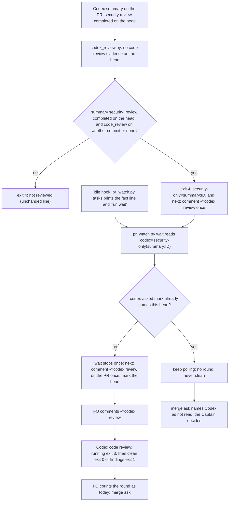

When Codex has posted only its security-review summary on a PR head, codex_review.py (or pr_watch.py) prints a next line that asks FO to request `@codex review`, so a merge ask is not prepared on a head with no code review.

## Scope

- Source: the Captain 「開」 (chat, 2026-11-06), answering 「要開這 4 張嗎？」 after fo-feedback round 005 (.notes/fo-feedback/round-005.md, closed 2026-11-06).
- Bite: ops-inbox PR #727 merged 2026-10-27 with Codex's code review only on an earlier commit d7eeeef26 (unresolved findings) and only a security review on the merged head 5dee91fb7 (Codex review-state comment, read by FO 2026-11-06); kc-paseo-plugins lost about 10 minutes per PR on #71 #72 #73 #75 waiting on exit 4 (operator report); Bridge outcome gap 7 (_l3-dogfood/OUTCOME.md, a94f9cd).
- Upstream first: kc-dev-flow-2 extensions/codex codex_review.py (exit 4 "not reviewed") and scripts/pr_watch.py.
- Non-goals: requesting the review automatically (a PR comment stays FO's step).

- Batch 16: the Captain 「可以，就這樣」 (chat, 2026-11-06), answering 「這批做 2、3、4、5、9 這 5 張，可以嗎？」, which named this task.

## Budget
- One package PR; the workflow word budget does not rise unless the design names a raise for the Captain.

## Stop condition
- A replay of a security-only head prints the code-review next line; a head with a code review prints none.

## FO alignment

Alignment: needed at ideation; the design choice is his to accept.
Result: aligned at backlog: Batch 16 backlog gate, the Captain 「核准（建議）」 (host question dialog, 2026-11-06), answering 「決定：第 16 批這五張（跳過的 CI 不擋、Codex 只貼安全摘要時提醒、交付檢查的相對路徑、ADR 編號跨流程預留、婉拒只在出過事時開任務）都用 Pilot，照各自寫下的範圍、預算與停止條件進入構想嗎？核准即接受「婉拒只在出過事時開任務」任務裡寫的標準（指出真的錯並說得出誰受害、再次出現、或你要求）。要改哪張直接說。」, approved the outcome and bounds in this file.
Surfaces: none
Visible change: none
Release review: not needed: workflow maintenance, on no journey map.

## Design

### PRFAQ

**Press release.** When Codex has reviewed a pull request head for security only, FO no longer waits on "not reviewed" until something else happens. The Codex reader still exits 4 and still counts no round, but it now says why: `not reviewed: Codex reviewed <head> for security only; security-only=summary:<id>`, followed by `next: comment `@codex review` on the PR once; a security review is no round and never clean.` `pr_watch.py wait` stops once per head with the same request. FO comments `@codex review`, Codex runs the code review, and the round is read as before. A head that already has a code review, or has no Codex summary at all, prints exactly what it prints today.

**FAQ**
- *Does a security review now count as a round, or as clean?* No. Exit stays 4 and the line carries no `evidence=` token, so neither `pr_watch.py` nor FO counts it (ADR 0004 counts rounds by rule; ADR 0013 keeps the reader's rule positive: the new line fires on a positive marker, the summary's `security_review` completed on the head).
- *Doesn't the archived task `codex-reader-counts-code-review-only` say the security object is never read?* It said so about counting: its design drew `security_review` as "never read" so that a security-only head stops reading clean. This design reads two fields of it (`status`, `commit_sha`) only to word the exit-4 line, never for a verdict or a finding. That task's Captain constraint, correct with security review off, on, or only one of the two run, is kept: off (no `security_review` row, or not on the head) prints today's line; both on the head reads the code review as today; only security on the head adds the request.
- *Who posts the comment?* FO. The reader and `pr_watch.py` only print the step (Scope non-goal: no automatic request).
- *What if FO already asked and Codex never answers?* `pr_watch.py` asks once per head (a `codex-asked` mark in the per-session state file, as the stall path marks `codex-stalled`). After that the existing Extensions rule applies: the merge ask names Codex as not read and the Captain decides. A new session asks once more, as for a stall.

**Acceptance evidence plan.** Replay the security-only merged head of iamcxa/kc-claude-plugins#727 and reviewed heads through base and candidate readers; replay the last 40 PRs of iamcxa/kc-claude-plugins and of iamcxa/kc-paseo-plugins and show every changed output is a security-only head; unit tests with one mutation per condition; word counts per moment.

Actors and order match the prose: Codex writes the summary, the reader classifies, `pr_watch.py` prints the step once per head, FO posts the comment, the Captain decides at the merge ask. The head-moved check, the finding-before-summary rule and the stall and unrecognized paths are existing code and are not drawn.

### Correction to the Scope's bite

`d7eeeef26` is not an earlier commit of #727: `git log -1 d7eeeef26` prints `feat(kc-ops-inbox): contract v1 ... (#727)` and `gh pr view 727 --json mergeCommit` names it, so it is the squash-merge commit on main. Codex code-reviewed it after a person's `@codex review` at 2026-10-27T14:59:06Z, about nine hours after the merge at 05:37:49Z. The bite stands as stated for the merged head: `5dee91fb7` had only the security review (completed 05:35:30Z, trigger "Draft marked ready").

### Replays (disposable prototype in /tmp/csopc, 2026-11-06, base = origin/main ba055b8a7, kc-dev-flow-2 0.35.0)

- #727, base: `not reviewed: no Codex evidence covers 5dee91fb7`, exit 4. Candidate: `not reviewed: Codex reviewed 5dee91fb7 for security only; security-only=summary:6434584622` then the `next:` line, exit 4. Its summary marker: `code_review.commit_sha` d7eeeef26 (has unresolved findings), `security_review.commit_sha` 5dee91fb7 completed.
- Reviewed heads, identical bytes and exit 0 in both: kc-paseo-plugins #71 (both reviews on the head) and #73 (code review on the head, security on an older commit). No Codex summary: kc-claude-plugins #555 prints the unchanged exit-4 line in both.
- Corpus: `gh pr list --state all --limit 40` of iamcxa/kc-claude-plugins and of iamcxa/kc-paseo-plugins, 80 PRs. 52 print identical bytes and exit (42 exit 0, 2 exit 1, 8 exit 4). 28 differ, every one exit 4 in both with the security-only line; 26 of them are merged and 2 open (kc-paseo-plugins #40 and #42, live instances; this task does not act on them). Spot-checked #796 and paseo #70: `code_review` all null, `security_review` completed on the head.
- The paseo operator's 10-minute window is visible in #71: summary created 17:15:37Z, person's `@codex review` at 17:21:23Z, code-review receipt 17:22:40Z.
- Idle path, exercised through `TasksTests` with a security-only snapshot: `tasks` prints `fact: o/r#7 OPEN draft=False checks=green codex=security-only(summary:9)` and its existing two lines to run `wait`; `wait` then stops at its first look (0 sleeps) with the request; a second `tasks` adds nothing new.

### Existing-code check

Use and repair what exists: `codex_review.py` already reads the summary marker (`code_row`, used for the running and stall paths) and already exits 4 for this head. The change widens that helper to return the whole marker object and adds one branch before the plain exit-4 return. `pr_watch.py` already maps `unrecognized=` and `stalled=` tokens into the codex column and already stops `wait` once per head for a stall (`stall_lines`); the change adds `security-only` to that mapping and one sibling of `stall_lines`. No replacement, no new exit code (every consumer keeps its exit-4 meaning).

### Chain checked (upstream first, 2026-11-06)

- Spacedock 0.27.3 cache: `grep -rIl 'codex-review-state\|chatgpt-codex-connector'` finds 0 files; Spacedock has no Codex reader.
- kc-dev-flow-2 at origin/main ba055b8a7 (0.35.0): the only reader of Codex's summary is `extensions/codex/codex_review.py`; `pr_watch.py` is its only script consumer; other `security_review` hits are the unrelated `tob_security_review` report.
- kc-pr-flow: its "codex review" is a local CLI second opinion, not GitHub Codex. Adopters (relay, web, qnow) run the package reader; not read further.
- Third-party mechanism: Codex's summary marker is undocumented (the archived task found no page describing it); the live comment bodies are the specification, so the reader stays a compatibility adapter, as EXTENSION.md Limits says.

### Words FO reads at each moment

Counted by whitespace split, base vs candidate; `references/sd/workflow.md` is 5939 words in both, so its budget does not rise.

| Moment | Passage or output | Base | Candidate |
| --- | --- | --- | --- |
| Startup (runs the idle hook) | `tasks` fact line per open PR | 6 | 6 (`codex=security-only(summary:N)` replaces `codex=not-reviewed`, one token) |
| Idle on an open PR, security-only head | `wait` output | 0 (keeps polling until another outcome) | 24, once per head |
| Idle on an open PR, any other head | `tasks`, `wait` | unchanged | unchanged |
| Idle on a merged PR | codex column not read for a closed PR | 0 | 0 |
| After the archive | none | 0 | 0 |
| Review step and merge ask | `extensions/codex/EXTENSION.md` | 310 | 325 (+15, named raise below) |
| Review step and merge ask, security-only head | reader output | 7 | 26 |

Named raise for the Captain: +15 words in the codex EXTENSION.md Read bullet (`exit 4 with `security-only=`: Codex reviewed the head for security only; do its `next:` line;`), read at the review step and merge ask on every head; +43 words of script output only on a security-only head. Without the EXTENSION sentence the documented exit-4 meaning says only "no verdict yet", so a FO that reads the file before the output has no instruction to act.

### Changes

- `kc-dev-flow-2/extensions/codex/codex_review.py`: the summary helper returns the marker object; one branch before the plain exit-4 return; docstring exit-4 sentence names `security-only=`.
- `kc-dev-flow-2/extensions/codex/test_codex_review.py`: one test with subtests (three code-row shapes that ask; seven shapes that do not, covering security off, both on, code running, code findings, code failed, security running, security on an old commit; a later clean code review decides; a non-bot summary does not ask).
- `kc-dev-flow-2/scripts/pr_watch.py`: the reader mapping reads `security-only=` on exit 4 as `security-only(<id>)`; one function beside `stall_lines` stops `wait` once per head with the request and a `codex-asked` mark; one docstring paragraph.
- `kc-dev-flow-2/scripts/test_pr_watch.py`: one test (mapping, no outcome, once per head, a new head asks again, at most 26 words).
- `kc-dev-flow-2/extensions/codex/EXTENSION.md`: the one sentence above.
- No ADR: no ruling changes (exit codes, round counting and the merge-ask rule stay). No workflow.md, budget, CI or adopter file.

### Not claimed

- A code review that `failed` on the head with security completed still prints the plain exit-4 line (existing gap, out of scope).
- A security review still running on the head asks nothing until it completes, so a request is not raced against a code review Codex may be about to start.
- After the one request per head there is no second step like the stall path's; the merge ask names Codex as not read.
- Merged security-only heads in the corpus (26) are not classified (release and sync PRs are among them); nothing here acts on them.
- The marker shape may change without notice (carried from the archived task's F1).

### Batch overlap

Files this design changes: `extensions/codex/codex_review.py`, `extensions/codex/test_codex_review.py`, `extensions/codex/EXTENSION.md`, `scripts/pr_watch.py`, `scripts/test_pr_watch.py`, all under `kc-dev-flow-2/`. Checks: the codex reader's exit-4 output and `pr_watch.py wait`.

| Task | Files or checks it changes (as its file stands, 2026-11-06) | Shared with this design |
| --- | --- | --- |
| delivery-check-passes-a-skipped-by-design-run (batch 16) | no design yet; its Scope names `delivery_gate.py check` | none |
| delivery-check-resolves-links-from-the-task (batch 16) | no design yet; its Scope names `delivery_gate.py` | none |
| adr-reservation-crosses-workflows (batch 16) | no design yet; its Scope names `number_guards.py` | none |
| decline-becomes-task-only-with-a-bite (batch 16) | no design yet; its Scope names README step 5 and `delivery_gate.py` decline parsing | none (this design leaves workflow.md and round counting unchanged) |
| seed-check-requires-alignment-result | `design_surfaces.py`, `test_design_surfaces.py`; runs `test_pr_watch.py` unchanged | `test_pr_watch.py` is run by it and edited here; different tests |
| step-back-answer-has-a-record-line (held) | `role_triggers.py`, its test, ADR 0026 | none; `pr_watch.py` only forwards its lines |
| dispatch-carries-reserved-adr-number | `dispatch_records.py` and siblings; `pr_watch.py --newest` unchanged | none |
| adoption-asks-which-extensions | `dispatch_records.py`, `number_guards.py`, tests, `laws.md` | none |
| fo-write-checks-parse-top-level | its tables name `codex_review.py` and `pr_watch.py` as untouched | none |
| captain-ruling-sources-checked (held) | `design_surfaces.py`, `extensions/peers/EXTENSION.md`, `adoption.md`, one ADR | none |
| comment-check-reaches-delivery-gate | `delivery_gate.py`, its test, validation principles | none |
| archive-waits-for-observer-report | mod, learn EXTENSION.md, `adoption.md`, README, two tests, one ADR; states `pr_watch.py` unchanged | none |
| picky-reviewers-may-run-on-gemini | no package file | none |
| adr-silent-undo-probe, journey-canvas-hosted-poc, journey-server-host-pilot, ops-inbox-r1-setup-and-isolation, pr-review-lite-value-pilot, merge-guard-stops-unasked-merges (held), gate-summary-names-each-decline (held), adr-required-statement | no mention of these five files | none |

Every kc-dev-flow-2 PR also moves the same release-please component (CHANGELOG and version on release), which is not a design file. No shared ADR number is taken.

Recommended order: any; if seed-check-requires-alignment-result lands first, rebase this branch's `test_pr_watch.py` addition (append-only, no conflict expected).

## Acceptance criteria

**AC-1** — The security-only merged head of #727 names the code-review request. Verified by: `python3 -B -I <candidate>/kc-dev-flow-2/extensions/codex/codex_review.py iamcxa/kc-claude-plugins 727` exits 4 and prints `security-only=summary:6434584622` and `next: comment `@codex review` on the PR once`, with no `evidence=`; the base reader prints only `not reviewed: no Codex evidence covers 5dee91fb7`. Falsifier: removing the new branch, or making it print `evidence=` instead of `security-only=`, fails the unit test of AC-3.

**AC-2** — Every other head prints what it prints today. Verified by: for the last 40 PRs (`gh pr list --state all --limit 40`) of iamcxa/kc-claude-plugins and of iamcxa/kc-paseo-plugins, base and candidate readers print identical bytes and exit codes except on heads whose summary marks `security_review` completed on the head and `code_review` not on it; each differing PR exits 4 in both and its candidate line contains `for security only; security-only=summary:`. At ideation: 52 identical, 28 differing, 28 of 28 security-only (re-run at implementation; counts may move as PRs change). kc-paseo-plugins #71 and #73 print identical clean lines. Falsifier: dropping the "code review not on the head" or "security on the head" condition makes a reviewed or security-off head ask, which AC-3's subtests catch.

**AC-3** — The reader's condition is pinned by tests. Verified by: `python3 -B -m unittest test_codex_review` in `extensions/codex/` passes on the candidate and fails 3 subtests on the base reader (ideation prototype: 36 tests OK on the candidate; base FAILED failures=3). Each mutation fails it: drop the code-row check (2 failures), drop `status == "completed"` (1), drop the security head check (1), never print the line (3), print `evidence=` instead (3).

**AC-4** — `pr_watch.py wait` asks once per head and the idle path reaches it. Verified by: `python3 -B -m unittest test_pr_watch` passes on the candidate (prototype: 135 tests OK) and the new test fails on the base (prototype: FAILED failures=1); mutations each fail the new test: `wait` not calling the new function (error), no `codex-asked` mark (failure), no `security-only` mapping in `reader` (failure). A `TasksTests` run with a security-only snapshot shows `tasks` printing its fact and run-`wait` lines and `wait` stopping at its first look with the request.

**AC-5** — Words. Verified by: `wc -w` of `references/sd/workflow.md` equal on base and candidate and `lint-skills.py` passing without a budget edit; `extensions/codex/EXTENSION.md` rises by at most 15 words (310 to 325 at ideation); the new test asserts the `wait` lines are two and at most 26 words; the reader's two lines on #727 are at most 26 words.

**AC-6** — Scope. Verified by: `git diff --name-only origin/main...HEAD` on the delivery branch lists only the five files under Changes; the repository's required checks (unit tests, version parity, skill frontmatter lint) pass on the PR.

## Needs decision

- **D1: should the idle hook's `tasks` print the request itself, not only `wait`?** Recommend no: `tasks` already tells FO to run `wait` for every open PR, and `wait` stops with the request at its first look (exercised, 0 sleeps); this follows the stall path, which also asks only from `wait`, and adds no words to every idle. What gets worse: FO reaches the request one step later, and a `wait` already running reaches it only at its next poll (60 seconds by default), instead of on the idle output itself.

## Stage Report: ideation

- DONE: Design the next line the codex reader (/Users/kent/.claude/plugins/cache/kc-claude-plugins/kc-dev-flow-2/0.35.0/scripts/../extensions/codex/codex_review.py) or /Users/kent/.claude/plugins/cache/kc-claude-plugins/kc-dev-flow-2/0.35.0/scripts/pr_watch.py prints when only Codex's security summary covers the head, with replays of #727 (security-only merged head) and a reviewed head
  ## Design: reader keeps exit 4, adds `security-only=summary:<id>` and the `@codex review` next line; `pr_watch.py wait` asks once per head. Replays: #727 base 7-word line vs candidate request line; paseo #71/#73 identical clean; 80-PR corpus 52 identical, 28 differ, all security-only.
- DONE: A `### Batch overlap` section naming each file the design would change and each other batch task (delivery-check-passes-a-skipped-by-design-run, delivery-check-resolves-links-from-the-task, adr-reservation-crosses-workflows, decline-becomes-task-only-with-a-bite) and live task of other sessions (adoption-asks-which-extensions, adr-silent-undo-probe, captain-ruling-sources-checked (held), comment-check-reaches-delivery-gate, dispatch-carries-reserved-adr-number, fo-write-checks-parse-top-level, gate-summary-names-each-decline (held), step-back-answer-has-a-record-line (held), merge-guard-stops-unasked-merges (held), journey-canvas-hosted-poc, picky-reviewers-may-run-on-gemini, seed-check-requires-alignment-result, archive-waits-for-observer-report, ops-inbox-r1-setup-and-isolation, pr-review-lite-value-pilot, adr-required-statement, journey-server-host-pilot (stalled, held or driven by other sessions; read only)) that changes the same file or check, so FO can order implementation
  Five files named; no other task edits them; only shared file is `test_pr_watch.py`, run (not edited) by seed-check-requires-alignment-result. Recommended order: any.
- DONE: The words FO reads at each lifecycle moment, before and after, per root learning.md "Measure the words FO reads at each moment, not one file's size"
  `### Words FO reads at each moment`: workflow.md 5939 = 5939; EXTENSION.md 310 → 325 (named raise); security-only head: wait 0 → 24, reader 7 → 26; all other moments unchanged.
- DONE: Acceptance criteria with reproducible evidence clauses and falsifiers, and unresolved decisions for the Captain, each with a recommendation and what gets worse under it
  AC-1..AC-6 below, each mapped on its own line; `## Needs decision` D1 (`tasks` prints the request too?) recommends no, and says what gets worse.
- DONE: AC-1 (#727 names the request)
  Prototype replay 2026-11-06: candidate exit 4 with `security-only=summary:6434584622` and the next line; base exit 4 bare line. Falsifier proven by mutations M4/M5.
- DONE: AC-2 (every other head unchanged)
  Prototype corpus of 80 PRs: 52 identical; 28 differ, 28/28 security-only. Must be re-run at implementation.
- DONE: AC-3 (reader tests and mutations)
  Prototype: 36 OK on candidate; base fails 3; five mutations fail 2/1/1/3/3.
- DONE: AC-4 (wait once per head, idle path)
  Prototype: test_pr_watch 135 OK on candidate; base fails 1; three mutations fail; TasksTests probe shows tasks → wait → request at 0 sleeps.
- DONE: AC-5 (words)
  Measured on the prototype with `wc -w`; lint-skills not yet run on a candidate branch (implementation).
- DONE: AC-6 (scope)
  Not yet verified: there is no delivery branch until implementation; the prototype changed exactly these five files.

### Summary

The reader keeps exit 4 for a head Codex reviewed for security only, and now says so with a `security-only=` token and a `next:` line asking FO to comment `@codex review` once; `pr_watch.py wait` stops once per head with the same request. A disposable prototype in /tmp/csopc replayed #727 and 80 recent PRs: only security-only heads change. The Scope's "earlier commit d7eeeef26" is the squash-merge commit, reviewed after merge (corrected in the design); one decision for the Captain (D1, whether `tasks` prints the request too, recommended no). `design_surfaces.py check`: "design surfaces presentable", exit 0.
