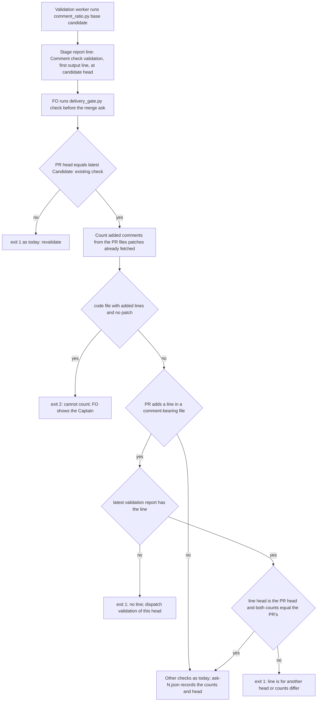

## Scope

- Source: issue iamcxa/kc-claude-plugins#409 (written for kc-dev-flow v1 from subspace-relay PRs 195 and 196, still open on 2026-10-19), handed to this FO under DOT#0007 (iamcxa/dot-decision-log PR #9, revision 3d601c5).
- Finding on origin/main 18dbf490 (2026-10-19): kc-dev-flow-2 states the rule but nothing at completion refuses its absence. `skills/implementation/principles.md` requires running `comment_ratio.py <base> HEAD` and reporting its output; `skills/validation/principles.md` requires reading every added comment and treats `comment_ratio.py` exit 1 as a repair finding. No completion-path script calls `comment_ratio.py`: `git grep -c -i comment` gives 0 in `laws_check.py`, `observer_check.py`, `dispatch_records.py` and `pr_watch.py`, and the 3 hits in `delivery_gate.py` are the `comment:<id>` reviewer token. So a validation report with no `comment_ratio.py` output, or with output from an earlier candidate, still reaches the delivery gate.
- Part of #409 already covered by prose only: the semantic read of changed comments (the #196 false-ownership case) is the validation principle "Read every comment the candidate adds"; `comment_ratio.py` measures ratio and citation classes, not truth.
- Bite: relay PRs 195 and 196 (the case corpus with fixed revisions in #409). No dev2 task in this workflow has yet been observed delivered without the comment output; measuring that over the archived validation reports is the first ideation step.
- Second corpus (subspace-relay dev2, 2026-10-19; table at the relay workspace `.context/comment-check-count-2026-10-19.md`, FO read it and the front-door-hardening row): of 32 archived check-era tasks, 0 lack `comment_ratio.py` output and 0 lack a validation comment pass; 11 report a ratio from a head the PR later moved past (rebase, main merge, stacked PR, late repair) with nothing re-measuring, one of them (front-door-hardening) with a comment changed in that gap; 10 validations quote only a percentage. So the observed gap is binding the comment check to the delivered head, not its absence.
- Upstream first: `delivery_gate.py` (the merge ask), `laws_check.py` L1/L2, the observer; Spacedock owns the runtime transition. Whether one of these can require the `comment_ratio.py` line bound to the dispatched Candidate head, with no new FO words.
- Non-goals: to be set at ideation. Closing #409 is not this task's to do; if the gap is closed, the task proposes it to the Captain.

## FO alignment

Alignment: not needed before ideation; the Captain approved this trial run in DOT#0007 (「准用 409」, 2026-10-19), which leaves profile, gates and merge to him as usual.
Release review: not needed: workflow maintenance, on no journey map.
Surfaces: none
Visible change: none

## Peers

- Peer: DOT#0007 conductor (kc-claude-plugins workspace) = de83e726-1fa6-4991-b12e-bd82ad8a7d79; listed as uds:/tmp/cc-socks/9226.sock (reply, 2026-10-19). Asked this FO to decide whether #409's gap remains in kc-dev-flow-2 and file one task; FO read DOT#0007 at 3d601c5 and checked the Captain's words 「可以，跑看看」 and 「准用 409」 in that session's own transcript (user messages at 2026-10-19T08:08:43Z and 08:18:11Z) before filing.
- Peer: subspace-relay dev2 FO = 62aab0fa-e10d-40ce-a62c-07dcf7d48e04; counts relayed by session colombo-15 (uds:/tmp/cc-socks/47087.sock) on 2026-10-19, which says the Captain approved forwarding (「准」) after the relay FO's direct send was held. Question: how many relay archived dev2 tasks were delivered without comment-check output. Answer: the second-corpus line in Scope; FO checked the table file and one row before recording it.

## Design

### PRFAQ

**Headline.** Before FO asks the Captain to merge, `delivery_gate.py check` counts the comments the PR head adds and holds the ask unless the latest validation report carries a `Comment check (validation):` line whose head and counts are that head's.

**Who and what hurts today (measured 2026-10-20, read-only).** Two corpora: this repository's dev2 state branch (60 archived tasks; 42 have a merged PR and a validation report; 39 of those name `comment_ratio.py` in a report, so 39 are check-era) and subspace-relay's (46 archived, 45 with a merged PR and report, 38 check-era; the Scope's count of 32 was taken on 2026-10-19; seven tasks have archived since, and the one local-merge task, which has no PR, is not counted here). That is 77 check-era delivered heads (86 distinct merged PRs counted in all, two relay tasks sharing PR 325). Nothing reads the report, so the check is bound to nothing:

- The latest validation report carries the script's first output line verbatim (`code lines N, comment lines M, P%`) in 13 of 77 (this repository 11, relay 2). The other 64 name the script with a percentage or a count in another shape, or, in 5, name it nowhere in the latest cycle (each of the 5 did in an earlier cycle). A loose form can be compared with nothing.
- Of the 13 verbatim lines, 10 equal the count at the delivered head (GitHub's file patches for the PR head, counted with `comment_ratio.count`). 2 were measured at an earlier head (this repository's PR 533: 402 code lines reported, 411 at the head; relay's PR 350: 991, 992; the comment count is the same in both). 1 quotes a delta run from a transcript audit, not a measurement of the candidate (PR 535).
- Relay's own table (FO, 2026-10-19; a different frame: it asks whether a run names the delivered head and whether the validator says it read the comments, by hand, over 32 tasks) finds 11 with every run on an earlier head and 10 quoting only a percentage. I checked its 11 against the delivered heads: the comment-line count each report quoted equals the count at the head in all 11 (PR 325 carries two tasks, 18 + 24 = 42); the code-line count had moved in 4 of them (PR 297, 336, 350, 377). So the unbound report is real, and in this sample it hid no changed comment count.
- Ratio and citations at the delivered head: 0 of 77 breach. The three heads over 5 percent or citing a task or PR number all predate the check (this repository's PR 468: 8.9 percent, 7 citations; relay's PR 260: 7.8 percent with one file the API gave no patch for, so understated; relay's PR 269: 6.1 percent).

The bite is therefore a missing binding (64 of 77 reports unparseable; 11 relay heads moved past the measured one), not a breach the gate would have caught. That is the one risk that can change the Captain's vote; it is Needs decision D1.

**What changes.**
- `skills/validation/principles.md`: each validation stage report, a recheck cycle included, carries `Comment check (validation): <first output line of comment_ratio.py> at <40-hex candidate head>`. This is the pattern of `Security review (validation): ... at <40-hex head>`, which `validation_security.py` already checks from `delivery_gate.py`.
- `delivery_gate.py check`: from the `files` pages it already fetches (each entry's `patch`), it counts added code and comment lines with `comment_ratio.count`. When the PR adds at least one line in a comment-bearing file (`.ts .tsx .js .mjs .sql .py`, the script's `LINE` table) it requires, in the latest `## Stage Report: validation` section, one such line whose head equals the PR head and whose two counts equal its own. Otherwise exit 1 with one of three lines; a code file with added lines and no `patch` is exit 2.
- A pass prints nothing new. The gate reads the two counts and the head from the line; `P%` is the script's third field and is not compared. The saved `merge/ask-N.json` gains `comment_check` (code, comment, head) so a later reader can see which head the counts were taken at.

**FAQ.**
- *Why measure instead of trusting the line?* A line the validator types is a claim. The gate holds the same patches the script would diff (this repository, 42 of 42 merged PR heads: code lines, comment lines and citation count identical, see Measurements), so a stale or invented line fails on the head, the numbers, or both.
- *Does this prove the comments were read?* No. It binds the measurement and the head the validator names. The semantic read ("Read every comment the candidate adds", the relay PR 196 false-ownership class) stays the validation principle; a validator can still skip it.
- *Why the gate, not a law or the observer?* The gate runs at the merge ask with the PR head in hand; the laws judge state-branch commits after the push and see no PR head, and the observer runs at archive, after the merge.
- *Why not hold on ratio or citations too?* No head in 77 would have held (above); validation already treats exit 1 as a repair finding. Deferred, not built.
- *Why is the implementation report not gated?* It measures its own `HEAD`, which repairs move; the validation line measures what is delivered. D2.
- *Stacked or rebased PR?* The gate counts the PR's own diff; a validator who ran the script against another base gets numbers that differ and a hold. That is the intended refusal.
- *Cost per ask.* No new GitHub call (the `files` pages are already read for the file list and `changedFiles` check); the count runs in memory. Time not measured.

### Flow

Branches match the prose: the existing head check first, an unreadable diff as a hold, a PR with no comment-bearing line needing no line, then absent, wrong head or wrong counts as holds. The existing checks still run and print; every problem is printed and exit 1 wins over exit 2 as today.

### Existing-code check (chain: Spacedock, kc-dev-flow-2, sibling adopters)

- Spacedock 0.27.0 plugin cache: `grep -rIl -i 'comment_ratio\|comment-ratio\|comment ratio\|added comments'` finds 0 files. Spacedock owns the stage-exit checklist (`--checklist`), which makes a report item exist; it reads no content, so it cannot bind a head.
- kc-dev-flow-2 at origin/main ad44f0cb: search 1, `git grep -n comment_ratio origin/main -- kc-dev-flow-2 ':!*CHANGELOG*'`, shows the script, its tests, the implementation and validation principles and `adoption.md`; no completion-path script calls it (the Scope's per-file counts were re-run on 2026-10-20: `laws_check.py`, `observer_check.py`, `dispatch_records.py` 0 hits of `comment`; `pr_watch.py` 2, a docstring and the PR review-comments API path; `delivery_gate.py` 3, all the `comment:<id>` reviewer token). Search 2, `git grep -n '"patch"' origin/main -- kc-dev-flow-2`, finds 0 hits: the gate fetches the `patch` field with every `files` page and never reads it. The capability is half-built (script works, prose rule exists, gate holds the data) with the enforcing seam missing. Need: a goal and a consumer (the Captain at the merge ask) and a measured unbound state; a falsifier is AC-3. The precedent to reuse is `validation_security.py` (a validator-written line bound to the dispatched head, checked from `delivery_gate.py`), not a new script.
- Siblings: relay's non-state tree has 0 `comment_ratio` hits and runs the package gate through its README; its table is the second corpus. qnow and subspace-web were not read. Exclusions: no dynamic or compatibility consumer was searched for beyond the repository greps above.

### Measurements (method, so validation can re-run)

Throwaway scripts in `/tmp/cc-analysis` (not kept; nothing in the repository). Method: for each `_archive/*.md` task with `pr: pr-merge:<N>` take the last `## Stage Report: validation` section; match `code lines (\d+), comment lines (\d+)`; take the delivered head with `gh pr view N --json headRefOid`; count with `gh api --paginate repos/<repo>/pulls/N/files` patches through `comment_ratio.count` and `cited` from origin/main's script. Check-era = a report of that task names `comment_ratio`. Equivalence to the script: for all 42 of this repository's merged PRs, `git fetch origin refs/pull/N/head`, `B=$(git merge-base <mergeCommit>^ FETCH_HEAD)`, `python3 kc-dev-flow-2/scripts/comment_ratio.py $B FETCH_HEAD` printed the same code lines, comment lines and CITE count as the patch count (42 of 42). Of the 86 distinct merged PRs counted, one file (relay's PR 260) had no `patch`. The fetches added PR-head objects to the shared object store and FETCH_HEAD files; no branch, ref name, config or working-tree file changed.

### Batch overlap

Files the design would change: `kc-dev-flow-2/scripts/delivery_gate.py` (one function, one docstring paragraph, one key in `write_record`); `kc-dev-flow-2/scripts/test_delivery_gate.py` (new cases; `file_pages` entries gain an optional `patch`); `kc-dev-flow-2/skills/validation/principles.md` (one sentence replaced). Not changed: `comment_ratio.py` (imported as is), `references/sd/workflow.md`, `lint-skills.py`, `laws_check.py`, `observer_check.py`, `dispatch_records.py`, the implementation principles.

| Task | Same file or check | Order |
| --- | --- | --- |
| fo-write-rules-checked (batch 4) | `delivery_gate.py` and `test_delivery_gate.py`; its Scope already says implement after this task | this task first |
| db-surface-without-migrations (batch 4) | none: its Non-goals leave `delivery_gate.py` alone | none |
| commissioned-by-names-spacedock (batch 4) | none: `workflow.md` line 2 and two synced READMEs | none |
| fo-batch-sittings (batch 4, ideation not started) | none known; its Scope names `workflow.md` Number guards | none; recheck when its design lands |
| adr-required-statement (other session, validation) | `workflow.md` and `test_poc_readme.py`; none of mine | none |
| release-acceptance (other session, ideation) | `workflow.md` Release review bullet and the `lint-skills.py` run; none of mine | none |
| journey-server-host-pilot (other session, validation) | none: its ask runs through whichever package its FO loaded; it already names `comment_ratio.py` in its reports | none |
| pr-review-lite-value-pilot, journey-canvas-hosted-poc (other sessions) | none found (`grep` for `delivery_gate`, `comment_ratio`, `validation/principles` over both task files: 0 hits) | none |
| `fo-write-checks-followups.md` (open follow-ups) | three items on `delivery_gate.py`, one about a rerun writing a second `ask-N.json`; my key sits in the same `write_record` | adjacent, not conflicting |

### Words FO reads at each moment

Whitespace split, the counter `lint-skills.py` uses; base is origin/main ad44f0cb, candidate is this design.

| Moment | Before | After |
| --- | --- | --- |
| Startup, idle, archive (FO reads `workflow.md` and the mod) | unchanged | unchanged: no `workflow.md` edit, no `WORKFLOW_BUDGET_STEPS` step |
| Validation dispatch (FO writes the record) | 0 comment words | 0 |
| Validation gate (FO reads the report) | script output pasted in any shape | one line of about 12 words in a fixed place |
| Merge ask, gate passes | the existing pass lines | identical: no new line |
| Merge ask, gate holds | 0 | 12 to 21 words per problem line (missing 20, wrong head 12, wrong counts 21) plus one 20-word `next:` line; 11 words for an unreadable patch |
| Validation worker reads `principles.md` (not an FO moment) | `and report its output.` 4 words | the sentence at the end of the Measure paragraph 20 words (+16) |

Every FO moment is at or below its base except the hold lines, which print only when the ask is refused.

## Acceptance criteria

**AC-1** A PR that adds at least one line in a comment-bearing file (`.ts .tsx .js .mjs .sql .py`) and whose latest validation report has no `Comment check (validation):` line exits 1, the output naming that label, with a `next:` line holding the absolute path of `comment_ratio.py`.
Verified by: a new case in `test_delivery_gate.py` with a `files` entry `dict(filename="a.py", additions=2, deletions=0, patch="@@ -0,0 +1,2 @@\n+x = 1\n+# why")` and a validation report without the line: exit 1 and the label in stdout. Ideation prototype: exit 1 on that shape, 2026-10-20 (not a candidate). Falsifier: deleting the absent-line branch makes the case exit 0.

**AC-2** The same PR with `Comment check (validation): code lines 2, comment lines 1, 50.0% at <PR head>` in the latest report exits 0, prints no comment line, makes no gh call the base run did not make, and the saved record's `comment_check` holds 2, 1 and the head. A PR with no added line in a comment-bearing file needs no line and passes as today.
Verified by: the same fixture plus the line (stub `calls.log` compared with the base run's calls; `merge/ask-1.json` keys); a markdown-only fixture exits 0 with no line. Falsifier: requiring the line on every PR fails the markdown case; an empty `comment_check` fails the record assertion.

**AC-3** A line for another head, or with counts that differ from the PR's, exits 1 and prints both sides: `the validation comment line is for <12 hex>, not the PR head <12 hex>` and `... says code lines 402, comment lines 1; the PR head has code lines 411, comment lines 1`.
Verified by: two cases built on AC-2's fixture (head `b`*40 against `a`*40; `comment lines 0` against a patch adding one). Prototype: both exit 1 with those texts, 2026-10-20. Falsifier: checking presence only passes both; checking the head only passes the second; checking the counts only passes the first.

**AC-4** Only the latest validation report counts: an earlier cycle with a matching line and a latest cycle without one exits 1.
Verified by: a case with `## Stage Report: validation` carrying the line and `## Stage Report: validation (cycle 2)` without it. Corpus basis: 5 of 77 latest reports name the script nowhere, each with an earlier cycle that did. Falsifier: searching the whole task text exits 0.

**AC-5** A code file with added lines and no `patch` exits 2 naming the file; a file with `additions: 0` and no `patch` does not; every test that exists at base passes unchanged except where a fixture gains a `patch` field.
Verified by: one case each; `python3 -B -m unittest discover -s kc-dev-flow-2/scripts` exit 0 at the candidate. Falsifier: skipping unreadable files makes the first case exit 0 and undercount (relay's PR 260 summed to 553/43 with `netlify/lib/share-address.ts` missing from the sum).

**AC-6** The gate's count equals the script's: for a diff mixing `//`, `#`, `--` and block comments across the six extensions, the gate function and `comment_ratio.count` over the same text return the same code and comment totals; and for PRs 647, 680, 682, 675 and 671 of this repository the gate function over `gh api --paginate repos/iamcxa/kc-claude-plugins/pulls/<N>/files` prints 92/0, 74/0, 319/0, 17/0 and 359/2 (code/comment), which `comment_ratio.py <merge-base> <PR head>` also prints.
Verified by: a unit test for the first clause; the second is the command in Measurements, rerun by validation (42 of 42 matched at ideation). Falsifier: counting a file type outside `LINE`, or `git diff -U3` context lines, changes a total.

**AC-7** `skills/validation/principles.md` tells the validator to write the line, `workflow.md` is untouched and no `WORKFLOW_BUDGET_STEPS` entry is added.
Verified by: `git diff --stat` at the candidate lists no `workflow.md`; `python3 kc-dev-flow-2/scripts/lint-skills.py` exit 0; the sentence differs from base by +16 words (whitespace split). Falsifier: any `workflow.md` edit makes the lint print a budget line.

**AC-8** Dogfood at this task's own PR: FO runs the candidate's `delivery_gate.py check` (path to the candidate worktree, as `<package>`) with the validation report carrying the line and gets exit 0; the same run on a copy of the task file with that line deleted gets exit 1. FO's validation scope notes for this task quote the new sentence, because the installed package (0.26.0) does not yet say it.
Verified by: both outputs recorded in the validation report. Limit: it shows the gate and one real validator agree on one PR, not that validators write the line unprompted after release; the next adopter delivery is that observation.

## Non-goals

- No hold on ratio or citations at the delivered head: 0 of 77 check-era heads would hold, and validation already returns exit 1 as a repair finding.
- No claim that the comments were read: the gate sees a measurement and a head, not reading. The false-ownership class of relay's PR 196 stays with the validation principle.
- No gate on the implementation report's line unless D2 rules otherwise, no law L3 (laws judge state commits after the push and see no PR head), no dispatch-record checklist requirement (relay: 0 of 32 reports lacked output at 2026-10-19; this repository: 2 of 39 latest validation reports never name the script).
- No change to `comment_ratio.py` output or exit codes, no ADR amendment (ADR 0004 records the script's exit rules, which do not change; the gate's docstring is where each delivery check is documented).
- Closing #409 is not this task's: it was closed NOT_PLANNED on 2026-10-20T04:03Z with a comment pointing at this task, so nothing remains to propose.

## Needs decision

**D1. Build the binding: the gate measures at the head and requires the validation line bound to it (recommended: yes).** The measurement and the line are one mechanism; either alone is weaker. What gets worse: the measured harm is zero: no head in 77 hid a changed comment count, so this buys a bound record, not a caught defect. Under today's wording only 13 of 77 reports have the form, so a task validated before the package carrying this change holds at its ask and costs one validation recheck. The ask-record key `comment_check` has no consumer today beyond a later reader; cut it and nothing else changes. If he declines: leave the prose rule as it is and record the 77-head measurement as the reason.

**D2. Gate the validation line only (recommended), or the implementation line too.** The title says both. Implementation measures its own `HEAD`, which repairs move, and the validation line measures the delivered head; implementation reports never name the script in 3 of 39 here and 0 of 38 in relay. What gets worse under validation-only: an implementation worker can skip the trim run and the first sign is the validator's exit 1, one repair cycle, not a bad delivery. Gating both means a hold that re-dispatches implementation for an omission with no effect on the head.

**D3. A code file with no `patch` holds the ask with exit 2 (recommended), or is skipped with a printed note.** Only matters if D1 is yes. What gets worse: a PR carrying a file GitHub gave no patch for (1 of 86 distinct merged PRs measured) holds until the Captain decides; skipping would undercount silently, the failure the gate exists to prevent.

D1 and D3 are coupled: D3 only has meaning if D1 builds the measurement.

## Stage Report: ideation

- DONE: A design (PRFAQ and Mermaid) that binds the comment check (kc-dev-flow-2/scripts/comment_ratio.py output and validation's comment read) to the delivered head, measured on the two corpora in Scope (this repository and subspace-relay's 32 check-era tasks, 11 measured on a head the PR later moved past); say where the check runs (kc-dev-flow-2/scripts/delivery_gate.py, laws L2, observer) and what it reads
  `## Design`: `delivery_gate.py check` counts added comments from the `patch` fields of the `files` pages it already fetches and requires a `Comment check (validation): ... at <40-hex head>` line in the latest validation report. Measured 77 check-era heads (39 here, 38 relay): 13 reports carry the script line verbatim, 10 equal the head, 2 stale, 1 not a candidate run; relay's 11 moved heads quoted the right comment count in all 11; 0 of 77 breach ratio or citations; patch counting equals the script on 42 of 42 PRs. Gate: yes; laws L2: no (judges state commits after the push, no PR head); observer: no change (runs at archive). The read half stays prose (Non-goals). `design_surfaces.py check` (package 0.26.0 and working copy): "presentable".
- DONE: A `### Batch overlap` section naming each file the design would change and each other batch-4 task and live task of other sessions that changes the same file or check, so FO can order implementation
  `### Batch overlap`: three files; fo-write-rules-checked shares `delivery_gate.py` and its test and goes after this task; the other eight tasks share no file with it; `fo-write-checks-followups.md` is adjacent (same `write_record`).
- DONE: The words FO reads at each lifecycle moment, before and after, per root learning.md "Measure the words FO reads at each moment, not one file's size"
  `### Words FO reads at each moment`: whitespace split; `workflow.md` untouched (no budget step); pass output unchanged; hold lines 12 to 21 words plus a 20-word `next:`, printed only on a refusal; validation principles +16 words (worker-read, not an FO moment).
- DONE: Acceptance criteria with reproducible evidence clauses and falsifiers, and unresolved decisions for the Captain, each with a recommendation and what gets worse under it
  AC-1 to AC-8, each with a test or command and a falsifier; D1 (build the binding; its worse side is that measured harm is zero), D2 (validation line only), D3 (missing patch holds). Current evidence per criterion (a throwaway prototype in `/tmp/cc-analysis/proto.py` and corpus runs, no candidate exists):
  - AC-1: prototype exits 1 on a PR adding a `.py` comment line with no report line; candidate test not written.
  - AC-2: prototype exits 0 on a matching line and on a markdown-only PR; the no-extra-gh-call and `comment_check` record parts are not verified.
  - AC-3: prototype exits 1 for a wrong head and for wrong counts with the AC's texts; candidate test not written.
  - AC-4: prototype exits 1 when only an earlier cycle has the line; 5 of 77 latest reports name the script nowhere (measured).
  - AC-5: prototype exits 2 for a code file with added lines and no patch; the existing suite is not yet run against a changed fixture.
  - AC-6: patch count equals `comment_ratio.py` on 42 of 42 merged PRs of this repository (code, comment and CITE counts), 2026-10-20; the five expected pairs are copied from that run; the mixed-extension unit test is not written.
  - AC-7: word counts measured (4 to 20); `lint-skills.py` not run on a candidate.
  - AC-8: not verified; it needs a candidate and this task's own PR.

### Summary

The gap in kc-dev-flow-2 is an unbound report, not a missing check: nearly every latest validation report mentions the script, only 13 of 77 can be compared, and 2 of those 13 were measured at an earlier head. The design reuses the gate's already-fetched PR patches and the `Security review (validation)` pattern, adds no new script, FO word or GitHub call, and leaves the semantic read and the ratio hold out. The one risk for the Captain is that measured harm is zero, so D1 is a question of whether a bound record is worth a recheck for tasks validated under the old wording.
