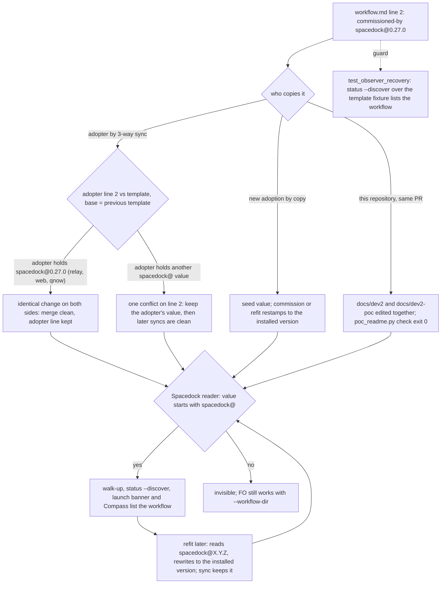

## Scope

- Source: the Captain, 2026-10-20 (「要，改」), answering FO's question on whether to file and schedule this for the next batch.
- Bite (read 2026-10-20 at spacedock 0.27.0 and kc-dev-flow-2 origin/main ad44f0cb): `kc-dev-flow-2/references/sd/workflow.md` line 2 and this repository's `docs/dev2/README.md` and `docs/dev2-poc/README.md` say `commissioned-by: kc-dev-flow-2` (since c8342ccc, #459, 2026-09-16; no ADR names it). Spacedock recognises a workflow only when the value starts with `spacedock@`: `internal/status/discover_walkup.go` DiscoverWorkflowDir, `internal/status/handlers.go` discoverWorkflows, and the state-checkout hint in `internal/status/native_runner.go`; `docs/schema/workflow-readme.mdschema.yml` requires `^spacedock@([0-9]+\.[0-9]+\.[0-9]+)?$`; `skills/refit/SKILL.md` reads and rewrites that stamp. So auto-discovery, workflow listing, refit's version read and the Compass dashboard drop these workflows; FO works only because every command passes `--workflow-dir`. No kc-dev-flow-2 script reads the value (test fixtures only). subspace-relay, subspace-web and qnow already carry `commissioned-by: spacedock@0.27.0`.
- Consumer: the Captain (Compass shows the dev2 stage strip) and any FO or tool that discovers workflows without `--workflow-dir`.
- Open at ideation: whether any test pins the template's exact frontmatter line (not verified); which spacedock version the template names and how refit keeps it current.
- Non-goals: to be set at ideation.

## FO alignment

Alignment: not needed before ideation; the Captain asked for the change.
Release review: not needed: workflow maintenance, on no journey map.
Surfaces: none
Visible change: none
Outside this repository's surfaces: the dev2 workflows of this repository appear in Compass and in Spacedock workflow discovery.

## Design

### Upstream first

Chain read 2026-10-20 (Spacedock plugin 0.27.0 source in the plugin cache, binary 0.27.2, kc-dev-flow-2 origin/main ad44f0cb, three adopters read-only):

- **Spacedock.** Four readers use one test, `strings.HasPrefix(commissioned-by, "spacedock@")`: `DiscoverWorkflowDir` (walk-up for commands without `--workflow-dir`), `discoverWorkflows` (`status --discover`, the front-door launch banner, survey and debrief), the state-checkout hint in `native_runner.go`, and Compass `read_workflow` (`SD_COMMISSIONED_PREFIX`). None reads the version. `docs/schema/workflow-readme.mdschema.yml` documents `^spacedock@([0-9]+\.[0-9]+\.[0-9]+)?$`; no Go file loads it (searched `workflow_readme`, `mdschema` in `*.go`), so it is documentation, not a gate. `skills/commission` writes `spacedock@{spacedock_version}`; its templates carry `spacedock@template`. `skills/refit` reads `spacedock@X.Y.Z` in Phase 1 and writes `spacedock@{current_version}` in Phase 5.
- **kc-dev-flow-2.** `adoption.md` already says to "stamp commissioning metadata through SD's existing procedure" and that the README sync is "a per-adopter three-way merge that keeps its own frontmatter"; `package_version.py` reads a different marker (`kc-dev-flow-2 X.Y.Z x-release-please-version`). Nothing in the package reads `commissioned-by`: the only hits are test fixtures (`test_delivery_gate.py`, `test_replay_dispatch.py`, `test_map_footprint.py`).
- **Adopters.** subspace-relay and subspace-web (`docs/dev2`, `docs/dev2-poc`) and qnow (`origin/next`, `docs/dev2`, `docs/dev2-poc`) all carry `spacedock@0.27.0`, written when each adopted (2026-09-19 to 2026-09-24). Only this repository carries `kc-dev-flow-2`, copied verbatim (c8342ccc, then 3ece141a for the POC). Not a kc-dev-flow-2 file, so the existing-code capability check does not apply (a value in a template, not a capability).

### PRFAQ

**Headline.** The kc-dev-flow-2 workflow template names `spacedock@0.27.0` in `commissioned-by:`, so a repository that copies it, and the two workflows of this repository, show up in Spacedock discovery and in Compass.

**What is wrong today (measured 2026-10-20).**

- In the repository's own checkout (origin/main ad44f0cb) `spacedock status --discover` lists `docs/dev`, `docs/ship`, `docs/ship-flow` and two `kc-ship-flow` fixtures, and neither `docs/dev2` nor `docs/dev2-poc`. In a fixture holding the template as `docs/dev2/README.md`, `spacedock status` from inside it stops with "no commissioned Spacedock workflow found", and the same command with `--workflow-dir` works. That is why FO runs: every command passes `--workflow-dir`.
- Compass `read_workflow` returns `None` for a README whose line 2 is `kc-dev-flow-2`; with `spacedock@0.27.0` it returns the 5 stages (`backlog ideation implementation validation done`), and 4 for the POC derivation. Compass does not scan for the directory: its stage strip takes the absolute workflow directory from the `spacedock status --boot` envelope in the FO session transcript (`workflow_dirs` in `compass_runtime/spacedock.py`) and skips a workflow whose `read_workflow` is `None` (the `continue` in the strip loop), so the prefix test is the one gate between a dev2 FO session and its strip (read 2026-10-20, Compass 1.3.0).

**What changes.**

- `references/sd/workflow.md` line 2 becomes `commissioned-by: spacedock@0.27.0`; nothing else in the file moves.
- `docs/dev2/README.md` and `docs/dev2-poc/README.md` in this repository get the same line in the implementation PR, so the Captain sees the workflows in Compass at merge instead of after the next release and sync. The POC README stays a derivation of the five-stage one (`poc_readme.py check` exit 0 only when both change).
- One new assertion in `test_observer_recovery.py` runs the pinned Spacedock binary's `status --discover` over the fixture it already builds from the template, so the real reader, not a regex copy of the schema, guards the value.
- One sentence in `skills/maintain-flow/SKILL.md` tells the maintainer why the value must not be bumped casually (below).

**How the stamp stays current.** It does not need to: discovery reads only the prefix, so a stale version is harmless to every reader above. Refit keeps it honest: Phase 1 compares the README's `spacedock@X.Y.Z` with the installed plugin version and Phase 5 rewrites it to `spacedock@{current_version}`. The package README sync then keeps the adopter's own line, because the template line did not change since the base (`git merge-file`: base = previous template, ours = adopter, theirs = new template). The template value is therefore a seed for a new adoption, which commission or refit restamps. Refit itself is an interactive skill and was read, not run (limit; AC-8).

**FAQ.**

- *Why `0.27.0` and not `0.27.2`, bare `spacedock@`, or `spacedock@template`?* Only a value equal to what adopters already hold merges clean. Measured 2026-10-20 with `git merge-file -p <adopter README> <template at the release it was synced from> <candidate template>`: `spacedock@0.27.0` exits 0 for relay, web, qnow and this repository's two READMEs; `spacedock@` and `spacedock@0.27.2` exit 1 on relay, web and qnow (both sides changed line 2 differently). `spacedock@template` is Spacedock's own placeholder, but it fails Spacedock's documented pattern and refit cannot read a version from it.
- *Is `0.27.0` a false claim about the template?* It says which Spacedock reader contract the template was written for; the CI pin (`SPACEDOCK_VERSION: v0.27.2`) is the version the tests run, which the stamp does not have to equal.
- *What happens to an adopter stamped differently (for example refit to 0.27.2)?* One conflict on line 2 at the release that carries this change, resolved by keeping its own value; `replay_dispatch.py build` exits with "README merge conflicted" in that case. After that sync the base holds the new line and later syncs are clean (simulated: ours `0.27.2`, base and theirs `0.27.0` with `trunk` changed: exit 0, both kept).
- *Why does the sync not need a migration note?* No adopter action: the three known adopters merge clean and this repository edits its own two files. Profile stays Pilot: no new data, credentials, recurring operation or release ownership.

### Flow



Branches match the prose: three ways the line travels (sync, new adoption, this repository), one reader test with its two outcomes, refit looping back to the same test, and the CI guard on the template.

### Package tests that read the template

Every package test that reads `references/sd/workflow.md` or builds a README from it, run 2026-10-20 from `git archive origin/main` copies in `/tmp` (pinned binary 0.27.2, SD plugin root 0.27.0), base tree and candidate tree (line 2 edited only), all exit 0 in both: `lint-skills.py` (5374 of 5374 words), `test_lint_skills.py`, `test_poc_readme.py`, `test_package_version.py`, `test_workflow_checkout.py`, `test_replay_dispatch.py`, `test_delivery_gate.py`, `test_pr_watch.py`, `test_observer_recovery.py`, `test_sd_dispatch.py`. None asserts on line 2: `test_poc_readme.py` (`derive`, `trunk: main` replacement), `test_observer_recovery.py` and `test_sd_dispatch.py` (template minus stages as a README, `--workflow-dir` explicit) and `test_package_version.py` (the release-line marker only) read other text. Unread by the tests: `journey-dev2-loop-smoke.sh` and `test_delivery_gate.py` carry their own `commissioned-by: kc-dev-flow-2` fixture line; the smoke passes `--workflow-dir` everywhere, so neither needs discovery. Left as is.

### Batch overlap

Files the design would change: `kc-dev-flow-2/references/sd/workflow.md` (line 2 only, 0 words); `docs/dev2/README.md` and `docs/dev2-poc/README.md` (line 2 only); `kc-dev-flow-2/scripts/test_observer_recovery.py` (one assertion); `kc-dev-flow-2/skills/maintain-flow/SKILL.md` (one sentence). Not changed: `lint-skills.py` (delta 0, `WORKFLOW_BUDGET_STEPS` untouched), `test_poc_readme.py`, `adoption.md`, `poc_readme.py`, `workflow_checkout.py`, `package_version.py`.

| Task | Same file or check | Order |
| --- | --- | --- |
| db-surface-without-migrations (batch 4) | `workflow.md` (a different bullet); its design already lists this task | independent; the second to merge reruns `lint-skills.py` |
| fo-batch-sittings (batch 4) | `workflow.md` Number guards; likely `maintain-flow/SKILL.md` if it adds a package rule (design not written) | independent text; if its design edits `maintain-flow/SKILL.md`, rebase |
| comment-check-reaches-delivery-gate, fo-write-rules-checked (batch 4) | `delivery_gate.py`, `dispatch_records.py`, laws; none of mine | none |
| adr-required-statement (other session, validation) | `workflow.md` Decision records and Number guards lines, `test_poc_readme.py`, a budget raise; mine edits a different line and neither of its tests | it merges first if it reaches the Captain first; budget is recomputed from the file, my delta is 0 |
| release-acceptance (other session, ideation) | `workflow.md` Release review bullet and `test_sd_dispatch.py` (extracts the workflow.md command line into a disposable repo) | independent; its fixture README becomes discoverable, which its `--workflow-dir` calls do not use |
| journey-server-host-pilot (validation), pr-review-lite-value-pilot, journey-canvas-hosted-poc (other sessions) | none found (pattern search over each task file for `workflow.md`, `docs/dev2` README, `commissioned-by`, `maintain-flow`, `test_observer_recovery`: 0 hits in all three) | none |
| Every later `chore(dev2): sync workflow` PR (this repository) | rewrites the same two READMEs by three-way merge | clean after my edit: ours and theirs hold the identical line 2 (simulated, exit 0) |

Merge order for FO: no task needs to precede this one; it should merge before the release that the adopters' next sync is based on, so their one-time line 2 resolution (if any) happens once.

### Words FO reads at each moment

Counted by whitespace split (the budget lint's own counter), unchanged base ad44f0cb against the candidate (line 2 edited in a `/tmp` copy; `spacedock` 0.27.2 for the outputs).

| Moment | Before | After |
| --- | --- | --- |
| Startup: FO reads `workflow.md` | 5374 words (line 2: 2 words) | 5374 words (line 2: 2 words) |
| Startup: `status --boot` output | 55 words | 55 words |
| Startup: `package_version.py` and `workflow_checkout.py` output | neither prints or reads `commissioned-by` (searched both files); `package_version.py` prints the same line on both trees | unchanged |
| Dispatch: `show-stage-def` for backlog, ideation, implementation, validation, done | 620, 485, 1221, 1392, 43 words | 620, 485, 1221, 1392, 43 words |
| Idle on an open or merged PR, after archive, the merge ask | script output of `pr_watch`, `delivery_gate`, learn; none reads `commissioned-by`, and `test_pr_watch.py` and `test_delivery_gate.py` pass on the candidate | unchanged |
| Adoption (`dev` reads `adoption.md`) | unchanged by this design | unchanged |
| `spacedock status --discover` (survey, debrief, banner) | prints 0 words for the dev2 fixture | prints its path, 1 word; not read by FO as an instruction |

Every moment is equal to its base; none falls below it, because the design adds no word FO reads. The one added sentence (about 45 words) is in `maintain-flow/SKILL.md`, which a maintainer loads and no FO or worker stage inlines. Limit: the idle, archive and merge-ask rows rest on "no script reads the value" (searched) and the passing tests, not on a recount of each output.

## Acceptance criteria

**AC-1** `references/sd/workflow.md` line 2 reads `commissioned-by: spacedock@0.27.0` and no other line of the file differs from origin/main.
Verified by: `git diff -U0 origin/main -- kc-dev-flow-2/references/sd/workflow.md` shows one removed and one added line, and `python3 kc-dev-flow-2/scripts/lint-skills.py` exits 0 printing `5374 of 5374 words` with `WORKFLOW_BUDGET_STEPS` untouched. Falsifier: any extra word makes the lint print that the file exceeds its budget.

**AC-2** The real Spacedock reader lists a workflow built from the template: in the fixture repository `test_observer_recovery.py` already builds (template minus ideation as `docs/dev2/README.md`), `spacedock status --discover` run in the repository prints the `docs/dev2` directory.
Verified by: the new assertion in that test, which compares real paths (macOS prints `/private/tmp`), run in the CI step that already installs the pinned binary: `SPACEDOCK_BIN=$HOME/.local/bin/spacedock python3 kc-dev-flow-2/scripts/test_observer_recovery.py`. Ideation reproduction 2026-10-20, binary 0.27.2: the template with `commissioned-by: kc-dev-flow-2` prints nothing, with `spacedock@0.27.0` prints the directory. Falsifier: restore the old line (or `spacedock@` removed) and the assertion fails.

**AC-3** The derived POC README keeps the stamp and every package test that reads the template still passes.
Verified by: the ten commands in "Package tests that read the template" exit 0 at the candidate (the CI workflow `kc-dev-flow-2-tests.yml` runs all ten); `python3 kc-dev-flow-2/scripts/poc_readme.py check docs/dev2-poc/README.md docs/dev2/README.md` exits 0 after the edit. Falsifier: editing only `docs/dev2/README.md` makes `check` exit 1 with a diff on line 2 (reproduced 2026-10-20).

**AC-4** In this repository `docs/dev2/README.md` and `docs/dev2-poc/README.md` read `commissioned-by: spacedock@0.27.0` on line 2 and differ from origin/main in no other line, and Spacedock discovery and Compass's workflow reader then see both.
Verified by: `git diff -U0 origin/main -- docs/dev2/README.md docs/dev2-poc/README.md` shows one changed line per file; `spacedock status --discover` from the repository root of the merge commit lists `docs/dev2` and `docs/dev2-poc` (today lists neither, 2026-10-20 on ad44f0cb); Compass `read_workflow(config, state, <dir>)` returns the 5 stage names for `docs/dev2` and the 4 for `docs/dev2-poc` (`None` for both today), run with the Compass install's own modules from a script kept outside the repository (probe used 2026-10-20, run as `python3 -B probe.py <compass skill dir> <workflow dir>...`):

```python
import sys, time, tempfile
from pathlib import Path
root = sys.argv[1]
sys.path.insert(0, root)
from compass_runtime import config as C, spacedock as S, state as ST
cfg = C.build_runtime_config(environ={"HOME": tempfile.mkdtemp()}, platform_name="darwin", os_name="posix", launcher_path=Path(root) / "x.py")
st = ST.build_runtime_state(cfg, started=time.time())
for d in sys.argv[2:]:
    r = S.read_workflow(cfg, st, d)
    print(d, None if r is None else r["stages"])
```

Falsifier: leave either file unedited and its directory is missing from the discover output and Compass returns `None`. Limit: only `read_workflow` was exercised, not the dashboard; that the stage strip renders for a live dev2 FO session is verified at validation by opening Compass with a session whose transcript holds a `status --boot` envelope for the edited `docs/dev2`, or is reported as unverified.

**AC-5** The next sync from the previous release is clean for the known adopters.
Verified by: for relay and web (`origin/HEAD`), qnow (`origin/next`) and this repository's two files: `git merge-file -p <README> <template at the release recorded in the README's x-release-please-version line> <candidate template>` exits 0 and keeps line 2 (`spacedock@0.27.0` for all five). Measured 2026-10-20 against origin/main as the candidate stand-in: exit 0 for all five; the same loop with `spacedock@` or `spacedock@0.27.2` exits 1 on relay, web and qnow. Falsifier: changing the candidate value away from `spacedock@0.27.0` fails the loop. Limit: an adopter that refit to a newer Spacedock before the release conflicts once on line 2; the sync PR says so and keeps its value. Rerun the loop at validation, because adopters move.

**AC-6** `skills/maintain-flow/SKILL.md` carries one sentence of at most 50 words saying the template's `commissioned-by:` value only seeds a new adoption (commission and refit restamp it, the sync keeps the adopter's), and that changing it conflicts with each adopter stamped differently at its next sync.
Verified by: `git diff origin/main -- kc-dev-flow-2/skills/maintain-flow/SKILL.md` adds that sentence and nothing else; `lint-skills.py` still exits 0. Falsifier: none mechanical; this is prose no check reads, kept because the conflict it warns of was measured (AC-5) and the sentence is removable alone if the Captain judges it unneeded.

**AC-7** No lifecycle moment's word count rises above its base.
Verified by: at validation, an independent recount (not the ideation commands) of `workflow.md` and of `show-stage-def` for the five stages on the base and the candidate, equal to the table above. Falsifier: a word added to the template body raises the first row and fails `lint-skills.py`.

**AC-8** A refit-style restamp keeps later syncs clean.
Verified by: at validation, in a copy of the repository's `docs/dev2/README.md` set line 2 to `spacedock@<installed plugin version>` (what refit Phase 5 writes), then `git merge-file -p` with base = candidate template and theirs = candidate template with another frontmatter line changed exits 0 and keeps both edits (simulated 2026-10-20: exit 0). Not verified: `spacedock:refit` itself was not run, since it is interactive and its README step regenerates a Spacedock template body that a dev2 README does not match; only its documented stamp edit is simulated.

### Non-goals

- No startup check that flags an adopter README whose stamp is not `spacedock@`: 3 of 4 known adopters already stamp through commission, and the one that did not is fixed by AC-4; a new check in `workflow_checkout.py` would add a script surface with no observed bite beyond this repository.
- No automatic bump of the template stamp when Spacedock releases: discovery reads the prefix only, and every bump conflicts with each adopter stamped otherwise (AC-5).
- No change to Spacedock's schema or Compass, no edit to the other workflows' README stamps in this repository (`docs/dev`, `docs/ship`, `docs/ship-flow` already start with `spacedock@`), none to adopter READMEs (their own line, after the release), and no ADR (a value, not a ruling).
- No change to the `commissioned-by: kc-dev-flow-2` lines in the `test_delivery_gate.py` and `journey-dev2-loop-smoke.sh` fixtures (they pass `--workflow-dir`).

### Needs decision

**D1. Name `spacedock@0.27.0` in the template (recommended), or leave the template and fix only this repository's two READMEs?** Recommend naming it: it is the only value measured to merge clean for relay, web and qnow, a new adoption by copy no longer reproduces the invisible workflow (this repository did, for five weeks), and the package's own real-binary tests then run on a README Spacedock can discover. Worse under the recommendation: the literal sits two patch versions behind the pinned and installed 0.27.2 until a refit restamps, an adopter stamped differently conflicts once on line 2, and a maintainer who bumps it later pays that conflict again (the AC-6 sentence is the only guard, and it is prose). Worse under the alternative (fix only the two READMEs): the template keeps teaching an undiscoverable value, no test covers it, and the Captain's 「要，改」 on the template is not carried out.

No past ruling bears on D1: `git -C <state> grep -n 'Override:'` hits only prose in archived designs and observer reports about unrelated rules (read 2026-10-20), and no ADR names `commissioned-by`.

## Stage Report: ideation

- DONE: Fresh dispatch: the ideation-1 worker stopped when the session ended and wrote nothing. A design (PRFAQ and Mermaid) for the value kc-dev-flow-2/references/sd/workflow.md and this repository's docs/dev2/README.md and docs/dev2-poc/README.md carry in commissioned-by, measured against Spacedock 0.27's own readers (discover_walkup.go DiscoverWorkflowDir, handlers.go discoverWorkflows, native_runner.go, docs/schema/workflow-readme.mdschema.yml, skills/refit/SKILL.md) and every package test that reads the template frontmatter; how refit keeps the stamp current
  `## Design`: value `spacedock@0.27.0` in the template and both READMEs; four Spacedock readers plus Compass test only the `spacedock@` prefix; schema pattern is not loaded by any Go file; refit Phase 1 reads and Phase 5 rewrites the version; 10 template-reading package tests exit 0 on base and candidate trees; three-way merge exit 0 for all 5 known READMEs with this value, exit 1 on relay/web/qnow with `spacedock@` or `spacedock@0.27.2`.
- DONE: A `### Batch overlap` section naming each file the design would change and each other batch-4 task (commissioned-by-names-spacedock, db-surface-without-migrations, comment-check-reaches-delivery-gate, fo-write-rules-checked, fo-batch-sittings) and live task of other sessions (adr-required-statement, pr-review-lite-value-pilot, release-acceptance, journey-canvas-hosted-poc, journey-server-host-pilot (driven by other sessions; read only)) that changes the same file or check, so FO can order implementation
  `### Batch overlap`: 5 files changed (line 2 of three READMEs, one test assertion, one maintain-flow sentence); no task must precede this one; shared files with db-surface, adr-required-statement, release-acceptance and fo-batch-sittings are different lines.
- DONE: The words FO reads at each lifecycle moment, before and after, per root learning.md "Measure the words FO reads at each moment, not one file's size"
  `### Words FO reads at each moment`: README 5374 to 5374, boot 55 to 55, five stage definitions unchanged; idle, archive and merge-ask rows rest on "no script reads the value" (searched) and passing tests, not a recount.
- DONE: Acceptance criteria with reproducible evidence clauses and falsifiers, and unresolved decisions for the Captain, each with a recommendation and what gets worse under it
  AC-1 to AC-8 each carry a command and a falsifier or a stated absence; D1 (value in the template, or fix only the two READMEs) in `### Needs decision`. Per criterion, current evidence (all from `/tmp` copies of origin/main, nothing is verified at a candidate):
  - AC-1: not yet verified at a candidate; the one-line edit passed `lint-skills.py` with 5374 of 5374 on a `/tmp` copy.
  - AC-2: reproduced: `spacedock status --discover` prints nothing for the old line and the directory for `spacedock@0.27.0` (binary 0.27.2); the test assertion is not written.
  - AC-3: the ten test commands exit 0 on base and edited trees; `poc_readme.py check` exits 0 with both READMEs edited and 1 with only one.
  - AC-4: before state reproduced (discover lists neither dev2 directory; Compass `None`); after state reproduced on `/tmp` copies of both READMEs (both discovered; Compass 5 and 4 stages); the repository files are not edited.
  - AC-5: measured exit 0 for five READMEs with this value and exit 1 on three with the two alternatives; rerun at validation.
  - AC-6: not yet verified; the sentence is not written.
  - AC-7: counts above are ideation measurements; the independent recount is owed at validation.
  - AC-8: the restamp merge simulated (exit 0, both lines kept); `spacedock:refit` not run, stated in the criterion.

### Summary

Name `spacedock@0.27.0` in `commissioned-by:` of the template and both of this repository's READMEs; every Spacedock reader and Compass test only the prefix, and the value is the only one measured to merge clean for relay, web and qnow. A real-binary `status --discover` assertion guards it; refit restamps later and the sync keeps the adopter's value. One Captain decision (D1).

FO note, not a design item: `python3 <package>/scripts/design_surfaces.py check` exits 1 on this file with "'Visible change:' is not 'none' but 'Surfaces:' has no 'ui'", from the `## FO alignment` record (`Surfaces: none` with a non-`none` `Visible change:`), which is FO's section and was left unedited. On a copy with `Visible change: none` the checker prints "design surfaces presentable". FO decides whether the record becomes `Visible change: none` (the visible effect is in Spacedock's and Compass's own surfaces) or the surface becomes `ui`; the design needs no change either way.
