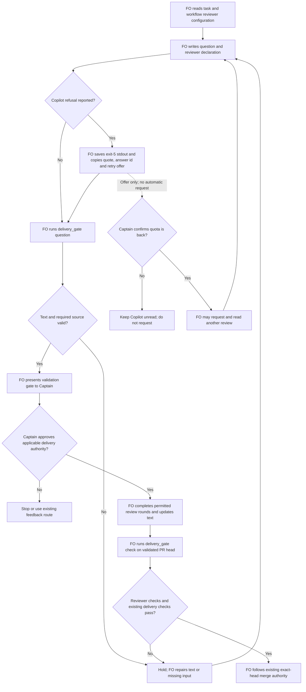

## Scope

- Source: the Captain 「可以，開 A-D」 (chat, 2026-10-26), answering 「需要你決定：下面 5 個套件缺口候選，要開哪幾張待辦？我建議開 A 到 D，E 先不開。」 after the learn backfill of 11 archived tasks (Captain 「補跑」, 2026-10-26).
- Bite: observer report on fo-written-lines-checked-before-dispatch (#724, 2026-10-26): the merge ask said only 'not run (quota)', against `extensions/copilot/EXTENSION.md` ('with the printed quote, and offers a retry'); FO had recorded the same rule in its own notes after the fo-write-checks observer caught it on 2026-10-19, and still missed it.
- Added 2026-10-27 (the Captain 「照建議」 on FO's batch-7 retrospective, item c): a second bite of the same class: the #728 merge ask carried no `second reviewer:` line at all although the change touched review rules, and `delivery_gate.py check` reported 'no second reviewer outcome is missing' (observer report on codex-reader-same-head-unresolved).
- Upstream first: `scripts/delivery_gate.py` (`check`, `question`), `extensions/copilot/EXTENSION.md`, `extensions/copilot/copilot_review.py` exit 5 output.

## FO alignment

Alignment: needed before ideation; where the check runs is a package design choice.
Surfaces: none
Visible change: none
Release review: not needed: workflow maintenance, on no journey map.
Result: aligned 2026-10-27 on the outcome by the Captain's 「全准」 answering this task's backlog briefing-1 question, which named the delivery check refusing a missing second-reviewer line and a copilot not run line without the printed quote and a retry offer; where each check runs is put to him at the ideation gate.
Reviewer: kc-dev-flow-2:chief-engineer opus 2026-10-27 — batch 8 review at the ideation gate (the Captain's batch ruling 2026-10-27): per-task disposition, the Captain's decisions, order and batch risk.

## Design

### PRFAQ

**Headline.** Before the Captain sees a delivery question, the existing delivery checker requires the configured second-reviewer declaration and carries a Copilot refusal's actual printed quote and a conditional retry offer into the question. The same check runs again before the merge ask, so a later review round cannot silently drop those facts.

**Who benefits?** FO (First Officer, the workflow coordinator) gets the missing fields at the writing step. The Captain sees what Copilot actually said and can authorize a retry when quota returns; a refusal remains unread review, never a clean round.

**What is the smallest slice?** Repair `delivery_gate.py question` and `check`, their existing tests, and the Copilot extension's instruction at its existing Read step. Keep Spacedock's gate/merge lifecycle, the review reader, the workflow README, the watcher and the observer unchanged. This is a Pilot repair within the approved workflow; it creates no hosted resource, recurring job, new reviewer request, CI trigger or release duty.

**Does this enforce an actual merge?** No. It refuses these two commands with exit 1 for incomplete text and exit 2 for unreadable required input. An agent that bypasses them can still merge; ADR 0027 already records that boundary. It verifies equality with a caller-saved reader output, not that a caller could not forge that file, not provider provenance, and not the truth of a semantic trigger.

### Checked chain and current baseline

1. **Spacedock first:** read its own 0.27.3 `mods/pr-merge.md`, `skills/first-officer/references/fo-merge-core.md` route contract and ensign contract. The upstream mod manages PR lifecycle, authorization and sentinel/archive; it does not define a second reviewer or a Copilot quote. Its hook is not the owner of this package-specific check. No upstream change is proposed.
2. **Package next:** `git fetch origin` succeeded after the managed filesystem required the authorized retry. Examined `origin/main` at `8bf4f3582411e8e4238f19fbadda8ddeca6767be`; its `kc-dev-flow-2/.claude-plugin/plugin.json` is 0.32.0. Installed Codex package bytes equal that commit for `delivery_gate.py`, `copilot_review.py`, `EXTENSION.md` and `references/sd/workflow.md`. `unstated_second_reviewers()` only iterates `Second reviewer: <name> because`; no declaration, or the actual `copilot triggered by ...` spelling, yields no iteration. A canonical `copilot not run: quota` already satisfies the existing outcome check. `question()` currently reads no README. `check()` already resolves README scalars/extensions and stores truncated confirmation clauses in `merge/ask-N.json`.
3. **Reader's own contract:** `copilot_review.py state()` exit 5 prints `not a review of <9-hex head>: "<quote>"; answer=review:<id> at <timestamp>`. `quote()` HTML-unescapes, collapses whitespace, takes 120 characters and changes `evidence=` to `evidence:`. Empty answers may produce an empty quote. A real heading or own line comment changes the classification; no list of quota sentences is proposed.
4. **Sibling adopters, read only:** relay beirut-dev2 `docs/dev2{,-poc}/README.md` and web dev2-fo `docs/dev2{,-poc}/README.md` list no remote reviewers and have empty `second-reviewer`; no declaration should be required there. Relay dhaka's older copies list only learn and no second-reviewer. QNow `conductor/repos/qnow-adopt-dev2/docs/dev2{,-poc}/README.md` list codex and copilot with second-reviewer copilot, as does this workflow: declaration applies. These are local checkout observations, not remote adoption verification.
5. **Prior rulings:** ADR 0013 keeps exit 5 as not run, forbids re-request until the Captain says quota is back and requires positive recognition of a review. ADR 0027 favors the script at the write and records the Captain rejecting a phrase heuristic without useful evidence. Checked `Override:` records; none reverses these two rules. `comment-check-reaches-delivery-gate` was explicitly closed for lack of demonstrated harm; here the two saved problem questions reproduce the reported omissions. No new ADR number is claimed; this repairs the existing rulings.

The bounded existing-code check used both named call sites (`text_problems`, `question`, `check`, `find_readme`, `write_record`) and extension/README/reader callers (`second-reviewer`, `copilot not run`, `answer=review`, `retry`). The rule and formatter exist; the writing check is incomplete. Excluded from the claim: private wrappers, host tool-permission guards, provider-side policies and semantic review of a diff. The existing checker is the implementation seam, not a replacement gate.

### Proposed behavior

- Both commands resolve the workflow README through existing `find_readme`. Add optional `--workflow-dir` to `question` with the same meaning as `check`; current split-root paths resolve through their parent already. Missing/unreadable README is exit 2; do not silently turn reviewer checks off. An empty second-reviewer means no configured second reviewer. A nonempty value not listed in `extensions`, or with no other listed remote reviewer, is configuration error, not permission to request a review.
- When codex and copilot are listed and `second-reviewer` names one, require exactly one case-insensitive `second reviewer:` declaration in the submitted question plus summary: `<configured name> because <nonempty trigger>` or `not triggered`. Do this even when no structured trigger is known: the README already requires the negative declaration. This catches an omitted line without pretending to classify authority or review changes from filenames. `profile: prod` and `Surfaces: db` are structured positive triggers and refuse `not triggered`. The harder-to-reverse dispatch, semantic authority/approval/merge/review change and Captain-request triggers remain FO's stated judgment, checked by the observer; do not silently interpret unrelated prose as a trigger or treat `NEVER_PATH` as this rule.
- Preserve the existing requirement for the named reviewer's outcome. A valid review/comment reference or explicit not-run outcome remains necessary. Do not mistake `answer=review:<id>` for completed-review evidence. For Copilot's existing non-reviewable PR types, preserve `copilot skipped: <type> PR` as the outcome permitted by EXTENSION.md: `check` compares the stated type with `facts.title`; `question` checks the form and leaves title verification to `check`. A supported type (`feat`, `fix`, `refactor`, `perf`) cannot claim this skip. Untriggered second reviewers are not newly requested or listed as unread.
- A Copilot non-review refusal is written on its own line as `copilot not run: "<printed quote>"; answer=review:<id>`. FO saves the existing reader's stdout at `<task folder>/review/copilot-not-run.txt`; this is a declared input, retained with the task, not a machine cache or a new receipt schema. On an observed exit 5, save/copy the printed line; re-reading the provider may be needed if stdout was lost, but never request another review to obtain it. Do not fabricate the quote from the known quota example.
- Each command reads that file only for a refusal. Parse the fixed exit-5 prefix and trailing `answer=review:<id> at <timestamp>`, treating the quote as opaque text (including internal quotes, Unicode and empty quotes). Compare the entire quote and id with the gate line, not mere quote punctuation or a quota keyword. A missing/unreadable saved file is exit 2; a readable but malformed source or a mismatch is exit 1. Report the missing input and repair, without claiming provider authentication. A later head does not erase a task's earlier refusal: ADR 0013's task-level no-retry state survives that push; the saved line explicitly retains the answer's older head. A later actual review supersedes its use in the question. Historical tasks are not rewritten.
- Require a separate, explicit offer: `Copilot retry: available when the Captain confirms quota is back.` This is an offer only. The checker never calls `gh pr edit`, POST, a review request, or a retry; a subsequent request still requires the Captain's quota-restored instruction. A bare word such as `retry`, a negative sentence such as `no retry`, or an offer only in the task body is insufficient.
- Preserve exit-2 configuration errors under the existing extension rule: `copilot not run: configuration error: <nonempty reason>` needs no nonexistent exit-5 quote. A bare `quota` reason is not this branch. This is not an alternate refusal path; whether FO has misreported a real refusal as configuration failure remains an observer/provenance limit. No change to `copilot_review.py`, its classification, request policy, or number of rounds.
- `check` uses the same text/input check as `question` before writing `ask-N.json`. On failure it saves no success record; existing candidate-head, CI, role, ADR, findings and approval checks remain. On success retain current output and authority wording. The source file belongs beside existing task review artifacts; no extra merge-record schema is needed in this slice.

### Journey and stops



### Replay over this workflow's saved merge asks

State snapshot for the corpus: `c652d02fd6ba6bfd95f940a395d295387a5677b1`. Scanned all 71 `merge/ask-*.json` files in active/archive tasks. Those records do not store the original full text, so each was joined to its own saved validation briefing using both saved Sufficiency and Necessity strings; task content came from the immutable `git-root://state/<commit>/<path>` artifact URI. This reconstructs candidate text associated with the saved ask; truncated-prefix agreement is not proof the original temporary text was identical. No claim is made that all 71 past calls can be exactly recreated.

- 65 have one full-text candidate. Existing `text_problems`: 62 pass, 3 hold. Proposed local text/source probe: 15 pass, 50 hold; 47 previously passing records change to hold. These are records, including repeat asks, not 47 independent incidents or whole remote delivery verdicts.
- Added reasons overlap: 35 contain a canonical Copilot not-run line but lack the new saved source and explicit retry offer; 13 have a malformed/wrong-name reviewer declaration; 2 omit the declaration entirely. No saved source was invented. Old asks are observations, not a migration backlog; new rules apply on the next invocation.
- `fo-written-lines-checked-before-dispatch` (#724), ask-1 and ask-2: old text check passes; proposal holds `second reviewer: copilot triggered by ... not run (quota)` as malformed. Rewriting only `triggered by` to `because` still leaves no legitimate outcome. With the canonical `copilot not run: quota` outcome it then holds for quote/source/retry. Repairing one field cannot clear all three.
- `codex-reader-same-head-unresolved` (#728), ask-1 and ask-2: old text check passes; proposal holds the wholly absent second-reviewer declaration. The task changes review behavior, but the check catches the omission through configuration, not keyword inference.
- 6 unknown: `adr-protected-path-guard/ask-1`, `kc-adr-format-source/ask-1`, `kc-decision-log-cli/ask-1` have no matching saved full text; `worker-knows-the-team-and-asks-early/ask-1`, `ask-2`, `ask-3` each match two distinct texts. Do not score these as pass, hold or a regression.
- Both actual baseline CLI paths were also exercised with temporary tasks and the package's stub GitHub fixture: absent declaration and `copilot not run: quota` each exited 0 in `question` and in `check` (four observed passes). The actual installed reader's `state()` was exercised on injected API pages for a refusal (exit 5). Five probe cases passed: exact output/quote/id plus offer; altered quote; removed offer; absent output; wrong id. This is a disposable design probe, not a candidate implementation or provider test.

`gh api rate_limit --jq .rate.remaining` failed with `error connecting to api.github.com`. No current GitHub PR state, real quota, provider response or merge is verified. Git fetch success does not remove that limit. The prototype reads local artifacts and makes no provider request.

### Words FO reads at each lifecycle moment

Count with `len(text.split())`, same input bundles in both columns. Reused and reran the archived `peers-rules-name-each-host-binding/validation-merged/fixture-outputs.py` against the installed 0.32.0 package, changing only its `W/kc-dev-flow-2` prefix to the installed package root. All fixture calls passed; they exercise current `pr_watch`, `observer_check` and `delivery_gate` using disposable repositories and stub GitHub data. This table measures a specified reading route, not cognitive load or every possible branch.

Inputs: workflow 5565; package mod 48; Spacedock Startup 133 and Awaiting Completion 507; Delivery authority section 461; Extensions section 224; learn extension 282; learn skill 2918; Copilot extension 740. Actual fixture outputs: open 29, merged 20, archive 28, successful merge check 57. The success fixture has no second reviewer and no not-run outcome, so it measures the unchanged branch; actual reviewer points vary with text.

| Moment and counted bundle | Before | Proposed after |
| --- | ---: | ---: |
| Startup: workflow + package mod + SD Startup + open output | 5775 | 5775 |
| Idle, open PR: mod + SD Awaiting Completion + Delivery authority + open output | 1045 | 1045 |
| Idle, merged PR: preceding instructions + learn extension + merged output | 1318 | 1318 |
| After archive: mod + learn extension + learn skill + archive output | 3276 | 3276 |
| Merge ask, no Copilot read: Delivery authority + Extensions + pass output | 742 | 742 |
| Merge ask, Copilot read: preceding bundle + full Copilot extension | 1482 | 1518 |
| Validation question check, success output only | 3 | 3 |

The 36 added words live only at the Copilot Read step, proposed verbatim:

> On exit 5, save stdout to `<task>/review/copilot-not-run.txt`; copy its quote and `answer=review:<id>` into `copilot not run: "<quote>"; answer=review:<id>`. Add `Copilot retry: available when the Captain confirms quota is back.` The delivery check compares the saved output.

If FO loads the whole Copilot extension at startup as well, that optional read adds 740 before / 776 after there too; do not hide the +36 by counting only the README. The refusal's source capture is a new action. Its exact quoted body and id are data-dependent; carry their actual word count when recounting the candidate. The retry line adds 10 words to the submitted text (count includes `Copilot retry:`). Proposed refusal diagnostics are 13 words for a missing declaration, 11 for quote/id, 7 for retry, with one 14-word repair line when relevant; print all applicable failures once, rather than the former pass output. No reduction claim and no workflow word-budget raise. CI configuration is unchanged; no per-PR CI cost was measured.

### Needs decision

**One decision for the Captain: use the shared `question`/`check` repair with a saved exit-5 output? Recommend yes.** It catches both measured omissions before presentation and again before merge; the saved output lets the check compare the printed quote, rather than accept quotation marks around `quota`; it preserves ADR 0013's no-automatic-retry rule. Worse: one saved file/action on refusal, +36 extension words when read, and a lost source blocks the ask until FO recovers it. Checking only at merge leaves the misleading validation question visible; checking punctuation alone cannot prove the line carries the printed quote. Configuration errors keep their existing reason-only branch. Approval accepts this bounded comparison, not source authentication or semantic trigger inference.

### Batch overlap

Proposed changed files: `kc-dev-flow-2/scripts/delivery_gate.py` (shared reviewer/config/source checks, `question --workflow-dir`, source-loading failures), `kc-dev-flow-2/scripts/test_delivery_gate.py` (both CLI paths and false controls), `kc-dev-flow-2/extensions/copilot/EXTENSION.md` (the 36-word save/copy/offer instruction). No workflow README, reader, watcher, mod, manifest, ADR index or number reservation changes.

| Named task | Same file or check, current task-file evidence | Implementation ordering |
| --- | --- | --- |
| archive-waits-for-observer-report | None: Spacedock archive/observer/learn seam, after actual merge | Independent; do not move reviewer checks into its archive hook |
| idle-hook-names-merged-tasks-without-learn | None: watcher/learn notices and idle outputs | Independent; combine lifecycle word recount if shipped together |
| copilot-not-run-line-carries-quote | This task owns the three files above | One implementation owner |
| dispatch-carries-reserved-adr-number | None: dispatch_records/number_guards and reservation transport | Independent |
| seed-check-requires-schema-fields | None: design_surfaces seed and task schema | Independent; new question tests need valid task fixtures |
| journey-probe-finds-nested-maps | None: adoption map discovery | Independent |
| read-adr-honors-adr-folder | None: kc-adr skill source and synchronized dev2 copy | Independent |
| adr-required-statement | Its older design names workflow/ADR checks, none of these files | Task records explicitly Closed 2026-10-20; frontmatter alone is misleading; no live owner inferred |
| journey-server-host-pilot | None: kc-journey-map host/client/server implementation | Independent, read only |
| ops-inbox-r1-setup-and-isolation | None: relay/ops inbox boundary | Independent, read only |
| pr-review-lite-value-pilot | None: Lite review pilot, not dev2 delivery checker | Independent, read only |
| adr-silent-undo-probe | None: archived scenario harness and experiment | Independent, read only |
| comment-check-reaches-delivery-gate | Direct overlap: delivery_gate.py and test_delivery_gate.py if revived | Explicitly Closed 2026-10-20; do not implement it. If FO reopens it, serialize on this current baseline |
| journey-canvas-hosted-poc | None: hosted journey canvas | Independent, read only |

Recommended order: implement this one repair from the current main baseline after approval; recheck these task files at dispatch. No other task is edited or contacted. Re-run the existing delivery suite when any revived shared-check work lands; shared output recounts must use the combined result.

## Acceptance criteria

**AC-1** Both command paths require the configured reviewer declaration, and honor an explicit untriggered result only where no structured positive trigger applies. Evidence: CLI tests for this workflow and QNow configuration, prod/db positive cases, and relay/web empty configuration; absent line, malformed `triggered by`, wrong reviewer, duplicates and prod/db `not triggered` each hold. Falsifier: remove the configuration-driven requirement and the saved #728 cases pass. Current evidence: corpus/prototype catches the absent and malformed cases; CLI integration and structured-case matrix remain future implementation proof.

**AC-2** Refusal quote and answer id equal the saved reader output in both `question` and `check`, including Unicode, internal quotes, HTML normalization, a >120-character body and the empty-body case. Evidence: run the unchanged real reader on injected pages, save its stdout, then exercise each CLI; alter one quote character/id or substitute `quota` and require exit 1. Missing/unreadable output requires exit 2; malformed readable output exit 1. Falsifier: accept quote punctuation alone or compare only ids. Current evidence: real reader formatter and five local probe cases; the full matrix and CLI error-code split are not implemented.

**AC-3** A refusal requires the explicit conditional retry offer in the submitted text, and neither check requests a review. Evidence: remove offer, write `no retry`, put offer only in the task body, and require exit 1; spy on subprocess calls and reject any request/POST. Exact quote and offer pass their checks. Falsifier: accept any occurrence of `retry` or add a review request. Current evidence: removed-offer probe fails; CLI subprocess controls remain future proof.

**AC-4** Keep adjacent outcomes correct: config error with nonempty reason, untriggered second reviewer, unlisted Copilot, valid review evidence, and Copilot skipped for unsupported PR type; a refusal answer id alone never counts as a review. Evidence: table-driven CLI cases, skipped type compared with PR title during `check`, and run the unchanged `test_copilot_review.py`. Falsifier: classify `answer=review` as a review, require refusal data from an unlisted reviewer, or allow `fix` to claim the docs skip. Current evidence: inspected original extension/reader and adopter configurations; these integration assertions remain unverified.

**AC-5** Replay the saved corpus with per-record provenance and limits, reproducing 71 records, 65 uniquely reconstructed texts, 6 unknown, and the two observed problem tasks holding. Evidence: the embedded replay program below on the named state snapshot and package; separately assert corrected variants of #724/#728 pass the new checks. Do not claim the local replay exercises provider CI or original temporary-file identity. Falsifier: drop the missing-declaration or quote/offer check and the corresponding counterexample passes. Current evidence: measured 62/3 baseline pass/hold versus 15/50 proposed, 47 changed; original 6 unknown retained.

**AC-6** Existing delivery checks and authority boundaries remain exercised; no success ask record is created on a new failure. Evidence: run `test_delivery_gate.py`, with a failure case asserting the task's merge directory has no new ask file, plus a temporary task's valid question followed by modified incomplete text at check. Test missing README/invalid configured reviewer as exit 2 and `--workflow-dir` with a folder task and a split-root task. Falsifier: wire only `question`, only `check`, or write the record before validating. Current evidence: actual baseline fixture command exercised; candidate behavior is not yet implemented.

**AC-7** Count FO's complete applicable passage/output bundles on the same scenarios before/after, preserving unchanged lifecycle rows and declaring the +36-word Copilot instruction, data-dependent source/output and retry costs. Evidence: rerun the named fixture/count recipe and `lint-skills.py` with the source checkout at the candidate; confirm no workflow/CI edits. Falsifier: move instructions into output and count README alone. Current evidence: all table inputs and baseline outputs measured; after values are design projections, not an implemented candidate measurement.

**AC-8** Publish only a design at this stage, with readable matching PRFAQ/Mermaid, named overlaps, and the Captain's unresolved location/source decision. Evidence: installed `design_surfaces.py check <task>` plus rendered diagram and path-scoped state diff showing this entity body only; frontmatter byte comparison. Falsifier: omit a branch/stop, remove the AC declarations or alter frontmatter/product source. Current evidence: final stage report records the actual design check and state commit; approval and implementation are future FO work.

## Reproduction notes

Diagram rendered with the locally installed `@mermaid-js/mermaid-cli` 12.0.0 (`mmdc -i journey.mmd -o journey.png`); extract the Mermaid block above as the input. The sandbox initially blocked Chromium startup; the authorized local render succeeded. Checked actors, approval/stop branches and the conditional retry route against the prose. Retry rejoins question construction so it cannot bypass the validation gate. PNG/SVG are disposable local outputs, not required source dependencies.


For the corpus/probe below, supply the same installed package and state checkout; use the cited state commit in a disposable snapshot if active state has since changed. The code exercises the existing text checker and a deliberately limited proposed predicate; it does not implement CLI config discovery, error-code distinctions, skip-type handling or provider validation. Those are explicitly acceptance work. Run `python3 -B replay.py <package> <state>` after extracting this block. Python stdlib suffices; Git must be able to read the artifact URI commits.

```python
import collections, contextlib, importlib.util, io, json, re, subprocess, sys
from pathlib import Path
sys.dont_write_bytecode = True
PKG=Path(sys.argv[1])
STATE=Path(sys.argv[2])
def load(name,path):
 spec=importlib.util.spec_from_file_location(name,path);m=importlib.util.module_from_spec(spec);spec.loader.exec_module(m);return m
gate=load('gate',PKG/'scripts/delivery_gate.py')
reader=load('reader',PKG/'extensions/copilot/copilot_review.py')
def proposed(task,text,second='copilot',enabled=True,printed=None):
 errors=[]
 if enabled and second:
  rows=re.findall(r'(?i)\bsecond reviewer:\s*([^\n]+)',text)
  if len(rows)!=1:errors.append('second-reviewer declaration missing or duplicated')
  elif re.match(r'not triggered(?:[.;]|$)',rows[0],re.I):
   if re.search(r'^profile:\s*prod\s*$',task,re.M) or re.search(r'^Surfaces:.*\bdb\b',task,re.M):errors.append('known trigger contradicts not triggered')
  elif not re.match(re.escape(second)+r'\s+because\s+\S',rows[0],re.I):errors.append('second-reviewer declaration malformed or wrong reviewer')
 for m in re.finditer(r'(?im)(?<![\w-])copilot not run:\s*([^\n]*)',text):
  value=m.group(1)
  if value.lower().startswith('configuration error:') and value[len('configuration error:'):].strip():continue
  source=re.fullmatch(r'not a review of [0-9a-f]{9}: "(.*)"; answer=review:(\d+) at (\S+)\s*',printed or '')
  if not source: errors.append('Copilot printed output missing or invalid')
  elif not value.startswith('"'+source[1]+'"; answer=review:'+source[2]):errors.append('Copilot quote or answer id differs')
  if not re.search(r'(?im)^Copilot retry: available when the Captain confirms quota is back\.[ \t]*$',text):errors.append('Copilot retry offer missing')
 return errors

def combined(d):return d.get('question','')+'\n'+'\n'.join(x.get('summary','') for x in d.get('artifacts',[]))
rows=[]
for p in sorted(STATE.rglob('merge/ask-*.json')):
 d=json.loads(p.read_text()); matches=[]
 for b in sorted((p.parent.parent/'review/validation').glob('briefing-*/index.json')):
  j=json.loads(b.read_text());t=combined(j)
  if all(str(d.get(k,'')) in t for k in ['sufficiency','necessity']):matches.append((b,j,t))
 unique={t:(b,j) for b,j,t in matches}
 if len(unique)!=1:
  rows.append(dict(path=str(p.relative_to(STATE)),result='unknown',reason='no full-text match' if not unique else 'ambiguous full-text match'));continue
 t,(b,j)=next(iter(unique.items())); uri=j['artifacts'][0]['uri'];match=re.fullmatch(r'git-root://state/([^/]+)/(.*)',uri)
 if not match:raise ValueError(uri)
 task=subprocess.check_output(['git','-C',str(STATE),'show',match[1]+':'+match[2]],text=True)
 old=gate.text_problems(task,t)[0];new=old+proposed(task,t)
 rows.append(dict(path=str(p.relative_to(STATE)),briefing=str(b.relative_to(STATE)),old=len(old),new=len(new),added=proposed(task,t),result=('hold' if new else 'pass'),has_notrun=bool(re.search('copilot not run:',t,re.I))))
print(json.dumps(rows,indent=2))
print('TOTAL',len(rows),'RESULT',dict(collections.Counter(r['result'] for r in rows)))
print('BASE',dict(collections.Counter(('hold' if r['old'] else 'pass') for r in rows if 'old'in r)))
print('CHANGED',sum(r.get('old')==0 and r.get('new',0)>0 for r in rows))
# Exercise the real existing reader's refusal formatter without any provider request.
body='Copilot was unable to review this pull request because the user who requested the review has reached their quota limit.'
r=dict(id=17,user=dict(login=reader.BOT),commit_id='a'*40,submitted_at='2026-10-27T00:00:00Z',body=body)
code,printed=reader.state('o/r','1',call=lambda *a:dict(headRefOid='a'*40),pages=lambda path:[r] if path.endswith('/reviews') else [])
assert code==5
ok='Second reviewer: copilot because review rules.\ncopilot not run: "'+reader.quote(body)+'"; answer=review:17\nCopilot retry: available when the Captain confirms quota is back.'
tests={'quoted refusal':([],ok,printed),'no quote':(['Copilot quote or answer id differs'],ok.replace(reader.quote(body),'quota'),printed),'no retry':(['Copilot retry offer missing'],ok.split('\nCopilot retry:')[0],printed),'no source':(['Copilot printed output missing or invalid'],ok,None),'wrong id':(['Copilot quote or answer id differs'],ok.replace('answer=review:17','answer=review:18'),printed)}
for name,(want,text,source) in tests.items():
 got=proposed('',text,printed=source);assert got==want,(name,got,want)
print('CONTROLS',len(tests),'passed','READER',code,printed)
```

### Feedback Cycles

- Cycle 1 (FO, 2026-10-28): on #736 87c1d1b7, RoboRev (roborev:1263) left 1 High, counted as P1 under step 5: `answer=review:<id>` is excluded case-sensitively in kc-dev-flow-2/scripts/delivery_gate.py, so `Copilot ANSWER=review:18` passes; to fix; investigation first, then FO fix authorization, then validation.
- Cycle 2 (FO, 2026-10-28): on #736 1a4918c7, RoboRev (roborev:1265) left 1 High, counted as P1 under step 5: the saved Copilot refusal's abbreviated commit is parsed but never compared with the PR head in delivery_gate.py check, so a refusal from an earlier head satisfies the second-reviewer outcome after a push; round 2, to fix; investigation first, then FO fix authorization, then validation.

## Stage Report: ideation

- DONE: A design for /Users/kent/.claude/plugins/cache/kc-claude-plugins/kc-dev-flow-2/0.32.0/scripts/delivery_gate.py to refuse a merge ask that lacks the second-reviewer line when the README's trigger holds, and a copilot not run line without the quote /Users/kent/.claude/plugins/cache/kc-claude-plugins/kc-dev-flow-2/0.32.0/extensions/copilot/copilot_review.py printed and a retry offer, replayed over the saved merge asks under merge/ in this workflow's tasks
  Current 0.32.0 at origin/main 8bf4f358; actual question/check each accept absent-declaration and quota-only controls. Embedded replay ran from this task: 71 records, 65 unique text matches, 6 unknown; 62/3 baseline pass/hold becomes 15/50 in the design probe (47 changes). Five real-reader/probe controls pass; removing declaration or quote/offer checks loses the corresponding counterexample.
- DONE: A `### Batch overlap` section naming each file the design would change and each other batch task (archive-waits-for-observer-report, idle-hook-names-merged-tasks-without-learn, copilot-not-run-line-carries-quote, dispatch-carries-reserved-adr-number, seed-check-requires-schema-fields, journey-probe-finds-nested-maps, read-adr-honors-adr-folder) and live task of other sessions (adr-required-statement, journey-server-host-pilot, ops-inbox-r1-setup-and-isolation, pr-review-lite-value-pilot, adr-silent-undo-probe, comment-check-reaches-delivery-gate, journey-canvas-hosted-poc (driven by other sessions; read only)) that changes the same file or check, so FO can order implementation
  Batch overlap names all 14 requested tasks and all three proposed files. comment-check-reaches-delivery-gate shares the checker/tests but its body says Closed; adr-required-statement is also Closed. No sibling file changed.
- DONE: The words FO reads at each lifecycle moment, before and after, per root learning.md "Measure the words FO reads at each moment, not one file's size"
  Lifecycle table counts full stated instruction/output bundles with len(text.split()); baseline fixtures rerun. Startup 5775, open idle 1045, merged idle 1318, archive 3276, no-Copilot merge 742 unchanged; Copilot-read merge 1482 to projected 1518. No workflow/CI edit; per-PR CI cost unmeasured.
- DONE: Acceptance criteria with reproducible evidence clauses and falsifiers, and unresolved decisions for the Captain, each with a recommendation and what gets worse under it
  AC-1 through AC-8 each state evidence and a falsifier. One unresolved decision recommends shared question/check enforcement plus retained reader stdout; cost and authenticity/semantic limits are explicit. design_surfaces.py: design surfaces presentable (exit 0); Mermaid 12.0.0 render succeeded, with retry routed back through the gate.

### Acceptance evidence

- AC-1: absent/malformed declaration measured in corpus and baseline CLI; proposed prod/db/config CLI integration not implemented.
- AC-2: reader exit-5 formatter plus exact/altered/missing-source/wrong-id probe exercised; Unicode/empty/full CLI matrix remains future proof.
- AC-3: removed-offer counterexample rejected by probe; request-side-effect and negative-wording CLI assertions remain future proof.
- AC-4: live local adopter configs and reader/extension contract checked; adjacent-outcome integration matrix remains future proof.
- AC-5: program extracted from the entity and rerun reproduces 71/65/6, 47 changed and five controls; original transient ask bytes and GitHub delivery verdicts cannot be reconstructed from this alone.
- AC-6: actual baseline question/check controls executed behind the existing stub GitHub fixture; candidate integration, no-new-record and README/folder cases remain future proof.
- AC-7: named archived fixture rerun against installed 0.32.0; all baseline counts measured, after counts are projections. A candidate recount must include data-dependent output and new failure branches.
- AC-8: surface check passed and diagram rendered; original 44-line task prefix preserved byte-for-byte and path-scoped diff check passed. No product edits, branch, PR or new agent.

### Summary

Designed a shared delivery-text repair with a declared saved-output input, one conditional retry offer and explicit limits; the two reported omissions reproduce on the current package. The Captain still decides the recommended enforcement/source choice; implementation, live provider verification and approval remain future work, and the GitHub API returned `error connecting to api.github.com`.


## Stage Report: implementation

- SKIPPED: One Draft PR (Conventional Commit title scoped to the plugin) from a branch off origin/main (8bf4f3582411e8e4238f19fbadda8ddeca6767be) implementing the approved design and acceptance criteria in the task file; the kc-dev-flow-2/scripts/delivery_gate.py change and tests the design names, enforced on new merge asks only, with the saved-ask replay counts reported and not enforced (the ideation gate's disposition); only the files the design names
  Implemented only the three approved files at 87c1d1b7446ebba908038e05e9b22cbbdace2cb5; fetch succeeded, its parent is the stated origin/main base, and the task branch was pushed without force or -u. Draft PR creation belongs to FO under the dispatch's explicit sandbox exception.
- DONE: Every acceptance criterion green with the evidence each names; each falsifier shown failing by a mutation you run (python3 -B, caches cleared)
  Local evidence for AC-1–7 below; AC-8 is the completed ideation-only criterion, with its accepted design retained and the current design-surfaces check passing. 107 delivery tests pass; 13 executed mutants produce 58 assertion failures and zero test errors; corpus counterexample mutants also lose both reported protections.
- SKIPPED: kc-dev-flow-2/scripts/lint-skills.py (the repository copy CI runs), /Users/kent/.claude/plugins/cache/kc-claude-plugins/kc-dev-flow-2/0.32.0/scripts/adr_lint.py docs/adr --since <base> exit 0; /Users/kent/.claude/plugins/cache/kc-claude-plugins/kc-dev-flow-2/0.32.0/scripts/number_guards.py check exit 0; /Users/kent/.claude/plugins/cache/kc-claude-plugins/kc-dev-flow-2/0.32.0/scripts/comment_ratio.py within its maximum; roborev evidence= line; push without force and without -u; PR body written for FO; FO reads CI on the PR head; CI cost measured or stated as not measured
  Repository skill lint and Codex package ADR/number/comment scripts exit 0 at the committed head (39 ADR files, zero findings, 237 added code lines, zero comment lines, 0.0% ≤ 5%). RoboRev not run: the dispatch states this sandbox cannot reach its daemon; no evidence= line exists. FO owns Draft PR and CI; title/body: /tmp/impl-copilot-not-run-line-carries-quote-pr.md. CI unchanged; per-PR CI cost not measured.

### Acceptance evidence

- AC-1: Both main(argv) CLI routes exercise this/QNow's codex+copilot configuration, either selected reviewer, prod/db contradictions, and empty relay/web configurations; omitted, duplicate, wrong-name and malformed declarations hold. Removing configuration enforcement yields 14 assertion failures; removing structured triggers yields 4.
- AC-2: Unchanged real reader state() produces saved stdout for Unicode, internal quotes, HTML/whitespace normalization, 140-character input, empty body and evidence= text; both routes accept exact quote/id and reject one-character/id/quota substitutions and inline refusals. Missing/unreadable source exits 2; malformed readable source exits 1. Punctuation-only and id-only mutants each fail 12 assertions; misclassifying missing source fails 1.
- AC-3: Both routes reject removed, negative and task-body-only offers; logged subprocess calls permit only existing reads, with zero calls from question. Accepting any retry word and adding a request each fail an assertion; stdout is compared even when its recorded head is older.
- AC-4: Config-error reason, untriggered state, unlisted Copilot, evidence=review and unsupported skips pass; blank reason, answer=review alone, supported-type skip and title mismatch hold. 15 unchanged reader tests, 54 dispatch tests and 113 watcher tests pass; outcome/unlisted/title mutants fail 2/1/1 assertions.
- AC-5: Embedded replay at state snapshot c652d02fd6ba6bfd95f940a395d295387a5677b1 reproduces 71 records, 65 unique reconstructed texts and 6 unknown; baseline 62 pass/3 hold, design prototype 15/50, candidate 23/42 (39 changes). Eight prototype holds were parenthesized not-triggered declarations: commissioned-by-names-spacedock asks 1–3, db-surface-without-migrations asks 1–3, fo-batch-sittings asks 1–2; all are pilot/non-db, so accepting them implements the approved negative declaration. Both #724/#728 task pairs hold, corrected copies pass both routes; disabling declaration or refusal checks lets the corresponding saved counterexample pass. No original temp-file identity or provider verdict is claimed; no historical record was edited or enforced.
- AC-6: Flat/folder/split-root tasks pass with discovered and explicit workflow directories; missing/unreadable README or invalid selected reviewer exits 2. A valid question followed by incomplete text in the same temporary task fails check and writes no ask file. Removing either route or writing a record early fails 1/7/1 assertions respectively; existing authority/head/CI checks remain covered by the 107-test suite.
- AC-7: Re-ran the named archived fixture against installed base and candidate with the same full passage bundles and len(text.split()): startup 5775→5775, idle-open 1045→1045, idle-merged 1318→1318, archive 3276→3276, merge without Copilot 742→742, merge with Copilot 1482→1520, question-success output 3→3. Copilot extension 740→778: +36 approved instruction, +2 explicit configuration-error spelling. Optional startup loading adds that same 740→778. Retry adds 10 submitted words; sample saved stdout/quote line cost 28/24 words, varying with the actual answer. Whole failure outputs: missing declaration 28, mismatched quote/id 26, missing retry 22; valid refusal check 70. No workflow, manifest, CI or version edit; no budget raise.
- AC-8: Ideation-only publication criterion was already completed before its approved gate; implementation preserves the entire pre-report entity prefix and frontmatter. Current design_surfaces.py check exits 0; no diagram or design change required a new render.

### Checks and replay recipe

All Python proof used python3 -B; candidate scripts/__pycache__ was cleared before the final mutation run. Re-run the committed test_delivery_gate.py and extensions/copilot/test_copilot_review.py directly; the new ReviewerDeclarationTests contain the input/config/source matrix, real-reader injection, no-request assertions and no-record assertions. Temporary proof scripts/results are retained in /tmp/copilot-implementation-evidence/: mutations.py/json, replay.py, embedded-replay.txt, replay-records.json (one provenance/result per record), replay-summary.json, count_words.py, word-counts.json and lifecycle{,-base}/; replay.py extracts the entity's embedded recipe at the named snapshot, then evaluates candidate text_problems plus reviewer_problems with the declared codex/copilot configuration and no invented saved source.
Affected documents: doc_impact.py <base> HEAD reports 0 documents. Copilot EXTENSION.md updated at its existing Read step; ADRs: none, this repairs existing ADR 0013/0027 without a new decision or number. Package scripts used the dispatch-selected Codex package /Users/kent/.codex/plugins/cache/kc-claude-plugins/kc-dev-flow-2/0.32.0. The state sibling idle-hook-names-merged-tasks-without-learn.md was already dirty and was left untouched.

### Summary

Delivered and pushed 87c1d1b7446ebba908038e05e9b22cbbdace2cb5 on spacedock-ensign/copilot-not-run-line-carries-quote: both commands enforce the configured declaration and compare saved Copilot refusal quote/id with a conditional retry offer, without requesting review or writing success on failure. Local tests, falsifiers, replay and required checks passed; provenance authentication and semantic trigger inference remain outside the accepted design. Draft PR creation, RoboRev and CI at that head remain FO work under the dispatch's explicit sandbox exception; this report is not validation or merge approval.

## Stage Report: implementation

- DONE: Fix the Cycle 1 finding as you proposed: in kc-dev-flow-2/scripts/delivery_gate.py make only the `answer=` exclusion case-insensitive (`OUTCOME_TOKEN = re.compile(r"(?<!(?i:answer=))\b(?:review|comment):\d+")`), and add your 8-subcase reproduction matrix (both review: and comment:, both commands) plus the lowercase-refusal and valid-evidence controls to kc-dev-flow-2/scripts/test_delivery_gate.py
  Repair commit 1a4918c747377f7b72d05cc33dbb05923079ebfb changes only the two named files: one regex line and two regression methods. The 8 uppercase/mixed-case bypasses fail on 87c1d1b7 and pass after repair; lowercase answer refusals still hold, valid bare/evidence= tokens still pass, and uppercase REVIEW:/COMMENT: retain their previous rejection.
- DONE: Run every kc-dev-flow-2 test file and show the case mutation fails the new tests; commit (named files only), push with an explicit remote and branch, no force and no -u; append a complete new `## Stage Report: implementation` ending in a superseding `### Summary`, committed with `spacedock state commit copilot-not-run-line-carries-quote --workflow-dir /Users/kent/conductor/workspaces/kc-claude-plugins/colombo/.context/dev2-adoption/worktree/docs/dev2`; FO runs RoboRev and reads CI on the new head
  All 25 package test files exit 0: 890 unit cases pass, one integration case skips, plus both Spacedock harnesses pass; delivery tests are 109/109. Restoring the old case-sensitive exclusion in memory causes exactly 8 assertion failures and zero test errors. Named-file commit pushed with git push origin spacedock-ensign/copilot-not-run-line-carries-quote; report committed via the required Spacedock command.
- SKIPPED: ReportForJourneyAcceptTests.test_the_report_keeps_top_level_stories_and_the_shipped_accept_reads_them
  Unchanged release-acceptance integration test skips because its Node/journey-accept/YAML dependency probe is unavailable; test_release_acceptance.py still exits 0 (77 pass, one skip). No dependency, configuration or sibling code changed.
- SKIPPED: RoboRev review and hosted CI results at the repaired PR head
  Explicit dispatch boundary: this sandbox reaches neither the GitHub API nor the RoboRev daemon, so no gh or daemon review ran. FO owns RoboRev and CI for PR #736 at 1a4918c747377f7b72d05cc33dbb05923079ebfb.

### Evidence

The new test_answer_prefix_never_establishes_a_review_or_comment_outcome covers both commands × both token alternatives × lowercase/uppercase/mixed-case answer prefixes (12 negative cases, including the 8 reproduced bypasses); test_existing_evidence_and_case_policy_are_preserved covers 12 valid bare/evidence= references and four uppercase-token negative controls. They invoke the existing real CLI parser/behavior against temporary task/config fixtures, log only stub GitHub reads and assert no success ask file on failure. Falsifier: restore the old OUTCOME_TOKEN expression; both commands falsely accept ANSWER=/AnSwEr= before review: or comment:.

Fresh suite manifest, commands, elapsed times and per-file logs: /tmp/copilot-cycle1-tests/results.json and adjacent *.log, produced by python3 -B /tmp/copilot-cycle1-all-tests.py <worktree>. Red/green/mutation logs: /tmp/copilot-cycle1-{red,green,mutation}.log; mutation runner: /tmp/copilot-cycle1-mutation.py. All verification uses python3 -B with bytecode writes disabled for the full suite. Test_sd_dispatch used installed Spacedock CLI 0.27.2 and plugin root /Users/kent/.codex/plugins/cache/spacedock/spacedock/0.27.3; CI pins a 0.27.2 plugin source, so the local harness pass is not hosted CI or exact plugin-pin equivalence.

Repository lint-skills.py exits 0, workflow remains 5565/5565 words; design_surfaces.py passes. Codex package adr_lint.py checks 39 files with zero legacy, number_guards.py exits 0 with no findings at base 8bf4f3582411e8e4238f19fbadda8ddeca6767be and repaired head; no migration path is declared. comment_ratio.py reports full-candidate 254 added code / zero comment lines, 0.0% ≤ 5%; repair-only adds 18 code / zero comments, below the 20-line enforcement floor. doc_impact.py reports zero affected documents; diff --check passes. ADRs: none; this is the authorized repair of existing refusal classification, with no new decision.

Replayed snapshot c652d02fd6ba6bfd95f940a395d295387a5677b1 again: 71 records, 65 reconstructed texts, 6 unknown; baseline 62 pass/3 hold, repaired candidate 23 pass/42 hold, 39 changed verdicts. Both #724/#728 saved task pairs still hold and corrected copies pass both routes; no historical state was enforced or edited, no source provenance or provider outcome inferred. The design prototype's 15/50 remains distinct: its 8 extra holds were valid parenthesized untriggered declarations, as explained in the prior report.

Complete reading bundles remeasured unchanged by this repair: startup 5775, idle-open 1045, idle-merged 1318, archive 3276, no-Copilot merge 742, Copilot merge 1520, successful question output 3. The original extension increase remains +38 words versus base (36 save/copy/offer instruction, two configuration-error spelling words); retry still adds 10 submitted words, actual quote/source length remains answer-dependent. CI configuration and triggers unchanged; per-PR CI cost not measured. The complete pre-report task body and frontmatter are preserved.

### Summary

This complete report supersedes the earlier implementation report: delivered and pushed 1a4918c747377f7b72d05cc33dbb05923079ebfb, closing the reproduced case gap for both review and comment outcomes while preserving valid-evidence behavior. All package test files ran with zero failing cases, one disclosed integration skip, and the exact case-regression mutant was caught; the original quote/retry/declaration checks and historical replay remain exercised. FO must run RoboRev and read CI on this new head before validation proceeds; this report grants no gate or merge approval.

## Stage Report: implementation

- DONE: Fix Cycle 2 as you proposed: in kc-dev-flow-2/scripts/delivery_gate.py `check`, compare the saved refusal's commit with the PR head; on a mismatch require the separate disclosure the copilot extension already asks for after a push (Copilot named as not read on the current head, with the last commit it answered), in a form like `Copilot not read: <current head>; last refusal: <saved head>`; keep older refusals usable with that disclosure; `question` keeps quote, id and retry validation and defers the head comparison when no head is known
  Repair commit 784e038979bea6d2c6d7984fb95a665d6e36c52f captures the reader's nine-hex head, and check passes the full facts.headRefOid into the shared reviewer check; a different saved head requires a separate line binding both values. Older refusals remain valid with the correct disclosure; question supplies no head and retains all quote/id/retry checks, with no provider read or review request.
- DONE: Add your reproduction plus the missing-disclosure, wrong-disclosure and correct-disclosure cases to kc-dev-flow-2/scripts/test_delivery_gate.py; run every kc-dev-flow-2 test file and show the comparison mutation fails the new tests; commit (named files only), push with an explicit remote and branch, no force, no -u; append a complete new `## Stage Report: implementation` ending in a superseding `### Summary`, committed with `spacedock state commit copilot-not-run-line-carries-quote --workflow-dir /Users/kent/conductor/workspaces/kc-claude-plugins/colombo/.context/dev2-adoption/worktree/docs/dev2`; FO runs RoboRev and reads CI
  Only delivery_gate.py and test_delivery_gate.py changed; named-file commit pushed with git push origin spacedock-ensign/copilot-not-run-line-carries-quote. All 25 package test files exit 0: 894 unit cases pass, one integration case skips, and both local Spacedock harnesses pass; delivery suite 113/113. Removing the comparison causes exactly five assertion failures and zero errors; phase-1 reproduction now passes all three tests. This report is committed through the required Spacedock command.
- SKIPPED: ReportForJourneyAcceptTests.test_the_report_keeps_top_level_stories_and_the_shipped_accept_reads_them
  Unchanged release-acceptance integration test skips because its Node/journey-accept/YAML dependency probe is unavailable; test_release_acceptance.py exits 0 (77 pass, one skip). No dependency or sibling-product edit.
- SKIPPED: RoboRev review and hosted CI results at the repaired PR head
  Explicit dispatch limit: the worker sandbox reaches neither the GitHub API nor the RoboRev daemon; no real gh request or daemon review ran. FO runs RoboRev and reads CI for PR #736 at 784e038979bea6d2c6d7984fb95a665d6e36c52f.

### Evidence

The new older-refusal matrix exercises the actual main(argv) check route with a seven-hex --head argument while requiring the full PR head from facts in the disclosure. Missing, wrong-current-head, wrong-refusal-head, truncated-current-head and inline disclosures all exit 1 without an ask file; the exact separate disclosure passes. Separate tests accept a current-head refusal without disclosure and allow an older refusal at question while rejecting changed quote/id or omitted retry. The fixture now defaults the unchanged real reader to the current PR head, with explicit older-head input for these regression cases; quote/Unicode/HTML/empty-body coverage remains in the 113-test suite.

Before implementation, those four new methods yielded five false-acceptance failures on 1a4918c7; after repair all 12 ReviewerDeclarationTests pass. Falsifier: replacing the source/head mismatch branch with False yields five assertion failures, with same-head/correct-disclosure/question controls still passing. /tmp/copilot-cycle2-{red,green,mutation}.log and /tmp/copilot-cycle2-mutation.py retain that evidence; /tmp/copilot-cycle2-repro-fixed.log records the three original phase-1 controls passing.

Full suite commands, 25 exit codes and per-file logs: /tmp/copilot-cycle2-tests/results.json and adjacent logs, from python3 -B /tmp/copilot-cycle2-all-tests.py <worktree>; bytecode writes are disabled throughout. The local CLI is Spacedock 0.27.2 with plugin root /Users/kent/.codex/plugins/cache/spacedock/spacedock/0.27.3; CI pins plugin source 0.27.2. Harness success proves its local synthetic gates, dispatch, recovery and merge-hook controls, not hosted CI, worker execution, human approval or provider merge.

Repository lint-skills.py exits 0 with workflow 5565/5565 words; design_surfaces.py passes. At this committed head, Codex package adr_lint.py checks 39 files, zero legacy; number_guards.py has no findings at base 8bf4f3582411e8e4238f19fbadda8ddeca6767be, with migration checking inapplicable because no path is declared. comment_ratio.py: full candidate 287 added code / zero comments; repair only 42 / zero; both 0.0% ≤ 5%. doc_impact.py reports zero affected documents and diff --check passes. ADRs: none; the authorized repair enforces EXTENSION.md's existing post-push unread disclosure and preserves ADR 0013's task-level no-retry state.

Saved-state replay at c652d02fd6ba6bfd95f940a395d295387a5677b1 still reproduces 71 records, 65 reconstructed texts and six unknown: baseline 62 pass/3 hold; candidate 23 pass/42 hold, 39 changed verdicts. Both #724/#728 task pairs hold and corrected copies pass both CLI routes. No saved reader output was invented for historical records; those records already lack source and remain held, so this corpus does not establish historical head-disclosure compliance. Original temporary text identity and provider outcomes remain unverified; no historical record was edited or enforced.

Applicable full reading bundles were recounted: startup 5775, idle-open 1045, idle-merged 1318, archive 3276, no-Copilot merge 742, same-head Copilot merge 1520, successful question output 3. Original Copilot extension increase remains +38 words against base (36 save/copy/offer instruction plus two configuration-error words); retry adds 10 submitted words and actual quote/source cost varies. The new mismatch branch prints 34 words including its repair line; its required disclosure adds seven submitted words. /tmp/copilot-cycle2-word-counts.json and /tmp/copilot-cycle2-disclosure-cost.json retain the count inputs/outputs. No workflow, extension, manifest, CI or version change; per-PR CI cost not measured.

The complete entity prefix and frontmatter preceding this report are preserved; unrelated seed-check-requires-schema-fields.md state work is left untouched.

### Summary

This complete report supersedes the earlier implementation reports: delivered and pushed 784e038979bea6d2c6d7984fb95a665d6e36c52f, requiring an exact current-head/last-refusal disclosure when check encounters an older refusal while keeping that refusal usable and question head-independent. All package test files ran without failing cases, one integration skip is disclosed, and the removed-comparison mutant is caught; both prior declaration/quote/retry and case-exclusion behavior remain covered. FO must run RoboRev and read CI on this new head before validation proceeds; this report grants no gate or merge approval.


## Stage Report: validation

- DONE: Independent verdict on PR #736 head 784e0389 against every acceptance criterion in the task file, re-running each evidence command and at least one falsifier per criterion yourself, and judging each limit the implementation report states
  PASSED at 784e038979bea6d2c6d7984fb95a665d6e36c52f, base 8bf4f3582411e8e4238f19fbadda8ddeca6767be, in an independent detached worktree; all eight criteria assessed below with negative controls. Product bytes were unchanged.
- DONE: Check both repair cycles directly (Cycle 1: answer= excluded regardless of case for review: and comment:; Cycle 2: an older refusal needs the current-head not-read disclosure, question defers the head comparison when no head is known); RoboRev on this head (FO, 2026-10-28): clean on 784e03897, evidence=roborev:1267 (earlier: 1263 and 1265 one High each, repaired); CI on this head read by FO
  Both repairs pass directly; reverting case exclusion produces 8 assertion failures, removing head comparison produces 5, with zero test errors. FO-supplied evidence only: RoboRev clean evidence=roborev:1267 and CI 4/4 pass on this exact head; no provider/daemon call made by validation.
- DONE: A minimal acceptance script the Captain can run (three to six steps, exact commands, expected output), run by you exactly as written in a fresh bash shell, with its observed output; /Users/kent/.claude/plugins/cache/kc-claude-plugins/kc-dev-flow-2/0.32.0/scripts/adr_lint.py docs/adr --since <base> with its exit code; your verdict naming the head, with findings classified by the workflow's Review-finding disposition
  Four-step acceptance script below ran unchanged via bash --noprofile --norc, exit 0; 12 declaration/repair tests and 15 reader tests pass. Required ADR lint exits 0 (39 files, zero legacy); no new review findings in any disposition class.
- SKIPPED: Live provider evidence, unchanged release-acceptance integration, and a fresh design render
  FO owns hosted CI/RoboRev; one unchanged Node/journey-accept/YAML integration test skips. No UI/design changed; accepted ideation render is prior evidence, not independently rerendered (mmdc absent; optional npx probe interrupted without a renderer result).

### Acceptance evidence

- AC-1: Both CLI routes cover configured/empty reviewers, duplicates/wrong/malformed declarations and prod/db contradictions; declaration/structured-trigger removals cause 14/4 failures.
- AC-2: Unchanged real reader feeds Unicode, internal quotes, HTML, long and empty answers into both routes; altered quote/id and missing/unreadable/malformed source have expected exits. Punctuation-only/id-only mutants cause 12/12 failures; wrong missing-source exit causes 1.
- AC-3: Removed/negative/task-only offers fail; subprocess spies reject review requests and question makes no provider call. Any-retry-word and added-request mutants each cause 1 failure; task-level no-automatic-retry remains intact.
- AC-4: Config-error reason, untriggered/unlisted reviewer, valid review/comment and unsupported-type skips pass; answer= is rejected regardless of prefix case. Outcome/unlisted/title mutants cause 2/1/1 failures; both repair matrices and the unchanged reader pass.
- AC-5: Fresh archive of state c652d02fd6ba6bfd95f940a395d295387a5677b1 reproduces 71 records/65 unique texts/6 unknown; baseline 62 pass/3 hold, candidate 23/42, 39 changed. Both historical task pairs hold, corrected copies pass both CLI routes; removing declaration/refusal checks admits their counterexamples. Prototype 15/50 differs by eight valid parenthesized untriggered declarations, as reported.
- AC-6: Flat/folder/split-root discovery, invalid/missing/unreadable config, full head/authority/CI checks and no-success-record failures pass; unwiring check/question or prematurely writing a record causes 1/7/1 failures. Valid question followed by incomplete check text still holds.
- AC-7: Independently rerun archived lifecycle fixture and complete bundles: startup 5775, idle-open 1045, idle-merged 1318, archive 3276, no-Copilot merge 742 unchanged; Copilot merge 1482→1520, successful question 3→3. Extension +38 = approved instruction 36 + configuration-error spelling 2; retry 10, sample source/quote 28/24, mismatch output 34 and disclosure 7 words. README-only delta 0 fails to represent measured bundle delta 38. No workflow/CI/version edit or budget increase; CI cost not measured.
- AC-8: Ideation-only publication criterion remains satisfied by the approved unchanged design; design_surfaces exits 0 and removing Acceptance criteria from a disposable copy exits 1. The complete existing entity prefix/frontmatter is preserved; no new design artifact is claimed.

### Checks and limits

All 25 package test files exit 0: 894 unit cases pass, one integration case skips, both local Spacedock harnesses pass; delivery suite 113/113. lint-skills passes at 5565/5565 words; number_guards has no findings; comment_ratio is 287 code/0 comment lines (0.0% ≤ 5%); doc_impact reports 0 documents; 7 dispatch records complete; diff --check passes. Copilot EXTENSION.md is updated at its existing read step; no ADR or migration was added.
Exact required command, run from the detached candidate: `python3 -B /Users/kent/.codex/plugins/cache/kc-claude-plugins/kc-dev-flow-2/0.32.0/scripts/adr_lint.py docs/adr --since 8bf4f3582411e8e4238f19fbadda8ddeca6767be` → exit 0, `39 ADR file(s) checked, 0 legacy`. Codex package path is selected by the loaded skill/dispatch adapter; installed baseline gate/extension/workflow bytes match the pinned base.
Limits judged valid: local synthetic CLI 0.27.2/plugin 0.27.3 harnesses do not prove CI's 0.27.2 plugin pin, native worker obedience, human approval or provider merge. Saved stdout equality authenticates neither provider provenance nor semantic trigger truth; six historical unknowns, original temporary-text identity and historical head disclosures remain unknown. No source was invented for the replay. The three changed files are necessary for the proven checks/tests/read instructions; removing each enforcement branch fails a named control. Goal sufficient within the approved Pilot boundary, with no new production obligation.
Evidence: `/tmp/copilot-validation-evidence-784e0389/` contains all-tests.log, tests/results.json and per-file logs, checks.json, mutation-results.json, cycle1-mutation.log, cycle2-mutation.log, replay.py/replay-records.json/replay-summary.json, word-counts.json, disclosure-cost.json, ac8-falsifier.txt and acceptance.sh/acceptance.log. All negative mutants ran in memory or disposable files; no product repair or PR mutation.

### Minimal acceptance script

No user-visible screen changed. Run these four numbered steps together in a fresh Bash shell; they verify local refusal/declaration/head behavior and the reader, not live provider responses or merge authority. Expected: exact candidate extracted; 12 tests OK; 15 tests OK; final cleanup message. Observed exactly those outputs, exit 0 (12 tests: 11.601s; 15 tests: 0.000s).
```bash
set -euo pipefail
# 1. Extract a disposable source snapshot at the reviewed revision.
REPO=/Users/kent/conductor/workspaces/kc-claude-plugins/colombo/.context/dev2-adoption/worktree/.worktrees/spacedock-ensign-copilot-not-run-line-carries-quote
PROBE=$(mktemp -d /tmp/copilot-acceptance.XXXXXX)
git -C "$REPO" archive --output="$PROBE/source.tar" 784e038979bea6d2c6d7984fb95a665d6e36c52f
tar -xf "$PROBE/source.tar" -C "$PROBE"
printf 'Candidate 784e038979bea6d2c6d7984fb95a665d6e36c52f extracted.\n'
# 2. Exercise declarations, quote/id, retry, both repairs and no-write failures.
python3 -B "$PROBE/kc-dev-flow-2/scripts/test_delivery_gate.py" ReviewerDeclarationTests
# 3. Check the unchanged real reader's refusal/review behavior.
python3 -B "$PROBE/kc-dev-flow-2/extensions/copilot/test_copilot_review.py"
# 4. Remove this disposable source snapshot.
python3 -c 'import shutil,sys; shutil.rmtree(sys.argv[1])' "$PROBE"
printf 'Acceptance passed; disposable snapshot removed.\n'
```

### Summary

PASSED for PR #736 head 784e038979bea6d2c6d7984fb95a665d6e36c52f; no Material, Deferred risk, Polish or Needs decision finding was added. Exact-head local verification and falsifiers support the accepted declaration/quote/retry behavior and both repairs; hosted CI/RoboRev remain explicitly FO-supplied evidence. Validation does not approve delivery: the Captain's gate/merge decision remains with FO.
