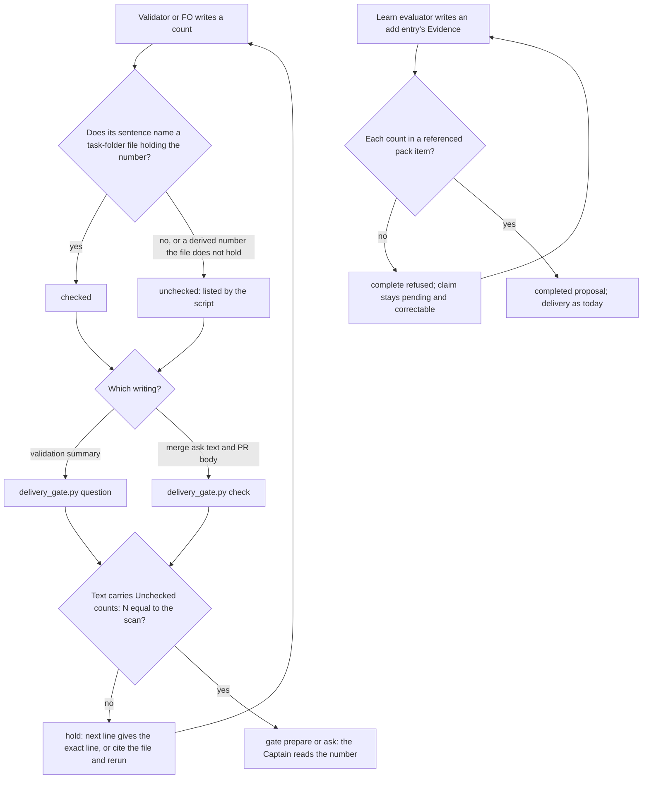

## Scope

- Outcome: When FO or a worker states a count or a measured number (cells run, tests passed, rounds, tokens), it names the command or run that produced it, so a wrong count is visible as unchecked.
- Source: the Captain, chat 2026-11-04: 「甲」, answering 「決定：來源標註照現狀出貨，K 情境 3/6 記成已知限制，另開一張專門處理數字附出處的追蹤任務，可以嗎？」
- Batch 18 scope: the Captain 「可以」 (chat, 2026-11-09), answering FO's batch 18 recommendation, which listed this task as 「數字要寫明是哪次執行算出來的，順便涵蓋 learn 的證據」.
- Bite: claims-name-their-source AC-8 evidence (state checkout, validation/implementation-2 and implementation-3): with the new written rule, the K scenario (the kc-adr count that said two cells were unmeasured where it was three) labelled the wrong count in 3 of 6 Claude runs, against 0 of 3 before; the P scenario reached 6 of 6. Its K grader false-passed the base, as its validation-1 F1 found.
- Second bite: iamcxa/kc-claude-plugins issue #811 (2026-11-08): a learn evidence line quoted a count from an earlier review pass (18) where a verified recount said 15.
- Consumer: every adopter FO and its workers, at gate summaries, PR bodies and Captain messages.
- Non-goals: re-measuring past counts; a general claim-source rule beyond counts and measured numbers.

## Budget
- One package PR; workflow word budget unchanged unless the design names a raise for the Captain.

## Stop condition
- A count or measured number in a gate summary, PR body or learn evidence that names no command or run is visible as unchecked, with a falsifier.

## FO alignment

Alignment: not needed; the Captain opened it and chose it for batch 18.
Surfaces: none
Visible change: none
Release review: not needed: workflow maintenance, on no journey map.

## Design

Every number below names the script and the run that produced it. The scripts and outputs are in `counts-name-the-run-that-produced-them/ideation/` (its `README.md` names each run, 2026-11-09).

### Evidence checked against its source

- **AC-8 of claims-name-their-source (confirmed).** `_archive/claims-name-their-source.md`, read 2026-11-09: the wrong-count limit is labelled in K candidate runs 1, 5 and 6 (3 of 6) against 0 of 3 base, and the K grader false-passes the base (validation-1 F1). ADR 0055 records the same and names this task as the follow-up.
- **Issue #811 (text only).** `gh issue view 811`, 2026-11-09: a learn `add` entry's Evidence quoted 18 from an earlier review pass where a recount said 15. A completed job cannot be re-evaluated, so the reporter closed the delivery PR and lost the lesson. The reporter is an outside adopter. A search of the five learn stores on this machine (kc-claude-plugins, relay, web, qnow, v0; `add` entries whose Evidence holds `18`) found no such record. The learn half is designed from the issue text and replayed on local entries, not on the bite itself.
- **ADR 0055's printed rule is not followed for counts.** `sourced_sample.py` over the validation briefings committed after 2026-11-05T00:00Z: 24 of 32 count sentences carry no bracketed date, backticked command or `report, not run` (kc-plugin dev2 8, relay 11, qnow 5; v0 none). Reading those 24: 6 name a command and date outside brackets (the Captain-step lines), 4 name a report or a run id, and 14 name nothing (`sourced-after-*.out`). The cut is approximate: adopters upgraded to 0.35.0 on different days.

### Chain checked (upstream first)

- **Spacedock 0.27.3** (grep for `measured|unchecked` over `skills/`, 2026-11-09): only the ideation rule "demonstrated, not asserted" in `first-officer-shared-core.md`. Nothing reads the source of a count.
- **kc-dev-flow-2 0.36.0** (origin/main `e7c9381f2`, which is before PR #794):
  - `delivery_gate.py` prints `CLAIM_SOURCE` (27 words) on every `question` and `check` run and holds nothing on it (ADR 0055).
  - `learning.py` `evaluation()` already refuses on structure: each decision `evidence` ref must equal a pack item. It does not read the entry's Evidence text.
  - The nearest existing run record is the Captain steps record (`delivery_gate.py steps`, `inspect_steps`): `### Step N` with `Asked`, `Ran` (fresh shell and a UTC time) and `Observed`. It is a task-folder file, so the design below counts it as a source with no change.
  - Validators also save logs and a `manifest.json` in their validation folders. No package format defines them.
- **Adopters:** not re-read this session. The 2026-11-03 grep of relay and web `AGENTS.md` (claims-name-their-source) found no count rule.
- **Past rulings** (`git -C <state> grep -n '^Override:'`, 2026-11-09): fo-write-rules-checked D4, where the Captain chose no phrase check because "matching words cannot stop that class of error", and agent-reads-governing-adr, where he chose a deterministic refusal. ADR 0055's reopen condition: "a later structured claim record supports a useful refusal".

### Replay

**Gate summaries** (`scan_replay.py`, 2026-11-09T05:15Z; read at kc-plugin dev2 `2a00a2a1e`, relay `f85b62c65`, v0 `77c06a14b`, qnow `8207a9729`). A count sentence counts as checked when it names a file in its task folder that holds every number of the sentence:

| Briefings | Before 2026-11-05 | After |
| --- | --- | --- |
| Validation briefings | 394 | 30 |
| With at least one count sentence | 231 | 20 |
| Count sentences | 352 | 32 |
| Checked (names a task file holding the number) | 1 | 0 |

Only 4 count sentences cite a task file that does not hold their number. All four are the same derived sum: "3 of 6" citing `cold-fo/README.md`, which holds `1/3` and `2/3`. A content check calls that sum unchecked, so a hold there would stop a correct line. The design therefore lists such a count and does not refuse it.

**Learn evidence** (`learn_replay2.py`, 2026-11-09; completed `add` entries):

| Store | Add entries | With a count | Counts | In a referenced pack item | In no pack item |
| --- | --- | --- | --- | --- | --- |
| kc-claude-plugins | 14 | 8 | 14 | 10 | 4 |
| relay | 5 | 1 | 1 | 1 | 0 |
| web | 3 | 3 | 12 | 12 | 0 |
| qnow | 6 | 1 | 1 | 1 | 0 |
| v0 | 0 | 0 | 0 | 0 | 0 |

The 4 misses come from 2 of the 28 entries. Three are real counts that appear in no pack item at all: "4 of 4 CI checks", "69 existing task files" and "64 task files". One is a regex defect, `2, round`, where the number pattern swallowed a comma; the implementation's number form `\d+(?:,\d{3})*` fixes it. No count appeared in the pack but outside the decision's referenced items.

### Two seams, two treatments

- **Learn: a structural refusal.** Learn has a structured record to join against. The evaluator writes an entry's Evidence from pack items it must reference. `complete` refuses an `add` entry when a count in its Evidence appears in none of the referenced items. The claim stays pending and correctable ("Invalid completion input leaves a pending claim usable for correction"). That is the step #811 lacked: there, a wrong count could be found only after completion, when nothing could change it any more. This is the same kind of check as the existing ref-equality refusal, and it meets ADR 0055's reopen condition. On local evidence it refuses 2 of 28 entries.
- **Gate summary, merge ask and PR body: a count the tool computes, and no refusal of the claim.** The scan cannot tell a wrong count from a derived one (the "3 of 6" case), so it never holds a count. Instead, `question` and `check` list each count sentence that names no task file holding its number, and require the text to carry the tool's own figure as `Unchecked counts: N` (D1). The Captain then sees how many numbers nobody checked, in the text he reads. A count is checked by citing the saved output, for example a validator's log or a Captain steps record, by its task-folder path. Following ADR 0027 D4, nothing judges whether a count is true.
- **Not built:** a recorder command that runs a command and saves its argv, exit code and time. The gap is the citing form: 1 of 352 count sentences cites any task file holding its number. A recorder adds nothing until a count cites something. Reopen if cited files turn out not to show the command that produced them.

### PRFAQ

**Press release.** A number in a validation summary or a merge ask is checked by the gate script when it cites the saved output that shows it. Each one that does not is listed, and the text carries the tool's count as `Unchecked counts: N`, so the Captain sees how many numbers no one checked. A learn proposal whose Evidence quotes a count that none of its cited evidence holds is refused before it completes, while it can still be corrected.

**FAQ**
- *Does a checked count mean it is right?* No. It means the cited file holds that number. A file can hold a stale number. If a learn pack item carried the stale 18 of #811, the learn check passes it.
- *What is still invisible?* A count written as a list with no number in it, such as kc-adr's "S6/S7 Codex not re-run" (ADR 0055 says the same). Chat. Stage reports, which are read only through the summary FO writes. A reader of the PR on GitHub, because the `Unchecked counts:` line lives in the ask text and not in the body.
- *Why hold on the line and not on the count?* Holding the count would stop correct derived sums. Holding the line stops only a missing disclosure, as `External rounds: N` does (ADR 0051).
- *What does FO do differently?* At a hold, it copies the `Unchecked counts:` line the script prints. Or it cites the saved file and runs the script again.

### Changes

- `kc-dev-flow-2/scripts/count_tokens.py` (new, about 40 lines). It has one count pattern: `N of M`, `N/M`, or `N` followed by at most one word and then cells, runs, tests, files, findings, words, lines, PRs, tasks, commits, cases, records, steps, rounds, tokens, briefings, attempts, skips, checks or comments. Numbers use the form `\d+(?:,\d{3})*`. It splits sentences on `.` or `;` plus whitespace, or on a newline, and skips fenced blocks and lines that open with `Unchecked counts:` or `External rounds:`. Both scripts import it, as `delivery_gate.py` already imports from its folder. It is tested through the two existing test files, so no new CI step is needed.
- `kc-dev-flow-2/scripts/delivery_gate.py`:
  - a new `count_problems(folder, text, declared)` (scan, list and compare);
  - calls from `question()` (question plus summary) and `check()` (`--text-file` plus PR body);
  - `pr_facts` adds `body` to its `--json` fields;
  - output: `counts: C checked, U unchecked`, then at most 8 `unchecked count: <12-word cut>` lines;
  - hold, exit 1, when the summary (for `question`) or the text file (for `check`) has no top-level `Unchecked counts: U` line equal to the scan. Its `next:` line gives the exact line to add and says that citing the saved output's task-folder path checks a count;
  - files are read on disk under the task folder, resolved as `named_file` does; a docstring paragraph.
  - `CLAIM_SOURCE` and exit codes 0 and 2 are unchanged.
- `kc-dev-flow-2/scripts/test_delivery_gate.py`: the AC-2 and AC-3 fixtures. Existing pass fixtures gain an `Unchecked counts: 0` line, or the line their own counts need.
- `kc-dev-flow-2/scripts/learning.py`: in `evaluation()`, for each `add` entry, every count in `Evidence` must appear in the joined referenced pack items. Otherwise it raises `Invalid("entry Evidence count '<cut>' is in no referenced evidence item")`.
- `kc-dev-flow-2/scripts/test_learning.py`: the AC-1 fixtures.
- `kc-dev-flow-2/skills/validation/principles.md`: one sentence, "Report each count with the task-folder path of the saved output that shows it; `delivery_gate.py` counts a count without one as unchecked."
- `kc-dev-flow-2/skills/evaluate-learning/SKILL.md`: one sentence, "Each count in an entry's Evidence must appear in an evidence item the decision references; `complete` refuses it otherwise."
- An ADR, with no number until FO reserves one: "A count cites the saved output that shows it, and the gate scripts count the ones that do not". It records both replays and both bites. It cites ADR 0055's reopen condition for the learn refusal and follows ADR 0027 D4 for the gate half (no claim is held), with ADR 0051's precedent for the disclosure line. It amends ADR 0055's consequence "The reminder adds no source-pattern hold": the new hold is on a missing `Unchecked counts: N` line, not on any count's source pattern, and 0055's reminder and its stance that no claim is judged both stand. It states the limits in the FAQ.
- Not changed: `references/sd/workflow.md`, so the startup budget does not move. FO meets the rule in the script's output when it writes the text, and ADR 0055's sentence there still holds. Also unchanged: `_mods/`, `design_surfaces.py`, `pr_watch.py`, the observer, the CI workflow and any adopter file.

### Existing-code check

The design reuses what is already there. `delivery_gate.py` is the script FO runs at both writes. `learning.py` `evaluation()` already refuses on structure, and the Captain steps record is already a saved run with its observed output. The need is observed: under ADR 0055's printed rule, 14 of 32 count sentences in recent summaries name no source (`sourced-after-*.out`), and 1 of 352 cites a file holding its number (`scan_replay.out`). Nothing in the package lists them.

### Profile check

Pilot holds: no production data, credentials, unattended operation or SLO. Adopters meet the new hold at their next validation gate after upgrading. They clear it by copying one line.

### Words FO reads at each moment

These are whitespace-split counts at origin/main `e7c9381f2`, taken 2026-11-09 with `str.split()` on the constants and `wc -w` on the files. PR #794 (merge-guard) lengthens `ASK` before this task lands. The implementation recounts on its real base.

| Moment | Base | Candidate |
| --- | --- | --- |
| Startup (`workflow.md` + mod) | 5931 + 48 | unchanged |
| Idle, archive (`pr_watch.py`), ideation gate (`design_surfaces.py`) | unchanged | unchanged |
| Validation gate preparation (`question`, pass) | 27 + 3 + 62 = 92 | +5 (`counts:` line) +14 per unchecked count, at most 8 (≤ +117). The post-cut summaries average 32 / 30 ≈ 1.1 unchecked |
| Validation preparation, hold on the line | — | + one problem line (about 15) + one `next:` line (about 35) |
| Merge ask (`check`) | 27 + points, class, record + `ASK` 40 | the same additions, over the ask text plus the PR body |
| Validation worker (`validation/principles.md`) | 826 | +22 (the sentence, `wc -w`) |
| Learn evaluator (`evaluate-learning`) | 877 | +19 (the sentence, `wc -w`); a refusal adds one line |
| Captain, gate summary | — | one `Unchecked counts: N` line |

### Batch overlap

Files this design changes: new `scripts/count_tokens.py`, `scripts/delivery_gate.py` (new `count_problems`, `question()`, `check()`, `pr_facts`, docstring), `scripts/test_delivery_gate.py`, `scripts/learning.py` (`evaluation()`), `scripts/test_learning.py`, `skills/validation/principles.md`, `skills/evaluate-learning/SKILL.md`, and one ADR in `docs/adr/`.

| Task | Same file, check or numbered record | Order |
| --- | --- | --- |
| merge-guard-stops-unasked-merges (validation, PR #794) | `delivery_gate.py` `ASK`/`ASK_UNQUOTED`, `test_delivery_gate.py`, CI workflow, ADR 0063 | lands first; this task rebases and recounts the merge-ask moment |
| delivery-gate-ignores-url-paths-and-data-fences (batch 18) | `delivery_gate.py` `absolute_paths`, `inspect_steps`, `test_delivery_gate.py` | before this task. Different functions, same files. Its S4 path fix does not change `named_file`, which this design reuses |
| delivery-check-before-ask-is-provable (batch 18) | probably `delivery_gate.py` `check()` / `write_record` and their tests (its design is not written yet) | before this task, since both edit `check()`. Re-read its design before implementation |
| validation-reads-pr-review-comments (batch 18) | probably `skills/validation/principles.md`, the reframed validation question | before this task; this design adds one sentence to whatever it leaves |
| adr-required-statement (validation) | `docs/adr/` format, `workflow.md` § Decision records, CI workflow | before this task; the new ADR follows the statement it requires |
| journey-server-host-pilot (validation), domain-note-reaches-worker-poc (backlog) | none (grep of both task files for these files, 2026-11-09) | none |
| any ADR-landing task | the `docs/adr/` number sequence | FO reserves the number at dispatch |

Recommended order: merge-guard-stops-unasked-merges, then delivery-gate-ignores-url-paths-and-data-fences, then delivery-check-before-ask-is-provable and validation-reads-pr-review-comments (either order), then this task, after adr-required-statement.

## Acceptance criteria

**AC-1** Learn refuses an unsourced Evidence count before completion. Evidence: in `test_learning.py`, a pack item "recount 2026-11-08: 15 findings (20 overall)" and an `add` entry whose Evidence says "18 findings" while referencing that item. `complete` exits 1 naming the count, and `read` still shows the job pending with its token usable. The same entry saying "15 findings" completes. Falsifier: remove the join from `evaluation()`, and the 18 entry completes and the test fails. Current evidence: not yet built. The pattern was replayed in `learn_replay.out`.

**AC-4** Both replays rerun with the final pattern, saved in the validation folder, each number naming its script, revision and date. Evidence:
- the gate replay over the four state checkouts lists how many recent summaries would need a non-zero line;
- the learn replay over the five stores refuses exactly the two entries `441fe280…` and `d829872c…` named in `learn_replay.out`, or explains each difference. The `2, round` defect no longer appears.

Current evidence: the ideation run is in `ideation/` (2026-11-09); the final pattern is not built.

**AC-5** The words FO reads per moment match the table at the candidate. Evidence: an independent recount, base and candidate. Startup is unchanged; the `question` and `check` additions are as the table says. Current evidence: base counted (above); the candidate is not built.

**AC-6** Existing callers stay green and the scope holds. Evidence:
- `python3 -B -m unittest discover -s kc-dev-flow-2/scripts -p 'test_*.py'` passes;
- `lint-skills.py` exits 0 with `WORKFLOW_WORD_BUDGET` unchanged;
- `adr_lint.py docs/adr --since <base> --require <reserved>` exits 0;
- `git diff --stat <base>` names neither `references/sd/workflow.md` nor `_mods/`.

Current evidence: not yet run.

**AC-7** Amended by Captain, amendment 1, replacing AC-2. `question` scans the question and summary, lists unchecked counts and writes the computed `Unchecked counts: N` line into the summary itself. Evidence in `test_delivery_gate.py`: the K-shape summary "2 cells not re-run (validation/validation-1/cells.txt)" cites a file listing three cells and holding no `2`; it lists that count as unchecked and writes `Unchecked counts: 1` whether the incoming line is missing or wrong, without holding on that line or the count. "3 cells (validation/validation-1/cells.txt)" with a file holding `3` is checked and writes `Unchecked counts: 0`. A derived "3 of 6" against a file holding `1/3` and `2/3` is listed as unchecked without refusal. Falsifier: drop the number-in-file comparison and the wrong "2 cells" counts as checked; remove the tool's write and the missing/wrong-line cases fail. Current evidence: not yet built.

**AC-8** Amended by Captain, amendment 1, replacing AC-3. `check` scans the ask text and PR body and writes the computed `Unchecked counts: N` line into the ask text itself. Evidence in `test_delivery_gate.py`: a fixture PR body (through the existing `gh` stub) holds one uncited count while the ask holds none; with the line missing or wrong, `check` writes `Unchecked counts: 1` without holding on that line or the count. Falsifier: scan only `--text-file` and the output is wrong; remove the tool's write and the missing/wrong-line cases fail. Current evidence: not yet built.

## Needs decision

Past rulings read: ADR 0027 D4 (fo-write-rules-checked `Override:`, no phrase check), ADR 0055 and its reopen condition, ADR 0051 (the round-count line), and agent-reads-governing-adr's `Override:` (a deterministic refusal where it fully separated good from bad).

- **D1. Hold the validation summary and the merge ask until they carry the script's own `Unchecked counts: N` (recommended), rather than only printing the list?** It is the only way the count reaches the Captain without depending on FO. Under ADR 0055's printed line, 14 of 32 recent count sentences still name no source (`sourced-after-*.out`). It does not repeat D4's error: no claim is judged, and only a figure the tool computed is required. The closest precedent is `findings_join` (ADR 0027 D5), which holds declined items against the validator's F-bullet count. Approving D1 also records that ADR 0055's "adds no source-pattern hold" is amended to allow this one disclosure hold. What gets worse:
  - 20 of 30 recent summaries would need the line, one more edit at most gates;
  - FO can clear it by copying the line, so it discloses and does not correct;
  - the Captain sees "unchecked", not "wrong".

  Alternative: print only, which follows ADR 0055 literally; he then sees the list only if FO copies it.
- **D2. Refuse a learn `complete` whose `add` Evidence quotes a count that no referenced pack item holds (recommended)?** It is a structural join like the existing ref-equality refusal, and it fires before the point where #811 got stuck. On local evidence it refuses 2 of 28 entries, both real misses. What gets worse: an evaluator stating a derived count must quote it as the pack states it. And a stale count that the pack itself carries still passes.

## Captain amendments

### Amendment 1 — 2026-11-09, host question dialog
Captain: 「核准（建議）」 (host question dialog, 2026-11-09)
Asked: 「決定：第 18 批四張設計照下列建議進實作嗎？建議核准。(1) 驗證回答能不能合併：Claude 和 Codex 兩邊都要跑，Codex 跑不了就停下來回報，不接受只有 Claude 的結果；這次不寫決策紀錄，等第 19 批觀察者的數字出來再定。(2) 合併檢查誤判：只在引用的文件裡，把 shell 或沒標語言的程式區塊算成你要跑的步驟；問題和報告裡的區塊照舊全算。(3) 檢查跑在提問前：沒有對應的檢查紀錄就不讓準備問題，所以 PR 要先 ready、CI 綠才能開驗證關卡。(4) 數字寫明出處：learn 提案完成時，證據裡的數字在它引用的資料找不到就擋下；摘要裡的「未查核的數字：N」改由工具自己寫進去，不擋、也不用我抄（工人原案是擋到我抄上那一行）。核准即接受上列每一項建議，包括 (4) 改成工具自己寫；要改哪項直接說。」
Supersedes: AC-2, AC-3
Design: **Gate summary, merge ask and PR body: a count the tool computes, and no refusal of the claim.** The scan cannot tell a wrong count from a derived one (the "3 of 6" case), so it never holds a count. Instead, `question` and `check` list each count sentence that names no task file holding its number, and require the text to carry the tool's own figure as `Unchecked counts: N` (D1). The Captain then sees how many numbers nobody checked, in the text he reads. A count is checked by citing the saved output, for example a validator's log or a Captain steps record, by its task-folder path. Following ADR 0027 D4, nothing judges whether a count is true.

Superseded text:

**AC-2** `question` lists unchecked counts and holds on a missing or wrong line. Evidence, in `test_delivery_gate.py`:
- the K shape: a summary saying "2 cells not re-run (validation/validation-1/cells.txt)", where `cells.txt` lists three cells and holds no `2`. It prints one `unchecked count:` line. It exits 1 with `Unchecked counts: 0` and passes with `Unchecked counts: 1`;
- "3 cells (validation/validation-1/cells.txt)" with a file holding `3` is checked and passes with `Unchecked counts: 0`;
- a derived "3 of 6" against a file holding `1/3` and `2/3` is listed as unchecked, never refused.

Falsifier: drop the number-in-file comparison, and the wrong "2 cells" counts as checked, so the test fails. Current evidence: not yet built.

**AC-3** `check` scans the ask text and the PR body. Evidence: a fixture PR body (through the existing `gh` stub) holding one uncited count, with ask text that holds none. `check` exits 1 until the text carries `Unchecked counts: 1`. Falsifier: scan only `--text-file`, and the test fails. Current evidence: not yet built.

## Number guards

ADR: 0072

## Stage Report: ideation

- DONE: Design how a count or measured number names the command or run that produced it in gate summaries, PR bodies and learn evidence packs, so a count with no source is visible as unchecked; prefer the tool recording the source over prose rules, and name the check and its falsifier. Batch overlap: name each file your design changes; siblings validation-reads-pr-review-comments, delivery-gate-ignores-url-paths-and-data-fences, delivery-check-before-ask-is-provable and counts-name-the-run-that-produced-them may touch kc-dev-flow-2/scripts/delivery_gate.py, so say the order you need relative to them.
  Learn gets a structural refusal in `learning.py` `evaluation()`: an `add` Evidence count must appear in a referenced pack item, or `complete` refuses it while the claim is still correctable (falsifier AC-1). The gate half has `delivery_gate.py` `question`/`check` list counts that cite no task file holding the number, with a hold only on a missing `Unchecked counts: N` (D1; falsifiers AC-2, AC-3). Replays: `scan_replay.out` (1 of 352 count sentences checked), `learn_replay.out` (2 of 28 entries refused). No recorder command; `delivery_gate.py` order is in `### Batch overlap`.
- DONE: A `### Batch overlap` section naming each file the design would change and each other batch task (validation-reads-pr-review-comments, delivery-gate-ignores-url-paths-and-data-fences, delivery-check-before-ask-is-provable, counts-name-the-run-that-produced-them, merge-guard-stops-unasked-merges) and live task of other sessions (adr-required-statement, journey-server-host-pilot, domain-note-reaches-worker-poc) that changes the same file or check, so FO can order implementation
  Eight files, named by function. Order: #794 merge-guard, then url-paths, then check-before-ask and validation-reads (either order), then this task, after adr-required-statement. journey-server-host-pilot and domain-note-reaches-worker-poc share no file (grep, 2026-11-09).
- DONE: The words FO reads at each lifecycle moment, before and after, per root learning.md "Measure the words FO reads at each moment, not one file's size"
  `### Words FO reads at each moment` (origin/main `e7c9381f2`, pre-#794): startup 5931+48 unchanged; `question` 92 plus 5, plus 14 per unchecked count (at most 8); `check` gets the same over the text and PR body; validation principles +22; evaluate-learning +19.
- DONE: Acceptance criteria with reproducible evidence clauses and falsifiers, and unresolved decisions for the Captain, each with a recommendation and what gets worse under it
  AC-1 (learn refusal, #811 shape): not yet built. AC-2 (`question` K shape, checked and derived cases): not yet built. AC-3 (`check` reads the PR body): not yet built. AC-4 (both replays rerun with the final pattern): the ideation run is saved, the final pattern is not built. AC-5 (per-moment recount): base counted, candidate not built. AC-6 (suite, lint, adr_lint, scope): not yet run. D1 (hold on the disclosure line) and D2 (learn refusal), each with what gets worse. `design_surfaces.py check`: "design surfaces presentable", exit 0 (2026-11-09).

### Summary

The design adds a structured check where a structured record exists, and disclosure where only prose exists. Learn evidence is joined against the pack items the evaluator cites and refused before completion. That catches the #811 class unless the pack itself carried the stale number. Gate summaries, merge asks and PR bodies get a count the script computes, `Unchecked counts: N`, because the replay shows that a content hold would stop correct derived sums ("3 of 6"). The list form "S6/S7 not re-run" stays invisible, as ADR 0055 already says. The #811 record is not on this machine, so the learn half is replayed on 28 local entries and not on the bite itself.

## Stage Report: implementation

- DONE: Start in the assigned worktree; verify pwd and git root before edits; fetch origin and base on origin/main.
  Assigned branch is spacedock-ensign/counts-name-the-run-that-produced-them; clean code worktree fast-forwarded from e7c9381f2ae7f11bc715a6f11a3e000b9b807e1e to fetched origin/main 82c9e67ae892b80647c3f6a8b6929f993e42dbc2; no product edits or product commit.
- DONE: Apply Captain amendments Amendment 1 first: move AC-2 and AC-3 under the amendment as superseded text and write replacement criteria with fresh ids.
  AC-2/AC-3 moved verbatim; AC-7/AC-8 require automatic writes without disclosure holds. Comparison with the committed entity confirmed unchanged frontmatter and ideation report; package design_surfaces.py check exits 0, "design surfaces presentable" (scope check not run at implementation).
- SKIPPED: One Draft PR implementing the approved design and acceptance criteria; commit locally and prepare PR text at /tmp/impl-counts-name-the-run-that-produced-them-pr.md.
  HOLD: the design requires a new ADR, but this entity has no ## Number guards / ADR: reservation. Package skills/read-adr/writing.md requires the coordinator to reserve it and forbids the worker from running the reserver. No PR opened: no push grant; no PR text prepared for an unimplemented candidate.
- SKIPPED: Every acceptance criterion green with the evidence each names; each falsifier shown failing by a mutation run with python3 -B and caches cleared.
  Implementation, replays, word recount and mutations not run pending the missing ADR reservation; none is claimed clean. Existing product bytes remain unchanged at the fetched base.
- SKIPPED: Repository lint-skills.py, package adr_lint.py docs/adr --since <base>, number_guards.py check, and comment_ratio.py within its maximum.
  Product implementation/checks not run because the mandatory reserved decision-record input is missing; WORKFLOW_WORD_BUDGET unchanged, no version or CI changes. CI cost not measured.
- SKIPPED: FO pushes the product branch, opens the Draft PR, runs RoboRev and reads CI.
  Delegated checks not run, never clean. A Paseo send_agent_prompt clarification to the dispatching FO returned "user rejected MCP tool call"; the clarification was not delivered. This report and final reply are the handback; no retry through another transport.

### Summary

Implementation is on hold pending an FO-reserved ADR number in this task's ## Number guards section. The approved Captain amendment is applied and the assigned product branch is clean at origin/main; this is preparation only, not a completed implementation. Resume after the FO supplies the reservation; the product deliverable, acceptance evidence and PR handoff remain outstanding.
