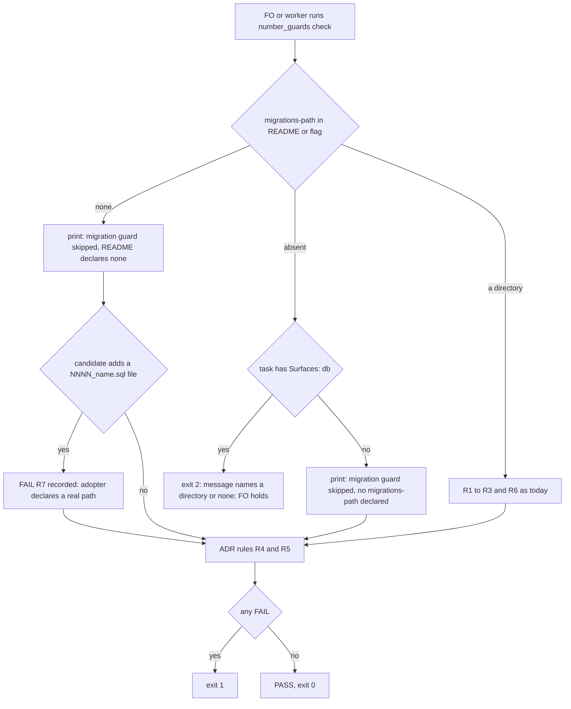

## Scope

- Source: issue iamcxa/kc-claude-plugins#678 (filed 2026-10-19 at the Captain's request from the relay dev2 FO's learn candidates); batch 4 approved 2026-10-20 (「按你建議」).
- Bite: `number_guards.py check` raises `Misconfigured("task has Surfaces: db but no migrations-path is declared ...")` and exits 2 on a repository whose `db` surface has no migration files (subspace-relay: Netlify Blobs keys). The README makes exit 2 a hold, so the relay FO dispositioned it by hand in four validation rounds of own-comments-follow-account, and the observer recorded `can't tell`. `references/sd/workflow.md` also says "Without `migrations-path:` the migration rules are skipped", which contradicts the exit-2 path for a db task (triage 2026-10-20 on origin/main ad44f0cb).
- Consumer: every adopter FO whose db surface has no migration directory (relay today) and the observer reading that hold.
- Direction from the issue, to be measured at ideation: an explicit, observer-visible declaration (for example `migrations-path: none` with a reason) rather than a silent skip.
- Batch overlap: fo-batch-sittings touches the Number guards passage of the README (the reservation-timing conflict); order this task's implementation first.
- Non-goals: to be set at ideation.

## FO alignment

Alignment: not needed before ideation; the Captain approved batch 4.
Release review: not needed: workflow maintenance, on no journey map.
Surfaces: none
Visible change: none

## Design

### PRFAQ

**Headline.** An adopter whose database has no migration files declares that once, `migrations-path: none`, in its workflow README, and `number_guards.py check` passes a `Surfaces: db` task visibly instead of exiting 2 for a human to disposition every round.

**Who and what hurts today (measured 2026-10-20, origin/main ad44f0cb).** Of 22 committed tasks with `Surfaces: db` in the four repositories (read from each `spacedock-state/dev2` ref with `git grep -nE '^Surfaces:.*(^|[ ,])db'`), 18 are qnow, whose README declares `migrations-path:` and which the guard serves; 3 are subspace-relay and 1 is this repository's journey-server-host-pilot, whose READMEs declare nothing. subspace-web has 0 such tasks and the same undeclared README, so its first db task will hit the same hold. Every one of those 4 exits 2 with "task has Surfaces: db but no migrations-path is declared". own-comments-follow-account met it in each of its four validation reports (cycles 1 to 4); each wrote a hand disposition plus a `git diff A B --name-only | grep -ci migrat` that gave 0, 263 words across the four items (one item also lists other scripts). The Captain's issue says the observer then recorded `can't tell`.

**A worse finding the issue does not name.** `check` raises at the db test before it reaches the ADR rules, so a db task in such a repository gets no R4 or R5 either. Fixture (reproduced 2026-10-20 with the released 0.26.0 script): the same candidate that adds `docs/adr/0001-second.md` over a base holding `0001-first.md` exits 1 with `FAIL R5` when the task says `Surfaces: ui`, and exits 2 with no ADR finding when it says `Surfaces: db`. The task that changes data is checked less than the task that does not. relay's db tasks that land an ADR (own-comments-follow-account 0059, publish-admission 0043) ran `adr_lint --require` by hand instead.

**What changes.**
- `migrations-path: none` in the README frontmatter (or `--migrations-path none`) means "this repository has no migration files". `check` then skips R1 to R3 and R6, still runs the ADR rules, prints `migration guard skipped: README declares migrations-path: none`, and exits 0 on a clean candidate, so the declaration sits in every report that quotes the output.
- New R7 keeps the declaration honest: under `none`, a candidate that adds a file named `NNNN_name.sql` anywhere fails `R7`. It replaces the relay validators' hand-run `grep -ci migrat`, and it also guards a POC in such a repository, which the README says is "not guarded until the README declares it".
- Undeclared stays fail-closed: a db task with no `migrations-path:` still exits 2, and the message now names both ways out (a directory, or `none`).
- `reserve --kind migration` under `none` exits 2 ("no migration number to reserve"); ADR reservation is unchanged.

**FAQ.**
- *Why a value of the existing key, not a new key or a silent skip?* One key keeps one parse (`settings()`); a silent skip is what the issue rejected because an observer cannot tell it from a forgotten key.
- *Why not point `migrations-path:` at a stub directory?* journey-server-host-pilot's implementation report records "no fake path"; and a stub holds no `NNNN_name.sql`, so `require_migrations` exits 2 anyway.
- *What does an adopter do about a reason?* Write it as a `#` comment line above the key. The frontmatter parser reads only `key:` lines (checked 2026-10-20 on a README with such a comment), so no reason field is built.
- *Order for an adopter.* Declare `none` only after the pin includes this change. The released 0.26.0 script reads `none` as a directory: it exits 2 for every task, db or not (reproduced 2026-10-20).

### Flow

Branches match the prose: a directory, `none`, absent plus db (the only exit 2 left on this path), absent plus not db. An R7 failure is recorded and the ADR rules still run, so the exit 1 reports both. Under `none` the ADR rules run for db and non-db tasks alike, which today they do only for non-db tasks.

### Existing-code check (chain: Spacedock, kc-dev-flow-2, sibling adopters)

- Spacedock 0.27.0 plugin cache: `grep -rln 'migrations-path\|number_guards'` over the whole install finds nothing; no migration or number concept (ADR 0002 says the same of 0.27.2). kc-dev-flow (v1), kc-ship-flow, kc-journey-map: 0 hits for `migrations-path`.
- kc-dev-flow-2 has the capability half-built: `check` already skips the migration rules for a non-db task with no key (test `test_no_db_surface_and_no_key_skips_loudly`) and runs the ADR rules there. The gap is only the db test that raises first and a skip line that says "no migrations-path declared" for both "forgotten" and "none exist". So the change reuses `settings()`, the skip branch and the ADR rules; it adds one value, one rule, two messages.
- Siblings: qnow declares a path and is served; relay, web and this repository declare nothing. relay's workaround is prose dispositions, journey-server-host-pilot's is "exit 2, NOT PASS". Neither is a contract to copy; only the bite evidence is used.
- Completeness: working through the journey for qnow; broken seam for the other three (exit 2 on every db task); the README sentence contradicts the code. Need: 4 of 22 db tasks plus the hidden ADR gap.

### Reconciling the README

`references/sd/workflow.md`, FO steps: number guards, bullet "POC marker", says "Without `migrations-path:` the migration rules are skipped, so a POC is not guarded until the README declares it." That is true for a non-db task and for a POC and false for a db task (exit 2). Replacement, 18 words against the old 18 by whitespace split (the budget counter, `len(text.split())` in `lint-skills.py`), so `WORKFLOW_BUDGET_STEPS` needs no step: "Without `migrations-path:` a db task exits 2 and a POC is not guarded; `none` declares no migration files." The Check bullet already says "Exit 2 is a configuration error, which returns to FO as a hold"; the script's message, not the README, says how to resolve it (the rule #670 set for this section).

### Batch overlap

Files the design would change: `kc-dev-flow-2/scripts/number_guards.py`; `kc-dev-flow-2/scripts/test_number_guards.py`; `kc-dev-flow-2/references/sd/workflow.md` (one bullet, word count unchanged); `docs/adr/0002-applied-migrations-are-frozen-and-numbers-are-reserved.md` (one Amended paragraph, no new ADR). Not changed: `lint-skills.py` (delta 0), `delivery_gate.py`, `docs/dev2/README.md` and `docs/dev2-poc/README.md` (the next `chore(dev2): sync` carries the sentence), and every adopter's README (their frontmatter, after the release).

| Task | Same file or check | Order |
| --- | --- | --- |
| fo-batch-sittings (batch 4) | `workflow.md` Number guards: it rewrites the Reserve bullet; mine edits the POC marker bullet of the same section | this task first, per its own Scope; the second to merge rebases and reruns `lint-skills.py` |
| comment-check-reaches-delivery-gate, fo-write-rules-checked (batch 4) | `delivery_gate.py`; mine does not touch it | none |
| commissioned-by-names-spacedock (batch 4) | `workflow.md` line 2 and the two synced READMEs; word count may move | independent; whoever merges second reruns the lint |
| adr-required-statement (other session, validation) | `workflow.md` § Decision records and the Number guards applicability line, `test_poc_readme.py`, a `WORKFLOW_BUDGET_STEPS` raise | it merges first if it reaches the Captain first; my edit is a different bullet and adds no budget step |
| release-acceptance (other session, ideation) | `workflow.md` Release review bullet; `lint-skills.py` run | independent text, shared word budget |
| journey-server-host-pilot (other session, validation) | consumer of the exit 2; edits no package file | its recorded "NOT PASS" disposition stays as written; it can declare `none` only after the release |
| pr-review-lite-value-pilot, journey-canvas-hosted-poc (other sessions) | none found (`grep` for `number_guards`, `Number guards`, `migrations-path`, `workflow.md` over both task files, 0 hits) | none |

### Words FO reads at each moment

Counted by whitespace split, unchanged base (ad44f0cb) against the candidate design. The Number guards text FO reads is in `workflow.md` plus the script output it quotes.

| Moment | Before | After |
| --- | --- | --- |
| Startup (FO reads `workflow.md`) | the POC marker sentence, 18 words | the replacement sentence, 18 words; the rest of the file unchanged |
| Implementation dispatch (`reserve`) | nothing new; relay-type repository: not asked to reserve a migration | same; if asked, 13-word message becomes 22 words and says there is no number to reserve |
| Implementation exit, validation, PR head (`check`), repository with a path | unchanged | unchanged |
| Same, db task, no migration files | exit-2 message 19 words, then the worker's hand disposition: 263 words across the 4 own-comments-follow-account items | no hold: `migration guard skipped: README declares migrations-path: none` 7 words plus `PASS: no findings` 3; the disposition item shrinks to the command and its output; not measured until implemented (AC-8) |
| Exit 2 that remains (db task, nothing declared) | 19 words | 27 words (+8) naming both ways out |
| Validation gate, POC marker | same sentence as startup | same, 18 words |

Every moment is at or below its base except the remaining exit 2 (+8) and the unmeasured `reserve` message (+9), both script output FO reads only on a fault.

## Acceptance criteria

**AC-1** A db task in a repository with no `migrations-path:` still exits 2, and the message names a directory and `none` as the two declarations.
Verified by: a new `MisconfigurationTests` case in `test_number_guards.py` on a fixture with no key, asserting exit 2 and both `migrations-path: <directory>` and `migrations-path: none` in the output (extends `test_a_db_surface_without_a_migrations_path_exits_2`). Falsifier: deleting the db test in `check` makes the fixture exit 0; removing `none` from the message fails the assertion.

**AC-2** With `migrations-path: none` (README or `--migrations-path none`), a db task on a clean candidate exits 0, the output holds `migration guard skipped: README declares migrations-path: none` and `PASS: no findings`, and an added `docs/adr/NNNN` that the base already has exits 1 with `FAIL R5` for the same db task.
Verified by: two new tests on `Fixture`, one clean and one with the ADR collision, both with `Surfaces: db`. At base (0.26.0 script) the same fixtures exit 2 for the clean case and for the collision, reproduced 2026-10-20 in a disposable repository; the candidate must change both. Falsifier: reordering the db test back above the ADR rules makes the collision test exit 2.

**AC-3** Under `none`, a candidate that adds a file named `NNNN_name.sql` at any path fails `R7` naming the path, for a POC and a non-POC task; a candidate that adds none passes; a modified or deleted existing `.sql` file is not R7's business.
Verified by: new tests on `Fixture` (added `db/migs/0001_x.sql`: exit 1 and `FAIL R7`; no sql: exit 0). Falsifier: deleting the R7 loop makes the first test exit 0. Limit: only the `NNNN_name.sql` shape the guard already defines (the docstring's "Limits" line) is seen; a timestamp-named or non-sql migration is not.

**AC-4** The declaration is not read as a directory anywhere: `reserve --kind migration` under `none` exits 2 with a message saying there is no migration number to reserve, `reserve --kind adr` still prints the next ADR number, and `check` never calls `require_migrations` with `none`.
Verified by: new `ReserveTests` cases (exit codes and the printed line); `check` under `none` exits 0 on a fixture whose base holds no `.sql` file (a call to `require_migrations` would exit 2). Falsifier: removing the `none` branch in `check` yields `no migration file matching NNNN_name.sql under 'none'`, the failure reproduced with the released script on 2026-10-20.

**AC-5** The 24 existing `test_number_guards.py` tests still pass unmodified except where AC-1 extends one.
Verified by: `python3 -B -m unittest discover -s kc-dev-flow-2/scripts -p 'test_number_guards.py'` at the candidate. The ideation prototype (a small diff on a copy of origin/main's script, run from a temp directory outside the repository) passed all 24 on 2026-10-20.

**AC-6** `workflow.md`'s POC marker sentence is replaced by the 18-word text above, no section gains words, and no budget step is added.
Verified by: `python3 kc-dev-flow-2/scripts/lint-skills.py` exit 0 with `WORKFLOW_BUDGET_STEPS` untouched (the lint's own count settles the equal-words claim); `python3 kc-dev-flow-2/scripts/test_poc_readme.py` exit 0 (the sentence reaches the derived POC README). Falsifier: any extra word in the section makes the lint print "exceeds the budget". Limit: the lint counts words, not meaning; that the sentence is true is covered by AC-1 and AC-3, which exercise each of its three claims.

**AC-7** ADR 0002 carries one Amended paragraph recording `none`, R7, the ADR rules running under it, and the order "update the package, then declare `none`", quoting the Captain's words at this task's ideation gate (the quote is filled from the gate record at implementation).
Verified by: `python3 kc-dev-flow-2/scripts/adr_lint.py docs/adr` exit 0 at the candidate and the paragraph's quoted span found verbatim in the gate record. No new ADR number is reserved.

**AC-8** Replay on the real relay record with the README declaring `none`: the check that exited 2 four times exits 0 and the report item holds the skip line instead of a disposition.
Verified by: at implementation, copy relay's `docs/dev2/README.md` from origin/main with `migrations-path: none` added into a temporary workflow directory and run `number_guards.py check --repo <relay checkout> --workflow-dir <that directory> --base origin/main --head origin/main --task <own-comments-follow-account task file>` read-only; expect exit 0 with the skip line and `PASS`. The ideation prototype gave that result on 2026-10-20, and exit 2 with the same command and no key. Validation reruns it and records the output words beside the 263 base.

**AC-9** Shipping order does not break an adopter: the PR body states that an adopter declares `none` only after its pin includes this change, and `none` read by the 0.26.0 script exits 2 for every task (reproduced 2026-10-20).
Verified by: the PR body line and the ADR 0002 paragraph of AC-7. Limit: nothing enforces the order in an adopter; an adopter that declares early gets exit 2 on every task, which the same message set makes visible, not silent.

### Non-goals

- No edit to relay's, web's or this repository's README frontmatter: that is each adopter's own line after the release.
- No reason field for `none`; no `Surfaces:` redefinition; no observer rule about number guards.
- No change to `delivery_gate.py`: its `never_paths` turns the `migrations-path` value into a path prefix, so under `none` a file under a top-level directory named `none/` would be treated as a never-path. Known limit; none of the three undeclared repositories has such a directory (not checked beyond relay's top-level listing in its report); fixing needs a line and a test with no observed bite.
- No change to journey-server-host-pilot's recorded exit-2 disposition.

### Needs decision

**D1. Declare with the value `none` of `migrations-path:` (recommended), or with a new key?** Recommend the value: one key, one parse, and the issue's own example. Worse: a repository whose migration directory is literally named `none` cannot declare it, and `delivery_gate.py` carries the sentinel as a fake path prefix (the limit above).

**D2. Include R7 (an added `NNNN_name.sql` fails under `none`)?** Recommend yes. Without it `none` is a silent skip that stays true only until someone adds a migration; the relay validators already ran `grep -ci migrat` by hand four times for this. Cost: about 6 lines and 2 tests; the three undeclared repositories hold 0 migration-shaped files (`git ls-tree -r origin/main`, 2026-10-20), so no false positive there. Worse: an adopter that keeps a seed file named `0001_x.sql` fails R7 and must declare a real path instead.

D1 and D2 are coupled: R7 is meaningful only because `none` is a declaration; if D1 flips to a new key, R7 moves with it.

## Stage Report: ideation

- DONE: A design (PRFAQ and Mermaid) for how an adopter declares a db surface with no migration files so kc-dev-flow-2/scripts/number_guards.py check passes visibly, measured on subspace-relay's own-comments-follow-account record and every committed task with Surfaces: db across the four repositories; reconcile the README's 'Without migrations-path: the migration rules are skipped' with the exit-2 path
  `## Design`: `migrations-path: none` plus R7; 22 db tasks (qnow 18, relay 3, this repo 1, web 0) with 4 holding exit 2; relay record 4 of 4 validation reports; hidden gap that exit 2 skips the ADR rules; the README sentence replaced at equal word count. `design_surfaces.py check` exit 0 ("presentable").
- DONE: A `### Batch overlap` section naming each file the design would change and each other batch-4 task and live task of other sessions that changes the same file or check, so FO can order implementation
  `### Batch overlap`: 4 files changed; fo-batch-sittings (first, per its Scope), adr-required-statement, release-acceptance, commissioned-by-names-spacedock share `workflow.md` or its word budget; delivery_gate tasks and the two other live tasks do not overlap.
- DONE: The words FO reads at each lifecycle moment, before and after, per root learning.md "Measure the words FO reads at each moment, not one file's size"
  `### Words FO reads at each moment`: whitespace-split counter, as the budget lint uses; startup 18 to 18; remaining exit 2 19 to 27; db task with no migrations 263 hand-written words to a 10-word output line (after-number unmeasured until AC-8).
- DONE: Acceptance criteria with reproducible evidence clauses and falsifiers, and unresolved decisions for the Captain, each with a recommendation and what gets worse under it
  AC-1 to AC-9 each carry a command and a falsifier; D1 (value `none` or new key) and D2 (R7) in `### Needs decision`, no past `Override:` bears on them (`git grep -n 'Override:'` read 2026-10-20; ADR 0002 read).
  Per criterion, current evidence (a throwaway prototype in /tmp/dbs_eval, not a candidate; nothing is verified at a candidate):
  - AC-1: prototype exits 2 with both declarations in the message on the db fixture; candidate test not written.
  - AC-2: prototype fixtures `task_db` with `none`: skip line, `FAIL R5` exit 1; clean relay replay exit 0 with `PASS`; released script exits 2 on the same db fixtures. Candidate test not written.
  - AC-3: prototype exits 1 with `FAIL R7: db/migs/0001_x.sql` on an added sql file; not yet a test.
  - AC-4: released script with `none` exits 2 "no migration file matching ... under 'none'" (reproduced); prototype `reserve` branch edited but not run; not yet verified.
  - AC-5: prototype passed the 24 existing tests (copy pointed at the prototype script, 2026-10-20); candidate run not yet done.
  - AC-6: word counts 18 to 18 by whitespace split on the two sentences; `lint-skills.py` and `test_poc_readme.py` not yet run on a candidate.
  - AC-7: not yet verified (ADR paragraph and the gate quote come at implementation).
  - AC-8: prototype replay on the relay README copy: exit 2 without the key, exit 0 with it, 2026-10-20; the after word count is not yet measured.
  - AC-9: old-script behaviour under `none` reproduced (exit 2 on a `Surfaces: ui` task); the PR body line is not yet written.

### Summary

Declare "no migration files" once as `migrations-path: none`; `check` then passes a db task with a visible skip line, keeps the ADR rules (which exit 2 skips today), and a new R7 fails if an `NNNN_name.sql` appears under `none`. Undeclared stays exit 2. The README sentence is replaced at equal word count, so no budget step. Two Captain decisions (D1 value versus new key, D2 R7); the adopter order (declare only after the pin) is the one residual no check enforces.
